# 4. 使用 D3 绘制条形图

在本章中，你将看到如何使用 D3 库构建最常用的图表类型：条形图。作为第一个示例，你将从一个简单的条形图开始，练习使用标量矢量图形（SVG）元素实现所有组件。


### 绘制柱状图

为此，我们选择用垂直柱状图来表示一些国家的收入，以便进行比较。作为分类标签，你将使用国家名称。与绘制折线图时一样，你决定使用一个外部文件，例如包含所有数据的逗号分隔值（CSV）文件。然后，你的网页将使用 `d3.csv()` 函数读取文件中的数据。因此，请将清单 4-1 中的数据写入一个文件，并将其保存为 `data_04.csv`。

**清单 4-1.** `data_04.csv`

```
country,income
France,14
Russia,22
Japan,13
South Korea,34
Argentina,28
```

清单 4-2 展示了一个空白网页，作为开发柱状图的起点。你必须记得在网页中包含 D3 库（更多信息请参见附录 A）。如果你更喜欢使用内容分发网络（CDN）服务，可以将引用替换为：

```
<script src="http://d3js.org/d3.v3.min.js"></script>
```

**清单 4-2.** `Ch4_01.html`

```
<!DOCTYPE html>
<html>
<head>
<meta charset="utf-8">
<script src="../src/d3.v3.js"></script>
</head>
<body>
<script type="text/javascript">
// 在此处添加 D3 代码
</script>
</body>
</html>
```

首先，定义你希望绘制柱状图的绘图区域大小是一个好习惯。尺寸由 `w` 和 `h`（宽度和高度）变量指定，但你还需要考虑边距的空间。这些边距值必须从 `w` 和 `h` 中减去，从而适当地限制分配给图表的区域（参见清单 4-3）。

**清单 4-3.** `Ch4_01.html`

```
<script type="text/javascript">
var margin = {top: 70, right: 20, bottom: 30, left: 40},
    w = 500 - margin.left - margin.right,
    h = 350 - margin.top - margin.bottom;
var color = d3.scale.category10();
</script>
```

此外，如果你查看 CSV 文件中的数据（参见清单 4-1），你会发现一系列五个国家及其对应的数值。如果你想用颜色来标识每个国家，就需要定义一个颜色比例尺，正如你已经看到的，这可以通过 `category10()` 函数来完成。

下一步是定义 x 轴和 y 轴的比例尺。x 轴上没有数值，而是标识国家名称的字符串值。因此，对于这种类型的值，你必须定义一个序数比例尺，如清单 4-4 所示。实际上，`rangeRoundBands` 函数将作为参数传入的范围划分为离散的区间，这正是柱状图所需要的。对于 y 轴，由于它表示数值变量，你只需选择一个线性比例尺。

**清单 4-4.** `Ch4_01.html`

```
<script type="text/javascript">
...
var color = d3.scale.category10();
var x = d3.scale.ordinal()
    .rangeRoundBands([0, w], .1);
var y = d3.scale.linear()
    .range([h, 0]);
</script>
```

现在，你需要使用 `d3.svg.axis()` 函数将这两个比例尺分配给相应的坐标轴。在处理柱状图时，y 轴上报告的值通常不是名义值，而是它们占总值的百分比。因此，你可以通过 `d3.format()` 定义一个百分比格式，然后通过 `tickFormat()` 函数将其分配给 y 轴上的刻度标签（参见清单 4-5）。

**清单 4-5.** `Ch4_01.html`

```
<script type="text/javascript">
...
var y = d3.scale.linear()
    .range([h, 0]);
var formatPercent = d3.format(".0%");
var xAxis = d3.svg.axis()
    .scale(x)
    .orient("bottom");
var yAxis = d3.svg.axis()
    .scale(y)
    .orient("left")
    .tickFormat(formatPercent);
</script>
```

最后，是时候开始在网页中创建 SVG 元素了。从根元素开始，如清单 4-6 所示。

**清单 4-6.** `Ch4_01.html`

```
<script type="text/javascript">
...
var yAxis = d3.svg.axis()
    .scale(y)
    .orient("left")
    .tickFormat(formatPercent);
var svg = d3.select("body").append("svg")
    .attr("width", w + margin.left + margin.right)
    .attr("height", h + margin.top + margin.bottom)
    .append("g")
    .attr("transform", "translate(" + margin.left + ", " + margin.top + ")");
</script>
```

现在，要访问 CSV 文件中包含的值，你必须像之前一样使用 `d3.csv()` 函数，将文件名作为第一个参数，将作用于文件内数据的迭代函数作为第二个参数（参见清单 4-7）。

**清单 4-7.** `Ch4_01.html`

```
<script type="text/javascript">
...
var svg = d3.select("body").append("svg")
    .attr("width", w + margin.left + margin.right)
    .attr("height", h + margin.top + margin.bottom)
    .append("g")
    .attr("transform", "translate(" + margin.left + ", " + margin.top + ")");
d3.csv("data_04.csv", function(error, data) {
    var sum = 0;
    data.forEach(function(d) {
        d.income = +d.income;
        sum += d.income;
    });
    //在此处插入所有依赖于文件中数据的 SVG 元素
});
</script>
```

在通过 `forEach()` 循环扫描文件中存储的值时，你确保所有收入值都被读取为数值而不是字符串：这可以通过将每个值赋值给自身并在前面加上加号来实现。

```
values = +values
```

同时，你还计算了所有收入的总和。这个总和对于计算百分比是必要的。事实上，如清单 4-8 所示，在定义两个坐标轴的定义域时，“单个收入”/总和的比值被分配给 y 轴，从而得到一个百分比的定义域。

**清单 4-8.** `Ch4_01.html`

```
...
d3.csv("data_04.csv", function(error, data) {
    data.forEach(function(d) {
        ...
    });
    x.domain(data.map(function(d) { return d.country; }));
    y.domain([0, d3.max(data, function(d) { return d.income/sum; })]);
});
```

在两个坐标轴上设置好值之后，你可以通过添加清单 4-9 中相应的 SVG 元素来绘制它们。

**清单 4-9.** `Ch4_01.html`

```
d3.csv("data_04.csv", function(error, data) {
    ...
    y.domain([0, d3.max(data, function(d) { return d.income/sum; })]);
    svg.append("g")
        .attr("class", "x axis")
        .attr("transform", "translate(0, " + h + ")")
        .call(xAxis);
    svg.append("g")
        .attr("class", "y axis")
        .call(yAxis);
});
```

通常，对于柱状图，网格线只需要在一个坐标轴上：即显示数值的那个轴。由于你正在处理垂直柱状图，你只在 y 轴上绘制网格线（参见清单 4-10）。另一方面，x 轴上不需要网格线，因为你已经有一种在离散值区域（通常称为类别）中的分类。（即使你在 x 轴上有连续值要表示，为了使柱状图有意义，它们在 x 轴上的范围也应该被划分为区间或组。每个区间内这些值的频率由 y 轴上柱子的高度表示，结果就是直方图。）

**清单 4-10.** `Ch4_01.html`

```
...
var yAxis = d3.svg.axis()
    .scale(y)
    .orient("left")
    .tickFormat(formatPercent);
var yGrid = d3.svg.axis()
    .scale(y)
    .orient("left")
    .ticks(5)
    .tickSize(-w, 0, 0)
    .tickFormat("");
var svg = d3.select("body").append("svg")
    .attr("width", w + margin.left + margin.right)
    .attr("height", h + margin.top + margin.bottom)
    .append("g")
    .attr("transform", "translate(" + margin.left + ", " + margin.top + ")");
d3.csv("data_04.csv", function(error, data) {
    ...
    svg.append("g")
        .attr("class", "y axis")
        .call(yAxis);
    svg.append("g")
        .attr("class", "grid")
        .call(yGrid);
});
```


由于网格仅位于 y 轴上，因此相应的轴标签也是如此。为了以某种方式区分图表中的各个组件，最佳实践是为每个标识图表组件的 SVG 元素 `<g>` 定义一个变量，通常使用与标识组件类相同的名称。因此，就像你定义 `labels` 变量一样，你也需要定义一个 `title` 变量。对于你打算添加的所有其他组件，依此类推。

与 `jqPlot` 不同，无需包含特定的插件来旋转轴标签；而是使用 SVG 为你提供的一种可能的变换，更具体地说是旋转。你唯一需要做的就是传递你想要旋转 SVG 元素的角度（以度为单位）。如果传递的值为正，则旋转是顺时针的。如果像你这种情况，你想将轴标签与 y 轴对齐，那么你需要将其逆时针旋转 90 度：因此指定 `rotate(–90)` 作为变换（参见清单 4-11）。对于 `title` 元素，你将其放置在图表顶部居中的位置。

**清单 4-11.** `Ch4_01.html`

```
d3.csv("data_04.csv", function(error, data) {

...

svg.append("g")
    .attr("class", "grid")
    .call(yGrid);

var labels = svg.append("g")
    .attr("class", "labels");

labels.append("text")
    .attr("transform", "rotate(–90)")
    .attr("y", 6)
    .attr("dy", ".71em")
    .style("text-anchor", "end")
    .text("Income [%]");

var title = svg.append("g")
    .attr("class", "title");

title.append("text")
    .attr("x", (w / 2))
    .attr("y", -30 )
    .attr("text-anchor", "middle")
    .style("font-size", "22px")
    .text("My first bar chart");

});
```

一旦你定义了所有 SVG 组件，千万不要忘记指定清单 4-12 中 CSS 类的属性。

**清单 4-12.** `Ch4_01.html`

```
<style>

body {
  font: 14px sans-serif;
}

.axis path,
.axis line {
  fill: none;
  stroke: #000;
  shape-rendering: crispEdges;
}

.grid .tick {
  stroke: lightgrey;
  opacity: 0.7;
}

.grid path {
  stroke-width: 0;
}

.x.axis path {
  display: none;
}

</style>
```

最后，添加构成条形图的 SVG 元素。由于你要为每组数据绘制一个条形，因此你必须利用 `d3.csv()` 函数中的迭代函数 `function(error,data)`。如清单 4-13 所示，你需要在函数链中添加 `data(data)` 和 `enter()` 函数。此外，在每个 `attr()` 函数中定义 `function(d)`，你可以将数据值一个接一个地迭代分配给相应的属性。通过这种方式，你可以为属性 `x`、`y`、`height` 和 `fill` 分配不同的值（CSV 文件中的每一行对应一个值），这些属性会影响每个条形的位置、颜色和大小。通过这种机制，每个 `.bar` 元素将反映 CSV 文件中某一行包含的数据。

**清单 4-13.** `Ch4_01.html`

```
d3.csv("data_04.csv", function(error, data) {

...

title.append("text")
    .attr("x", (w / 2))
    .attr("y", -30 )
    .attr("text-anchor", "middle")
    .style("font-size", "22px")
    .text("My first bar chart");

svg.selectAll(".bar")
    .data(data)
    .enter().append("rect")
    .attr("class", "bar")
    .attr("x", function(d) { return x(d.country); })
    .attr("width", x.rangeBand())
    .attr("y", function(d) { return y(d.income/sum); })
    .attr("height", function(d) { return h - y(d.income/sum); })
    .attr("fill", function(d) { return color(d.country); });

});
```

最后，你所有的努力都将得到回报，你将得到如图 4-1 所示的漂亮条形图。

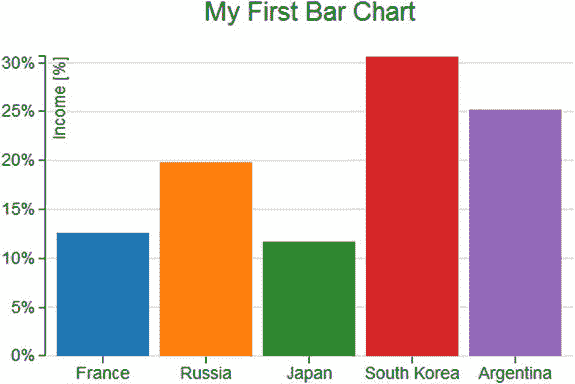

**图 4-1.** 一个简单的条形图

### 绘制堆叠条形图

你已经通过最简单的案例介绍了条形图，其中每个国家/地区都有多个组以及一个对应的值（收入）。很多时候，你需要表示稍微复杂一些的数据，例如，你想按部门划分总收入的数据。在这种情况下，每个国家的收入将被分成多个部分，每个部分代表一个生产部门的收入。在我们的示例中，我们将使用一个 CSV 文件，其方式与上一个示例（参见清单 4-1）非常相似，但每个国家/地区有多个值，以便你可以处理多系列条形图。因此，使用文本编辑器编写清单 4-14 中的数据，并将其保存为 `data_05.csv`。

**清单 4-14.** `data_05.csv`

```
Country,Electronics,Software,Mechanics
Germany,12,14,18
Italy,8,12,10
Spain,6,4,5
France,10,14,9
UK,7,11,9
```

查看文件内容，你可能会注意到现在有四列。第一列仍然包含国家名称，但现在有三项收入，每项对应一个不同的生产部门：电子、软件和机械。这些标题列在表头中。

从上一个示例的代码开始，进行一些更改并删除一些行，直到得到清单 4-15 所示的代码。**粗体**部分的代码是需要更改的部分（标题和 CSV 文件），而未出现的部分则需要删除。直接从本节开始的读者可以轻松复制清单 4-15 中显示的内容。

**清单 4-15.** `Ch4_02.html`

```
<!DOCTYPE html>
<html>
<head>
<meta charset="utf-8">
<script src="http://d3js.org/d3.v3.js"></script>
<style>

body {
  font: 14px sans-serif;
}

.axis path,
.axis line {
  fill: none;
  stroke: #000;
  shape-rendering: crispEdges;
}

.x.axis path {
  display: none;
}

</style>
</head>
<body>
<script type="text/javascript">

var color = d3.scale.category10();

var margin = {top: 70, right: 20, bottom: 30, left: 40},
    w = 500 - margin.left - margin.right,
    h = 350 - margin.top - margin.bottom;

var x = d3.scale.ordinal()
    .rangeRoundBands([0, w], .1);

var y = d3.scale.linear()
    .range([h, 0]);

var formatPercent = d3.format(".0%");

var xAxis = d3.svg.axis()
    .scale(x)
    .orient("bottom");

var yAxis = d3.svg.axis()
    .scale(y)
    .orient("left")
    .tickFormat(formatPercent);

var yGrid = d3.svg.axis()
    .scale(y)
    .orient("left")
    .ticks(5)
    .tickSize(-w, 0, 0)
    .tickFormat("");

var svg = d3.select("body").append("svg")
    .attr("width", w + margin.left + margin.right)
    .attr("height", h + margin.top + margin.bottom)
  .append("g")
    .attr("transform", "translate(" + margin.left + ", " + margin.top + ")");

d3.csv("data_05.csv", function(error, data) {

  svg.append("g")
      .attr("class", "x axis")
      .attr("transform", "translate(0, " + h + ")")
      .call(xAxis);

  svg.append("g")
      .attr("class", "y axis")
      .call(yAxis);

  svg.append("g")
      .attr("class", "grid")
      .call(yGrid);

});

var labels = svg.append("g")
    .attr("class", "labels");

labels.append("text")
    .attr("transform", "rotate(–90)")
    .attr("x", 50)
    .attr("y", -20)
    .attr("dy", ".71em")
    .style("text-anchor", "end")
    .text("Income [%]");

var title = svg.append("g")
    .attr("class", "title")

title.append("text")
    .attr("x", (w / 2))
    .attr("y", -30 )
    .attr("text-anchor", "middle")
    .style("font-size", "22px")
    .text("A stacked bar chart");

</script>
</body>
</html>
```


现在，请思考您想要设定的颜色和域。在前面的案例中，您为每个条形（国家）绘制了不同的颜色。实际上，您甚至可以让所有条形都使用同一种颜色。您之前的方法是一种可选方案，主要出于美学因素的考虑。然而，在本例中，使用一组不同的颜色是必要的，以便区分构成每个条形的各个部分。因此，每个条形将拥有一系列相同的颜色，其中每种颜色对应一个生产部门。一个小提示：当您需要图例来标识不同的数据表示时，您需要使用一系列颜色，反之亦然。您根据文件的标题行定义颜色的域，并通过一个过滤器删除第一个项目“Country”（国家）（参见清单 4-16）。

**清单 4-16.** `Ch4_02.html`

```
d3.csv("data_05.csv", function(error, data) {

color.domain(d3.keys(data[0]).filter(function(key) {

return key !== "Country"; }));

svg.append("g")

.attr("class", "x axis")

.attr("transform", "translate(0, " + h + ")")

.call(xAxis);

...
```

在 y 轴上，您不能绘制收入的值，而应绘制其占总收入的百分比。为此，您需要知道所有收入值的总和，因此，通过遍历从文件中读取的所有数据，您可以获得这个总和。同样，为了让 D3 明确知道三列（`Electronics`、`Mechanics` 和 `Software`）中的值是数值类型，您必须在遍历中像这样显式指定它们：

```
values = +values;
```

在清单 4-17 中，您可以看到 `forEach()` 函数如何遍历文件中的值，并同时计算出您需要的总和，以便获得百分比。

**清单 4-17.** `Ch4_02.html`

```
d3.csv("data_05.csv", function(error, data) {

color.domain(d3.keys(data[0]).filter(function(key) {

return key !== "Country"; }));

var sum = 0;

data.forEach(function(d){

d.Electronics = +d.Electronics;

d.Mechanics = +d.Mechanics;

d.Software = +d.Software;

sum = sum +d.Electronics +d.Mechanics +d.Software;

});

svg.append("g")

.attr("class", "x axis")

.attr("transform", "translate(0, " + h + ")")

.call( xAxis );

...
```

现在，您需要创建一个能够满足您需求的数据结构。为每个条形构建一个对象数组，其中每个对象对应总收入被划分的一个部分。将这个数组命名为 `"countries"`，并通过一个迭代函数创建它（参见清单 4-18）。

**清单 4-18.** `Ch4_02.html`

```
d3.csv("data_05.csv", function(error, data) {

...

data.forEach(function(d){

d.Electronics = +d.Electronics;

d.Mechanics = +d.Mechanics;

d.Software = +d.Software;

sum = sum +d.Electronics +d.Mechanics +d.Software;

});

data.forEach(function(d) {

var y0 = 0;

d.countries = color.domain().map(function(name) {

return {name: name, y0: y0/sum, y1: (y0 += +d[name])/sum }; });

d.total = d.countries[d.countries.length - 1].y1;

});

svg.append("g")

.attr("class", "x axis")

.attr("transform", "translate(0, " + h + ")")

.call( xAxis );

...
```

使用 Firebug 控制台（参见第 1 章中的“Firebug 和 DevTool”一节），您可以直接看到这个数组的内部结构。因此，（临时）将调用控制台的代码添加到代码中，并将 `countries` 数组作为参数传递，如清单 4-19 所示。

**清单 4-19.** `Ch4_02.html`

```
data.forEach(function(d) {

var y0 = 0;

d.countries = color.domain().map(function(name) {

return {name: name, y0: y0/sum, y1: (y0 += +d[name])/sum }; });

d.total = d.countries[d.countries.length - 1].y1;

console.log(d.countries);

});
```

图 4-2 展示了 `countries` 数组的内部结构及其所有内容，正如 Firebug 控制台所显示的那样。

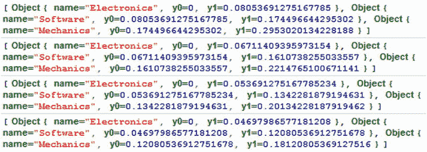

**图 4-2.** Firebug 控制台显示 `countries` 数组的内容和结构

如果您详细分析数组的第一个元素：

```
[Object {name="Electronics", y0=0, y1=0.08053691275167785},
Object {name="Software", y0=0.08053691275167785, y1=0.174496644295302},
Object {name="Mechanics", y0=0.174496644295302, y1=0.2953020134228188}]
```

您可能会注意到，数组的每个元素本身又是一个包含三个对象的数组。这三个对象代表了您想要拆分数据的三个类别（多系列条形图的三个系列）。`y0` 和 `y1` 的值分别代表条形中每个部分的起始和结束百分比。

在您整理好所有需要的数据之后，您可以将其包含在 x 和 y 的域中，如清单 4-20 所示。

**清单 4-20.** `Ch4_02.html`

```
d3.csv("data_05.csv", function(error, data) {

...

data.forEach(function(d) {

...

console.log(d.countries);

});

x.domain(data.map(function(d) { return d.Country; }));

y.domain([0, d3.max(data, function(d) { return d.total; })]);

svg.append("g")

.attr("class", "x axis")

.attr("transform", "translate(0, " + h + ")")

.call(xAxis);

...
```

然后，在清单 4-21 中，您开始定义将构成图表条形的 `rect` 元素。

**清单 4-21.** `Ch4_02.html`

```
d3.csv("data_05.csv", function(error, data) {

...

svg.append("g")

.attr("class", "grid")

.call(yGrid);

var country = svg.selectAll(".country")

.data(data)

.enter().append("g")

.attr("class", "country")

.attr("transform", function(d) {

return "translate(" + x(d.Country) + ",0)"; });

country.selectAll("rect")

.data(function(d) { return d.countries; })

.enter().append("rect")

.attr("width", x.rangeBand())

.attr("y", function(d) { return y(d.y1); })

.attr("height", function(d) { return (y(d.y0) - y(d.y1)); })

.style("fill", function(d) { return color(d.name); });

});
```

您已经通过库看到了数组的内部结构，并且由于 D3 总是从基本图形开始，最复杂的部分在于将数据结构转换为 SVG 元素的层次结构。`<g>` 标签可以帮助您构建适当的分层分组。在这方面，您需要为每个国家定义一个 `<g>` 元素。首先，您需要迭代地从 CSV 文件中读取数据。这可以通过将 `data` 数组（原始的 `data` 数组，而不是您刚刚定义的 `countries` 数组）作为参数传递给 `data()` 函数来实现。完成所有这些后，您将得到五个新的组元素 `<g>`，因为 CSV 文件中列出了五个国家，并且也将绘制五个条形。每个条形在 x 轴上的位置也需要管理。您无需进行任何计算来将正确的 x 值传递给 `translate(x,0)` 函数。事实上，如图 4-3 所示，这些值是由 D3 自动生成的，利用了您在 x 轴上定义了序数比例尺这一事实。

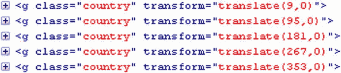

**图 4-3.** Firebug 显示 x 轴上不同的平移值，这些值由 D3 库自动生成

在每个组元素 `<g>` 内部，您现在必须创建 `<rect>` 元素，这些元素将为每个部分生成彩色矩形。此外，有必要确保为 `y` 和 `height` 属性分配正确的值，以便将矩形一个接一个地正确放置，避免它们重叠，从而为每个国家获得一个单一的堆叠条形。


这次将使用 `countries` 数组，并将其作为参数传递给 `data()` 函数。由于需要对已创建的每个 `<g>` 元素进行进一步迭代，因此需要将迭代函数 `function(d)` 作为参数传递给 `data()` 函数。这样，你就在一个迭代中创建了另一个迭代：第一个迭代扫描 `data` 中的值（国家）；第二个内部迭代扫描 `countries` 数组中的值（生产部门）。因此，你将最终的百分比（`y1`）分配给 `y` 属性，并将初始百分比与最终百分比之差（`y0–y1`）分配给 `height` 属性。`y0` 和 `y1` 的值是在你逐一定义 `countries` 数组中的对象时预先计算好的（见图 4-4）。

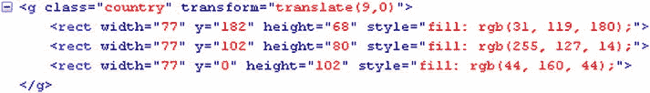

图 4-4. Firebug 显示了分配给每个 `rect` 元素的不同高度值

最后，你可以在图 4-5 中欣赏到你的堆叠条形图。

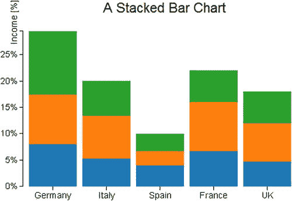

图 4-5. 堆叠条形图

观察你的堆叠条形图，你会立刻发现缺少了某些东西。如何识别生产部门，以及它们的参考颜色是什么？为什么不添加一个图例呢？

正如你为其他图表组件所做的那样，你可能更倾向于为这个新组件定义一个 `legend` 变量。一旦创建了组元素 `<g>`，图例也需要进行迭代（见清单 4-22）。迭代必须在生产部门上进行。对于每个项目，你需要获取部门的名称和对应的颜色。为此，这次你将利用之前定义的颜色域：对于 `text` 元素，你将使用 CSV 文件中的表头；而对于颜色，你则直接分配域的值。

**清单 4-22.** `Ch4_02.html`

```
d3.csv("data_05.csv", function(error, data) {

...

country.selectAll("rect")
.data(function(d) { return d.countries; })
.enter().append("rect")
.attr("width", x.rangeBand())
.attr("y", function(d) { return y(d.y1); })
.attr("height", function(d) { return (y(d.y0) - y(d.y1)); })
.style("fill", function(d) { return color(d.name); });

var legend = svg.selectAll(".legend")
.data(color.domain().slice().reverse())
.enter().append("g")
.attr("class", "legend")
.attr("transform", function(d, i) {
return "translate(0, " + i * 20 + ")"; });

legend.append("rect")
.attr("x", w - 18)
.attr("y", 4)
.attr("width", 10)
.attr("height", 10)
.style("fill", color);

legend.append("text")
.attr("x", w - 24)
.attr("y", 9)
.attr("dy", ".35em")
.style("text-anchor", "end")
.text(function(d) { return d; });

});
```

为了完善堆叠条形图这一主题，使用 D3 库可以通过添加清单 4-23 中的单行代码，按降序排列条形图。虽然在你的案例中并不真正需要此功能，但在某些其他特定情况下它可能会很有用。

**清单 4-23.** `Ch4_02.html`

```
d3.csv("data_05.csv", function(error, data) {

...

data.forEach(function(d) {

...

console.log(d.countries);

});

data.sort(function(a, b) { return b.total - a.total; });
x.domain(data.map(function(d) { return d.Country; }));

...

});
```

图 4-6 显示了你的堆叠条形图沿 x 轴按降序排列。

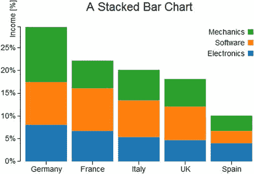

图 4-6. 带图例的排序堆叠条形图

### 归一化堆叠条形图

在本节中，你将学习如何将前面的图表转换为归一化图表。所谓“归一化”，是指将图表中要显示的值范围转换为另一个目标范围，该范围通常是从 0 到 1，或者如果讨论百分比，则是从 0 到 100（在第 2 章的“范围、域和比例尺”部分中已经讨论过非常相似的概念）。因此，如果你想比较覆盖彼此差异很大的值范围的不同序列，就需要进行归一化，将这些区间全部报告为 0 到 100（或 0 到 1）之间的百分比值。事实上，当需要比较多个数据序列时，我们通常对其相对特征感兴趣。例如，在我们的示例中，你可能对机械部门如何影响一个国家的经济收入（归一化）感兴趣，并且还想比较这种影响在不同国家之间的差异（归一化值之间的比较）。因此，为了满足这样的需求，你可以用归一化格式来表示你的堆叠图表。

你已经在 y 轴上报告了百分比值；然而，每个生产部门的百分比是根据所有国家收入总额计算的。这次，百分比将根据每个国家的收入来计算。因此，在这种情况下，你并不关心每个单独部分在全球收入（指所有五个国家）中所占的百分比，而只关心每个部门在其各自国家中产生的收入百分比。因此，在这种情况下，每个国家将由一个 100% 的条形图表示。现在，没有关于哪个国家比其他国家产生更多收入的信息，你只对每个国家内部的信息感兴趣。

所有这些推理对于你理解以下内容很重要：尽管从相同的数据出发，但你需要根据你想让图表观看者关注的重点来选择不同类型的图表。

对于这个示例，你将使用相同的文件 `data_05.csv`（参考清单 4-14）；正如我们刚才所说，输入的信息是相同的，但对其解释是不同的。为了归一化之前的堆叠条形图，你需要对代码进行一些更改。首先，将左右边距各扩展几个像素，如清单 4-24 所示。

**清单 4-24.** `Ch4_03.html`

```
var margin = {top: 70, right: 70, bottom: 30, left: 50},
w = 500 - margin.left - margin.right,
h = 350 - margin.top - margin.bottom;
```

在清单 4-25 中，在 `d3.csv()` 函数内部，你必须删除用于计算总收入总和的迭代，这不再需要。相反，你添加一个新的迭代，该迭代考虑每个国家的百分比。然后，你必须删除 y 域的定义，只保留 x 域。

**清单 4-25.** `Ch4_03.html`

```
d3.csv("data_05.csv", function(error, data) {

color.domain(d3.keys(data[0]).filter(function(key) {
return key !== "Country"; }));

data.forEach(function(d) {
var y0 = 0;
d.countries = color.domain().map(function(name) {
return {name: name, y0: y0, y1: y0 += +d[name]}; });
d.countries.forEach(function(d) { d.y0 /= y0; d.y1 /= y0; });
});

x.domain(data.map(function(d) { return d.Country; }));

var country = svg.selectAll(".country")

...
```

使用这种新型图表，y 轴标签会被条形图覆盖。因此，你必须删除或注释掉 `rotate()` 函数，使其再次可见，如清单 4-26 所示。

**清单 4-26.** `Ch4_03.html`

```
labels.append("text")
//.attr("transform", "rotate(–90)")
.attr("x", 50)
.attr("y", -20)
.attr("dy", ".71em")
.style("text-anchor", "end")
.text("收入 [%]");
```


既然要修改图表标题，何不趁此机会一并调整？请按清单 4-27 所示修改标题。

**清单 4-27.** `Ch4_03.html`

```
title.append("text")
.attr("x", (w / 2))
.attr("y", -30 )
.attr("text-anchor", "middle")
.style("font-size", "22px")
.text("A normalized stacked bar chart");
```

图例也不再需要了。实际上，你将用另一种功能相似的图形表示来替代它。因此，可以从代码中删除清单 4-28 中定义图例的代码行。

**清单 4-28.** `Ch4_03.html`

```
var legend = svg.selectAll(".legend")
.data(color.domain().slice().reverse())
.enter().append("g")
.attr("class", "legend")
.attr("transform", function(d, i) {
return "translate(0, " + i * 20 + ")"; });
legend.append("rect")
.attr("x", w - 18)
.attr("y", 4)
.attr("width", 10)
.attr("height", 10)
.style("fill", color);
legend.append("text")
.attr("x", w - 24)
.attr("y", 9)
.attr("dy", ".35em")
.style("text-anchor", "end")
.text(function(d) { return d; });
```

现在你已经删除了图例并做了相应修改，加载网页后，你将得到如图 4-7 所示的归一化堆叠条形图。

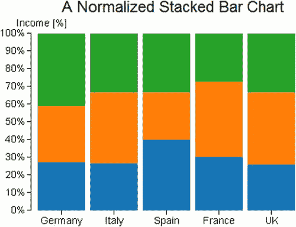

**图 4-7.** 归一化堆叠条形图

没有图例，你必须再次以某种方式了解条形图中颜色所代表的含义；你将在最右侧的条形上添加标签，标明各组的名称。

首先，在清单 4-29 中添加一个新的样式类。

**清单 4-29.** `ch4_03.html`

```
<style>
...
.x.axis path {
display: none;
}
.legend line {
stroke: #000;
shape-rendering: crispEdges;
}
</style>
```

因此，在刚刚删除的代码（如清单 4-28 所示）的位置，添加清单 4-30 中的代码。

**清单 4-30.** `Ch4_03.html`

```
country.selectAll("rect")
.data(function(d) { return d.countries; })
.enter().append("rect")
.attr("width", x.rangeBand())
.attr("y", function(d) { return y(d.y1); })
.attr("height", function(d) { return (y(d.y0) - y(d.y1)); })
.style("fill", function(d) { return color(d.name); });
var legend = svg.select(".country:last-child")
.data(data);
legend.selectAll(".legend")
.data(function(d) { return d.countries; })
.enter().append("g")
.attr("class", "legend")
.attr("transform", function(d) {
return "translate(" + x.rangeBand()*0.9 + ", " +
y((d.y0 + d.y1) / 2) + ")";
});
legend.selectAll(".legend")
.append("line")
.attr("x2", 10);
legend.selectAll(".legend")
.append("text")
.attr("x", 13)
.attr("dy", ".35em")
.text(function(d) { return d.name; } );
});
```

当你将标签添加到最后一个条形时，定义这些标签的 SVG 元素必须属于最后一个国家对应的组。因此，你使用 `.country: last-child` 选择器来获取包含所有条形的选择集中的最后一个元素。这样，新图表将如图 4-8 所示。

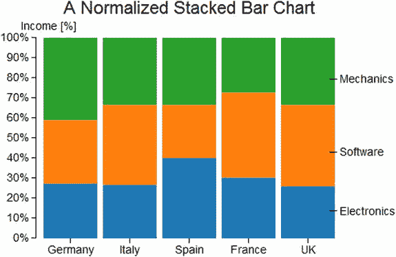

**图 4-8.** 带标签作为图例的归一化堆叠条形图

### 绘制分组条形图

始终使用 `data_05.csv` 中包含的相同数据，你可以得到另一种表示形式：分组条形图。当你想要关注每个生产部门的个人收入时，这种表示形式最为合适。在这种情况下，你并不关心各部门在总收入中所占的比例。因此，百分比消失了，取而代之的是 CSV 文件中写入的 `y` 值。

清单 4-31 展示了与之前其他示例中几乎相同的代码部分，因此我们不再详细讨论。实际上，你将以此为基础，在其上添加其他代码片段。

**清单 4-31.** `Ch4_04.html`

```
<!DOCTYPE html>
<html>
<head>
<meta charset="utf-8">
<script src="../src/d3.v3.js"></script>
<style>
body {
font: 14px sans-serif;
}
.axis path,
.axis line {
fill: none;
stroke: #000;
shape-rendering: crispEdges;
}
.x.axis path {
display: none;
}
</style>
</head>
<body>
<script type="text/javascript">
var color = d3.scale.category10() ;
var margin = {top: 70, right: 70, bottom: 30, left: 50},
w = 500 - margin.left - margin.right,
h = 350 - margin.top - margin.bottom;
var yGrid = d3.svg.axis()
.scale(y)
.orient("left")
.ticks(5)
.tickSize(-w, 0, 0)
.tickFormat("")
var svg = d3.select("body").append("svg")
.attr("width", w + margin.left + margin.right)
.attr("height", h + margin.top + margin.bottom)
.append("g")
.attr("transform", "translate(" + margin.left + ", " + margin.top + ")");
d3.csv("data_05.csv", function(error, data) {
svg.append("g")
.attr("class", "x axis")
.attr("transform", "translate(0, " + h + ")")
.call(xAxis);
svg.append("g")
.attr("class", "y axis")
.call(yAxis)
svg.append("g")
.attr("class", "grid")
.call(yGrid);
});
</script>
</body>
</html>
```

为此，你需要在 `x` 轴上定义两个不同的变量：`x0` 和 `x1`，两者都遵循如清单 4-32 所示的有序比例尺。`x0` 标识所有条形组（代表一个国家）的有序比例尺，而 `x1` 是每个组内单个条形（代表一个生产部门）的有序比例尺。

**清单 4-32.** `Ch4_04.html`

```
var margin = {top: 70, right: 70, bottom: 30, left: 50},
w = 500 - margin.left - margin.right,
h = 350 - margin.top - margin.bottom;
var x0 = d3.scale.ordinal()
.rangeRoundBands([0, w], .1);
var x1 = d3.scale.ordinal();
var y = d3.scale.linear()
.range([h, 0]);
...
```

因此，在坐标轴的定义中，你将 `x0` 分配给 `x` 轴，将 `y` 分配给 `y` 轴（参见清单 4-33）。而变量 `x1` 稍后将仅用作单个条形表示的参考。

**清单 4-33.** `Ch4_04.html`

```
...
var y = d3.scale.linear()
.range([h, 0]);
var xAxis = d3.svg.axis()
.scale(x0)
.orient("bottom");
var yAxis = d3.svg.axis()
.scale(y)
.orient("left");
...
```

在 `d3.csv()` 函数内部，你使用 `keys()` 函数提取所有生产部门的名称，并使用 `filter()` 函数从数组中过滤掉“country”标题，如清单 4-34 所示。同样，你为每个国家构建一个对象数组，但结构略有不同。新数组如下所示：

```
[Object {name="Electronics", value=12},
Object {name="Software", value=14},
Object {name="Mechanics", value=18}]
```

**清单 4-34.** `Ch4_04.html`

```
...
d3.csv("data_05.csv", function(error, data) {
var sectorNames = d3.keys(data[0]).filter(function(key) {
return key !== "Country"; });
data.forEach(function(d) {
d.countries = sectorNames.map(function(name) {
return {name: name, value: +d[name]
};
});
...
});
...
```

定义好数据结构后，你可以像清单 4-35 所示那样定义新的值域。

**清单 4-35.** `Ch4_04.html`

```
d3.csv("data_05.csv", function(error, data) {
...
data.forEach(function(d) {
...
});
x0.domain(data.map(function(d) { return d.Country; }));
```


`x1.domain(sectorNames).rangeRoundBands([0, x0.rangeBand()]);`

`y.domain([0, d3.max(data, function(d) {`

`return d3.max(d.countries, function(d) { return d.value; });`

`})]);`

`svg.append("g")`

`.attr("class", "x axis")`

`.attr("transform", "translate(0, " + h + ")")`

`.call(xAxis);`

`...`

如前所述，通过 `x0` 你可以指定包含每个国家名称的序数域。而在 `x1` 中，各个扇区的名称构成了域。最后，在 `y` 中，域由数值定义。用新的域更新迭代中传递的值（参见清单 4-36）。

**清单 4-36.** `Ch4_04.html`

```
d3.csv("data_05.csv", function(error, data) {
...
svg.append("g")
.attr("class", "grid")
.call(yGrid);

var country = svg.selectAll(".country")
.data(data)
.enter().append("g")
.attr("class", "country")
.attr("transform", function(d) {
return "translate(" + x0(d.Country) + ",0)";
});

country.selectAll("rect")
.data(function(d) { return d.countries; })
.enter().append("rect")
.attr("width", x1.rangeBand())
.attr("x", function(d) { return x1(d.name); })
.attr("y", function(d) { return y(d.value); })
.attr("height", function(d) { return h - y(d.value); })
.style("fill", function(d) { return color(d.name); });
});
```

然后，在 `csv()` 函数外部，你可以定义 SVG 元素，该元素将表示 y 轴上的轴标签，如清单 4-37 所示。它不需要在 `csv()` 函数内部定义，因为它独立于 CSV 文件中包含的数据。

**清单 4-37.** `Ch4_04.html`

```
d3.csv("data_05.csv", function(error, data) {
...
});

var labels = svg.append("g")
.attr("class", "labels")

labels.append("text")
.attr("transform", "rotate(–90)")
.attr("y", 5)
.attr("dy", ".71em")
.style("text-anchor", "end")
.text("Income");
</script>
```

最后一点……你需要为图表添加一个合适的标题，如清单 4-38 所示。

**清单 4-38.** `Ch4_04.html`

```
labels.append("text")
...
.text("Income");

var title = svg.append("g")
.attr("class", "title")

title.append("text")
.attr("x", (w / 2))
.attr("y", -30 )
.attr("text-anchor", "middle")
.style("font-size", "22px")
.text("A grouped bar chart");
</script>
```

图 4-9 显示了结果。

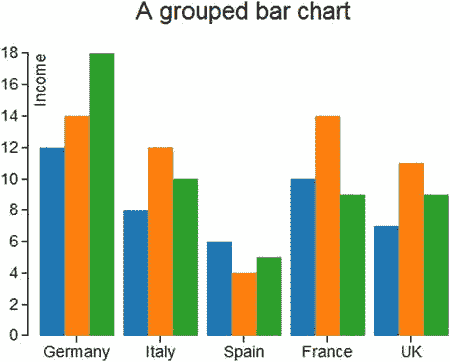

**图 4-9.** 分组条形图

在前面的归一化条形图案例中，你看到了一种表示图例的替代方法。你通过在一些标签上放置报告系列名称的标签来构建这个图例，这些标签位于最后一个条形上（参见图 4-8）。实际上，你使用了点标签。这些标签可以包含任何文本，并且直接连接到图表中的单个值。现在，引入点标签。你将把它们放置在每个条形的顶部，显示该条形所表示的数值。这大大提高了每种图表类型的可读性。

正如你对任何其他图表组件所做的那样，在定义了 `PointLabels` 变量后，你使用它来分配应用于相应选择的函数链。同样，对于这种类型的组件，它具有针对单个数据的特定值，你利用 CSV 文件中包含的数据进行迭代。你想要迭代的数据与你用于条形的数据相同。因此，你将相同的迭代 `function(d)` 作为参数传递给 `data()` 函数（参见清单 4-39）。为了在条形顶部绘制数据，你将针对每个 `PointLabel` 应用一个 `translate()` 变换。

**清单 4-39.** `Ch4_04.html`

```
d3.csv("data_05.csv", function(error, data) {
...
country.selectAll("rect")
...
.attr("height", function(d) { return h - y(d.value); })
.style("fill", function(d) { return color(d.name); });

var pointlabels = country.selectAll(".pointlabels")
.data(function(d) { return d.countries; })
.enter().append("g")
.attr("class", "pointlabels")
.attr("transform", function(d) {
return "translate(" + x1(d.name) + ", " + y(d.value) + ")";
})
.append("text")
.attr("dy", "-0.3em")
.attr("x", x1.rangeBand()/2)
.attr("text-anchor", "middle")
.text(function(d) { return d.value; });
...
});
```

最后，只需为图表添加一个以经典格式分组的图例即可（参见清单 4-40）。

**清单 4-40.** `ch4_04.html`

```
d3.csv("data_05.csv", function(error, data) {
...
pointlabels.append("text")
...
.text(function(d) { return d.value; });

var legend = svg.selectAll(".legend")
.data(color.domain().slice().reverse())
.enter().append("g")
.attr("class", "legend")
.attr("transform", function(d, i) {
return "translate(0, " + i * 20 + ")";
});

legend.append("rect")
.attr("x", w - 18)
.attr("y", 4)
.attr("width", 10)
.attr("height", 10)
.style("fill", color);

legend.append("text")
.attr("x", w - 24)
.attr("y", 9)
.attr("dy", ".35em")
.style("text-anchor", "end")
.text(function(d) { return d; });
});
```

图 4-10 显示了带有点标签和分段图例的新图表。

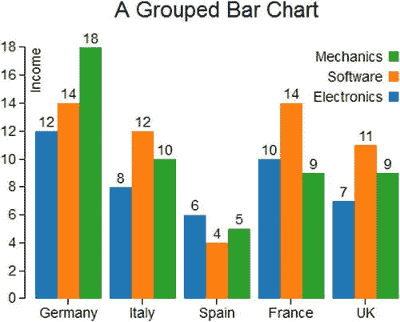

**图 4-10.** 在每个条形上方显示数值的分组条形图


### 包含负值的水平条形图

到目前为止，你只使用了正值，但如果同时有正负值该怎么办？如何在条形图中表示它们？例如，下面这个包含正负值的序列（见代码清单 4-41）。

**代码清单 4-41.** `Ch4_05.html`

```
var data = [4, 3, 1, -7, -10, -7, 1, 5, 7, -3, -5, -12, -7, -11, 3, 7, 8, -1];
```

在分析要显示的数据之前，先像代码清单 4-42 所示那样，为图表添加边距。

**代码清单 4-42.** `Ch4_05.html`

```
var data = [4, 3, 1, -7, -10, -7, 1, 5, 7, -3, -5, -12, -7, -11, 3, 7, 8, -1];

var margin = {top: 30, right: 10, bottom: 10, left: 30},
    w = 700 - margin.left - margin.right,
    h = 400 - margin.top - margin.bottom;
```

在这个特定案例中，你将使用水平条形图，输入数组中的值将在 x 轴上表示，且 0 值位于中间。为了实现这一点，首先需要找到绝对值（包括负值和正值）中的最大值。然后，你在线性比例尺上创建 `x` 变量，而 `y` 变量则分配给一个序数比例尺，该比例尺包含数据在输入数组中放置的顺序（见代码清单 4-43）。

**代码清单 4-43.** `Ch4_05.html`

```
...
var margin = {top: 30, right: 10, bottom: 10, left: 30},
    w = 700 - margin.left - margin.right,
    h = 400 - margin.top - margin.bottom;

var xMax = Math.max(-d3.min(data), d3.max(data));

var x = d3.scale.linear()
    .domain([-xMax, xMax])
    .range([0, w])
    .nice();

var y = d3.scale.ordinal()
    .domain(d3.range(data.length))
    .rangeRoundBands([0, h], .2);
```

在代码清单 4-44 中，你将这两个比例尺分配给对应的 x 轴和 y 轴。这次，x 轴将绘制在图表的上部，而 y 轴将朝下（y 值向下递增）。

**代码清单 4-44.** `Ch4_05.html`

```
var y = d3.scale.ordinal()
    .domain(d3.range(data.length))
    .rangeRoundBands([0, h], .2);

var xAxis = d3.svg.axis()
    .scale(x)
    .orient("top");

var yAxis = d3.svg.axis()
    .scale(y)
    .orient("left");
```

至此，剩下的工作就是开始实现绘图区域。创建根 `<svg>` 元素，并分配之前定义好的边距。然后，定义 x 轴和 y 轴（见代码清单 4-45）。

**代码清单 4-45.** `Ch4_05.html`

```
var yAxis = d3.svg.axis()
    .scale(y)
    .orient("left");

var svg = d3.select("body").append("svg")
    .attr("width", w + margin.left + margin.right)
    .attr("height", h + margin.top + margin.bottom)
    .append("g")
    .attr("transform", "translate(" + margin.left + ", " + margin.top + ")");

svg.append("g")
    .attr("class", "x axis")
    .call(xAxis);

svg.append("g")
    .attr("class", "y axis")
    .attr("transform", "translate("+x(0)+",0)")
    .call(yAxis);
```

最后，你需要为每个要表示的条形插入一个 `<rect>` 元素，并注意将条形分为两个不同的组：负值条形和正值条形（见代码清单 4-46）。必须区分这两类，以便通过 CSS 样式类（例如颜色）分别设置它们的属性。

**代码清单 4-46.** `Ch4_05.html`

```
svg.append("g")
    .attr("class", "y axis")
    .attr("transform", "translate("+x(0)+",0)")
    .call(yAxis);

svg.selectAll(".bar")
    .data(data)
    .enter().append("rect")
    .attr("class", function(d) {
        return d < 0 ? "bar negative" : "bar positive";
    })
    .attr("x", function(d) { return x(Math.min(0, d)); })
    .attr("y", function(d, i) { return y(i); })
    .attr("width", function(d) { return Math.abs(x(d) - x(0)); })
    .attr("height", y.rangeBand());
```

事实上，如果你用 Firebug 分析图 4-11 中的结构，你会看到迭代在同一组内创建了两种不同类型的条形，可通过类名 `"bar positive"` 和 `"bar negative"` 的特征来识别。通过这两个不同的名称，你可以应用两种不同的 CSS 样式，以区分负值条形和正值条形。

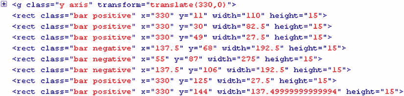

**图 4-11.** Firebug 展示了如何区分正值条形和负值条形，并在每个 `rect` 元素的类中指明了这种区别

根据我们刚才所说的，你像代码清单 4-47 那样设置负值和正值条形的样式类属性。

**代码清单 4-47.** `Ch4_05.html`

```
<style>
.bar.positive {
    fill: red;
    stroke: darkred;
}

.bar.negative {
    fill: lightblue;
    stroke: blue;
}

.axis path,
.axis line {
    fill: none;
    stroke: #000;
}

body {
    font: 14px sans-serif;
}
</style>
```

最后，你得到图 4-12 中的图表，其中正值条形为红色，负值条形为蓝色。

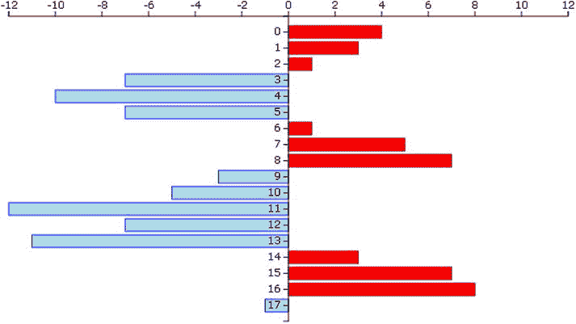

**图 4-12.** 一个水平条形图

### 本章小结

在本章中，你几乎涵盖了与实现条形图相关的所有基本方面，这种图表类型与本书第一部分使用 jqPlot 库开发的图表类型相同。这里，你使用了 D3 库。因此，你看到了如何逐个元素地实现一个简单的条形图；然后你继续学习了堆叠条形图和分组条形图的各种情况，最后研究了一个非常特殊的情况：一个描绘负值的水平条形图。

在下一章中，你将采用相同的方法：你将学习如何以类似于使用 jqPlot 时的方式来实现饼图，但这次你将使用 D3 库。

