# 5. 使用 D3 绘制饼图

在上一章中，你刚刚了解了条形图如何表示特定类别的数据。你还看到，从相同的数据结构出发，根据你的意图，你可以选择一种图表类型而不是另一种，以突出数据的特定方面。例如，在选择归一化堆叠条形图时，你希望关注每个行业在其国家收入中所占的百分比。

通常，条形图表示的此类数据也可以使用饼图来表示。在本章中，你将学习如何使用 D3 库创建这种图表类型。鉴于该库不像 jqPlot 那样提供已经实现好的图形，而是要求用户使用基本的可缩放矢量图形（SVG）元素来构建它们，你将首先了解如何构建弧线和扇形。事实上，就像条形图的矩形和折线图的线条一样，这些形状对于实现饼图（使用扇形）或环形图（使用弧线）至关重要。在实现了一个经典的饼图示例之后，我们将通过创建一些变体来进一步深入探讨该主题。在本章的第二部分，你将处理环形图，管理从逗号分隔值（CSV）文件中读取的多个数据系列。

最后，我们将以一个尚未涉及过的图表来结束本章：极区面积图。这种图表类型是饼图的进一步演变，其中扇区不再局限于一个圆内，而是都具有不同的半径。使用极区面积图，信息将不再仅由扇区所占的角度表示，还由其半径表示。


### 基础饼图

为了更好地突出柱状图与饼图之间的相似性，本示例将使用与创建基础柱状图时相同的 CSV 文件（参见第 4 章中的“绘制柱状图”部分）。因此，在本节中，你的目标是使用相同的数据来实现对应的饼图。为此，在开始“烘焙”饼图和甜甜圈图之前，你必须先获得形状合适的“烤盘”。D3 库也允许你表示弧形和扇形等弯曲形状，尽管实际上并没有这样的 SVG 元素。事实上，正如你很快会看到的，借助其一些方法，D3 可以像处理其他真实的 SVG 元素（矩形、圆形、线条等）一样处理弧线和扇形。一旦你熟悉了这些元素的实现，创建基础饼图的工作就基本完成了。在本节的第二部分，你将主要通过对形状边框和颜色的调整，来制作一些主题变体。

### 绘制基础饼图

请再次关注名为 `data_04.csv` 的 CSV 文件中包含的数据（参见代码清单 5-1）。

代码清单 5-1. `data_04.csv`

```
country,income
France,14
Russia,22
Japan,13
South Korea,34
Argentina,28
```

现在，我们将演示这些数据如何完美地适用于饼图表示。首先，在代码清单 5-2 中，定义了绘图区域和边距。

代码清单 5-2. `Ch5_01a.html`

```
var margin = {top: 70, right: 20, bottom: 30, left: 40},
    w = 500 - margin.left - margin.right,
    h = 400 - margin.top - margin.bottom;
```

即使是饼图，你也需要使用一系列颜色来区分不同的扇区。通常，使用 `category10()` 函数来创建颜色域是常见的做法，这也是你到目前为止所做的。在本例中你可以做同样的事情，但这并非总是必需的。因此，我们借此机会看看如何传递自定义的颜色序列。通过逐个定义你喜欢的颜色来创建一个自定义示例，如代码清单 5-3 所示。

代码清单 5-3. `Ch5_01a.html`

```
var margin = {top: 70, right: 20, bottom: 30, left: 40},
    w = 500 - margin.left - margin.right,
    h = 400 - margin.top - margin.bottom;

var color = d3.scale.ordinal()
    .range(["#ffc87c", "#ffeba8", "#f3b080", "#916800", "#dda66b"]);
```

之前你使用 `rect` 元素构建了柱状图，而现在你需要处理的是圆形的扇区。因此，你将涉及圆形、角度、弧线、半径等概念。D3 提供了一整套工具，允许你处理这类对象，从而简化饼图的工作。

为了表示饼图的扇区（圆形扇区），D3 为你提供了一个函数：`d3.svg.arc()`。这个函数实际上定义了弧线。术语“弧”指的是由一个角度和两个圆（一个半径较小（内半径），另一个半径较大（外半径））所界定的特定几何表面。圆形扇区，即饼图的一个切片，无非就是内半径等于 0 的弧（参见图 5-1）。

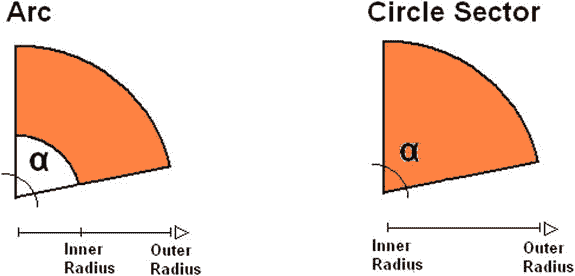

图 5-1.

通过增加内半径，可以从圆形扇区转变为弧

首先，你需要计算一个与绘图区域大小相协调的半径。然后，根据这个范围，界定外半径和内半径，在本例中内半径为 0（参见代码清单 5-4）。

代码清单 5-4. `Ch5_01a.html`

```
...
var color = d3.scale.ordinal()
    .range(["#ffc87c", "#ffeba8", "#f3b080", "#916800", "#dda66b"]);

var radius = Math.min(w, h) / 2;

var arc = d3.svg.arc()
    .outerRadius(radius)
    .innerRadius(0);
```

D3 还提供了一个定义饼图的函数：`d3.layout.pie()` 函数。该函数构建一个布局，允许你非常轻松地计算弧的起始角度和结束角度。使用这个函数并非强制要求，但饼图布局会自动将数据数组转换为对象数组。因此，如代码清单 5-5 所示，定义一个对收入值进行迭代的函数来创建饼图。

代码清单 5-5. `Ch5_01a.html`

```
...
var arc = d3.svg.arc()
    .outerRadius(radius)
    .innerRadius(0);

var pie = d3.layout.pie()
    .sort(null)
    .value(function(d) { return d.income; });
```

现在，如代码清单 5-6 所示，插入根元素 `<svg>`，并为其分配正确的尺寸和适当的 `translate()` 变换。

代码清单 5-6. `Ch5_01a.html`

```
...
var pie = d3.layout.pie()
    .sort(null)
    .value(function(d) { return d.income; });

var svg = d3.select("body").append("svg")
    .attr("width", w + margin.left + margin.right)
    .attr("height", h + margin.top + margin.bottom)
    .append("g")
    .attr("transform", "translate(" + (w / 2 + margin.left) +
          "," + (h / 2 + margin.top) + ")");
```


接下来，对于 CSV 文件中的数据读取，你一如既往地使用 `d3.csv()` 函数。同样，你必须确保收入被解释为数值，而不是字符串。然后，你使用 `forEach()` 函数编写迭代，并用 `+` 符号为收入赋值，如清单 5-7 所示。

**清单 5-7.** `Ch5_01a.html`

```
...
.append("g")
.attr("transform", "translate(" +(w/2+margin.left)+
"," +(h/2+margin.top)+ ")");
d3.csv("data_04.csv", function(error, data) {
data.forEach(function(d) {
d.income = +d.income;
});
});
```

现在是时候添加一个 `<arc>` 元素了，但这个元素并不作为 SVG 元素存在。实际上，你在这里使用的是描述弧线形状的 `<path>` 元素。正是 D3 本身借助 `pie()` 和 `arc()` 函数构建了相应的路径。这为你省去了一个过于复杂的工作。你只需定义这些元素，就好像它们是 `<arc>` 元素一样（参见清单 5-8）。

**清单 5-8.** `Ch5_01a.html`

```
d3.csv("data_04.csv", function(error, data) {
data.forEach(function(d) {
d.income = +d.income;
});
var g = svg.selectAll(".arc")
.data(pie(data))
.enter().append("g")
.attr("class", "arc");
g.append("path")
.attr("d", arc)
.style("fill", function(d) { return color(d.data.country); });
});
```

如果你用 Firebug 分析 SVG 结构，可以在图 5-2 中看到弧线路径是自动创建的，并且每个扇区都有一个 `<g>` 元素。

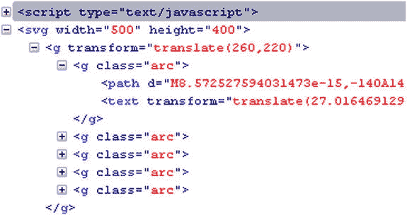

**图 5-2.** 使用 Firebug，你可以看到 D3 库如何自动构建弧线元素

此外，有必要为每个扇区添加一个指示性标签，以便你能理解它对应哪个国家，如清单 5-9 所示。请注意 `arc.centroid()` 函数。此函数计算弧线的质心。质心定义为内半径和外半径以及起始角度和结束角度之间的中点。因此，标签文本完美地出现在每个扇区的中间。

**清单 5-9.** `Ch5_01a.html`

```
d3.csv("data_04.csv", function(error, data) {
...
g.append("path")
.attr("d", arc)
.style("fill", function(d) { return color(d.data.country); });
g.append("text")
.attr("transform", function(d) {
return "translate(" + arc.centroid(d) + ")"; })
.style("text-anchor", "middle")
.text(function(d) { return d.data.country; });
});
```

即使对于饼图，在顶部中央位置添加标题也是一种好的做法（参见清单 5-10）。

**清单 5-10.** `Ch5_01a.html`

```
d3.csv("data_04.csv", function(error, data) {
...
g.append("text")
.attr("transform", function(d) {
return "translate(" + arc.centroid(d) + ")"; })
.style("text-anchor", "middle")
.text(function(d) { return d.data.country; });
var title = d3.select("svg").append("g")
.attr("transform", "translate(" +margin.left+ ", " +margin.top+ ")")
.attr("class", "title")
title.append("text")
.attr("x", (w / 2))
.attr("y", -30 )
.attr("text-anchor", "middle")
.style("font-size", "22px")
.text("My first pie chart");
});
```

至于 CSS 类属性，你可以添加清单 5-11 中的定义。

**清单 5-11.** `Ch5_01a.html`

```
<style>
body {
font: 16px sans-serif;
}
.arc path {
stroke: #000;
}
</style>
```

最后，你使用 D3 库得到了你的第一个饼图，如图 5-3 所示。

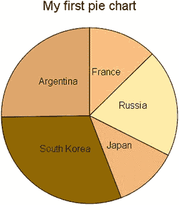

**图 5-3.** 一个简单的饼图

### 饼图的一些变体

现在，你将对你刚刚创建的基本饼图进行一些更改，说明你可以获得的关于该主题的无限变化可能性中的一部分：

-   处理颜色序列；
-   对饼图中的扇区进行排序；
-   在扇区之间添加间距；
-   仅用轮廓表示扇区；
-   结合以上所有方法。

#### 处理颜色序列

在前面的例子中，我们在比例尺中定义了颜色，并且在之前的例子中我们使用了 `category10()` 函数。还有其他已定义好的分类颜色比例尺：`category20()`、`category20b()` 和 `category20c()`。将它们应用到你的饼图中，看看它们如何影响其外观。清单 5-12 展示了一个使用 `category10()` 函数的案例。对于其他类别，你只需将此函数替换为其他函数即可。

**清单 5-12.** `Ch5_01b.html`

```
var color = d3.scale.category10();
```

图 5-4 显示了这些比例尺之间的颜色变化（在印刷品中反映为不同的灰度色调）。`category10()` 和 `category20()` 函数生成具有交替颜色的比例尺；而 `category20b()` 和 `category20c()` 则生成颜色渐变缓慢的比例尺。

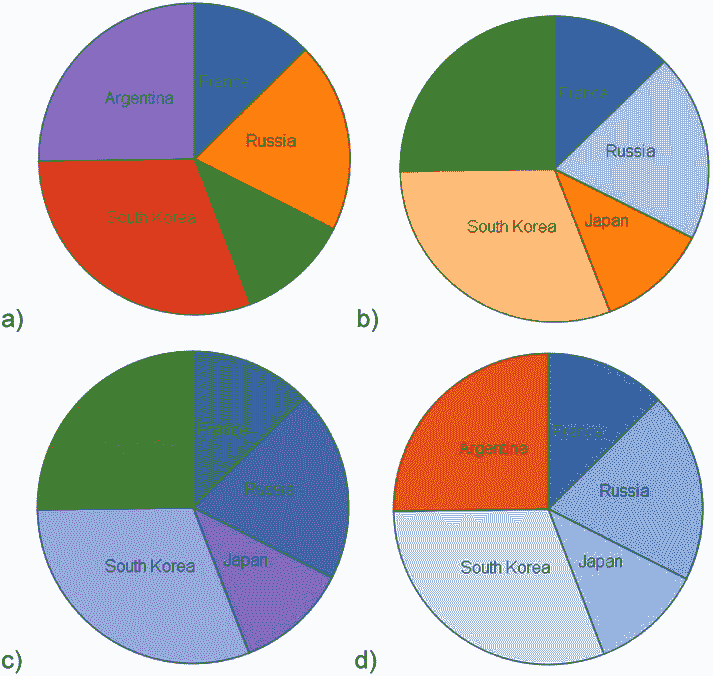

**图 5-4.** 不同的颜色序列：a) category10, b) category20, c) category20b, d) category20c

#### 对饼图中的扇区进行排序

另一件需要注意的事情是，默认情况下，D3 中的饼图会进行隐式排序。因此，如果你没有像清单 5-13 所示那样通过向 `sort()` 函数传递 `null` 来显式地提出请求。

**清单 5-13.** `Ch5_01c.html`

```
var pie = d3.layout.pie()
//.sort(null)
.value(function(d) { return d.income; });
```

那么，饼图看起来会有所不同，如图 5-5 所示。

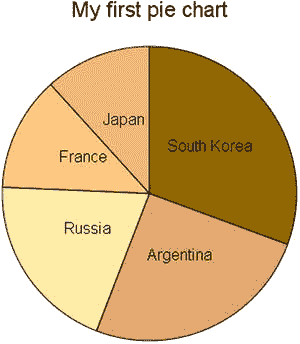

**图 5-5.** 一个带有排序扇区的简单饼图

在饼图中，第一个扇区是最大的，然后其他扇区按降序逐渐添加。

#### 在扇区之间添加间距

通常，扇区之间会显示间距，这很容易实现。你只需要对 `path` 元素的 CSS 样式类进行一些更改，如清单 5-14 所示。

**清单 5-14.** `Ch5_01d.html`

```
.arc path {
stroke: #fff;
stroke-width: 4;
}
```

图 5-6 显示了当扇区被白色间隙隔开时，饼图如何呈现出更令人愉悦的外观。

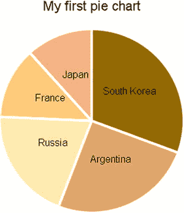

**图 5-6.** 扇区被白色空间分隔开


##### 仅用轮廓表示扇区

绘制一个仅由彩色边框界定、内部为空的饼图扇区会稍微复杂一些。你在 `jqPlot` 中见过类似的情况。修改 CSS 样式类，如清单 5-15 所示。

**清单 5-15.** `Ch5_01e.html`

```css
.arc path {
  fill: none;
  stroke-width: 6;
}
```

实际上，这次你不想用特定颜色填充扇区，而是希望定义扇区的边缘用特定颜色着色。因此，你需要在 SVG 元素的样式定义中，用 `stroke` 属性替换 `fill`。现在，线条被赋予了指示性颜色。但你还需要做另一个改动，这个改动理解起来稍微复杂一些。

你使用每个扇区的边框来指定着色部分，但它们实际上是重叠的。因此，后面的颜色会部分覆盖前面的颜色，并且所有扇区紧密相连看起来不够整洁。最好添加一个小的间隙。这很容易实现，只需为每个扇区应用一个平移变换。每个扇区都应沿离心方向偏离中心一小段距离。因此，每个扇区的平移量都不同，这里你利用了 `centroid()` 函数的功能，该函数提供了平移的方向（x 和 y 坐标）（参见清单 5-16）。

**清单 5-16.** `Ch5_01e.html`

```javascript
var g = svg.selectAll(".arc")
    .data(pie(data))
    .enter().append("g")
    .attr("class", "arc")
    .attr("transform", function(d) {
        a = arc.centroid(d)[0]/6;
        b = arc.centroid(d)[1]/6;
        return "translate(" + a +", "+b + ")";
    })

g.append("path")
    .attr("d", arc)
    .style("stroke", function(d) { return color(d.data.country); });
```

图 5-7 展示了这些改动如何影响饼图。

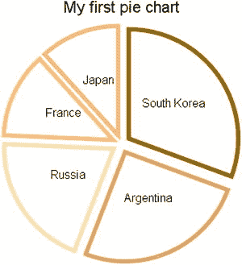

**图 5-7.** 未填充扇区的饼图

##### 综合运用

但这还没完。你可以在最后这两个饼图之间创建一个折中方案：让扇区拥有颜色更深的边缘，并用较浅的颜色填充内部。只需定义两个相同但颜色不同的路径即可，如清单 5-17 所示。第一个路径将使用一种略微暗淡的均匀颜色，而第二个路径则只有彩色边缘，内部为白色。

**清单 5-17.** `Ch5_01f.html`

```javascript
var g = svg.selectAll(".arc")
    .data(pie(data))
    .enter().append("g")
    .attr("class", "arc")
    .attr("transform", function(d) {
        a = arc.centroid(d)[0]/6;
        b = arc.centroid(d)[1]/6;
        return "translate(" + a +", "+b + ")";
    })

g.append("path")
    .attr("d", arc)
    .style("fill", function(d) { return color(d.data.country); })
    .attr('opacity', 0.5);

g.append("path")
    .attr("d", arc)
    .style("stroke", function(d) { return color(d.data.country); });
```

图 5-8 展示了带有两个路径（分别为扇区和边框着色）的分离式饼图。

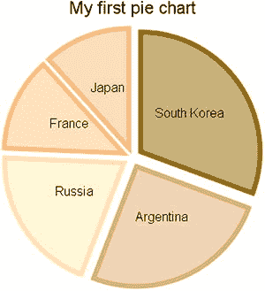

**图 5-8.** 饼图扇区着色的另一种方式

### 环形图

饼图之于柱状图，正如环形图之于多系列柱状图。实际上，当你有多个数据集时，你需要为每个系列绘制一个饼图。如果改用环形图，你可以将它们全部表示在一起，并在单个图表中进行比较（参见图 5-9）。

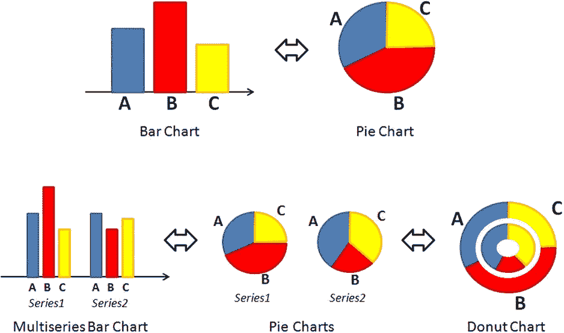

**图 5-9.** 一个展示饼图与柱状图在单系列和多系列数据下平行关系的示意图

首先编写清单 5-18 中的代码；我们不会提供任何解释，因为它与前面的示例完全相同。

**清单 5-18.** `Ch5_02.html`

```html
<!DOCTYPE html>
<html>
<head>
<meta charset="utf-8">
<script src="http://d3js.org/d3.v3.js"></script>
<style>
body {
  font: 16px sans-serif;
}
.arc path {
  stroke: #000;
}
</style>
</head>
<body>
<script type="text/javascript">
var margin = {top: 70, right: 20, bottom: 30, left: 40},
    w = 500 - margin.left - margin.right,
    h = 400 - margin.top - margin.bottom;

var color = d3.scale.ordinal()
    .range(["#ffc87c", "#ffeba8", "#f3b080", "#916800", "#dda66b"]);

var radius = Math.min(w, h) / 2;

var svg = d3.select("body").append("svg")
    .attr("width", w + margin.left + margin.right)
    .attr("height", h + margin.top + margin.bottom)
    .append("g")
    .attr("transform", "translate(" +(w/2+margin.left)+
          "," +(h/2+margin.top)+ ")");

var title = d3.select("svg").append("g")
    .attr("transform", "translate(" +margin.left+ ", " +margin.top+ ")")
    .attr("class", "title");

title.append("text")
    .attr("x", (w / 2))
    .attr("y", -30 )
    .attr("text-anchor", "middle")
    .style("font-size", "22px")
    .text("一个环形图");
</script>
</body>
</html>
```

对于多系列数据的示例，你将向文件 `data_04.csv` 中添加另一列表示支出的数据，如清单 5-19 所示，并将这个新版本保存为 `data_06.csv`。

**清单 5-19.** `data_06.csv`

```csv
country,income,expense
France,14,10
Russia,22,19
Japan,13,6
South Korea,34,12
Argentina,28,26
```

你添加了一组新数据。与前面的示例不同，你必须为此系列创建一个新的弧。然后，在第二个弧的基础上，再添加第三个弧。这个弧不是用来绘制某个系列的扇区，而是用于在圆周上分布标签。这些标签显示国家名称，作为图例的替代方案。因此，将半径分成三部分，并在各部分之间留出间隙以分隔系列，如清单 5-20 所示。

**清单 5-20.** `Ch5_02.html`

```javascript
var arc1 = d3.svg.arc()
    .outerRadius(0.4 * radius)
    .innerRadius(0.2 * radius);

var arc2 = d3.svg.arc()
    .outerRadius(0.7 * radius )
    .innerRadius(0.5 * radius );

var arc3 = d3.svg.arc()
    .outerRadius(radius)
    .innerRadius(0.8 * radius);
```

你刚刚创建了两个弧来管理这两个系列，因此现在需要创建两个饼图布局，一个用于收入值，另一个用于支出值（参见清单 5-21）。

**清单 5-21.** `Ch5_02.html`

```javascript
var pie = d3.layout.pie()
    .sort(null)
    .value(function(d) { return d.income; });

var pie2 = d3.layout.pie()
    .sort(null)
    .value(function(d) { return d.expense; });
```

你使用 `d3.csv()` 函数读取文件中的数据，如清单 5-22 所示。你像往常一样使用 `forEach()` 迭代数据，将收入和支出解释为数值。

**清单 5-22.** `Ch5_02.html`

```javascript
d3.csv("data_06.csv", function(data) {
    data.forEach(function(d) {
        d.income = +d.income;
        d.expense = +d.expense;
    });
});
```


在`Listing 5-23`中，你创建了`path`元素，这些元素绘制了两个甜甜圈图的各个扇区，对应于两个数据系列。通过`data()`函数，你将两个饼图布局的数据绑定到两个表示上。两个甜甜圈图必须遵循相同的颜色序列。一旦定义了`path`元素，你就将其与一个`text`元素连接起来，其中报告了相应的数值。因此，你添加了一些标签，使图表更易于阅读。

**Listing 5-23.** `Ch5_02.html`

```
var g = svg.selectAll(".arc1")
    .data(pie(data))
    .enter().append("g")
    .attr("class", "arc1");

g.append("path")
    .attr("d", arc1)
    .style("fill", function(d) { return color(d.data.country); });

g.append("text")
    .attr("transform", function(d) {
        return "translate(" + arc1.centroid(d) + ")"; })
    .attr("dy", ".35em")
    .style("text-anchor", "middle")
    .text(function(d) { return d.data.income; });

var g = svg.selectAll(".arc2")
    .data(pie2(data))
    .enter().append("g")
    .attr("class", "arc2");

g.append("path")
    .attr("d", arc2)
    .style("fill", function(d) { return color(d.data.country); });

g.append("text")
    .attr("transform", function(d) {
        return "translate(" + arc2.centroid(d) + ")"; })
    .attr("dy", ".35em")
    .style("text-anchor", "middle")
    .text(function(d) { return d.data.expense; });
```

现在，剩下的工作就是添加外部标签，以执行图例的功能，如`Listing 5-24`所示。

**Listing 5-24.** `Ch5_02.html`

```
g.append("text")
    .attr("transform", function(d) {
        return "translate(" + arc3.centroid(d) + ")"; })
    .style("text-anchor", "middle")
    .text(function(d) { return d.data.country; });
```

这样你就得到了图 5-10 所示的甜甜圈图。

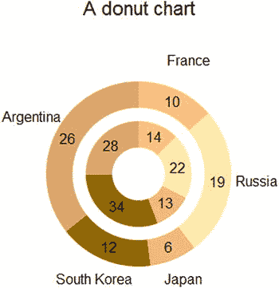

**Figure 5-10.** 一个甜甜圈图

### 极区图

极区图与饼图非常相似，但不同之处在于每个扇区从圆心延伸的距离，从而可以表示另一个值。每个扇区的范围与这个新添加的值成正比（见图 5-11）。

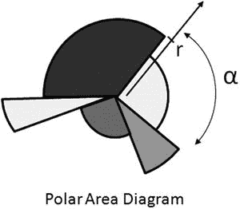

**Figure 5-11.** 在极区图中，每个扇区由半径`r`和一个角度`θ`来表征

再次考虑文件`data_04.csv`中的数据，并添加一个额外的列，显示相应国家的增长情况，如`Listing 5-25`所示。将其保存为`data_07.csv`。

**Listing 5-25.** `data_07.csv`

```
country,income,growth
France,14,10
Russia,22,19
Japan,13,9
South Korea,34,12
Argentina,28,16
```

开始编写`Listing 5-26`中的代码；同样，我们不会解释这一部分，因为它与前面的示例相同。

**Listing 5-26.** `Ch5_03.html`

```
<!DOCTYPE html>
<html>
<head>
<meta charset="utf-8">
<script src="http://d3js.org/d3.v3.js"></script>
<style>
body {
  font: 16px sans-serif;
}
.arc path {
  stroke: #000;
}
</style>
</head>
<body>
<script type="text/javascript">
var margin = {top: 70, right: 20, bottom: 30, left: 40},
    w = 500 - margin.left - margin.right,
    h = 400 - margin.top - margin.bottom;

var color = d3.scale.ordinal()
    .range(["#ffc87c", "#ffeba8", "#f3b080", "#916800", "#dda66b"]);

var radius = Math.min(w, h) / 2;

var pie = d3.layout.pie()
    .sort(null)
    .value(function(d) { return d.income; });

var svg = d3.select("body").append("svg")
    .attr("width", w + margin.left + margin.right)
    .attr("height", h + margin.top + margin.bottom)
  .append("g")
    .attr("transform", "translate(" +(w/2-margin.left)+
          "," +(h/2+margin.top)+ ")");

var title = d3.select("svg").append("g")
    .attr("transform", "translate(" +margin.left+ ", " +margin.top+ ")")
    .attr("class", "title");

title.append("text")
    .attr("x", (w / 2))
    .attr("y", -30 )
    .attr("text-anchor", "middle")
    .style("font-size", "22px")
    .text("A polar area diagram");
</script>
</body>
</html>
```

在`Listing 5-27`中，你使用`d3.csv()`函数读取`data_07.csv`文件中的数据，并确保`income`和`growth`的值被解释为数值。

**Listing 5-27.** `Ch5_03.html`

```
d3.csv("data_07.csv", function(error, data) {
  data.forEach(function(d) {
    d.income = +d.income;
    d.growth = +d.growth;
  });
});
```

与前面的示例不同，这里你不仅定义了一个弧，而且定义了一个会随着读取数据的变化而变化的弧；我们将其称为`arcs`，因为`outerRadius`不再是常量，而是与文件中的`growth`值成正比。为此，你需要应用一个通用的迭代函数，然后必须在`d3.csv()`函数内部声明这些弧（见`Listing 5-28`）。

**Listing 5-28.** `Ch5_03.html`

```
d3.csv("data_07.csv", function(error, data) {
  data.forEach(function(d) {
    d.income = +d.income;
    d.growth = +d.growth;
  });

  arcs = d3.svg.arc()
      .innerRadius( 0 )
      .outerRadius( function(d,i) { return 8*d.data.growth; });
});
```


现在，你只需添加 SVG 元素来绘制扇区，并附上包含增长值和收入值的标签（见代码清单 5-29）。报告收入值的标签将绘制在扇区内部，正好位于 `centroid()` 函数返回的值所在位置。而报告增长值的标签则绘制在扇区外部。要实现这种效果，你可以使用 `centroid()` 返回的 `x` 和 `y` 值，并将它们乘以一个大于 2 的值。请记住，质心位于角度的正中心，且处于 `innerRadius` 和 `outerRadius` 的中间位置。因此，将它们乘以 2，你会得到扇区外边缘中心的点。如果乘以一个大于 2 的值，那么你会得到扇区外部的 `x` 和 `y` 位置，这正是你想要绘制增长值标签的地方。

代码清单 5-29. Ch5_03.html

```
var g = svg.selectAll(".arc")
    .data(pie(data))
    .enter().append("g")
    .attr("class", "arc");

g.append("path")
    .attr("d", arcs)
    .style("fill", function(d) { return color(d.data.country); });

g.append("text")
    .attr("class", "growth")
    .attr("transform", function(d) {
        a = arcs.centroid(d)[0]*2.2;
        b = arcs.centroid(d)[1]*2.2;
        return "translate(" +a+", "+b+ ")"; })
    .attr("dy", ".35em")
    .style("text-anchor", "middle")
    .text(function(d) { return d.data.growth; });

g.append("text")
    .attr("class", "income")
    .attr("transform", function(d) {
        return "translate(" +arcs.centroid(d)+ ")"; })
    .attr("dy", ".35em")
    .style("text-anchor", "middle")
    .text(function(d) { return d.data.income; });
```

饼图还有一个尚未完成的工作：添加图例。在代码清单 5-30 中，我们在 `d3.csv()` 函数外部定义了一个 `<g>` 元素，用于插入图例表格；在函数内部，我们定义了所有与国家相关的元素，因为定义它们需要访问文件中写入的值。

代码清单 5-30. Ch5_03.html

```
var legendTable = d3.select("svg").append("g")
    .attr("transform", "translate(" +margin.left+ ", "+margin.top+")")
    .attr("class", "legendTable");

d3.csv("data_07.csv", function(error, data) {
    ...
    var legend = legendTable.selectAll(".legend")
        .data(pie(data))
        .enter().append("g")
        .attr("class", "legend")
        .attr("transform", function(d, i) {
            return "translate(0, " + i * 20 + ")"; });

    legend.append("rect")
        .attr("x", w - 18)
        .attr("y", 4)
        .attr("width", 10)
        .attr("height", 10)
        .style("fill", function(d) { return color(d.data.country); });

    legend.append("text")
        .attr("x", w - 24)
        .attr("y", 9)
        .attr("dy", ".35em")
        .style("text-anchor", "end")
        .text(function(d) { return d.data.country; });
});
```

最后，你可以对 CSS 样式类进行一些调整，如代码清单 5-31 所示。

代码清单 5-31. Ch5_03.html

```
<style>
body {
    font: 16px sans-serif;
}
.arc path {
    stroke: #fff;
    stroke-width: 4;
}
.arc .income {
    font: 12px Arial;
    color: #fff;
}
</style>
```

这就是极区图（见图 5-12）。

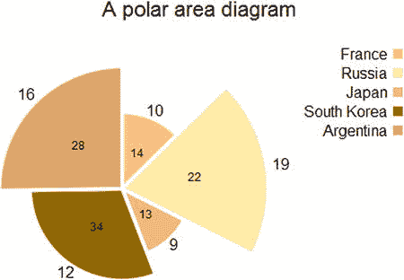

图 5-12. 极区图

### 本章小结

在本章中，你学习了如何使用 D3 库实现饼图和环形图，其遵循的指导原则与前面几章几乎相同。此外，在本章末尾，你还学习了如何制作极区图，这是一种你之前未曾见过的图表类型，而 D3 库让你能够轻松实现它。

在下一章中，你将实现两种类型的 K 线图，这些图表类型在本书第一部分介绍 jqPlot 库时已经讨论过，不过这次你将使用 D3 库。

