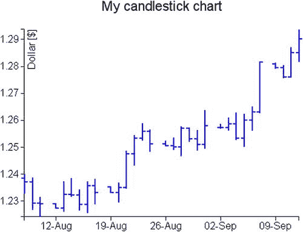
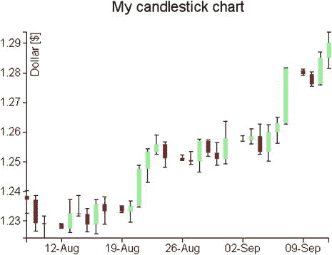

# 6. 使用 D3 绘制 K 线图

在这一章虽然简短但很重要，你将学习 K 线图。这种图表类型基于一种特定的数据格式（OHLC，即开盘价-最高价-最低价-收盘价）。因此，你需要实现一个解析器来从外部文件读取 OHLC 数据。此外，你需要解决的另一个重要方面是如何处理日期和时间数据。

尽管听起来很复杂，但在本章中，你将发现 D3 库为你提供了哪些工具，让事情变得简单而直接。

你首先将从构建一个简单的 OHLC 图表开始，以便特别关注 OHLC 数据的读取。然后，你将详细了解 D3 如何处理日期和时间数据，最后你将仅使用标量矢量图形（SVG）元素（如线条）来表示 OHLC 图表。

在最后一部分，你只需进行少量修改，就能将你的 OHLC 图表转换为更完整的 K 线图。


### 创建 OHLC 图表

由于 D3 能够利用小型图形组件构建新的图形结构，因此你也可以创建类似 jqPlot 生成的 K 线图。你已经知道，K 线图需要定义良好的数据结构：一个包含日期和四个 OHLC 值的时间序列数据。将清单 6-1 中的数据复制到文件中，并保存为`data_08.csv`。

**清单 6-1.** `data_08.csv`

```
date,open,min,max,close,
08/08/2012,1.238485,1.2327,1.240245,1.2372,
08/09/2012,1.23721,1.22671,1.23873,1.229295,
08/10/2012,1.2293,1.22417,1.23168,1.228975,
08/12/2012,1.229075,1.22747,1.22921,1.22747,
08/13/2012,1.227505,1.22608,1.23737,1.23262,
08/14/2012,1.23262,1.23167,1.238555,1.232385,
08/15/2012,1.232385,1.22641,1.234355,1.228865,
08/16/2012,1.22887,1.225625,1.237305,1.23573,
08/17/2012,1.23574,1.22891,1.23824,1.2333,
08/19/2012,1.23522,1.23291,1.235275,1.23323,
08/20/2012,1.233215,1.22954,1.236885,1.2351,
08/21/2012,1.23513,1.23465,1.248785,1.247655,
08/22/2012,1.247655,1.24315,1.254415,1.25338,
08/23/2012,1.25339,1.252465,1.258965,1.255995,
08/24/2012,1.255995,1.248175,1.256665,1.2512,
08/26/2012,1.25133,1.25042,1.252415,1.25054,
08/27/2012,1.25058,1.249025,1.25356,1.25012,
08/28/2012,1.250115,1.24656,1.257695,1.2571,
08/29/2012,1.25709,1.251895,1.25736,1.253065,
08/30/2012,1.253075,1.248785,1.25639,1.25097,
08/31/2012,1.25096,1.249375,1.263785,1.25795,
09/02/2012,1.257195,1.256845,1.258705,1.257355,
09/03/2012,1.25734,1.25604,1.261095,1.258635,
09/04/2012,1.25865,1.25264,1.262795,1.25339,
09/05/2012,1.2534,1.250195,1.26245,1.26005,
09/06/2012,1.26006,1.256165,1.26513,1.26309,
09/07/2012,1.26309,1.262655,1.281765,1.281625,
09/09/2012,1.28096,1.27915,1.281295,1.279565,
09/10/2012,1.27957,1.27552,1.28036,1.27617,
09/11/2012,1.27617,1.2759,1.28712,1.28515,
09/12/2012,1.28516,1.281625,1.29368,1.290235,
```

现在这几乎已成为一种习惯，我们首先编写几乎所有图表通用的代码，这些代码无需额外解释（见清单 6-2）。

**清单 6-2.** `Ch6_01.html`

```html
<!DOCTYPE html>
<html>
<head>
<meta charset="utf-8">
<script src="http://d3js.org/d3.v3.js"></script>
<style>
body {
  font: 16px sans-serif;
}
</style>
</head>
<body>
<script type="text/javascript">
var margin = {top: 70, right: 20, bottom: 30, left: 40},
    w = 500 - margin.left - margin.right,
    h = 400 - margin.top - margin.bottom;

var svg = d3.select("body").append("svg")
    .attr("width", w + margin.left + margin.right)
    .attr("height", h + margin.top + margin.bottom)
  .append("g")
    .attr("transform", "translate(" +margin.left+ ", " +margin.top+ ")");

var title = d3.select("svg").append("g")
    .attr("transform", "translate(" +margin.left+ ", " +margin.top+ ")")
    .attr("class", "title");

title.append("text")
    .attr("x", (w / 2))
    .attr("y", -30 )
    .attr("text-anchor", "middle")
    .style("font-size", "22px")
    .text("我的 K 线图");
</script>
</body>
</html>
```

由于文件第一列包含日期类型的值，你需要定义一个解析器来设置其格式（见清单 6-3）。

**清单 6-3.** `Ch6_01.html`

```javascript
...
w = 500 - margin.left - margin.right,
h = 400 - margin.top - margin.bottom;

var parseDate = d3.time.format("%m/%d/%Y").parse;
...
```

K 线图是一种通常与时间相关的数据表示形式，即四个 OHLC 数据对应单个时间单位，其随时间的变化沿 x 轴可见。因此，你将有一个 x 轴，需要在上面处理时间值，而在 y 轴上则分配线性比例。在定义 x 轴时，确保日期仅显示日和月，这将由前三个初始字符表示（见清单 6-4）。

**清单 6-4.** `Ch6_01.html`

```javascript
var parseDate = d3.time.format("%m/%d/%Y").parse;

var x = d3.time.scale()
    .range([0, w]);

var y = d3.scale.linear()
    .range([h, 0]);
```


```javascript
var xAxis = d3.svg.axis()
.scale(x)
.orient("bottom")
.tickFormat(d3.time.format("%d-%b"))
.ticks(5);

var yAxis = d3.svg.axis()
.scale(y)
.orient("left");
...
```

现在观察数据文件（清单 6-1）中的内容，可以看到五列数据，其中后四列是数字。第一列包含日期，必须提交给解析器，而其他四列将被解释为数值。此外，你需要找出所有 OHLC 数据中的最大值和最小值。在迭代函数 `forEach()` 中管理所有这些方面，如清单 6-5 所示。

**清单 6-5.** `Ch6_01.html`

```javascript
...
var svg = d3.select("body").append("svg")
.attr("width", w + margin.left + margin.right)
.attr("height", h + margin.top + margin.bottom)
.append("g")
.attr("transform", "translate(" +margin.left+ ", " +margin.top+ ")");

d3.csv("data_08.csv", function(error, data) {
var maxVal = -1000;
var minVal = 1000;
data.forEach(function(d) {
d.date = parseDate(d.date);
d.open = +d.open;
d.close = +d.close;
d.max = +d.max;
d.min = +d.min;
if (d.max > maxVal)
maxVal = d.max;
if (d.min < minVal)
minVal = d.min;
});
});
...
```

接下来，在清单 6-6 中，你创建了 x 和 y 的定义域。在 x 轴上，定义域将处理日期，而 y 轴的定义域将有一个扩展，覆盖刚刚找到的最小值和最大值（`minVal` 和 `maxVal`）之间的所有值。

**清单 6-6.** `Ch6_01.html`

```javascript
d3.csv("data_08.csv", function(error, data) {
data.forEach(function(d) {
...
});
x.domain(d3.extent(data, function(d) { return d.date; }));
y.domain([minVal,maxVal]);
});
```

一旦定义域被明确定义，你就可以使用 SVG 元素绘制 x 和 y 两个轴及其标签，如清单 6-7 所示。

**清单 6-7.** `Ch6_01.html`

```javascript
d3.csv("data_08.csv", function(error, data) {
...
y.domain([minVal,maxVal]);
svg.append("g")
.attr("class", "x axis")
.attr("transform", "translate(0, " + h + ")")
.call(xAxis)
svg.append("text")
.attr("class", "label")
.attr("x", w)
.attr("y", -6)
.style("text-anchor", "end");
svg.append("g")
.attr("class", "y axis")
.call(yAxis);
svg.append("text")
.attr("class", "label")
.attr("transform", "rotate(-90)")
.attr("y", 6)
.attr("dy", ".71em")
.style("text-anchor", "end")
.text("美元 [$]");
});
```

然后你使用 SVG 元素 `<line>` 将数据绘制到 OHLC 图表上（参见清单 6-8）。`ext` 线是垂直线，定义了最高值和最低值之间的范围。`close` 和 `open` 线是两条水平线，分别对应收盘价和开盘价。

**清单 6-8.** `Ch6_01.html`

```javascript
d3.csv("data_08.csv", function(error, data) {
...
svg.append("text")
.attr("class", "label")
.attr("transform", "rotate(-90)")
.attr("y", 6)
.attr("dy", ".71em")
.style("text-anchor", "end")
.text("美元 [$]")
svg.selectAll("line.ext")
.data(data)
.enter().append("svg:line")
.attr("class", "ext")
.attr("x1", function(d) { return x(d.date)})
.attr("x2", function(d) { return x(d.date)})
.attr("y1", function(d) { return y(d.min);})
.attr("y2", function(d) { return y(d.max); });
svg.selectAll("line.close")
.data(data)
.enter().append("svg:line")
.attr("class", "close")
.attr("x1", function(d) { return x(d.date)+5})
.attr("x2", function(d) { return x(d.date)-1})
.attr("y1", function(d) { return y(d.close);})
.attr("y2", function(d) { return y(d.close); });
svg.selectAll("line.open")
.data(data)
.enter().append("svg:line")
.attr("class", "open")
.attr("x1", function(d) { return x(d.date)+1})
.attr("x2", function(d) { return x(d.date)-5})
.attr("y1", function(d) { return y(d.open);})
.attr("y2", function(d) { return y(d.open); });
});
```

得益于你定义新生成元素类的方式，你可以通过使用 `line` 类为所有三条线一起定义 CSS 样式属性，或者使用 `line.open`、`line.close` 和 `line.ext` 类单独定义它们（参见清单 6-9）。

**清单 6-9.** `Ch6_01.html`

```css
<style>
body {
font: 16px sans-serif;
}
.axis path,
.axis line {
fill: none;
stroke: #000;
shape-rendering: crispEdges;
}
line.open, line.close, line.ext {
stroke: blue;
stroke-width: 2;
shape-rendering: crispEdges;
}
</style>
```

最后，你得到了图 6-1 所示的蜡烛图。



**图 6-1.** OHLC 图表


### 日期格式

处理这类使用 OHLC 数据的图表时，你总是需要处理 x 轴上的时间和日期值。因此，借鉴这一观察结果，我们来分析 D3 库如何处理这类数据。

如果在之前的示例中，日期和月份没有用零填充，或者年份只用了两位数字表示（例如“8/9/12”），会发生什么情况？在`d3.csv()`函数内部，D3 将无法读取这种格式的日期，因此蜡烛图也不会显示。实际上，你需要做的非常简单，即猜测出要在解析器中插入的正确格式化字符序列。所谓格式化字符，是指一组前面带有“%”符号的字符，根据特定（区分大小写）的字符，以某种方式表示时间单位。

`var parseDate = d3.time.format("%m/%e/%y").parse;`

即使是文字表达的日期也可以用同样的方式处理。你已经见过这种日期格式：

`08-Aug-12,1.238485,1.2327,1.240245,1.2372,`

它可以用这个解析器处理：

`var parseDate = d3.time.format("%d-%b-%y").parse;`

但还有更复杂的情况，例如：

`Monday 16 April 2012,1.238485,1.2327,1.240245,1.2372,`

它可以用这个解析器处理：

`var parseDate = d3.time.format("%A %e %B %Y").parse;`

不同值之间的所有分隔字符（包括空格）都应在解析器中处于相同位置。因此，如果日期是这样定义的...

`'8 Aug-12',1.238485,1.2327,1.240245,1.2372,`

你必须在定义解析器的字符串中同时插入空格和引号，否则日期将无法被识别。

`var parseDate = d3.time.format("'%d %b-%y'").parse;`

你还必须记住，在 csv 文件中唯一不能添加的分隔字符是“,”。如果你必须插入它，则必须使用 TSV（制表符分隔值）文件。

表 6-1 包含了所有可用的格式化字符。它们的组合应能覆盖任何输入格式。

**表 6-1.** D3 日期和时间格式化字符

| 格式化字符 | 描述 |
| --- | --- |
| `%a` | 缩写的星期几名称 |
| `%A` | 完整的星期几名称 |
| `%b` | 缩写的月份名称 |
| `%B` | 完整的月份名称 |
| `%c` | 日期和时间，格式为“`%a %b %e %H:%M:%S %Y`” |
| `%d` | 月份中的第几天，十进制数，零填充 [01,31] |
| `%e` | 月份中的第几天，十进制数，空格填充 [ 1,31] |
| `%H` | 小时（24 小时制），十进制数 [00,23] |
| `%I` | 小时（12 小时制），十进制数 [01,12] |
| `%j` | 年份中的第几天，十进制数 [001,366] |
| `%m` | 月份，十进制数 [01,12] |
| `%M` | 分钟，十进制数 [00,59] |
| `%p` | 上午或下午 |
| `%S` | 秒，十进制数 [00,61] |
| `%U` | 年份中的第几周（周日为一周的第一天），十进制数 [00,53] |
| `%w` | 星期几，十进制数 [0(星期日),6] |
| `%W` | 年份中的第几周（周一为一周的第一天），十进制数 [00,53] |
| `%x` | 日期，格式为“`%m/%d/%y`” |
| `%X` | 时间，格式为“`%H:%M:%S`” |
| `%y` | 不带世纪的年份，十进制数 [00,99] |
| `%Y` | 带世纪的年份，十进制数 |
| `%Z` | 时区偏移量，例如“–0700” |
| `%%` | 字面意义的“`%`”字符 |

### 蜡烛图中的箱线表示

使用 jqPlot 时，你还看到了显示 OHLC 数据的其他方式。例如，这类数据通常由一条垂直线和一个覆盖其特定长度的垂直矩形框表示。垂直线与之前的蜡烛图表示相同，位于 OHLC 的最高值和最低值之间。而矩形框则表示开盘价和收盘价之间的范围。此外，如果开盘价大于收盘价，矩形框将是一种颜色，反之则是另一种颜色。

你使用`data_08.csv`文件中包含的相同数据，并从上一个示例的代码开始，查看需要进行的更改。

将`ext`、`open`和`close`这三行替换为以下三行：`ext`、`ext1`和`ext2`（参见清单 6-10）。然后你需要添加代表矩形框的矩形。线条应为黑色，而当开盘价大于收盘价时，矩形框应为红色；反之，矩形框将为绿色。

**清单 6-10.** `Ch6_02.html`

```
svg.selectAll("line.ext")
.data(data)
.enter().append("svg:line")
.attr("class", "ext")
.attr("x1", function(d) { return x(d.date)})
.attr("x2", function(d) { return x(d.date)})
.attr("y1", function(d) { return y(d.min);})
.attr("y2", function(d) { return y(d.max);});

svg.selectAll("line.ext1")
.data(data)
.enter().append("svg:line")
.attr("class", "ext")
.attr("x1", function(d) { return x(d.date)+3})
.attr("x2", function(d) { return x(d.date)-3})
.attr("y1", function(d) { return y(d.min);})
.attr("y2", function(d) { return y(d.min); });

svg.selectAll("line.ext2")
.data(data)
.enter().append("svg:line")
.attr("class", "ext")
.attr("x1", function(d) { return x(d.date)+3})
.attr("x2", function(d) { return x(d.date)-3})
.attr("y1", function(d) { return y(d.max);})
.attr("y2", function(d) { return y(d.max); });

svg.selectAll("rect")
.data(data)
.enter().append("svg:rect")
.attr("x", function(d) { return x(d.date)-3; })
.attr("y", function(d) { return y(Math.max(d.open, d.close));})
.attr("height", function(d) {
return y(Math.min(d.open, d.close))-y(Math.max(d.open, d.close));})
.attr("width", 6)
.attr("fill", function(d) {
return d.open > d.close ? "darkred" : "darkgreen" ;});
});
```

最后要做的是设置清单 6-11 中的 CSS 样式类。

**清单 6-11.** `Ch6_02.html`

```
<style>
body {
font: 16px sans-serif;
}
.axis path,
.axis line {
fill: none;
stroke: #000;
shape-rendering: crispEdges;
}
line.ext, line.ext1, line.ext2 {
stroke: #000;
stroke-width: 1;
shape-rendering: crispEdges;
}
</style>
```

图 6-2 显示了最终结果。



**图 6-2.** 蜡烛图

### 总结

在本章中，你看到了本书第一部分专门介绍 jqPlot 库时已经讨论过的蜡烛图类型，但这次你使用了 D3。你已经看到，在保持对每个图形元素的完全控制的同时，如何轻松获得类似的结果。此外，由于这种图表使用时间数据，这里你更深入地探讨了 D3 库如何管理这类数据以及管理格式的各种方法。

继续遵循 jqPlot 库和 D3 库在实现各种图表类型方面的并行性，在下一章中，你将学习散点图和气泡图，以及如何使用 D3 库实现它们。


