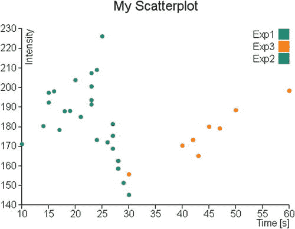
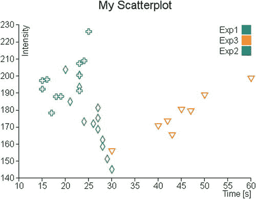
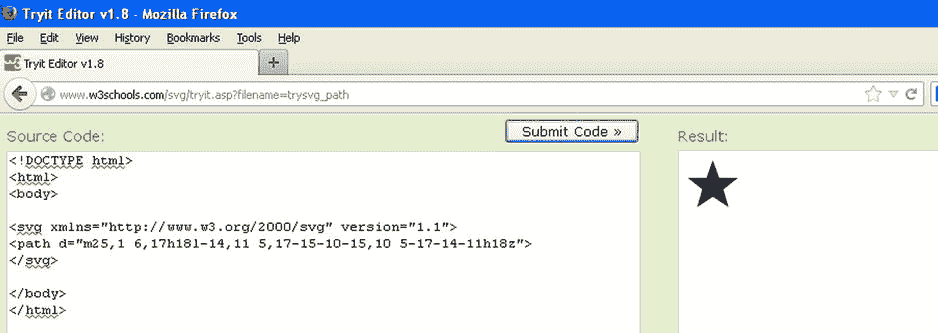
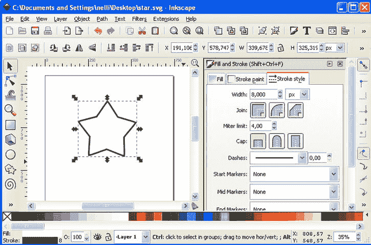
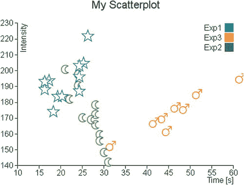
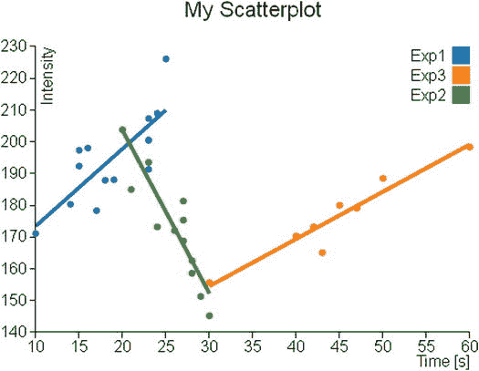
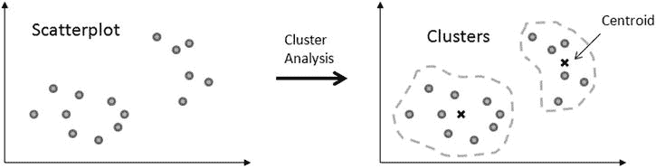
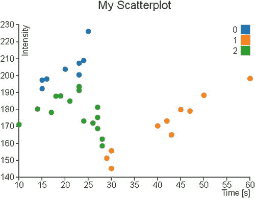
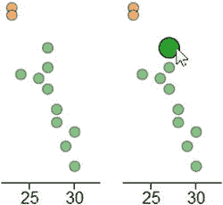
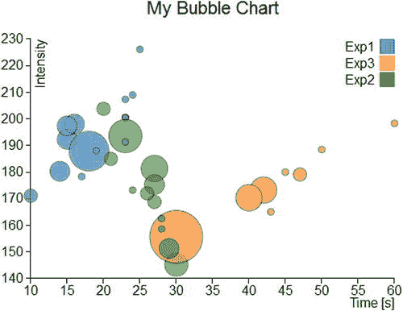

# 7. 使用 D3 绘制散点图和气泡图

在本章中，你将学习散点图。当你有一组数据对 `[x, y]` 并希望分析它们在 xy 平面上的分布时，就会用到这种图表。因此，你将首先了解如何使用 D3 库制作这种图表。在第一个示例中，你将开始读取一个包含多个数据系列的 TSV（制表符分隔值）文件，并通过这些数据了解如何实现散点图。

完成散点图后，你将看到如何使用特定形状的标记来表示数据点，这些标记可以从预定义集合中选择，也可以自行创建。

这类图表非常重要。它是分析数据分布的基本工具；事实上，通过这些图表，你可以发现特定的趋势（趋势线）和分组（聚类）。在本章中，两个简单的示例将向你展示如何表示趋势线和聚类。

此外，你还将了解如何通过事件处理为图表添加高亮功能，以及 D3 库如何管理它。

最后，本章将以一个最终示例结束，在该示例中，你需要用三个参数 `[x, y, z]` 来表示数据。因此，通过适当修改散点图，你将发现如何得到气泡图，这是一种经过修改以能够表示额外参数的散点图。

### 散点图

借助 D3 库，你可以生成的图形表示形式没有限制，可以将图形元素像积木一样组合起来。散点图的创建也不例外。

你从一组数据（见清单 7-1）开始，这次是表格形式（因此是一个 TSV 文件），你将复制并保存为名为 `data_09.tsv` 的文件。（请参阅下面的注释。）

**注释**

请注意，TSV 文件中的值是用 TAB 键分隔的，因此当你编写或复制清单 7-1 时，请记得检查每个值之间是否只有一个 TAB 字符。

**清单 7-1.** `data_09.tsv`

```
time  intensity group
10    171.11    Exp1
14    180.31    Exp1
17    178.32    Exp1
42    173.22    Exp3
30    145.22    Exp2
30    155.68    Exp3
23    200.56    Exp2
15    192.33    Exp1
24    173.22    Exp2
20    203.78    Exp2
18    187.88    Exp1
45    180.00    Exp3
27    181.33    Exp2
16    198.03    Exp1
47    179.11    Exp3
27    175.33    Exp2
28    162.55    Exp2
24    208.97    Exp1
23    200.47    Exp1
43    165.08    Exp3
27    168.77    Exp2
23    193.55    Exp2
19    188.04    Exp1
40    170.36    Exp3
21    184.98    Exp2
15    197.33    Exp1
50    188.45    Exp3
23    207.33    Exp1
28    158.60    Exp2
29    151.31    Exp2
26    172.01    Exp2
23    191.33    Exp1
25    226.11    Exp1
60    198.33    Exp3
```

假设文件中的数据属于三个不同的实验（标记为 `Exp1`、`Exp2` 和 `Exp3`），每个实验应用于不同的对象（例如，三种发光物质），你需要测量它们的发射强度随时间的变化情况。读数在不同时间重复进行。你的目标是在 xy 平面上表示这些值，以便分析它们的分布和潜在特性。

观察数据，你可以看到它们由三列组成：`time`、`intensity` 和 `group` 成员关系。这是一种典型的数据结构，可以以散点图的形式显示。你将把时间刻度放在 x 轴上，把强度值放在 y 轴上，最后通过标记的形状或颜色来标识组别，这些标记将标示点在散点图中的位置。

按照惯例，你从编写清单 7-2 中的代码开始。这段代码代表你的起始代码，由于它几乎与你在前面示例中看到的所有图表相同，因此无需进一步解释。

**清单 7-2.** `Ch7_01.html`

```
<!DOCTYPE html>
<html>
<head>
<meta charset="utf-8">
<script src="http://d3js.org/d3.v3.js"></script>
<style>
body {
  font: 16px sans-serif;
}
.axis path,
.axis line {
  fill: none;
  stroke: #000;
  shape-rendering: crispEdges;
}
</style>
</head>
<body>
<script type="text/javascript">
var margin = {top: 70, right: 20, bottom: 40, left: 40},
    w = 500 - margin.left - margin.right,
    h = 400 - margin.top - margin.bottom;

var color = d3.scale.category10();

var x = d3.scale.linear()
    .range([0, w]);

var y = d3.scale.linear()
    .range([h, 0]);

var xAxis = d3.svg.axis()
    .scale(x)
    .orient("bottom");

var yAxis = d3.svg.axis()
    .scale(y)
    .orient("left");

var svg = d3.select("body").append("svg")
    .attr("width", w + margin.left + margin.right)
    .attr("height", h + margin.top + margin.bottom)
  .append("g")
    .attr("transform", "translate(" + margin.left+ "," +margin.top+ ")");

var title = d3.select("svg").append("g")
    .attr("transform", "translate(" + margin.left+ "," +margin.top+ ")")
    .attr("class","title");

title.append("text")
    .attr("x", (w / 2))
    .attr("y", -30 )
    .attr("text-anchor", "middle")
    .style("font-size", "22px")
    .text("My Scatterplot");
</script>
</body>
</html>
```


在`Listing 7-3`中，你使用`d3.tsv()`函数从 TSV 文件读取表格数据，并确保数值类型能被正确识别。这里，即使第一列包含时间数据，也无需进行解析，因为它们以秒为单位，因此可以视为线性比例尺。

`Listing 7-3. Ch7_01.html`

```
...
var svg = d3.select("body").append("svg")
    .attr("width", w + margin.left + margin.right)
    .attr("height", h + margin.top + margin.bottom)
  .append("g")
    .attr("transform", "translate(" + margin.left+ "," +margin.top+ ")");

d3.tsv("data_09.tsv", function(error, data) {
  data.forEach(function(d) {
    d.time = +d.time;
    d.intensity = +d.intensity;
  });
});

var title = d3.select("svg").append("g")
    .attr("transform", "translate(" + margin.left+ "," +margin.top+ ")")
    .attr("class","title");
...
```

关于定义域（domain）的赋值也非常简单，如`Listing 7-4`所示。此外，你还会使用`nice()`函数，该函数会对定义域的值进行取整。

`Listing 7-4. Ch7_01.html`

```
d3.tsv("data_09.tsv", function(error, data) {
  data.forEach(function(d) {
    d.time = +d.time;
    d.intensity = +d.intensity;
  });

  x.domain(d3.extent(data, function(d) { return d.time; })).nice();
  y.domain(d3.extent(data, function(d) { return d.intensity; })).nice();
});
```

你还需要添加坐标轴标签，在 x 轴上显示“Time [s]”，在 y 轴上显示“Intensity”，如`Listing 7-5`所示。

`Listing 7-5. Ch7_01.html`

```
d3.tsv("data_09.tsv", function(error, data) {
  ...
  x.domain(d3.extent(data, function(d) { return d.time; })).nice();
  y.domain(d3.extent(data, function(d) { return d.intensity; })).nice();

  svg.append("g")
      .attr("class", "x axis")
      .attr("transform", "translate(0," + h + ")")
      .call(xAxis);

  svg.append("text")
      .attr("class", "label")
      .attr("x", w)
      .attr("y", h + margin.bottom - 5)
      .style("text-anchor", "end")
      .text("Time [s]");

  svg.append("g")
      .attr("class", "y axis")
      .call(yAxis);

  svg.append("text")
      .attr("class", "label")
      .attr("transform", "rotate(–90)")
      .attr("y", 6)
      .attr("dy", ".71em")
      .style("text-anchor", "end")
      .text("Intensity");
});
```

最后，你需要在图表上直接绘制标记。这些标记可以用 SVG 元素`<circle>`来表示。因此，图表上表示的数据点将是半径为 3.5 像素的小圆点（见`Listing 7-6`）。为了区分不同组别的表示，标记会以不同颜色绘制。

`Listing 7-6. Ch7_01.html`

```
d3.tsv("data_09.tsv", function(error, data) {
  ...
  svg.append("text")
      .attr("class", "label")
      .attr("transform", "rotate(-90)")
      .attr("y", 6)
      .attr("dy", ".71em")
      .style("text-anchor", "end")
      .text("Intensity");

  svg.selectAll(".dot")
      .data(data)
    .enter().append("circle")
      .attr("class", "dot")
      .attr("r", 3.5)
      .attr("cx", function(d) { return x(d.time); })
      .attr("cy", function(d) { return y(d.intensity); })
      .style("fill", function(d) { return color(d.group); });
});
```

现在散点图上有了许多彩色标记，但缺少对颜色及其所属组别的说明。因此，有必要添加一个图例，显示与不同颜色关联的各个组别的名称（见`Listing 7-7`）。

`Listing 7-7. Ch7_01.html`

```
d3.tsv("data_09.tsv", function(error, data) {
  ...
  svg.selectAll(".dot")
      .data(data)
    .enter().append("circle")
      .attr("class", "dot")
      .attr("r", 3.5)
      .attr("cx", function(d) { return x(d.time); })
      .attr("cy", function(d) { return y(d.intensity); })
      .style("fill", function(d) { return color(d.group); });

  var legend = svg.selectAll(".legend")
      .data(color.domain())
    .enter().append("g")
      .attr("class", "legend")
      .attr("transform", function(d, i) {
        return "translate(0," + (i * 20) + ")"; });

  legend.append("rect")
      .attr("x", w - 18)
      .attr("width", 18)
      .attr("height", 18)
      .style("fill", color);

  legend.append("text")
      .attr("x", w - 24)
      .attr("y", 9)
      .attr("dy", ".35em")
      .style("text-anchor", "end")
      .text(function(d) { return d; });
});
```

完成所有工作后，你将得到如图 7-1 所示的散点图。



图 7-1. 展示数据分布的散点图

### 标记与符号

在绘制散点图时，一个不容忽视的方面是用于表示数据点的标记形状。毫不意外，D3 库提供了多种方法来通过符号管理标记的表示。在本章中，你将学习这一主题，因为它非常适合散点图这类图表，但其应用并不局限于其他类型的图表（例如折线图）。


#### 使用符号作为标记

`D3` 库提供了一组可直接用作标记的符号。在表 7-1 中，你可以看到列出了各种预定义符号的表格。

**表 7-1.** `D3` 库中的预定义符号

| 符号 | 描述 |
| --- | --- |
| `Circle` | 圆形 |
| `Cross` | 希腊十字（或加号） |
| `Diamond` | 菱形 |
| `Square` | 与坐标轴对齐的正方形 |
| `Triangle-down` | 向下的等边三角形 |
| `Triangle-up` | 向上的等边三角形 |

继续之前的示例，你将散点图中的圆点替换为用作标记的不同符号。这些符号将根据数据所属的系列（`Exp1`、`Exp2` 或 `Exp3`）而变化。因此，这次为了区分数据所属的系列，将同时使用标记的颜色和形状。

首先，你需要在 `groupMarker` 对象内为每个系列分配一个符号，如代码清单 7-8 所示。

**代码清单 7-8.** `Ch7_01b.html`

```
var margin = {top: 70, right: 20, bottom: 40, left: 40},
w = 500 - margin.left - margin.right,
h = 400 - margin.top - margin.bottom;

var groupMarker = {
Exp1: "cross",
Exp2: "diamond",
Exp3: "triangle-down"
};

var color = d3.scale.category10();
```

然后，从代码中删除与圆点表示相关的行（见代码清单 7-9）。这些行将被生成标记的其他代码替换（见代码清单 7-10）。

**代码清单 7-9.** `Ch7_01b.html`

```
svg.selectAll(".dot")
.data(data)
.enter().append("circle")
.attr("class", "dot")
.attr("r", 3.5)
.attr("cx", function(d) { return x(d.time); })
.attr("cy", function(d) { return y(d.intensity); })
.style("fill", function(d) { return color(d.group); });
```

实际上，你将生成一些符号，它们不过是预定义的 SVG 路径。从代码清单 7-10 中通过使用 `append("path")` 函数来添加符号这一事实，你可以猜到这一点。至于符号本身的生成，`D3` 库提供了一个特定的函数：`d3.svg.symbol()`。要显示的符号通过 `type()` 函数作为参数传递，例如，如果你想使用交叉符号，则使用 `type("cross")`。

然而，在这种情况下，需要表示的符号有三个，并且它们取决于每个点的系列。因此，你必须通过对 `groupMarker` 应用函数 `(d)` 来实现对所有数据的迭代，该函数将返回对应于“cross”、“diamond”和“triangle-down”符号的字符串。

最后，由于符号由 SVG 路径构成，因此也可以通过调整层叠样式表（CSS）样式来更改符号。在此示例中，你可以选择通过将 `fill` 属性设置为 `white` 来仅表示符号的轮廓。

**代码清单 7-10.** `Ch7_01b.html`

```
d3.tsv("data_09.tsv", function(error, data) {
...
svg.append("text")
.attr("class", "label")
.attr("transform", "rotate(-90)")
.attr("y", 6)
.attr("dy", ".71em")
.style("text-anchor", "end")
.text("Intensity");

svg.selectAll("path")
.data(data)
.enter().append("path")
.attr("transform", function(d) {
return "translate(" + x(d.time) + "," + y(d.intensity) + ")";
})
.attr("d", d3.svg.symbol().type( function(d) {
return groupMarker[d.group];
}))
.style("fill", "white")
.style("stroke", function(d) { return color(d.group); })
.style("stroke-width", "1.5px");

var legend = svg.selectAll(".legend")
...
});
```

图 7-2 展示了使用各种符号代替圆点的散点图。



**图 7-2.** 在散点图中，系列可以用不同的符号表示

#### 使用自定义标记

你刚刚看到，使用 `D3` 库的标记不过是 SVG 路径。你可以利用这一点，通过创建其他符号并将其添加到已定义的符号中来自定义图表。

在互联网上，你可以找到大量的 SVG 符号；一旦决定了要使用的符号，就可以获取其路径，以便将其添加到你的网页中。更具探索精神的读者也可以决定使用 SVG 编辑器来编辑 SVG 符号。我建议你使用 `Inkscape` 编辑器（见图 7-3）；你可以从其官方网站下载： [`http://inkscape.org`](http://inkscape.org/)。或者，更简单的方法是，你可以从一个已经设计好的 SVG 符号开始，然后根据自己的喜好进行修改。为此，我推荐使用此链接的 SVG Tryit 页面： [`www.w3schools.com/svg/tryit.asp?filename=trysvg_path`](http://www.w3schools.com/svg/tryit.asp?filename=trysvg_path)（见图 7-4）。



**图 7-4.** Tryit 是一个有用的工具，可以通过插入路径来实时预览 SVG 符号



**图 7-3.** Inkscape：一个用于生成符号的优秀 SVG 编辑器

因此，选择三个新符号（例如，新月形、星形和火星符号）来替换默认符号。提取它们的路径，然后插入到一个名为 `markers` 的新对象的定义中，如代码清单 7-11 所示。

**代码清单 7-11.** `Ch7_01c.html`

```
var margin = {top: 70, right: 20, bottom: 40, left: 40},
w = 500 - margin.left - margin.right,
h = 400 - margin.top - margin.bottom;

var markers = {
mars: "m15,7 a 7,7 0 1,0 2,2 z l 1,1 7-7m-7,0 h 7 v 7",
moon: "m15,3 a 8.5,8.5 0 1,0 0,13 a 6.5,6.5 0 0,1 0,-13",
star: "m11,1 3,9h9l-7,5.5 2.5,8.5-7.5-5-7.5,5 2.5-8.5-7-6.5h9z"
};

var groupMarker = {
...
```

现在，你需要更新在 `groupMarker` 变量中定义的符号与组之间的关联，如代码清单 7-12 所示。

**代码清单 7-12.** `Ch7_01c.html`

```
var groupMarker = {
Exp1: markers.star,
Exp2: markers.moon,
Exp3: markers.mars
};
```

最后要做的就是在创建 SVG 元素时更改路径的定义（见代码清单 7-13）。

**代码清单 7-13.** `Ch7_01c.html`

```
svg.selectAll("path")
.data(data)
.enter().append("path")
.attr("transform", function(d) {
return "translate(" + x(d.time) + "," + y(d.intensity) + ")";
})
.attr("d", function(d) { return groupMarker[d.group]; })
.style("fill", "white")
.style("stroke", function(d) { return color(d.group); })
.style("stroke-width", "1.5px");
```

最后，你将得到一个散点图，其中显示了你亲自创建或从互联网下载的符号（见图 7-5）。



**图 7-5.** 使用自定义标记集的散点图

### 添加更多功能

现在你已经学会了如何使用散点图表示数据分布，是时候介绍趋势线和聚类了。很多时候，详细分析数据分布中的某些点集，你会发现它们遵循特定的趋势或倾向于聚集在聚类中。因此，在图形上突出显示这一点将非常有用。在本节中，你将看到第一个示例，说明如何计算和表示线性趋势线。然后，你将看到第二个示例，该示例将说明如何突出显示 `xy` 平面中存在的一些聚类。


#### 趋势线

为简单起见，你将计算一组遵循线性趋势的点（一个序列）的趋势线。为此，你需要使用最小二乘法。该方法确保你能够在给定一组数据的情况下，找到最符合这些点趋势的直线，并尽可能通过最小化误差（误差平方和）来实现。

**注意：** 如需更多信息，建议你访问 Wolfram MathWorld 上关于 [`http://mathworld.wolfram.com/LeastSquaresFitting.html`](http://mathworld.wolfram.com/LeastSquaresFitting.html) 的文章。

在本例中，你将沿用散点图的代码，但排除所有因插入符号而做的修改。为避免不必要的错误和重复，清单 7-14 展示了本例需要作为起点的代码。

**清单 7-14.** `Ch7_02.html`

```html
<!DOCTYPE html>
<html>
<head>
<meta charset="utf-8">
<script src="http://d3js.org/d3.v3.js"></script>
<style>
body {
  font: 16px sans-serif;
}
.axis path, .axis line {
  fill: none;
  stroke: #000;
  shape-rendering: crispEdges;
}
</style>
</head>
<body>
<script type="text/javascript">
var margin = {top: 70, right: 20, bottom: 40, left: 40},
    w = 500 - margin.left - margin.right,
    h = 400 - margin.top - margin.bottom;
var color = d3.scale.category10();
var x = d3.scale.linear()
    .range([0, w]);
var y = d3.scale.linear()
    .range([h, 0]);
var xAxis = d3.svg.axis()
    .scale(x)
    .orient("bottom");
var yAxis = d3.svg.axis()
    .scale(y)
    .orient("left");
var svg = d3.select("body").append("svg")
    .attr("width", w + margin.left + margin.right)
    .attr("height", h + margin.top + margin.bottom)
  .append("g")
    .attr("transform", "translate(" +margin.left+ "," +margin.top+ ")");
d3.tsv("data_09.tsv", function(error, data) {
  data.forEach(function(d) {
    d.time = +d.time;
    d.intensity = +d.intensity;
  });
  x.domain(d3.extent(data, function(d) { return d.time; })).nice();
  y.domain(d3.extent(data, function(d) { return d.intensity; })).nice();
  svg.append("g")
      .attr("class", "x axis")
      .attr("transform", "translate(0," + h + ")")
      .call(xAxis);
  svg.append("text")
      .attr("class", "label")
      .attr("x", w)
      .attr("y", h + margin.bottom - 5)
      .style("text-anchor", "end")
      .text("Time [s]");
  svg.append("g")
      .attr("class", "y axis")
      .call(yAxis);
  svg.append("text")
      .attr("class", "label")
      .attr("transform", "rotate(-90)")
      .attr("y", 6)
      .attr("dy", ".71em")
      .style("text-anchor", "end")
      .text("Intensity");
  svg.selectAll(".dot")
      .data(data)
    .enter().append("circle")
      .attr("class", "dot")
      .attr("r", 3.5)
      .attr("cx", function(d) { return x(d.time); })
      .attr("cy", function(d) { return y(d.intensity); })
      .style("fill", function(d) { return color(d.group); });
  var legend = svg.selectAll(".legend")
      .data(color.domain())
    .enter().append("g")
      .attr("class", "legend")
      .attr("transform", function(d, i) {
        return "translate(0," + (i * 20) + ")";
      });
  legend.append("rect")
      .attr("x", w - 18)
      .attr("width", 18)
      .attr("height", 18)
      .style("fill", color);
  legend.append("text")
      .attr("x", w - 24)
      .attr("y", 9)
      .attr("dy", ".35em")
      .style("text-anchor", "end")
      .text(function(d) { return d; });
});
var title = d3.select("svg").append("g")
    .attr("transform", "translate(" + margin.left + "," + margin.top + ")")
    .attr("class","title");
title.append("text")
    .attr("x", (w / 2))
    .attr("y", -30)
    .attr("text-anchor", "middle")
    .style("font-size", "22px")
    .text("My Scatterplot");
</script>
</body></html>
```

首先，在 `tsv()` 函数内定义所有用于最小二乘法的变量，如清单 7-15 所示。每个变量都定义了一个大小为 3 的数组，因为图表中需要表示三个序列。

**清单 7-15.** `Ch7_02.html`

```javascript
d3.tsv("data_09.tsv", function(error, data) {
  sumx = [0,0,0];
  sumy = [0,0,0];
  sumxy = [0,0,0];
  sumx2 = [0,0,0];
  n = [0,0,0];
  a = [0,0,0];
  b = [0,0,0];
  y1 = [0,0,0];
  y2 = [0,0,0];
  x1 = [9999,9999,9999];
  x2 = [0,0,0];
  colors = ["","",""];
  data.forEach(function(d) {
    ...
  });
```

现在，你利用数据解析过程中的迭代，同时计算最小二乘法所需的所有求和项（见清单 7-16）。此外，为了便于绘制直线，还需要确定每个序列中 x 的最大值和最小值。

**清单 7-16.** `Ch7_02.html`

```javascript
d3.tsv("data_09.tsv", function(error, data) {
  ...
  data.forEach(function(d) {
    d.time = +d.time;
    d.intensity = +d.intensity;
    for(var i = 0; i < 3; i=i+1)
    {
      if(d.group == "Exp"+(i+1)){
        colors[i] = color(d.group);
        sumx[i] = sumx[i] + d.time;
        sumy[i] = sumy[i] + d.intensity;
        sumxy[i] = sumxy[i] + (d.time * d.intensity);
        sumx2[i] = sumx2[i] + (d.time * d.time);
        n[i] = n[i] +1;
        if(d.time < x1[i])
          x1[i] = d.time;
        if(d.time > x2[i])
          x2[i] = d.time;
      }
    }
  });
  x.domain(d3.extent(data, function(d) { return d.time; })).nice();
  ...
});
```

一旦计算出所有求和项，就可以进行清单 7-17 中的最小二乘法计算。由于有三个序列，你将在 `for()` 循环中重复计算三次。此外，在每个循环中，你直接插入 SVG 元素的创建，用于绘制对应计算结果所得的直线。

**清单 7-17.** `Ch7_02.html`

```javascript
d3.tsv("data_09.tsv", function(error, data) {
  ...
  x.domain(d3.extent(data, function(d) { return d.time; })).nice();
  y.domain(d3.extent(data, function(d) { return d.intensity; })).nice();
  for(var i = 0; i < 3; i = i + 1){
    b[i] = (sumxy[i] - sumx[i] * sumy[i] / n[i]) /
           (sumx2[i] - sumx[i] * sumx[i] / n[i]);
    a[i] = sumy[i] / n[i] - b[i] * sumx[i] / n[i];
    y1[i] = b[i] * x1[i] + a[i];
    y2[i] = b[i] * x2[i] + a[i];
    svg.append("svg:line")
        .attr("class","trendline")
        .attr("x1", x(x1[i]))
        .attr("y1", y(y1[i]))
        .attr("x2", x(x2[i]))
        .attr("y2", y(y2[i]))
        .style("stroke", colors[i])
        .style("stroke-width", 4);
  }
```

现在，你已经完成了所有步骤，可以在散点图中看到三条趋势线的表示，如图 7-6 所示。



**图 7-6.** 每个组都显示其趋势线


#### 聚类

在使用散点图时，你可能需要进行聚类分析。互联网上存在许多分析方法和算法，可以让你执行各种聚类识别与研究操作。

聚类分析是一种分类技术，其目标是在数据分布（本例中为 xy 平面上的散点图）中识别数据组（即聚类）。各个数据点分配到这些聚类的过程并非预先定义，而是由聚类分析来确定选择与分组的准则。这些聚类应尽可能相互区分，在本例中，聚类分析将基于各个数据点与代表该聚类的点（称为质心，见图 7-7）之间的精确距离作为分组准则。

因此，该分析的主要目的是识别数据分布中可能存在的相似性。在这方面，没有什么比散点图更合适的了——你可以根据聚类归属，通过不同点的不同颜色来突出这些相似性。

在本节中，你将了解如何实现一个聚类分析算法，以及如何将其集成到散点图中。



图 7-7. 聚类分析将一组数据点围绕每个聚类的质心进行分组

##### K-均值算法

鉴于聚类分析的复杂性，本章不会深入探讨该主题。你只关心如何以不同于其所属系列（Exp1、Exp2 和 Exp3）的方式突出显示散点图中的各个点。在本例中，你希望根据数据点所属的聚类为其着色。为此，你将使用一个简单的聚类分析案例：K-均值算法。首先，你需要定义要将所有数据划分成的聚类数量，然后为每个聚类选择一个代表点（质心）。每个数据点与三个质心之间的距离将被视为归属准则。

互联网上有一些应用了 K-均值方法的示例，并且完全是用 JavaScript 实现的；其中我选择了 Heather Arthur 开发的一个示例（[`https://github.com/harthur/clusterfck`](https://github.com/harthur/clusterfck)），但你可以用其他任何示例替换它。

对于本例，我擅自修改了代码，使其尽可能简单。从 TSV 文件中包含的数据点开始，并将它们呈现在散点图中，你实际上是在分析这些点在 xy 空间中的分布情况。现在，你希望在此分布中识别出，例如，三个不同的聚类。

为此，你将应用以下算法：

1. 随机选择三个数据点作为聚类质心。
2. 遍历文件中的所有数据点，将每个数据点分配给具有最近质心的聚类。最终，所有数据点被分为三个聚类。
3. 在每个聚类内部，计算一个新的质心，这次它不会对应任何给定的点，而是位于聚类中所有点之间的“中点”。
4. 重复步骤 2 和 3，直到新的质心与之前的质心重合（即质心在 xy 平面上的坐标保持不变）。

算法完成后，散点图中的点将呈现三种不同的颜色，对应三个不同的聚类。

请注意，此算法中没有优化，因此每次在浏览器中刷新页面时，结果都会不同。事实上，你每次得到的结果都只是一种可能的解决方案，而非“最佳解决方案”。

现在，为了保持一定的模块化，你将把聚类分析的代码写在一个外部文件中，并将其命名为 `kmeans.js`。

首先，你将实现 `randomCentroids()` 函数，该函数将从文件包含的点中（此处通过 `points` 数组传入）选择 `k` 个点（本例中 `k` = 3），并将它们指定为 k 个聚类的质心（见清单 7-18）。此函数对应算法的第 1 步。

**清单 7-18.** `kmeans.js`

```
function randomCentroids(points, k) {
  var centroids = points.slice(0);
  centroids.sort(function() {
    return (Math.round(Math.random()) - 0.5);
  });
  return centroids.slice(0, k);
};
```

现在，你需要将文件中包含的所有点分配到三个不同的聚类中。为此，你需要计算每个数据点与相关质心之间的距离，因此需要实现一个特定的函数来计算两点之间的距离。在清单 7-19 中，定义了 `distance()` 函数，该函数返回通用点 `v1` 和 `v2` 之间的距离。

**清单 7-19.** `kmeans.js`

```
function distance(v1, v2) {
  var total = 0;
  for (var i = 0; i < v1.length; i++) {
    total += Math.pow((v2[i] - v1[i]), 2);
  }
  return Math.sqrt(total);
};
```


现在你已经知道如何计算两点之间的距离，就可以实现一个函数，用于判断每个数据点的簇分配：计算该点与所有质心的距离，并选择距离最小的那个。因此，你可以将 `closestCentroid()` 函数添加到代码中，如清单 7-20 所示。

**清单 7-20.** `kmeans.js`

```
function closestCentroid(point, centroids) {
    var min = Infinity;
    var index = 0;
    for (var i = 0; i < centroids.length; i++) {
        var dist = distance(point, centroids[i]);
        if (dist < min) {
            min = dist;
            index = i;
        }
    }
    return index;
}
```

现在你可以编写一个函数，完整地表达之前首次介绍的算法。该函数需要两个参数：输入数据点（`points`）和这些点将被划分成的簇的数量（`k`）（见清单 7-21）。在函数内部，你将使用新实现的 `randomCentroids()` 函数来选择质心（算法的第 1 步）。

**清单 7-21.** `kmeans.js`

```
function kmeans(points, k) {
    var centroids = randomCentroids(points, k);
}
```

选定三个质心后，你可以将所有数据点（包含在 `points` 数组中）分配到三个簇中，并定义 `assignment` 数组，如清单 7-22 所示（算法的第 2 步）。该数组的长度与 `points` 数组相同，其构造方式使得元素的顺序与数据点的顺序相对应。每个元素包含其所属簇的编号。例如，如果 `assignment` 数组的第三个元素值为 2，则表示第三个数据点属于第三个簇（簇的编号为 0、1 和 2）。

**清单 7-22.** `kmeans.js`

```
function kmeans(points, k) {
    var centroids = randomCentroids(points, k);
    var assignment = new Array(points.length);
    var clusters = new Array(k);
    var movement = true;
    while (movement) {
        for (var i = 0; i < points.length; i++) {
            assignment[i] = closestCentroid(points[i], centroids);
        }
        movement = false;
    }
    return clusters;
}
```

最后，通过每次选择一个簇，你将重新计算质心，并重复整个过程，直到获得始终相同的值。首先，如清单 7-23 所示，你使用迭代器 `j` 进行迭代，每次分析一个簇。在迭代内部，基于 `assignment` 数组的内容，你将所有属于该簇的数据点填充到 `assigned` 数组中。这些值用于计算定义在 `newCentroid` 变量中的新质心。要确定其新坐标 `[x, y]`，你需要分别对该簇所有点的所有 `x` 值和 `y` 值求和。然后将这些总和除以点的数量，因此新质心的 `x` 和 `y` 值不过是所有坐标的平均值。

为了实现这一切，你需要使用迭代器 `g` 和 `i` 实现一个双重迭代（两个 `for()` 循环）。对 `g` 的迭代允许你每次处理一个坐标（先处理 `x`，再处理 `y`，以此类推），而对 `i` 的迭代允许你逐个点求和，以完成累加。

如果新质心与之前的质心不同，那么各个数据点到簇的分配将再次重复，循环重新开始（算法的第 3 步和第 4 步）。

**清单 7-23.** `kmeans.js`

```
function kmeans(points, k) {
    ...
    while (movement) {
        for (var i = 0; i < points.length; i++) {
            assignment[i] = closestCentroid(points[i], centroids);
        }
        movement = false;
        for (var j = 0; j < k; j++) {
            var assigned = [];
            for (var i = 0; i < assignment.length; i++) {
                if (assignment[i] == j) {
                    assigned.push(points[i]);
                }
            }
            if (!assigned.length) {
                continue;
            }
            var centroid = centroids[j];
            var newCentroid = new Array(centroid.length);
            for (var g = 0; g < centroid.length; g++) {
                var sum = 0;
                for (var i = 0; i < assigned.length; i++) {
                    sum += assigned[i][g];
                }
                newCentroid[g] = sum / assigned.length;
                if (newCentroid[g] != centroid[g]) {
                    movement = true;
                }
            }
            centroids[j] = newCentroid;
            clusters[j] = assigned;
        }
    }
    return clusters;
}
```


#### 将聚类分析应用于散点图

完成聚类分析的 JavaScript 代码后，现在需要回到网页中。正如你为趋势线示例所做的那样，你将使用清单 7-24 中所示的散点图代码。这是进行各种更改和添加以集成聚类分析的起点。

**清单 7-24.** `Ch7_03.html`

```html
<!DOCTYPE html>
<html>
<head>
<meta charset="utf-8">
<script src="http://d3js.org/d3.v3.js"></script>
<style>
body {
  font: 16px sans-serif;
}
.axis path, .axis line {
  fill: none;
  stroke: #000;
  shape-rendering: crispEdges;
}
</style>
</head>
<body>
<script type="text/javascript">
var margin = {top: 70, right: 20, bottom: 40, left: 40},
    w = 500 - margin.left - margin.right,
    h = 400 - margin.top - margin.bottom;

var color = d3.scale.category10();

var x = d3.scale.linear()
    .range([0, w]);

var y = d3.scale.linear()
    .range([h, 0]);

var xAxis = d3.svg.axis()
    .scale(x)
    .orient("bottom");

var yAxis = d3.svg.axis()
    .scale(y)
    .orient("left");

var svg = d3.select("body").append("svg")
    .attr("width", w + margin.left + margin.right)
    .attr("height", h + margin.top + margin.bottom)
  .append("g")
    .attr("transform", "translate(" + margin.left + "," + margin.top + ")");

d3.tsv("data_09.tsv", function(error, data) {
  data.forEach(function(d) {
    d.time = +d.time;
    d.intensity = +d.intensity;
  });

  x.domain(d3.extent(data, function(d) { return d.time; })).nice();
  y.domain(d3.extent(data, function(d) { return d.intensity; })).nice();

  svg.append("g")
      .attr("class", "x axis")
      .attr("transform", "translate(0," + h + ")")
      .call(xAxis);

  svg.append("text")
      .attr("class", "label")
      .attr("x", w)
      .attr("y", h + margin.bottom - 5)
      .style("text-anchor", "end")
      .text("Time [s]");

  svg.append("g")
      .attr("class", "y axis")
      .call(yAxis);

  svg.append("text")
      .attr("class", "label")
      .attr("transform", "rotate(-90)")
      .attr("y", 6)
      .attr("dy", ".71em")
      .style("text-anchor", "end")
      .text("Intensity");

  var legend = svg.selectAll(".legend")
      .data(color.domain())
    .enter().append("g")
      .attr("class", "legend")
      .attr("transform", function(d, i) { return "translate(0," + (i * 20) + ")"; });

  legend.append("rect")
      .attr("x", w - 18)
      .attr("width", 18)
      .attr("height", 18)
      .style("fill", color);

  legend.append("text")
      .attr("x", w - 24)
      .attr("y", 9)
      .attr("dy", ".35em")
      .style("text-anchor", "end")
      .text(function(d) { return d; });
});

var title = d3.select("svg").append("g")
    .attr("transform", "translate(" + margin.left + "," + margin.top + ")")
    .attr("class","title");

title.append("text")
    .attr("x", (w / 2))
    .attr("y", -30)
    .attr("text-anchor", "middle")
    .style("font-size", "22px")
    .text("My Scatterplot");
</script>
</body>
</html>
```

首先，你需要包含刚刚创建的文件 `kmeans.js`，以便使用其中定义的函数（见清单 7-25）。

**清单 7-25.** `Ch7_03.html`

```html
...
<meta charset="utf-8">
<script src="http://d3js.org/d3.v3.js"></script>
<script src="./kmeans.js"></script>
<style>
body {
...
```

准备一个数组来保存要分析的数据，并将其命名为 `myPoints`。完成此操作后，你终于可以添加对 `kmean()` 函数的调用了，如清单 7-26 所示。

**清单 7-26.** `Ch7_03.html`

```javascript
d3.tsv("data_09.tsv", function(error, data) {
  var myPoints = [];
  data.forEach(function(d) {
    d.time = +d.time;
    d.intensity = +d.intensity;
    myPoints.push([d.time, d.intensity]);
  });

  var clusters = kmeans(myPoints, 3);

  x.domain(d3.extent(data, function(d) { return d.time; })).nice();
  y.domain(d3.extent(data, function(d) { return d.intensity; })).nice();
  ...
};
```

最后，你修改圆形 SVG 元素的定义，使其基于 `kmeans()` 函数返回的结果进行表示，如清单 7-27 所示。

**清单 7-27.** `Ch7_03.html`

```javascript
d3.tsv("data_09.tsv", function(error, data) {
  ...
  svg.append("text")
      .attr("class", "label")
      .attr("transform", "rotate(-90)")
      .attr("y", 6)
      .attr("dy", ".71em")
      .style("text-anchor", "end")
      .text("Intensity");

  for(var i = 0; i < 3; i = i + 1){
    svg.selectAll(".dot" + i)
        .data(clusters[i])
      .enter().append("circle")
        .attr("class", "dot")
        .attr("r", 5)
        .attr("cx", function(d) { return x(d[0]); })
        .attr("cy", function(d) { return y(d[1]); })
        .style("fill", function(d) { return color(i); });
  }

  var legend = svg.selectAll(".legend")
      .data(color.domain())
    .enter().append("g")
  ...
};
```

在图 7-8 中，你可以看到聚类分析后可能获得的结果之一。



**图 7-8.** 该散点图展示了应用于 TSV 文件中数据的聚类分析的一种可能结果


### 高亮数据点

你尚未在 `D3` 库中涉及的另一项功能，但在 `jqPlot` 库中已经见过（参见第 10 章），即高亮显示及其相关事件。`D3` 库甚至允许你为图表添加此功能，并以与 `jqPlot` 库非常相似的方式处理事件。

`D3` 库提供了一个特定的函数来激活或移除事件监听器：`on()` 函数。该函数通过方法链直接应用于选择集，通常需要两个参数：事件类型和监听器。

`selection.on(type, listener);`

第一个参数是你要激活的事件类型，以包含事件名称的字符串形式表示（例如 `mouseover`、`submit` 等）。第二个参数通常由一个函数构成，该函数充当监听器，在事件触发时执行操作。

基于以上内容，如果要添加高亮功能，你需要管理两个特定事件：一个是用户将鼠标悬停在数据点上时将其高亮显示，另一个是用户将鼠标从数据点上移开时，将其恢复为正常状态。这两个事件在 `D3` 库中分别定义为 `mouseover` 和 `mouseout`。现在你需要将这些事件与两个不同的操作关联起来。对于 `mouseover`，你将放大数据点的体积，并增强其颜色的鲜艳度，使其与其他数据点形成更鲜明的对比。而对于 `mouseout`，你将执行完全相反的操作，恢复原始数据点的颜色和大小。

清单 7-28 展示了应用于散点图代码的高亮功能。

**清单 7-28.** `Ch7_04.html`

```
<!DOCTYPE html>
<html>
<head>
<meta charset="utf-8">
<script src="http://d3js.org/d3.v3.js"></script>
<style>
body {
  font: 16px sans-serif;
}
.axis path, .axis line {
  fill: none;
  stroke: #000;
  shape-rendering: crispEdges;
}
</style>
</head>
<body>
<script type="text/javascript">
var margin = {top: 70, right: 20, bottom: 40, left: 40},
    w = 500 - margin.left - margin.right,
    h = 400 - margin.top - margin.bottom;

var color = d3.scale.category10();

var x = d3.scale.linear()
    .range([0, w]);

var y = d3.scale.linear()
    .range([h, 0]);

var xAxis = d3.svg.axis()
    .scale(x)
    .orient("bottom");

var yAxis = d3.svg.axis()
    .scale(y)
    .orient("left");

var svg = d3.select("body").append("svg")
    .attr("width", w + margin.left + margin.right)
    .attr("height", h + margin.top + margin.bottom)
  .append("g")
    .attr("transform", "translate(" + margin.left + "," + margin.top + ")");

d3.tsv("data_09.tsv", function(error, data) {
  data.forEach(function(d) {
    d.time = +d.time;
    d.intensity = +d.intensity;
  });

  x.domain(d3.extent(data, function(d) { return d.time; })).nice();
  y.domain(d3.extent(data, function(d) { return d.intensity; })).nice();

  svg.append("g")
      .attr("class", "x axis")
      .attr("transform", "translate(0," + h + ")")
      .call(xAxis);

  svg.append("text")
      .attr("class", "label")
      .attr("x", w)
      .attr("y", h + margin.bottom - 5)
      .style("text-anchor", "end")
      .text("Time [s]");

  svg.append("g")
      .attr("class", "y axis")
      .call(yAxis);

  svg.append("text")
      .attr("class", "label")
      .attr("transform", "rotate(-90)")
      .attr("y", 6)
      .attr("dy", ".71em")
      .style("text-anchor", "end")
      .text("Intensity");

  var dots = svg.selectAll(".dot")
      .data(data)
    .enter().append("circle")
      .attr("class", "dot")
      .attr("r", 5)
      .attr("cx", function(d) { return x(d.time); })
      .attr("cy", function(d) { return y(d.intensity); })
      .style("fill", function(d) { return color(d.group); })
      .on("mouseover", function() { d3.select(this)
          .style("opacity",1.0)
          .attr("r", 15);
      })
      .on("mouseout", function() { d3.select(this)
          .style("opacity",0.6)
          .attr("r", 5);
      }) ;

  var legend = svg.selectAll(".legend")
      .data(color.domain())
    .enter().append("g")
      .attr("class", "legend")
      .attr("transform", function(d, i) {
        return "translate(0," + (i * 20) + ")";
      });

  legend.append("rect")
      .attr("x", w - 18)
      .attr("width", 18)
      .attr("height", 18)
      .style("fill", color);

  legend.append("text")
      .attr("x", w - 24)
      .attr("y", 9)
      .attr("dy", ".35em")
      .style("text-anchor", "end")
      .text(function(d) { return d; });
});

var title = d3.select("svg").append("g")
    .attr("transform", "translate(" + margin.left + "," + margin.top + ")")
    .attr("class","title");

title.append("text")
    .attr("x", (w / 2))
    .attr("y", -30)
    .attr("text-anchor", "middle")
    .style("font-size", "22px")
    .text("My Scatterplot");
</script>
</body>
</html>
```

在加载网页查看结果之前，你需要通过 CSS 样式设置 `opacity` 属性来淡化所有数据点的颜色，如清单 7-29 所示。

**清单 7-29.** `Ch7_04.html`

```
<style>
body {
  font: 16px sans-serif;
}
.axis path,
.axis line {
  fill: none;
  stroke: #000;
  shape-rendering: crispEdges;
}
.dot {
  stroke: #000;
  opacity: 0.6;
}
</style>
```

图 7-9 展示了气泡图中众多数据点中的某一个在两种不同状态下的情况。左侧是数据点的正常状态，右侧则是高亮显示状态。



**图 7-9.** 气泡的两种状态：左侧为正常状态，右侧为鼠标悬停时的高亮状态


### 气泡图

只需对之前的散点图示例稍作修改，就能非常轻松地构建气泡图。首先，你需要在数据中添加一个新列。在本例中（见清单 7-30），你将带宽值作为最后一列添加到 `data_09.tsv` 中，并将其保存为 `data_10.tsv`。

**清单 7-30.** `data_10.tsv`

```
time  intensity group   bandwidth
10    171.11    Exp1    20
14    180.31    Exp1    30
17    178.32    Exp1    10
42    173.22    Exp3    40
30    145.22    Exp2    35
30    155.68    Exp3    80
23    200.56    Exp2    10
15    192.33    Exp1    30
24    173.22    Exp2    10
20    203.78    Exp2    20
18    187.88    Exp1    60
45    180.00    Exp3    10
27    181.33    Exp2    40
16    198.03    Exp1    30
47    179.11    Exp3    20
27    175.33    Exp2    30
28    162.55    Exp2    10
24    208.97    Exp1    10
23    200.47    Exp1    10
43    165.08    Exp3    10
27    168.77    Exp2    20
23    193.55    Exp2    50
19    188.04    Exp1    10
40    170.36    Exp3    40
21    184.98    Exp2    20
15    197.33    Exp1    30
50    188.45    Exp3    10
23    207.33    Exp1    10
28    158.60    Exp2    10
29    151.31    Exp2    30
26    172.01    Exp2    20
23    191.33    Exp1    10
25    226.11    Exp1    10
60    198.33    Exp3    10
```

现在，数据列表中有了第三个参数，对应于新列 `bandwidth`。该值由一个数字表示，为了能将其作为数字读取，你需要在数据解析中添加 `bandwidth` 变量，如清单 7-31 所示。切记，要在 `tsv()` 函数中将 TSV 文件名替换为 `data_10.tsv`。

**清单 7-31.** `Ch7_05.html`

```
d3.tsv("data_10.tsv", function(error, data) {
  var myPoints = [];
  data.forEach(function(d) {
    d.time = +d.time;
    d.intensity = +d.intensity;
    d.bandwidth = +d.bandwidth;
    myPoints.push([d.time, d.intensity]);
  });
  ...
});
```

现在，你只需增大所有点的半径，就能将它们变成圆形区域，因为它们已经被设置为 SVG 元素 `<circle>`，如清单 7-32 所示。这些圆的半径必须与带宽值成比例，因此可以直接将其赋值给 `r` 属性。`0.4` 是一个修正因子，它能使带宽值在气泡图中得到很好的呈现（在其他情况下，你需要使用其他值作为因子）。

**清单 7-32.** `Ch7_05.html`

```
d3.tsv("data_10.tsv", function(error, data) {
  ...
  svg.append("text")
    .attr("class", "label")
    .attr("transform", "rotate(–90)")
    .attr("y", 6)
    .attr("dy", ".71em")
    .style("text-anchor", "end")
    .text("Intensity");

  svg.selectAll(".dot")
    .data(data)
    .enter().append("circle")
    .attr("class", "dot")
    .attr("r", function(d) { return d.bandwidth * 0.4 })
    .attr("cx", function(d) { return x(d.time); })
    .attr("cy", function(d) { return y(d.intensity); })
    .style("fill", function(d) { return color(d.group); })
    .on("mouseover", function() { d3.select(this)
      .style("opacity",1.0)
      .attr("r", function(d) { return d.bandwidth * 0.5 });
    })
    .on("mouseout", function() { d3.select(this)
      .style("opacity",0.6)
      .attr("r", function(d) { return d.bandwidth * 0.4 });
    });

  var legend = svg.selectAll(".legend")
  ...
});
```

最后但同样重要的是，你需要更新新图表的标题，如清单 7-33 所示。

**清单 7-33.** `Ch7_05.html`

```
title.append("text")
  .attr("x", (w / 2))
  .attr("y", –30 )
  .attr("text-anchor", "middle")
  .style("font-size", "22px")
  .text("My Bubble Chart");
```

图 7-10 将展示最终结果。



**图 7-10.** 气泡图

### 本章小结

在本章中，你简要了解了如何使用 D3 库生成气泡图和散点图。即使在这里，你实现的也是与本书第二部分使用 jqPlot 库时看到的相同类型的图表。因此，你可以对这两个不同的库以及它们在实现相同类型图表时各自采用的方法有所了解。

在下一章中，你将实现一种本书尚未涉及过的图表类型：雷达图。这种表示示例无法用 jqPlot 实现，但借助 D3 的图形元素，它是可以实现的。因此，下一章将是一个很好的例子，展示如何利用 D3 库的潜力来开发其他类型、不同于常见图表的图表。

