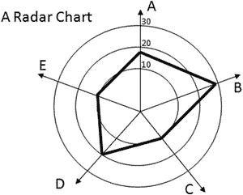
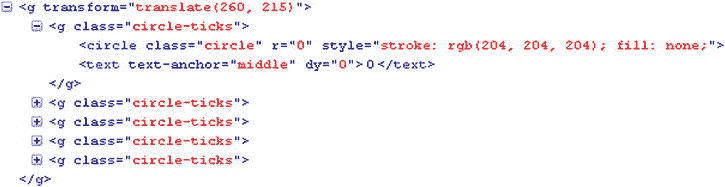
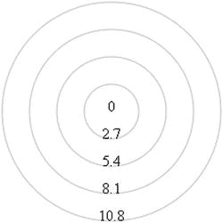
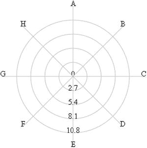
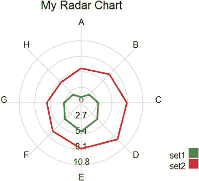
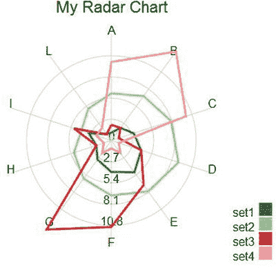
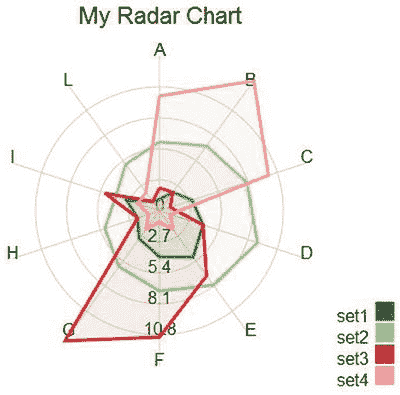

# 8. 使用 D3 绘制雷达图

本章将介绍一种你尚未读过的图表类型：雷达图。首先，你将了解它是什么，包括其基本特征，以及如何使用 D3 库提供的 SVG 元素创建一个雷达图。

你将首先从一个 CSV 文件中读取少量代表性数据。然后，参考这些数据，你将看到如何一步步实现雷达图的所有组件。在本章的第二部分，你将使用相同的代码从更复杂的文件中读取数据，其中要处理的序列数量和数据量都更大。当你需要从头开始表示一种新的图表类型时，这种方法是一种相当常见的做法。你从一个简单但完整的示例开始，然后，一旦实现了基本示例，你将用更复杂、更真实的数据对其进行扩展。

## 雷达图

雷达图因其典型的网状结构，也被称为网络图或蜘蛛图（见图 8-1）。它们是二维图表，能够表示三个或更多定量变量。它们由一系列角度相同的辐条组成，每条辐条代表其中一个变量。每条辐条上都有一个点，该点到中心的距离与给定变量的大小成正比。然后，一条线连接每条辐条上报告的点，从而使图形呈现网状外观。如果没有这条连接线，图表看起来会更像扫描雷达。


**图 8-1.** 雷达图看起来像蜘蛛网

### 构建自动缩放坐标轴

复制以下数据并将其保存为 `data_11.csv` 文件（参见代码清单 8-1）。

**代码清单 8-1.** `data_11.csv`

```
section,set1,set2,
A,1,6,
B,2,7,
C,3,8,
D,4,9,
E,5,8,
F,4,7,
G,3,6,
H,2,5,
```

在代码清单 8-2 中，你定义了绘图区域和边距。然后，你使用 `category10()` 函数创建了一个颜色序列。

**代码清单 8-2.** `Ch8_01.html`

```
var margin = {top: 70, right: 20, bottom: 40, left: 40},
w = 500 - margin.left - margin.right,
h = 400 - margin.top - margin.bottom;
var color = d3.scale.category20();
```

在你刚刚定义的绘图区域内，你还需要定义一个能够容纳圆形（此处为雷达图）的特定区域。定义好这个区域后，你像定义笛卡尔坐标轴一样定义半径。实际上，雷达图上的每个辐条都被视为一个坐标轴，你可以在其上放置一个变量。因此，你在半径上定义了一个线性比例尺，如代码清单 8-3 所示。

**代码清单 8-3.** `ch8_01.html`

```
var circleConstraint = d3.min([h, w]);
var radius = d3.scale.linear()
    .range([0, (circleConstraint / 2)]);
```

你需要找到绘图区域的中心。这是雷达图的中心，也是所有辐条向外辐射的起点（参见代码清单 8-4）。

**代码清单 8-4.** `Ch8_01.html`

```
var centerXPos = w / 2 + margin.left;
var centerYPos = h / 2 + margin.top;
```

开始绘制根元素 `<svg>`，如代码清单 8-5 所示。

**代码清单 8-5.** `Ch8_01.html`

```
var svg = d3.select("body").append("svg")
    .attr("width", w + margin.left + margin.right)
    .attr("height", h + margin.top + margin.bottom)
    .append("g")
    .attr("transform", "translate(" + centerXPos + ", " + centerYPos + ")");
```

现在，如代码清单 8-6 所示，你使用 `d3.csv()` 函数读取文件内容。你需要验证读取的值 `set1` 和 `set2` 被解释为数值。你还希望知道所有这些值中的最大值，以便定义一个根据其值进行扩展的比例尺。

**代码清单 8-6.** `ch8_01.html`

```
d3.csv("data_11.csv", function(error, data) {
    var maxValue = 0;
    data.forEach(function(d) {
        d.set1 = +d.set1;
        d.set2 = +d.set2;
        if(d.set1 > maxValue)
            maxValue = d.set1;
        if(d.set2 > maxValue)
            maxValue = d.set2;
    });
});
```

一旦知道了输入数据的最大值，你就将完整比例尺的值设置为该最大值乘以 1.5。在这种情况下，你无法使用坐标轴上自动生成的刻度，而必须手动定义它们。实际上，这些刻度具有球形形状，因此具有相当特殊的特征。此示例将半径轴的范围划分为五个刻度。定义好刻度的值后，你可以为半径轴分配一个定义域（参见代码清单 8-7）。

**代码清单 8-7.** `Ch8_01.html`

```
d3.csv("data_11.csv", function(error, data) {
    ...
    data.forEach(function(d) {
        ...
    });
    var topValue = 1.5 * maxValue;
    var ticks = [];
    for(i = 0; i < 5; i += 1){
        ticks[i] = topValue * i / 5;
    }
    radius.domain([0, topValue]);
});
```

现在你已经拥有了所有数值，我们可以嵌入一些 `<svg>` 元素，以设计一个雷达网格，该网格的形状和值将根据输入的数据而变化（参见代码清单 8-8）。

**代码清单 8-8.** `Ch8_01.html`

```
d3.csv("data_11.csv", function(error, data) {
    ...
    radius.domain([0, topValue]);
    var circleAxes = svg.selectAll(".circle-ticks")
        .data(ticks)
        .enter().append("g")
        .attr("class", "circle-ticks");
    circleAxes.append("svg:circle")
        .attr("r", function(d) {return radius(d);})
        .attr("class", "circle")
        .style("stroke", "#CCC")
        .style("fill", "none");
    circleAxes.append("svg:text")
        .attr("text-anchor", "middle")
        .attr("dy", function(d) {return radius(d)})
        .text(String);
});
```

你创建了一个由五个名为 `circle-ticks` 的 `<g>` 标签组成的结构，如图 8-2 所示，每个标签包含一个 `<circle>` 元素（用于绘制网格）和一个 `<text>` 元素（用于显示对应的数值）。


**图 8-2.** FireBug 展示了 `circle-ticks` 的结构

所有这些代码生成了如图 8-3 所示的圆形网格。


**图 8-3.** 雷达图的圆形网格

如你所见，刻度上报告的值将根据数据中包含的最大值而变化。

现在是绘制辐条的时候了，辐条的数量与 `data_11.csv` 文件中的行数相同。这些行中的每一行都对应一个变量，其名称输入在文件的第一列中（参见代码清单 8-9）。

**代码清单 8-9.** `Ch8_01.html`

```
d3.csv("data_11.csv", function(error, data) {
    ...
    circleAxes.append("svg:text")
        .attr("text-anchor", "middle")
        .attr("dy", function(d) {return radius(d)})
        .text(String);
    lineAxes = svg.selectAll('.line-ticks')
        .data(data)
        .enter().append('svg:g')
        .attr("transform", function (d, i) {
            return "rotate(" + ((i / data.length * 360) - 90) +
                ")translate(" + radius(topValue) + ")";
        })
        .attr("class", "line-ticks");
    lineAxes.append('svg:line')
        .attr("x2", -1 * radius(topValue))
        .style("stroke", "#CCC")
        .style("fill", "none");
    lineAxes.append('svg:text')
        .text(function(d) { return d.section; })
        .attr("text-anchor", "middle")
        .attr("transform", function (d, i) {
            return "rotate("+(90 - (i * 360 / data.length)) + ")";
        });
});
```

现在图表中已经呈现了辐条，如图 8-4 所示。


**图 8-4.** 雷达图的径向坐标轴

### 向雷达图添加数据

现在需要考虑文件中的数值列。每一列都可以视为一个序列，每个序列必须分配一种颜色。你可以通过获取文件中的表头并移除第一列来定义这些序列。然后，根据序列的顺序创建颜色域，再定义绘制它们的线条（参见清单 8-10）。

**清单 8-10.** `Ch8_01.html`

```
d3.csv("data_11.csv", function(error, data) {
...
lineAxes.append('svg:text')
.text(function(d) { return d.section; })
.attr("text-anchor", "middle")
.attr("transform", function (d, i) {
return "rotate("+(90-(i*360/data.length))+")";
});

var series = d3.keys(data[0])
.filter(function(key) { return key !== "section"; })
.filter(function(key) { return key !== ""; });

color.domain(series);

var lines = color.domain().map(function(name){
return (data.concat(data[0])).map(function(d){
return +d[name];
});
});
});
```

这是 `series` 数组的内容：

`["set1", "set2"]`

这是 `lines` 数组的内容：

`[[1,2,3,...],[6,7,8,...]]`

这些线条将帮助你创建相应的路径元素，使你能够在雷达图上绘制序列的趋势。每个序列将穿过各个辐条上假设的值（参见清单 8-11）。

**清单 8-11.** `Ch8_01.html`

```
d3.csv("data_11.csv", function(error, data) {
...
var lines = color.domain().map(function(name){
return (data.concat(data[0])).map(function(d){
return +d[name];
});
});

var sets = svg.selectAll(".series")
.data(series)
.enter().append("g")
.attr("class", "series");

sets.append('svg:path')
.data(lines)
.attr("class", "line")
.attr("d", d3.svg.line.radial()
.radius(function (d) {
return radius(d);
})
.angle(function (d, i) {
if (i == data.length) {
i =0;
} //close the line
return (i / data.length) * 2 * Math.PI;
}))
.data(series)
.style("stroke-width", 3)
.style("fill", "none")
.style("stroke", function(d,i){
return color(i);
});
});
```

你还可以添加一个图例，显示序列的名称（实际上就是列的表头），并在绘图区域的顶部放置一个标题，如清单 8-12 所示。

**清单 8-12.** `Ch8_01.html`

```
d3.csv("data_11.csv", function(error, data) {
...
.data(series)
.style("stroke-width", 3)
.style("fill", "none")
.style("stroke", function(d,i){
return color(i);
});

var legend = svg.selectAll(".legend")
.data(series)
.enter().append("g")
.attr("class", "legend")
.attr("transform", function(d, i) {
return "translate(0," + i * 20 + ")";
});

legend.append("rect")
.attr("x", w/2 -18)
.attr("y", h/2 - 60)
.attr("width", 18)
.attr("height", 18)
.style("fill", function(d,i){ return color(i);});

legend.append("text")
.attr("x", w/2 -24)
.attr("y", h/2 - 60)
.attr("dy","1.2em")
.style("text-anchor", "end")
.text(function(d) { return d; });
});

var title = d3.select("svg").append("g")
.attr("transform", "translate(" +margin.left+ "," +margin.top+ ")")
.attr("class","title");

title.append("text")
.attr("x", (w / 2))
.attr("y", -30 )
.attr("text-anchor", "middle")
.style("font-size", "22px")
.text("My Radar Chart");
```

最后但同样重要的是，你可以添加一个 CSS 样式类来控制文本样式，如清单 8-13 所示。

**清单 8-13.** `Ch8_01.html`

```
<style>
body {
font: 16px sans-serif;
}
</style>
```

图 8-5 显示了生成的雷达图。


**图 8-5.** 包含两个序列的雷达图

#### 改进你的雷达图

如果你按照前面的示例操作，向雷达图添加更多列和行应该没有任何问题。打开最后一个输入数据文件 `data_11.csv`，再添加两列和两行。将文件另存为 `data_12.csv`，如清单 8-14 所示。

**清单 8-14.** `data_12.csv`

```
section,set1,set2,set3,set4,
A,1,6,2,10,
B,2,7,2,14,
C,3,8,1,10,
D,4,9,4,1,
E,5,8,7,2,
F,4,7,11,1,
G,3,6,14,2,
H,2,5,2,1,
I,3,4,5,2,
L,1,5,1,2,
```

现在，你需要在 `d3.csv()` 函数中将 `data11.csv` 文件的调用替换为 `data12.csv` 文件，如清单 8-15 所示。

**清单 8-15.** `Ch8_02.html`

```
d3.csv("data_12.csv", function(error, data) {
...});
```

图 8-6 显示了结果。



**图 8-6.** 包含四个序列的雷达图

哇，成功了！准备好添加另一个功能了吗？到目前为止，你已经绘制了一条穿过各个辐条并循环回到起点的线；这个趋势现在描述了一个特定的区域。你通常会对雷达图中由不同线条界定的区域更感兴趣，而不是线条本身。如果你想对雷达图进行这个小改动以显示区域，你只需要再添加一条路径，如清单 8-16 所示。这条路径与已有的路径几乎相同，只是新路径不是绘制代表序列的线条，而是为线条内部包围的区域着色。在这个例子中，你将使用对应线条的颜色，但添加一点透明度，以免覆盖底层的序列。

**清单 8-16.** `Ch8_02.html`

```
d3.csv("data_12.csv", function(error, data) {
...
var sets = svg.selectAll(".series")
.data(series)
.enter().append("g")
.attr("class", "series");

sets.append('svg:path')
.data(lines)
.attr("class", "line")
.attr("d", d3.svg.line.radial()
.radius(function (d) {
return radius(d);
})
.angle(function (d, i) {
if (i == data.length) {
i =0;
}
return (i / data.length) * 2 * Math.PI;
}))
.data(series)
.style("stroke-width", 3)
.style("opacity", 0.4)
.style("fill", function(d,i){
return color(i);
})
.style("stroke", function(d,i){
return color(i);
});

sets.append('svg:path')
.data(lines)
.attr("class", "line")
.attr("d", d3.svg.line.radial()
...
});
```

如图 8-7 所示，你现在有了一个带有半透明区域的雷达图。



**图 8-7.** 带有颜色填充区域的雷达图

### 总结

本章解释了如何实现雷达图。这种图表类型并不常见，但对于突出 D3 库的潜力特别有用。它通过一个示例帮助你理解如何开发其他不同于最常见类型的图表。

下一章通过考虑两个不同的案例来结束本书。这些案例旨在以简化的方式提出开发人员在处理真实数据时经常面临的经典情况。在第一个示例中，你将看到如何使用 D3 来表示实时生成或获取的数据。你将创建一个不断更新的图表，始终显示当前状态。在第二个示例中，你将使用 D3 库读取数据库中包含的数据。