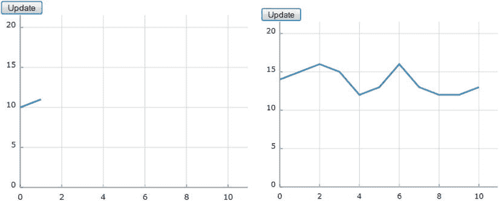
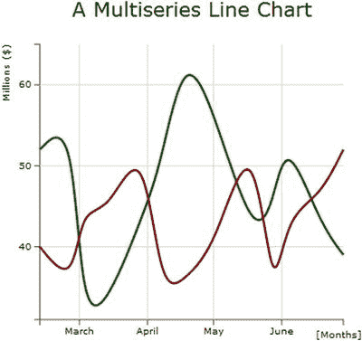

# 9. 使用 D3 处理实时数据

在本章中，你将学习如何使用 D3 库开发实时图表。具体来说，你将创建一个折线图，用于显示由一个模拟外部数据源的函数生成的实时数值。数据将持续生成，因此折线图也会随之变化，始终展示最新情况。

在本章的第二部分，你将开发一个稍微复杂的图表。这次，你将使用一个数据源为真实数据库的示例。首先，你将实现一个折线图，用于读取外部文件中包含的数据。随后，你将学习如何使用该示例读取相同的数据，但这次数据来自数据库中的表。

## 实时图表

你有一个数据源，它模拟了一个返回变量性能随机变化的函数。这些值存储在一个具有缓冲区功能的数组中，你希望该数组仅包含最近的十个值。对于每个生成或获取的输入值，最旧的值将被新值替换。该数组中的数据以折线图的形式显示，每 3 秒更新一次。所有操作通过点击一个按钮来激活。

让我们先为绘制折线图打下基础（如需回顾使用 D3 库开发折线图，请参阅第 3 章）。首先，编写用于构建图表的 HTML 结构，如代码清单 9-1 所示。

**代码清单 9-1.** `Ch9_01.html`

```html
<!DOCTYPE html>
<html>
<head>
<meta charset="utf-8">
<script src="http://d3js.org/d3.v3.js"></script>
<style>
// 在此处添加 CSS 样式
</style>
<body>
<script type="text/javascript">
// 在此处添加 JavaScript 代码
</script>
</body>
</html>
```

现在，你开始定义在编写代码过程中会用到的变量，首先从输入数据的管理开始。如前所述，你将在图表上表示的数据来自一个函数，该函数从一个起始值生成正或负的随机变化。你决定从 10 开始。

因此，从这个值开始，你从随机函数接收一系列值，并将它们收集到一个名为 `data` 的数组中（见代码清单 9-2）。目前，你只为其分配了起始值 (10)。对于这个数组，为了实时接收值，你需要设置一个最大限制，在本例中为十一个元素（0–10）。一旦填满，你将把该数组作为一个队列来管理，其中最旧的项将被移除，以便为新项腾出空间。

**代码清单 9-2.** `Ch9_01.html`

```javascript
<script type="text/javascript">
var data = [10];
w = 400;
h = 300;
margin_x = 32;
margin_y = 20;
ymax = 20;
ymin = 0;
y = d3.scale.linear().domain([ymin, ymax]).range([0 + margin_y, h - margin_y]);
x = d3.scale.linear().domain([0, 10]).range([0 + margin_x, w - margin_x]);
</script>
```

`data` 数组中包含的值将沿 y 轴表示，因此有必要确定刻度标签需要覆盖的值范围。从值 10 开始，你可以决定，例如，该范围覆盖从 0 到 20 的值（稍后，你将确保刻度对应于 5 的倍数范围，即 0、5、10、15 和 20）。由于要显示的值是随机生成的，它们会逐渐达到甚至超过 20，如果发生这种情况，你会看到线条消失在图表的上边缘之外。该怎么办呢？

因为主要目标是创建一个在获取新数据后能重绘自身的图表，所以你将确保刻度标签也能根据 `data` 数组中包含的值所覆盖的范围进行调整。为此，你需要使用 `ymax` 和 `ymin` 变量定义 `y` 的范围，而 `x` 范围则覆盖静态范围 [0–10]。

`w` 和 `h` 变量（宽度和高度）定义了绘制折线图的绘图区域的大小，而 `margin_x` 和 `margin_y` 则允许你调整边距。

现在，让我们创建将表示图表各个部分的标量矢量图形（SVG）元素。你首先创建 `<svg>` 根元素，然后定义 x 轴和 y 轴，如代码清单 9-3 所示。

**代码清单 9-3.** `Ch9_01.html`

```javascript
<script type="text/javascript">
...
y = d3.scale.linear().domain([ymin, ymax]).range([0 + margin_y, h - margin_y]);
x = d3.scale.linear().domain([0, 10]).range([0 + margin_x, w - margin_x]);

var svg = d3.select("body")
    .append("svg:svg")
    .attr("width", w)
    .attr("height", h);

var g = svg.append("svg:g")
    .attr("transform", "translate(0, " + h + ")");

// 绘制 x 轴
g.append("svg:line")
.attr("x1", x(0))
.attr("y1", -y(0))
.attr("x2", x(w))
.attr("y2", -y(0));
// 绘制 y 轴
g.append("svg:line")
.attr("x1", x(0))
.attr("y1", -y(0))
.attr("x2", x(0))
.attr("y2", -y(25));
</script>
```

接下来，在两个坐标轴上添加刻度线和对应的标签，然后添加网格。最后，使用 `line()` 函数在图表上绘制线条（参见清单 9-4）。

**清单 9-4.** `Ch9_01.html`

```javascript
<script type="text/javascript">
...
g.append("svg:line")
.attr("x1", x(0))
.attr("y1", -y(0))
.attr("x2", x(0))
.attr("y2", -y(25));
// 绘制 x 轴标签
g.selectAll(".xLabel")
.data(x.ticks(5))
.enter().append("svg:text")
.attr("class", "xLabel")
.text(String)
.attr("x", function(d) { return x(d) })
.attr("y", 0)
.attr("text-anchor", "middle");
// 绘制 y 轴标签
g.selectAll(".yLabel")
.data(y.ticks(5))
.enter().append("svg:text")
.attr("class", "yLabel")
.text(String)
.attr("x", 25)
.attr("y", function(d) { return -y(d) })
.attr("text-anchor", "end");
// 绘制 x 轴刻度线
g.selectAll(".xTicks")
.data(x.ticks(5))
.enter().append("svg:line")
.attr("class", "xTicks")
.attr("x1", function(d) { return x(d); })
.attr("y1", -y(0))
.attr("x2", function(d) { return x(d); })
.attr("y2", -y(0) - 5);
// 绘制 y 轴刻度线
g.selectAll(".yTicks")
.data(y.ticks(5))
.enter().append("svg:line")
.attr("class", "yTicks")
.attr("y1", function(d) { return -1 * y(d); })
.attr("x1", x(0) +5)
.attr("y2", function(d) { return -1 * y(d); })
.attr("x2", x(0))
// 绘制 x 轴网格
g.selectAll(".xGrids")
.data(x.ticks(5))
.enter().append("svg:line")
.attr("class", "xGrids")
.attr("x1", function(d) { return x(d); })
.attr("y1", -y(0))
.attr("x2", function(d) { return x(d); })
.attr("y2", -y(25));
// 绘制 y 轴网格
g.selectAll(".yGrids")
.data(y.ticks(5))
.enter().append("svg:line")
.attr("class", "yGrids")
.attr("y1", function(d) { return -1 * y(d); })
.attr("x1", x(w))
.attr("y2", function(d) { return -y(d); })
.attr("x2", x(0));
var line = d3.svg.line()
.x(function(d,i) { return x(i); })
.y(function(d) { return -y(d); })
</script>
```

为了让图表外观更美观，还需要定义层叠样式表（CSS）样式，如清单 9-5 所示。

**清单 9-5.** `Ch9_01.html`

```css
<style>
path {
stroke: steelblue;
stroke-width: 3;
fill: none;
}
line {
stroke: black;
}
.xGrids {
stroke: lightgray;
}
.yGrids {
stroke: lightgray;
}
text {
font-family: Verdana;
font-size: 9pt;
}
</style>
```

现在，在图表上方添加一个按钮，确保用户点击它时能激活 `updateData()` 函数，如清单 9-6 所示。

**清单 9-6.** `Ch9_01.html`

```html
<body>
<div id="option">
<input name="updateButton"
type="button"
value="更新"
onclick="updateData()" />
</div>
```

然后，实现 `getRandomInt()` 函数，该函数在最小值和最大值之间生成一个随机整数值（参见清单 9-7）。

**清单 9-7.** `Ch9_01.html`

```javascript
function getRandomInt (min, max) {
return Math.floor(Math.random() * (max - min +1)) + min;
};
```

清单 9-8 展示了 `updateData()` 函数，其中将 `getRandomInt()` 函数生成的值添加到数组的最新值上，以模拟趋势的变化。这个新值被存储在数组中，同时移除最旧的值；因此，数组的大小始终保持不变。

**清单 9-8.** `Ch9_01.html`

```javascript
function updateData() {
var last = data[data.length-1];
if(data.length >10){
data.shift();
}
var newlast = last + getRandomInt(-3,3);
if(newlast <0)
newlast = 0;
data.push(newlast);
};
```

如果 `getRandomInt()` 函数返回的新值大于或小于 y 轴表示的范围，您会看到数据线延伸到图表边缘之外。为了防止这种情况发生，您必须通过改变 `ymin` 和 `ymax` 变量来更改 y 轴上的区间，并使用这些新值更新 `y` 的范围，如清单 9-9 所示。

**清单 9-9.** `Ch9_01.html`

```javascript
function updateData() {
...
if(newlast <0)
newlast = 0;
data.push(newlast);
if(newlast > ymax){
ymin = ymin + (newlast - ymax);
ymax = newlast;
y = d3.scale.linear().domain([ymin, ymax])
.range([0 + margin_y, h - margin_y]);
}
if(newlast < ymin){
ymax = ymax - (ymin - newlast);
ymin = newlast;
y = d3.scale.linear().domain([ymin, ymax])
.range([0 + margin_y, h - margin_y]);
}
};
```

因为获取的新数据必须重新绘制，所以需要删除无效的 SVG 元素并用新元素替换。让我们同时对刻度标签和数据线进行此操作（参见清单 9-10）。最后，需要以固定的时间间隔重复刷新图表。因此，使用 `requestAnimFrame()` 函数，可以重复执行 `UpdateData()` 函数的内容。

**清单 9-10.** `Ch9_01.html`

```javascript
function updateData() {
...
if(newlast < ymin){
ymax = ymax - (ymin - newlast);
ymin = newlast;
y = d3.scale.linear().domain([ymin, ymax]).range([0 + margin_y, h - margin_y]);
}
var svg = d3.select("body").transition();
g.selectAll(".yLabel").remove();
g.selectAll(".yLabel")
.data(y.ticks(5))
.enter().append("svg:text")
.attr("class", "yLabel")
.text(String)
.attr("x", 25)
.attr("y", function(d) { return -y(d) })
.attr("text-anchor", "end");
g.selectAll(".line").remove();
g.append("svg:path")
.attr("class", "line")
.attr("d", line(data));
window.requestAnimFrame = (function(){
return window.requestAnimationFrame ||
window.webkitRequestAnimationFrame ||
window.mozRequestAnimationFrame ||
function( callback ){
window.setTimeout(callback, 1000);
};
})();
requestAnimFrame(setTimeout(updateData,3000));
render();
};
```

现在，当点击“更新”按钮后，一条线会从左侧开始绘制由生成随机变化的函数获取的值。一旦线条到达图表的右端，它将在每次获取时更新，仅显示最后十个值（参见图 9-1）。



**图 9-1.** 带启动按钮的实时图表

## 使用 PHP 从 MySQL 表中提取数据

最后，是时候使用数据库中的数据了，这个场景更可能符合您的日常需求。您选择 MySQL 作为数据库，并使用超文本预处理器（PHP）语言来查询数据库，并以 JavaScript 对象表示法（JSON）格式获取数据，以便 D3 能够读取。您会发现，一旦使用 D3 构建了图表，过渡到这个阶段就很容易了。

以下示例并非旨在解释 PHP 语言或任何其他语言的使用，而是为了说明一个典型且真实的案例。该示例展示了将您所学的一切与其他编程语言进行接口连接是多么简单。通常，像 Java 和 PHP 这样的语言为从其数据源（本例中为数据库）收集和准备数据提供了出色的接口。

#### 从 TSV 文件开始

为了更清晰地理解从已知知识到与 PHP 和数据库交互的过渡，让我们从一个你应该熟悉的案例开始（参见清单 9-11）。首先，你编写一个包含这些数据系列的制表符分隔值（TSV）文件，并将其保存为`data_13.tsv`。

##### 清单 9-11. `data_13.tsv`

```
day          income  expense
2012-02-12   52      40
2012-02-27   56      35
2012-03-02   31      45
2012-03-14   33      44
2012-03-30   44      54
2012-04-07   50      34
2012-04-18   65      36
2012-05-02   56      40
2012-05-19   41      56
2012-05-28   45      32
2012-06-03   54      44
2012-06-18   43      46
2012-06-29   39      52
```

> **注意：** TSV 文件中的值是用制表符分隔的，因此当你编写或复制清单 9-11 时，请记得检查每个值之间是否只有一个制表符。

实际上，正如所暗示的，你已经见过这些数据，尽管形式略有不同；这些数据与`data_03.tsv`文件中的数据相同（参见第 3 章中的清单 3-60）。你将列`date`改为`day`，并修改了日期的格式。现在，你必须添加清单 9-12 中的 JavaScript 代码，这将使你能够将这些数据表示为多系列折线图。（这段代码与第 3 章中“差异折线图”一节使用的代码非常相似；关于清单 9-12 内容的解释和细节，请参见该节。）

##### 清单 9-12. `Ch9_02.html`

```html
<!DOCTYPE html>
<html>
<head>
<meta charset="utf-8">
<script src="http://d3js.org/d3.v3.js"></script>
<style>
body {
  font: 10px verdana;
}
.axis path,
.axis line {
  fill: none;
  stroke: #333;
}
.grid .tick {
  stroke: lightgrey;
  opacity: 0.7;
}
.grid path {
  stroke-width: 0;
}
.line {
  fill: none;
  stroke: darkgreen;
  stroke-width: 2.5px;
}
.line2 {
  fill: none;
  stroke: darkred;
  stroke-width: 2.5px;
}
</style>
</head>
<body>
<script type="text/javascript">
var margin = {top: 70, right: 20, bottom: 30, left: 50},
    w = 400 - margin.left - margin.right,
    h = 400 - margin.top - margin.bottom;

var parseDate = d3.time.format("%Y-%m-%d").parse;

var x = d3.time.scale().range([0, w]);
var y = d3.scale.linear().range([h, 0]);

var xAxis = d3.svg.axis()
    .scale(x)
    .orient("bottom")
    .ticks(5);

var yAxis = d3.svg.axis()
    .scale(y)
    .orient("left")
    .ticks(5);

var xGrid = d3.svg.axis()
    .scale(x)
    .orient("bottom")
    .ticks(5)
    .tickSize(-h, 0, 0)
    .tickFormat("");

var yGrid = d3.svg.axis()
    .scale(y)
    .orient("left")
    .ticks(5)
    .tickSize(-w, 0, 0)
    .tickFormat("");

var svg = d3.select("body").append("svg")
    .attr("width", w + margin.left + margin.right)
    .attr("height", h + margin.top + margin.bottom)
  .append("g")
    .attr("transform", "translate(" + margin.left + ", " + margin.top + ")");

var line = d3.svg.area()
    .interpolate("basis")
    .x(function(d) { return x(d.day); })
    .y(function(d) { return y(d["income"]); });

var line2 = d3.svg.area()
    .interpolate("basis")
    .x(function(d) { return x(d.day); })
    .y(function(d) { return y(d["expense"]); });

d3.tsv("data_13.tsv", function(error, data) {
  data.forEach(function(d) {
    d.day = parseDate(d.day);
    d.income = +d.income;
    d.expense = +d.expense;
  });

x.domain(d3.extent(data, function(d) { return d.day; }));
  y.domain([
    d3.min(data, function(d) { return Math.min(d.income, d.expense); }),
    d3.max(data, function(d) { return Math.max(d.income, d.expense); })
  ]);

svg.append("g")
      .attr("class", "x axis")
      .attr("transform", "translate(0, " + h + ")")
      .call(xAxis);

svg.append("g")
      .attr("class", "y axis")
      .call(yAxis);

svg.append("g")
      .attr("class", "grid")
      .attr("transform", "translate(0, " + h + ")")
      .call(xGrid);

svg.append("g")
      .attr("class", "grid")
      .call(yGrid);

svg.datum(data);

svg.append("path")
      .attr("class", "line")
      .attr("d", line);

svg.append("path")
      .attr("class", "line2")
      .attr("d", line2);
});

var labels = svg.append("g")
    .attr("class", "labels");

labels.append("text")
    .attr("transform", "translate(0, " + h + ")")
    .attr("x", (w-margin.right))
    .attr("dx", "-1.0em")
    .attr("dy", "2.0em")
    .text("[Months]");

labels.append("text")
    .attr("transform", "rotate(-90)")
    .attr("y", -40)
    .attr("dy", ".71em")
    .style("text-anchor", "end")
    .text("Millions ($)");

var title = svg.append("g")
    .attr("class", "title")

title.append("text")
    .attr("x", (w / 2))
    .attr("y", -30 )
    .attr("text-anchor", "middle")
    .style("font-size", "22px")
    .text("A Multiseries Line Chart");
</script>
</body>
</html>
```

使用这段代码，你将得到图 9-2 中的图表。


##### 图 9-2. 从 TSV 文件读取数据的多系列图表

#### 进入实际案例

现在，让我们进入实际案例，你将处理数据库中的表。对于数据源，你选择 MySQL 测试数据库中一个名为 `sales` 的表。创建好这个名称的表后，你可以通过执行 SQL 序列来填充数据（见代码清单 9-13）。

**代码清单 9-13.** `sales.sql`

```sql
insert into sales
values ('2012-02-12', 52, 40);
insert into sales
values ('2012-02-27', 56, 35);
insert into sales
values ('2012-03-02', 31, 45);
insert into sales
values ('2012-03-14', 33, 44);
insert into sales
values ('2012-03-30', 44, 54);
insert into sales
values ('2012-04-07', 50, 34);
insert into sales
values ('2012-04-18', 65, 36);
insert into sales
values ('2012-05-02', 56, 40);
insert into sales
values ('2012-05-19', 41, 56);
insert into sales
values ('2012-05-28', 45, 32);
insert into sales
values ('2012-06-03', 54, 44);
insert into sales
values ('2012-06-18', 43, 46);
insert into sales
values ('2012-06-29', 39, 52);
```

最好将 PHP 脚本写在单独的文件中，并保存为 `myPHP.php`。该文件的内容如代码清单 9-14 所示。

**代码清单 9-14.** `myPHP.php`

```php
<?php
$username = "dbuser";
$password = "dbuser";
$host = "localhost";
$database = "test";
$server = mysql_connect($host, $username, $password);
$connection = mysql_select_db($database, $server);
$myquery = "SELECT * FROM sales";
$query = mysql_query($myquery);
if ( ! $myquery ) {
    echo mysql_error();
    die;
}
$data = array();
for ($x = 0; $x < mysql_num_rows($query); $x++) {
    $data[] = mysql_fetch_assoc($query);
}
echo json_encode($data);
mysql_close($server);
?>
```

通常，PHP 脚本可以通过其特殊的开始和结束处理指令 `<?php` 和 `?>` 来识别。这段简短但功能强大且多用途的代码片段通常在我们需要连接数据库时使用。让我们仔细看看它的作用。

在这个例子中，选择了 `dbuser` 作为用户名，`dbuser` 作为密码，但这些值取决于你要连接的数据库。数据库和主机名的值也是如此。因此，为了连接数据库，你必须首先定义一组标识变量，如代码清单 9-15 所示。

**代码清单 9-15.** `myPHP.php`

```php
$username = "homedbuser";
$password = "homedbuser";
$host = "localhost";
$database = "homedb";
```

定义好这些变量后，PHP 提供了一组已实现的函数，你只需将这些变量作为参数传递，即可与数据库建立连接。在这个例子中，你需要调用 `mysql_connect()` 和 `mysql_select_db()` 函数来创建与数据库的连接，无需再定义其他内容（见代码清单 9-16）。

**代码清单 9-16.** `myPHP.php`

```php
$server = mysql_connect($host, $username, $password);
$connection = mysql_select_db($database, $server);
```

即使是输入 SQL 查询，PHP 也证明了自己是一个非常实用的工具。代码清单 9-17 是一个非常简单的示例，展示了如何执行 SQL 查询以从数据库中检索数据。如果你不熟悉 SQL 语言，查询是一种针对特定数据库的声明性语句，用于获取其中包含的所需数据。你可以轻松识别查询，因为它由一个 `SELECT` 语句后跟一个 `FROM` 语句，并且几乎总是在末尾有一个 `WHERE` 语句。

> **注意：** 如果你没有 SQL 语言经验，并且想在不安装数据库和其他环境的情况下进行一些练习，我建议访问 w3schools 网站的以下网页：[`www.w3schools.com/sql`](http://www.w3schools.com/sql)。在该页面中，你将找到关于命令的完整文档，包含许多示例，甚至可以通过嵌入 SQL 测试查询来查询网站提供的示例数据库（请参阅“自己试试”部分）。

在这个简单的例子中，`SELECT` 语句后面跟着 `'*'`，这意味着你想要获取 `FROM` 语句中指定的表（本例中为 `sales`）中所有列的数据。

**代码清单 9-17.** `myPHP.php`

```php
$myquery = "SELECT * FROM sales";
$query = mysql_query($myquery);
```

执行查询后，你需要检查是否成功，并在发生错误时进行处理（见代码清单 9-18）。

**代码清单 9-18.** `myPHP.php`

```php
if ( ! $query ) {
    echo mysql_error();
    die;
}
```

如果查询成功，那么你需要处理查询返回的数据。你将把这些值放入一个名为 `$data` 的数组中，如代码清单 9-19 所示。这部分与 D3 中的 `csv()` 和 `tsv()` 函数非常相似，只是它不是逐行读取文件，而是从数据库中检索到的表中逐行读取数据。`mysql_num_rows()` 函数返回表中的行数，类似于 `for()` 循环中使用的 JavaScript 的 `length()` 函数。`mysql_fetch_assoc()` 函数将查询检索到的数据逐行分配给数据数组。

**代码清单 9-19.** `myPHP.php`

```php
$data = array();
for ($x = 0; $x < mysql_num_rows($query); $x++) {
    $data[] = mysql_fetch_assoc($query);
}
echo json_encode($data);
```

脚本的关键在于调用 PHP 的 `json_encode()` 方法，该方法将数据格式转换为 JSON，然后通过 `echo` 返回数据，D3 将解析这些数据。最后，你必须关闭与服务器的连接，如代码清单 9-20 所示。

**代码清单 9-20.** `myPHP.php`

```php
mysql_close($server);
```

现在，回到 JavaScript 代码，只更改一行（是的，只有一行！）（见代码清单 9-21）。你将 `tsv()` 函数替换为 `json()` 函数，并直接将 PHP 文件作为参数传递。

**代码清单 9-21.** `Ch9_02b.html`

```javascript
d3.json("myPHP.php", function(error, data) {
    //d3.tsv("data_03.tsv", function(error, data) {
    data.forEach(function(d) {
        d.day = parseDate(d.day);
        d.income = +d.income;
        d.expense = +d.expense;
    });
```

最终，你将得到相同的图表（见图 9-3）。



**图 9-3.** 直接从数据库获取数据的多系列图表

### 小结

本章通过考虑两个不同的案例进行了总结。在第一个示例中，你了解了如何创建一个能够表示实时生成或获取的数据的网页。在第二个示例中，你学习了如何使用 D3 库读取数据库中包含的数据。

在下一章中，我将介绍一个新主题：控件。我将描述在图表中引入控件的重要性，并理解如何使用控件更改图表属性。这为用户提供了实时选择属性参数的机会。