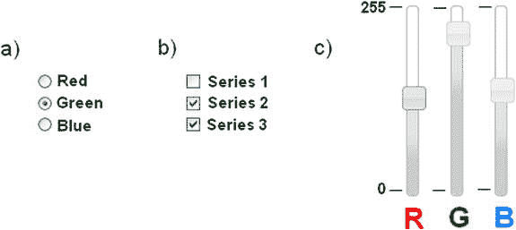
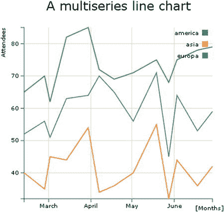
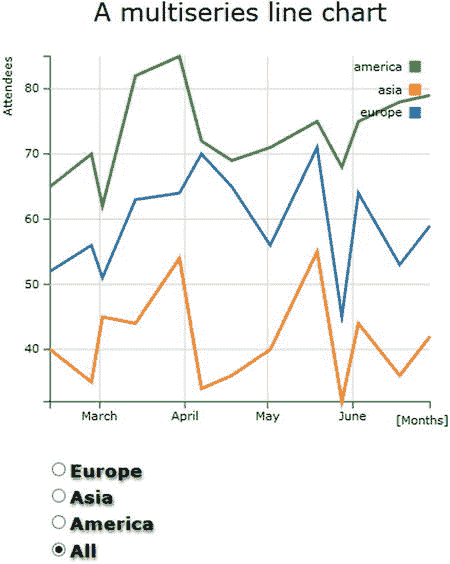
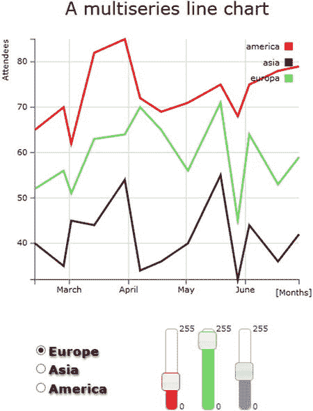
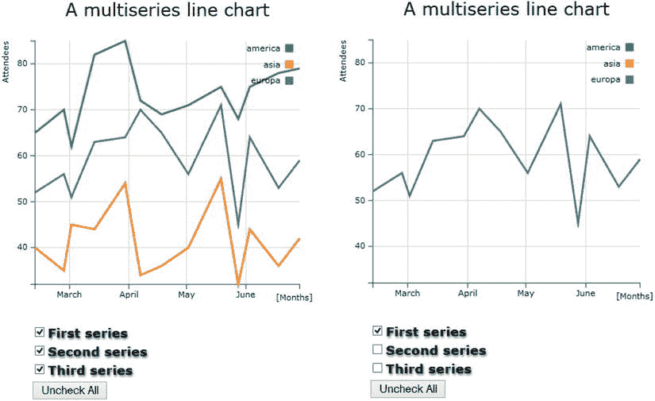

# 10. 为图表添加控件

有时，在运行时直接从浏览器更改设置，然后使用这些新设置重新绘制图表会非常有用。一种典型的方法是添加活动控件。这些控件使图表具有交互性，允许用户实时做出选择，例如决定图表应如何呈现。通过插入控件，你可以让用户控制图表属性的值。

在本章中，你将学习如何在网页中引入控件。你还将考虑导致选择一种控件而非另一种的因素。一系列包含三种最常用控件的示例将带你更深入地了解这个主题。

## 添加控件

对控件进行分组的一种方式是根据其功能。某些控件（例如按钮、菜单）作为开关（命令控件）工作，用户可以通过它们触发特定事件或启动命令。其他控件（例如复选框、单选按钮、组合框、滑块）则绑定到特定的值或属性。通过这类控件，用户可以进行选择或通过文本字段（文本区域）输入值。还有一些控件（例如滚动条）具有导航功能，特别适用于需要移动对象的情况，例如列表中的选中项或框架或网页中包含的大图像。

在这里，您将研究那些与值相关联的控件，这些控件允许用户通过做出选择来与图表进行交互。这些控件应以某种方式图形化地表示特定属性可以取的值（这些值通常是在您的 JavaScript 代码中分配给某些变量的值，仅限于您希望提供给用户的值）。您对控件的选择将取决于要设置的属性及其可以取的值：

-   为了让用户从一组值中做出单一选择（例如，三种可能的颜色之一），将互斥的单选按钮作为控件是最佳选择（见图 10-1a）。
-   为了让用户选择图表中应显示哪些系列，您需要使用复选框（见图 10-1b）。
-   为了允许用户在特定属性的值范围内进行选择（例如，通过调整定义颜色的红绿蓝 (RGB) 值来改变对象的颜色），滑块通常是最佳选择（见图 10-1c）（在这种情况下，您将使用三个滑块作为控件，分别对应红色、绿色和蓝色）。



图 10-1. 三种最常用的控件：(a) 单选按钮，(b) 复选框，(c) 滑块

可能的控件列表并不仅限于此。但是，理解这些控件背后的机制使图表开发人员能够处理绝大多数情况，包括那些最复杂的情况。

在以下示例中，您将了解如何将这三个控件应用于您的图表。

### 使用单选按钮

为了说明控件的使用，我们首先来看一下单选按钮。单选按钮是一组以列表形式分组的小按钮（见图 10-1a）。它们通常表示为小的空心圆圈，旁边带有文本。如前所述，这种类型的控件链接到某个值或属性。单选按钮的特殊之处在于它们的值是互斥的；因此，用户只能选择其中一个。

举例来说，我们以一个简单的多系列折线图为例，在该图表中，您希望允许用户决定显示哪个系列，而不是显示所有系列。为了进行选择，用户将单击其中一个单选按钮，用圆点填充圆圈。与该控件对应的系列随后将绘制在图表上。

#### 添加单选按钮控件

首先，您需要编写导入所有必要库的 HTML 页面（见清单 10-1）。

清单 10-1. `ch10_01.html`

```html
<HTML>
<HEAD>
<TITLE>使用控件进行系列选择</TITLE>
<meta charset="utf-8">
<script src="http://code.jquery.com/jquery-1.9.1.min.js"></script>
<script src="http://d3js.org/d3.v3.min.js"></script>
<script src="./multiseries.js"></script>
<link rel="stylesheet" href="./multiseries.css"/>
<script>
$(document).ready(function(){
  //在此处添加您的代码
});
</script>
</HEAD>
<BODY>
<div id="myChart"></div>
<!-- 在此处添加带有控件的表格 -->
</BODY>
</HTML>
```

或者，如果您更喜欢使用内容分发网络 (CDN) 服务，可以使用以下代码：

```html
<script src="../src/js/jquery-1.9.1.js"></script>
<script src="../src/d3.v3.js"></script>
```

您从一个将表示三组值的折线图开始。您将作为参考点的图表是在第 3 章中实现的多系列折线图（见清单 3-51）。

为方便起见，这里再次给出图表（见图 10-2）和生成它的代码（见清单 10-2），您将在此基础上进行工作。



图 10-2. 在第 3 章中实现的带有图例的多系列折线图

清单 10-2. `Ch3_08a.html`

```html
<!DOCTYPE html>
<html>
<head>
<meta charset="utf-8">
<script src="http://d3js.org/d3.v3.min.js"></script>
<style>
body {
  font: 10px verdana;
}
.axis path,
.axis line {
  fill: none;
  stroke: #333;
}
.grid .tick {
  stroke: lightgrey;
  opacity: 0.7;
}
.grid path {
  stroke-width: 0;
}
.line {
  fill: none;
  stroke: steelblue;
  stroke-width: 1.5px;
}
</style>
</head>
<body>
<script type="text/javascript">
var margin = {top: 70, right: 20, bottom: 30, left: 50},
    w = 400 - margin.left - margin.right,
    h = 400 - margin.top - margin.bottom;

var parseDate = d3.time.format("%d-%b-%y").parse;

var x = d3.time.scale().range([0, w]);
var y = d3.scale.linear().range([h, 0]);
var color = d3.scale.category10();

var xAxis = d3.svg.axis()
    .scale(x)
    .orient("bottom")
    .ticks(5);

var yAxis = d3.svg.axis()
    .scale(y)
    .orient("left")
    .ticks(5);

var xGrid = d3.svg.axis()
    .scale(x)
    .orient("bottom")
    .ticks(5)
    .tickSize(-h, 0, 0)
    .tickFormat("")

var yGrid = d3.svg.axis()
    .scale(y)
    .orient("left")
    .ticks(5)
    .tickSize(-w, 0, 0)
    .tickFormat("")

var svg = d3.select("body").append("svg")
    .attr("width", w + margin.left + margin.right)
    .attr("height", h + margin.top + margin.bottom)
  .append("g")
    .attr("transform", "translate(" + margin.left + ", " + margin.top + ")");

var line = d3.svg.line()
    .x(function(d) { return x(d.date); })
    .y(function(d) { return y(d.attendee); });

d3.tsv("data_02.tsv", function(error, data) {
  data.forEach(function(d) {
    d.date = parseDate(d.date);
  });

color.domain(d3.keys(data[0]).filter(function(key) {
    return key !== "date";
  }));

var continents = color.domain().map(function(name) {
    return {
      name: name,
      values: data.map(function(d) {
        return {date: d.date, attendee: +d[name]};
      })
    };
  });

x.domain(d3.extent(data, function(d) { return d.date; }));

y.domain([
    d3.min(continents, function(c) {
      return d3.min(c.values, function(v) { return v.attendee; });
    }),
    d3.max(continents, function(c) {
      return d3.max(c.values, function(v) { return v.attendee; });
    })
  ]);

svg.append("g")
      .attr("class", "x axis")
      .attr("transform", "translate(0, " + h + ")")
      .call(xAxis);

svg.append("g")
      .attr("class", "y axis")
      .call(yAxis)

svg.append("g")
      .attr("class", "grid")
      .attr("transform", "translate(0, " + h + ")")
      .call(xGrid)

svg.append("g")
      .attr("class", "grid")
      .call(yGrid);

var continent = svg.selectAll(".continent")
      .data(continents)
    .enter().append("g")
      .attr("class", "continent");

continent.append("path")
      .attr("class", "line")
      .attr("d", function(d) { return line(d.values); })
      .style("stroke", function(d) { return color(d.name); });

var legend = svg.selectAll(".legend")
      .data(color.domain().slice().reverse())
    .enter().append("g")
      .attr("class", "legend")
      .attr("transform", function(d, i) { return "translate(0," + i * 20 + ")"; });

legend.append("rect")
      .attr("x", w - 18)
      .attr("width", 18)
      .attr("height", 18)
      .style("fill", color);

legend.append("text")
      .attr("x", w - 24)
      .attr("y", 9)
      .attr("dy", ".35em")
      .style("text-anchor", "end")
      .text(function(d) { return d; });
});
</script>
</body>
</html>
```

此图表仅用于显示存储在外部 TSV 文件中的数据（参见清单 10-3）。

**清单 10-3.** `data2.tsv`

```
date         europe  asia    america
12-Feb-12    52      40      65
27-Feb-12    56      35      70
02-Mar-12    51      45      62
14-Mar-12    63      44      82
30-Mar-12    64      54      85
07-Apr-12    70      34      72
18-Apr-12    65      36      69
02-May-12    56      40      71
19-May-12    71      55      75
28-May-12    45      32      68
03-Jun-12    64      44      75
18-Jun-12    53      36      78
29-Jun-12    59      42      79
```

但是，与之前用不同颜色的线条显示所有三个系列不同，这里你为用户提供了每次仅显示一个系列的机会。图表在浏览器中加载后，用户将能够选择三个系列中的任意一个并在它们之间切换，而无需加载新页面。

鉴于示例正变得越来越复杂，一个良好的实践是尽可能地将代码模块化。将所有仅与图表显示相关的代码封装到一个外部 js 文件中。我们称这个文件为 `multiseries.js`。然后，这个 JS 文件将被包含在 HTML 页面中。

```html
<script src="./multiseries.js"></script>
```

首先，将清单 10-2 中的所有代码封装到一个名为 `draw_multiseries()` 的函数中（参见清单 10-4）。添加到原始示例中的代码部分以粗体显示。

**清单 10-4.** `Multiseries.js`

```javascript
function draw_multiseries(s,w,h,series){

var margin = {top: 70, right: 20, bottom: 30, left: 50},
    w = w - margin.left - margin.right,
    h = h - margin.top - margin.bottom;

var parseDate = d3.time.format("%d-%b-%y").parse;

var x = d3.time.scale().range([0, w]);
var y = d3.scale.linear().range([h, 0]);

var color = d3.scale.category10();

var xAxis = d3.svg.axis()
    .scale(x)
    .orient("bottom")
    .ticks(5);

var yAxis = d3.svg.axis()
    .scale(y)
    .orient("left")
    .ticks(5);

var xGrid = d3.svg.axis()
    .scale(x)
    .orient("bottom")
    .ticks(5)
    .tickSize(-h, 0, 0)
    .tickFormat("");

var yGrid = d3.svg.axis()
    .scale(y)
    .orient("left")
    .ticks(5)
    .tickSize(-w, 0, 0)
    .tickFormat("");

var svg = d3.select(s).append("svg")
    .attr("width", w + margin.left + margin.right)
    .attr("height", h + margin.top + margin.bottom)
  .append("g")
    .attr("transform", "translate(" + margin.left + ", " + margin.top + ")");

var line = d3.svg.line()
    .x(function(d) { return x(d.date); })
    .y(function(d) { return y(d.attendee); });

d3.tsv("data_02.tsv", function(error, data) {
  data.forEach(function(d) {
    d.date = parseDate(d.date);
  });

color.domain(d3.keys(data[0]).filter(function(key) {
    return key !== "date";
  }));

var continents = color.domain().map(function(name) {
  return {
    name: name,
    values: data.map(function(d) {
      return {date: d.date, attendee: +d[name]};
    })
  };
});
```

```javascript
.attr("transform", function(d, i) { return "translate(0, " + i * 20 + ")"; });
```

```javascript
legend.append("rect")
```

```javascript
.attr("x", w - 18)
```

```javascript
.attr("y", 4)
```

```javascript
.attr("width", 10)
```

```javascript
.attr("height", 10)
```

```javascript
.style("fill", color);
```

```javascript
legend.append("text")
```

```javascript
.attr("x", w - 24)
```

```javascript
.attr("y", 9)
```

```javascript
.attr("dy", ".35em")
```

```javascript
.style("text-anchor", "end")
```

```javascript
.text(function(d) { return d; });
```

```javascript
});
```

```javascript
var labels = svg.append("g")
```

```javascript
.attr("class", "labels")
```

```javascript
labels.append("text")
```

```javascript
.attr("transform", "translate(0, " + h + ")")
```

```javascript
.attr("x", (w-margin.right))
```

```javascript
.attr("dx", "-1.0em")
```

```javascript
.attr("dy", "2.0em")
```

```javascript
.text("[月份]");
```

```javascript
labels.append("text")
```

```javascript
.attr("transform", "rotate(-90)")
```

```javascript
.attr("y", -40)
```

```javascript
.attr("dy", ".71em")
```

```javascript
.style("text-anchor", "end")
```

```javascript
.text("参会人数");
```

```javascript
var title = svg.append("g")
```

```javascript
.attr("class", "title")
```

```javascript
title.append("text")
```

```javascript
.attr("x", (w / 2))
```

```javascript
.attr("y", -30 )
```

```javascript
.attr("text-anchor", "middle")
```

```javascript
.style("font-size", "22px")
```

```javascript
.text("多系列折线图");
```

```javascript
</script>
```

```javascript
</body>
```

```javascript
</html>
```

# 多系列折线图与交互控件

```javascript
x.domain(d3.extent(data, function(d) { return d.date; }));
y.domain([
  d3.min(continents, function(c) {
    return d3.min(c.values, function(v) { return v.attendee; });
  }),
  d3.max(continents, function(c) {
    return d3.max(c.values, function(v) { return v.attendee; });
  })
]);

if( typeof series === 'number'){
  if (series < 3) {
    continents = [continents[series]];
  }
}
else if(typeof series === 'object'){
  var tmp = [];
  if(series[2])
    tmp.push(continents[2]);
  if(series[1])
    tmp.push(continents[1]);
  if(series[0])
    tmp.push(continents[0]);
  continents = tmp;
}

svg.append("g")
  .attr("class", "x axis")
  .attr("transform", "translate(0, " + h + ")")
  .call(xAxis);

svg.append("g")
  .attr("class", "y axis")
  .call(yAxis);

svg.append("g")
  .attr("class", "grid")
  .attr("transform", "translate(0, " + h + ")")
  .call(xGrid);

svg.append("g")
  .attr("class", "grid")
  .call(yGrid);

var continent = svg.selectAll(".continent")
  .data(continents)
  .enter().append("g")
  .attr("class", "continent");

continent.append("path")
  .attr("class", "line")
  .attr("d", function(d) { return line(d.values); })
  .style("stroke", function(d) { return color(d.name); });

var legend = svg.selectAll(".legend")
  .data(color.domain().slice().reverse())
  .enter().append("g")
  .attr("class", "legend")
  .attr("transform", function(d, i) { return "translate(0, " + i * 20 + ")"; });

Legend.append("rect")
  .attr("x", w - 18)
  .attr("y", 4)
  .attr("width", 10)
  .attr("height", 10)
  .style("fill", color);

legend.append("text")
  .attr("x", w - 24)
  .attr("y", 9)
  .attr("dy", ".35em")
  .style("text-anchor", "end")
  .text(function(d) { return d; });

});

var labels = svg.append("g")
  .attr("class", "labels");

labels.append("text")
  .attr("transform", "translate(0, " + h + ")")
  .attr("x", (w-margin.right))
  .attr("dx", "-1.0em")
  .attr("dy", "2.0em")
  .text("[月份]");

labels.append("text")
  .attr("transform", "rotate(-90)")
  .attr("y", -40)
  .attr("dy", ".71em")
  .style("text-anchor", "end")
  .text("参会人数");

var title = svg.append("g")
  .attr("class", "title");

title.append("text")
  .attr("x", (w / 2))
  .attr("y", -30 )
  .attr("text-anchor", "middle")
  .style("font-size", "22px")
  .text("多系列折线图");

} //函数结束
```

## 使用函数参数控制图表

你刚刚定义的函数接受四个参数。第一个参数 `tag` 表示图表将从 HTML 页面中的哪个标签开始绘制。第二个和第三个参数 `w` 和 `h`（宽度和高度）是用于绘制图表的画布尺寸。最后一个参数 `series` 是一个值，用于告知函数图表上将显示哪个系列。

通过提供一个带参数的函数来指定代码后，你可以在外部绘制图表，每次调整其属性，而无需修改代码。例如，一个简单的属性可以是决定是否在多系列图表中显示某个系列。

## 使用单选按钮选择数据系列

用户将从一组可能的选项中选择一个；单选按钮是实现此目的的最佳控件选择。因此，让我们为每个单选按钮分配一个系列。如清单 10-5 所示，所有控件（按钮）都包含在表格内的一个内部列表中。每个按钮由一个 `<input>` 元素指定，其中四个系列也作为值被指定。

**清单 10-5.** `ch10_01.html`

```html
<table>
  <tr>
    <td>
      <div>
        <ul>
          <li><input name="dataSeries" value="0" type="radio" checked />欧洲</li>
          <li><input name="dataSeries" value="1" type="radio" />亚洲</li>
          <li><input name="dataSeries" value="2" type="radio" />美洲</li>
          <li><input name="dataSeries" value="3" type="radio" />全部</li>
        </ul>
      </div>
    </td>
  </tr>
</table>
```

然而，仅在 HTML 页面中设置控件定义是不够的；你还必须创建将单选按钮与 D3 图表关联起来的函数。根据哪个单选按钮处于 `checked` 状态，图表中将加载数据集中的不同子集。

当用户选择不同的单选按钮时，会将其 `checked` 属性从 `'false'` 更改为 `'true'`。单选按钮的状态变化会触发检测此事件的 `change()` 函数。该函数为 `series` 变量赋值，指示图表中将显示哪个系列（值为 3 表示应显示所有系列），并最终强制重新绘制图表。这样，新数据就会在图表中呈现，而无需重新加载页面（参见清单 10-6）。

**清单 10-6.** `ch10_01.html`

```javascript
$(document).ready(function(){
  var series = 3;
  d3.select("#myChart").selectAll("svg").remove();
  draw_multiseries("#myChart",400,400,series);
  $("input[type=radio][name=dataSeries]").attr("checked", false);
  $("input[type=radio][name=dataSeries][value=3]").attr("checked", true);
  $("input[type=radio][name=dataSeries]").change(function(){
    series = parseInt($(this).val());
    d3.select("#myChart").selectAll("svg").remove();
    draw_multiseries("#myChart",400,400,series);
  });
});
```

要自定义控件表格内的元素，你可以添加一些层叠样式表（CSS）样式，如清单 10-7 所示。

**清单 10-7.** `ch10_01.html`

```html
<HTML>
  <HEAD>
    <TITLE>带控件的系列选择</TITLE>
    <meta charset="utf-8">
    <script src="http://code.jquery.com/jquery-1.9.1.min.js"></script>
    <script src="http://d3js.org/d3.v3.min.js"></script>
    <script src="./multiseries.js"></script>
    <link rel="stylesheet" href="./multiseries.css"/>
    <style>
      li {
        font-family: "Verdana";
        font-size: 16px;
        font-weight: bold;
        text-shadow: 1px 2px 2px #555555;
        margin: 3px;
        list-style: none;
      }
    </style>
    <script>
      $(document).ready(function(){
        ...
```

如果在浏览器中加载此网页，你将得到图 10-3 中的图表。



**图 10-3.** 使用单选按钮可以选择仅显示一个数据系列

现在，用户可以选择图表中将显示哪个系列。通过选择单选按钮作为控件，图表将一次只显示一组数据。

### 使用滑块调整颜色

在之前的示例中，用户首先通过选中某个单选按钮来设置要显示的序列。这一次，当选中某个序列时，其他序列将保持不变，但你可以修改所选序列的颜色。为此，你将插入一组三个滑块。在此场景中，用户以预定义颜色选择一个序列，然后可以通过调整构成该颜色的三个 RGB 值来修改它。现在，你有了一个选择，随后可以进行精细调整。

当你需要通过在一段连续值范围内滚动来更改某个属性的值时，滑块就是所需的控件类型。在这种情况下，需要三个滑块，分别对应每种颜色（红、绿、蓝），以便用户可以调整 RGB 值来获得所需的颜色。

沿用之前的示例（参见清单 10-3 和 10-4），首先选择 jQuery 界面库（jQuery UI）来获取滑块。

该库提供了一系列工具，例如小部件、主题、效果和交互，这些工具可以丰富网页，将其转变为高度交互的 Web 应用程序。就我们的目的而言，小部件尤其值得关注。这些小型的图形应用程序可以成为有价值的工具，当添加到网页中时，它们能让你的图表更具交互性。小部件有助于与网页底层的程序进行交互，并且通常本身就是真正的微型应用程序。在最简单的形式中，小部件表现为表格、折叠面板、组合框甚至按钮。

因此，在向网页添加滑块之前，你必须导入该库的所有必要文件：

```javascript
<script src="http://code.jquery.com/jquery-1.9.1.min.js"></script>
<link rel="stylesheet" href="http://code.jquery.com/ui/1.10.3/themes/smoothness/jquery-ui.css"/>
<script src="http://code.jquery.com/ui/1.10.3/jquery-ui.min.js"></script>
<script src="../src/js/jquery-1.9.1.js"></script>
<link rel="stylesheet" href="../src/css/smoothness/jquery-ui-1.10.3.custom.min.css"/>
<script src="../src/js/jquery-ui-1.10.3.custom.min.js"></script>
```

**注意**

如果你在本书附带的源代码所提供的工作区中工作（参见附录 A），则可以使用以下引用访问工作区中已包含的库。

导入所有文件后，你就可以开始在 HTML 表格中插入三个滑块了。如清单 10-8 所示，你删除了包含单选按钮的第二列，并用一组 `<div>` 元素替换了它（如果你直接从这里开始，可以复制整个清单，而不仅仅是粗体文本）。jQuery UI 会将它们转换为滑块（参见第 2 章）。

**清单 10-8.** `ch10_02.html`

```html
<table>
  <tr>
    <td>
      <div>
        <ul>
          <li><input name="dataSeries" value="0" type="radio" checked />欧洲</li>
          <li><input name="dataSeries" value="1" type="radio" />亚洲</li>
          <li><input name="dataSeries" value="2" type="radio" />美洲</li>
        </ul>
      </div>
    </td>
    <td>
      <div id="red">
        <div id="slider-text">
          <div id="0">0</div>
          <div id="1">255</div>
        </div>
      </div>
      <div id="green">
        <div id="slider-text">
          <div id="0">0</div>
          <div id="1">255</div>
        </div>
      </div>
      <div id="blue">
        <div id="slider-text">
          <div id="0">0</div>
          <div id="1">255</div>
        </div>
      </div>
    </td>
  </tr>
</table>
```

此外，你还为每个滑块添加了两个数值，其 `id` 为 `slider-text`。这些值不过是用于显示三个滑块所覆盖的值范围（0–255）的最小值和最大值的标签。当需要在网页中为每个滑块表示一个刻度时，这种方法非常有用。

现在，让我们添加所有 CSS 样式指令，以确保这些新控件能够在现有页面的上下文中正确显示（参见清单 10-9）。

**清单 10-9.** `ch10_02.html`

```css
#red, #green, #blue {
  float: left;
  margin: 15px;
  left: 50px;
}

#red .ui-slider-range {
  background: #ef2929;
}

#red .ui-slider-handle {
  border-color: #ef2929;
}

#green .ui-slider-range {
  background: #8ae234;
}

#green .ui-slider-handle {
  border-color: #8ae234;
}

#blue .ui-slider-range {
  background: #729fcf;
}

#blue .ui-slider-handle {
  border-color: #729fcf;
}

#slider-text div {
  font-family: "Verdana";
  font-size: 10px;
  position: relative;
  left: 17px;
}
```

关于 JavaScript 代码部分，你只需保留管理单选按钮以选择所需系列的部分，并将其与处理 RGB 值的新代码段集成，这些 RGB 值通过三个滑块进行调整，如清单 10-10 所示。然后，三个 RGB 值通过一个适当的函数转换为十六进制数字，并组合成 HTML 颜色代码，该代码由井号（`#`）后跟六个十六进制字符（`'rrggbb'`）表示，其中每对字符代表一个 0 到 255 之间的值，并转换为十六进制格式。

**清单 10-10.** `ch10_02.html`

# 交互式图表开发

```javascript
$(document).ready(function(){
  var colors = ["#ffc87c", "#ffeba8", "#f3b080"];
  var series = 0;
  d3.select("#myChart").selectAll("svg").remove();
  draw_multiseries("#myChart",400,400,series,colors);
  $("input[type=radio][name=dataSeries]").attr("checked", false);
  $("input[type=radio][name=dataSeries][value=0]").attr("checked", true);
  $("input[type=radio][name=dataSeries]").change(function(){
    series = parseInt($(this).val());
    d3.select("#myChart").selectAll("svg").remove();
    draw_multiseries("#myChart",400,400,series,colors);
  });
  function hexFromRGB(r, g, b) {
    var hex = [
      r.toString( 16 ),
      g.toString( 16 ),
      b.toString( 16 )
    ];
    $.each( hex, function( nr, val ) {
      if ( val.length === 1 ) {
        hex[ nr ] = "0" + val;
      }
    });
    return hex.join( "" ).toUpperCase();
  };
  $( "#red, #green, #blue" ).slider({
    orientation: "vertical",
    range: "min",
    max: 255,
    change: refreshPlot
  });
  $( "#red" ).slider( "value", 75 );
  $( "#green" ).slider( "value", 178 );
  $( "#blue" ).slider( "value", 197 );
  function refreshPlot() {
    var r = $( "#red" ).slider( "value" );
    var g = $( "#green" ).slider( "value" );
    var b = $( "#blue" ).slider( "value" );
    var col = hexFromRGB(r, g, b);
    d3.select("#myChart").selectAll("svg").remove();
    colors[series] = "#"+col;
    draw_multiseries("#myChart",400,400,series,colors);
  }
  $("[id=0]").css('top','90px');
  $("[id=1]").css('top','-20px');
});
```

对于这个特定示例，你需要向 `draw_multiseries()` 函数传递一个额外的参数，即由三个 RGB 滑块指示的当前颜色。在这方面，我倾向于将整个 `colors` 数组作为第五个参数传递，该数组由与三个系列相关的三种颜色组成。这样，每次更改其中一个滑块的位置时，你都可以在函数外部更新这三种颜色的值，并让 `draw_multiseries()` 函数仅负责显示图表。

因此，你需要在 `multiseries.js` 中的 `draw_multiseries()` 函数中进行一些更改（参见清单 10-11），然后将其另存为 `multiseries2.js`。不要忘记在 HTML 页面中用这个新文件替换之前的文件。

```html
<script src="./multiseries2.js"></script>
```

**清单 10-11.** `Multiseries2.js`

```javascript
function draw_multiseries(s,w,h,series,colors){
  ...
  //var color = d3.scale.category10();
  ...
  if( typeof series === 'number'){
    if (series < 3) {
      //continents = [continents[series]];
    }
  }
  ...
};
```

在图 10-4 中，用户可以决定显示哪个系列，并通过三个滑块修改 RGB 值来更改它。



**图 10-4.** 添加了三个滑块小部件以调整 RGB 级别的图表

### 使用复选框

在前面的示例中，用户只能从可显示的序列中选择一个。然而，用户通常希望能够决定哪些序列应该显示，哪些不应该显示，例如，选择同时显示两个或更多数据集。这需要在同一组内处理多个选择。为了让用户能够做出这种选择，你必须选择使用复选框。

通常，复选框以列表形式分组，由空框表示（见图 10-1）。与单选按钮不同，这些控件不是互斥的，而是多选的。因此，你可以选择它们所代表的所有、部分或全部值（而使用单选按钮时，必须选中一个项目）。

与单选按钮类似，每个序列都有一个复选框，如果某个复选框被选中，则对应的序列会显示在图表中。然而，与单选按钮不同的是，复选框彼此独立：它们的状态（选中或未选中）不会影响其他复选框的状态。

通常，当你有一个复选框列表时，添加两个具有“全选/取消全选”功能的按钮会非常有用，从而允许用户一键选择/取消选择所有复选框。

让我们删除包含先前控件（单选按钮、滑块）的表格，并用一个包含复选框的新表格替换它，如清单 10-12 所示（如果你直接从这里开始，可以复制整个清单，而无需考虑之前的控件）。此外，除了四个对应序列的控件外，你还可以在末尾添加一个按钮来管理“全选/取消全选”功能。

**清单 10-12.** `ch10_03.html`

```
<table>
<tr>
<td>
<div>
<ul>
<li><input name="0" type="checkbox" checked />欧洲</li>
<li><input name="1" type="checkbox" checked />亚洲</li>
<li><input name="2" type="checkbox" checked />美洲</li>
<li><input type="button" name="checkall" value="取消全选"></li>
</ul>
</div>
</td>
</tr>
</table>
```

与单选按钮一样，你必须添加 `jQuery` 方法来绑定这些控件上发生的事件。首先，定义每个复选框的状态。通常，它们应该全部被选中。然后，定义五个 `jQuery` 方法，启用或禁用要表示的序列，然后强制重新绘图。

从代码中，你必须删除所有处理先前控件的行，并在其位置写入清单 10-13 中的方法。

**清单 10-13.** `ch10_03.html`

```
$(document).ready(function(){
    var series = [true,true,true];
    d3.select("#myChart").selectAll("svg").remove();
    draw_multiseries("#myChart",400,400,series);

    $("input[type=checkbox][name=0]").change(function(){
        if(this.checked){
            series[0] = true;
        }else{
            series[0] = false;
        }
        d3.select("#myChart").selectAll("svg").remove();
        draw_multiseries("#myChart",400,400,series);
    });

    $("input[type=checkbox][name=1]").change(function(){
        if(this.checked){
            series[1] = true;
        }else{
            series[1] = false;
        }
        d3.select("#myChart").selectAll("svg").remove();
        draw_multiseries("#myChart",400,400,series);
    });

    $("input[type=checkbox][name=2]").change(function(){
        if(this.checked){
            series[2] = true;
        }else{
            series[2] = false;
        }
        d3.select("#myChart").selectAll("svg").remove();
        draw_multiseries("#myChart",400,400,series);
    });

    $("input[type=button][name=checkall]").click(function(){
        if(this.value == "全选"){
            series = [true,true,true];
            $("input[type=checkbox][name=0]").prop("checked", true);
            $("input[type=checkbox][name=1]").prop("checked", true);
            $("input[type=checkbox][name=2]").prop("checked", true);
            d3.select("#myChart").selectAll("svg").remove();
            draw_multiseries("#myChart",400,400,series);
            this.value = "取消全选";
        }else{
            series = [false,false,false];
            $("input[type=checkbox][name=0]").prop("checked", false);
            $("input[type=checkbox][name=1]").prop("checked", false);
            $("input[type=checkbox][name=2]").prop("checked", false);
            d3.select("#myChart").selectAll("svg").remove();
            draw_multiseries("#myChart",400,400,series);
            this.value = "全选";
        }
    });
});
```

在这个示例中，我们不需要传递一个属性，比如前一个示例中的颜色。然后你可以回到使用原始函数 `draw_multiseries`（带有四个参数的那个）。

```html
<script src="./multiseries.js"></script>
```

如图 10-5 所示，用户现在可以选择他或她想要在图表中显示的序列。



**图 10-5.** 带有复选框和按钮的自定义图例

如果你点击标有“取消全选”的按钮，所有复选框都将被取消选中，并且对应的序列将在图表中隐藏。随后，该按钮将显示标签“全选”。这次点击它时，所有复选框都将被选中，并且对应的序列将显示在图表中。

### 本章小结

在本章中，你已经了解了如何使用各种控件，例如单选按钮、滑块和复选框，来增加图表的交互性。通过引入控件，我们作为程序员不再是唯一能够直接控制图表属性值的人；通过这些控件，用户也能够做出适当的选择。

此外，你还学习了如何将 `jQuery UI` 小部件与 `D3` 库集成，将这些小部件用作控件。

在下一章中，你将通过使用 `jQuery UI` 小部件作为图表的容器来完成这种集成。这种组合极大地扩展了使用 `D3` 库开发和表示图表的可能性。