# 11. 在 jQuery 小部件中嵌入 D3 图表

在本章中，你将利用在某些特定容器（通常称为小部件，例如选项卡面板和折叠面板）中表示图表的能力，这些容器由包括 jQuery UI 在内的一些库提供。这使你能够利用 jQuery UI 小部件的巨大潜力，进一步改进图表的表示方式。

结合 jQuery UI 和 D3 库的优势是多方面的：你可以在网页中占用相同空间的情况下显示更多图表，同时保持页面上下文的干净整洁。另一个优势是 jQuery UI 小部件可以调整大小，甚至用户也可以调整 D3 图表的大小。

在本章中，你将探讨三个简单的案例，这些案例将使刚才提到的优势变得显而易见。


### jQuery UI：小部件

除了 D3 库之外，还有另一个库可以帮助你将交互式和图形化对象集成到网页中：jQuery UI。该库提供了一整套工具，例如小部件、主题、特效和交互功能，这些工具能够丰富网页，将其转变为高度交互的 Web 应用程序。就我们的目的而言，小部件尤其值得关注。这些小型的图形化应用程序可以成为有价值的工具，当将它们添加到网页中时，能使你的图表更具交互性。小部件促进了网页底层程序的交互，并且通常本身就是真正的微型应用程序。在最简单的形式中，小部件表现为表格、手风琴、组合框，甚至是按钮。

与 D3 库一样，如果你想集成其小部件，需要在网页中包含插件文件。在本章将要看到的示例中，我们将使用 jQuery UI 1.10.3 版本。你还必须包含代表主题的 CSS 文件。这可以通过 Google Hosted Libraries 服务来完成：

```
<link rel="stylesheet" href="http://ajax.googleapis.com/ajax/libs/jqueryui/1.10.3/themes/smoothness/jquery-ui.css"/>
<script src="http://ajax.googleapis.com/ajax/libs/jquery/1.9.1/jquery.min.js"></script>
<script src="http://ajax.googleapis.com/ajax/libs/jqueryui/1.10.3/jquery-ui.min.js"></script>
```

你也可以从官方的 CDN jQuery 网站下载：

```
<link rel="stylesheet" href="http://code.jquery.com/ui/1.10.3/themes/smoothness/jquery-ui.css"/>
<script src="http://code.jquery.com/jquery-1.9.1.min.js"></script>
<script src="http://code.jquery.com/ui/1.10.3/jquery-ui.min.js"></script>
```

如果你更倾向于在本地下载这些库，或者使用本书附带的源代码中的工作区（参见附录 A），你可以按如下方式引用这些库：

```
<link rel="stylesheet" href="../src/css/smoothness/jquery-ui-1.10.3.custom.min.css"/>
<script src="../src/js/jquery-1.9.1.js"></script>
<script src="../src/js/jquery-ui-1.10.3.custom.min.js"></script>
```

**注意：** 本书中用于 jQuery UI 小部件的主题是 smoothness。可用主题列表非常广泛，涵盖了多种颜色和形状的组合。这个丰富的列表可以在 ThemeRoller (http://jqueryui.com/themeroller) 上找到。ThemeRoller 是 jQuery 官方网站上的一个页面，允许你预览小部件，然后从可用的主题中下载你最喜欢的一个。

访问 jQuery UI 官方网站 (http://jqueryui.com/) 时，你会注意到该库提供的小部件数量众多。在此，我将只讨论最常见的示例，特别是那些最有可能被集成到包含图表的页面中的示例。

正如你将在本书中看到的，其中一些小部件将被用作容器，利用其特殊功能，例如调整大小和封装，包括：

- 手风琴
- 选项卡

其他小部件将用于替换 HTML 提供的简单控件，因为前者更加先进且功能丰富，包括以下内容：

- 按钮
- 组合框
- 菜单
- 滑块

还有一些小部件将执行指示器的功能。通过这些，你将看到如何集成一个特定的小部件类：

- 进度条

### 手风琴

手风琴小部件是一组可折叠的面板，使网页能够在紧凑的空间内显示大量信息（更多信息，请参考 http://jqueryui.com/accordion/）。

jQuery UI 手风琴允许你将相关内容组织到不同的部分（称为面板）中，每次只显示一个面板。每个面板可以容纳一个主题区域，或者，正如你将在后续章节中看到的，不同类型的图表。通过点击每个面板的标签来显示内容，允许用户在不切换页面的情况下从一个面板移动到另一个面板。手风琴的面板会根据用户的选择展开和收缩，这样在任何给定时间只有一个面板显示其内容。

要在页面中获得手风琴小部件，你需要编写的 HTML 结构由一个包含所有面板的外部 `<div>` 标签组成。每个面板依次由一个位于两个 `<h3>` 标签之间的标题和一个 `<div></div>` 对指定，内容位于其间。清单 11-1 展示了一个包含四个面板的简单手风琴。

**清单 11-1.** `Ch11_01a.html`

```
<div id="accordion">
  <h3>第一个标题</h3>
  <div>第一个内容面板</div>
  <h3>第二个标题</h3>
  <div>第二个内容面板</div>
  <h3>第三个标题</h3>
  <div>第三个内容面板</div>
  <h3>第四个标题</h3>
  <div>第四个内容面板</div>
</div>
```

在 JavaScript 代码中，你需要添加清单 11-2 中的代码片段来获得一个手风琴小部件。

**清单 11-2.** `Ch11_01a.html`

```
$(function() {
  $( "#accordion" ).accordion();
});
```

图 11-1 展示了我们的手风琴。

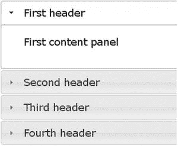

**图 11-1.** 手风琴由可折叠的面板组成，适合在有限的空间内包含信息

但是，这还不够。最好能够控制手风琴的样式。这可以通过添加清单 11-3 中给出的代码来实现。

**清单 11-3.** `Ch11_01a.html`

```
<style type="text/css">
.ui-accordion {
  width: 690px;
  margin: 2em auto;
}
.ui-accordion-header {
  font-size: 15px;
  font-weight: bold;
}
.ui-accordion-content {
  font-size: 12px;
}
</style>
```

结果如图 11-2 所示。

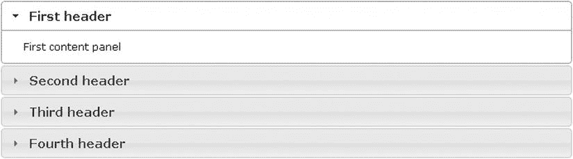

**图 11-2.** 通过修改 CSS 样式属性，你可以随心所欲地改变手风琴的外观


#### 标签页

在功能上与折叠面板非常相似的一个部件是带有标签页的面板。在这里，每个面板都是独立的，但顶部有多个标签页，通过不同的标题进行标识。尽管如此，这个部件提供了在有限空间内展示大量信息的可能性，用户每次只能选择查看一个标签页的内容。更重要的是，它失去了面板垂直展开的特性（更多信息，请参考 [`http://jqueryui.com/tabs/`](http://jqueryui.com/tabs/)）。

要在网页中获得一个标签页部件，你需要编写的 HTML 结构比之前的稍微复杂一些。标题以无序列表 `<ul>` 的形式给出，其中每个列表项 `<li>` 必须引用一个锚点标签 `<a>`。每个标签页的内容都包含在一对 `<div></div>` 中，其 `id` 属性与锚点标签中的引用相对应（参见清单 11-4）。

**清单 11-4.** `Ch11_01b.html`

```
<div id="tabs">
  <ul>
    <li><a href="#tabs-1">第一个标题</a></li>
    <li><a href="#tabs-2">第二个标题</a></li>
    <li><a href="#tabs-3">第三个标题</a></li>
    <li><a href="#tabs-4">第四个标题</a></li>
  </ul>
  <div id="tabs-1">
    <p>第一个标签面板</p>
  </div>
  <div id="tabs-2">
    <p>第二个标签面板</p>
  </div>
  <div id="tabs-3">
    <p>第三个标签面板</p>
  </div>
  <div id="tabs-4">
    <p>第四个标签面板</p>
  </div>
</div>
```

在 JavaScript 代码中，你需要指定标签页部件，如清单 11-5 所示。

**清单 11-5.** `Ch11_01b.html`

```
$(function() {
  $( "#tabs" ).tabs();
});
```

还必须定义 CSS 样式类，如清单 11-6 所示。

**清单 11-6.** `Ch11_01b.html`

```
<style type="text/css">
.ui-tabs {
  width: 690px;
  margin: 2em auto;
}
.ui-tabs-header {
  font-size: 15px;
  font-weight: bold;
}
.ui-tabs-panel {
  font-size: 12px;
}
</style>
```

当过程完成后，你将得到如图 11-3 所示的部件。

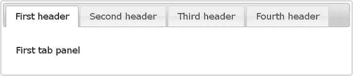

**图 11-3.** 标签页部件由多个占据同一区域的面板组成

### 标签页上的 D3 图表

你将用作容器的第一个部件是标签页。将图表插入标签页内，可以在同一页面的有限区域内显示不同的图表。在这个例子中，你将在三个标签页中放置三个不同的 D3 图表，分别称为 `Tab 1`、`Tab 2` 和 `Tab 3`。在第一个标签页中，你将放置一个多系列折线图；在第二个标签页中，放置一个条形图；在最后一个标签页中，放置一个饼图。你不会详细分析这些图表，因为它们与前面章节中使用的图表类型完全相同。每种图表类型都将封装在相应的 JS 文件中，并作为一个函数表示（参见清单 11-7 至 11-9）。

**清单 11-7.** `linechart.js`

```
function draw_linechart(s,w,h){
  margin_x = 32;
  margin_y = 20;
  var data = [{x:0,y:100},{x:10,y:110},{x:20,y:140},
              {x:30,y:130},{x:40,y:80},{x:50,y:75},
              {x:60,y:120},{x:70,y:130},{x:80,y:100}];
  var ax = [];
  var ay = [];
  data.forEach(function(d,i){
    ax[i] = d.x;
    ay[i] = d.y;
  })
  var xMax = d3.max(ax);
  var yMax = d3.max(ay);
  var xLowLim = 0;
  var xUpLim = d3.max(ax);
  var yUpLim = 1.2 * d3.max(ay);
  var yLowLim = 0.8 * d3.min(ay);
  var line = d3.svg.line()
    .x(function(d) { return x(d.x); })
    .y(function(d) { return -y(d.y); })
  y = d3.scale.linear().domain([yLowLim, yUpLim]).range([0 + margin_y, h - margin_y]);
  x = d3.scale.linear().domain([xLowLim, xUpLim]).range([0 + margin_x, w - margin_x]);
  var svg = d3.select(s)
    .append("svg:svg")
    .attr("width", w)
    .attr("height", h)
  var g = svg.append("svg:g")
    .attr("transform", "translate(0, " + h + ")");
  // 绘制 x 轴标签
  g.selectAll(".xLabel")
    .data(x.ticks(5))
    .enter().append("svg:text")
    .attr("class", "xLabel")
    .text(String)
    .attr("x", function(d) { return x(d) })
    .attr("y", 0)
    .attr("text-anchor", "middle");
  // 绘制 y 轴标签
  g.selectAll(".yLabel")
    .data(y.ticks(5))
    .enter().append("svg:text")
    .attr("class", "yLabel")
    .text(String)
    .attr("x", 25)
    .attr("y", function(d) { return -y(d) })
    .attr("text-anchor", "end");
  // 绘制 x 轴刻度
  g.selectAll(".xTicks")
    .data(x.ticks(5))
    .enter().append("svg:line")
    .attr("class", "xTicks")
    .attr("x1", function(d) { return x(d); })
    .attr("y1", -y(yLowLim))
    .attr("x2", function(d) { return x(d); })
    .attr("y2", -y(yLowLim)-5)
  // 绘制 y 轴刻度
  g.selectAll(".yTicks")
    .data(y.ticks(5))
    .enter().append("svg:line")
    .attr("class", "yTicks")
    .attr("y1", function(d) { return -y(d); })
    .attr("x1", x(xLowLim))
    .attr("y2", function(d) { return -y(d); })
    .attr("x2", x(xLowLim)+5)
  // 绘制 x 轴网格
  g.selectAll(".xGrids")
    .data(x.ticks(5))
    .enter().append("svg:line")
    .attr("class", "xGrids")
    .attr("x1", function(d) { return x(d); })
    .attr("y1", -y(yLowLim))
    .attr("x2", function(d) { return x(d); })
    .attr("y2", -y(yUpLim))
  // 绘制 y 轴网格
  g.selectAll(".yGrids")
    .data(y.ticks(5))
    .enter().append("svg:line")
    .attr("class", "yGrids")
    .attr("y1", function(d) { return -y(d); })
    .attr("x1", x(xUpLim)+20)
    .attr("y2", function(d) { return -y(d); })
    .attr("x2", x(xLowLim))
  // 绘制 x 轴
  g.append("svg:line")
    .attr("x1", x(xLowLim))
    .attr("y1", -y(yLowLim))
    .attr("x2", 1.2*x(xUpLim))
    .attr("y2", -y(yLowLim))
  // 绘制 y 轴
  g.append("svg:line")
    .attr("x1", x(xLowLim))
    .attr("y1", -y(yLowLim))
    .attr("x2", x(xLowLim))
    .attr("y2", -1.2*y(yUpLim))
  g.append("svg:path")
    .attr("class", "axisArrow")
    .attr("d", function() {
      var x1 = x(xUpLim)+23, x2 = x(xUpLim)+30;
      var y2 = -y(yLowLim), y1 = y2-3, y3 = y2+3
      return 'M'+x1+','+y1+','+x2+','+y2+','+x1+','+y3;
    });
  g.append("svg:path")
    .attr("class", "axisArrow")
    .attr("d", function() {
      var y1 = -y(yUpLim)-13, y2 = -y(yUpLim)-20;
      var x2 = x(xLowLim), x1 = x2-3, x3 = x2+3
      return 'M'+x1+','+y1+','+x2+','+y2+','+x3+','+y1;
    });
  // 绘制数据点连线
  g.append("svg:path").attr("d", line(data));
};
```

**清单 11-8.** `barchart.js`

```
function draw_barchart(s,w,h){
  var margin = {top: 70, right: 20, bottom: 30, left: 40},
```


```javascript
w = w - margin.left - margin.right,
h = h - margin.top - margin.bottom;
var color = d3.scale.category10();
var x = d3.scale.ordinal()
    .rangeRoundBands([0, w], .1);
var y = d3.scale.linear()
    .range([h, 0]);
var formatPercent = d3.format(".0%");
var xAxis = d3.svg.axis()
    .scale(x)
    .orient("bottom");
var yAxis = d3.svg.axis()
    .scale(y)
    .orient("left")
    //.tickFormat(formatPercent);
    .tickFormat(d3.format(".0%"));
var yGrid = d3.svg.axis()
    .scale(y)
    .orient("left")
    .ticks(5)
    .tickSize(-w, 0, 0)
    .tickFormat("")
var svg = d3.select(s).append("svg")
    .attr("width", w + margin.left + margin.right)
    .attr("height", h + margin.top + margin.bottom)
    .append("g")
    .attr("transform", "translate(" + margin.left + "," + margin.top + ")");
d3.csv("data_04.csv", function(error, data) {
    var sum = 0;
    data.forEach(function(d) {
        d.income = +d.income;
        sum += d.income;
    });
    x.domain(data.map(function(d) { return d.country; }));
    y.domain([0, d3.max(data, function(d) { return d.income/sum; })]);
    svg.append("g")
        .attr("class", "x axis")
        .attr("transform", "translate(0," + h + ")")
        .call(xAxis);
    svg.append("g")
        .attr("class", "y axis")
        .call(yAxis)
    svg.append("g")
        .attr("class", "grid")
        .call(yGrid);
    var labels = svg.append("g")
        .attr("class", "labels")
    labels.append("text")
        .attr("transform", "rotate(-90)")
        .attr("y", 6)
        .attr("dy", ".71em")
        .style("text-anchor", "end")
        .text("Income [%]");
    svg.selectAll(".bar")
        .data(data)
        .enter().append("rect")
        .attr("class", "bar")
        .attr("x", function(d) { return x(d.country); })
        .attr("width", x.rangeBand())
        .attr("y", function(d) { return y(d.income/sum); })
        .attr("height", function(d) { return h - y(d.income/sum); })
        .attr("fill", function(d) { return color(d.country); });
});
};
```

清单 11-9. `piechart.js`

```javascript
function draw_piechart(s,w,h){
    var margin = {top: 10, right: 10, bottom: 10, left: 10},
        w = w - margin.left - margin.right,
        h = h - margin.top - margin.bottom;
    var color = d3.scale.category10();
    var radius = Math.min(w, h) / 2;
    var arc = d3.svg.arc()
        .outerRadius(radius)
        .innerRadius(0);
    var pie = d3.layout.pie()
        .sort(null)
        .value(function(d) { return d.income; });
    var svg = d3.select(s).append("svg")
        .attr("width", w + margin.left + margin.right)
        .attr("height", h + margin.top + margin.bottom)
        .append("g")
        .attr("transform", "translate(" +(w/2+margin.left)+
            "," +(h/2+margin.top)+ ")");
    d3.csv("data_04.csv", function(error, data) {
        data.forEach(function(d) {
            d.income = +d.income;
        });
        var g = svg.selectAll(".arc")
            .data(pie(data))
            .enter().append("g")
            .attr("class", "arc");
        g.append("path")
            .attr("d", arc)
            .style("fill", function(d) { return color(d.data.country); });
        g.append("text")
            .attr("transform", function(d) {
                return "translate(" + arc.centroid(d) + ")"; })
            .style("text-anchor", "middle")
            .text(function(d) { return d.data.country; });
    });
};
```

随着网页上引入如此多的图形元素，使用**层叠样式表（CSS）**样式变得越来越重要。你需要定义一些设置来修改选项卡的外观，使其符合你的需求。添加清单 11-10 中的样式设置。

清单 11-10. `Ch11-02.html`

```css
<style>
.ui-tabs {
    width: 690px;
    margin: 2em auto;
}
.ui-tabs-nav {
    font-size: 12px;
}
.ui-tabs-panel {
    font-size: 14px;
}
.jqplot-target {
    font-size: 18px;
}
ol.description {
    list-style-position: inside;
    font-size: 15px;
    margin: 1.5em auto;
    padding: 0 15px;
    width: 600px;
}
</style>
```

就像之前对 JavaScript 代码所做的那样，对 CSS 也进行同样的处理。将多系列折线图的**层叠样式表（CSS）**样式单独定义，并封装在一个名为 `linechart.css` 的外部文件中（参见清单 11-11）。

清单 11-11. `Linechart.css`

```css
path {
    stroke: black;
    stroke-width: 3;
    fill: none;
}
line {
    stroke: black;
}
.xGrids {
    stroke: lightgray;
}
.yGrids {
    stroke: lightgray;
}
text {
    font-family: Verdana;
    font-size: 9pt;
}
.axisArrow {
    stroke: black;
    stroke-width: 1;
    fill: black;
}
```

现在是时候在 `$(document).ready()` 函数的末尾添加 jQueryUI 的 `tabs()` 函数了，如清单 11-12 所示。

清单 11-12. `ch11_02.html`

```javascript
$(document).ready(function(){
    $("#tabs").tabs();
    draw_linechart("#tabs-1",400,300);
    draw_barchart("#tabs-2",400,300);
    draw_piechart("#tabs-3",400,300);
});
```

选择某个选项卡将重新绘制其中的图表内容。现在，在网页的 `<body>` 部分，你需要添加 jQuery UI 库将转换为选项卡的 `<div>` 元素。具体做法是指定一个 `id` 为 `tabs` 的 `<div>` 元素。在其中，定义一个包含三个项目的列表，每个项目代表一个选项卡。在列表之后，你还需要定义 `tabs` 的三个子分区：三个额外的 `<div>` 元素，分别命名为 `tabs-1`、`tabs-2` 和 `tabs-3`。你将把图表放入这些分区中：`chart1`、`chart2` 和 `chart3`（参见清单 11-13）。

清单 11-13. `ch11_02.html`

```html
<div id="tabs">
    <ul>
        <li><a href="#tabs-1">选项卡 1</a></li>
        <li><a href="#tabs-2">选项卡 2</a></li>
        <li><a href="#tabs-3">选项卡 3</a></li>
    </ul>
    <div id="tabs-1">
        <p>这是折线图</p>
    </div>
    <div id="tabs-2">
        <p>这是柱状图</p>
    </div>
    <div id="tabs-3">
        <p>这是饼图</p>
    </div>
</div>
```

图 11-4 展示了最终结果。

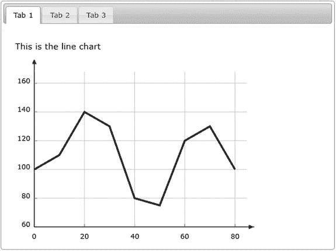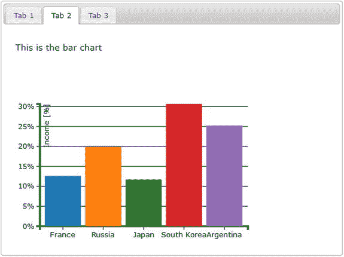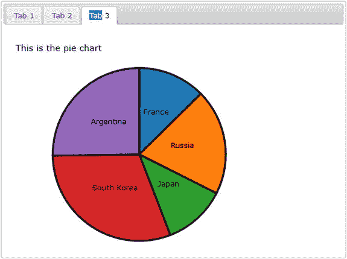

**图 11-4.** 一个包含三个选项卡的页面，每个选项卡内含有不同的图表


### 手风琴中的 D3 图表

jQuery UI 中另一种常用的容器是手风琴。这次你将把之前的三个图表放入手风琴中。网页需要包含的插件列表与上一个示例相同。你需要在 CSS 样式上做一些修改；手风琴有特定的 CSS 类，需要指定它们的属性。如清单 11-14 所示。

**清单 11-14.** `ch11_03.html`

```css
<style type="text/css">
.ui-accordion {
  width: 690px;
  margin: 2em auto;
}
.ui-accordion-header {
  font-size: 12px;
}
.ui-accordion-content {
  font-size: 14px;
}
.jqplot-target {
  font-size: 18px;
}
ol.description {
  list-style-position: inside;
  font-size: 15px;
  margin: 1.5em auto;
  padding: 0 15px;
  width: 600px;
}
.section {
  width: 400px;
  height: 200px;
  margin-top: 20px;
  margin-left: 20px;
}
</style>
```

与上一个示例一样，你必须创建 jQuery UI 小部件。你可以通过调用`accordion()`函数来实现，如清单 11-15 所示：

**清单 11-15.** `ch11_03.html`

```javascript
$(document).ready(function(){
  $("#accordion").accordion();
  draw_linechart("#chart1",400,300);
  draw_barchart("#chart2",400,300);
  draw_piechart("#chart3",400,300);
});
```

如你所见，定义手风琴的方式与定义选项卡非常相似。同样，你现在需要在 HTML 代码中定义将被转换为手风琴选项卡的`<div>`元素（参见清单 11-16）。

**清单 11-16.** `ch11_03.html`

```html
<div id="accordion" style="margin-top:50px">
  <h3><a href="#">第 1 部分</a></h3>
  <div>
    <p>这是柱状图</p>
    <div id="chart1"></div>
  </div>
  <h3><a href="#">第 2 部分</a></h3>
  <div>
    <p>这是多系列折线图</p>
    <div class="section" id="chart2"></div>
  </div>
  <h3><a href="#">第 3 部分</a></h3>
  <div>
    <p>这是饼图</p>
    <div class="section" id="chart3"></div>
  </div>
</div>
```

如图 11-5 所示，结果与上一个类似，但这次不同的图表通过垂直滑动手风琴选项卡来切换。

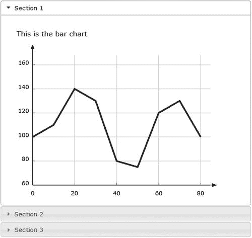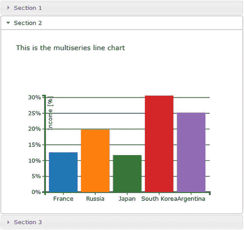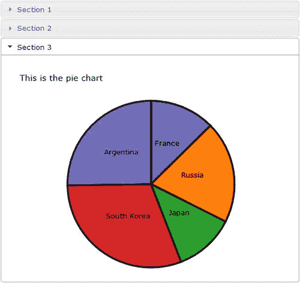

**图 11-5.** 包含三个图表的手风琴小部件

默认情况下，你需要点击手风琴标题来激活关联的面板。但你可以更改此行为，设置激活每个面板中部分的事件。例如，你可以将`mouseover`设置为激活事件。为此，你需要将事件作为参数传递给`accordion()`函数。

```javascript
$("#accordion").accordion({ event: "mouseover" });
```

如果你修改代码，当鼠标悬停在相应手风琴标题上时，你将看到每个部分展开。

### 可调整大小和可拖动的图表

你可以在图表中广泛利用的另外两个功能是让用户调整容器区域的大小和拖动它。网页中的可调整大小框架允许你任意更改其大小及其包含对象的大小。此功能可以与拖动页面内元素的能力相结合，从而使它们能够占据相对于原始位置的不同位置。

除了使页面布局更流畅之外，当你希望用户交互式地管理页面上不同框架所占用的空间时，此功能有时也很有用（参见图 11-6）。

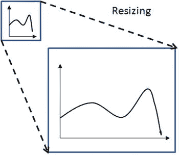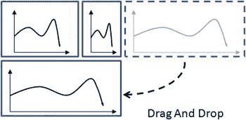

**图 11-6.** 将图表封装在 jQuery UI 容器中，可以调整它们的大小并在页面上移动它们

在本节中，你将看到两个示例。在第一个示例中，你将重点放在应用于折线图的调整大小功能上。你将看到调整包含在容器中的图表大小是多么容易。在第二个示例中，你将通过添加另外两个折线图来进一步扩展该示例。一旦为所有三个图表启用了可拖动属性，你将看到如何根据自己的喜好更改它们的位置，甚至交换它们。

#### 可调整大小的折线图

在这个示例中，你将使用一个简单的折线图。因此，你只需要包含 CSS 和文件`linechart.js`中的`draw_linechart()`函数（参见清单 11-7 和 11-11）。

```html
<link rel="stylesheet" href="./linechart.css" />
<script src="./linechart.js"></script>
```

相反，将 jQuery UI 容器相关的 CSS 样式直接添加到你的 HTML 页面中（参见清单 11-17）。

**清单 11-17.** `ch11_04.html`

```css
<style type="text/css">
.chart-container {
  border: 1px solid darkblue;
  padding: 30px 0px 30px 30px;
  width: 900px;
  height: 400px;
}
#chart1 {
  width: 96%;
  height: 96%;
}
</style>
```

在网页的`<body>`部分，你现在添加`<div>`元素，它将是包含折线图的容器（参见清单 11-18）。

**清单 11-18.** `ch11_04.html`

```html
<div id="resizable" class="chart-container">
  <div id="chart1"></div>
</div>
```

现在，在将`chart-container`定义为容器之后，你可以使用两个 jQuery 方法来处理它——`resizable()`函数添加可调整大小功能，`bind()`函数将调整大小事件绑定到图表的重新绘制（参见清单 11-19）。

**清单 11-19.** `ch11_04.html`

```javascript
$(document).ready(function(){
  $('div.chart-container').resizable({delay:20});
  $('div.chart-container').bind('resize', function(event, ui) {
    d3.select("#chart1").selectAll("svg").remove();
    draw_linechart("#chart1", ui.size.width, ui.size.height);
  });
  draw_linechart("#chart1",400,300);
});
```

结果是一个可调整大小的图表，如图 11-7 所示，右下角有一个小的灰色三角形。用户通过点击它，可以调整容器的大小，从而调整 D3 图表的大小。

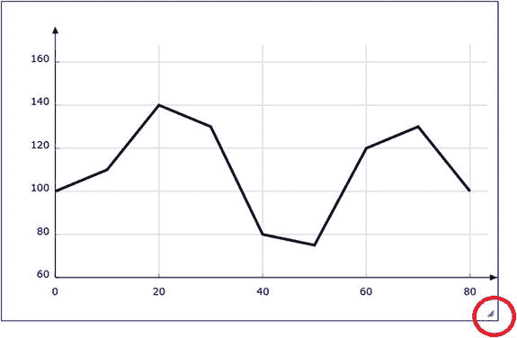

**图 11-7.** 可调整大小的折线图


#### 三个可拖拽的折线图

在上一个示例的基础上，你将通过将另外两个折线图放置到独立的容器中来添加它们。此处的目标——除了让所有三个容器都可调整大小之外——是让这些容器可拖拽。最终结果是一个包含三个折线图的网页，这些折线图的位置可以通过拖拽来改变，甚至可以交换它们的位置。

首先，对上一个示例做一些小的补充。在清单 11-20 中，你添加了另外两个容器（`chart-container2` 和 `chart-container3`），并在其中放置了新的折线图，分别命名为 `chart2` 和 `chart3`。

**清单 11-20.** `ch11_04b.html`

```html
<BODY>

<div class="chart-container">
  <div id="chart1"></div>
</div>

<div class="chart-container2">
  <div id="chart2"></div>
</div>

<div class="chart-container3">
  <div id="chart3"></div>
</div>

</BODY>
```

现在你已经创建了三个不同的容器，每个容器可以容纳前几个示例中看到的三个图表之一。接下来，你将激活这三个容器的可拖拽功能。这其实非常简单；你只需要将函数添加到应用于每个容器的三个 jQuery 选择器中，如清单 11-21 所示。此外，你将像处理第一个容器一样，为两个新容器添加调整大小的功能。

**清单 11-21.** `ch11_04b.html`

```javascript
$(document).ready(function(){
  $('div.chart-container').draggable({
    cursor: 'move'
  });
  $('div.chart-container2').draggable({
    cursor: 'move'
  });
  $('div.chart-container3').draggable({
    cursor: 'move'
  });

  $('div.chart-container').resizable({delay:20});
  $('div.chart-container').bind('resize', function(event, ui) {
    d3.select("#chart1").selectAll("svg").remove();
    draw_linechart("#chart1", ui.size.width, ui.size.height);
  });

  $('div.chart-container2').resizable({delay:20});
  $('div.chart-container2').bind('resize', function(event, ui) {
    d3.select("#chart2").selectAll("svg").remove();
    draw_piechart("#chart2", ui.size.width, ui.size.height);
  });

  $('div.chart-container3').resizable({delay:20});
  $('div.chart-container3').bind('resize', function(event, ui) {
    d3.select("#chart3").selectAll("svg").remove();
    draw_barchart("#chart3", ui.size.width, ui.size.height);
  });

  draw_linechart("#chart1",300,200);
  draw_piechart("#chart2",200,200);
  draw_barchart("#chart3",500,200);
});
```

剩下的就是添加 CSS 样式，从而定义每个容器的初始位置和大小，如清单 11-22 所示。

**清单 11-22.** `ch11_04b.html`

```css
<style type="text/css">
.chart-container {
  border: 1px solid darkblue;
  padding: 30px 0px 30px 30px;
  width: 300px;
  height: 200px;
  position: relative;
  float: left;
}

.chart-container2 {
  border: 1px solid darkblue;
  padding: 30px 0px 30px 30px;
  width: 200px;
  height: 200px;
  position: relative;
  float: left;
  margin-left: 20px;
}

.chart-container3 {
  border: 1px solid darkblue;
  padding: 30px 0px 30px 30px;
  width: 500px;
  height: 200px;
  position: relative;
  float: left;
  margin-left: 20px;
}

#chart1 {
  width: 96%;
  height: 96%;
}

#chart2 {
  width: 96%;
  height: 96%;
}

#chart3 {
  width: 96%;
  height: 96%;
}
</style>
```

在图 11-8 中，你可以看到页面初始加载时的布局。图 11-9 展示了用户改变了第三个图表的位置和大小，使其对齐到其他两个图表下方的情况。

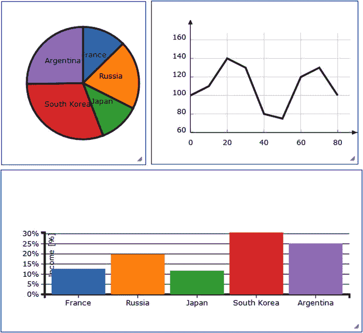

**图 11-9.** 通过拖拽和调整容器大小，可以改变原始布局

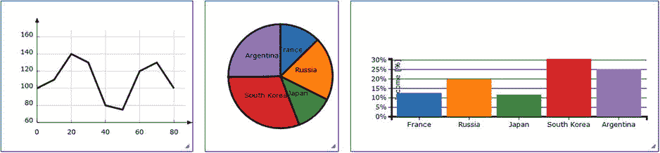

**图 11-8.** 网页展示了三个封闭在不同容器中的折线图

### 本章小结

在本章中，你已经了解了如何利用 jQuery UI 库提供的小部件的潜力，这些小部件有助于改善图表的呈现方式。你已经了解了如何将多个图表放入诸如折叠面板和选项卡之类的容器中，这样即使它们占据同一区域，你也可以逐个查看它们。你还了解了如何调整这些容器的大小，并将这种能力扩展到使用 jqPlot 库开发的图表上。

在下一章也是最后一章中，你将了解如何使用 JSON 格式处理结构化数据。你将看到处理高度结构化数据以进行数据可视化是多么“自然”，而使用其他 JavaScript 库和编程语言来实现这种可视化可能颇具挑战性。

