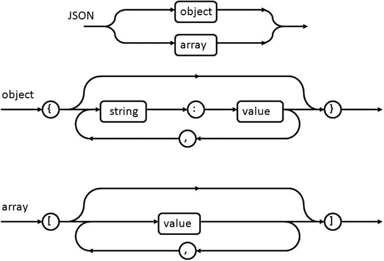
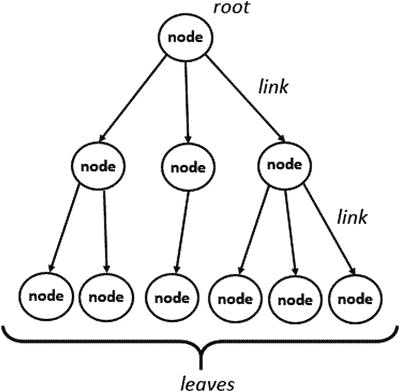
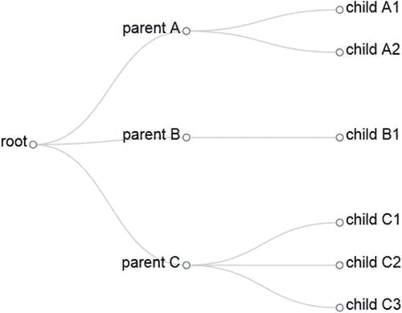
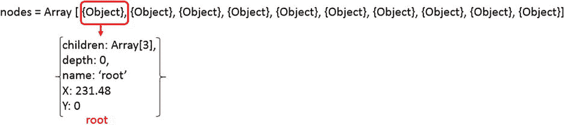
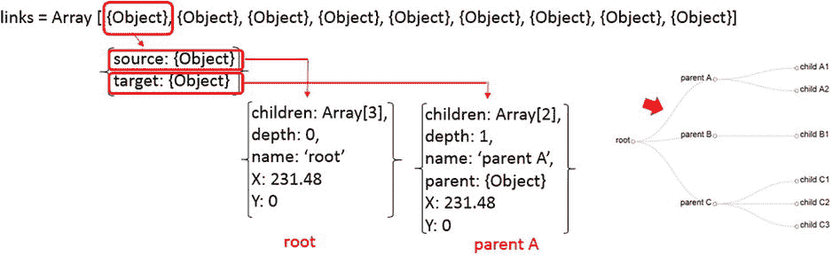
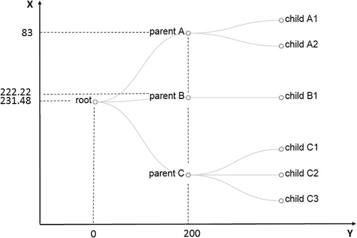
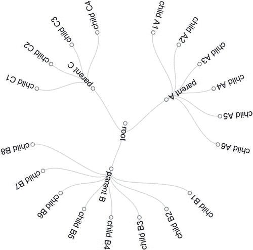
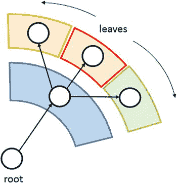
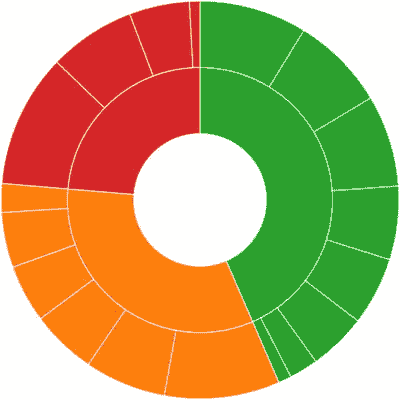
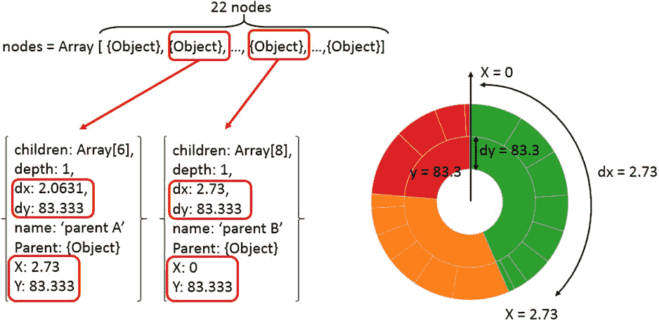

# 12. JSON 与布局——处理结构化数据

处理完图表的所有图形方面之后，是时候更详细地分析输入数据了。在前面的章节中，你开始将输入数据的值分配给数组。然后，你使用了包含在 CSV 或 TSV 文件中的表格数据。这一步使你能够处理可视化所需的大部分数据，但实际上，还有更复杂的数据结构，例如树形层次结构。

实际上，为了获取此类数据，通常需要与其他技术进行交互，为此，你需要找到一种非常适合任何数据源的方法。需要使用一种通用的文本格式，该格式易于被不同的脚本语言（尤其是 JavaScript）处理，并且对人类来说仍然易于理解，这导致了 `JavaScript` 对象表示法（`JSON`）格式的使用。你在第 1 章中简要了解了这种格式，但现在你将看到如何具体使用它来处理来自外部源的输入数据。

本章将详细研究 `JSON` 格式。首先，你将通过分析一些语法图来了解 `JSON` 格式中如何存在结构化数据。然后，你将进入实际示例。

### JSON 格式

`JSON`（`JavaScript` 对象表示法）是一种数据交换格式（详见 [`http://json.org`](http://json.org/)）。由于其树状结构（每个元素被称为一个名称-值对），人类易于读写，机器也易于解析和生成。这是其日益普及的主要原因。

`JSON` 结构建立在两种不同结构的组合之上：数组和对象（见图 12-1）。在其中，你可以定义所有常用的经典原始值，即使在其它语言中也是如此：数字、布尔值、字符串和空值。这使得其中包含的值可以在各种编程语言之间进行交换。（在 [`www.json.org`](http://www.json.org/) 上，你可以找到所有处理 `JSON` 格式的语言列表，以及所有相关技术的列表，例如库、模块、插件等。）



图 12-1. `JSON` 的语法图

为了更好地理解图 12-1 中的语法图，你可以分析 `JSON` 格式是如何构建的。你必须考虑两件事。第一，对象和数组都包含一系列由图中 `value` 标签标识的值。`value` 指的是任何类型的值，例如字符串、数字或布尔值，它甚至可以是对象或数组。

除此之外，你很容易猜到 `JSON` 结构是一个具有不同层级的树状结构。树的节点要么是数组，要么是对象；叶子节点是其中包含的值。

考虑一些例子。如果你有一个只有一层结构的 `JSON`，那么只有两种可能：

- 一个值的数组
- 一个带有值的对象

如果你将结构扩展到两层，则有四种可能（为简单起见，假设树是对称的）：

- 数组的数组
- 对象的数组
- 带有数组的对象
- 带有对象的对象

以此类推；情况逐渐变得更加复杂。通过这种方式，你可以生成所有可能的数据结构，例如树（见图 12-2）。



图 12-2. 一种树状数据结构

现在，根据上述关于 `JSON` 格式的说明，编写图 12-2 中所示的树结构，然后将文件保存为 `tree.json`。如清单 12-1 所示，通过交替使用对象和数组，可以描述任何数据结构，甚至更复杂的结构。

**清单 12-1.** `tree.json`

```json
{
  "name": "root",
  "children": [
    {
      "name": "parent A",
      "children": [
        {"name": "child A1"},
        {"name": "child A2"}
      ]
    },{
      "name": "parent B",
      "children": [
        {"name": "child B1"}
      ]
    },{
      "name": "parent C",
      "children": [
        {"name": "child C1"},
        {"name": "child C2"},
        {"name": "child C3"}
      ]
    }
  ]
}
```

### JSON 不是 JavaScript 对象字面量

这一点值得更详细地讨论，因为人们很容易混淆 `JSON` 和 `JavaScript` 对象字面量。

当你有两个不同的系统（可能使用不同的编程语言）并且它们需要通信时，它们将使用字符串来交换数据。字符串中描述的数据将遵循一种格式，在你的例子中就是 `JSON`。

即使 `JSON` 字符串与 `JavaScript` 结构化对象具有相同的格式，它也只是一个字符串。

相反，一旦 `JSON` 文件被 `d3.json()` 函数解释，它将被视为一个实际的结构化对象，其数据存储在变量、数组和对象中，以 `JavaScript` 处理这些实例的方式。

### D3 布局

该库提供了称为布局的 `D3` 模块，帮助开发者构建结构以处理复杂数据。此外，`D3` 布局凭借其内部实现，在管理构成图表的元素坐标计算方面，是非常有用的工具。事实上，一旦将数据结构加载到布局（例如树）中，布局就会为每个将在绘图区域中占据位置的节点计算 `x` 和 `y` 坐标。

正是由于可能的数据结构数量庞大，`D3` 库提供了一组内置布局。特别是，为了处理层次化数据结构，`D3` 库提供了以下布局：

- `partition`
- `tree`
- `cluster`
- `pack`
- `treemap`

### 从一个简单的树开始

作为第一个示例，你将实现一个显示树的 HTML 页面。层次结构的数据正是包含在文件 `tree.json`（见清单 12-1）中的数据。到目前为止，你已经看到借助 `d3.csv()` 和 `d3.tsv()` 函数读取 CSV 或 TSV 文件中的数据是多么容易。类似地，`D3` 库提供了一个名为 `d3.json()` 的函数。

```javascript
d3.json("path/to/file.json", function(error, root){
  ...
});
```

在专门为层次化数据结构提供的各种 `D3` 布局中，`d3.layout.tree` 最适合所选示例。作为参考，我选择了一个复杂的树状图表示，即 `M. Bostock` 的示例 #4063570 ([`http://bl.ocks.org/mbostock/4063570`](http://bl.ocks.org/mbostock/4063570))。

**清单 12-2.** `Ch12-1.html`

```html
<HTML>
<HEAD>
<meta charset="utf-8">
<script src="http://d3js.org/d3.v3.js"></script>
<STYLE>
.node circle {
  fill: #fff;
  stroke: steelblue;
  stroke-width: 1.5px;
}
.node {
  font: 20px sans-serif;
}
.link {
  fill: none;
  stroke: #ccc;
  stroke-width: 1.5px;
}
</STYLE>
</HEAD>
<body>
<script>
var width = 600;
var height = 500;

var tree = d3.layout.tree()
    .size([height, width-200]);

var diagonal = d3.svg.diagonal()
    .projection (function(d) {return [d.y, d.x];});

var svg = d3.select("body").append("svg")
    .attr("width",width)
    .attr("height",height)
  .append("g")
    .attr("transform", "translate(100, 0)");

d3.json("tree.json", function(error, root){
  var nodes = tree.nodes(root);
  var links = tree.links(nodes);

  var link = svg.selectAll(".link")
      .data(links)
    .enter().append("path")
      .attr("class", "link")
      .attr("d", diagonal);

  var node = svg.selectAll(".node")
      .data(nodes)
    .enter().append("g")
      .attr("class", "node")
      .attr("transform", function(d) { return "translate(" + d.y + ", " + d.x + ")"; });

  node.append("circle")
      .attr("r", 4.5);

  node.append("text")
      .attr("dx", function(d) { return d.children ? -8 : 8; })
      .attr("dy", 3)
      .style("text-anchor", function(d) { return d.children ? "end" : "start"; })
      .text( function(d){return d.name;});
});
</script>
</BODY>
</HTML>
```

通过这种方式，你得到了一棵树（见图 12-3），它与图 12-2 中表示的树非常相似。



图 12-3. 从 `JSON` 文件动态生成的树

### 树形布局分析

如果你仔细观察图 12-3 中的树，就会发现它不过是`tree.json`文件中以 `JSON` 格式描述的层次结构的动态呈现。你在本例中实现的代码能够表示任意树形结构，无论其层级、节点和叶子的数量如何。

这种高效的数据管理 `JSON` 及其正确可视化，很大程度上归功于 `D3` 布局所扮演的角色。在本例中，你使用了`d3.layout.tree`。现在你将详细了解它的工作原理，以及它如何在内部处理从 `JSON` 文件读取的数据。

通过分析清单 12-2 所示的代码，你可以看到布局的声明。下一步是使用`size()`函数声明绘图区域的大小（见清单 12-3）。这一步非常重要，因为布局的主要目的之一就是自动计算树中所有节点的所有`x`和`y`坐标。计算出的`x`和`y`值完全取决于传递给`size()`函数的两个参数。

**清单 12-3.** `Ch12-1.html`

```javascript
var tree = d3.layout.tree()
    .size([height, width-200]);
```

从 `JSON` 文件读取的数据存储在`root`变量中。然后，通过`nodes()`函数将其加载到布局中（见清单 12-4）。此操作会生成一个包含构成树的所有节点的数组，你将把这个数组存储在`nodes`变量中。下一步操作是生成一个包含连接树中所有节点的链接的数组`links`。你可以使用`links()`函数来创建它。

**清单 12-4.** `Ch12-1.html`

```javascript
d3.json("tree.json", function(error, root){
    var nodes = tree.nodes(root);
    var links = tree.links(nodes);
    ...
});
```

查看刚刚创建的两个数组的内容，你会发现一系列嵌套的数据结构，比 `JSON` 文件中描述的复杂得多。该树由 10 个节点和 9 个链接组成，这些对象分别包含在`nodes`和`links`两个数组中（见图 12-4）。此外，你还会注意到每个节点都附带两个新字段`x`和`y`，这正是布局计算出的坐标。




**图 12-4.** `d3.layout.tree` 的内部结构相当复杂

图 12-5 清晰地展示了布局节点中的`x`和`y`坐标如何与将在树上呈现的绘图区域相匹配。



**图 12-5.** `d3.layout.tree` 根据绘图区域的大小自动计算每个节点的坐标

### 圆形树形表示

你在前一个示例中看到的树形结构是一个简单的结构，随着节点和层级数量的增加，结构会变得越来越复杂。在这种情况下，一种常见的做法是将树表示为圆形。

首先，通过编写一个新的 JSON 格式结构（见清单 12-5）来增加树的复杂度，然后将其保存为`tree2.json`。

**清单 12-5.** `tree2.json`

```
{
    "name": "root",
    "children": [
        {
            "name": "parent A",
            "children": [
                {"name": "child A1"},
                {"name": "child A2"},
                {"name": "child A3"},
                {"name": "child A4"},
                {"name": "child A5"},
                {"name": "child A6"}
            ]
        },{
            "name": "parent B",
            "children": [
                {"name": "child B1"},
                {"name": "child B2"},
                {"name": "child B3"},
                {"name": "child B4"},
                {"name": "child B5"},
                {"name": "child B6"},
                {"name": "child B7"},
                {"name": "child B8"}
            ]
        },{
            "name": "parent C",
            "children": [
                {"name": "child C1"},
                {"name": "child C2"},
                {"name": "child C3"},
                {"name": "child C4"}
            ]
        }
    ]
}
```

现在输入用于表示圆形树的 HTML 页面代码（见清单 12-6）。

**清单 12-6.** `ch12-2.html`

```
<HTML>
<HEAD>
<meta charset="utf-8">
<script src="http://d3js.org/d3.v3.js"></script>
<style type="text/css">
.node circle {
    fill: #fff;
    stroke: steelblue;
    stroke-width: 1.5px;
}
.node {
    font: 20px sans-serif;
}
.link {
    fill: none;
    stroke: #ccc;
    stroke-width: 1.5px;
}
</style>
</HEAD>
<body>
<script>
var radius = 350;
var margin = 120;
var angle = 360;
var tree = d3.layout.tree()
    .size([angle, radius-margin]);
var diagonal = d3.svg.diagonal.radial()
    .projection (function(d) {return [d.y, d.x / 180* Math.PI];});
var svg = d3.select("body").append("svg")
    .attr("width", 2*radius)
    .attr("height", 2*radius)
    .append("g")
    .attr("transform", "translate("+radius + ", " + radius + ")");
d3.json("tree2.json", function(error, root){
    var nodes = tree.nodes(root);
    var links = tree.links(nodes);
    var link = svg.selectAll(".link")
        .data(links)
        .enter().append("path")
        .attr("class", "link")
        .attr("d", diagonal);
    var node = svg.selectAll(".node")
        .data(nodes)
        .enter().append("g")
        .attr("class", "node")
        .attr("transform", function(d) { return "rotate(" + (d.x - 90) + ")translate(" + d.y + ")"; });
    node.append("circle")
        .attr("r", 4.5);
    node.append("text")
        .attr("dy", ".31em")
        .attr("text-anchor", function(d) { return d.x > 180 ? "start" : "end"; })
        .attr("transform", function(d) { return d.x > 180 ? "translate(8)" : "rotate(180)translate(-8)"; })
        .text(function(d) { return d.name; });
});
</script>
</body>
</HTML>
```

图 12-6 展示了从 JSON 文件读取的树的圆形表示。



**图 12-6.** 树的圆形表示

#### 分区布局

在前面的示例中，你看到了树的圆形表示。在本节中，你将看到另一种表示形式，它非常类似于环形图（参见第 5 章，图 5-10）。（参见图 12-7）。通常，它会生成邻接图，例如节点-链接树图的填充空间变体。它不是绘制层次结构中父节点和子节点之间的链接，而是将节点绘制为实心区域（圆弧或矩形），它们相对于其他节点的位置揭示了它们在层次结构中的位置。

因此，在这种表示中，节点由扇形区域表示，而链接则通过径向方式隐式描述。典型树结构的分层信息得以保留。但还有更多内容。以扇形区域形式表示的节点允许我们向图表添加更多信息：我们可以表示每个叶子节点相对于其他叶子节点的权重。实际上，我们可以通过扇形区域的扩展角度来表示这个数量。



图 12-7. 树的另一种圆形表示

同样在这种情况下，D3 库为我们提供了适合此目的的层次布局：`d3.layout.partition`。在前面的示例中，你看到`d3.layout.tree`自动计算了每个节点的`x`和`y`坐标。同样地，`d3.layout.partition`计算每个扇形区域（即每个节点）的扩展角度。

首先，修改你在前面示例中使用的数据结构，为每个叶子节点添加一个大小值。该值表示每个叶子节点相对于其他叶子节点的“权重”（参见清单 12-7）。

**清单 12-7.** `tree4.json`

```
{
"name": "root",
"children": [
{
"name": "parent A",
"children": [
{"name": "child A1", "size": 25},
{"name": "child A2", "size": 31},
{"name": "child A3", "size": 11},
{"name": "child A4", "size": 21},
{"name": "child A5", "size": 44},
{"name": "child A6", "size": 22}
]
},{
"name": "parent B",
"children": [
{"name": "child B1", "size": 5},
{"name": "child B2", "size": 11},
{"name": "child B3", "size": 35},
{"name": "child B4", "size": 36},
{"name": "child B5", "size": 28},
{"name": "child B6", "size": 22},
{"name": "child B7", "size": 26},
{"name": "child B8", "size": 41}
]
},{
"name": "parent C",
"children": [
{"name": "child C1", "size": 23},
{"name": "child C2", "size": 51},
{"name": "child C3", "size": 33},
{"name": "child C4", "size": 4}
]
}]
}
```

而清单 12-8 展示了用于显示树形扇形区域的 HTML 页面代码。作为参考，我选择了 M. Bostock 的示例#4063423（[`bl.ocks.org/mbostock/4063423`](http://bl.ocks.org/mbostock/4063423)）中的“旭日图”表示。

**清单 12-8.** `ch12_03.html`

```
<HTML>
<HEAD>
<meta charset="utf-8">
<script src="http://d3js.org/d3.v3.js"></script>
</HEAD>
<body>
<script>
var radius = 250;
var angle = 360;
var color = d3.scale.category10();
var svg = d3.select("body").append("svg")
.attr("width", 2*radius)
.attr("height", 2* radius)
.append("g")
.attr("transform", "translate("+radius + ", " + radius + ")");
var partition = d3.layout.partition()
.size([2 * Math.PI, radius]);
var arc = d3.svg.arc()
.startAngle(function(d) { return d.x; })
.endAngle(function(d) { return d.x + d.dx; })
.innerRadius(function(d) { return d.y; })
.outerRadius(function(d) { return d.y + d.dy; });
d3.json("tree3.json", function(error, root) {
var size = function(d) { return d.size; };
var nodes = partition.value(size).nodes(root);
var path = svg.datum(root).selectAll("path")
.data(nodes)
.enter().append("path")
.attr("display", function(d) { return d.depth ? null : "none"; })
.attr("d", arc)
.style("stroke", "#fff")
.style("fill", function(d) { return color((d.children ? d : d.parent).name); })
.style("fill-rule", "evenodd");
});
</script>
</body>
</HTML>
```

图 12-8 展示了代码的运行结果。



图 12-8. 树的另一种圆形表示

现在让我们详细分析`d3.layout.partition`的工作原理。分区布局的声明与树布局非常相似（参见清单 12-9）。通过传递给`size()`函数的两个参数，你可以将第一个参数设置为圆形范围（本例中为整圆角度），第二个参数设置为半径。

**清单 12-9.** `ch12_03.html`

```
var partition = d3.layout.partition()
.size([2 * Math.PI, radius]);
```

在`json()`函数内部，你可以通过`root`变量将 JSON 文件中包含的结构化数据分配给分区布局。叶子节点的大小值通过递归传递给`value()`函数（参见清单 12-10）。

**清单 12-10.** `ch12_03.html`

```
d3.json("tree3.json", function(error, root) {
var size = function(d) { return d.size; };
var nodes = partition.value(size).nodes(root);
```

如果你详细分析分区布局的内部结构，可以看到它在图 12-9 中的结构方式。



图 12-9. 分区布局的详细结构

最后，函数`d3.svg.arc()`会将`x`、`y`、`dx`和`dy`值转换为构成整个图表的扇形区域（参见清单 12-11）。

**清单 12-11.** `ch12_03.html`

```
var arc = d3.svg.arc()
.startAngle(function(d) { return d.x; })
.endAngle(function(d) { return d.x + d.dx; })
.innerRadius(function(d) { return d.y; })
.outerRadius(function(d) { return d.y + d.dy; });
```

#### JSON 与布局的无限可能

在前两个示例中，你亲眼看到了 D3 库（结合 JSON 技术进行数据输入）所能提供的无限可能性的冰山一角。

对于任何有兴趣进一步扩展该主题的人，我强烈建议访问[`https://github.com/mbostock/d3/wiki/Gallery`](https://github.com/mbostock/d3/wiki/Gallery)。该页面内包含大量使用 D3 库开发的示例。

### 总结

在本章中，你了解了 D3 库如何读取 JSON 格式的结构化数据。此外，你还了解了布局及其在处理具有复杂结构（如树）的数据时所起的作用。

### 结语

通过本章，你已读完了本书。全书呈现并讨论了许多图表示例。至此，你应该熟悉了所有最常见的图表类型。此外，你应该已经养成了使用 D3 库实现 JavaScript 代码的良好实践，以创建一系列 SVG 图形，从而构建你需要的各种图表。

此外，示例的顺序经过精心选择，以便你能够逐步学习 D3 库所依据的所有概念（选择器、布局、域、比例尺、链式方法等）。

我必须说，尽管涵盖了大量的主题，但还有许多其他主题我本想添加。我希望这本书能让你更好地欣赏数据可视化世界，尤其是图表。我也希望这本书能为你提供良好的数据可视化基础知识，并证明它在你处理图表的所有场合中都能成为宝贵的帮手。