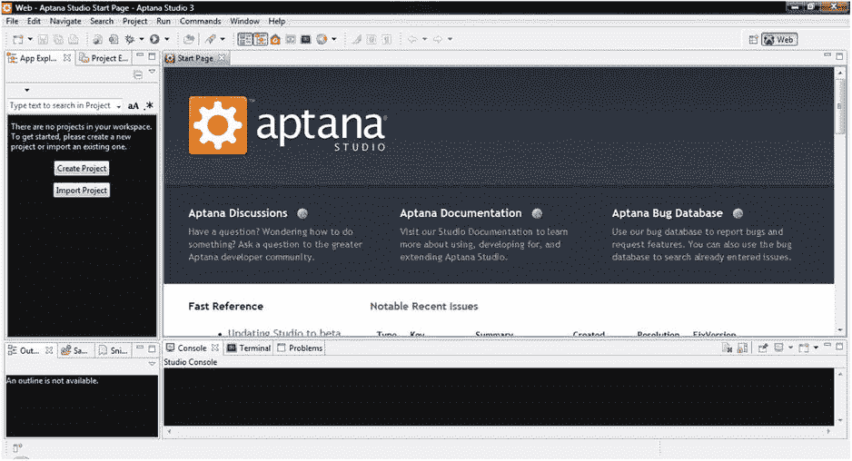
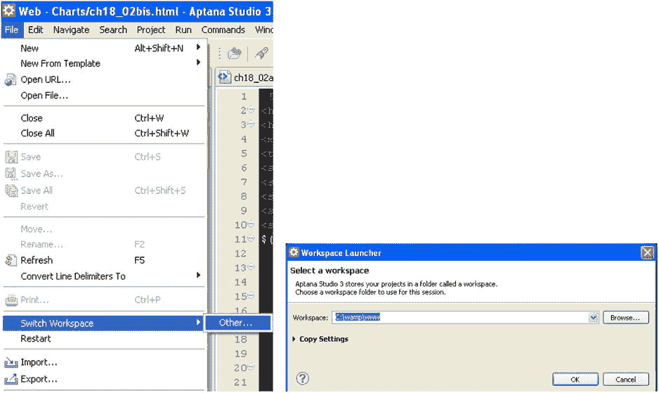
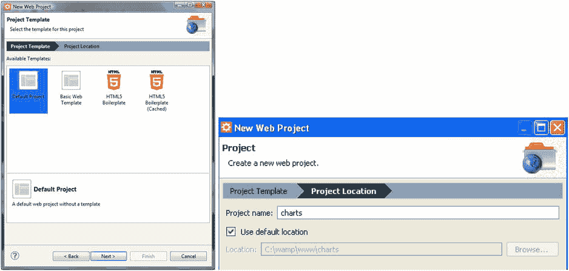
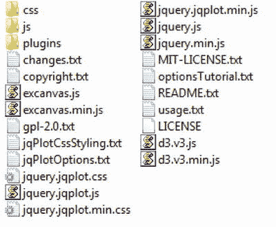
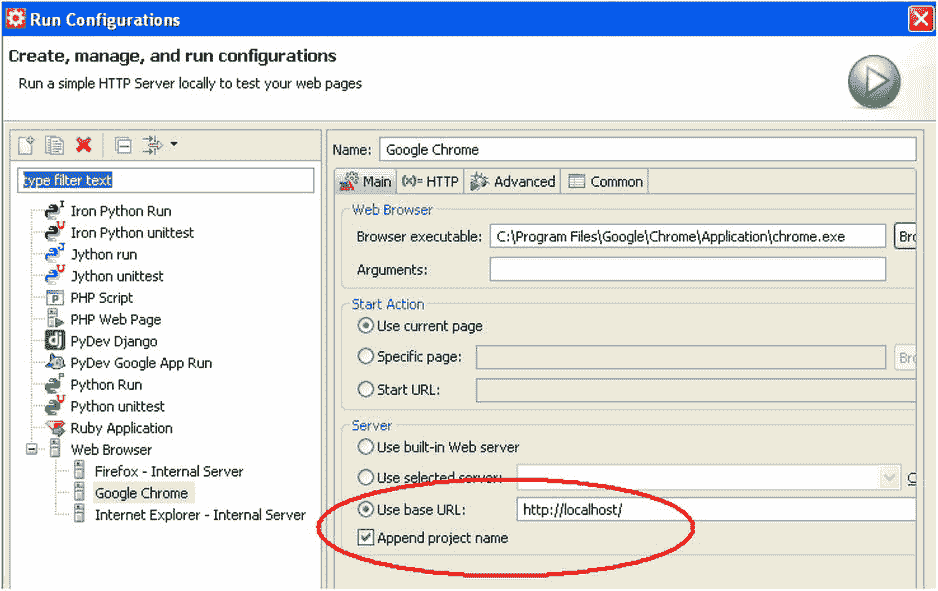

# 13. 书中示例的使用指南

本附录将指导你如何结合使用 XAMPP 和 Aptana Studio，在个人电脑上搭建一个开发环境，以便你能够开发、运行并修复书中提供的示例。

## 安装 Web 服务器

如今，在网络上，你可以轻松找到包含所需一切组件的免费软件包，用于为所有示例以及所有与网络世界相关的内容搭建测试环境。

这些软件包最大限度地减少了需要安装的程序数量。更重要的是，它们可以通过一次安装完成。这些软件包通常包含 Apache HTTP 服务器、MySQL 数据库，以及 PHP、Perl 和 Python 编程语言的解释器。最完整的软件包是 XAMPP（可从 Apache Friends 网站 [`www.apachefriends.org/en/index.html`](http://www.apachefriends.org/en/index.html) 下载）。XAMPP 完全免费，其主要特点是它是一个跨平台软件包（支持 Windows、Linux、Solaris、MacOS）。此外，XAMPP 还包含一个 Tomcat 应用服务器（用于 Java 编程语言）和一个 FileZilla FTP 服务器（用于文件传输）。其他解决方案则具有平台特异性，如其名称的首字母所示：
* `WAMP` (Windows)
* `MAMP` (MacOS)
* `LAMP` (Linux)
* `SAMP` (Solaris)
* `FAMP` (FreeBSD)

实际上，XAMPP 是一个首字母缩略词；其字母代表以下术语：
* `X`，代表操作系统
* `A`，代表 Apache，即 Web 服务器
* `M`，代表 MySQL，即数据库管理系统
* `P`，代表 PHP、Perl 或 Python，即编程语言

因此，选择最适合你平台的 Web 服务器解决方案，并将其安装在你的电脑上。

## 安装 Aptana Studio IDE

安装好 Web 服务器后，需要安装一个集成开发环境（IDE），用于开发 JavaScript 代码。在本附录中，你将安装 Aptana Studio 作为你的开发环境。

访问 Aptana 网站（[`www.aptana.com`](http://www.aptana.com/)），点击 Aptana Studio 3 软件的 Products 标签页（在撰写本文时，最新版本是 3.4.2）。下载独立版本（已集成 Eclipse IDE）：`Aptana_Studio_3_Setup_3.4.2.exe`。

下载完成后，运行可执行文件以安装 Aptana Studio IDE。安装结束时，启动应用程序，你应该会看到工作台打开，如图 A-1 所示。



图 A-1. Aptana Studio IDE 工作台

在安装 Aptana Studio 的过程中，软件会自动检测各种浏览器和已安装的 Web 服务器，并进行相应配置。

## 设置 Aptana Studio 工作空间

在开始开发书中的示例之前，你必须创建一个工作空间。首先，你应该在 Aptana Studio 中设置工作空间，使其指向 Web 服务器的文档根目录。

以下是使用 XAMPP 时的典型路径：
* Windows：`C:\xampp\htdocs`
* Linux：`/opt/lamp/htdocs`
* MacOS：`/Applications/XAMPP/xamppfiles/htdocs`

而使用 WAMP 时，路径为：
* `C:\WAMP\www`

因此，从菜单中选择 File ➤ Switch Workspace ➤ Other . . .。然后，在字段中输入 Web 服务器文档根目录的路径，如图 A-2 所示。



图 A-2. 在文档根目录上设置工作空间

## 创建项目

创建工作空间的下一步是在 Aptana Studio 中创建一个项目：



图 A-3. 创建默认项目

从菜单中选择 New ➤ Web Project。会出现一个如图 A-3 所示的窗口。选择 Default Project，然后点击 Next。输入 `charts` 作为项目名称。这将是工作空间中的一个目录，你将使用 Aptana Studio 在其中编写书中描述的所有示例文件。

## 完成工作空间

设置好 Aptana Studio 工作空间并创建项目后，即可完成工作空间的配置。

让我们打开文档根目录，并创建一个名为 `src` 的新目录。现在，你将在整本书中使用的工作空间由两个目录组成：
* `src`
* `charts`

`src` 目录应包含所有与库相关的文件。

`charts` 目录应包含与书中示例相关的所有 HTML、图像和层叠样式表（CSS）文件（这实际上是一个项目）。每个示例文件都应在此目录中创建（如果你更喜欢采用不同的方式，也可以，但重要的是要注意 HTML 页面中引用库文件和图像时的不同路径）。

> **注意**
> 本书附带的源代码（可从 Apress 网站 [`www.apress.com`](http://www.apress.com/) 的源代码/下载区域获取）实际上已经打包在一个工作空间中。其中，你会找到 `charts` 项目的两个版本：内容分发网络（CDN）版和本地版。`charts_CDN` 目录包含所有引用远程分发服务的库的示例。`charts_local` 目录包含所有引用 `src` 目录内库的示例。

## 用库文件填充 src 目录

如果你选择通过引用本地库来开发 HTML 页面，则需要下载所有库文件。这些文件将被收集在 `src` 目录中。这是一个好方法，因为你可以开发多个项目，这些项目将使用相同的库，而无需为每个项目复制它们。

本附录中列出的版本是用于实现书中示例的版本。如果你安装其他版本，可能会出现不兼容问题，或者你可能会观察到与描述不同的行为。

### D3 库版本 3

访问 D3 网站（[`http://d3js.org`](http://d3js.org/)），下载库文件：`d3.v3.zip`。直接解压所有内容，并将其放置在 `src` 目录中。现在，`src` 目录中应该有两个新文件：
* `d3.v3.js`
* `d3.v3.min.js`

至此，你已获得 `src` 目录，该目录应包含如图 A-4 所示的子目录和文件。



图 A-4. `src` 目录中包含的文件和子目录

> **注意**
> 按照惯例，你将在 `charts` 目录中开发示例。如果你想采用其他方式，则在将其他文件包含到网页中时，需要考虑新的路径。

如果你在 `charts` 目录内开发 HTML 页面，则需要使用以下代码：

```html
<script type="text/javascript" src="../src/d3.v3.js"></script>
```

相反，如果你更愿意直接在文档根目录中开发，则使用以下代码：

```html
<script type="text/javascript" src="src/d3.v3.js"></script>
```

简而言之，重要的是要考虑你所包含的文件相对于你正在实现的页面的路径。

## 运行示例

在工作区创建或复制 HTML 文件后，若要在 Aptana Studio IDE 中运行它，请从菜单中选择 `运行` ➤ `运行`，或单击工具栏上的 `运行` 按钮（见图 A-5）。


图 A-5. 工具栏上的 `运行` 按钮

随后，您的默认浏览器将立即打开，并加载所选的 HTML 页面。

查看 `运行配置`（见图 A-6），方法是从 `运行` 图标的上下文菜单中选择 `运行配置...`。例如，让我们将 `http://localhost/` 设置为您的基址 URL；为此，请选择 `附加项目名称` 选项，如图所示。然后，单击 `应用` 按钮以确认您的设置。



图 A-6. 必须为每个浏览器正确设置运行配置

现在，您已具备轻松处理本书所有示例所需的一切条件。

一旦您对 Aptana IDE 达到一定熟悉程度，您会发现它是开发许多其他项目的绝佳环境，无论是 JavaScript 项目还是其他编程语言（例如 PHP）项目。

那么，祝您玩得开心！

## 总结

本附录提供了关于如何将 XAMPP 和 Aptana Studio 结合使用，在您的 PC 上创建开发环境的指南。使用这些应用程序并非强制要求，还有许多其他解决方案可供选择；互联网上有许多应用程序可以执行类似操作。但是，如果您希望实现并快速测试本书中描述的示例，该环境将证明是一个不错的选择。

## 索引

### A
`Append()` 方法链式方法 `html()` 运算符嵌套无序列表 `text()` 运算符
Aptana Studio IDE 安装项目创建运行配置 `src` 目录
D3 库版本 3 文件和子目录 Web 服务器安装工作区 `charts` 目录设置

### B
条形图绘制 `category10()` 函数
CDN 服务 CSS 类 `d3.csv()` 函数 `data_04.csv` 坐标轴域 `forEach()` 循环函数 `function(error, data)` 函数网格线 `rangeRoundBands` 函数简单条形图尺寸和维度 SVG 元素 `tickFormat()` 函数标题元素变量
分组图 参见（参见分组条形图）水平 jqPlot 库堆叠条形图 参见（参见堆叠条形图）
气泡图

### C
蜡烛图 箱线表示数据格式描述 OHLC 图 参见（参见开盘-最高-最低-收盘 (OHLC) 图）
CDN。参见 参见内容分发网络 (CDN)
图表控件 复选框 参见（参见复选框）命令功能单选按钮 参见（参见单选按钮）滑块 参见（参见滑块）
图表技术 坐标轴标签 蜡烛图坐标值 D3 库数据点 DOM Firebug 和 DevTools 图形表示直方图 HTML5 JavaScript 开发 JavaScript 库 JSON 图例折线图饼图雷达图和气泡图比例 SVG 和 CANVAS 文本标签刻度
复选框 “全选/取消全选” 功能自定义图例 jQuery 方法系列数量列表
圆形树形表示
逗号分隔值 (CSV) 文件 坐标轴和网格 `d3.svg.axis().function` 网格变量水平网格线 JavaScript 代码 SVG 元素数据绘制 `append()` 方法组件 `d3.csv()` 函数数据对象域路径元素 SVG 元素数据读取解析填充区域标记连线
内容分发网络 (CDN)

### D, E, F
D3 图表 坐标轴范围控制 坐标轴箭头 条形图 参见（参见条形图）蜡烛图 参见（参见蜡烛图）代码 `attr()` 函数 坐标轴 CSS 类 网格添加 浅灰色网格 路径元素 正确顺序，坐标轴和网格 SVG 元素 `text-anchor` `text(String)` 函数 文本样式 x,y 值
CSV 文件 参见（参见逗号分隔值 (CSV) 文件）差异折线图 裁剪路径 代码更改 代码编写 颜色 `d3.min` 和 `d3.max` `data_03.tsv` 数据点 插值 通用函数 TSV 文件 域和范围 第一个“砖块” jqPlot 和 Highcharts 多系列折线图 参见（参见多系列折线图）饼图 参见（参见饼图）比例 标题和坐标轴标签
D3 库。另请参见 另请参见气泡图；散点图 `Append()` 方法 内容分发网络 (CDN) 数据插入 数据可视化 调试工具 DOM 元素 动态属性 `html()` 方法 `insert()` 方法 JavaScript 库 jQuery 库 运算符 PHP 语言 参见（参见超文本预处理器 (PHP) 语言）雷达图 参见（参见雷达图）实时图表 参见（参见实时图表）远程 D3 库 选择和选择器 SVG 变换 万维网联盟
数据插入 数组 `enter()` 运算符 FireBug HTML 结构 `selectAll()`
文档对象模型 (DOM)
甜甜圈图 代码编写 `d3.csv()` 函数 `data_04.csv` `data_06.csv` 外部标签 `forEach()` 函数 图例 路径元素 与单图对比

### G
分组条形图 代码片段 `csv()` 函数 `d3.csv()` 函数 `data_05.csv` 域 数据结构 `filter()` 函数 `keys()` 函数 图例添加 `PointLabels` 报告值 标题添加 `xo` 和 `x1` 变量

### H
处理结构化数据。参见 参见 JSON 格式
水平条形图 CSS 样式类 FireBug `<rect>` 元素插入 `<svg>` 元素创建 最大值 正值和负值 带 x 轴和 y 轴的比例 样式类属性
超文本预处理器 (PHP) 语言 `json()` 函数 多系列图表 `myPHP.php` `sales.sql` TSV 文件

### I
IDE。参见 参见集成开发环境 (IDE)
`Insert()` 方法 `append()` 子标签 CSS 选择器 FireBug 功能 HTML 结构 父标签 无序列表
集成开发环境 (IDE)

### J
JavaScript 开发 数组 IDE jsFiddle 库 对象 编程语言 运行和调试
JavaScript 对象表示法 (JSON)
jQuery 手风琴 `barchart.js` 更改，原始布局 可拖拽折线图 `linechart.js` `piechart.js` 可调整大小折线图 UI 小部件 参见（参见 UI 小部件）
JSON 格式 分析，树形布局 数组和对象 CSV/TSV 文件 D3 模块 系统树图表示 分区布局 树形数据结构 值标签

### K, L
K-均值算法

### M
多系列折线图 `category10()` 函数 代码编写 `d3.keys()` 函数 `d3.min` 和 `d3.max` `data_02.tsv` 不同颜色 双重迭代 图例添加 线条插值 `map()` 函数 `parseDate()` 函数 `scale()` 函数 SVG 元素

### N
归一化堆叠条形图 代码添加 `d3.csv()` 函数 `data_05.csv` 文件 图例 新样式类添加 值范围 `rotate()` 函数 SVG 元素 标题修改

### O
OHLC。参见 参见开盘-最高-最低-收盘 (OHLC) 图
开盘-最高-最低-收盘 (OHLC) 图 图表模型 代码编写 CSS 样式 `data_08.csv` 域 `forEach()` 函数 线条元素 `line.ext` 类 `line.open` 和 `line.close` 最小值和最大值 SVG 元素
运算符 数组 `attr()` 链式功能 FireBug `getText()` `style()` 运算符 SVG 元素 `text()` 运算符

### P, Q
分区布局 邻接图 圆形表示 `d3.layout.partition` HTML 页面 递归
饼图 “烤盘” 颜色序列 甜甜圈图 参见（参见甜甜圈图）绘制 `arc.centroid()` 函数 `<arc>` 元素 区域和边距 `category10()` 函数 质心 扇形颜色 CSS 类属性 `data_04.csv` `d3.csv()` 函数 `d3.layout.pie()` 函数 Firebug `forEach()` 函数 `pie()` 和 `arc()` 函数 半径计算 根元素插入 简单饼图 标题添加 `translate()` 变换混合 极坐标面积图 空间添加 SVG 元素
极坐标面积图 `centroid()` 函数 代码编写 CSS 样式类 `d3.csv()` 函数 `data_07.csv` `innerRadius` 和 `outerRadius` 模型 扇形特征

### R
雷达图 自动缩放 坐标轴 区域和边距 圆形刻度 圆形网格 `d3.csv()` 函数 `data_11.csv` 文件 绘制区域中心 线性比例 `<svg>` 元素 径向轴 根元素 `<svg>` 刻度 `d3.csv()` 函数 `data_12.csv` 文件 数据添加 颜色域添加 CSS 样式类添加 数据系列 图例添加 路径颜色 半透明区域 网状结构
单选按钮 CDN 服务 JS 文件 多系列折线图
实时图表 CSS 样式 数据数组 `getRandomInt()` 函数 HTML 结构 `line()` 函数 边距调整 `requestAnimFrame()` 函数 SVG 元素 `updateData()` 函数

### S

可缩放矢量图形 (SVG) `append()` 运算符 `attr()` 运算符 主体结构 `delay()` 函数 `duration()` 函数 元素 `append()` 方法 裁剪路径 CSS 样式类 默认行为 FireBug 水平网格线 `<g>` 元素 路径元素 `svg.append()` 文本图形元素 变换 `transition()` 方法

散点图 坐标轴标签 聚类分析算法实现 圆形 SVG 元素 代码编写 K-均值算法 `kmean()` 函数 `myPoints` 表示 选择和分组标准 代码编写 彩色标记 自定义标记 `d3.tsv()` 函数 `data_09.tsv` 数据分布 数据点高亮 标记和符号 `nice()` 函数 SVG 元素 趋势线

滑块 代码部分 十六进制格式 jQuery 界面库 数值 RGB 值

堆叠条形图 绘制 代码编写 颜色域 组件 国家数组 `data_05.csv` `data()` 函数 Firebug 和 DevTool `forEach()` 函数 迭代函数 数值 `rect` 元素 `translate(x,0)` 函数 归一化 参见（参见归一化堆叠条形图）

`SVG`。参见 参见可缩放矢量图形 (SVG)

### T

制表符分隔值 (TSV) 文件

### U, V, W

UI 小部件 手风琴小部件 CSS 样式属性 功能 Google 托管库 HTML 结构 调整大小和封装 选项卡

### X, Y, Z

XAMPP