# 第 1 章：图表技术概述

当我们需要以图形方式表示数据或定性结构，以展示关系、进行比较或突出趋势时，我们会使用图表。图表是一种图形结构，由符号组成，例如折线图中的线条、柱状图中的柱形或饼图中的扇形。图表是有效的工具，可以帮助我们辨别和理解大量数据背后的关系。对人类而言，阅读图形表示（如图表）比阅读原始数字数据更容易。如今，图表的使用已成为各种专业领域以及日常生活许多方面的常见做法。因此，根据数据的结构和所突出的现象，图表呈现出多种形式。例如，如果你有按不同组别划分的数据，并希望表示每组占总数的百分比，通常你会将这些数据组显示在饼图或柱状图中。相反，如果你想展示某个变量随时间变化的趋势，折线图通常是最佳选择。

在本书中，你将学习如何使用基于 JavaScript 的各种技术，根据你的需求创建、绘制和调整图表。然而，在开始使用 JavaScript 开发图表之前，理解本书各章节将涵盖的基本概念非常重要。在本章中，我将简要概述这些概念。

首先，我将向你展示如何识别构成图表的最常见元素。了解这些元素将很有帮助，因为你将在专为实现图表而创建的 JavaScript 库中，以组件、变量和对象的形式找到它们。

接下来，我将列出最常见的图表类型。你对图表及其特性了解得越多，就越容易为你的数据选择合适的表示方式。做出正确的选择至关重要，这样才能突出你想要表示的关系，而仅仅阅读数据是不够的。只有当你熟悉了最常见的图表类型后，你才能选择最适合你目的的图表。

一旦你熟悉了这些概念，你需要学习如何通过网络实现它们，以及当前有哪些技术可以帮助你实现这一目标。因此，在本章的第二部分，我将讨论这些技术方面，逐一介绍本书示例开发中所涉及的技术。

最后，鉴于我们所有的工作都将集中在 JavaScript 代码的开发上，我认为提供对某些数据类型的简要描述会有所帮助。那些不熟悉 JavaScript 的人可以从这个快速参考中受益，了解数据在代码中会呈现的形式。然而，我强烈建议读者更深入地研究本章讨论的概念和技术。

### 图表中的元素

你很快就会看到，图表可以有多种形式。在图表中，数据通过特定于图表类型的符号呈现为图形结构；然而，所有图表都有一些共同特征。

通常，每个图表都有一个标题，位于顶部，提供对数据的简短描述。较少见的情况下，会使用副标题或脚注来提供额外的描述（主要是与数据相关的信息，如参考文献、地点、日期和注释）。

图表通常有坐标轴——两条垂直的线，允许用户参考每个数据点 `P(x, y)` 的坐标值（`x`，`y`），如图 1-1 所示。水平线通常代表 `x` 轴，垂直线代表 `y` 轴。

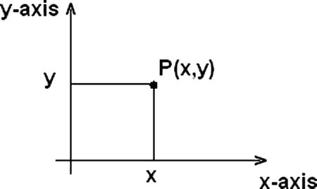

图 1-1. 一个二维图表

每个坐标轴上都定义了一个刻度。刻度可以是数值型或分类型的。每个坐标轴被划分为若干段，对应刻度所代表的特定数值范围。段与段之间的分界线称为刻度线。每条刻度线报告该坐标轴关联的刻度值。通常，这些被称为刻度标签。

图 1-2 展示了四个具有不同刻度的坐标轴。坐标轴 a 和 b 具有数值型刻度，其中 a 是线性刻度，b 是对数刻度。坐标轴 c 和 d 具有分类型刻度，其中 c 是有序的，因此遵循升序排列，而 d 则只是没有特定顺序的一系列类别。

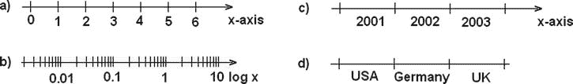

图 1-2. 四个具有不同刻度的坐标轴

良好的实践是，在每个坐标轴旁显示一个标签，简要描述其所代表的维度；这些被称为坐标轴标签。如果刻度是数值型的，标签应在括号内显示度量单位。例如，如果你有一个 x 轴报告一组数据的时间，你可以将“时间”作为坐标轴标签，并将秒单位（此处为秒）放在方括号内，如 `[s]`（参见图 1-3）。

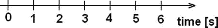

图 1-3. 一个坐标轴标签

在显示图表的绘图区域中，可以包含网格线以帮助数据在视觉上对齐。图 1-4 展示了一个图表的网格，其 x 轴为线性时间刻度，y 轴为对数刻度。

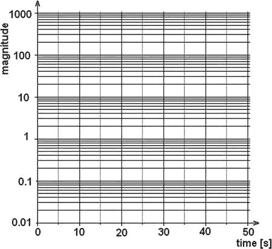

图 1-4. 一个具有两种不同刻度的图表

你已经了解了数据如何以符号形式表示。然而，文本标签也可用于突出显示特定的数据点。点标签在图表中相应数据点处直接提供数值，而工具提示则是当鼠标悬停在某个数据点上时动态出现的小框。这两种标签如图 1-5 所示。

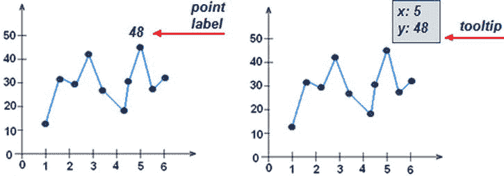

图 1-5. 数据点的点标签和工具提示

数据通常被分组为多个系列，为了在同一图表中表示这些系列，它们必须是可区分的。最常见的方法是为每个系列分配不同的颜色。在其他情况下，例如折线图，也可以使用线条的样式（虚线、点线等）来区分不同的系列。一旦你确定了一系列颜色（或线条样式），就需要添加一个表格来展示颜色与组之间的对应关系。这个表格称为图例，如图 1-6 所示。

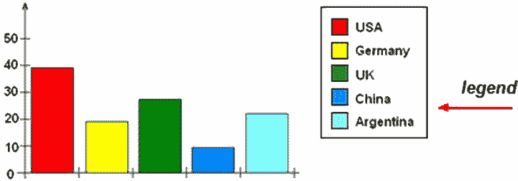

图 1-6. 一个图例

尽管讨论本节所涵盖的概念可能看似琐碎，但定义本书中我将反复提及的元素的术语非常重要。它们构成了你将用于构建图表的基本构件。你还会看到专门用于图表表示的 JavaScript 库如何使用这些术语，并将它们与编辑和设置组件相关联（参见第 8 章中的“插入选项”一节）。

## 最常见的图表类型

本节简要概述最常见的图表类型。这些图表将在本书后续章节中逐一进行更详细的描述。

*   **`直方图`：** 在 `x` 轴上竖立的相邻矩形，`x` 轴被分割成离散的区间（组距），每个矩形的面积与该组距内观测值的频率成正比（参见图 1-7）。
*   **`条形图`：** 形状与 `直方图` 相似，但本质不同，这是一种由矩形条组成的图表，其长度与它们所代表的值成正比。每个条形标识一组数据（参见图 1-7）。

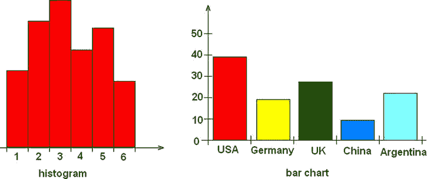

图 1-7. 一个 `直方图` 和一个 `条形图`

*   **`折线图`：** 由一条线连接的一系列有序数据点。数据点 `P (x, y)` 被报告在图表中，代表 `x` 和 `y` 两个坐标轴的刻度（参见图 1-8）。
*   **`饼图`：** 一个被分成若干扇区的圆形（饼）。每个扇区代表一组数据，其大小与百分比值成正比（参见图 1-8）。

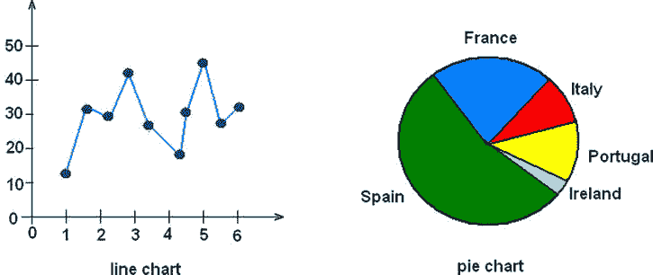

图 1-8. 一个 `折线图` 和一个 `饼图`

*   **`气泡图`：** 一种二维散点图，其中第三个变量由数据点的大小表示（参见图 1-9）。
*   **`雷达图`：** 一种图表，其中一系列数据在多个坐标轴上表示，这些坐标轴从图表中心的原点径向出发。这种图表通常呈现蜘蛛网的形状（参见图 1-9）。

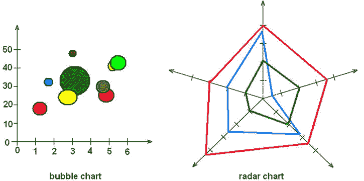

图 1-9. 一个 `气泡图` 和一个 `雷达图`

*   **`K 线图`：** 一种专门用于描述价格随时间变化趋势的图表。每个数据点由四个值组成，通常称为开盘-最高-最低-收盘（`OHLC`）值，并呈现类似蜡烛的形状（参见图 1-10）。

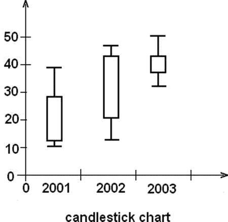

图 1-10. 一个 `K 线图`

 **注意** 开盘-最高-最低-收盘（`OHLC`）是四个数值，通常用于说明金融工具价格随时间的变化。

## 如何在 Web 上实现图表

现在我已经描述了最常见的图表类型及其组成元素，下一步是快速了解一下当前可用于实现图表的技术。

如今，Web 技术日新月异：每天都有新的解决方案被提出，解决那些不久前还相当复杂的问题。这些创新将为你提供实现高度交互式图表的机会，并拥有引人注目的图形，而这一切只需编写几行 `JavaScript` 代码。整个过程可以快速轻松地完成，因为大部分工作都由高度专业化的图表表示 `JavaScript` 库为你完成。这些库现在在网络中随处可见。

在本书中，你将使用 `jqPlot`，它目前是使用最广泛的库之一，并且可以为图表实现过程中可能出现的几乎所有问题提供通用解决方案。

但是，在逐一介绍这些库之前（这将在后续章节中进行），你必须首先了解构成 `JavaScript` 图表开发基础的所有技术，因为它们将伴随你完成本书的其余部分。

### HTML5 与 Web 图形技术

最近，关于 `HTML5` 的讨论很多，它实际上正在彻底改变 Web 应用程序的开发方式。在 `HTML5` 出现之前，如果要引入交互式图形内容，使用诸如 `Adobe Flash` 之类的应用程序几乎是必经之路。但是，在 Web 上使用 `Flash` 或类似应用程序来开发图表或其他图形表示，会带来一个明显的限制：依赖需要在最终用户机器上安装的插件。此外，这类应用程序在智能手机上不受支持。得益于 `HTML5`，开发者现在可以创建高级图形和动画，而无需依赖 `Flash`。

当你阅读本书时，你将看到 `HTML5` 也催生了许多其他技术，有些是新的，有些是旧的但已焕然一新，例如 `JavaScript`。事实上，作为一种语言，`JavaScript` 正在经历重生，这得益于为利用 `HTML5` 引入的创新而精确开发的新库。`HTML5` 有许多新的语法特性，包括 `<canvas>` 元素和可缩放矢量图形（`SVG`）内容的集成。由于这些元素，无需使用 `Flash` 就能非常容易地在 Web 上集成多媒体和图形内容。

在 `Flash` 的位置上，你将使用 `JavaScript` 库，例如 `jQuery` 和 `jqPlot`。目前，这些是可用于实现诸如数据图形可视化等任务的完整库的良好示例。然而，Web 技术世界在不断发展；在互联网上，你总能找到具有与本书所述类似特性的新库。

### 使用 SVG 和 Canvas 绘制图表

在 `HTML5` 引入的新技术可以实现的众多图形应用中，我将重点关注通过图表来呈现和可视化数据。使用 `JavaScript` 作为编程语言，我们现在可以利用嵌入在新浏览器中的强大渲染引擎。作为该语言新能力的基础，我将参考 `HTML5` 的 `canvas` 和 `SVG`。`SVG` 和 `canvas` 允许你开发完全交互式的图表，从而用内置的动画、过渡和工具提示来丰富你的图形表示，而不是在服务器上绘制静态图像然后下载到浏览器中。这是因为 `SVG` 和 `canvas` 内容是在浏览器中绘制的，因此构成图表的图形元素可以在不刷新页面的情况下进行转换。这个特性对于可视化实时数据至关重要，这些数据要求图表随着数据变化而持续更新。以这种方式操作将确保真正的客户端图表绘制。事实上，通过利用这些技术，图表实际上是在客户端绘制的，只需要从服务器传递数据。这方面带来了相当多的优势，最重要的是消除了从服务器下载大型图形文件的需要。

### Canvas 与 SVG 对比

`HTML5` 的 `canvas` 和 `SVG` 都是允许你在浏览器中创建丰富图形的 Web 技术，但它们有着根本的不同。在本书中，你将主要看到一个 `JavaScript` 框架：`jqPlot`。`jqPlot` 基于 `jQuery` 框架，利用 `HTML5` 的 `<canvas>` 元素来绘制其图表。其他库（例如 `D3` 库）则使用 `SVG`。

`HTML5` 的 `canvas` 规范是一个多功能的 `JavaScript` API，允许你以编程方式编码绘图操作。`Canvas` 本身允许你定义一个画布上下文对象，在 `HTML` 页面上显示为 `<canvas>` 元素。然后可以使用二维或三维绘图上下文（通过 Web 图形库 `WebGL`）在该元素内部进行绘制。我将只介绍第一种选项；`jqPlot` 使用二维绘图上下文。二维上下文为你提供了一个强大的 API，可以在位图表面（即画布）上执行快速绘图操作。与 `SVG` 不同，形状没有对应的 `DOM` 节点，只有像素。

`SVG` 是一种基于 `XML` 的矢量图形格式。`SVG` 内容可以是静态的、动态的、交互式的或动画的，这使其非常灵活。你还可以使用层叠样式表（`CSS`）来设置 `SVG` 元素的样式，并使用 `SVG` 文档对象模型（`DOM`）提供的应用程序编程接口（`API`）方法为其添加动态行为。

与 `SVG` 相比，`canvas` 的优势在于高绘图性能以及更快的图形和图像编辑。每当需要在像素级别工作时，`canvas` 是更优选择。然而，使用 `canvas` 时，没有可供操作的 `DOM` 节点可能是一个缺点，尤其是在你不使用像 `jqPlot` 这样的 `JavaScript` 框架时。另一个缺点是文本渲染能力较差。

与 `canvas` 相比，`SVG` 的优势在于分辨率无关性、良好的动画支持以及使用声明式语法对元素进行动画处理的能力。但最重要的是，可以使用 `JavaScript` 中的 `SVG DOM API` 对每个元素进行完全控制。然而，当复杂度增加时，渲染速度慢可能成为一个问题，但浏览器供应商正在努力使浏览器更快（参见表 1-1 和 1-2）。

表 1-1. Web 浏览器与引擎

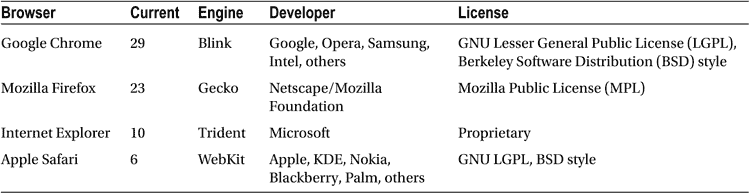

表 1-2. Web 技术支持：浏览器对比

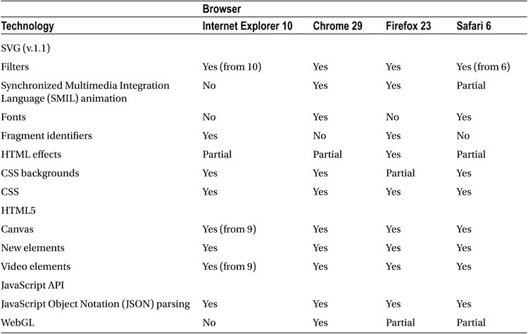

### DOM

在使用作用于 `HTML` 页面结构元素层面的库时，我们不可避免地要谈到 `DOM`。我将经常提到这个概念，因为它是每个网页的基础结构。万维网联盟（`W3C`）认为有必要（并且非常正确地）为结构化文档的表示创建一个官方标准，以便为所有编程语言和平台制定指导方针。`HTML` 文档以及 `XML` 文档的树形结构完全遵循该标准制定的指导方针。以下是一个 `HTML` 文档的示例：

```
<HTML>
    <HEAD>
      <TITLE>A title</TITLE>
    </HEAD>
    <BODY>
      Hello
      <BR>
    </BODY>
</HTML>
```

该文档的 `DOM` 树可以如图 1-11 所示。

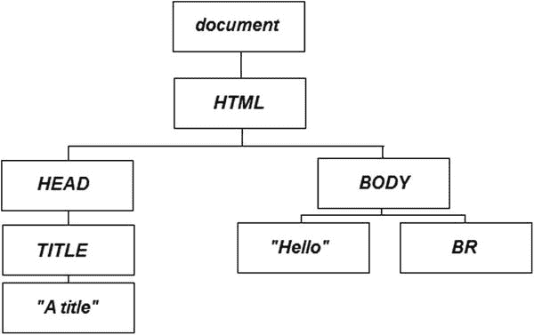

图 1-11. `DOM` 树形结构示例

但是，`DOM` 标准不仅限于制定关于 `DOM` 在文档中应如何结构的指导方针；该标准还定义了许多旨在作用于组成文档的元素的功能。因此，任何与文档相关的操作（创建、插入、删除）都应遵循 `DOM` 标准。因此，无论你使用哪种编程语言或在哪个平台上工作，你总会发现该标准所表达的相同功能。通常，术语 *`DOM`* 也适用于管理网页所有元素的 `API`。

这一切都很重要，因为任何选择阅读本书的人，都对开发图表感兴趣，这些图表不仅使用 `DOM`，而且本身就是 `DOM` 的一部分，其每一个方面都可以在 `JavaScript` 中进行检查和操作。在本书中，你将学习如何充分利用 `jQuery` 和 `jqPlot`。借助这些 `JavaScript` 库，你可以访问每个图表元素，例如更改对象的颜色和位置。

### 用 JavaScript 进行开发

尽管大多数选择阅读本书的人可能已经对 `JavaScript` 有很好的了解，但事实可能并非如此。因此，我以实用的方式构建了本书，提供了循序渐进的示例，并提供了示例中必须编写的所有代码。因此，本书为新手提供了学习该语言的机会，也为那些有一段时间没有使用它的人提供了重温记忆的机会。

要开始使用你将用于开发图表的 `JavaScript` 库，有必要准备一个开发环境。诚然，要开发 `JavaScript` 代码，你可以简单地使用文本编辑器，例如记事本（或者，更好的是 Notepad++），但开发者通常更喜欢使用专门的应用程序（通常称为集成开发环境（`IDE`））来开发代码。除了提供带有与代码中使用的关键字相对应的区分颜色的文本编辑器外，此类应用程序还包含一组旨在简化工作的工具。这些应用程序可以检查代码中是否存在任何错误，提供调试工具，使文件管理变得容易，并协助在服务器上进行部署，以及许多其他操作。

如今，网络上有很多 `JavaScript IDE`，但其中最突出的一些是 `Aptana Studio`（参见图 1-12）；安装了 `JavaScript` 测试驱动（`JSTD`）插件的 `Eclipse Web Developer`；以及 `NetBeans`。这些编辑器还允许你开发超文本预处理器（`PHP`）、`CSS` 和 `HTML`（有关如何使用 `Aptana Studio IDE` 设置工作区以实现本书代码的信息，请参阅附录 A，或直接使用本书附带的源代码；你可以在 Apress 网站 [`www.apress.com`] 的源代码/下载区域找到代码示例）。

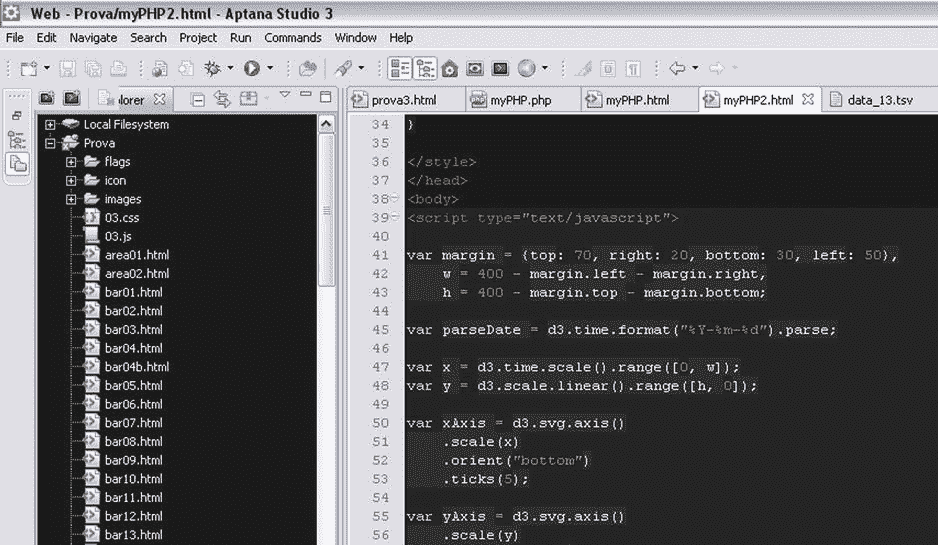

图 1-12. `Aptana Studio 3 IDE`

对于那些不想在计算机上安装太多应用程序的人，还有在线 `JavaScript IDE`。这些 `IDE` 允许用户在充当 `IDE` 的网页中编辑 `JavaScript` 代码，并直接从同一网页检查其结果。不幸的是，许多此类 `IDE` 需要收费。然而，`jsFiddle`（`http://jsfiddle.net`）是一个无需付费的在线 `IDE`，除了编辑功能外，它还提供代码共享以及添加库（例如 `jQuery` 和 `D3`）的选项（参见图 1-13）。

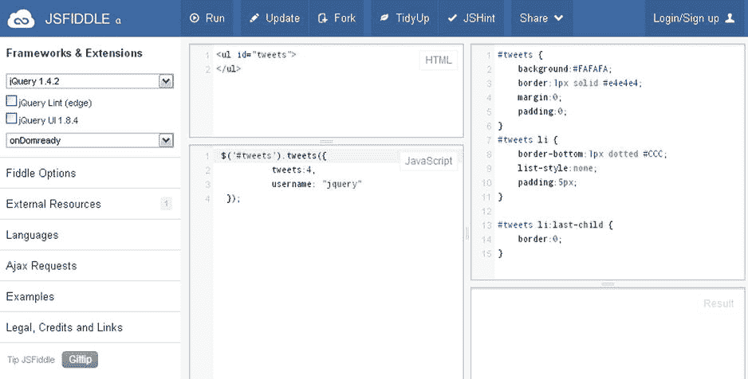

图 1-13. 在线 `IDE jsFiddle`

`jsFiddle` 可能非常有用。除了允许用户包含许多 `JavaScript` 库（参见图 1-14）之外，它还提供了各自发布的不同版本，从而允许用户实时测试任何不兼容性。

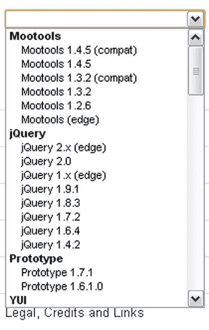

图 1-14. `jsFiddle` 提供了一系列最流行的 `JavaScript` 库

### 运行和调试 JavaScript

如果我们想在客户端-服务器框架中定义 `JavaScript`，它是一种完全客户端的编程语言。它不需要编译，并且除了 `HTML` 文档之外，代码片段还可以出现在许多其他特定于其他语言的文件类型中，例如 `.JSP` 或 `.PHP`。

这些代码片段会不受影响地通过应用服务器，而永远不会被处理。只有浏览器负责运行 `JavaScript` 代码。因此，`JavaScript` 代码仅在网页下载之后或之后响应事件时运行。如果 `JavaScript` 代码规模较大或以后可能有用，则可以将其定义在外部 `.JS` 文件中；在这里，你将找到本文中提到的所有 `JavaScript` 库和框架。然而，无论其形式如何，`JavaScript` 都直接在浏览器中运行。

因此，即使你不使用真正的 `IDE` 来开发和调试 `JavaScript` 代码，你也可以简单地将代码插入到一个空的 `HTML` 文件中，然后直接在浏览器（`Chrome`、`Internet Explorer` 和 `Firefox` 是最常见的）中加载该文件。为了将其与页面上的其他文本区分开来，你必须将代码放在 `<script></scripts>` 标签内：

```
<script type="text/javascript">
// JavaScript 代码
</script>
```

如果 `JavaScript` 代码位于外部文件中，那么需要将其包含在 `HTML` 页面中，编写如下：

```
<script type="text/javascript" src="library.js"></script>
```

因此，只要执行 `JavaScript` 不是为了安装某些东西，你就拥有了所需的一切。谁的操作系统上没有网络浏览器呢？

### JavaScript 中的数据类型

如前所述，本书既不会解释编写良好 `JavaScript` 代码的规则和语法，也不会过多地停留在编程细节上。尽管如此，我们将要开发的代码是围绕图表展开的，或者更确切地说，是围绕数据处理以及如何显示它们展开的。让我们从最简单的情况开始。所有数据结构的最小构建块是变量（当它包含单个值时）。在处理数据类型方面，`JavaScript` 与其他编程语言非常不同。当你想要在 `JavaScript` 中存储值时，不必指定值的类型（`int`、`string`、`float`、`boolean` 等）；你只需要使用 `var` 关键字来定义它。

在 `Java` 或 `C` 中，包含整数值的变量与包含文本的变量声明方式不同：

```
int value = 3;
String text = "这是一个字符串值";
```

在 `JavaScript` 中，存储值的类型无关紧要。所有内容都用 `var` 声明，因此相同的声明是：

```
var value = 3;
var text = "这是一个字符串值";
```

因此，在 `JavaScript` 中，我们可以将变量视为用于存储任何类型值的容器。

为简单起见，这里将变量视为单个值的容器，从而代表了最简单的数据结构。然而，实际上，变量也可能包含更复杂的数据类型：数组和对象。

 **注意** `JavaScript` 中变量的使用实际上要复杂一些。你也可以在不使用 `var` 关键字声明的情况下使用变量。`var` 关键字将在当前作用域内声明变量。如果缺少 `var`，`JavaScript` 将搜索在更高作用域级别声明的同名变量。如果 `JavaScript` 没有找到这个变量，则会声明一个新的变量；否则，`JavaScript` 将使用找到的变量中的值。因此，变量的不正确使用有时会导致难以检测的错误。

# 数组
数组是由逗号分隔并用方括号 `[]` 括起来的一系列值：
```
var array = [1, 6, 3, 8, 2, 4];
```
数组是 JavaScript 中最简单、使用最广泛的数据结构，因此你应该非常熟悉它们。可以通过在数组名称后面的方括号中指定其索引（在数组中的位置）来访问数组中的任何值。在 JavaScript 中，索引从 0 开始：
```
array[3]  //返回 8
```
数组可以包含任何类型的数据，而不仅仅是整数。
```javascript
var fruits = ["banana", "apple", "peach"];
```
有许多函数可以帮助我们处理这类对象。由于其用途广泛，我将在本书中频繁使用该对象，因此有必要快速了解一下它。我们可以通过以下方式获取数组中的值的数量：
```javascript
fruits.length  //返回 3
```
或者，如果你知道具体的值，可以通过以下方式获取对应的索引：
```javascript
fruits.indexOf("apple") //返回 1
```
此外，还有一组函数允许我们在数组中添加和删除元素。`push()` 和 `pop()` 函数用于添加和删除数组的最后一个元素，而 `shift()` 和 `unshift()` 函数则用于添加和删除数组的第一个元素：
```javascript
fruits.push("strawberry");
// 现在数组为 ["banana", "apple", "peach", "strawberry"];
fruits.pop();    //返回 "strawberry"
// 现在数组为 ["banana", "apple", "peach"];
fruits.unshift("orange", "pear");
// 现在数组为 ["orange", "pear", "banana", "apple", "peach"];
fruits.shift();  //返回 "orange"
// 现在数组为 ["pear", "banana", "apple", "peach"];
```
有时，我们需要遍历数组中的每个值以对其执行某些操作。在其他编程语言中广泛使用的一种方法是 `for()` 函数。例如，要计算数组中所有值的总和，可以这样写：
```javascript
var sum = 0;
for (var i = 0; i < array.length; i++) {
    sum += array[i];
}
```
但在 JavaScript 中，更常见的是使用 `forEach()` 函数，其中 `d` 按顺序依次代表数组中的每个值：
```javascript
var sum = 0;
array.forEach(function(d) {
     sum += d;
});
```

## 对象
数组适用于简单的值列表，但如果你需要结构化数据，则需要定义对象。对象是一种自定义数据结构，其属性和值由你定义。你可以通过将属性放在两个花括号 `{ }` 之间来定义对象；每个属性由名称后跟冒号（`:`）和赋值的值组成，并且每个属性/值对之间用逗号分隔：
```javascript
var animal = {
    species: "lion",
    class: "mammalia",
    order: "carnivora",
    extinct: false,
    number: 123456
};
```
在 JavaScript 代码中，点表示法用于引用每个值，指定属性的名称：
```javascript
animal.species      //返回 "lion"
```
现在你已经了解了对象和数组，可以看到如何将它们组合起来，以在 JavaScript 中获得更复杂的数据结构。你可以创建对象数组、数组对象，甚至是对象中的对象。方括号用于表示数组，花括号用于表示对象。例如，我们可以这样定义一个对象数组：
```javascript
var animals = [
    {
        species: "lion",
        class: "mammalia",
        order: "carnivora",
        extinct: false,
        number: 123456
    },
    {
        species: "gorilla",
        class: "mammalia",
        order: "primates",
        extinct: false,
        number: 555234
    },
    {
        species: "octopus",
        class: "cephalopoda",
        order: "octopoda",
        extinct: false,
        number: 333421
    }
];
```
要获取这些数据结构中的值，你需要同时使用带索引的方括号和属性名称：
```javascript
animals[0].extinct  //返回 false
animals[2].species  //返回 "octopus"
```

### Firebug 和 DevTools
为了调试，如果你使用 IDE，可以轻松利用其中包含的各种调试工具。但是，如果你无法使用 IDE，仍然可以使用外部工具。将浏览器视为一个开发环境，可以通过从互联网下载的插件集成调试工具。目前互联网上有许多可用的工具，但我推荐的是 Firebug，这是一个为那些喜欢使用 Mozilla Firefox 浏览器的用户准备的 Web 开发工具。Firebug 是一个无缝集成到 Firefox 浏览器中的插件，如图 1-15 所示。

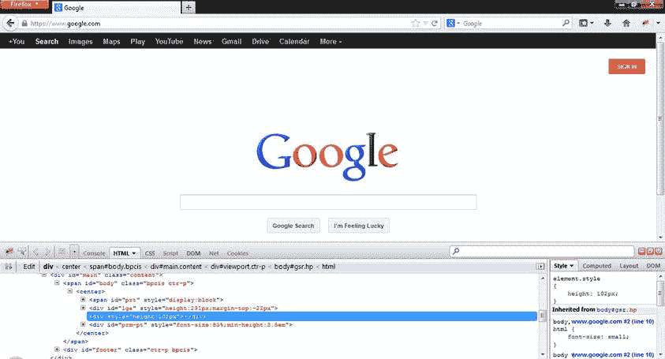
图 1-15。Firebug 是 Mozilla Firefox 的一个扩展，并完全集成到浏览器中

Firebug 将在整个过程中被证明是一个非常实用的工具，尤其是在使用 jQuery 和 D3 库时，这些库要求始终控制 DOM 的结构。该工具将允许你直接监控 DOM 的结构。然而，对于那些喜欢使用 Google Chrome 的用户，有 DevTools，它已经集成到浏览器中（参见 图 1-16）。要访问此工具，只需单击浏览器右上角的按钮。

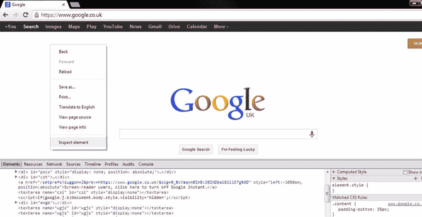
图 1-16。使用 DevTools 可以监控有关网页的大量信息

接下来，选择工具  开发者工具，或者只需右键单击任何页面元素，然后在上下文菜单中选择检查元素。使用这两个工具，你不仅可以轻松检查 DOM 的每个元素——其属性及其值——还可以检查应用于它们的 CSS 样式。你还可以对这些值进行更改，以实时观察效果，而无需每次都修改文件中的代码并保存。Firebug 和 DevTools 还包括各种用于监控页面性能的工具，包括渲染和网络方面。

使用 DevTools 时，还应特别注意控制台的使用。通过它，你可以使用诸如 `console.log()` 之类的方法访问诊断信息。此方法经常用于通过控制台显示许多变量的值，将变量名称作为参数传递，并添加文本作为指示：
```javascript
var x = 3;
console.log("The value of x is " + x); // x 的值是 3
```
还可以输入命令并与文档进行交互，使用诸如 `$()` 或 `profile()` 之类的方法。有关这些方法的更多信息，请参阅关于 Console API（`https://developers.google.com/chrome-developer-tools/docs/console-api`）和 Command Line API（`https://developers.google.com/chrome-developer-tools/docs/commandline-api`）的文档。

### JSON
JSON 是一种特定的语法，用于将数据组织为 JavaScript 对象。这种格式通常用于基于浏览器的代码，尤其是在 JavaScript 中。JSON 是 XML 的一种有效替代方案，用于组织数据。两者都与编程语言无关，但 JSON 比 XML（一种完整的标记语言）更快，并且更容易用 JavaScript 解析。此外，jqPlot 和 D3 与 JSON 配合良好。其结构完全遵循我们在 JavaScript 中定义对象和数组时所看到的规则：
```javascript
var company = {
    "name": "Elusive Dinamics",
    "location": "France",
    "sites": 2,
    "employees": 234,
    "updated": true
};
```

## 总结


# 第 1 章

第一章向你介绍了许多贯穿全书的基本概念。首先，你了解了最常见的图表类型及其构成元素。接着，你快速浏览了在 Web 上开发图表时需要了解的许多技术要点。最后，你简要探索了本书 JavaScript 示例中使用的数据类型。

我曾提到，大部分工作将由专门的 JavaScript 库完成。在下一章中，你将学习`jQuery`库。这个库将为你提供一系列直接在 DOM 层面操作的工具。在本书后续内容中，你会发现掌握这个库至关重要：许多图形库（包括`jqPlot`）都构建于其上。


