# 第 3 章：初识 jqPlot

在本章中，您将了解该库的基本概念。在了解了库的结构及其组成文件之后，您将开始理解仅用几行代码制作图表是多么容易。

## jqPlot 库

通过一系列示例，并借助插件的使用，你将逐步学会如何呈现任何类型的图表。所有操作都将通过 `$.jqPlot()` 函数完成，该函数的三个参数定义了 jqPlot 库的所有特性：目标画布、输入数据数组和选项对象。

最后，在简要说明如何通过层叠样式表（CSS）样式来自定义图表之后，你将快速了解模块化思维如何让你的实现变得有序、可维护且可复用。那么，让我们开始介绍这个精彩的库吧。

## jqPlot 库简介

`jqPlot` 是一个专门用于在网页中生成图表的 JavaScript 库。`jqPlot` 完全用纯 JavaScript 编写，是一个开源项目，自 2009 年以来由 Chris Leonello 全面开发和维护。当与 jQuery 库结合使用时，其功能才能发挥到极致。正是由于这个原因，再加上其简洁性，`jqPlot` 成为当今最流行的图表表示库之一。

`jqPlot` 非常成功，几乎取代了之前的其他库，例如 Flot，`jqPlot` 保留了 Flot 的许多方面，包括外观和感觉。事实上，`jqPlot` 的作者经常承认他曾是 Flot 的忠实用户，但随着时间的推移，他逐渐认识到其局限性。这个旧库缺乏许多功能；此外，其架构结构使其难以扩展。因此，Leonello 觉得有必要创建一个新库，保留 Flot 中所有好的特性，同时允许其发展壮大。于是，他完全重写了其架构。`jqPlot` 具有高度模块化的结构，并且正如你将看到的，它基于大量的插件，每个插件都扮演着特定的角色。因此，它最强大的特性是其可插拔性。用户绘制的每个对象，无论是线条、坐标轴、阴影还是网格本身，都由一个插件处理。每个图表元素都有可自定义的设置选项，每个添加的插件都可以扩展图表的功能。

插件的数量逐渐增加，进一步拓宽了库的应用目标。`jqPlot` 现在是一个多功能且可扩展的库，适合那些希望仅需几步就能开发出专业图表的人。

在大多数情况下，`jqPlot` 允许你无需添加太多代码行就能绘制出漂亮的图表。事实上，你会看到 `jqPlot`（甚至可能比 jQuery 更甚）秉承了“写得更少，做得更多”的理念。我认为这是该库最受赞赏的一点。每天，越来越多的开发者加入到 `jqPlot` 用户的行列中。

## 包含基本文件

当你决定利用 `jqPlot` 在你的网站上绘制图表时，作为起点，需要包含一组关键文件。

如前所述，`jqPlot` 本质上是 jQuery 的一个扩展，因此使用它需要包含 jQuery 插件（参见表 3-1）。你可以从 `jqPlot` 官方网站（`www.jqplot.com`）下载此插件，以及构成 `jqPlot` 库的所有其他插件，包括 CSS 文件。这些文件根据发布版本被分组到不同的发行包中。

表 3-1. jqPlot 的发行版本及其所基于的 jQuery 版本

| jqPlot 版本 | jQuery 版本 |
| --- | --- |
| 1.0.6–1.0.8 | 1.9.1 |
| 1.0.2–1.0.5 | 1.6.4 |

 **注意** 本书中的所有示例均使用 `jqPlot` 库的 1.0.8 版本。

然而，有一小组文件代表了库的核心，如果你想包含 `jqPlot` 提供的所有功能，这些文件是必不可少的。这组基本文件包括 jQuery 插件、`jqPlot` 插件和一个 `jqPlot` CSS 文件。还有一个文件需要导入，但仅当你想在低于版本 9 的 Internet Explorer 浏览器中加载页面时才需要：一个 ExplorerCanvas（`excanvas`）脚本。这个可选文件弥补了 HTML5 引入的画布功能的缺失。

因此，在你的网页的 `<head></head>` 标签内，你将包含这些文件（有关如何设置工作区的更多信息，请参见附录 A）：

```html
<!--[if lt IE 9]><script type="text/javascript" src="../src/excanvas.js"></script><![endif]-->
<script type="text/javascript" src="../src/jquery.min.js"></script>
<script type="text/javascript" src="../src/jquery.jqplot.min.js"></script>
<link rel="stylesheet" type="text/css" href="../src/jquery.jqplot.min.css"/>
```

除了从网站下载 `jqPlot` 库并在本地使用外，你也可以像使用 jQuery 一样，使用内容分发网络（CDN）服务。`jsDelivr`（`www.jsdelivr.com/#!jqplot`）是一个提供所有最新 `jqPlot` 发行版的 CDN 网站。如果你想使用此服务，可以按如下方式修改 URL：

```html
<!--[if lt IE 9]><script type="text/javascript" src="http://cdn.jsdelivr.net/excanvas/r3/excanvas.js">
</script><![endif]-->
<script src="http://code.jquery.com/jquery-1.9.1.min.js"></script>
<script type="text/javascript" src="http://cdn.jsdelivr.net/jqplot/1.0.8/jquery.jqplot.min.js">
</script>
<link rel="stylesheet" type="text/css" href="http://cdn.jsdelivr.net/jqplot/1.0.8/jquery.jqplot.min.css"/>
```

你很快就会发现，在网络中你会遇到类似的文件，有些带有缩写“min”（表示“压缩版”），有些则没有。你应该始终尝试使用 min 版本，即这些文件的压缩版本。它们加载速度更快。只有当你的意图是修改这些库的内部时，才应该使用它们的普通版本（不带“min”）。

## 图表基础

现在你已经了解了 `jqPlot` 库的结构，并查看了使用它所需的一组文件，你可以开始学习如何在你的网页中使用这些文件了。在图表开发中，有两个基本步骤：创建一个用于呈现图表的区域，以及插入一个用于调用 `jqPlot` 库提供的所有函数、变量和对象系列的 JavaScript 代码部分。

### 添加图表容器

`jqPlot` 库要求在 HTML 页面的 `<body>` 部分内定义一个容器（一个 `<div>` 元素）。此容器将作为库的画布。

在本章中，此容器被称为**目标**。在网页中，每个目标（在此例中为图表容器）都由一个特定的 `id` 标识。在本书中，你总会看到 `myChart` 作为目标的标识符，但它可以取任何名称，并且你必须始终记住，同一个网页可能分配有多个目标。此外，为目标指定宽度和高度也很重要。这些将定义网页内绘图区域的大小（参见清单 3-1）。

***清单 3-1***. Ch3_01.html

```html
<BODY>
   ...
   <div id="myChart" style="height:400px; width:500px;"></div>
   ...
</BODY>
```

### 创建图表

要输入代码，`jqPlot` 命令和几乎所有 JavaScript 代码都必须包含在 `<scripts>` 标签内。但是，一个网页分为两个部分：`head` 和 `body`。那么，插入 JavaScript 代码的最佳位置是哪里？虽然可以将代码放在库的两个部分中，但根据库的不同，最好只放在其中一个部分。考虑到 `jqPlot` 的工作方式，您应该将代码放在 `<head></head>` 标签之间。

此外，`jqPlot` 是 `jQuery` 的一个扩展，因此如果您希望代码被执行，您需要在 `$(document).ready()` 函数内部调用其所有方法（参见清单 3-2）。

***清单 3-2***. Ch3_01.html

```javascript
$(document).ready(function(){
    // 在此处插入所有 jqPlot 代码。
});
```

然后，要创建实际的图表，您必须使用目标元素的 `id` 来调用 `$.jqplot` 插件，您希望在该元素中绘制图表。此调用由以下 `jQuery` 函数执行：

```javascript
$.jqplot(target, data, options);
```

`jqplot()` 函数有三个参数：`target`，即要渲染图表的 `target` 元素的 ID——您在图表容器中指定的 `id` 属性；`data`，由数据系列的数组组成；以及 `options`，这是 `jqPlot` 的主要特性。在 `options` 中，您将输入必要的自定义设置，以使图表更符合您的需求和品味。

如果您不定义任何 `options`（是的，它是可选的！），您可以按照标准选项的设置生成图表。事实上，许多选项已经定义好了，您不必在每次开发图表时都更改所有设置。如果标准选项满足您的要求，则无需定义它们。这将为您节省大量时间，并避免编写许多行代码。例如，让我们编写清单 3-3 中的函数。

***清单 3-3***. Ch3_01.html

```javascript
$(document).ready(function(){
    $.jqplot ('myChart', [[100, 110, 140, 130, 80, 75, 120, 130, 100]]);
});
```

只需几行代码，您就可以生成如图 3-1 所示的图表。

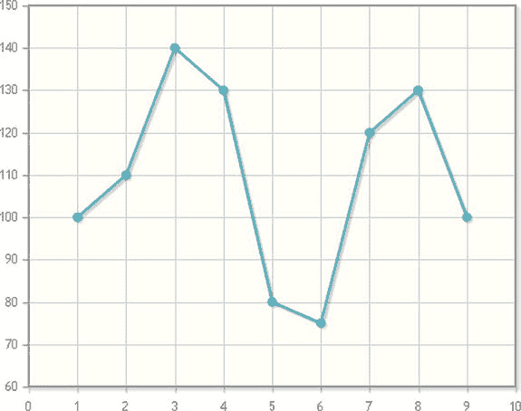

图 3-1. 仅用几行代码创建的折线图

从您刚才看到的内容可以推断，如果您不指定任何 `options`，默认结果将是一个折线图，并且您添加的数据将按此方式解释。因此，数组中的值是 `y` 值，其序列的索引显示在 `x` 轴上。在后面的章节中，您将学习如何解释这些值，以及如何从线性图表中获得不同类型的图表。

## 使用 `jqPlot` 插件

最新的 `jqPlot` 发行版提供了大约三十个插件（有关所有 `jqPlot` 插件的列表，请参见附录 B）。每个插件都专门执行特定任务，其名称通常能指示其功能。在接下来的章节中，您将了解许多这些插件——它们的用途和主要选项。

例如，以 `BarRenderer` 为例。如果您希望输入数据被解释为条形图，则需要此插件：

```javascript
$.jqplot ('myChart', [[100, 110, 140, 130, 80, 75, 120, 130, 100]],
{
    series:[{renderer: $.jqplot.BarRenderer}]
});
```

在 `jqPlot` 中，我们通常将插件称为渲染器。这是因为框架的架构规定每个插件必须覆盖一个特定任务。如果开发者认为有必要，则会包含它。此外，真正的渲染器应尽可能相互独立。实际上，您可以添加任意数量的插件，并且它们的顺序通常不重要。有些插件不需要您指定任何额外的选项或设置；它们已经定义好，并且仅通过被包含就直接激活。其中一个插件是 `Highlighter`，它高亮显示鼠标附近的数据点。但是，如果您对默认设置不满意，您可以随时用新值定义属性；这些插件还包含额外的、可设置的属性。其他插件提供的功能需要在 `options` 参数中指定才能被激活。

因此，`jqPlot` 库的基本元素以及由包含的插件逐步引入的附加组件，都可以通过一系列属性来表征（其方式与 CSS 样式非常相似）。`jqPlot` 库将这些属性称为 `options`。

## 理解 `jqPlot` 选项

有效使用 `jqPlot` 的关键在于理解 `jqPlot` 的选项。图表中任何对象的属性都由属性定义，这些属性可以取不同的值。理解如何通过我将称之为 `options` 的对象类型来设置和使用这些属性非常重要。

### 插入选项

到目前为止，您已经了解了如何在 JavaScript 代码中调用 `jqplot()` 函数，以及如何包含插件和数据，但您尚未观察到如何输入选项。您可以通过以下方式将不同的属性传递给 `$.jqplot()` 函数来自定义默认折线图：

```javascript
$(document).ready(function(){
    $.jqplot ('myChart', [[100, 110, 140, 130, 80, 75, 120, 130, 100]],
    {
        // 所有属性在此处。
    });
});
```

首先要注意的是，在调用 `$.jqplot()` 之后，无法直接在图表对象中设置属性。充其量，这不会产生任何效果。您必须在 `options` 参数中传递所有属性。

`options` 参数在其每个属性中代表 `jqPlot` 对象。表征图表的一切都由许多属性表示，这些属性被设置为特定值。这些值区分条形图和折线图，调节线条的描边或轴的长度，指示是否显示图例及其位置，等等。通常，在包含各种插件时，无需为所有属性指定值；它们已经设置为默认值。正是由于这些默认值，在添加插件时，您无需添加一行代码即可实现一个漂亮的图表。如果您显式指定一个属性，实际上是在覆盖一个已用默认值定义的属性的值。

因为我们的目标是设置 `jqPlot` 对象，并且由于该对象由一系列组件组成，因此有必要构建一个 `options` 对象，其结构完美地反映这些组件，通过定义一系列具有其属性的对象。回忆与组件对应的对象，并在 `options` 对象内部为其某个属性赋值，您将覆盖默认值并更改 `jqPlot` 对象相应组件的属性。您可以在 `options` 对象内部定义的最常用对象包括：

*   `seriesColors`
*   `stackSeries`
*   `title`
*   `axesDefaults`
*   `axes`
*   `seriesDefaults`
*   `series`
*   `legend`
*   `grid`
*   `cursor`
*   `highlighter`

每个名称都反映了图表中其属性值更改将受到影响的组件。这些对象由一系列定义明确的属性构建而成，每个属性都有自己的默认值。

这是 `jqPlot` 对象的结构：

`jqplot` 对象  组件对象  对象属性  默认值

在清单 3-4 中，你可以看到定义 `options` 对象时需要遵循的对应结构。

***清单 3-4***. Ch3_02c.html

```javascript
var options = {
    axes:{
       yaxis:{
          min: 70,
          max: 150
       },
       ...
    },
    ...
};
```

我认为最容易添加到图表中的对象是 `title`。它不包含任何属性，并且通常可以被视为 `jqPlot` 对象本身的属性。此外，可以直接为其设置一个文本值，该文本将成为图表的标题。鉴于其简单性，`title` 是理解如何使用选项的一个很好的起点（清单 3-5）。

***清单 3-5***. Ch3_02a.html

```javascript
$(document).ready(function(){
    $.jqplot ('myChart', [[100, 110, 140, 130, 80, 75, 120, 130, 100]],
    {
        title: 'My first jqPlot chart'
    });
});
```

如果你愿意，也可以使用 `jqplot()` 函数在外部定义对象的属性，将属性赋值给一个变量。然后，这个变量将作为参数传递给 `jqPlot()` 函数，如清单 3-6 所示。这个变量实际上就是 `options` 对象。

***清单 3-6***. Ch3_02a.html

```javascript
var options = { title: 'My first jqPlot chart' };
$.jqplot ('myChart', [[100, 110, 140, 130, 80, 75, 120, 130, 100]], options);
```

在这两种情况下，你现在都会得到一个顶部带有标题的图表（参见图 3-2）。

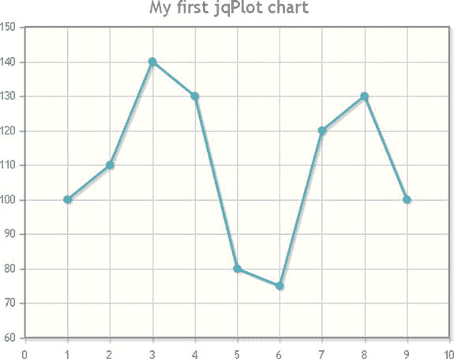

图 3-2. 为折线图添加标题

为了更好地理解如何在 `options` 对象中设置 `jqPlot` 属性，让我们以 jqPlot 网站的 API 文档部分（`www.jqplot.com/docs/files/jqplot-core-js.html`）为例。假设你想隐藏图表中的网格线。在属于 `grid` 对象的属性列表中，你会找到你要找的内容：

```
this.drawGridlines = true.
```

`this` 是网格的实例，`true` 是在创建 `jqplot` 对象时分配给它的默认值。因为你希望隐藏网格（与默认行为不同），所以需要在 `jqPlot` 对象中将值 `true` 替换为值 `false`。为此，你必须在 `options` 对象定义中添加 `drawGridlines` 属性，保持 `object:{property:attribute}` 的结构。

```javascript
options = {grid:{drawGridlines: false}};
```

现在，你得到了一个没有网格线的图表（参见图 3-3）。

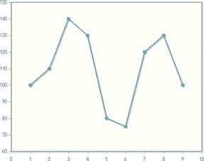

图 3-3. 隐藏折线图中的网格线

有关可设置属性的完整列表，你可以访问 jqPlot 官方网站（`www.jqplot.com/docs/index/General.html`）或阅读每个发行版中包含的 `jqPlotOptions.txt` 文件。

## 处理坐标轴选项

坐标轴的处理方式与其他普通组件对象略有不同，因为它们有四个不同的子对象，即 `xaxis`、`yaxis`、`x2axis` 和 `y2axis`。因此，为了说明坐标轴，我们需要一个嵌套层次更深的例子。假设你想指定 y 轴的 `min` 和 `max` 属性。为此，你需要按照清单 3-7 所示的结构来指定 `options` 对象。

清单 3-7. Ch3_02c.html

```
var options = {
    axes:{
        yaxis:{
            min: 70,
            max: 150
        }
    }
};
```

现在，y 轴的范围介于你在 `options` 中定义的 `max` 和 `min` 属性之间（参见图 3-4）。

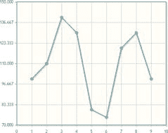

图 3-4. 聚焦于 y 轴特定范围的折线图

为了方便起见，jqPlot 提供了一个便捷的快捷方式，使我们能够一次性为所有坐标轴的属性赋予相同的值：`axesDefaults` 对象。如果你想为 x 轴和 y 轴（或 x2 轴和 y2 轴）设置相同的值，只需为 `axesDefaults` 选项对象指定这些属性，赋值一次即可（参见清单 3-8）。

清单 3-8. Ch3_02d.html

```
$(document).ready(function(){

var options = {
       axesDefaults:{
          min: 0,
          max: 20
       }
   };
   $.jqplot ('myChart', [[1,4,8,13,8,7,12,10,5]], options);
});
```

## 插入数据系列

之前，你了解了如何使用标准选项设置生成一个简单的折线图（参见“创建图表”部分）。在该示例中，数据数组直接作为第二个参数传递给 `$.jqplot()` 函数。但是，你也可以在外部将数据数组定义为一个变量，然后将其作为第二个参数传递。

```
$(document).ready(function(){
    var data = [[100,110,140,130,80,75,120,130,100]];
    $.jqplot ('myChart', data);
});
```

这里，你看到的是对应于 y 轴值的单个数据系列。但是，正如你将看到的，也可以将数据作为 (x, y) 值对传递，并且还可以一次传递多个数据系列。这些输入模式各不相同，具体取决于你正在设计的图表以及所使用的各种插件的要求。例如，如果你想输入多个数据系列，则需要声明四个不同的数组，如清单 3-9 所示。

清单 3-9. Ch3_03a.html

```
$(document).ready(function(){
    var series1 = [1, 2, 3, 2, 3, 4];
    var series2 = [3, 4, 5, 6, 5, 7];
    var series3 = [5, 6, 8, 9, 7, 9];
    var series4 = [7, 8, 9, 11, 10, 11];
    $.jqplot ('myChart', [series1, series2, series3, series4]);
});
```

jqPlot 能够管理多个系列，而无需在 `options` 中指定任何属性。实际上，浏览器将显示一个折线图，其线条数量与数据系列数量相同，每条线条颜色不同，如图 3-5 所示。

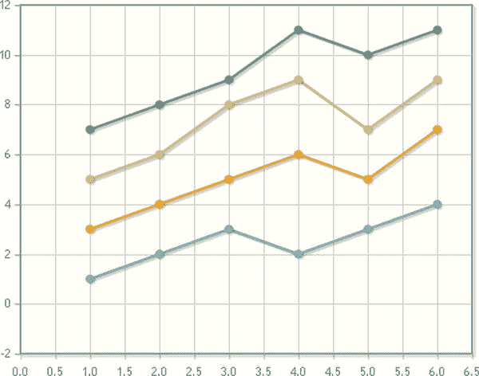

图 3-5. 每个系列颜色不同的多系列折线图

如你所见，在外部定义数据系列不仅使代码更易读、更整洁，还有助于将来对数据进行扩展和操作。利用 JavaScript 提供的所有工具，你可以创建、操作、排序、计算和处理无限多样的数据。

甚至可以更改数据系列的 `options` 对象属性。这些系列按照特定顺序插入到一个数组中，该数组作为第二个参数传递给 `$.jqplot()` 函数。这个顺序将反映在 `jqPlot` 对象内部 `series` 对象的创建中。例如，如果你只想让第二个系列不显示其标记点，则需要为第一个系列的属性留空（以免覆盖其属性），然后在第二个位置将 `showMarker` 属性设置为 `'false'`。这样，jqPlot 将只覆盖第二个系列属性的值。要实现这一点，你必须按照清单 3-10 所示编写 `options` 对象。

清单 3-10. Ch3_03b.html

```javascript
$(document).ready(function(){
    var series1 = [1, 2, 3, 2, 3, 4];
    var series2 = [3, 4, 5, 6, 5, 7];
    var series3 = [5, 6, 8, 9, 7, 9];
    var series4 = [7, 8, 9, 11, 10, 11];
    var options = {
       series: [ {},
              {
                showMarker: false
              }]
       }

$.jqplot ('myChart', [series1, series2, series3, series4], options);
});
```

这些设置的结果是生成一个包含四个序列的图表，如图 3-6 所示。请注意，从上往下数的第三个序列没有标记点。

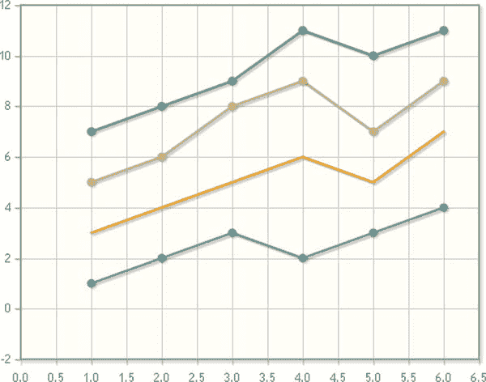

图 3-6. 一个包含无标记序列的多序列图表

如果你决定在 `axesDefaults` 中设置 `showMarker` 属性，而不是在 `axes` 对象中设置，那么你将一次性为所有序列赋予相同的值（参见代码清单 3-11）。

代码清单 3-11. Ch3_03c.html

```javascript
$(document).ready(function(){
    var series1 = [1, 2, 3, 2, 3, 4];
    var series2 = [3, 4, 5, 6, 5, 7];
    var series3 = [5, 6, 8, 9, 7, 9];
    var series4 = [7, 8, 9, 11, 10, 11];
    var options = {
       seriesDefaults: { showMarker: false }
    };
    $.jqplot ('myChart', [series1, series2, series3, series4], options);
});
```

现在，图表中的所有序列都不再显示任何标记点（参见图 3-7）。

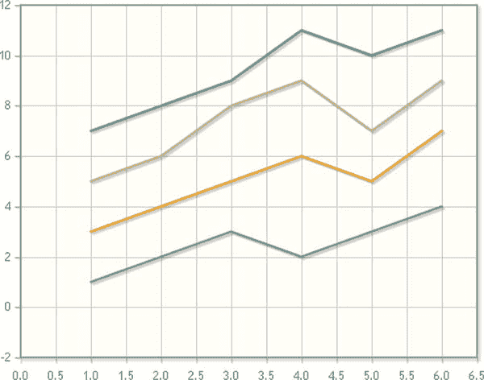

图 3-7. 一个无标记的多序列图表

还有第三种方式可以将数据作为数组输入。你刚刚看到了一个例子，其中为每个序列定义了一个数组，然后将它们全部收集在一个数组中传递给 `$.jqplot()` 函数：

```javascript
    var series1 = [1, 2, 3, 2, 3, 4];
    var series2 = [3, 4, 5, 6, 5, 7];
    var series3 = [5, 6, 8, 9, 7, 9];
    var series4 = [7, 8, 9, 11, 10, 11];
    $.jqplot ('myChart', [series1, series2, series3, series4], options);
```

但是，也可以将所有序列定义在一个名为 `dataSets` 的单一变量中：

```javascript
    var dataSets = {
       data1: [[1,1], [2,2], [3,3], [4,2],  [5,3],  [6,4]],
       data2: [[1,3], [2,4], [3,5], [4,6],  [5,5],  [6,7]],
       data3: [[1,5], [2,6], [3,8], [4,9],  [5,7],  [6,9]],
       data4: [[1,7], [2,8], [3,9], [4,11], [5,10], [6,11]]
    };
```

一旦声明了 `dataSets` 变量，为了访问这些值，你需要指定其中的序列，并使用 `dataSets.` 作为前缀。因此，当你需要将四个序列作为 `jqplot()` 函数的第二个参数单独传递时，必须按照以下方式操作：

```javascript
$.jqplot ('myChart', [dataSets.data1, dataSets.data2, dataSets.data3, dataSets.data4], options);
```

尽管目前来看，整个操作可能显得过于繁琐，但稍后你会看到，在某些特殊情况下，将所有数据收集到一个数据集中会非常有用。

## 渲染器与插件：进一步澄清

通常，渲染器是一个附加到图表中某个对象上以绘制它的对象。而插件除了添加绘图功能外，还可以执行其他功能，例如事件处理、进行计算以及处理字符串和值（如日期）的格式。因此，可以将渲染器视为一种绘图插件，但反过来并不总是成立。

让我们通过一些例子更详细地探讨这个细微差别。例如，你已经看到，仅输入单个数据序列，默认情况下就可以得到一个折线图（参见“创建图表”一节）。如果你想将此序列渲染为条形图，则需要将 `barRenderer` 插件附加到 `options` 中的 `seriesDefaults` 对象上。此外，当从折线图切换到条形图时，有必要在 x 轴上创建类别，以便条形之间能够良好地分隔开。为此，你需要将 `CategoryAxisRenderer` 附加到 `options` 中的 `axes` 对象上（参见代码清单 3-12）。

代码清单 3-12. Ch3_04a.html

```javascript
$(document).ready(function(){
    var data = [[100, 110, 140, 130, 80, 75, 120, 130, 100]];
    var options = {
       seriesDefaults: {
         renderer: $.jqplot.BarRenderer
       },
       axes:{
         xaxis:{
           renderer: $.jqplot.CategoryAxisRenderer
         }
      }
    }
    $.jqplot ('myChart', data, options);
});
```

然而，仅仅在 `options` 中调用这两个渲染器是不够的。你还必须在页面中加载它们，因此需要包含相应的插件，如代码清单 3-13 和 3-14（CDN 服务）所示。

代码清单 3-13. Ch3_04a.html

```html
<script type="text/javascript" src="../src/jquery.min.js"></script>
<script type="text/javascript" src="../src/jquery.jqplot.min.js"></script>
<link rel="stylesheet" type="text/css" href="../src/jquery.jqplot.min.css"/>
<script type="text/javascript" src="../src/plugins/jqplot.barRenderer.min.js"></script>
<script type="text/javascript" src="../src/plugins/jqplot.categoryAxisRenderer.min.js"></script>
```

代码清单 3-14. Ch3_04a.html

```html
<script src="http://code.jquery.com/jquery-1.9.1.min.js"></script>
<script type="text/javascript" src="http://cdn.jsdelivr.net/jqplot/1.0.8/jquery.jqplot.min.js"></script>
<link rel="stylesheet" type="text/css" href="http://cdn.jsdelivr.net/jqplot/1.0.8/jquery.jqplot.min.css"/>
<script type="text/javascript" src="http://cdn.jsdelivr.net/jqplot/1.0.8/plugins/jqplot.barRenderer.min.js"></script>
<script type="text/javascript" src="http://cdn.jsdelivr.net/jqplot/1.0.8/plugins/jqplot.categoryAxisRenderer.min.js"></script>
```

如果你在浏览器中重新加载页面，折线图就会变成条形图，如图 3-8 所示。

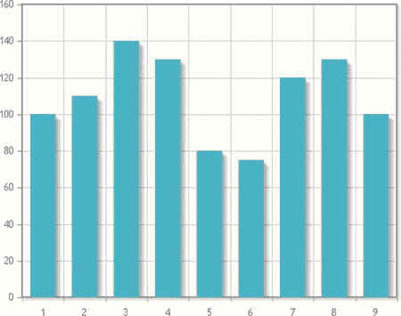

图 3-8. 一个条形图

通过将这两个渲染器调用到 `options` 中，你便用这些类别渲染器替换了图表中所有序列的默认渲染器。这些渲染器本身又有多个设置为默认值的属性，这些属性同样可以被修改。其中许多属性可能是该特定渲染器所特有的，因此它们会被添加到 `jqplot` 对象中已定义的属性中，以便为图表引入新功能。

即使对于这类附加属性，你也可以通过 `options` 对象更改默认值。首先，将所需的渲染器赋值给 `renderer` 属性。然后，在 `rendererOptions` 属性中指定你想要设置的所有属性。所有这些属性都将在你想要操作的那个组件对象中指定。例如，如果你希望某个给定序列的每个条形都有不同的颜色，你需要更改 `varyBarColor` 属性，将其默认值 `false` 替换为 `true`（参见代码清单 3-15）。

代码清单 3-15. Ch3_04b.html

```javascript
var options = {
    seriesDefaults: {
        renderer: $.jqplot.BarRenderer,
        rendererOptions: {
           varyBarColor: true
        }
    },
    axes:{
       xaxis:{
          renderer: $.jqplot.CategoryAxisRenderer
      }
    }
}
```

通过刚才所做的更改，`BarRenderer` 插件会自动为每个条形分配不同的颜色（参见图 3-9）。

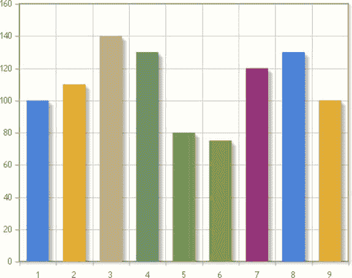

图 3-9. 不同颜色的条形图

插件还具有可在 `options` 对象内部设置的特定属性。如前所述，并非所有 jqPlot 插件都是渲染器，那些不是渲染器的插件在 jqPlot 发行版中很容易识别，因为它们的文件名中不包含 `renderer` 一词。这些插件执行与图表中特定类型组件不直接相关的特定功能。此类功能总体上增强了 jqPlot 的能力。例如，`Highlighter` 是一个在鼠标悬停时高亮显示数据点的插件。正如你将看到的，该插件内部包含一系列工具，用于处理数据值的格式说明符，并可以显示具有 HTML 结构的工具提示内容。其他值得注意的插件包括 `Trendline`，它会自动计算并绘制已绘制数据的趋势线；`Cursor`，它表示图表中显示的鼠标光标；以及 `PointLabels`，它会在数据点处放置标签。

## CSS 自定义

jqPlot 图表的许多样式都是通过 CSS 完成的。每个发行版中都提供了 `jquery.jqplot.css` 文件，它是为了获得 jqPlot 图表而需要在网页中包含的三个基本文件之一。

构成图表的所有组件都可以通过 CSS 进行自定义，而无需在 `options` 对象中设置它们的任何属性。这是为了保持与网页中所有其他对象的一致性：图表及其内部（画布内）所有内容的样式，都必须像任何其他 HTML 对象一样，由 CSS 文件管理。控制 jqPlot 对象样式的 CSS 类名称以 `.jqplot-*` 前缀开头。例如，影响所有坐标轴的样式类是 `.jqplot-axis`。

为了说明如何使用 CSS 修改图表的某些元素，让我们看看如何更改图表标题的字体和字号。与任何 HTML 元素一样，你只需调用 `jqPlot` 元素的 CSS 选择器并修改属性即可。因此，在这种情况下，你在代码清单 3-16 中添加了 CSS 样式设置。

***代码清单 3-16***. `Ch3_02e.html`

```css
<style>
    .jqplot-title {
        font: italic bold 22px arial, sans-serif;
    }
</style>
```

使用这条新的 CSS 语句，你更改了标题的样式，如图 3-10 所示。

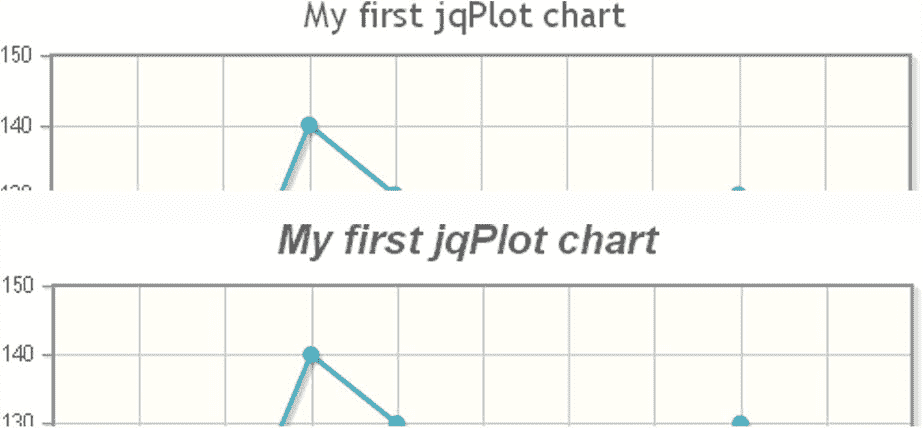

图 3-10. 应用于标题的两种不同 CSS 样式

## 模块化思维

当事情变得越来越复杂，需要添加到网站中的代码行数变得很多时，最好以模块化的方式进行思考。创建独立的模块不仅能提供更好的可见性和易于维护性，还能促进你所创建内容的可重用性。让我们分析一下代码清单 3-17 中网页的当前情况。

***代码清单 3-17***. `Ch3_05a.html`

```html
<HTML>
<HEAD>
<TITLE>我的第一个图表</TITLE>
<script type="text/javascript" src="../src/jquery.min.js"></script>
<script type="text/javascript" src="../src/jquery.jqplot.min.js"></script>
<link rel="stylesheet" type="text/css" href="../src/jquery.jqplot.min.css"/>
<style>
    .jqplot-title {
        font: italic bold 22px arial, sans-serif;
    }
</style>
<script class="code" type="text/javascript">
$(document).ready(function(){
    var data = [[100, 110, 140, 130, 80, 75, 120, 130, 100]];
    $(document).ready(function(){
        $.jqplot ('myChart', data,
        {
            title: '我的第一个 jqPlot 图表'
        });
    });
});
</script>
</HEAD>
<BODY>
    <div id="myChart" style="height:400px; width:500px;"></div>
</BODY>
</HTML>
```

如果你在浏览器中加载此网页，你将得到图 3-11 中的折线图。

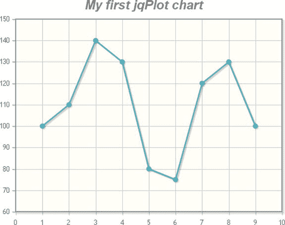

图 3-11. 一个简单的折线图

显而易见，控制页面样式的部分包含在 `<style></style>` 标签对中，而 JavaScript 或 jqPlot 代码则包含在 `<script></script>` 标签对中。这是我们添加代码行的两个主要区域。但有趣的是，这两个部分可以被复制并粘贴到两个独立的外部文件中。样式部分将被复制到一个我们称之为 `myCss.css` 的文件中（参见代码清单 3-18）。

***代码清单 3-18***. `myCss.css`

```css
.jqplot-title {
    font: italic bold 22px arial, sans-serif;
}
```

JavaScript 代码将被复制到一个我们命名为 `myJS.js` 的文件中（参见代码清单 3-19）。

***代码清单 3-19***. `myJS.js`

```javascript
$(document).ready(function(){
    var data = [[100, 110, 140, 130, 80, 75, 120, 130, 100]];
    $.jqplot ('myChart', data,
    {
       title: '我的第一个 jqPlot 图表'
    });
});
```

现在，你可以通过删除复制的部分并包含两个新创建的文件来更改你的 HTML 页面（参见代码清单 3-20）。

***代码清单 3-20***. `Ch3_05b.html`

```html
<HTML>
<HEAD>
    <TITLE>我的第一个图表</TITLE>
    <script type="text/javascript" src="../src/jquery.min.js"></script>
    <script type="text/javascript" src="../src/jquery.jqplot.min.js"></script>
    <link rel="stylesheet" type="text/css" href="../src/jquery.jqplot.min.css"/>
    <script type="text/javascript" src="myJS.js"></script>
    <link rel="stylesheet" type="text/css" href="myCss.css"/>
</HEAD>
<BODY>
   <div id="myChart" style="height:400px; width:500px;"></div>
</BODY>
</HTML>
```

如果你现在在浏览器中加载该页面，与 JavaScript 代码和 CSS 样式位于同一页面的初始情况相比，你将看不到任何区别（参见图 3-11）。

了解以模块化方式工作的可能性将使你能够编写可被多个图表重用的代码。当你想要创建，例如，一组标准的 CSS 样式来分配一个对所有图表通用的图形主题时，这会非常有用。或者，如果你已经开发了 JavaScript 方法，其应用在许多其他情况下都很有价值，那么你可以将这些方法作为外部文件包含在你个人库的每个 HTML 页面中。

## 总结

# 排版后的内容

在本章中，你迈出了使用`jqPlot`库的第一步。具体来说，你了解了该库的设计方式以及一些关键概念，例如插件和选项。通过一系列示例，你逐步学会了如何使用传递给`$.jqPlot()`函数的三个不同参数：`target`（即`jqPlot`库的画布）、输入`data`（其格式和多种输入模式），以及尤为重要的`options`对象，通过它来配置库中所有组件的设置。`options`将成为你在后续章节中看到的所有实现的核心。

在接下来的章节中，你将更具体地使用`jqPlot`库，实现所有最常见的图表类型。在下一章中，你将开始学习折线图。

