# 第 2 章


## jQuery 基础

在上一章中，你了解了 DOM 树，并看到 HTML 文档由许多元素组成，这些元素可以从初始上下文中创建、修改和删除。这些操作由浏览器通过 JavaScript 命令执行，如前所述，这些命令既可以在页面加载时执行，也可以作为后续事件的结果来执行。为此，人们开发了一个以简单且成熟的方式管理所有这些操作的 JavaScript 库。这个库就是 jQuery，它完全开源。它由 Jon Resig 于 2006 年创建，并由一个开发团队持续改进。由于其相对于经典 JavaScript 的实用性以及操作 DOM 元素的能力，jQuery 目前是使用最广泛的 JavaScript 库，并成为所有 Web 开发人员的参考基准。

任何计划在网页中包含 jQuery 库的开发人员都会很快发现伴随这个 UI 库的著名格言的真谛："Write less, do more."（写得更少，做得更多）。秉承这一口号的精神，jQuery 在 JavaScript 代码开发中引入了三个新概念——在使用该 UI 库提供的方法时，你需要牢记这些概念：
*   通过层叠样式表（CSS）选择器选择要应用 jQuery 方法的 HTML 页面元素（选择集）
*   构建 jQuery 方法链，可依次应用于同一选择集
*   使用 jQuery 包装器进行隐式迭代

在本章中，在了解了如何将 jQuery 库包含到你将开发的网页中之后，将介绍"选择集"的概念。选择集是 jQuery 库的基础，理解它们以及如何实现它们非常重要，因为本书将始终讨论它们。通过一系列小示例并使用方法链技术，你将浏览 jQuery 库提供的一系列函数，这些函数允许你操作选择集，以创建、隐藏和更改各种 DOM 元素及其内容。在本章的最后部分，我将介绍 `jQuery 用户界面库`（`jQuery UI`），并说明其一些最常用的小部件。你将了解它们的基本特性，并发现如何将它们整合到网页中。

本章的目的是让你快速了解 jQuery——其功能和基本概念。详细描述其每个方法超出了本书的范围。在本书的所有示例中，这些方法将在上下文中进行解释。不过，你可能还需要查阅 jQuery 官方网站（`http://jquery.com/`）上的文档。

## 包含 jQuery 库

现在，有两种方法可以将 jQuery 库包含到你的网页中。
*   **本地方法**：在本地下载必要的库，然后将它们添加到网页中。
*   **CDN 方法**：直接设置指向提供这些 JavaScript 库的网站的链接。

提供这些库的网站被称为内容分发网络（CDN）。CDN 是一个大型服务器系统，为最终用户提供高可用性和高性能的内容。当用户尝试访问文件时，CDN 会选择离用户最近的服务器。最常用的 CDN 之一是 Google Hosted Libraries。该服务为 Web 应用程序提供对许多最流行的开源 JavaScript 库（如 jQuery）的可靠访问。

要从该服务加载库，你需要复制以下 HTML 片段并将其直接粘贴到你的网页中：
```
<script src="http://ajax.googleapis.com/ajax/libs/jquery/1.9.1/jquery.min.js">
</script>
```

另一个可以获取任何版本 jQuery 库的 CDN 站点是 jQuery 本身的官方 CDN 站点：`code.jquery.com`。如果你更喜欢使用该站点的 URL，则需要复制并粘贴此 HTML 片段：
```
<script src="http://code.jquery.com/jquery-1.9.1.min.js"></script>
```

 **注意** 本章中的所有示例均使用 jQuery 库的 1.9.1 版本。

如果你选择采用本地方式，则需要复制并粘贴 jQuery 库的相对路径。该路径会有所不同，具体取决于库位于 Web 服务器或你的 PC 上的位置。最佳实践是创建一个合适的本地目录，用于加载你需要包含的所有库。

例如，你可能决定将 jQuery 库放在一个 `src` 目录中，而将正在开发的网页放在一个 `charts` 目录中，如图 2-1 所示。在这种情况下，你必须使用此相对路径：
```
<script src="../src/js/jquery-1.9.1.js"></script>
```

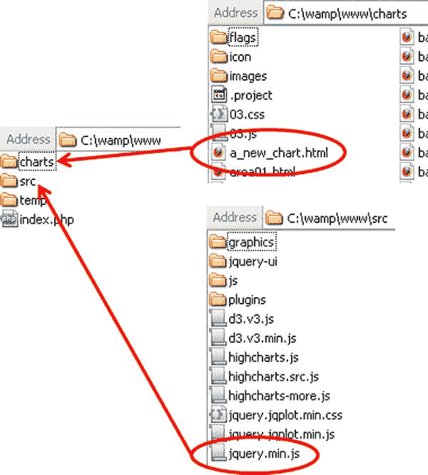

图 2-1. Web 服务器上目录组织方式的示例

 **注意** 关于如何在 Web 服务器或 PC 上设置工作区以开发本书示例的详细信息，请参阅附录 A。你还会找到关于库的不同版本、如何下载它们以及如何将它们包含在工作区中的信息。

## 选择集

选择集是一组被选中以便以某种方式进行操作的 HTML 元素。实际上，这是 jQuery 背后的主要概念。让我们以代码清单 2-1 中的简单 HTML 页面为例：

***代码清单 2-1***. `ch2_01a.html`
```
<HTML>
<HEAD>
<script src="http://ajax.googleapis.com/ajax/libs/jquery/1.9.1/jquery.min.js"></script>
</HEAD>
<BODY>
<div> 这是第一段文本</div>
<div class="selected"> 这是第二段文本</div>
<div> 这是最后一段文本</div>
</BODY>
</HTML>
```

在这个页面中，有三个包含不同文本的 `<div>` 元素。列表中的第二个元素被标记了类名 `'selected'`。要选择所有三个元素，你可以使用选择器 `'div'`，它会在页面的所有元素中识别出它们。

接下来，你编写 `jQuery()` 函数，并将选择器作为参数传递。这样，你就选择了这三个元素及其内容。要获取文本，你使用 `text()` 函数，将其链接到 `jQuery()` 函数调用之后，并在 `<head>` 部分的末尾添加这一行，如代码清单 2-2 所示。

***代码清单 2-2***. `ch2_01a.html`
```
<script>
var text = jQuery('div').text();
console.log(text);
</script>
```

三个 `<div>` 元素中包含的所有文本都已分配给变量 `text`。要查看其内容（这在调试中非常有用），你可以使用 `console.log()` 函数，然后在 Google Chrome 中，通过右键单击页面直接选择"检查"（参见图 2-2）。

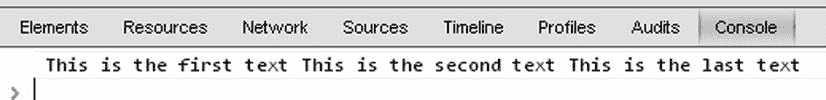

图 2-2. 变量 `text` 包含了三个 `<div>` 元素中的文本

根据你进行选择的频率，你也可以使用 `$()` 来调用此函数，如代码清单 2-3 所示。在本书提供的示例中，我们将使用此选项。

***代码清单 2-3***. `ch2_01b.html`
```
<script>
var text = $('div').text();
console.log(text);
</script>
```

相比之下，如果你只想选择三个 `<div>` 元素中的一个，可以通过为每个元素分配一个类名，然后对所选元素的名称（而非标签元素）应用选择器来区分它们（代码清单 2-4）。

***代码清单 2-4***. `ch2_01c.html`
```
<script>
var text = $('.selected').text();
console.log(text);
</script>
```

在这种情况下，变量 `text` 仅包含第二个 `<div>` 元素的文本，如图 2-3 所示。

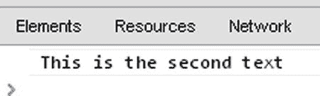

图 2-3. 在 Google Chrome 浏览器中通过“检查元素”功能显示的 `text` 变量内容

一旦你理解了如何进行选择，你就会发现如何通过更改其内容或属性来操作任何元素。你甚至可以添加其他元素或从页面中移除某个元素。在这方面，jQuery 凭借其提供的大量方法，为我们提供了必要的工具。

## 方法链

jQuery 的设计允许 jQuery 方法进行链式调用。一旦选定了一个元素或一组元素，下一步就是对其应用一系列方法。这一系列方法可以通过链式调用来编写。

使用前面的示例（参见代码清单 2-1），假设你想将第二个 `<div>` 元素中的文本替换为另一句话，并隐藏其他两个元素，使它们不再出现在网页中。为此，你将把“This is the second text”这一行替换为新的“This is a new text”，同时隐藏其他文本。图 2-4 显示了应用任何更改之前的情况。

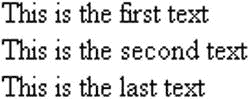

图 2-4. 未使用 jQuery 方法链时网页显示的文本

现在，应用以下方法链：
```
$('div').hide().filter('.selected').text('This is a new text').show();
```

所有三个 `<div>` 元素都被包含在选择中，然后被隐藏。在你所做的选择中，只有类名为 `'selected'` 的元素及其内容被替换为新文本。只有这些最后的元素需要被显示。因此，在这条命令链的末尾，结果将是

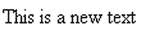

## 包装集

当涉及 jQuery 时，我们处理的是包装集。在前面的示例中，有三个 `<div>` 元素。你经常会进行包含多个元素的选择，但你永远不需要指定程序循环。在这里，当你应用 `hide()` 方法来隐藏所有三个元素时，你并没有使用 `for` 或 `while` 结构（即 `$('div').each(function() {})`）。因此，**包装集**可以被定义为一组可以进行任何操作的元素（选择），就好像它是一个单一项目一样。

## jQuery 与 DOM

jQuery 是一个主要工作在文档对象模型（DOM）上的库，并且其所有功能都始终引用 DOM。jQuery 与 DOM 一样，将每个网页视为一个树形结构，其中每个标签（也称为元素）都是一个节点。这棵树的根是文档，它是包含 DOM 中所有其他元素的元素。jQuery 提供了一组简化此类对象操作的方法，使你能够为页面增加动态效果。

## `ready()` 方法

如果你想编写操作 DOM 元素的 JavaScript 代码，DOM 需要在你操作之前加载完成。但是，你需要在浏览器完全加载所有资源之前进行操作。为此，jQuery 为你提供了 `ready()` 方法。这是一个绑定到文档对象的 DOM 上的自定义事件处理程序。`ready()` 方法只接受一个参数：一个包含代码的函数，该代码应在 DOM 加载完成后、但在用户能在浏览器中看到所有资源之前立即执行。
```
$(document).ready(function() {
    // 我们在这里编写 JavaScript 代码。
});
```

## 通过选择遍历 DOM

你已经了解了如何使用一个特定的 CSS 选择器作为参数来识别并选择一组 DOM 元素。然而，jQuery 的潜力不止于此；从选择在 DOM 中的位置出发，可以遍历 DOM 以获得一组新的选定元素进行操作。jQuery 为我们提供了一组可应用于选择的方法。

让我们以代码清单 2-5 中的简单 HTML 代码为例：

***代码清单 2-5***. `ch2_03a.html`
```
<HTML>
<HEAD>
<script src="http://ajax.googleapis.com/ajax/libs/jquery/1.9.1/jquery.min.js"></script>
</HEAD>
<BODY>
<div class="fruits">
    <div>苹果</div>
    <div>橙子</div>
    <div>香蕉</div>
    <div>草莓</div>
</div>
</BODY>
</HTML>
```

此页面将显示四种水果的列表。正如你已经看到的，如果你使用 `'div'` 作为选择器进行选择，你将得到一个包含五个元素的序列：
```
<div class="fruits">
    <div>苹果</div>
    <div>橙子</div>
    <div>香蕉</div>
    <div>草莓</div>
</div>
<div>苹果</div>
<div>橙子</div>
<div>香蕉</div>
<div>草莓</div>
```
你需要特别注意第一个 `<div>` 元素。你会在选择中找到其他四个 `<div>` 水果元素，尽管它们随后会在后续元素中重复出现。这是因为选择器 `'div'` 会选择每个元素及其内容，而不管其中的某个元素是否也会被选中。每当你想要对此类选择进行进一步操作时，考虑到这一点非常重要。

现在，如果你编写代码清单 2-6 中的代码片段，你将在一个警告对话框中看到文本，如图 2-5 所示。你可以看到最后一行文本包含了所有水果。

***代码清单 2-6***. `ch2_03a.html`
```
<script>
    var text = $('div').text();
    alert(text);
</script>
```

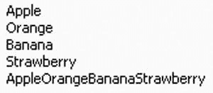

图 2-5. 警告对话框显示了选择中包含的元素内的文本

然而，通常你需要直接访问选择的特定值。例如，要直接访问当前选择的第二个元素，你可以编写
```
var text = $('div:eq(1)').text();
```

你使用了函数 `eq()` 并传入了你想要选择的元素在选择中的索引。现在，你只得到这个文本：

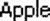

类似地，如果你想选择序列中的第三个元素，你可以直接编写
```
var text = $('div:eq(2)').text();
```

或者，如果你愿意，也可以使用 `next()` 方法进行遍历，将选择从一个元素移动到下一个元素：
```
var text = $('div:eq(1)').next().text();
```

然后你会得到这个警告消息：


现在，让我们看一个示例，演示选择集与 DOM 结构之间的区别。这有时会引起混淆。你必须记住，`eq()` 方法会创建一种子选择；而 `next()`、`prev()`、`parent()`、`children()`、`nextAll()` 和 `prevAll()` 则是将选择集移动到 DOM 上的其他位置。

事实上，如果你编写以下链式调用：
```
var text = $('div:eq(1)').prev().text();
```

你不会得到任何结果，因为 `'div:eq(1)'` 选中的元素在列表中是第一个（但在选择集中是第二个）。因此，如果你尝试将选择集移动到 DOM 中的前一个元素，你不会得到任何结果。如果你想将选择集移动到名为 `'fruits'` 的父元素，则需要使用 `parent()` 方法：
```
var text = $('div:eq(1)').parent().text();
```

现在，你得到了父元素，它与选择集中的第一个元素相同。图 2-6 展示了结果。

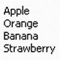

图 2-6。警告对话框显示了第一个元素中的四种水果

如果你编写以下命令：
```
var text = $('div:eq(0)').text();
```

你会得到相同的结果。

## 创建并插入新元素

到目前为止，你已经看到，通过在 `jQuery()` 函数或其别名 `$()` 中传递一个参数，你可以获得 DOM 中所有具有该标签或相同类名的元素的选择集。现在，假设你传递的参数是一个 HTML 页面中不存在的标签。这时，你刚刚创建了一个要添加到 DOM 中的新元素。此外，这个元素无论从哪方面来说都是一个选择集，因此可以对其进行任何类型的操作，即使它尚未被实际添加到网页中。通过在方法链的末尾添加一些特定的 jQuery 方法，你将决定将新创建的元素插入到何处。

例如，如前面的示例所示，通过编写以下代码片段：
```
$('<div>Lemon</div>').appendTo('div:eq(2)');
```

你在水果列表中创建了一个新元素。然后，你将其追加到选择集中的第三个元素（列表中的第二个元素）之后。图 2-7 展示了应用更改后网页中列表的显示效果。

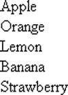

图 2-7。列表可以动态增加，添加新元素

有许多方法可以指定在何处以及如何插入刚创建的元素：`prepend()`、`after()`、`before()`、`append()`、`appendTo()`、`prependTo()`、`insertAfter()`、`insertBefore()`、`wrap()`、`wrapAll()`、`wrapInner()`等等。

有关这些函数使用的更多详细信息，建议读者查阅 jQuery 官方网站（`http://jquery.com/`）上的文档。

## 移除、隐藏和替换元素

另一组非常有用的 jQuery 方法包括那些允许我们从页面（从 DOM 中）删除静态元素，或者至少隐藏它们的方法。有时，这些方法甚至对于用一个元素替换另一个元素也很有用。

要从列表中移除“Orange”水果，只需编写：

```
$('div:eq(2)').remove();
```

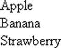

如果你想隐藏它，可以编写：

```
$('div:eq(2)').hide();
  ...
$('div:eq(2)').show();
```

然而，在这种情况下，在后续的代码中，仍然可以再次显示“Orange”。

如果你改用 `remove()`（参见清单 2-7），则选择器 `'div:eq(2)'` 对应的元素会发生变化，并且无法恢复被移除的元素。

**清单 2-7**。`ch2_04c.html`

```
$('div:eq(2)').remove();
var text = $('div:eq(2)').text();
alert(text); //返回 'Banana'
```

最后，如果你想用“Pineapple”替换“Orange”，可以使用 `replaceWith()` 方法，如下所示：

```
$('div:eq(2)').replaceWith('<div>Pineapple<div>');
```

现在，你有了一个新的水果列表，如图 2-8 所示。

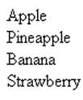

图 2-8。列表可以通过移除某些元素来动态缩减

## jQuery UI：小部件

除了 jQuery 库之外，还有另一个库可以帮助你将交互式和图形化对象集成到网页中：jQuery UI。这个库提供了一整套工具，例如小部件、主题、效果和交互，它们丰富了网页，将其转变为高度交互的 Web 应用程序。就我们的目的而言，小部件尤其值得关注。这些小型的图形化应用程序可以成为有价值的工具，当添加到你的网页中时，它们能使你的图表更具交互性。小部件促进了网页底层程序之间的交互，并且通常本身就是真正的迷你应用程序。在最简单的形式中，小部件表现为表格、折叠面板、组合框，甚至是按钮。

与 jQuery 库一样，如果你想集成其小部件，你需要将插件文件包含到网页中。你还必须包含代表主题的 CSS 文件。这可以通过 Google 托管库服务来完成：

```
<link rel="stylesheet" href="http://ajax.googleapis.com/ajax/libs/jqueryui/1.10.3/themes/smoothness/jquery-ui.css" />
<script src="http://ajax.googleapis.com/ajax/libs/jquery/1.9.1/jquery.min.js">
</script>
<script src="http://ajax.googleapis.com/ajax/libs/jqueryui/1.10.3/jquery-ui.min.js">
</script>
```

你也可以从官方的 CDN jQuery 网站下载：

```
<link rel="stylesheet" href="http://code.jquery.com/ui/1.10.3/themes/smoothness/jquery-ui.css" />
<script src="http://code.jquery.com/jquery-1.9.1.min.js"></script>
<script src="http://code.jquery.com/ui/1.10.3/jquery-ui.min.js"></script>
```

如果你更喜欢在本地下载库，或者使用本书附带的源代码中的工作区（参见附录 A），你可以按如下方式引用库：

```
<link rel="stylesheet" href="../src/css/smoothness/jquery-ui-1.10.3.custom.min.css" />
<script src="../src/js/jquery-1.9.1.js"></script>
<script src="../src/js/jquery-ui-1.10.3.custom.min.js"></script>
```

 **注意** 本书中用于 jQuery UI 小部件的主题是 `smoothness`。可用主题列表非常广泛，涵盖了多种颜色和形状的组合。这个丰富的列表可以在 ThemeRoller（`http://jqueryui.com/themeroller`）上找到。ThemeRoller 是 jQuery 官方网站上的一个页面，它允许你预览小部件，然后从可用的主题中下载你喜欢的主题。

访问 jQuery UI 官方网站（`http://jqueryui.com/`）时，你会注意到这个库提供的小部件数量众多。在这里，我将只讨论最常见的示例，特别是那些最有可能被集成到包含图表的页面中的示例。

正如你将在本书中看到的，其中一些小部件将用作容器，利用其特殊功能，例如调整大小和封装，包括：

* 折叠面板
* 选项卡

其他小部件将用于替换 HTML 提供的简单控件，因为前者更加先进且功能丰富，包括以下内容：

* 按钮
* 组合框
* 菜单
* 滑块

还有一些小部件将执行指示器的功能。通过这些，你将看到如何集成特定的小部件类别：

* 进度条

### 折叠面板

#### 手风琴部件

手风琴部件是一组可折叠的面板，能让网页在紧凑的空间内展示大量信息。每个面板可以容纳一个主题区域，或者如你将在后续章节中看到的，不同类型的图表。点击每个面板的标签即可显示内容，使用户无需切换页面就能在不同面板间移动。根据用户的选择，手风琴的面板会展开或收缩，因此在任何给定时间，只有一个面板会显示其内容。

要在页面中获得手风琴部件，你需要编写的 HTML 结构由一个包含所有面板的外部 `<div>` 标签组成。每个面板则由一对 `<h3>` 标签之间的标题和一对 `<div></div>` 标签（内容位于其间）来指定。清单 2-8 展示了一个包含四个面板的简单手风琴。

**清单 2-8**。`ch2_05.html`

```
<div id="accordion">
    <h3>第一个标题</h3>
    <div>第一个内容面板</div>
    <h3>第二个标题</h3>
    <div>第二个内容面板</div>
    <h3>第三个标题</h3>
    <div>第三个内容面板</div>
    <h3>第四个标题</h3>
    <div>第四个内容面板</div>
</div>
```

在 JavaScript 代码中，你需要添加清单 2-9 中的代码片段来获得手风琴部件。

**清单 2-9**。`ch2_05.html`

```
$(function() {
    $("#accordion").accordion();
});
```

图 2-9 展示了我们的手风琴。

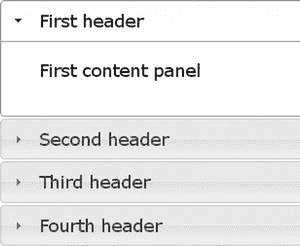

图 2-9。手风琴由可折叠的面板组成，适合在有限的空间内容纳信息

但是，这还不够。如果你能控制手风琴的样式就更好了。这可以通过添加清单 2-10 中给出的代码来实现。

**清单 2-10**。`ch2_05.html`

```
<style type="text/css">
    .ui-accordion {
        width: 690px;
        margin: 2em auto;
    }
    .ui-accordion-header {
        font-size: 15px;
        font-weight: bold;
    }
    .ui-accordion-content {
        font-size: 12px;
    }
</style>
```

结果如图 2-10 所示。

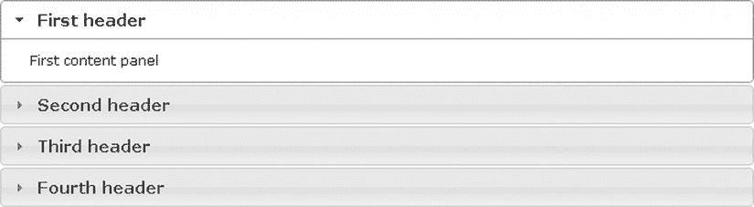

图 2-10。通过修改 CSS 样式属性，你可以随心所欲地改变手风琴的外观

#### 标签页

在功能上与手风琴非常相似的部件是带有标签页的面板。在这里，每个面板都是唯一的，但顶部有多个标签页，由不同的标题标识。尽管如此，这个部件提供了在有限空间内展示大量信息的可能性，并且用户一次只能选择一个标签页来查看其内容。更显著的区别在于失去了面板的垂直展开特性。

要在网页中获得标签页部件，你需要编写的 HTML 结构比前一个稍微复杂一些。标题放在一个无序列表 `<ul>` 中，其中的每个列表项 `<li>` 必须引用一个锚点标签 `<a>`。每个标签页的内容都包含在一对 `<div></div>` 标签中，并带有一个 `id` 属性，该属性与锚点标签中的引用相对应（参见清单 2-11）。

**清单 2-11**。`ch2_06.html`

```
<div id="tabs">
  <ul>
    <li><a href="#tabs-1">第一个标题</a></li>
    <li><a href="#tabs-2">第二个标题</a></li>
    <li><a href="#tabs-3">第三个标题</a></li>
    <li><a href="#tabs-4">第四个标题</a></li>
  </ul>
  <div id="tabs-1">
    <p>第一个标签页面板</p>
  </div>
  <div id="tabs-2">
    <p>第二个标签页面板</p>
  </div>
   <div id="tabs-3">
    <p>第三个标签页面板</p>
  </div>
  <div id="tabs-4">
    <p>第四个标签页面板</p>
  </div>
</div>
```

在 JavaScript 代码中，你需要指定标签页部件，如清单 2-12 所示。

**清单 2-12**。`ch2_06.html`

```
$(function() {
    $("#tabs").tabs();
});
```

还必须定义 CSS 样式类，如清单 2-13 所示。

**清单 2-13**。`ch2_06.html`

```
<style type="text/css">
    .ui-tabs {
      width: 690px;
      margin: 2em auto;
    }
    .ui-tabs-header {
      font-size: 15px;
      font-weight: bold;
    }
    .ui-tabs-panel {
      font-size: 12px;
    }
</style>
```

当过程完成后，你将得到图 2-11 所示的部件。

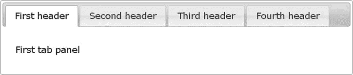

图 2-11。标签页部件由占据同一区域的多个面板组成

#### 按钮

在所有可用的部件中，按钮仍然是最常用的。以前，在网页中插入按钮有两种方式。第一种是经典方法，使用标签 `<input type="button"/>`。一种更现代的方法是清单 2-14。

**清单 2-14**。`ch2_07.html`

```
<button>一个按钮元素</button>
<input type="submit" value="一个提交按钮" />
<a href="#">一个锚点</a>
```

如果没有进一步的说明或 JavaScript 代码，当你加载页面时，你会看到图 2-12 中展示的按钮。


图 2-12。网页展示了三种类型的按钮：一个简单的按钮元素、一个提交按钮和一个锚点按钮

要使用 JavaScript 函数来引用它们，请编写清单 2-15 中提供的代码片段。

**清单 2-15**。`ch2_07.html`

```
$(function() {
    $("input[type=submit], a, button")
      .button()
      .click(function(event) {
         event.preventDefault();
      });
});
```

通过这种方式，你将获得一组更美观的按钮，如图 2-13 所示。

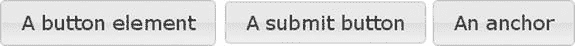

图 2-13。这三种类型的按钮现在由 jQuery UI 按钮部件表示

你可以通过添加图标来丰富你的按钮。jQuery UI 提供了大量的图标集，但你也可以使用更大的自定义图标。清单 2-16 展示了如何将四个按钮写入你的网页：

**清单 2-16**。`ch2_08.html`

```
<button>仅带图标的按钮</button>
<button>左侧带自定义图标的按钮</button>
<button>带两个图标的按钮</button>
<button>带两个图标且无文本的按钮</button>
```

您添加了四个按钮来突出显示四种可能的情况：一个只有图标的按钮；一个左侧带有文本和图标的按钮；一个两侧都带有文本和图标的按钮；以及一个有两个图标但没有文本的按钮（参见图 2-14）。查看 HTML 代码，您会发现实际上所有四个按钮内部都有文本，但可以禁用此功能以获得没有文本的按钮。清单 2-17 演示了如何为不同按钮分配图标，图标名称被分配给 `primary` 和 `secondary`（可选）属性。此外，通过将 `text` 属性设置为 `'false'`，您可以获得一个没有文本的按钮。

**清单 2-17**。`ch2_08.html`

```
$(function() {
    $("button:first").button({
        icons: {
            primary: "ui-icon-locked"
        },
        text: false
    }).next().button({
        icons: {
            primary: "ui-icon-italy"
        }
    }).next().button({
        icons: {
            primary: "ui-icon-gear",
            secondary: "ui-icon-triangle-1-s"
        }
    }).next().button({
        icons: {
            primary: "ui-icon-gear",
            secondary: "ui-icon-triangle-1-s"
        },
        text: false
    });
});
```

要插入自定义图标，您需要使用 `url()` 函数将其地址定义为 CSS 文件，如清单 2-18 所示。

**清单 2-18**。`ch2_08.html`

```
<style>
.ui-button .ui-icon-italy {
    background-image: url("icon/exit24x24.png");
    width: 24px;
    height: 24px;
}
</style>
```

图 2-14 展示了您刚刚创建的一组按钮。


图 2-14。每个按钮都可以轻松地通过图标进行丰富

#### 组合框

组合框是网页和许多应用程序中另一个广泛使用的控件。组合框是一个可编辑的下拉菜单，用户可以通过它选择一个条目。要在页面中插入组合框，您需要定义一个特定的元素结构，如清单 2-19 所示。

**清单 2-19**。`ch2_09.html`

```
<div class="ui-widget">
    <label>选择您的目的地：</label>
    <select id="combobox">
        <option value="">选择一个...</option>
        <option value="Amsterdam">阿姆斯特丹</option>
        <option value="London">伦敦</option>
        <option value="Rome">罗马</option>
    </select>
</div>
```

接下来，您需要使用 JavaScript 代码引用此结构，首先使用 `$()` 选择元素，然后将其激活为 jQuery 组合框小部件：

```
$(function() {
     $("#combobox").combobox();
});
```

让我们添加一点 CSS 样式：

```
<style>
    .ui-widget {
       font-size: 18px;
    }
</style>
```

图 2-15 展示了组合框小部件，它代表了实现事件捕获的整个系列功能的起点。

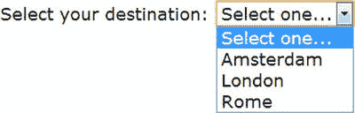

图 2-15。组合框是一个下拉菜单，允许用户在多个选项中进行选择

# jQuery UI 小部件详解

### 菜单

刚刚考虑了组合框，您不能忽视在主页上包含交互式菜单的可能性。通过这样的菜单，用户可以做出系列选择，例如选择如何表示图表的选项。

在 HTML 中，无序列表定义为 `<ul>`，列表项定义为 `<li>`。如果您想添加一个子菜单作为项目，只需插入一个嵌入的无序列表 `<ul>`。为了说明如何构建菜单，让我们看一下代码清单 2-20。

**代码清单 2-20**. ch2_10.html

```html
<ul id="menu">
    <li class="ui-state-disabled"><a href="#">高级</a></li>
    <li><a href="#">筛选</a></li>
    <li>
        <a href="#">缩放</a>
        <ul>
            <li><a href="#">10%</a></li>
            <li><a href="#">25%</a></li>
            <li><a href="#">50%</a></li>
            <li><a href="#">100%</a></li>
        </ul>
    </li>
</ul>
```

与前面的小部件一样，您必须通过添加以下函数来激活菜单：

```javascript
$(function() {
    $("#menu").menu();
});
```

您还需要包含 CSS 样式设置：

```css
<style>
    .ui-menu {
        width: 150px;
    }
</style>
```

现在，页面上就有了一个菜单，如图 2-16 所示。

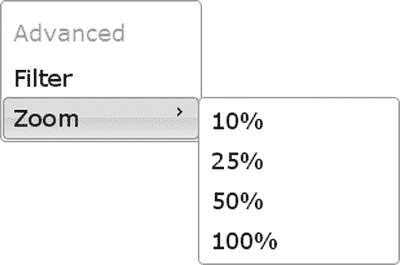
*图 2-16. 下拉菜单让您对不同的选项进行分类*

### 滑块

当您开始开发各种类型的图表时，您会发现每次都需要设置几个参数。用户可以通过滑块实时修改这些参数。这些滑块使用户能够在特定范围内更改参数。

与许多其他小部件一样，首先您需要添加 `<div>` 元素来在网页中表示滑块。

```html
<div id="slider"></div>
```

然后，像往常一样，您使用 JavaScript 函数激活该小部件，并在其中指定小部件的属性。例如，要指定滑块手柄的默认位置，您可以将 `value` 属性设置为 0 到 100 之间的百分比值。类似地，可以通过将字符串 `'horizontal'` 或 `'vertical'` 赋值给 `orientation` 属性来设置方向。对于 `range` 属性，您可以指示滑块覆盖的范围（滑块轨道的阴影区域）应从 `'min'` 值还是 `'max'` 值开始（参见图 2-19）。因此，如果您将 `range` 属性设置为 `'min'`，则范围将从最小值延伸到滑块手柄。`animation` 属性是另一个需要考虑的设置。滑块小部件内置了动画：当用户单击滑块轨道时，手柄会从其当前位置移动到单击点；这可以缓慢或快速完成。您可以通过将 `animation` 属性设置为 `'fast'` 或 `'slow'` 来选择手柄移动的速度。属性 `'true'` 和 `'false'` 表示动画是启用还是禁用（参见代码清单 2-21）。

**代码清单 2-21**. ch2_12.html

```javascript
$(function() {
    $("#slider").slider({
        value: 60,
        orientation: 'horizontal',
        range: 'min',
        animate: 'slow'
    });
});
```

一旦定义了滑块的基本属性，您就需要决定其大小（以及手柄的大小）并添加 CSS 样式设置。当您定义滑块的长度和宽度时，需要考虑您选择的方向，并相应地设置 `height` 和 `width` 属性。在这种情况下，我们希望水平显示滑块；因此，`width` 属性将远大于 `height` 属性（参见代码清单 2-22）。

**代码清单 2-22**. ch2_12.html

```css
<style>
    .ui-slider {
       width: 400px;
       height: 10px;
    }
    .ui-slider .ui-slider-handle {
       width: 12px;
       height: 20px;
    }
</style>
```

如果您在浏览器中加载该网页，您将看到滑块（参见图 2-17）。


*图 2-17. 滑块是一种允许您在范围内选择数值的小部件*

有时，您需要使用多个滑块，并且需要将它们水平排列（例如，在立体声音响的均衡器中可以找到类似的结构）。在指定多个滑块时，无需定义多个 `<div>` 元素：只需一个带有 `"eq"` 作为其 `id` 的 `<div>` 元素即可标记。然后，在此元素内，将每个滑块定义为一个包含其默认值（即各个手柄在滑块轨道上的位置）的配对，如代码清单 2-23 所示。

**代码清单 2-23**. ch2_13.html

```html
<div id="eq">
    <span>88</span>
    <span>77</span>
    <span>55</span>
    <span>33</span>
    <span>40</span>
    <span>45</span>
    <span>70</span>
</div>
```

现在，您必须实现一个 JavaScript 函数，这次稍微复杂一些。首先，使用 `$("#eq > span")` 选择器，对七个元素进行选择。然后，使用 `parseInt()` 函数，将配对中包含的所有值依次赋值给相应的 `value` 属性，以便手柄处于图 2-18 所示的位置（参见代码清单 2-24）。

**代码清单 2-24**. ch2_13.html

```javascript
$(function() {
    $('#eq > span').each(function() {
        // read initial values from markup and remove that
        var value = parseInt($(this).text(), 10);
        $(this).empty().slider({
            value: value,
            range: 'min',
            animate: 'slow',
            orientation: 'vertical'
        });
    });
});
```

即使对于这种类似均衡器的结构，也需要添加一些 CSS 样式设置，例如不同滑块之间的边距（参见代码清单 2-25）。

**代码清单 2-25**. ch2_13.html

```css
<style>
    #eq span {
      height:180px;
      float:left;
      margin:15px;
      width:10px;
    }
</style>
```

最终，您会得到图 2-18 所示的条形图。

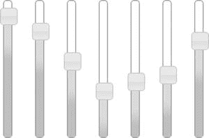
*图 2-18. 滑块也可以成组排列，以实现更复杂的控制（例如，均衡器）*

### 进度条

当您开发复杂操作时，系统可能需要很长时间才能完成任务。在用户等待期间，为了防止系统看起来像被锁定，通常会用进度条来表示已完成任务的百分比。定义一个进度条非常简单：

```html
<div id="progressbar"></div>
```

您还必须编写相应的 JavaScript 函数来激活进度条，如代码清单 2-26 所示。

**代码清单 2-26**. ch2_11a.html

```javascript
$(function() {
    $("#progressbar").progressbar({
        value: 37
    });
});
```

接下来，添加 CSS 样式设置，如代码清单 2-27 所示。

**代码清单 2-27**. ch2_11a.html

```css
<style>
    .ui-progressbar {
       height: 20px;
       width: 600px;
    }
</style>
```

但是，您得到的结果并非预期效果；您会得到一个静态进度条，固定在 37% 的位置（参见图 2-19）。


*图 2-19. 使用进度条，您可以显示进程的状态*

要获得一个功能完整的进度条，您需要将其 `value` 属性设置为一个计数器值，该计数器值直接与底层进程的迭代相关联。此外，如果您想增加进度条的动态效果，可以使用动画图形交换格式（GIF）图像作为其背景。代码清单 2-28 展示了向进度条添加 CSS 样式属性。

**代码清单 2-28**. ch2_11b.html

```css
<style>
    .ui-progressbar {
       height: 20px;
       width: 600px;
    }
    .ui-progressbar .ui-progressbar-value {
       background-image: url(images/pbar-ani.gif);
    }
</style>
```

图 2-20 中的 GIF 图像能更好地体现操作的进度感。


*图 2-20. 带有动画 GIF 的进度条为网页赋予了高度动态的外观*

> **注意** 适用于任何类型进度条的动画 GIF 可以轻松安全地从网站 ajaxload (`www.ajaxload.info`) 获取。只需选择您想要使用的进度条类型，然后选择前景色和背景色，该网站就会自动生成动画 GIF 的预览。如果图像符合您的要求，您可以继续下载。

或者，您也可以使用本书附带的代码中提供的动画 GIF（`pbar-ani.gif`），它位于图表/图像目录中（您可以在 Apress 网站 [`www.apress.com`] 的源代码/下载区域找到代码示例）。

## 关于 jQuery 库的总结性思考

到现在为止，您可能想知道为什么我们要从一个库（jQuery）开始，它显然与图表开发或一般的数据可视化无关。您已经看到 jQuery UI 库为我们提供了图形元素，但其用途与您对图表的预期相去甚远。

实际上，我们必须从这里开始。您已经决定使用 JavaScript 语言，目标是在网页中实现图形元素（这些元素无非就是 DOM 元素）。这一切的核心是通过这个库引入的概念。选择器、方法链、结构、使用 CSS 样式的实践——这些是 Web 编程的基础，更是图表开发的基础。而获得这些基础知识的最佳方式莫过于使用 jQuery 库。

随着您阅读本书的深入，您会发现 jqPlot 库必须包含 jQuery 库。这就是了解 jQuery 的重要性所在。

## 本章小结

在开始直接使用 JavaScript 开发图表之前，有必要介绍一些构成此类代码开发基础的基本工具。因此，在本第二章中，向您介绍了 **jQuery** 和 **jQuery UI** 库。通过 jQuery，您学会了如何通过选择器和方法链动态操作 DOM 元素。通过 **jQuery UI**，您发现了如何使用交互式图形元素（**jQuery UI 小部件**）来丰富您的页面。

在下一章中，您将迈出使用 jqPlot 库的第一步。具体来说，您将了解该库的设计方式以及关键概念，例如插件和选项。