# 使用 jqPlot 绘制折线图

在上一章中，你了解了 `jqPlot` 的最基本用法：只需一组数据即可绘制一条折线，无需任何额外选项。你看到，要创建最基本的图表类型——折线图，并不需要包含插件。

在本章中，你将开始更详细地研究 `jqPlot` 库所提供的可能性，探索各种插件及其功能。首先，由于折线图是在笛卡尔坐标轴上绘制的，你将学习使用 `(x, y)` 值对作为输入数据。接着，你将研究坐标轴以及如何使用适当的插件来创建它们。你还将详细分析如何实现与坐标轴相关的各种元素，如刻度、坐标轴标签和网格。随后将讨论对数刻度。

接下来，你将学习如何通过同时处理多个数据系列来实现多系列折线图。你将发现如何通过设置线条和标记来修改图案、形状甚至颜色。此外，你还会了解如何通过调整浏览器绘制图表的速度来创建动画。

而且，你将探究 `jqPlot` 库如何处理不同格式的日期和时间值。你还将看到如何使用 HTML 格式自定义某些元素，以及如何高亮数据点。在本章的最后部分，你将处理更复杂的情况，例如生成趋势线和处理带状图。

## 使用 `(x, y)` 值对作为输入数据

到目前为止，为简单起见，输入数据都是以 `y` 值数组的形式传递的（参见代码清单 4-1）。如果 `jqPlot` 只找到 `y` 值，则会根据它们在数组中的顺序，将 `x` 值分配为 1、2、3 等。

***代码清单 4-1***。`Ch4_01.html`

```
$(document).ready(function(){
    var plot1 = $.jqplot ('myChart', [[100,110,140,130,80,75,120,130,100]]);
});
```

在图 4-1 中，你可以看到 `x` 轴上有一系列整数，它们是作为数据传递的数组的索引。

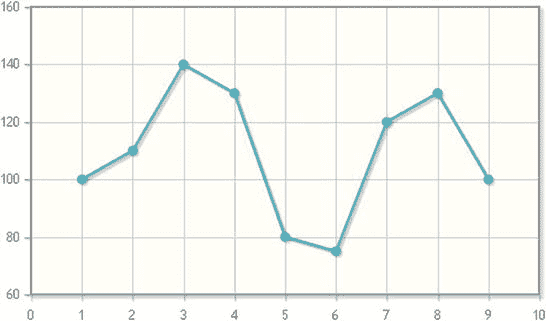

图 4-1。`x` 轴显示的是插入值的索引

当处理线性图时，最好使用 `(x, y)` 值对数组，因为这样可以避免许多复杂情况，例如需要按特定顺序输入数据，而这并不总是可行或正确的。实际上，使用值对时，数据不必按 `x` 值递增的顺序列出；`jqPlot` 会为你完成排序。此外，`x` 值不必等距，可以遵循任意分布。在代码清单 4-2 中，插入了 `(x, y)` 值对，其中 `x` 值既未排序也未均匀分布。

***代码清单 4-2***。`Ch4_02.html`

```
$(document).ready(function(){
    var data = [[[10,100], [80,130], [65,75], [40,130],
                 [60,80], [30,140], [70,120], [20,110], [95,100]]];
    $.jqplot ('myChart', data);
});
```

在图 4-2 中，你可以看到 `jqPlot` 如何对图表中的所有点进行排序，无论它们输入的顺序如何，也无论它们是否沿 `x` 轴均匀分布。

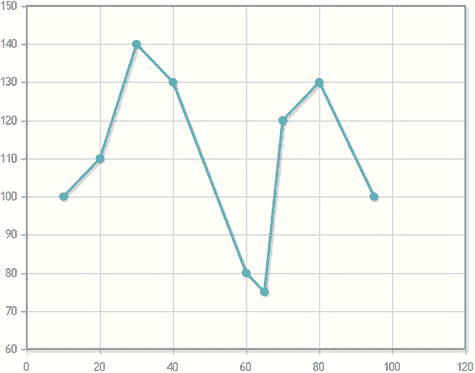

图 4-2。一个简单的折线图，`x` 轴上的点分布不均匀

## 开发折线图的第一步：坐标轴

在详细研究折线图的更复杂方面之前，让我们先检查一下这种图表所基于的基础：坐标轴。如果你想开发一个能够完美可视化数据的图表，坐标轴的适当管理至关重要。为此，你需要充分理解 `jqPlot` 库通过 `options` 对象中的特定属性所提供的操作模式。

### 添加标题和坐标轴标签

开发图表时，第一步是添加标题并管理坐标轴标签，使用 `CanvasAxisLabelRenderer` 插件。

但是，为了正常运行，此插件需要另一个提供文字功能的插件：`CanvasTextRenderer`。使用此插件，你可以直接在画布元素上渲染标签文本。这使你可以像处理其他图形元素一样处理文本，从而能够根据需要旋转文本。默认情况下，`y` 轴上的坐标轴标签现在旋转了 90 度，如图 4-3 所示。

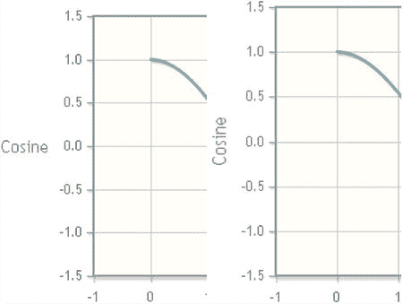

图 4-3。如果不包含 `CanvasAxisLabelRenderer` 插件，`y` 轴标签是水平的。包含该插件后，`y` 轴标签会垂直旋转

要集成这一新功能，你需要将这两个插件添加到基本插件集中：

```html
<script type="text/javascript" src="../src/plugins/jqplot.canvasTextRenderer.min.js">
</script>
<script type="text/javascript"
    src="../src/plugins/jqplot.canvasAxisLabelRenderer.min.js"></script>
```

或者，如果你更喜欢使用内容分发网络（CDN）服务，可以按如下方式操作：

```html
<script type="text/javascript" src="http://cdn.jsdelivr.net/jqplot/1.0.8/plugins
    /jqplot.canvasTextRenderer.min.js"></script>
<script type="text/javascript" src="http://cdn.jsdelivr.net/jqplot/1.0.8/plugins
    /jqplot.canvasAxisLabelRenderer.min.js"></script>
```

创建 `options` 变量后，你必须在其中指定一些属性，如代码清单 4-3 所示。你已经了解了如何通过向 `title` 对象分配字符串来添加标题。然后，需要显式调用 `canvasAxisLabelRenderer` 对象以激活其功能，通过在 `axesDefaults` 对象内部执行此操作，它将适用于所有坐标轴。要为 `x` 轴和 `y` 轴标签分配文本，你必须在 `axes` 对象的 `xaxis` 和 `yaxis` 子对象中设置 `label` 属性。其树状结构将允许你在每个单独坐标轴的级别上进行不同的更改。

***代码清单 4-3***。`ch9_03a.html`

```javascript
$(document).ready(function(){
    var data = [[100, 110, 140, 130, 80, 75, 120, 130, 100]] ;
    var options = {
       title: '我的折线图',
       axesDefaults: {
          labelRenderer: $.jqplot.CanvasAxisLabelRenderer
       },
       axes: {
          xaxis: {
             label: "X 轴"
          },
          yaxis: {
             label: "Y 轴"
          }
       }
    };
    $.jqplot ('myChart', data, options);
});
```

图 4-4 展示了上述代码生成的图表。

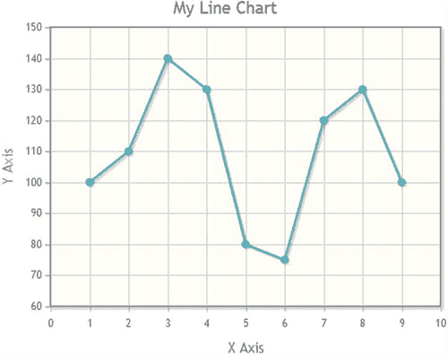

图 4-4. Y 轴标签垂直方向的折线图

### 坐标轴属性

与坐标轴标签类似，在 `axes` 对象中也可以指定多个属性。例如，观察图表（参见图 9-4），可以看到线条从 `x` 值 1 开始，而 `x` 轴从值 0 开始，因此留下了一段空白。在 `x` 范围的末端（9 到 10 之间）也出现了另一段空白。如果要控制这些间距（坐标轴边界与数据集端点之间的距离），必须使用 `pad` 属性。通过应用内边距，可以扩展数据边界之上和之下的范围。数据范围会乘以这个因子，以确定坐标轴的最小和最大边界。值 0 将被解释为无内边距，`pad` 将被设置为 1。因此，通过向 `xaxis` 对象添加 `pad` 属性并将其设置为 1（参见代码清单 4-4），可以得到图 4-5 中的图表。

***代码清单 4-4***. `Ch4_03b.html`

```javascript
xaxis: {
    label: "X Axis",
    pad: 1
},
```

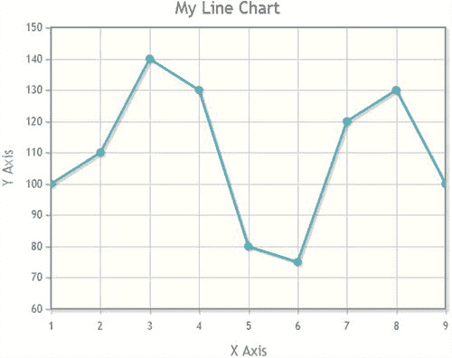

图 4-5. 与图 4-4 相同的折线图，`x` 轴的 `pad` 设置为 1

现在，`x` 轴从值 1 开始，到值 9 结束，与表示数据系列的线条一致。为了更好地理解内边距的概念，现在将 `pad` 属性设置为 2（参见代码清单 4-5）。这意味着要将当前范围（即 10）扩展两倍。结果将得到一个 `x` 轴范围从 –4 到 14 的图表，如图 4-6 所示。这是因为 `jqPlot` 倾向于以对称的方式保持数据，将其显示在中间。

***代码清单 4-5***. `Ch4_03c.html`

```javascript
xaxis: {
    label: "X Axis",
    pad: 2
},
```

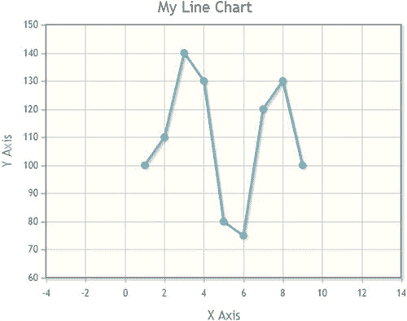

图 4-6. 相同的折线图，`x` 轴的 `pad` 设置为 2

另一种控制数据显示范围的方法是使用 `min` 和 `max` 属性（参见代码清单 4-6）。

***代码清单 4-6***. `Ch4_03d.html`

```javascript
xaxis: {
    label: "X Axis",
    min: 1,
    max: 9
},
```

图 4-7 显示了具有新范围的 `x` 轴。

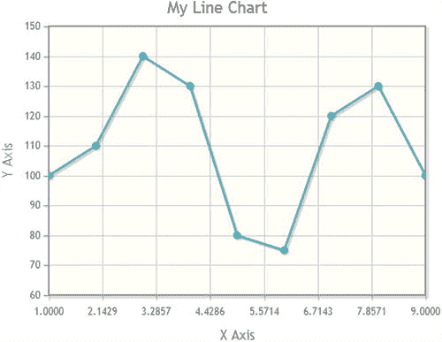

图 4-7. 相同的折线图，`x` 轴定义了 `max` 和 `min`

其他有用的属性是那些控制细分（分割轴）及其底层数值项的属性：`ticks` 属性。由于它们的使用不仅限于 `axes` 对象下的简单选项——它们本身就是一个对象，并且需要渲染器插件才能工作——因此对它们的处理需要单独一节来讨论。

# 坐标轴刻度

`tick`（刻度）是一个组件，用于在图表中显示刻度线或网格线的值。刻度在图表中的行为可以在 `options` 的 `axes` 对象内部指定，并且刻度本身作为一个对象，在 `tickOption` 属性内部可以设置多个属性。例如，可能需要为每个坐标轴设置特定数量的网格线。这可以通过多种方式实现。最简单的方法是直接指定 `numberTicks` 属性（参见代码清单 4-7）。如果将其值设置为 5，则 x 轴上将得到五个刻度：0、3、6、9 和 12（参见图 4-8）。

**代码清单 4-7**. Ch4_03e.html

```
xaxis: {
    label: "X Axis",
    numberTicks: 5
},
```

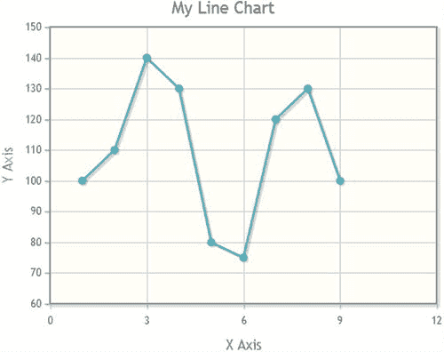

图 4-8. x 轴上具有预设数量刻度的折线图

这同样可以应用于 y 轴。在这种情况下，需要在 `yaxis` 对象中设置相同的属性。从图中可以看出，x 轴划分的间隔是均匀的，因此刻度是等距的。另一种方法是直接定义希望在图表上显示的刻度，如代码清单 4-8 所示。

**代码清单 4-8**. Ch4_03f.html

```
xaxis: {
    label: "X Axis",
    ticks: [0,3,6,9,12]
},
```

这将生成相同的图表（参见图 4-9）。

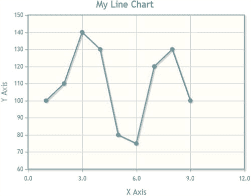

图 4-9. x 轴上直接定义刻度的折线图

但是，当希望沿坐标轴不均匀分布刻度时，通常更倾向于使用这种方法，如代码清单 4-9 所示。网格线也会跟随这种不均匀性，因为它将在每个刻度对应的位置绘制（参见图 4-10）。

**代码清单 4-9**. Ch4_03g.html

```
xaxis: {
    label: "X Axis",
    ticks: [1,2,3,7,9]
},
```

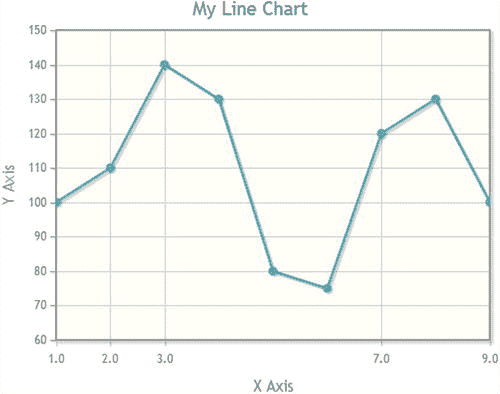

图 4-10. x 轴上具有非均匀预设刻度的折线图

刻度在图表中非常重要，以至于有一个专门针对它们的插件：`CanvasAxisTickRenderer`。

如果希望在保留刻度值的同时创建一个没有网格线的图表，可以将 `showGridLine` 属性设置为 `'false'`。但是，在此之前，需要先在网页中包含该插件：

```
<link rel="stylesheet" type="text/css" href="../src/jquery.jqplot.min.css" />
<script type="text/javascript"
    src="../src/plugins/jqplot.canvasTextRenderer.min.js"></script>
<script type="text/javascript"
    src="../src/plugins/jqplot.canvasAxisLabelRenderer.min.js"></script>
<script type="text/javascript"
    src="../src/plugins/jqplot.canvasAxisTickRenderer.min.js"></script>
```

或者，如果更喜欢使用 CDN 服务，可以按如下方式操作：

```
<script type="text/javascript" src="http://cdn.jsdelivr.net/jqplot/1.0.8/plugins
    /jqplot.canvasTextRenderer.min.js"></script>
<script type="text/javascript" src="http://cdn.jsdelivr.net/jqplot/1.0.8/plugins
    /jqplot.canvasAxisLabelRenderer.min.js"></script>
<script type="text/javascript" src="http://cdn.jsdelivr.net/jqplot/1.0.8/plugins
    /jqplot.canvasAxisTickRenderer.min.js"></script>
```

然后，必须在 `axesDefaults` 对象内部进行设置，因为希望隐藏两个坐标轴的网格线。记得使用 `tickRenderer` 属性调用刚刚包含的插件（参见代码清单 4-10）。此外，不要忘记删除在 `xaxis` 对象内部定义的 `ticks` 属性。

**代码清单 4-10**. Ch4_04a.html

```
axesDefaults: {
    labelRenderer: $.jqplot.CanvasAxisLabelRenderer,
    tickRenderer: $.jqplot.AxisTickRenderer,
    tickOptions: {
       showGridline: false
    }
},
axes: {
    xaxis: {
       label: "X Axis"  //remove the comma here
    },
```

如图 4-11 所示，得到一个没有网格的图表。

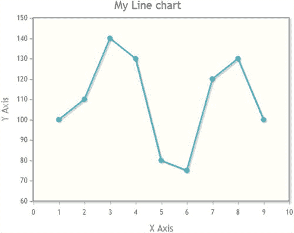

图 4-11. 没有网格线的折线图

有时，您可能需要仅隐藏一个轴上的网格线，例如 x 轴（参见图 4-12）。在这种情况下，您只需在 `xaxis` 对象内部调用渲染器。在代码清单 4-11 中，您可以看到必须从 `axesDefaults` 中移除并写入 `xaxis` 对象内的代码行。

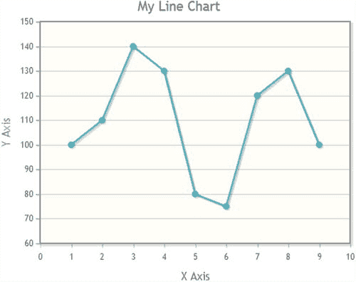

图 4-12。仅显示水平网格线的折线图

**代码清单 4-11**。ch9_04b.html

```
axesDefaults: {
    labelRenderer: $.jqplot.CanvasAxisLabelRenderer
    //删除所有以下行
    //tickRenderer: $.jqplot.AxisTickRenderer,
    //tickOptions: {
    //showGridline: false
    //}
},
axes: {
    xaxis: {
       label: "X 轴",
       tickRenderer: $.jqplot.AxisTickRenderer,
       tickOptions: {
          showGridline: false
       }
    },
    ...
```

您可能想要添加的另一个功能是允许将数值格式化为字符串。这种功能最常见的应用场景是在 y 轴上显示百分比值。为此，您需要在数值后添加字符 `'%'`，如代码清单 4-12 所示。

**代码清单 4-12**。Ch4_04c.html

```
yaxis: {
    label: "Y 轴",
    tickRenderer: $.jqplot.AxisTickRenderer,
    tickOptions: {
       formatString:'%d%'
    }
}
```

如图 4-13 所示，图表现在在 y 轴上显示百分比值。

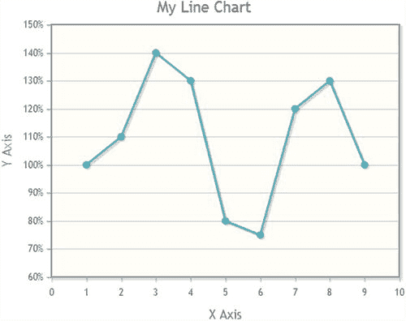

图 4-13。在 y 轴上显示百分比的折线图

稍后，您将看到其他情况，其中这种字符串格式化被证明是一个非常强大的工具（请参阅“处理日期值”一节）。

## 使用对数刻度

根据您希望在图表中表示的数据趋势，有时需要在一个或两个轴上使用对数刻度。jqPlot 支持对数刻度，只需在您的网页中包含 `LogAxisRenderer` 插件即可。

```
<script type="text/javascript"
    src="../src/plugins/jqplot.logAxisRenderer.min.js"></script>
```

**对数刻度** 对数刻度使用与数量级（通常为十）相对应的间隔，而不是标准的线性刻度。这允许您在一个轴上表示大范围的值 (v)。

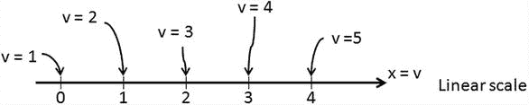

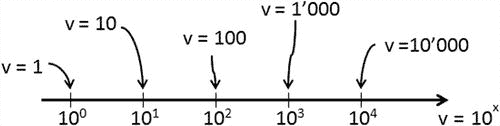

对数是书写指数的另一种方式，您可以用它来分离指数 (x) 并将其放置在轴上。

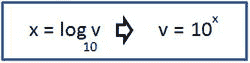

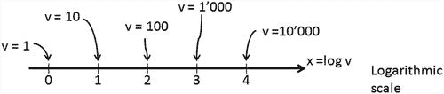

例如，对数刻度上增加一个点对应数值增加 10 倍。同样，增加两个点对应数值增加 100 倍。以此类推。

在您希望以对数刻度表示数据的轴上，只需添加带有插件引用的 `renderer` 属性即可。在这种情况下，您需要创建一个大致遵循指数趋势的数据数组。因此，您可以使用代码清单 4-13 中的 `[x, y]` 对数组。

**代码清单 4-13**。Ch4_11.html

```
var data = [[0,1.2],[10,2.4],[20,5.6],[30,12],[40,23],
            [50,60],[60,120],[70,270],[80,800]];
```

接下来，将 y 轴设置为对数刻度，如代码清单 4-14 所示。

**代码清单 4-14**。Ch4_11.html

```
$.jqplot ('myChart', [data],{
    axes:{
    xaxis:{},
    yaxis:{ renderer: $.jqplot.LogAxisRenderer }
    }
});
```

在图 4-14 中，您可以看到数据在半对数刻度（一个轴上的对数刻度）下如何呈现近似直线的形状。

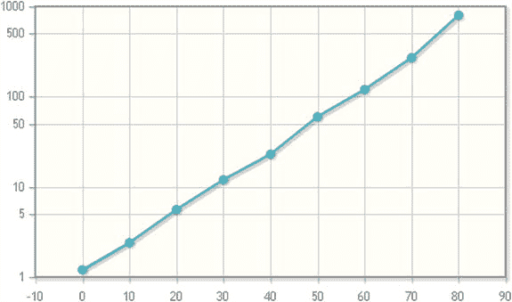

图 4-14。y 轴采用半对数刻度的折线图

## 多系列折线图

既然已经很好地指定了用于表示折线图的轴，现在是时候讨论多系列折线图了。通常，您需要在同一图表中显示多个数据系列。事实上，图表的目的大多正是为了比较不同的数据系列。

jqPlot 库为我们提供了管理多系列图表所需的工具。通过作用于线条和标记的图案、形状和颜色，可以引入有助于表示不同数据系列的图形效果。

### 多个数据系列

到目前为止，您只处理了单个数据集。但有时，您希望同时表示多个数据集。在第 1 章中，您了解到在 jqPlot 中，多个系列的处理方式与单个系列相同。每个系列必须首先单独定义，将其赋值给一个变量，然后与其他系列组合成一个数组。然后将此数组作为第二个参数传递给 `jqPlot()` 函数（参见代码清单 4-15）。

**代码清单 4-15**。Ch4_05a.html

```
$(document).ready(function(){
    var data1 = [1, 2, 3, 2, 3, 4];
    var data2 = [3, 4, 5, 6, 5, 7];
    var data3 = [5, 6, 8, 8, 7, 9];
    var data4 = [7, 8, 9, 9, 10, 11];
    var options = {
       title:'多个数据数组'
    };
    $.jqplot ('myChart', [data1, data2, data3, data4], options);
});
```

图 4-15 显示了来自代码清单 4-15 的多系列图表结果。

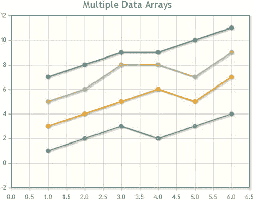

图 4-15。多系列折线图

系统会自动为每个系列分配不同的颜色。这个颜色序列在 jqPlot 中被定义为默认值。以下是 jqPlot 将按顺序分配给系列的颜色：

```
seriesColors: [  "#4bb2c5", "#c5b47f", "#EAA228", "#579575",
                 "#839557", "#958c12", "#953579", "#4b5de4",
                 "#d8b83f", "#ff5800", "#0085cc"]
```

这些值代表 `'#rrggbb'`，其中 *rr*、*gg* 和 *bb* 分别是红色、绿色和蓝色的十六进制值。浏览器组合这些值以生成系列所需的所有颜色。

当系列超过 11 个时，jqPlot 会从头开始重复该序列。如果您不希望这样，或者只是需要以不同方式处理，您可以在 `seriesColors` 属性中定义一个包含不同颜色序列的数组，例如代码清单 4-16 中给出的系列。图 4-16 显示了一种灰色变化，但请运行示例，亲自看看区别（颜色范围从蓝色到紫色）。

**代码清单 4-16**。Ch4_05b.html

```
var options = {
    seriesColors: ["#105567","#805567","#bb5567","#ff5567"],
    title:'多个数据数组'
};
```

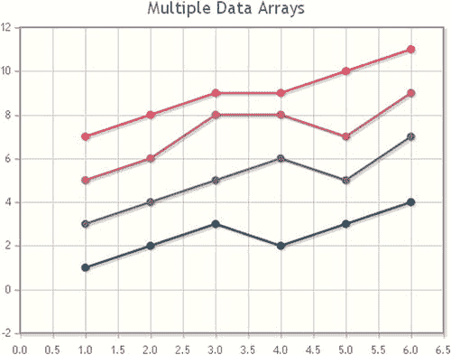

图 4-16。使用自定义颜色集的多系列折线图

 **注意** 要检查颜色代码，我建议访问网站 HTML 颜色代码（`http://html-color-codes.info`）。

你也可以使用两个函数来指定特定颜色：`rgba(r, g, b, a)` 和 `rgb(r, g, b)`。你可以将这些函数直接插入到要分配给 `seriesColors` 属性的数组的每个值中，如代码清单 4-17 所示。

**代码清单 4-17**。Ch4_05c.html

```
seriesColors: ["rgba(16,85,103,0.2)", "rgba(128,85,103,0.6)",
               "rgb(187,85,103)", "rgb(250,85,103)"],
```

之前，你一直通过组合实现特定颜色所需的红、绿、蓝光来指定颜色，而使用 `rgba()` 函数时，引入了一个新变量 `a`。这个 `a`（代表“alpha”）表示颜色的不透明度/透明度级别。如图 4-17 所示，定义较低的 alpha 值可以让你看到彩色对象背后的内容。

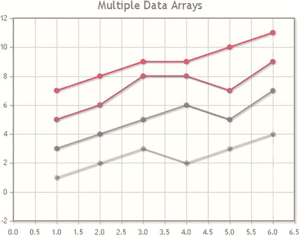

图 4-17。具有不同透明度级别的多系列折线图

## 平滑折线图

除了选择是否显示点标记以及连接它们的直线之外，你通常还会决定是否希望获得平滑的曲线进展，如图 4-18 所示。这可以通过使用 `smooth` 属性并将其设置为 `'true'` 来实现（参见代码清单 4-18）。

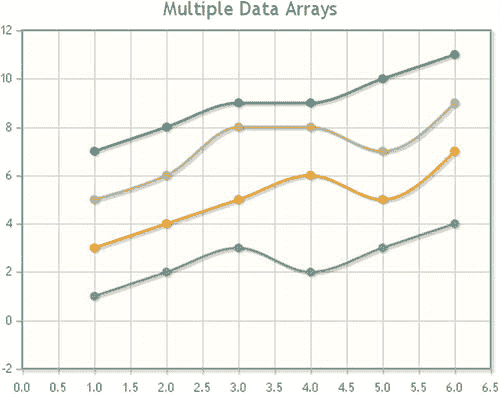

图 4-18。具有平滑线条的多系列折线图

**代码清单 4-18**。Ch4_06.html

```
$(document).ready(function(){
    var data1 = [1, 2, 3, 2, 3, 4];
    var data2 = [3, 4, 5, 6, 5, 7];
    var data3 = [5, 6, 8, 8, 7, 9];
    var data4 = [7, 8, 9, 9, 10, 11];
    var options = {
       title:'Multiple Data Arrays',
       seriesDefaults: {
          rendererOptions: {
             smooth: true
          }
       }
    };
    $.jqplot ('myChart', [data1, data2, data3, data4], options);
});
```

## 线条与标记样式

在设计折线图时，需要考虑的另一个关键方面是线条和标记的显示方式。你可以使用线条、一系列标记或两者结合来表示图表。默认情况下，`jqPlot` 会为每个系列显示点标记，对应每个 `[x, y]` 数据点，并用一条线按顺序连接它们。

所有这些都可以通过属于系列对象的两个关键属性来控制：`linePattern` 和 `lineWidth`；同时添加 `markerOptions` 属性，还可以影响标记组件的另外两个属性：`style` 和 `size`。代码清单 4-19 是这些设置的一个示例。

**代码清单 4-19**。`Ch4_07a.html`

```
$(document).ready(function(){
    var data1 = [1, 2, 3, 2, 3, 4];
    var data2 = [3, 4, 5, 6, 5, 7];
    var data3 = [5, 6, 8, 9, 7, 9];
    var data4 = [7, 8, 9, 11, 10, 11];
    var options = {
       title: 'Multiple Data Arrays',
       series:[{
          linePattern: 'dashed',
          lineWidth:2,
          markerOptions: { style: 'diamond' }
       },
       {
          showLine:false,
          markerOptions: { size: 7, style: 'x' }
       },
       {
          markerOptions: { style: 'circle' }
       },
       {
          lineWidth:5,
          linePattern: 'dotted',
          markerOptions: { style: 'filledSquare', size: 10 }
       }]
    }
    $.jqplot ('myChart', [data1, data2, data3, data4], options);
});
```

图 4-19 展示了代码清单 4-19 中设置的结果。

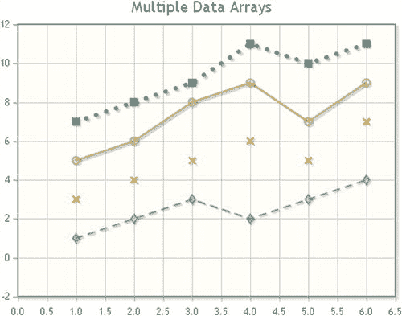

图 4-19。在折线图中可以设置不同的标记和图案

图表上的线条可以通过 `linePattern` 属性绘制为实线、虚线或点线。默认情况下，绘制的每条线都是实线，因此如果你希望线条具有不同的样式，则必须在 `options` 中指定。你在代码清单 4-19 中看到，可以将 `linePattern` 属性设置为 `'dotted'` 或 `'dashed'`，以分别获得点线或虚线。在代码清单 4-20 中，你可以看到还可以通过将格式定义为一个数组（`[破折号长度, 间隙长度, 等等]`）来获得自定义的线条图案。当分配给 `linePattern` 属性的数组具有偶数个元素时，线条看起来效果最好，这样线条以破折号开始，以间隙结束。`linePattern` 属性还可以使用破折号（`-`）和点（`.`）字符的简写字符串表示法来创建自定义图案。代码清单 4-20 提供了示例。

**代码清单 4-20**。`Ch4_07b.html`

```
var options = {
    title: 'Multiple Data Arrays',
    seriesDefaults: {
       showMarker: false
    },
    series: [{ linePattern: 'dashed'},
              { linePattern: 'dotted'},
              { linePattern: [4, 3, 1, 3, 1, 3]},
              { linePattern: '-.'}]
};
```

图 4-20 展示了代码清单 4-20 中使用的自定义线条图案示例。

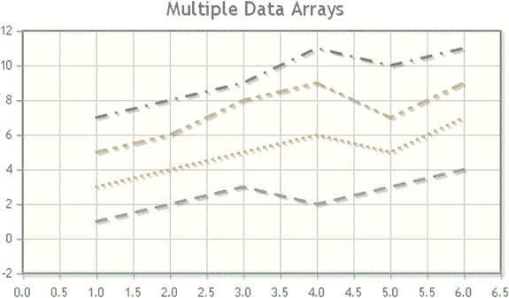

图 4-20。具有不同图案的多系列折线图

## 动画图表

当你在浏览器中加载网页时，你会注意到图表几乎是瞬间绘制完成的。你可以根据自己的偏好降低绘制速度；较慢的速度会在绘制图表元素时产生浮动效果（参见代码清单 4-21）。

**代码清单 4-21**。`Ch4_23.html`

```
var options = {
    title: 'Multiple Data Arrays',
    seriesDefaults: {
       showMarker: false,
       rendererOptions: {
          smooth: true,
          animation: { show: true  }
       }
    }
};
```

图 4-21 展示了图表绘制的顺序，使其具有动画外观。

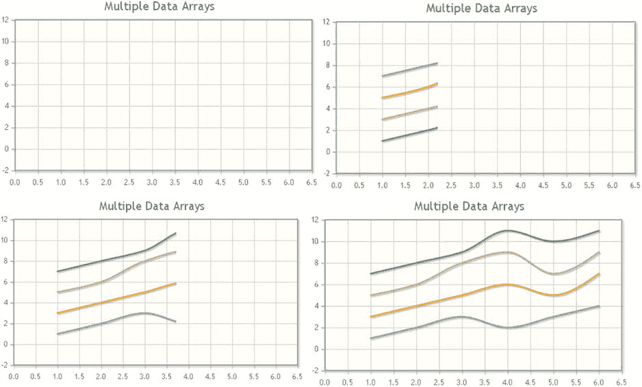

图 4-21。一个动画多系列折线图

## 多个 Y 轴

`jqPlot` 支持相对于同一个 X 轴的多个 Y 轴。当你想在单个图表中显示分布在不同的 Y 尺度上但具有相同 X 值的不同系列时，这非常有用。在这种情况下，明智的做法是将 Y 轴设置为对应系列的颜色，以便你可以确定任何给定点的正确 Y 值。作为输入数据，让我们创建三个数据数组，它们包含相同的 X 值，但 Y 值分布在不同的范围内，如代码清单 4-22 所示。使用相同的 X 值不是强制性的，但这样做是明智的。

**代码清单 4-22**。`Ch4_12.html`

```
var data1 = [[10, 200], [20, 230], [30, 214], [40, 212], [50, 225], [60, 234]];
var data2 = [[10, 455], [20, 470], [30, 465], [40, 432], [50, 455], [60, 464]];
var data3 = [[10, 40], [20, 60], [30, 54], [40, 52], [50, 65], [60, 54]];
```

为了能够轻松比较不同的数值序列，为每个 y 轴指定正确的取值范围非常重要（参见清单 4-23）。在 `series` 对象中，你需要显式指定三个值，每个值将一个序列分配给不同的 y 轴。如果你想保留某个特定序列的默认设置（即沿默认 y 轴显示），你仍然必须在该序列对应的位置分配一个空对象 `{}`。实际上，在本例中，`series` 数组的第一个元素就是一个空对象 `{}`。

**清单 4-23**。`Ch4_12.html`

```
var options = {
    series:[
      {},
      {yaxis: 'y2axis'},
      {yaxis: 'y3axis'}
    ],
    axesDefaults:{useSeriesColor: true},
    axes:{
       xaxis: {min: 0, max: 70},
       yaxis: {min: 190, max: 240},
       y2axis: {min: 430, max: 480},
       y3axis: {min: 35, max: 80}
    }
};
$.jqplot ('myChart', [data1, data2, data3], options);
```

此外，你需要为 `axesDefaults` 对象设置 `useSeriesColor` 属性为 `'true'`。这样做之后，`jqPlot` 会将序列的颜色分配给对应的 y 轴。因此，通过使用三种默认颜色，第一个序列将显示为浅蓝色，第二个为橙色，第三个为灰棕色。

图 4-22 展示了这三个序列，每个序列都根据其 y 轴的值进行表示。这些轴在此处以不同的灰度显示，但实际上它们会呈现与相关序列对应的颜色。

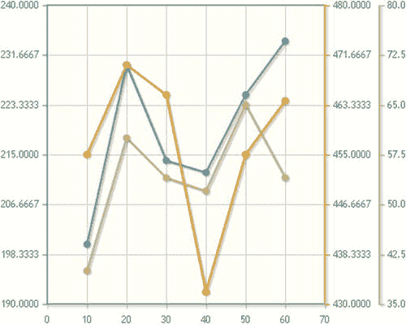

图 4-22。具有多个 y 轴的多序列折线图

## 使用 JavaScript 处理数据

如前所述，最好在 `jqPlot` 函数外部单独定义数据数组。你已经了解了如何创建包含数值（y 值或 `[x, y]` 对）的数组。然而，由于 `jqPlot` 属于 JavaScript 世界，还有另一种通常被证明非常有用的方法：通过 JavaScript 方法生成数据序列。

### 使用数学函数生成数据

`jqPlot` 库基于 JavaScript，并且与所有编程语言一样，它允许你实现生成值序列作为输入数据的函数。例如，清单 4-24 使用了三个最常用且最著名的数学函数（正弦、余弦、幂），并通过它们创建了一个数据数组。

**清单 4-24**。`Ch4_08a.html`

```
$(document).ready(function(){
    var options = {
       title:'Math function Arrays'
    };

    var cosPoints = [];
    for (var i=0; i< 2 * Math.PI; i += 0.1){
       cosPoints.push([i, Math.cos(i)]);
    }

    var sinPoints = [];
    for (var i=0; i< 2 * Math.PI; i += 0.1){
       sinPoints.push([i, 2 * Math.sin(i-.8)]);
    }

    var powPoints = [];
    for (var i=0; i< 2 * Math.PI; i += 0.1) {
       powPoints.push([i, 2.5 + Math.pow(i/4, 2)]);
    }

    $.jqplot ('myChart', [cosPoints, sinPoints, powPoints], options);
});
```

图 4-23 展示了清单中三个函数生成的点如何在折线图上形成这三个数学函数的特征趋势。

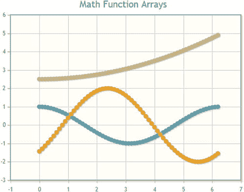

图 4-23。一个折线图，展示了由数学函数生成的三组不同的数据序列

由于这是一个点密度很高的函数，并且目标是突出趋势，因此最好不要显示标记点（参见图 4-24）。同时，最好在 `options` 中启用平滑处理，如清单 4-25 所示。

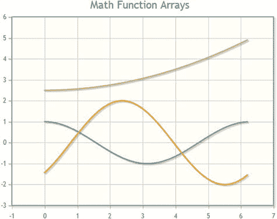

图 4-24. 同一折线图，但渲染得更清晰易读

**代码清单 4-25**。`Ch4_08b.html`

```
var options = {
    title: '数学函数数组',
    seriesDefaults: {
       rendererOptions: {
          smooth: true
       },
       markerOptions: { show: false }
    }
};
```

## 生成随机数据

您刚刚了解了如何通过数学函数生成输入数据。同样地，有时也需要生成随机数据。例如，假设您刚刚编写完 `jqPlot` 图表，想尝试输入一些模拟数据。为此，最好使用随机生成的数据。代码清单 4-26 中的函数会生成随机数据，每个数据点都根据前一个点的值生成。每一步中，新值由加到前一个数或从前一个数中减去的随机数决定。这会生成一个连续的数据序列，其起始值作为参数传递给该函数。

**代码清单 4-26**。`Ch4_09.html`

```
function generateRandomData(npts, start, delta) {
    var data = [];
    if (delta == null) {
       delta = start;
       start = (Math.random() - 0.5) * 2 * delta;
    }
    for (j=0; j<npts; j++) {
       data.push([j, start]);
       start += (Math.random() - 0.5) * 2 * delta;
    }
    return data;
}
```

您使用了三个参数：`npts` 是要生成的数据点数量，`start` 是起始值，`delta` 是每一步随机增加或减少的最大值。该函数返回一个数组，该数组将作为输入数据传递给图表。您可以在外部定义它：

```
var data = generateRandomData(30, 100, 1);
$.jqplot('myChart', [data]);
```

或者，您也可以直接传递它：

```
$.jqplot ('myChart', [makeContinuousData(30, 100, 1)]);
```

结果，您会得到类似图 4-25 所示的图表（每次都会不同）。

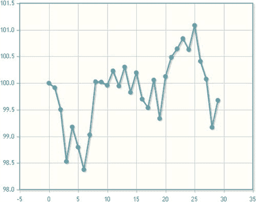

图 4-25. 表示随机数据序列的折线图

## 处理日期值

一种常用的值类型是日期类型，尤其是在其他图表（例如柱状图）中。这些特殊值处理起来并不容易，`jqPlot` 为此提供了一个插件：`DateAxisRenderer`。该插件扩展了 JavaScript 原生的日期处理能力，允许您以任何明确的形式表示日期值，而不仅仅是毫秒。

### DateAxisRenderer 插件

日期有多种表示方式，其格式因国家和用途而异。日期由日、月、年指示符组成。这些指示符可以按不同顺序排列，可以使用一位、两位或四位数字；或者，您甚至可能只想使用其中一两个指示符（例如，月、年）。此外，各种字符用作分隔符。例如，以`04/07/2012`为例：“4”代表第四个月（四月），“7”代表该月的第七天，“2012”代表年份。这样的日期可以有多种显示方式：`'07/04/2012'`、`'07/04/12'`、`'04/07/12'`、`'7-Apr-12'`、`'7-Apr'`、`'Apr-12'`、`'7 April'`、`'2012'` 等等。

日期值的标准格式如下：

```
'YYYY-MM-DD HH:MM<PM or AM>'
```

这个字符串包含了所有必要的信息——也许有点太多了。实际上，您通常只需要日期信息的一部分：有时，您可能只需要报告日和月，或者，如果涉及时间，您可能只需要处理小时和分钟，等等。

一旦包含了`DateAxisRenderer`插件，`jqPlot`几乎可以接受任何可识别的值。在内部解析该值后，它将在您调用该插件的轴上渲染，并以`tickOptions.formatString`中指定的格式呈现。

表 4-1 显示了可接受的格式代码。

表 4-1. `jqPlot` 接受的日期和时间格式

| 代码 | 结果 | 描述 |
| --- | --- | --- |
| **年份** |   |   |
| `%Y` | 2008 | 四位数的年份 |
| `%y` | 08 | 两位数的年份 |
| **月份** |   |   |
| `%m` | 09 | 两位数的月份 |
| `%#m` | 9 | 一位或两位数的月份 |
| `%B` | September | 完整的月份名称 |
| `%b` | Sep | 缩写的月份名称 |
| **日** |   |   |
| `%d` | 05 | 两位数的月份中的日期 |
| `%#d` | 5 | 一位或两位数的月份中的日期 |
| `%e` | 5 | 一位或两位数的月份中的日期 |
| `%A` | Sunday | 完整的星期几名称 |
| `%a` | Sun | 缩写的星期几名称 |
| `%w` | 0 | 星期几的数字（0 = 星期日，6 = 星期六） |
| `%o` | th | 月份中日期后的序数后缀字符串 |
| **小时** |   |   |
| `%H` | 23 | 24 小时制的小时（两位数） |
| `%#H` | 3 | 24 小时制整数格式的小时（一位或两位数） |
| `%I` | 11 | 12 小时制的小时（两位数） |
| `%#I` | 3 | 12 小时制整数格式的小时（一位或两位数） |
| `%p` | pm | AM 或 PM |
| **分钟** |   |   |
| `%M` | 09 | 分钟（两位数） |
| `%#M` | 9 | 分钟（一位或两位数） |
| **秒** |   |   |
| `%S` | 02 | 秒（两位数） |
| `%#S` | 2 | 秒（一位或两位数） |
| `%s` | 1206567625723 | Unix 时间戳（自 1970-01-01 00:00:00 以来的秒数） |
| **毫秒** |   |   |
| `%N` | 008 | 毫秒（三位数） |
| `%#N` | 8 | 毫秒（一位到三位数） |
| **时区** |   |   |
| `%O` | 360 | 本地时间与格林威治标准时间 (GMT) 之间的分钟差 |
| `%Z` | Mountain Standard Time (MST) | 时区名称，由浏览器报告 |
| `%G` | –06:00 | 与 GMT 之间的小时和分钟差 |
| **快捷方式** |   |   |
| `%F` | 2008-03-26 | `%Y-%m-%d` |
| `%T` | 05:06:30 | `%H:%M:%S` |
| `%X` | 05:06:30 | `%H:%M:%S` |
| `%x` | 03/26/08 | `%m/%d/%y` |
| `%D` | 03/26/08 | `%m/%d/%y` |
| `%#c` | Wed Mar 26 15:31:00 2008 | `%a %b %e %H:%M:%S %Y` |
| `%v` | 3-Sep-2008 | `%e-%b-%Y` |
| `%R` | 15:31 | `%H:%M` |
| `%r` | 3:31:00 PM | `%I:%M:%S %p` |
| **字符** |   |   |
| `%n` | \n | 换行 |
| `%t` | \t | 制表符 |
| `%%` | % | 百分号 |

为了更清楚地了解`jqPlot`如何处理日期值，让我们看一系列说明各种格式的示例。但是，无论格式如何，您都必须始终在网页的`<head>`部分包含`DateAxisRenderer`插件。

```
<script type="text/javascript"
    src="../src/plugins/jqplot.dateAxisRenderer.min.js"></script>
```

### 处理不同格式的日期值

第一个示例处理一段时间内的汇率，数据点为逐日值。为此，输入数据数组内部应包含一系列`[x, y]`值，其中`x`是日期值。`x`值的序列不必符合时间顺序；`jqPlot`会沿 x 轴对这些点进行排序。在代码清单 4-27 中，您使用了一系列`x`输入值，前五个采用了不同的格式。

***代码清单 4-27***. `Ch4_13a.html`

```
var line1 = [['14-Oct-2012', 1300.41], ['2012-10-15', 1310.50],
             ['2012/10/16', 1322.88], ['17 Oct 2012', 1312.41],
             ['10/18/2012', 1308.16], ['19-Oct-2012', 1310.71],
             ['20-Oct-2012', 1305.01],['21-Oct-2012', 1300.85],
             ['22-Oct-2012', 1290.67]];
```

接下来，你需要在`options`的`xaxis`对象中调用渲染器来激活它。你希望表示月份中的日期，以便跟踪汇率走势，因此将设置输出格式，不包含年份（年份保持不变）。此外，在开头，你希望以数字形式显示月份中的日期，然后显示月份的前三个字符，两者之间用空格分隔。简单来说，在清单 4-28 中，格式将是`'%d %b'`，其中`%d`代表数字形式的日期，`%b`代表月份的前三个字符。`y`值是美元，因此你需要为`y`轴的刻度添加美元符号（`$`）作为前缀。为此，你也必须为`y`轴刻度使用`formatString`属性。

**清单 4-28**. `Ch4_13a.html`

```
var options = {
    title: 'Handling Date Values',
    axes:{
       xaxis:{
          renderer: $.jqplot.DateAxisRenderer,
          tickOptions:{
             formatString:'%d %b'
          }
       },
       yaxis:{
          tickOptions:{
             formatString:'$%d'
          }
       }
    }
};
$.jqplot('myChart', [line1], options);
```

图 4-26 显示了`y`轴上带有前缀`$`的美元值，以及`x`轴上的日期和月份。这只是你可以设置用来表示刻度值的几种格式之一。

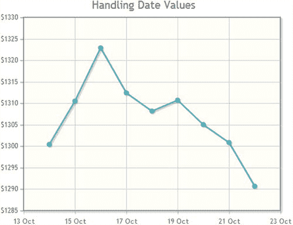

图 4-26. 在`x`轴上带有日期值的折线图

### 处理时间值

假设你想绘制一个表示博物馆参观人数的图表。可以在输入数据中明确指定时间（小时、分钟、秒）。这样你就可以像之前的示例（参见清单 4-27）一样处理这些时间值，例如，创建一个包含某一天收集的数据的图表。同样，日期可以使用之前讨论过的任何格式进行设置。你可以用多种方式表示时间：12 小时制，带有`am`或`pm`后缀；或者直接使用 24 小时制，可以包含或忽略秒和分钟。清单 4-29 展示了一个包含以 2 小时间隔的时间值序列的数组。

**清单 4-29**. `Ch4_13b.html`

```
var line1 = [['2012-10-14 08:00AM', 30],['2012-10-14 10:00AM', 60],
             ['2012-10-14 00:00PM', 120], ['2012-10-14 02:00PM', 60],
             ['2012-10-14 04:00PM', 100], ['2012-10-14 06:00PM', 40]];
```

关于输出格式，你必须记得也要管理时间格式；因为你只对一天中的小时数感兴趣，所以将`'%R'`设置为`'formatString'`（参见清单 4-30）。

**清单 4-30**. `Ch4_13b.html`

```
var options = {
    title: 'Museum Visitors',
    axes:{
       xaxis:{
          label: 'time',
          renderer:$.jqplot.DateAxisRenderer,
          tickOptions:{
             formatString: '%R'
          }
       },
       yaxis:{
          label: 'visitors'
       }
    }
};
$.jqplot('myChart', [line1], options);
```

浏览器将显示图 4-27 中的图表。

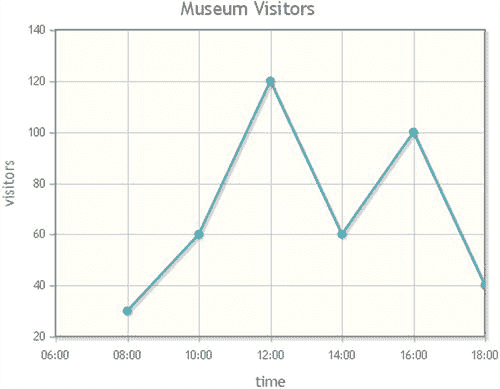

图 4-27. 在`x`轴上带有时间值的柱状图

## 高亮显示

你可以为图表添加的一个引人注目的效果是高亮显示（即让图表对鼠标悬停做出反应）。例如，`Highlighter`插件会以漂亮的动态效果高亮显示鼠标附近的数据点。通过显示包含数据点值的工具提示，可以增强此效果。

### 光标高亮器

以下示例将帮助你熟悉高亮显示功能。此功能非常重要，它包括在鼠标悬停在图表中的特定元素上时激活一个事件。通常，这些元素是表示数据的元素，例如，在折线图中，这些元素由点（或者更准确地说，由标记）表示；你会看到这也适用于其他类型的图表：柱状图中的柱子、饼图中的扇区等。

默认情况下，触发的事件只是数据的高亮显示，通过一个显示其 (`x`, `y`) 值的工具提示来表示。

要将这些功能添加到你的图表中，你必须包含一组插件：

```
<script type="text/javascript" src="../src/plugins/jqplot.highlighter.min.js">
</script>
<script type="text/javascript" src="../src/plugins/jqplot.cursor.min.js">
</script>
```

在清单 4-31 中，作为输入数据，你使用了一系列 [`x`, `y`] 对，其中`x`轴是日期值，`y`轴是数值。

**清单 4-31**. `Ch4_14a.html`

```
var line1 = [['14-Oct-12', 1300.41], ['15-Oct-12', 1310.50],['16-Oct-12', 1322.88],
             ['17-Oct-12', 1312.41],['18-Oct-12', 1308.16],['19-Oct-12', 1310.71],
             ['20-Oct-12', 1305.01],['21-Oct-12', 1300.85],['22-Oct-12', 1290.67]];
```

正如你已经看到的，为了处理日期值，你需要包含`DateAxisRenderer`插件。

```
<script type="text/javascript"
    src="../src/plugins/jqplot.dateAxisRenderer.min.js"></script>
```

在清单 4-32 中，你看到了`options`对象，其中包含两个新对象：`highlighter`和`cursor`。

**清单 4-32**. `Ch4_14a.html`

```
var options = {
    title: 'Data Point Highlighting',
    axes:{
       xaxis:{
          renderer: $.jqplot.DateAxisRenderer,
          tickOptions:{
             formatString: '%b&nbsp;%#d'
          }
       },
       yaxis:{
          tickOptions:{
             formatString: '$%d'
          }
       }
    },
    highlighter:{
       show: true,
       sizeAdjust: 7.5
    },
    cursor:{
       show: false
    }
};
```

在图 4-28 中，当光标移动到图表上的数据点时，会出现一个工具提示。默认情况下，此工具提示使用轴格式化程序报告`x`和`y`值，并用逗号分隔，但可以使用不同的格式字符串进行自定义。

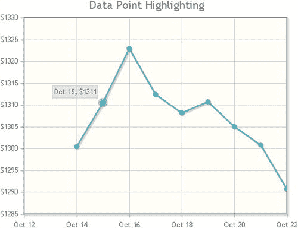

图 4-28. 折线图上的数据点高亮显示

在清单 4-32 中，你会注意到光标已被禁用，通过将其`show`属性设置为`'false'`（默认情况下是启用的）。如清单 4-33 所示启用它，你会看到鼠标光标在进入图表区域时发生变化，并在右下角显示一个可选的工具提示，报告鼠标位置。该工具提示可以位于固定位置，也可以跟随鼠标移动。指针样式默认为`'crosshair'`，也可以自定义。

**清单 4-33**. `Ch4_14b.html`

```
    ...
    highlighter: {
       show: true,
       sizeAdjust: 7.5
    },
    cursor: {
       show: true,
       tooltipLocation:'ne'
    }
});
```

图 4-29 显示了一个报告光标坐标的工具提示。请注意，光标在图表中间由一个黑色十字表示。

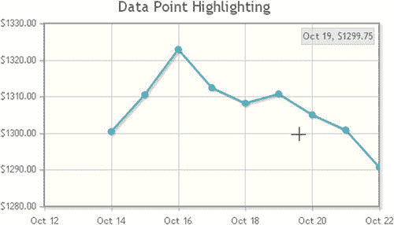

图 4-29. 显示光标坐标的折线图

### 使用 HTML 格式的高亮显示

你可以使用 HTML 标签作为格式来更改工具提示的内容。这使得自定义的可能性几乎无限。实际上，你可以将工具提示视为一个小型网页，在其中添加任何类型的元素，例如图像或锚点链接（更多详情，请参见第 5 章）。例如，你可以使用代码清单 4-34 中所示的设置，将一个 HTML 格式字符串分配给`formatString`属性。

***代码清单 4-34***. `Ch4_14c.html`

```
highlighter: {
    show: true,
    sizeAdjust: 7.5,
    showMarker: false,
    tooltipAxes: 'xy',
    yvalues: 4,
    formatString:'<table class="jqplot-highlighter"> \
                  <tr><td>date:</td><td>%s</td></tr> \
                  <tr><td>value:</td><td>%s</td></tr></table>'
},
```

结果，带有内容的工具提示将像一个小型 HTML 页面一样运行，如图 4-30 所示。

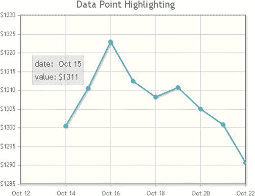

图 4-30. 带有 HTML 工具提示的折线图

## 与图表交互：限制线和缩放

一旦你拥有一个图形和元素设置良好的折线图，下一步就是引入交互元素。例如，用户可能需要使用阈值来查看哪些数据超出了这些值。用户可能还需要改变这个阈值，以确定哪些数据在阈值之内，哪些在阈值之外。通常，会表示大量数据。在这种情况下，用户可能只需要分析一个细节。

jqPlot 库通过限制线和缩放为这两种情况提供了解决方案。让我们详细看一些解决这些问题的示例。

# 在图表上绘制限制线

另一个非常有用的功能是 `CanvasOverlay` 插件。它允许你在图表上绘制水平线和垂直线，目的是指示一个限制、阈值、截止日期或划定一个特定范围。这可以通过在网页中包含 `CanvasOverlay` 插件来实现：

```
<script type="text/javascript"
    src="../src/plugins/jqplot.canvasOverlay.min.js"></script>
```

通过包含此插件，你在 `options` 中获得了一个新对象：`canvasOverlay`。在此对象中，你将定义一个对象数组及其属性。这些对象中的每一个都将由绘制在画布上的一条线表示，`jqPlot` 在该画布上创建你的图表。`canvasOverlay` 中已经定义了五种类型的对象：

*   `horizontalLine`
*   `verticalLine`
*   `dashedHorizontalLine`
*   `dashedVerticalLine`
*   `Line (通用)`

要了解如何将这些限制线插入到你的图表中，让我们从一个简单的折线图开始，你希望在该图表中显示两条不同颜色的水平限制线：一条标记上限的红色线和一条标记下限的蓝色虚线。

在代码清单 4-35 中，你定义了两个对象：一个用于下限的 `horizontalLine` 和一个用于上限的 `dashedHorizontalLine`。定义了两条线之后，你必须指定它们的属性。它们的属性（例如 `y` 值、`lineWidth` 和 `color`）的含义是显而易见的。`lineCap` 属性指定了线条末端的类型；它可以是 `round`、`butt` 或 `square`。

***代码清单 4-35***. Ch4_15.html

```
$(document).ready(function(){
    var data = [100, 110, 140, 130, 80, 75, 120, 130, 100];
    var options = {
       canvasOverlay: {
          show: true,
          objects: [
          {horizontalLine: {
              y: 70,
              lineWidth: 3,
              color: 'rgb(255, 0, 0)',
              shadow: true,
              lineCap: 'butt'
          }},
          {dashedHorizontalLine: {
              y: 145,
              lineWidth: 4,
              color: 'rgb(0, 0, 255)',
              shadow: false,
              dashPattern: [8, 16],
              lineCap: 'round'
          }}
          ]
       }
    };
    $.jqplot('myChart', [data], options);
});
```

图 4-31 显示了在值 70 和 145 之间划定折线图范围的两条限制线。

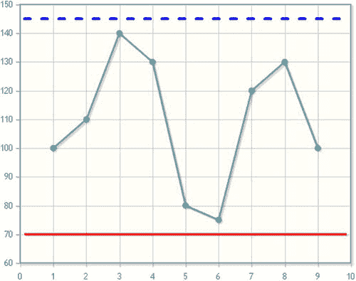

图 4-31. 带有下限和上限的折线图

你刚刚看到了如何在两条限制线之间划定折线图的范围。在更复杂的情况下（但本例并非如此，这种情况不太常见），改变这些限制线的值，从而能够随意移动它们可能会很方便，例如，通过点击一系列按钮。在下一个示例中，你将通过添加用于在图表表面滑动限制线的按钮，继续实现当前图表。

# 向图表添加按钮

使用前面的示例（参见代码清单 4-35），你现在将看到如何向图表添加按钮。按钮可以放置在网页的任何部分，因为它们位于画布之外。在这里，它们的功能是允许你通过点击按钮随意移动限制线。

为此，你将需要四个按钮：两个用于向上移动限制线，两个用于向下移动限制线，标签如下：

*   下限上移
*   下限下移
*   上限上移
*   上限下移

你可以将代码清单 4-36 中定义的四个按钮添加到网页 `<body>` 部分的任何位置。

***代码清单 4-36***. Ch4_16.html

```
<div>
    <button onclick="lineup(myPlot, 'lowlimit')">下限上移</button>
    <button onclick="linedown(myPlot, 'lowlimit')">下限下移</button>
</div>
<div>
    <button onclick="lineup(myPlot, 'hilimit')">上限上移</button>
    <button onclick="linedown(myPlot, 'hilimit')">上限下移</button>
</div>
```

这些行将生成图 4-32 中所示的四个按钮。

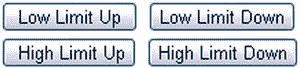

图 4-32. 为移动限制线而添加到图表中的按钮

在第 2 章中，你了解了可用作控件的 `jQuery` 用户界面库（`jQuery UI`）小部件。鉴于这类控件的潜力，建议使用该库提供的按钮小部件（有关如何使用这些小部件的更多信息，请参见第 10 章）。如果你想使用 `jQuery UI` 小部件来替换这四个按钮，你需要包含以下插件：

```
<link rel="stylesheet" href="http://code.jquery.com/ui/1.10.3/themes/smoothness
    /jquery-ui.css" />
<script src="http://code.jquery.com/ui/1.10.3/jquery-ui.min.js"></script>
```

但是，如果你更愿意引用本地安装的库（参见附录 A），则必须包含以下代码：

```
<link rel="stylesheet" href="../src/css/smoothness/jquery-ui-1.10.3.custom.min.css" />
<script src="../src/js/jquery-ui-1.10.3.custom.min.js"></script>
```

并且，在 HTML 页面的 `<body>` 部分，添加代码清单 4-37 中的代码。

***代码清单 4-37***. Ch4_16.html

```html
<script>
$(function() {
    $('button')
       .button()
       .click(function(event) {
          event.preventDefault();
       });
});
</script>
```

现在，按钮以 `jQuery UI` 样式显示（或者更准确地说，使用了众多主题中的“平滑”主题），如图 4-33 所示。

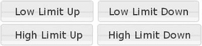

图 4-33。相同的四个按钮，但使用 `jQuery UI` 显示

此时，这些按钮完全处于非活动状态。你需要开发两个 `JavaScript` 函数；当按下按钮时，这些函数将被执行。第一个函数 `lineup()` 将增加作为参数传递的线条的 `y` 值（上限或下限），然后强制重新绘制图表。第二个函数 `linedown()` 将减小 `y` 值。这两个函数必须位于 `jQuery` 函数 `$(document).ready()` 外部（参见清单 4-38）。

***清单 4-38***。Ch4_16.html

```
function lineup(plot, name) {
    var co = plot.plugins.canvasOverlay;
    var line = co.get(name);
    line.options.y += 5;
    co.draw(plot);
}

function linedown(plot, name) {
    var co = plot.plugins.canvasOverlay;
    var line = co.get(name);
    line.options.y -= 5;
    co.draw(plot);
}
```

下一步是将 `$.jqplot()` 函数返回的对象赋值给一个变量：

```
myPlot = $.jqplot('myChart', [data], options);
```

 **注意** 注意不要写成 `var myPlot`，否则按下按钮时你将看不到图表有任何变化。

最后一步是命名 `canvasOverlay` 对象内的两条线条，如清单 4-39 所示。

***清单 4-39***。Ch4_16.html

```
objects: [
    {horizontalLine: {
       name: 'lowlimit',
       y: 70,
       lineWidth: 3,
       color: 'rgb(255, 0, 0)',
       shadow: true,
       lineCap: 'butt'
    }},
    {dashedHorizontalLine: {
       name: 'hilimit',
       y: 145,
       lineWidth: 4,
       color: 'rgb(0, 0, 255)',
       shadow: false,
       dashPattern: [8, 16],
       lineCap: 'round'
    }}
]
```

最终，你会得到一个包含四个按钮的图表，如图 4-34 所示。

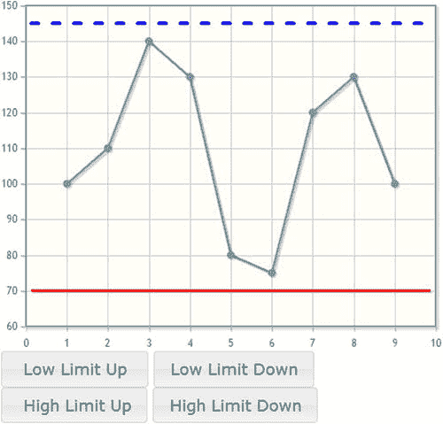

图 4-34。一个带有可改变上下阈值按钮的折线图

有时，你需要向图表中添加垂直线，尤其是在需要标记截止日期时。在这种情况下，我们将采用类似的方法，但会有些不同。例如，假设你想在折线图中放置一条代表截止日期的单条垂直线。在这种情况下，你可以使用清单 4-40 中的代码。

***清单 4-40***。Ch4_17.html

```
$(document).ready(function(){
    var data = [100, 110, 140, 130, 80, 75, 120, 130, 100];
    var options = {
       canvasOverlay: {
          show: true,
          objects: [
          {verticalLine: {
             name: 'lowlimit',
             x: 5,
             lineWidth: 3,
             color: 'rgb(50, 200, 50)',
             shadow: true,
             lineCap: 'butt',
             yOffset: 0
          }}
          ]
       }
    };
    myPlot = $.jqplot('myChart', [data], options);
});
```

这次，你只需要两个按钮。

```
<div>
    <button onclick="lineright(myPlot, 'lowlimit')">推迟截止日期</button>
    <button onclick="lineleft(myPlot, 'lowlimit')">提前截止日期</button>
</div>
```

现在，你必须开发两个 `JavaScript` 函数，当按下按钮时，这些函数将水平移动限制线。与之前看到的 `JavaScript` 函数一样，清单 4-41 中的两个函数必须放置在 `jQuery` 函数 `$(document).ready()` 外部。

***清单 4-41***。Ch4_17.html

```
function lineright(plot, name) {
    var co = plot.plugins.canvasOverlay;
    var line = co.get(name);
    line.options.x += 1;
    co.draw(plot);
}

function lineleft(plot, name) {
    var co = plot.plugins.canvasOverlay;
    var line = co.get(name);
    line.options.x -= 1;
    co.draw(plot);
}
```

结果如图 4-35 所示，图表中间有一条绿色的垂直线。通过点击两个按钮，该线条将向左移动（如果你想提前截止日期）或向右移动（如果你想推迟截止日期）。

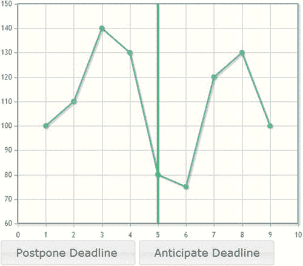

图 4-35。一个带有绿色水平限制线的折线图

## 缩放

通常，当你处理大量数据时，最终图表上的线条会由数千个点组成。正是在这种情况下，缩放功能变得不可或缺。从宏观视图开始，你可以放大线条的某一部分，以获得数据的微观视图。

`Cursor` 插件也启用了图表缩放功能。通过在图表上单击并拖动光标，你可以放大并滚动图表的较小区域。如果双击，你可以重置所有内容并返回宏观视图。因此，你需要在网页中包含 `Cursor` 插件，并且由于 `x` 轴上有日期值，因此还必须包含 `DateAxisRenderer` 插件：

```html
<script type="text/javascript"
    src="../src/plugins/jqplot.dateAxisRenderer.min.js"></script>
<script type="text/javascript" src="../src/plugins/jqplot.cursor.min.js"></script>
```

或者，如果你更喜欢使用 CDN 服务，可以按如下方式操作：

```html
<script type="text/javascript" src="http://cdn.jsdelivr.net/jqplot/1.0.8/plugins
    /jqplot.dateAxisRenderer.min.js"></script>
<script type="text/javascript"
    src="http://cdn.jsdelivr.net/jqplot/1.0.8/plugins/jqplot.cursor.min.js"></script>
```

清单 4-42 展示了大量传入数据的可用性。

***清单 4-42***. Ch4_18.html

```javascript
var data = [["6/22/2012 10:00:00", 110.32], ["6/8/2012 10:00:00", 115.84],
            ["5/26/2012 10:00:00", 121.23], ["5/11/2012 10:00:00", 122.12],
            ["4/27/2012 10:00:00", 120.69], ["4/13/2012 10:00:00",123.24],
            ["3/30/2012 10:00:00", 116.78], ["3/16/2012 10:00:00", 115.16],
            ["3/2/2012 10:00:00", 113.57], ["2/17/2012 10:00:00", 120.45],
            ["2/2/2012 10:00:00", 121.28], ["1/20/2012 10:00:00", 124.7],
            ["1/5/2012 10:00:00", 130.07], ["12/22/2011 10:00:00", 129.36],
            ["12/8/2011 10:00:00", 130.76], ["11/24/2011 10:00:00", 133.96],
            ["11/10/2011 10:00:00", 140.02] ,["10/27/2011 10:00:00", 138.36],
            ["10/13/2011 10:00:00", 140.54], ["9/29/2011 10:00:00", 140.91],
            ["9/15/2011 10:00:00", 140.15], ["9/2/2011 10:00:00", 138.25],
            ["8/25/2011 10:00:00", 137.29], ["8/11/2011 10:00:00", 139.15],
            ["7/28/2011 10:00:00", 144.86], ["7/14/2011 10:00:00", 145.32],
            ["6/30/2011 10:00:00", 148.12], ["6/16/2011 10:00:00", 146.43],
            ["6/2/2011 10:00:00", 147], ["5/19/2011 10:00:00", 144.62],
            ["5/5/2011 10:00:00", 143.2], ["4/21/2011 10:00:00", 144.06],
            ["4/7/2011 10:00:00", 137.45], ["3/24/2011 10:00:00", 138.08],
            ["3/10/2011 10:00:00", 137.92], ["2/25/2011 10:00:00", 131.18],
            ["2/11/2011 10:00:00", 129.64], ["1/28/2011 10:00:00", 133.9],
            ["1/14/2011 10:00:00", 134.25], ["12/31/2010 10:00:00", 137],
            ["12/17/2010 10:00:00", 136.69], ["12/3/2010 10:00:00", 144.87],
            ["11/19/2010 10:00:00", 146.7], ["11/5/2010 10:00:00", 143.97],
            ["10/22/2010 10:00:00", 139.6], ["10/8/2010 10:00:00", 133.39],
            ["9/24/2010 10:00:00", 130.27], ["9/10/2010 10:00:00", 132.75],
            ["8/27/2010 10:00:00", 130.25]];
```

启用缩放功能非常简单。只需在 `options` 中将 `zoom` 属性设置为 `'true'`，如代码清单 4-43 所示。

***代码清单 4-43***. Ch4_18.html

```javascript
var options = {
    series: [{
       neighborThreshold: -1
    }],
    axes:{
       xaxis:{
          renderer: $.jqplot.DateAxisRenderer,
          min:'August 1, 2010 16:00:00',
          tickInterval: '6 months',
          tickOptions: {formatString: '%#m/%#d/%Y'}
       }
    },
    cursor:{
       show: true,
       zoom: true,
       showTooltip: false
    }
};
myPlot = $.jqplot('myChart', [data], options);
```

或者，如果你愿意，也可以禁用重置缩放的双击操作。`Cursor` 插件还通过外部使用 `resetZoom()` 方法扩展了绘图对象（即 `$.jqplot()` 函数返回的值）。此外，可以从用户代码或其他 HTML 元素（例如按钮）中调用此方法，以重置绘图缩放。

你可以在 jQuery 的 `ready()` 函数中定义此函数：

```javascript
    $('.button-reset').click(function() { myPlot.resetZoom() });
```

然后，在网页的 `<body>` 部分中，将以下行插入到你希望放置按钮的任何位置：

```html
<button class="button-reset">重置缩放</button>
```

图 4-36 展示了一组代表折线图在不同时刻的图片。第一张图片是浏览器中显示的折线图，未进行任何缩放。第二张图片显示了用户为进行缩放而选择的图表区域。最后一张图片展示了缩放后的结果。如果用户点击“重置缩放”按钮，浏览器将再次显示第一张图片。

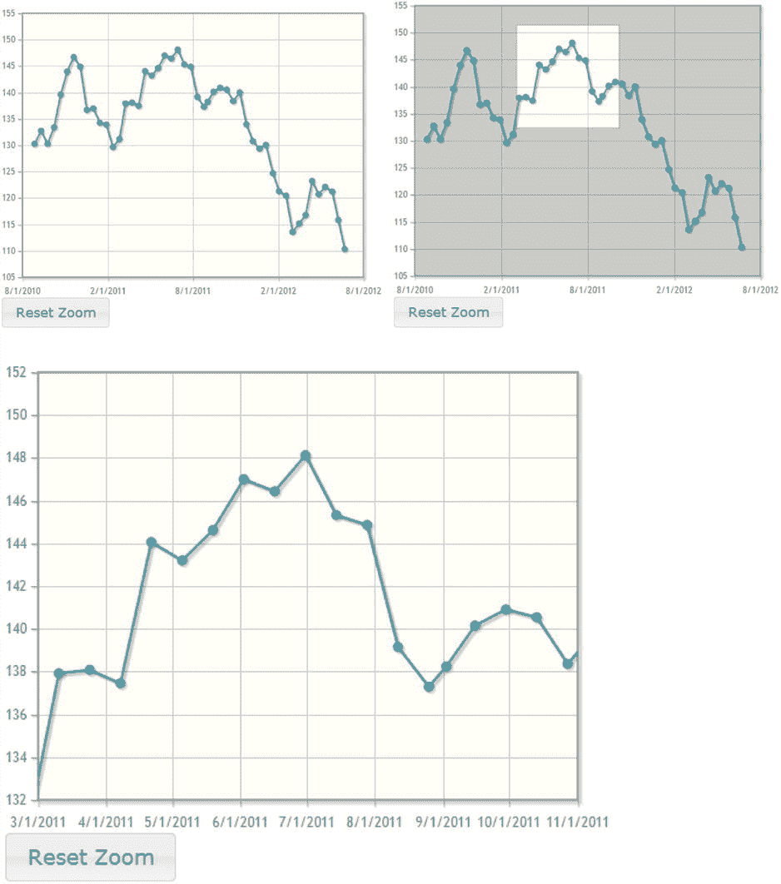

图 4-36. 通过缩放提取的折线图细节

## 更改图表外观

得益于其多个插件，jqPlot 可以直接在画布上渲染图表组件，包括文本。现在必须清楚的是，jqPlot 库的亮点在于通过更改 jqPlot 属性和所添加插件的默认值，可以改变任何图表元素的外观。但这并非实现此类更改的唯一方法。如果你想修改 HTML 页面中某个元素的外观，可以借助 CSS 样式。对于 jqPlot 元素也是如此。

可以使用 CSS 类引用多个（但并非全部）jqPlot 对象，从而更改这些对象的样式，而无需在 `options` 中设置其属性。这些对象可以通过 CSS 进行自定义，使用诸如 `.jqplot-*` 之类的 CSS 类。

### 使用 CSS 自定义文本

jqPlot 库提供了 CSS 类，你可以使用这些类更改某些属性，而无需引用 `options` 对象。举例来说，你将使用其中一些类来更改图表内的文本。让我们从实现一个简单的多系列折线图开始，该图表仅在 `options` 中定义了标题和轴标签（参见代码清单 4-44）。

***代码清单 4-44***. Ch4_10a.html

```javascript
$(document).ready(function(){
    var data1 = [1, 2, 3, 2, 3, 4];
    var data2 = [3, 4, 5, 6, 5, 7];
    var data3 = [5, 6, 8, 9, 7, 9];
    var data4 = [7, 8, 9, 11, 10, 11];
    var options = {
       title: '多系列折线图',
       axesDefaults: {
          label: '轴标签'
       }
    };
    $.jqplot('myChart',[data1, data2, data3, data4], options);
});
```

你添加了代码清单 4-45 中的 `<style>` 部分，该部分可以提取为一个 CSS 文件。

***代码清单 4-45***. Ch4_10a.html

```css
<style>
.jqplot-title {
    font-family: "Arial Black";
    font-size: 24px;
    color: lightblue;
}

.jqplot-xaxis-label {
    font-size: 24px;
}

.jqplot-axis {
    font-family: "Arial";
    font-size: 16px;
}

.jqplot-xaxis {
    color: green;
}

.jqplot-yaxis {
    color: orange;
    font-weight: bold;
}
</style>
```

图 4-37 展示了在应用代码清单 4-45 中 CSS 样式前后的情况，使我们能够看到所做的更改。

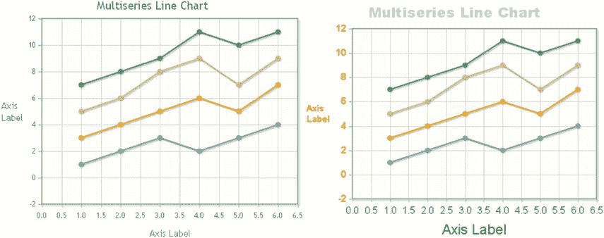

图 4-37. 应用于刻度标签和标题的一些 CSS 样式

### 更改背景颜色

继续前面的示例（参见代码清单 4-45），你现在发现只需向 `options` 中添加一个属性（在代码清单 4-46 中突出显示），即可获得黑色背景，如图 4-38 所示。

***代码清单 4-46***. Ch4_10b.html

```javascript
var options = {
    title: '多数据数组',
    axesDefaults: {
       label: '轴标签'
    },
    grid: {
       background: '#000000'
    }
};
```

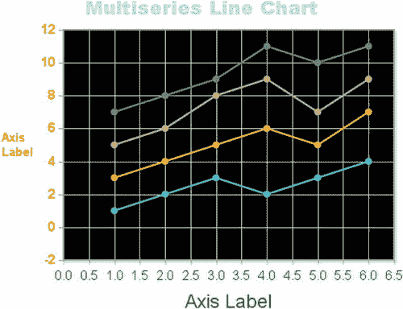

图 4-38. 具有黑色背景的折线图

### 使用 CSS 进一步自定义

这次，你不仅要更改网格的背景，还要更改图表周围的空白区域，使其更具吸引力。你将通过直接将 CSS 样式应用于图表元素来实现这一点。

例如，与默认设置（灰色网格，白色背景）相反，假设你决定将图表放置在完全黑色的背景上。在这种情况下，你需要创建一个包含 `<div>` 元素的容器，并将其嵌入到 `myChart` 目标（另一个 `<div>` 元素）中：

```html
<div class="chart-container">
    <div id="myChart" style="height:400px; width:500px;"></div>
</div>
```

此容器用于扩展黑色背景的放置区域；我们通过将容器的类设置为 `chart-container` 来引用它。

此时，需要牢记的最重要的一点是，现在可以通过更改两个 `<div>` 元素（容器和目标元素）的 CSS 样式来恰当地描述它们。这可以通过为 `.chart-container` 指定属性来实现，如代码清单 4-47 所示（至于目标元素的样式，已使用 `.jqplot-*` 类进行了设置）。在 `.chart-container` 类中，将 `background` 属性设置为 `'black'`；容器的尺寸通过 `width` 和 `height` 属性确定。你还使用了 `padding` 属性，以便更好地将目标元素在容器内居中。内边距会清除元素内容周围的区域，并扩展其背景颜色。这四个值分别对应上、右、下、左的内边距。

***代码清单 4-47***. Ch4_20.html

```css
<style type="text/css">
.chart-container {
    background : #000000;
    padding: 30px 0px 80px 30px;
    width: 560px;
    height: 330px;
}
...
</style>
```

对容器和目标元素进行 CSS 定制后，最终得到的图表如图 4-39 所示。

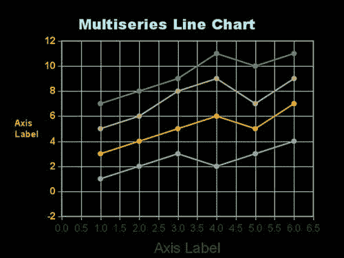

图 4-39. 具有黑色背景的多系列折线图

## 设置网格

默认情况下，图表的网格是灰色的。然而，在前面的示例（参见代码清单 4-47）中，你已经了解了如何通过在 `options` 的 `grid` 对象中设置属性来更改网格。在本示例中，你将继续修改同一个多系列折线图，但这次将重点关注网格属性。

你可以同时更改网格的颜色和粗细。例如，你可能想要一个颜色为黑色、线条更粗的网格，在这种情况下，你必须定义 `gridLineColor` 和 `gridLineWidth` 属性。此外，有时 jqPlot 默认显示的图表网格可能过粗，这反而会妨碍可读性而非提升它。在这种情况下，你需要减少刻度线的数量。这可以通过在 `options` 的 `axes` 对象中为每个轴以特定方式设置 `numberTicks` 属性来轻松实现。代码清单 4-48 包含了所有这些更改。

***代码清单 4-48***. Ch4_10d.html

```javascript
var options = {
    title: 'Multiseries Line Chart',
    axesDefaults: {
       label: 'AxisLabel'
    },
    grid: {
       background: '#000000',
       gridLineColor: '#ffffff',
       gridLineWidth: 2
    },
    axes: {
       xaxis: {
          numberTicks: 5,
          min: 0,
          max: 8
       },
       yaxis: {
          numberTicks: 3,
          min: 0,
          max: 12
       }
    }
};
```

最终，你将获得一个具有所需网格的新图表（参见图 4-40）。

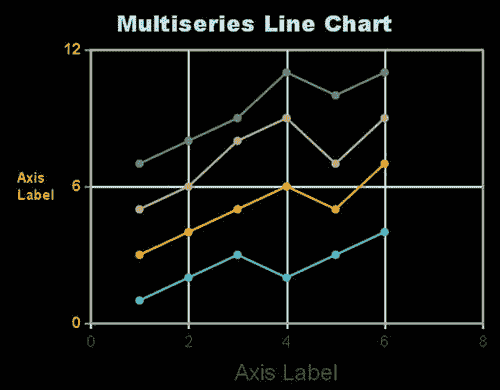

图 4-40. 具有自定义网格的多系列折线图

请注意，图表周围有一个灰色轮廓：即边框。你也可以更改它，或者像代码清单 4-49 那样禁用它。你可以将 `drawBorder` 属性设置为 `'false'`，并同时禁用 `shadow`。

***代码清单 4-49***. Ch4_20e.html

```javascript
grid: {
    drawBorder: false,
    shadow: false,
    gridLineColor: '#000000',
    gridLineWidth: 2,
},
```

进行这些更改后，你将获得一个更易读的网格，例如图 4-41 所示，其边框颜色与网格颜色相同（白色）。

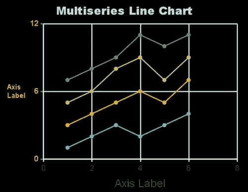

图 4-41. 具有自定义网格、更易读的多系列折线图

## 处理折线图上的区域

到目前为止，你已经了解到折线图基本上由通过线条连接的点集组成，用于描述某个数值的趋势。现在，你可能会发现这种视图有些局限。通常，折线图最有趣的部分是线条（或多条线条）以某种方式界定的区域。

### 面积图

折线图可以转换为面积图。在本示例中，你将使用已创建的多系列折线图（参见代码清单 4-50），通过进行更改来获得一个混合了面积和线条的新图表。在这里，你将看到只需进行很少的更改即可达到预期效果。

***代码清单 4-50***。Ch4_22a.html

```
$(document).ready(function(){
    var data1 = [1, 2, 3, 2, 3, 4];
    var data2 = [3, 4, 5, 6, 5, 7];
    var data3 = [5, 6, 8, 9, 7, 9];
    var data4 = [7, 8, 9, 11, 10, 11];
    var options = {
       title:'Multiple Data Arrays'
    };
    $.jqplot ('myChart', [data1, data2, data3, data4], options);
});
```

首先，你需要在 `options` 中为要表示为面积图的序列插入 `fill` 属性。这次，你选择使用 `seriesDefaults` 将面积图表示应用于所有序列。通过这种方式，你将获得一个面积图。为了使图表更美观，你可以添加其他选项，例如平滑处理（参见代码清单 4-51）。

***代码清单 4-51***。Ch4_22a.html

```
var options = {
    title: 'Multiple Data Arrays',
    seriesDefaults: {
       showMarker: false,
       rendererOptions: {
         smooth: true
       },
       fill: true
    }
};
```

但是，在运行网页时，你立即发现有些不对劲：最后一个序列的面积覆盖了其他序列（参见图 4-42）。

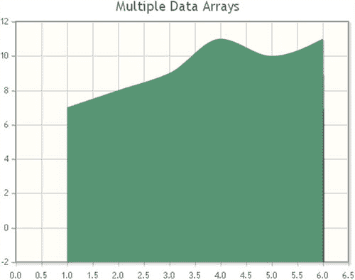

图 4-42。一个序列覆盖其他序列的面积图

在将 `fill` 属性应用于序列之前，你需要考虑序列对应面积应如何表示的绘制顺序。在这种情况下，只需以不同的方式排列序列的顺序即可：

```
$.jqplot ('myChart', [data4, data3, data2, data1], options);
```

结果是一个精确的面积图，如图 4-43 所示。

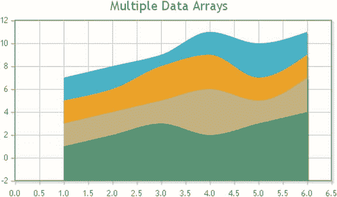

图 4-43。正确渲染的多系列面积图

### 折线与面积组合图

在同一图表中混合使用折线和面积也可以产生非常好的效果。继续前面的示例（参见代码清单 4-51），你可以不设置 `seriesDefaults` 中的 `fill` 属性来对所有序列应用填充，而是逐个序列地决定哪些序列应表示为面积图、哪些表示为折线图，如代码清单 4-52 所示。

***代码清单 4-52***。Ch4_22b.html

```
var options = {
    title:'Multiple Data Arrays',
    seriesDefaults: {
       showMarker: false,
       rendererOptions: {
          smooth: true
       }
    },
    series: [{}, {fill: true}, {}, {fill: true}]
};
```

图 4-44 展示了如何组合折线图和面积图。

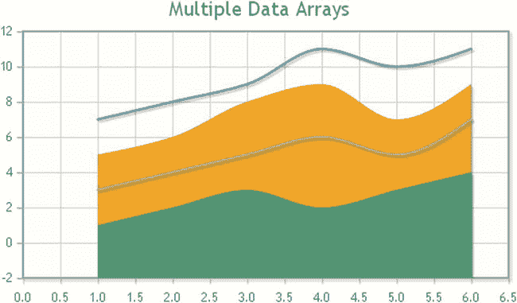

图 4-44。组合的折线与面积图

### 带状图

带状图（也称为高低折线图或范围图）是一种结合了面积图和折线图特征的图表类型。