# 带状图（Band Chart）

带状图是一种带有底层阴影区域的折线图（参见图 4-45）。该区域表示 Y 轴上数值范围的上下边界。这个范围随 X 轴变化，最终形成一个带状区域。

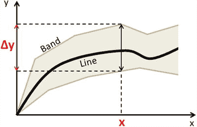

图 4-45. 带状图

你可以使用带状区域来表示 Y 轴上的特定区间，该区间随 X 轴值变化，并与内部折线的趋势相关联，例如用于展示置信区间或误差带。另一个用途是突出显示随时间变化的分布，以及显示算术平均值的折线。

使用`jqPlot`，带状区域可以自动计算或手动指定。如果手动指定，必须提供两个`[x, y]`值数组作为带状区域的边界。第一个数组定义下边界线，第二个数组定义上边界线。这两个数组作为另一个数组的两个元素传入`options`中的`bandData`属性。

首先，我们定义一个包含`[x, y]`值对的数据数组，以及包含两个数组（下边界线和上边界线）的带状数组`bdata`（参见代码清单 4-53）。

***代码清单 4-53***. Ch4_24a.html

```
var data =[[10,100],[20,110],[30,140],[40,130],
             [50,80],[60,75],[70,120],[80,130],[90,100]];
varbdata =[[[10,90],[20,100],[30,130],[40,120],
             [50,70],[60,65],[70,110],[80,120],[90,90]],
            [[10,110],[20,120],[30,150],[40,140],
             [50,90],[60,85],[70,130],[80,140],[90,110]]];
```

然后，在`options`中使用代码清单 4-54 所示的代码。图 4-46 展示了生成的带状折线图。

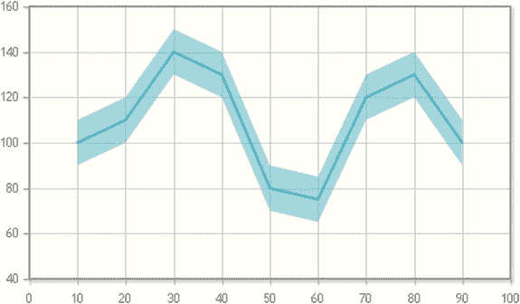

图 4-46. 带状折线图

***代码清单 4-54***. Ch4_24a.html

```
var options = {
    series: [{
       rendererOptions: { bandData: bdata }
    }],
    seriesDefaults: {
       shadow: false,
       showMarker: false
    }
};
$.jqplot ('myChart', [data], options);
```

如果选择绘制平滑折线图，带状区域也会随之平滑。代码清单 4-55 给出了代码，图 4-47 展示了结果。

***代码清单 4-55***. Ch4_24b.html

```
rendererOptions: {
    bandData: bdata,
    smooth: true
}
```

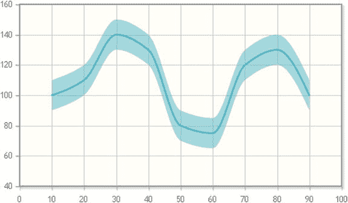

图 4-47. 平滑带状折线图

带状数据数组中的点数不必与数据系列中的点数对应。此外，如果数据系列是平滑的，带状数据也会被绘制为平滑线。带状区域不必相对于主线对称。通过在`bdata`数组中插入具有非对称 Y 值的数组，可以使带状区域变得不对称，如代码清单 4-56 所示。

***代码清单 4-56***. Ch4_24c.html

```
varbdata =[[[10,90],[30,100],[40,100],[50,70],
             [60,65], [70,110],[80,120],[90,90]],
            [[10,110],[30,150],[40,140],[50,120],
             [60,85], [70,130],[80,140],[90,110]]];
```

现在，图 4-48 中的带状区域相对于主线是不对称的。

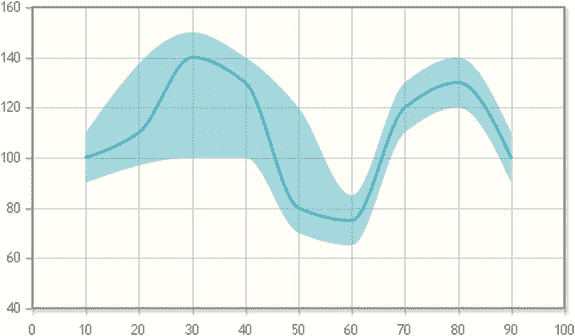

图 4-48. 非对称带状折线图

但是，提供带状数据并非强制要求；它们可以由`jqPlot`自动计算。要激活此功能而不使用任何数组，你需要在`rendererOptions`中将`bands`对象的`show`属性设置为`'true'`，如代码清单 4-57 所示。如图 4-49 所示，默认情况下带状区间覆盖主线 Y 值的±3%。

***代码清单 4-57***. Ch4_24d.html

```
series: [{
    rendererOptions: {
       bands: { show: true},
       smooth: true
    }
}],
```

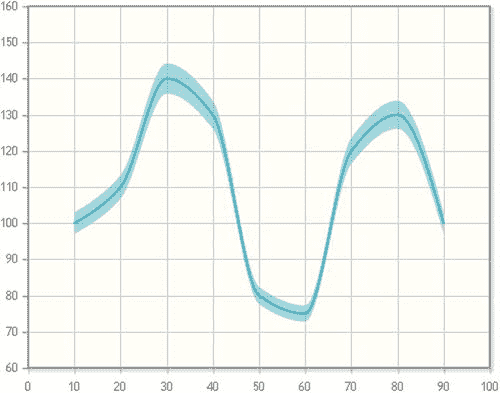

图 4-49. 带状区间为±3%的带状折线图

### 填充折线图中的两条线之间的区域

你刚刚了解了带状区域。为什么不填充两条系列线之间的区域呢？这个任务同样可以用`jqPlot`完成。通过设置`fillBetween`对象中的属性，可以控制图表中两条线之间的区域。

这里，我们从一个非常简单的多系列折线图开始（与其他案例中使用的示例相同），如代码清单 4-58 所述。

***代码清单 4-58***. Ch4_5a.html

```
$(document).ready(function(){
    var data1 = [1, 2, 3, 2, 3, 4];
    var data2 = [3, 4, 5, 6, 5, 7];
    var data3 = [5, 6, 8, 9, 7, 9];
    var data4 = [7, 8, 9, 11, 10, 11];
    var options = {
       title:'Multiple Data Arrays',
    };
    $.jqplot('myChart', [data1, data2, data3, data4], options);
});
```

使用这个多系列折线图，你可以考虑每个系列，索引从 0 开始：第一个系列为 0，第二个系列为 1，第三个系列为 2，依此类推。

因此，如果你想填充两条线之间的区域，需要在`series1`和`series2`属性中指定它们对应的两个索引。例如，如果你想填充第二个和第四个系列之间的区域，必须将`series1`设置为 1（第二个系列），将`series2`设置为 3（第四个系列），如代码清单 4-59 所示。可选地，你可以使用`color`属性或更好的`rgba()`函数来设置限定区域的颜色。

***代码清单 4-59***. Ch4_25.html

```
var options = {
    title: 'Multiple Data Arrays',
    fillBetween: {
       series1: 1,   //second series
       series2: 3,   //fourth series
       color: "rgba(10, 120, 130, 0.7)"
    }
});
```

在图 4-50 中，你可以看到第二个和第四个系列之间的选定区域已被着色。

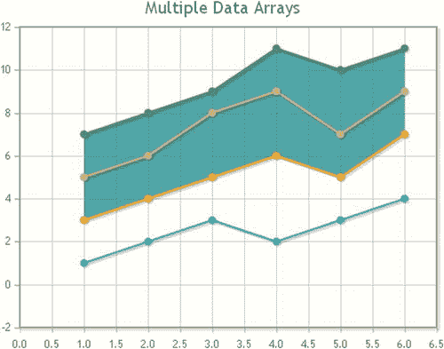

图 4-50. 两条线之间带有着色区域的多系列折线图

你可以将一个 JavaScript 函数绑定到一个按钮上，该按钮用于更新每个系列的图表设置，然后重新绘制所有内容。为此，我们在 jQuery 的`ready()`函数中添加代码清单 4-60 中的函数。

***代码清单 4-60***. Ch4_26.html

```
$("button[name=changeFill]").click(function(e) {
    plot1.fillBetween.series1 = parseInt($("input[name=series1]").val());
    plot1.fillBetween.series2 = parseInt($("input[name=series2]").val());
    plot1.replot();
});
```

为了使上述 JavaScript 函数正常工作，你需要将变量`plot1`赋值为函数`$.jqplot()`返回的值：

```
plot1 = $.jqplot ('myChart', [data1, data2, data3, data4], options);
```

并且，在网页的`<body>`部分，你必须添加两个输入文本框和一个按钮，如代码清单 4-61 所示。

***代码清单 4-61***. Ch4_26.html


```html
<label for="series1">第一系列：</label>
<input type="text" name="series1" value="1" />
<label for="series2">第二系列：</label>
<input type="text" name="series2" value="3" />
<button name="changeFill">更改填充</button>
```

结果如图 图 4-51 所示。

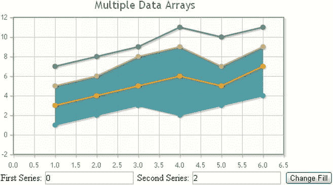

图 4-51. 一个带有可选颜色区域的多系列折线图

要用 jQuery UI 小部件替换简单的 HTML 控件，您需要对代码进行一些修改以便集成，如 代码清单 4-62 所示。

***代码清单 4-62***. Ch4_26ui.html

```html
<link rel="stylesheet" href="../src/css/smoothness/jquery-ui-1.10.3.custom.min.css" />
<script src="../src/js/jquery-ui-1.10.3.custom.min.js"></script>
...
$("button[name=changeFill]").click(function(e) {
    plot1.fillBetween.series1 = parseInt($("#combobox").val());
    plot1.fillBetween.series2 = parseInt($("#combobox2").val());
    plot1.replot();
});
...
<div class="ui-widget">
<label>第一系列：</label>
<select id="combobox">
    <option value="0">1</option>
    <option value="1">2</option>
    <option value="2">3</option>
    <option value="3">4</option>
</select>
</div>
<div class="ui-widget">
<label>第二系列：</label>
<select id="combobox2">
    <option value="0">1</option>
    <option value="1">2</option>
    <option value="2">3</option>
    <option value="3">4</option>
</select>
</div>
<button name="changeFill">更改填充</button>
<script>
$(function() {
    $('button')
       .button()
       .click(function(event) {
          event.preventDefault();
      });
});
</script>
```

结果如图 图 4-52 所示。

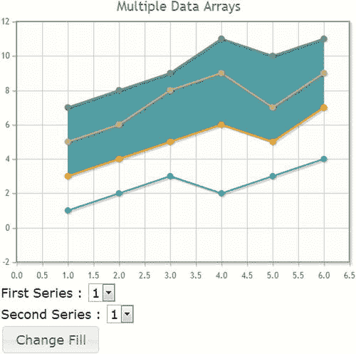

图 4-52. 一个带有可选颜色区域的多系列折线图

## 趋势线

jqPlot 确实充满了惊喜。除了您已经了解的关于折线图的所有功能外，jqPlot 还可以计算并绘制趋势线。这些通常是图表中绘制的直线，但有时也可以是指数形式的（如果在对数尺度上是线性的）。趋势线表示图表中绘制的系列数据的总体模式或方向。该线是使用统计技术绘制的。此功能由另一个插件 `Trendline` 实现。

要启用此功能，您需要在网页中包含该插件：

```html
<script type="text/javascript" src="../src/plugins/jqplot.trendline.min.js"></script>
```

之后，您只需激活该插件，添加启用它的行，如 代码清单 4-63 所示。

***代码清单 4-63***. Ch4_27a.html

```javascript
$(document).ready(function(){
    var data = [100, 110, 140, 130, 135, 132, 140, 135, 142]
    $.jqplot.config.enablePlugins = true;
    $.jqplot ('myChart', [data]);
});
```

只需这几行代码，就可以获得一条趋势线，如图 图 4-53 所示。

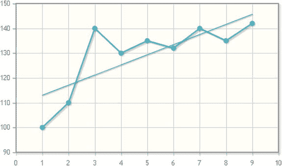

图 4-53. 折线图的线性趋势线

但是，如果您希望显式地表达属性，可以通过使用选项来实现。这使您能够像处理图表中的其他对象一样处理趋势线。假设您想更改线条的颜色并增加其粗细以使其突出（参见 代码清单 4-64）。

***代码清单 4-64***. Ch4_27b.html

```javascript
var options = {
    seriesDefaults: {
       trendline: {
          show:true,
          color: '#ff0000',
          lineWidth: 4
       }
    }
}
$.jqplot ('myChart', [data], options);
```

现在您可以对趋势线进行更多控制。图 4-54 显示了在 `trendline` 对象中设置了属性的线条（趋势线更粗，并在浏览器中以深红色显示）。

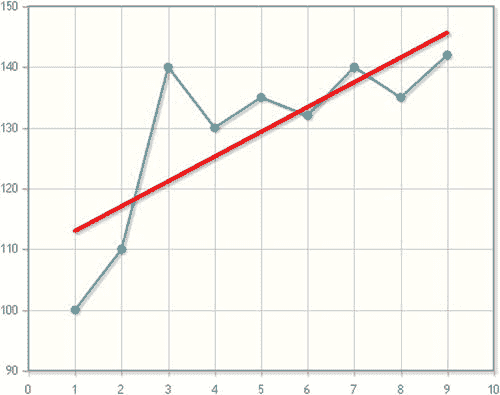

图 4-54. 折线图中自定义的线性趋势线

如前所述，可以使用趋势线曲线，它表示图表数据点所遵循的指数趋势。让我们在下一个示例中研究这一点，见 代码清单 4-65。

***代码清单 4-65***. Ch4_28.html

```javascript
$(document).ready(function(){
    var data = [[10, 1.44], [30, 6.98], [50, 10.7], [70, 37.5], [90, 78.1]];
    var options = {
       seriesDefaults: {
          trendline: {
             show:true,
             color: '#ff0000',
             lineWidth: 4,
             type: 'exponential'
          }
       }
    }
    $.jqplot ('myChart', [data], options);
});
```

图 4-55 展示了一个折线图，其中绘制了一系列遵循指数趋势的数据点。因此，您可以用一条指数趋势线来突出显示这一点。

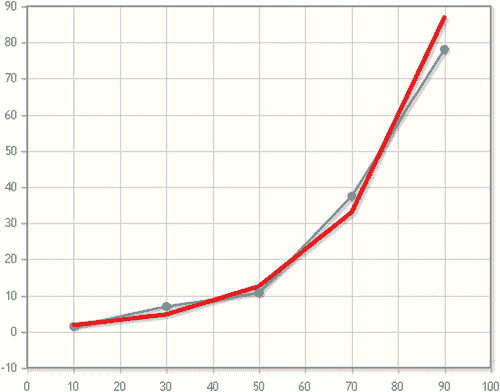

图 4-55. 折线图中自定义的指数趋势

## 本章小结

在这一内容丰富的章节中，您已经深入了解了 jqPlot 的世界。您了解了这个库提供的众多可能性，使您能够尽最大能力实现折线图。您学习了如何操作绘制图表的基本元素，例如**坐标轴**和**刻度**。特别是，您看到了如何在同一个图表中管理多个数据系列（**多系列图表**），并添加各种图形效果。您还探索了 jqPlot 库如何允许您操作**日期和时间值**的不同格式。此外，您还了解了如何使用 **HTML 格式**以及**高亮显示**数据点来自定义某些元素。在本章的最后部分，您处理了更复杂的情况，例如生成**趋势线**和使用**带状图**。

在下一章中，我们将讨论更多主题，您将面对其他新概念，这次将应用于柱状图。

## 第 5 章


## 使用 jqPlot 绘制柱状图

在本章中，您将处理另一大类图表：柱状图。在上一章中，我们向您展示了如何表征折线图，这是 jqPlot 中的默认图表类型。现在，使用 `BarRenderer` 插件，您将发现主 jqPlot 对象的结构如何逐渐被新的属性和对象丰富。通过实际示例，您将看到如何使用 `rendererOptions` 更改属性和对象属性的值。

有时，使用同一组数据可以获得不同的表示形式。学习如何选择最适合您需求的表示形式是本书的基本目标之一。为此，使用一组数据，您将看到如何从分组柱状图切换到堆叠柱状图**，在这两种情况下，都可以选择垂直或水平表示。

此外，您将学习如何使用 jqPlot 库表示组合图表，例如，如何同时表示折线图和柱状图，以及如何通过简单地减慢绘制速度来获得简单但引人注目的动画。您还将了解一种特殊类型的柱状图——Marimekko 图，jqPlot 库以一种非常令人满意的方式实现了它。


## 使用`BarRenderer`插件创建柱状图

当您有一组数据被划分为多个类别，并且需要比较这些类别时，柱状图可能是最适合您需求的图表类型。您已经看到，在不包含任何插件的情况下，默认情况下输入数据被解释为连接成线的点。要告诉`jqPlot`输入数据必须用于绘制柱状图，您需要在 HTML 页面的`<head>`部分放置一组插件：

```html
<script type="text/javascript" src="../src/plugins/jqplot.dateAxisRenderer.min.js"></script>
<script type="text/javascript"
    src="../src/plugins/jqplot.canvasAxisTickRenderer.min.js"></script>
<script type="text/javascript" src="../src/plugins/jqplot.categoryAxisRenderer.min.js"></script>
<script type="text/javascript" src="../src/plugins/jqplot.barRenderer.min.js"></script>
```

或者，如果您更喜欢使用内容分发网络（CDN）服务，可以按如下方式操作：

```html
<script type="text/javascript" src="http://cdn.jsdelivr.net/jqplot/1.0.8/plugins/jqplot.dateAxisRenderer.min.js"></script>
<script type="text/javascript" src="http://cdn.jsdelivr.net/jqplot/1.0.8/plugins/jqplot.canvasAxisTickRenderer.min.js"></script>
<script type="text/javascript" src="http://cdn.jsdelivr.net/jqplot/1.0.8/plugins/jqplot.categoryAxisRenderer.min.js"></script>
<script type="text/javascript" src="http://cdn.jsdelivr.net/jqplot/1.0.8/plugins/jqplot.barRenderer.min.js"></script>
```

要设置输入数据以便在柱状图中使用，您必须插入一个格式为`[label, y]`的数组，其中`x`不再存在，取而代之的是一个指示性标签。这个标签通常是一个字符串值。实际上，当我们谈论柱状图时，我们不再关注一个变量（`y`值）相对于另一个变量（`x`值）的趋势，而是关注比较数据的类别或组（标签）。在本例中，您将使用五个组，每个组代表一个州，以标签形式报告：

```javascript
var data = [['Germany', 12], ['Italy', 8], ['Spain', 6], ['France', 10], ['UK', 7]];
```

一旦包含了`BarRenderer`插件，您必须激活它，将其引用分配给`series`对象中的`renderer`属性（参见清单 5-1）。您将对第二个插件`CategoryAxisRenderer`执行相同操作，仅针对`xaxis`对象指定它。

***清单 5-1***. Ch5_01a.html

```javascript
var options = {
    title: 'Foreign Customers',
    series:[{renderer:$.jqplot.BarRenderer}],
    axes: {
       xaxis: {
          renderer: $.jqplot.CategoryAxisRenderer
       }
    }
};
$.jqplot ('myChart', [data], options);
```

接下来，在 HTML 页面的`<body>`部分，添加以下行：

```html
<div id="myChart" style="height:300px; width:500px;"></div>
```

通过这种方式，您将得到一个简单的柱状图，如图 5-1 所示。数据数组中的每个州都由一个蓝色条表示，其高度对应于`y`值。

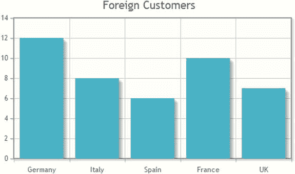

图 5-1. 一个简单的柱状图

## 旋转轴刻度标签

通常，可能需要或希望旋转 x 轴上报告的刻度标签。例如，文本可能太长而无法完整显示，为了保持标签的可读性，您需要将它们以一定角度倾斜书写。这种旋转是通过包含`CanvasTextRenderer`插件实现的：

```html
<script type="text/javascript" src="../src/plugins/jqplot.canvasTextRenderer.min.js"></script>
```

或者，如果您更喜欢使用 CDN 服务，可以按如下方式操作：

```html
<script type="text/javascript" src="http://cdn.jsdelivr.net/jqplot/1.0.8/plugins
    /jqplot.canvasTextRenderer.min.js"></script>
```

同样，仅仅包含插件是不够的；您还必须通过将其引用传递给`tickRenderer`属性来激活它，如清单 5-2 所示。然后，您需要在`tickOptions`中指定某些属性：将`angle`属性设置为-30 度。使用此值，您表示文本相对于 x 轴的倾斜角度。如果值为正，文本将顺时针旋转；如果为负（如清单 5-2 所示），则逆时针旋转。

***清单 5-2***. Ch5_01b.html

```javascript
var options = {
    title: 'Foreign customers',
    series:[{ renderer: $.jqplot.BarRenderer }],
    axes: {
       xaxis: {
          renderer: $.jqplot.CategoryAxisRenderer,
          tickRenderer: $.jqplot.CanvasAxisTickRenderer,
          tickOptions: {
             angle: -30,
             fontSize: '10pt'
          }
          }
    }
};
$.jqplot ('myChart', [data], options);
```

如果您现在在浏览器中加载网页，在图表底部，您将看到所有标签都相对于 x 轴逆时针旋转（参见图 5-2）。

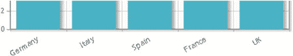

图 5-2. x 轴上带有旋转标签的柱状图

## 修改条之间的间距

使用柱状图时，最常见的需求可能是改变条之间的间距。可以通过设置不同的`barMargin`属性值来直接调整此间距。由于此属性不属于`jqplot`对象，而是`BarRenderer`插件特有的，因此您必须在`rendererOptions`中指定它。每当您包含一个渲染器插件时，您也会包含一整套不属于原始`jqplot`对象的新属性。因此，如果您希望这些属性中的某个值与默认值不同，您需要在`rendererOptions`中写入此属性并设置新值。例如，让我们在条之间应用 30 像素的间距，如清单 5-3 所示。

***清单 5-3***. Ch5_02.html

```javascript
var options = {
    title: 'Foreign Customers',
    seriesDefaults:{
       renderer:$.jqplot.BarRenderer,
       rendererOptions: {
          barMargin: 30
       },
    },
    axes: {
```

由于图表的宽度保持不变，将`barMargin`属性增加到 30 的结果是，所有条都比以前更窄（参见图 5-3）。

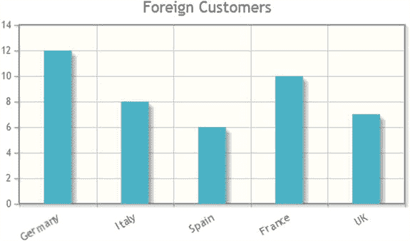

图 5-3. 通过插件引入的新属性可以调整条之间的间距

## 在条顶部添加数值

`jqPlot`库允许您处理点标签。虽然您也可以在折线图中使用它们，但点标签是柱状图的重要组成部分。如果激活，点标签会明确显示条上方的`y`值，从而增强值的可读性，尤其是对于堆叠柱状图。要激活此功能，您需要包含另一个插件：

```html
<script type="text/javascript" src="../src/plugins/jqplot.pointLabels.min.js"></script>
```

或者，如果您更喜欢使用 CDN 服务，可以按如下方式操作：

```html
<script type="text/javascript"
    src="http://cdn.jsdelivr.net/jqplot/1.0.8/plugins/jqplot.pointLabels.min.js"></script>
```


你可能已经注意到，`PointLabels` 并非一个渲染器插件，因此它默认处于激活状态。这次，无需在 `renderer` 属性中传递引用。这个过程非常简单快捷：在 `options` 中，将 `pointLabels` 对象的 `show` 属性设置为 `'true'`（参见代码清单 5-4）。

***代码清单 5-4***。Ch5_03.html

```
seriesDefaults:{
    renderer:$.jqplot.BarRenderer,
    pointLabels: { show: true }
},
```

如图 5-4 所示，激活数据点标签后，每个柱形上方将显示其 y 值。

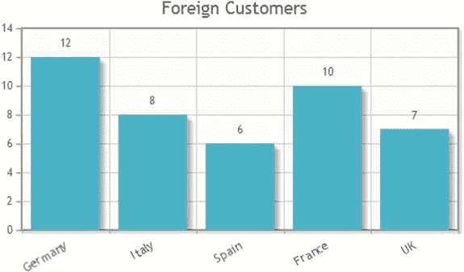

图 5-4。一个在每个柱形上方显示 y 值的柱状图

## 包含负值的柱状图

通常，我们习惯于看到所有 y 值均为正数的柱状图，但情况并非总是如此。不过，如果你想在柱状图中表示负值，则必须小心谨慎。如果你尝试使用包含负值的输入数据数组，如下例所示：

```
var data = [['Germany', -12], ['Italy', -8], ['Spain', -6], ['France', -10], ['UK', -7]];
```

你将得到图 5-5 中的柱状图。

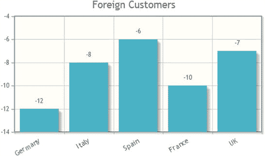

图 5-5。此柱状图错误地解释了负值

这并非你真正想要的结果。柱形被绘制得仿佛它们仍然是正值。只有数据点标签正确地显示了 y 值。此外，y 轴上报告的值与柱形的表示不相关，柱形本应从顶部开始，向下延伸到 y 轴上对应的负值。要解决所有这些问题，你需要将 `fillToZero` 属性设置为 `'true'`，该属性属于 `BarRenderer` 插件；因此，你必须在 `rendererOptions` 中指定它（参见代码清单 5-5）。

***代码清单 5-5***。ch10_04a.html

```
var options = {
    title: 'Foreign Customers',
    seriesDefaults:{
       renderer:$.jqplot.BarRenderer,
       rendererOptions: { fillToZero: true },
       pointLabels: { show: true }
    },
    ...
```

现在，jqPlot 可以正确地表示负值柱形了（参见图 5-6）。

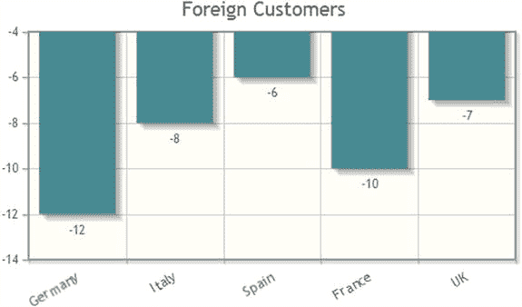

图 5-6。一个包含负值的简单柱状图

当同一柱状图中同时表示正值和负值时，此功能的效果更佳：

```
var data = [['Germany', -12], ['Italy', 8], ['Spain', -6], ['France', 10], ['UK', -7]];
```

如图 5-7 所示，颜色稍深的柱形用于区分负值。

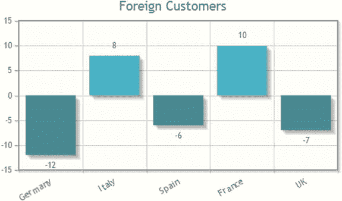

图 5-7。一个包含正值和负值的简单柱状图

## 包含多组数据的柱状图

你已经了解了折线图如何管理多个序列，因此你可能期望柱状图也提供同样的可能性。从单序列过渡到多序列时，你需要对输入数据的组织方式进行一些更改。因此，我们从单序列输入数据数组的格式开始：

```
var data = [['Germany', 12], ['Italy', 8], ['Spain', 6], ['France', 10], ['UK', 7]];
```

首先，你必须指定一个自定义的 `ticks` 数组，该数组必须包含数据组或类别（即你想在 x 轴上报告的值）的名称。刻度数应与每个序列中的 y 值数量相匹配。

```
var ticks = ['Germany', 'Italy', 'Spain', 'France', 'UK'];
```

由于你正在处理多个序列，因此可以指定至少三个数据序列。每个序列代表数据的进一步分类，因此你可以通过报告数据所属组的标签来区分它们。现在，你只需为每个序列插入 y 值（来自 `ticks` 数组），如代码清单 5-6 所示，因为每个序列的 x 值都是相同的。

***代码清单 5-6***。Ch5_05.html

```
var data = [12, 8, 6, 10, 7];       // Electronics customers
var data2 = [14, 12, 4, 14, 11];    // Software customers
var data3 = [18, 10, 5, 9, 9];      // Mechanics customers
```

关于指示序列的名称，你必须在 `series` 对象中指定它们（参见代码清单 5-7），将它们逐一分配给每个序列的 `label` 属性。

***代码清单 5-7***。Ch5_05.html

```
var options = {
        title: 'Foreign Customers',
        seriesDefaults:{
            renderer:$.jqplot.BarRenderer,
        },
    series:[
       {label: 'Electronics'},
       {label: 'Software'},
       {label: 'Mechanics'}
    ],
    axes: {
    ...
```

现在，像往常一样，在 `options` 内部，你将 `ticks` 数组分配给 `xaxis` 对象的 `ticks` 属性（参见代码清单 5-8）。这样，你就将 x 轴上生成的每个刻度分配给了数组中包含的一个字符串。

***代码清单 5-8***。ch10_05.html

```
axes: {
    xaxis: {
       renderer: $.jqplot.CategoryAxisRenderer,
       ticks: ticks
    }
},
```

你刚刚看到，处理多个序列只是增加了数据的进一步分类。除了被划分为 x 轴上表示的类别之外，数据还被划分为多个序列，每个序列代表一个不同的组。为了区分不同的序列，有必要用不同的颜色绘制相应的柱形。但是，如果你就此止步，观察此图表的用户将无法获得任何关于哪种颜色代表哪个组的信息。因此，需要引入图例（参见代码清单 5-9）。

***代码清单 5-9***。Ch5_05.html

```
var options = {
    title: 'Foreign Customers',
    seriesDefaults: {
       renderer: $.jqplot.BarRenderer,
    },
    series:[
       {label: 'Electronics'},
       {label: 'Software'},
       {label: 'Mechanics'}
    ],
    axes: {
       xaxis: {
          renderer: $.jqplot.CategoryAxisRenderer,
          ticks: ticks
       }
    },
    legend: {
       show: true,
       placement: 'outsideGrid',
       location: 'e'
    }
};
$.jqplot ('myChart', [data, data2, data3], options);
```

因此，你将获得一个多序列柱状图，如图 5-8 所示。如你所见，当使用多个序列时，必须使用不同的颜色来区分它们。

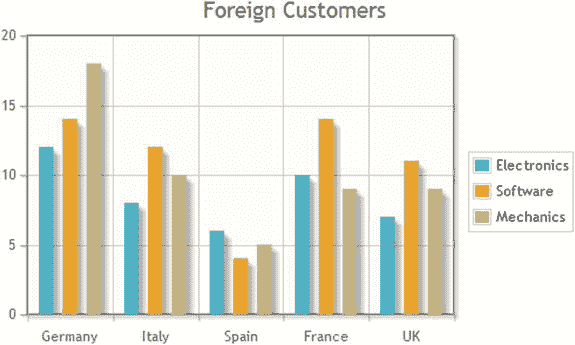

图 5-8。一个包含图例的多序列柱状图

## 垂直与水平柱状图

观察图 5-8 中的图表，你会注意到每个组都由一种颜色表示。分配的颜色遵循 jqPlot 内部默认指定的顺序，并且该顺序在折线图中也有所体现。每个国家在其 x 轴段内有三列，每个段由网格线界定。


这种柱状图通常被定义为垂直柱状图。我们当然也可以用水平方向的柱状条来表示相同的输入数据，但同样需要修改输入数据数组的格式。在这种情况下，必须使用`[y, n]`对，其中`n`是一个整数值，分配给一个字符串（参见清单 5-10）。这些字符串是包含在`ticks`数组中的标签描述，而`n`是其索引。

***清单 5-10***。Ch5_06.html

```
var data =  [[12, 1], [8, 2], [6, 3], [10, 4], [7, 5]];
var data2 =  [[14, 1], [12, 2], [4, 3], [14, 4], [11, 5]];
var data3 =  [[18, 1], [10, 2], [5, 3], [9, 4], [9, 5]];
var ticks = ['Germany', 'Italy', 'Spain', 'France', 'UK'];
```

修改输入数据数组的格式后，必须将`barDirection`属性设置为`'horizontal'`（默认值为`'vertical'`）。如清单 5-11 所示，你需要在`seriesDefaults`中进行此设置，以便将水平方向应用于所有系列。这次，需要将`ticks`数组分配给`yaxis`对象中的`ticks`属性，而不是像之前那样分配给`xaxis`对象。

***清单 5-11***。Ch5_06.html

```
var options = {
    title: 'Foreign Customers',
    seriesDefaults:{
       renderer: $.jqplot.BarRenderer,
       rendererOptions: {
          barDirection: 'horizontal'
       }
    },
    series:[
       {label: 'Electronics'},
       {label: 'Software'},
       {label: 'Mechanics'}
    ],
    axes: {
       yaxis: {
          renderer: $.jqplot.CategoryAxisRenderer,
          ticks: ticks
       }
    },
    legend: {
       show: true,
       placement: 'outsideGrid',
       location: 'e'
    }
};
$.jqplot ('myChart', [data, data2, data3], options);
```

现在，你将得到如图 5-9 所示的水平多系列柱状图。

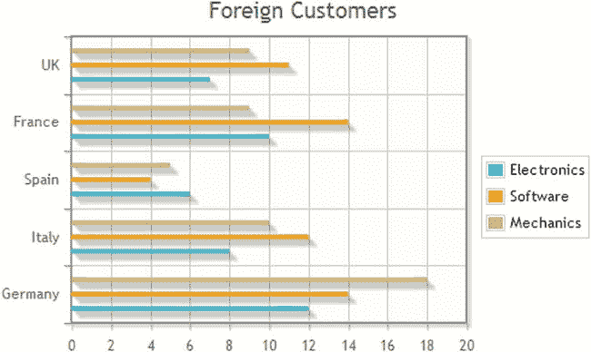

图 5-9。一个水平多系列柱状图

## 垂直堆叠柱状图

当你需要将数据系列分解为其组成部分，同时保留将这些数据系列作为一个整体进行比较的能力时，就必须使用堆叠图。jqPlot 库支持此类图表。对于堆叠柱状图，添加数据点标签尤其合适，可以使图表更具可读性。报告的值是累积的，即堆叠中底层柱状条的总和，如清单 5-12 所示。

***清单 5-12***。Ch5_07.html

```
var data = [12, 8, 6, 10, 7];
var data2 = [14, 12, 4, 14, 11];
var data3 = [18, 10, 5, 9, 9];
var ticks = ['Germany', 'Italy', 'Spain', 'France', 'UK'];

var options = {
   title: 'Foreign Customers',
   stackSeries: true,
   seriesDefaults:{
      renderer:$.jqplot.BarRenderer,
      pointLabels: { show: true,location: 's' }
   },
   series:[
      {label: 'Electronics'},
      {label: 'Software'},
      {label: 'Mechanics'}
   ],
   axes: {
      xaxis: {
         renderer: $.jqplot.CategoryAxisRenderer,
         ticks: ticks
      }
   },
   legend: {
      show: true,
      placement: 'outsideGrid',
      location: 'e'
   }
};

$.jqplot ('myChart', [data, data2, data3], options);
```

通过设置`pointLabels`属性的值，你可以指定数据点标签显示的位置：`'n'`、`'s'`、`'e'`、`'w'`、`'ne'`、`'nw'`、`'se'`或`'sw'`。这些值应被解释为相对于柱状条顶部绘制数据点标签的方向基点。在此示例中，你选择`'s'`（南）来将值显示在柱状条顶部正下方的彩色区域内，如图 5-10 所示。

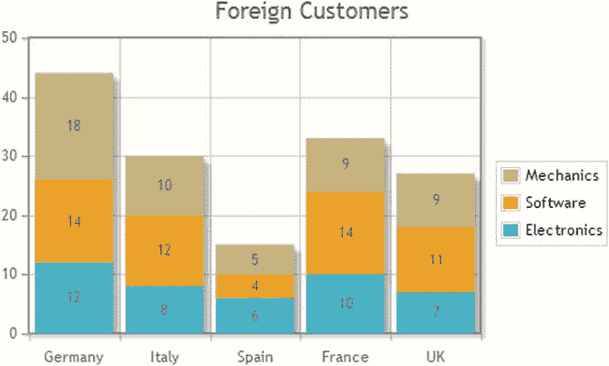

图 5-10。一个垂直多系列堆叠柱状图

## 水平堆叠柱状图

同样地，你可以创建一个水平堆叠柱状图。在这种情况下，为了在分段内部显示数据点标签，你需要将它们设置为`'w'`（西）（参见清单 5-13）。

***清单 5-13***。ch10_08.html

```
var data =  [[12, 1], [8, 2], [6, 3], [10, 4], [7, 5]];
var data2 =  [[14, 1], [12, 2], [4, 3], [14, 4], [11, 5]];
var data3 =  [[18, 1], [10, 2], [5, 3], [9, 4], [9, 5]];
var ticks = ['Germany', 'Italy', 'Spain', 'France', 'UK'];

var options = {
   title: 'Foreign Customers',
   stackSeries: true,
   seriesDefaults:{
      renderer: $.jqplot.BarRenderer,
      rendererOptions: {
         barDirection: 'horizontal'
      },
      pointLabels: { show: true, location: 'w' }
   },
   series:[
      {label: 'Electronics'},
      {label: 'Software'},
      {label: 'Mechanics'}
   ],
   axes: {
      yaxis: {
         renderer: $.jqplot.CategoryAxisRenderer,
         ticks: ticks
       }
   },
   legend: {
   show: true,
   placement: 'outsideGrid',
   location: 'e'
   }
};
$.jqplot ('myChart', [data, data2, data3], options);
```

在图 5-11 中，你可以看到这些值是如何显示在柱状条末端（西侧）附近的彩色区域内的。

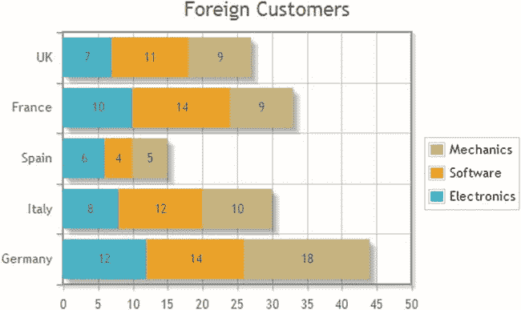

图 5-11。一个水平多系列堆叠柱状图

## 组合图：柱状图中的折线图

组合图是在单个图表中组合两种或多种图表类型的图表。在下面的示例中，你将考虑在一个图表中同时表示一个柱状图系列和一个折线图系列。对于这种表示方式，你需要使用双 y 轴。每个系列都有自己的单位和量级，因此必须符合其中一个轴。因此，你必须使用主轴和次轴。你还需要激活自动缩放功能，以强制 y 轴对齐刻度线，从而获得一致的网格线。

因此，让我们定义两个输入系列（参见清单 5-14）。数组`data`包含要表示为柱状图的`[label1, y1]`值对。数组`line`包含要表示为折线图的`[label2, y2]`值对。

***清单 5-14***。Ch5_09.html

```
var data = [['Germany', 12], ['Italy', 8], ['Spain' ,6], ['France', 10], ['UK', 7]];
var line = [['BMW', 45], ['AlfaRomeo', 30], ['Seat', 24],['Renault', 36], ['Mini', 30]];
```

这个案例有助于理解拥有多个 y 轴进行工作的实用性（jqPlot 支持最多九个 y 轴和两个 x 轴）。这里你有两个系列，它们的顺序由你在函数`$.jqplot()`中作为第二个参数传递它们的顺序决定：

```
$.jqplot ('myChart', [data, line], options);
```

数组`data`（用于柱状图的系列）排在第一位，数组`line`（用于折线图的系列）排在第二位。这非常重要。确定了这个顺序后，在`options`中，你需要在`series`对象内指定两个元素，如清单 5-15 所示。仅在第一个元素中，你激活了*BarRenderer*插件，而在第二个元素中，你定义了两个辅助轴：`x2axis`和`y2axis`。现在，你有四个轴可以操作，因此，你必须在`axes`对象内指定它们。在`yaxis`和`y2axis`上，你必须激活自动缩放。

***清单 5-15***。Ch5_09.html


```javascript
var options = {
    title: 'Foreign customers',
    series:[{renderer: $.jqplot.BarRenderer},
       {
          xaxis: 'x2axis',
          yaxis: 'y2axis'
       }],
    axes: {
       xaxis: {
          renderer: $.jqplot.CategoryAxisRenderer
       },
       x2axis: {
          renderer: $.jqplot.CategoryAxisRenderer
       },
       yaxis: {
          autoscale: true
       },
       y2axis: {
          autoscale: true,
          renderOptions: {
             alignTicks: true
          }
       }
    }
};
```

结果就是图 5-12 中的图表，它同时包含了柱状图和折线图。

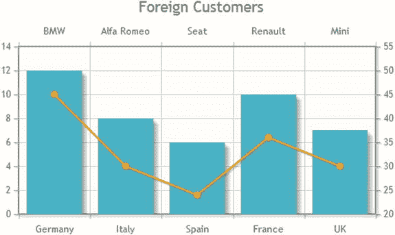

图 5-12. 折线图与柱状图的组合图

## 动画图

jqPlot 库还为您提供了为图表添加动画效果的能力。为此，您不需要任何额外的插件。从之前的示例（组合图，见代码清单 5-15）开始，您可以为每个序列分配不同的速度。在定义绘制速度时，就好像您正在让浏览器放慢创建图表元素的速度。这会在绘制过程中产生动态效果，从而创建动画。此外，通过为不同部分分配不同的速度，您可以获得非常棒的效果。

正如我们在代码清单 5-16 中看到的，在 `options` 中，您需要通过将 `animate` 和 `animateReplot` 属性设置为 `'true'` 来激活动画功能。然后，您可以使用数值（毫秒数）为每个序列定义不同的速度。

***代码清单 5-16***. Ch5_10.html

```javascript
var options = {
    animate: true,
    animateReplot: true,
    title: 'Foreign Customers',
    series:[{
       renderer: $.jqplot.BarRenderer,
       rendererOptions: {
          animation: {
             speed: 2500
          },
       }
    },{
       xaxis: 'x2axis',
       yaxis: 'y2axis',
       rendererOptions: {
          animation: {
             speed: 2500
          },
       }
    }],
    axes: {
       xaxis: { renderer: $.jqplot.CategoryAxisRenderer  },
       x2axis: {renderer: $.jqplot.CategoryAxisRenderer  },
       yaxis: { autoscale:true, numberTicks: 6 },
       y2axis: { autoscale:true, numberTicks: 6 }
    }
};
```

当您在浏览器中加载此图表时，您会看到一个动画，其中折线图和柱状图被缓慢而平滑地绘制出来。图 5-13 展示了动画在连续阶段中的发展过程。折线图按照数据点的顺序从左到右绘制，同时，柱状条增长以达到各自的 y 值。

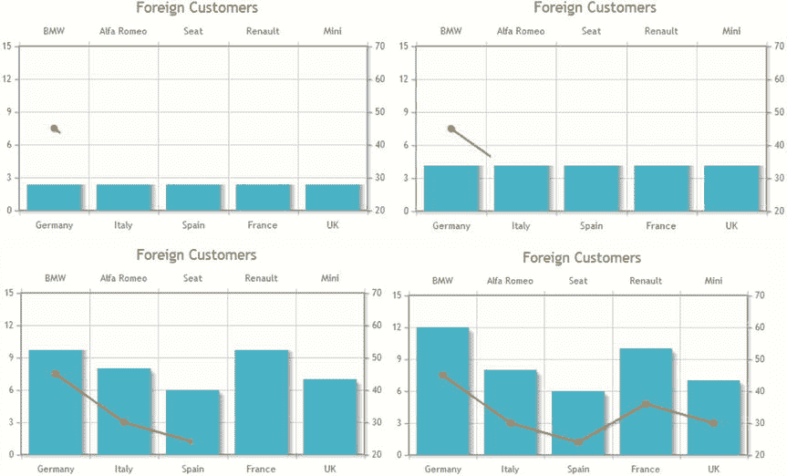

图 5-13. 一个动画化的折线-柱状组合图

## 马瑞麦考图表

一种可以从柱状图衍生出来的图表是所谓的马瑞麦考图表（也称为 Mekko 图表），因其与马瑞麦考印花相似而得名。这种图表已在商业领域得到采用。马瑞麦考图表本质上是堆叠柱状图。然而，在这里，所有柱状条的高度都相等。此外，柱状条之间没有间距，并且柱状条被分成多个段，这些段的高度与百分比相关（参见图 5-14）。

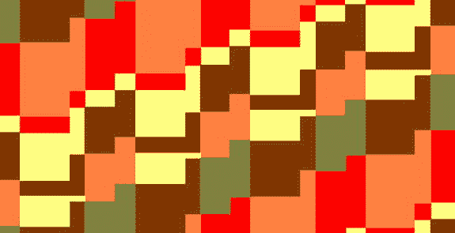

图 5-14. 一个马瑞麦考图案

马瑞麦考图表旨在在两个轴上报告百分比值：x 轴上每个类别（即每个柱状条放置的位置）所占的百分比，以及 y 轴上每个类别（由每个柱状条被划分成的段表示）所占的百分比。

jqPlot 允许您使用两个特定的插件来开发这种图表：`MekkoRenderer` 和 `MekkoAxisRenderer`：

```html
<script class="include" type="text/javascript"
     src="../src/plugins/jqplot.mekkoRenderer.min.js"></script>
<script class="include" type="text/javascript"
    src="../src/plugins/jqplot.mekkoAxisRenderer.min.js"></script>
<script class="include" type="text/javascript"
    src="../src/plugins/jqplot.canvasTextRenderer.min.js"></script>
<script class="include" type="text/javascript"
    src="../src/plugins/jqplot.canvasAxisLabelRenderer.min.js"></script>
```

或者，如果您更喜欢使用 CDN 服务，可以按如下方式进行：

```html
<script type="text/javascript" src="http://cdn.jsdelivr.net/jqplot/1.0.8/plugins
    /jqplot.mekkoRenderer.min.js"></script>
<script type="text/javascript" src="http://cdn.jsdelivr.net/jqplot/1.0.8/plugins
    /jqplot.mekkoAxisRenderer.min.js"></script>
<script type="text/javascript" src="http://cdn.jsdelivr.net/jqplot/1.0.8/plugins
    /jqplot.canvasTextRenderer.min.js"></script>
<script type="text/javascript" src="http://cdn.jsdelivr.net/jqplot/1.0.8/plugins
    /jqplot.canvasAxisLabelRenderer.min.js"></script>
```

除了这两个插件之外，您还需要包含 `CanvasTextRenderer` 和 `CanvasAxisLabelRenderer`。数据是为图表中的每个柱状条指定的。您可以将数据指定为 y 值的数组，或指定为 [标签, 值] 对的数组。在代码清单 5-17 中，请注意标签仅用于第一个序列；后续序列的标签将被忽略。

***代码清单 5-17***. Ch5_11.html

```javascript
var bar1 = [['bananas', 10],['apples', 7],['pears', 4],
            ['peaches', 8],['lemons', 7],['oranges',5]];
var bar2 = [9, 5, 8, 11, 9, 4];
var bar3 = [11, 4, 7, 3, 8, 7];
var bar4 = [5, 8, 11, 4, 12, 3];
var barLabels = ['Italy', 'Spain', 'France', 'Greece'];
```

在 `options` 中，您激活 `MekkoRenderer` 插件，将其分配给 `seriesDefaults` 对象。您可以通过将 `legend` 对象的 `show` 属性设置为 `'true'` 来在图表右侧添加图例。如果您想为 x 轴下方的每个柱状条放置标签，则必须将 `barLabels` 数组分配给 x 轴的 `barLabels` 属性。

***代码清单 5-18***. Ch5_11.html [无标注]

```javascript
var options = {
    title: 'Fruit Consumption in 2012',
    seriesDefaults:{renderer: $.jqplot.MekkoRenderer},
    legend:{show: true},
    axesDefaults:{
       renderer: $.jqplot.MekkoAxisRenderer
    },
    axes:{
       xaxis:{
          barLabels: barLabels,
          tickOptions:{formatString: '%d'}
       }
    }
};

$.jqplot('myChart', [bar1, bar2, bar3, bar4], options);
```

现在，您就得到了图 5-15 中所示的 Mekko 图表。

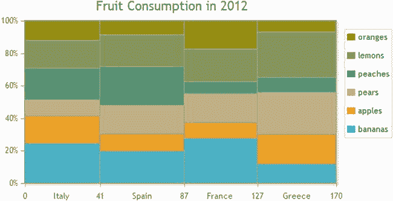

图 5-15. 一个 Mekko 图表

## 柱状图事件

在柱状图中，如果您将光标移到某个柱状条上，默认情况下它会被高亮显示。当您将鼠标悬停在一个柱状条上以及单击一个柱状条时，会触发事件。捕获这些事件并对其进行管理的能力非常重要，而 jqPlot 库允许您这样做。您可以为不同类型的事件实现特定的响应动作，从而使您的图表更具交互性。您获得的响应可能取决于鼠标指针的位置或您单击的目标。

表 5-1 列出了由于其元素丰富而适用于柱状图的事件。让我们逐一看看这些事件。

表 5-1. 使用 jqPlot 库处理事件


| 事件 | 触发时机 |
| --- | --- |
| `jqplotDataClick` | 使用鼠标左键点击数据点时触发。 |
| `jqplotRightClick` | 使用鼠标右键点击数据点时触发。 |
| `jqplotDataMouseOver` | 鼠标悬停在数据点上时触发。 |
| `jqplotDataHighlight` | 数据点被高亮显示时触发。 |
| `jqplotDataUnhighlight` | 数据点取消高亮显示时触发。 |

### `jqplotDataClick` 事件

本示例展示了 `jqplotDataClick` 事件——被点击的序列索引、数据点及其数据值。

我们先来看第一个示例，一个简单的柱状图（参见**清单 5-19**）。

***清单 5-19***。Ch5_12.html

```
var data = [['Germany', 12], ['Italy', 8], ['Spain', 6],
            ['France', 10], ['UK', 7]];

var options = {
   title: 'Foreign Customers',
   series:[{renderer: $.jqplot.BarRenderer}],
   axes: {
      xaxis: {
         renderer: $.jqplot.CategoryAxisRenderer
      }
   }
};
$.jqplot ('myChart', [data], options);
```

在 jQuery 的 `ready()` 函数内部，添加清单 5-20 中的函数。这是一个 jQuery 函数，用于将 `jqplotDataClick` 事件与某个函数的执行绑定。作为参数，该事件会获取 jqPlot 对象的一些属性值，例如 `seriesIndex`、`pointIndex` 和 `data`。这些值将被转换为字符串，并与 jQuery 的 `html()` 函数拼接。这段 HTML 文本将被发送到网页中的 `info1` 元素。

***清单 5-20***。Ch5_12.html

```
$('#myChart').bind('jqplotDataClick',
    function (ev, seriesIndex, pointIndex, data) {
       $('#info1').html('series: ' + seriesIndex +
       ', point: '+pointIndex+', data: '+data);
    }
);
```

现在，在你想要显示带值文本的位置添加一个 `<span>` 元素。在你点击某个柱形之前，该元素会显示一条“Nothing yet”消息。之后，根据点击的数据点，新文本将替换该消息并显示相应的值：

```
<div><span>You clicked: </span><span id="info1">Nothing yet</span></div>
```

图 5-16 显示了当用户点击“France”柱形时触发的事件所对应的消息。

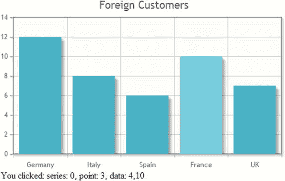

图 5-16。点击柱形可获取其值

### `jqplotRightClick` 事件

本示例涵盖了 jqPlot 提供的另一个事件：`jqplotRightClick`。该事件需要在 `options` 中显式激活（参见清单 5-21）。这会使 jqPlot 在用户右键点击柱形时触发 `jqplotRightClick` 事件。

***清单 5-21***。Ch5_13.html

```
var options = {
    title: 'Foreign Customers',
    captureRightClick: true,
    series:[{renderer: $.jqplot.BarRenderer}],
    axes: {
       xaxis: {
          renderer: $.jqplot.CategoryAxisRenderer
       }
    }
};
```

接下来，你需要将之前的 jqPlot 函数替换为清单 5-22 中的函数。

***清单 5-22***。Ch5_13.html

```
$('#myChart').bind('jqplotDataRightClick',
    function (ev, seriesIndex, pointIndex, data) {
       $('#info1').html('series: ' + seriesIndex +
       ', point: '+pointIndex+', data: '+data);
    }
);
```

总体效果相同，但这次你需要使用右键点击而非左键。右键点击“Spain”柱形，结果如图 5-17 所示。

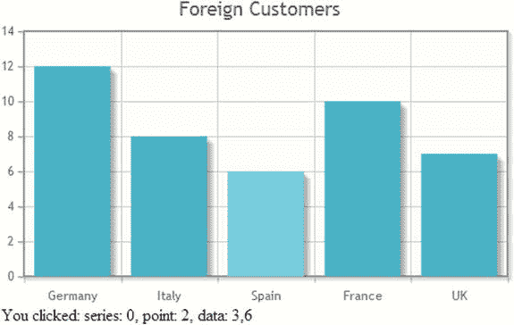

图 5-17。右键点击柱形可获取其值

### 其他柱状图事件

通常，你可能希望捕获另一个事件：当光标悬停在柱形上时，jqPlot 会触发 `jqplotDataMouseOver` 事件。即使你已显式禁用了高亮功能，该事件也会被触发。当用户将鼠标移过柱形时，该事件会持续触发。相比之下，另一个事件 `jqplotDataHighlight` 仅在用户首次将鼠标移过柱形时触发一次。当用户移出柱形时，jqPlot 会触发第三个事件：`jqplotDataUnhighlight`。最后这两个事件仅在高亮功能启用时才会生成。

延续之前的示例（参见清单 5-22），你将捕获 `jqplotDataClick` 事件的 jQuery 函数替换为另外两个函数（参见清单 5-23）。第一个函数会在鼠标悬停在柱形上时，立即向 `info1` 元素发送包含相同值的 HTML 文本。第二个函数会在鼠标移出柱形时，将 `info1` 元素中的前一个字符串替换为 `'Nothing'`。

***清单 5-23***。Ch5_14a.html

```
$('#myChart').bind('jqplotDataHighlight',
    function (ev, seriesIndex, pointIndex, data) {
       $('#info1').html('series: ' + seriesIndex +
       ', point: '+pointIndex+', data: '+data);
    }
);

$('#myChart').bind('jqplotDataUnhighlight',
    function (ev) {
       $('#info1').html('Nothing');
    }
);
```

现在，你想了解 `jqplotDataMouseOver` 事件与 `jqPlotDataHighlight` 事件在行为上的差异。要理解这种差异，最好的方法莫过于通过一个示例来对比它们。这次，你将统计鼠标悬停在柱形上时触发的事件次数。为此，你定义一个计数器 `nEvents`，并将其初始化为 0。正如预期，使用 `jqPlotDataHighlight` 事件时，每当鼠标悬停在柱形上，计数器就设为 1，当鼠标移出柱形时，计数器变为 0。而使用 `jqplotDataMouseOver` 事件时，行为则大不相同：即使光标停留在同一个柱形上，计数器也会持续增加。在这两种情况下，你都会使用 `jqplotDataUnhighlight` 事件，在每次鼠标移出柱形时重置计数器。

首先，你需要更改 `info1` HTML 元素：

```
<div><span>Events: </span><span id="info1">Nothing yet</span></div>
```

然后，为了研究 `jqplotDataHighlight` 事件的行为，你将两个 jQuery 函数替换为清单 5-24 中的两个函数。

***清单 5-24***。Ch5_14b.html

```
nEvents = 0;
$('#myChart').bind('jqplotDataHighlight',
    function (ev, seriesIndex, pointIndex, data) {
       nEvents = nEvents + 1;
       $('#info1').html(nEvents);
    }
);

$('#myChart').bind('jqplotDataUnhighlight',
    function (ev) {
       $('#info1').html('Nothing');
       nEvents = 0;
    }
);
```

如图 5-18 所示，当鼠标停留在“Spain”柱形上时，计数器稳定显示为 1。

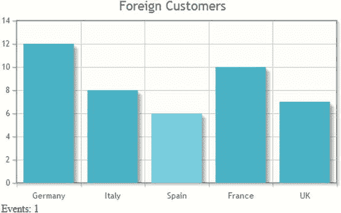

图 5-18。统计 `jqPlotDataHighlight` 事件的发生次数

为了研究 `jqplotDataMouseOver` 事件的行为，你将两个 jQuery 函数替换为清单 5-25 中的两个函数。

***清单 5-25***。Ch5_14c.html

```
nEvents = 0;
$('#myChart').bind('jqplotDataMouseOver',
    function (ev, seriesIndex, pointIndex, data) {
       nEvents = nEvents + 1;
       $('#info1').html(nEvents);
    }
);

$('#myChart').bind('jqplotDataUnhighlight',
    function (ev) {
       $('#info1').html('Nothing');
       nEvents = 0;
    }
);
```

如图 5-19 所示，当鼠标停留在“Spain”柱形上时，计数器的值会持续增加。

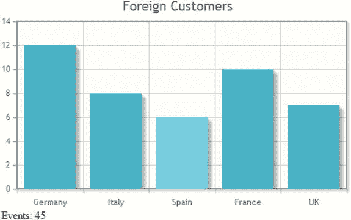

图 5-19。统计 `jqplotDataMouseOver` 事件的发生次数


#### 图 5-19. 统计 `jqplotDataMouseOver` 事件发生的次数

#### 点击柱形图在文本中显示信息

鉴于 jqPlot 在事件处理方面的潜力，我们借此机会探讨一个常见案例。通过点击柱形图，你可以获取该柱形的相关信息，并将其显示在 HTML 页面的文本框中。这通过为 `jqlotDataClick` 事件绑定监听器来实现。

在本例中，我们从用于生成水平堆叠柱形图的代码开始（见代码清单 5-26）。

**代码清单 5-26.** `Ch5_15.html`

```
var data = [12, 8, 6, 10, 7];
var data2 = [14, 12, 4, 14, 11];
var data3 = [18, 10, 5, 9, 9];
var ticks = ['Germany', 'Italy', 'Spain', 'France', 'UK'];

var options = {
   title: 'Foreign Customers',
   stackSeries: true,
   seriesDefaults:{
      renderer: $.jqplot.BarRenderer,
      pointLabels: { show: true, location: 's' }
   },
   series:[
      {label: 'Electronics'},
      {label: 'Software'},
      {label: 'Mechanics'}
   ],
   axes: {
      xaxis: {
         renderer: $.jqplot.CategoryAxisRenderer,
         ticks: ticks
      }
   },
   legend: {
      show: true,
      placement: 'outsideGrid',
      location: 'e'
   }
};
$.jqplot ('myChart', [data, data2, data3], options);
```

与之前的事件示例类似，最后我们添加一个 jQuery 函数，用于捕获 `jqplotDataClick` 事件，并将一组信息发送到 `info1` 元素（见代码清单 5-27）。

**代码清单 5-27.** `Ch5_15.html`

```
$('#myChart').bind('jqplotDataClick',
    function (ev, seriesIndex, pointIndex, data) {
       $('#info1').html('series: ' + seriesIndex +
       ', point: '+pointIndex+', data: '+data);
    }
);
```

每当你点击一个柱形时，此函数将刷新显示在 `<span>` 元素（其 `id` 为 `'info1'`）中的信息。这里，我们将 `<span>` 元素添加到 HTML 页面中：

```
<span id="info1">Information will be provided here </span>
```

现在，通过点击柱形的高亮区域，你可以在文本框中获取与该柱形相关的所有数据，如图 5-20 所示。

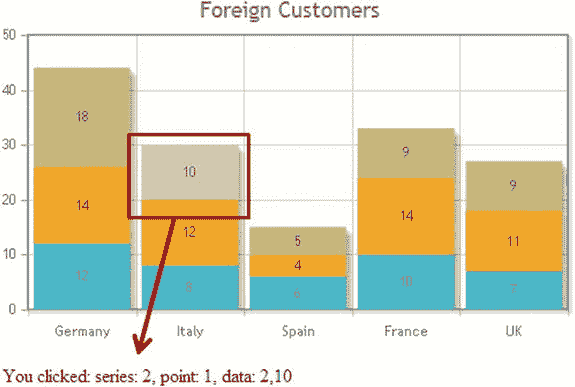

**图 5-20.** 点击堆叠柱形图，获取其数值

### 处理图例

在处理柱形图时，我们使用了图例，这是大多数图表的关键组成部分。图例是 jqPlot 中一个已定义的元素。通常，你只需在 `options` 中调用 `legend` 对象，即可让图例显示在图表旁边。这里，我们将更详细地分析这个有用的元素。

何时需要使用图例？当你处理多系列数据时，即当你拥有一个数据分组（通常用不同颜色区分）时。图例的作用仅在于，在一个小区域内报告每种颜色与区分组内元素的标签之间的对应关系。

#### 添加图例

前面的示例（见图 5-20）非常适合用来研究图例。通过观察堆叠图表，你可以轻松看到每个国家的柱形由三个部分组成，这些部分以不同颜色为特征。因此，你了解到图表中表示了三个系列。此外，你还能获得每个系列对总数值贡献多少的信息，但你仍然缺少关键信息：哪些颜色代表哪些类别。通过添加图例，你将明确三种颜色与“Mechanics”、“Software”和“Electronics”这些类别之间的关联。

因此，继续使用前面示例中的代码（见代码清单 5-26 和 5-27），我们将 `legend` 定义添加到 `options` 对象中，如代码清单 5-28 所示。为此，你无需包含任何插件；只需将 `show` 属性设置为 `'true'` 即可。

**代码清单 5-28.** `Ch5_15.html`

```
var options = {
    ...
    axes: {
       xaxis: {
          renderer: $.jqplot.CategoryAxisRenderer,
          ticks: ticks
       }
    },
    legend: {
       show: true,
       placement: 'outsideGrid',
       location: 'e'
    }
};
$.jqplot ('myChart', [data,data2,data3],options);
```

图 5-21 展示了带有图例的图表。

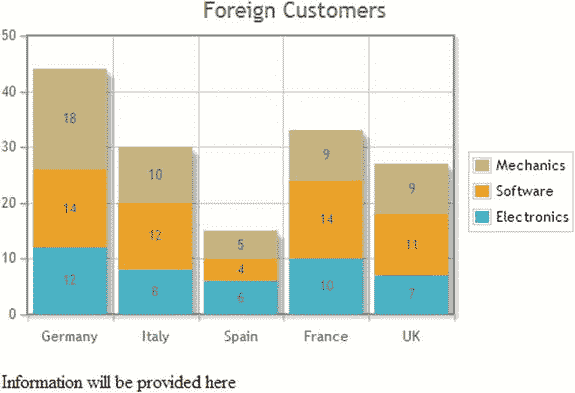

**图 5-21.** 带有图例的堆叠柱形图

`placement` 属性指定了你希望图例出现的位置；省略该属性，你将获得默认行为：图例绘制在图表内部。为了避免遮挡柱形，你可以通过设置 `location` 属性来改变图例的位置，如代码清单 5-29 所示。

**代码清单 5-29.** `Ch5_16a.html`

```
legend: {
    show: true,
}
```

因此，如图 5-22 所示，图表发生了变化，图例被绘制在内部（默认情况下），位于右上角（`'ne'` [东北方向]）。

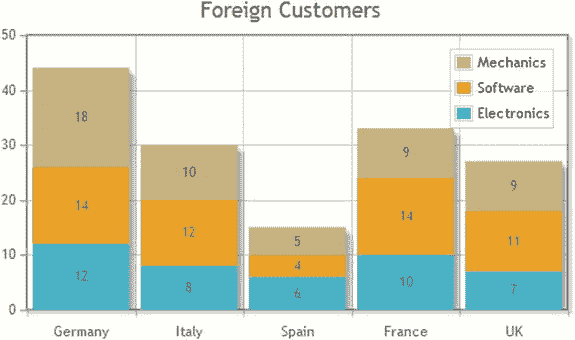

**图 5-22.** 默认图例位置在图表内部，位于右上角

为了更深入的处理，最好使用层叠样式表（CSS）进行自定义。你将使用一些用于图例的 CSS 类来修改默认属性——主要是 CSS 类 `table.jqplot-table-legend`。

例如，你可以将规范添加到代码清单 5-30 提供的 CSS 类中。

**代码清单 5-30.** `Ch5_16b.html`

```
<style>
    table.jqplot-table-legend {
       background-color: rgba(175, 175, 175, 1);
       font: "Arial Narrow";
       font-style: italic;
       font-size: 13pt;
       color: white;
    }
</style>
```

然后，图例将发生变化，如图 5-23 所示。


**图 5-23.** 使用 CSS 样式修改后的图例

### 增强型图例

如果你查看 jqPlot 发行版中的几个插件，你会发现一个与图例相关的插件：`EnhancedLegendRenderer`。此插件扩展了图例的功能：点击图例项，你可以显示或隐藏相应的系列。你可以通过一个具体示例来了解这一点。首先，在你的网页中包含该插件：

```
<script type="text/javascript"
    src="../src/plugins/jqplot.enhancedLegendRenderer.min.js"></script>
```

或者，如果你更喜欢使用 CDN 服务，可以按如下方式操作：

```
<script type="text/javascript" src="http://cdn.jsdelivr.net/jqplot/1.0.8/plugins
    /jqplot.enhancedLegendRenderer.min.js"></script>
```

然后，你必须像处理其他插件一样，在 `options` 中激活该插件，如代码清单 5-31 所示。

**代码清单 5-31.** `Ch5_16c.html`

```
legend: {
    renderer: $.jqplot.EnhancedLegendRenderer,
    show: true,
    placement: 'outsideGrid',
    location: 'ne'
}
```

在浏览器中加载页面后，你将得到图 5-24 中的图表。如果你点击图例中的某个项，相应的系列将从图表中消失，留下一个空白区域。如果你只想分析系列的子集而忽略其他系列，这会很有用。因此，让我们点击图例中的“Software”，看看会发生什么。


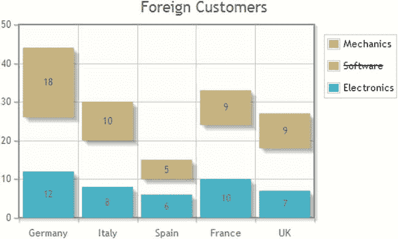

图 5-24. 通过选择图例中的项可以隐藏序列

在图 5-24 的图例中，属于 Software 序列的橙色部分已经消失，并且“Software”项被划掉。

此效果是累积的，您可以逐个隐藏所有序列。如果再次点击一个被划掉的项，相应的序列将重新出现在图表中。

## 自定义图例高亮

您刚刚了解了如何使用 `jqPlot` 默认提供的图例。但是，您可以通过在 HTML 中实现一个简单的表格，然后动态填充序列标签来创建自定义图例。由于必须从头开始创建自己的图例，因此首先需要选择一种样式。您可以使用外部 CSS 文件或直接在网页中编写样式来定义 CSS 样式，例如代码清单 5-32 中给出的样式。

***代码清单 5-32***. `Ch5_17.html`

```
<style type="text/css">
table.sample {
    border-width: thin;
    border-spacing: 0px;
    border-style: outset;
    border-color: rgb(221, 221, 221);
    border-collapse: collapse;
}
table.sample th {
    border-width: 1px;
    padding: 1px;
    border-style: inset;
    border-color: gray;
}
table.sample td {
    border-width: 1px;
    padding: 1px;
    border-style: inset;
    border-color: gray;
}
</style>
```

您使用了三个不同的 CSS 类。第一个指定了整个表格的样式。另外两个分别用于指定标题和单元格的特定样式。

定义样式后，出于我们的目的，您可以使用一个简单柱状图的代码（参见代码清单 5-33）。

***代码清单 5-33***. `Ch5_17.html`

```
var data = [['Germany', 12], ['Italy', 8], ['Spain', 6], ['France', 10], ['UK', 7]];

var options = {
    title: 'Foreign Customers',
    series:[{renderer:$.jqplot.BarRenderer}],
    axes: {
       xaxis: {
          renderer: $.jqplot.CategoryAxisRenderer
       }
    }
};
$.jqplot ('myChart', [data], options);
```

下一步是将自定义图例绑定到 `jqplotDataHighlight` 和 `jqplotDataUnhighlight` 事件（参见代码清单 5-34）。您之前已经见过这些事件，并且知道如何使用 jQuery 方法将对象绑定到它们。在本例中，您将做得更多；您将确保仅用几行 jQuery 代码就能动态创建整个自定义图例。这些代码将包含数据数组。与 `jqPlot` 提供的默认图例相比，在这里您能够获得比指示组序列成员关系的标签多得多的信息。还可以添加汇总值（使用 JavaScript 函数）或简单的 `y` 值。

***代码清单 5-34***. `Ch5_17.html`

```
$(document).ready(function(){

var data = ...
    var options = ...

$.jqplot ('myChart', [data], options);

$.each(data, function(index, val) {
       $('#legend1').append('<tr><td>'+val[0]+'</td><td>'+val[1]+'</td></tr>');
    });

$('#myChart').bind('jqplotDataHighlight',
       function (ev, seriesIndex, pointIndex, data) {
          var color = 'rgb(100%, 90%, 50%)';
          $('#legend1 tr').css('background-color', '#ffffff');
          $('#legend1 tr').eq(pointIndex+1).css('background-color', color);
    });

$('#myChart').bind('jqplotDataUnhighlight',
       function (ev, seriesIndex, pointIndex, data) {
          $('#legend1 tr').css('background-color', '#ffffff');
    });

});
```

第一个 jQuery 函数处理数据数组的值。另外两个函数将图例绑定到鼠标悬停在图例项上时的高亮事件。此外，这些函数还将样式属性的变化绑定到这些事件，在本例中，是项的背景颜色。

现在，您需要定义两个不同的区域来插入图表和图例。您可以使用 HTML 表格来实现这一点。因此，将代码清单 5-35 中的代码添加到 HTML 页面的 `<body>` 部分。

***代码清单 5-35***. `Ch5_17.html`

```
<table style="margin-left:auto; margin-right:auto;">
<tr>
    <td><div id="myChart" style="width:460px; height:340px;"></div></td>
    <td><div style="height:340px;">
       <table id="legend1" class="sample" >
          <tr><th>Nation</th><th>Customers</th></tr>
       </table>
    </div>
    </td>
</tr>
</table>
```

最后，您可以加载带有新自定义图例的新页面（参见图 5-25）。

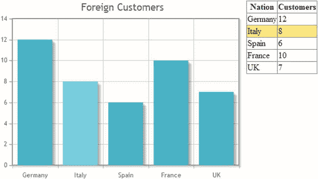

图 5-25. 一个自定义 HTML 图例

## 自定义工具提示

除了图例之外，柱状图中另一个非常常用的元素是工具提示。就像可以使用代码创建自定义图例一样，也可以自定义工具提示，创造出非常独特的效果。当您将鼠标悬停在一个柱子上并高亮它时，会显示一个工具提示，但与默认的 `jqPlot` 工具提示不同，这个工具提示将完全以 HTML 格式构建。这极大地扩展了您艺术表现的可能性，为您的图表增添了一丝个性（使用 `jqPlot`，一切都有点过于“标准 `jqPlot`”的风险）。在这个例子中，我们将展示一个小图标图像如何为柱状图带来非常好的效果。

在开始编写代码之前，让我们创建一个目录，并将其命名为 `flags`（您可以根据喜好命名）。在这个目录中，您将存储所有将要使用的便携式网络图形（PNG）图像文件。这些图标是国家的国旗，您将把它们放在柱状图的 `x` 轴上。从互联网上找到并下载这些 PNG 文件非常容易。

 **注意**  工具提示中显示国旗所需的 PNG 文件包含在本书附带的源代码中，您可以在本书 Apress 产品页面（`www.apress.com/9781484208632`）的“源代码/下载”选项卡中找到。

当您准备好国旗图像后，第一步是创建一个自定义工具提示。您需要将工具提示绑定到 `jqplotDataHighlight` 和 `jqplotDataUnhighlight` 事件。您可以使用几行 jQuery 代码动态创建自定义工具提示。

这里，我们从您已经使用过的柱状图开始（参见代码清单 5-36），因为它代表了一个理解如何开发此类自定义工具提示的简单示例。

***代码清单 5-36***. `Ch5_18.html`

```
var data = [['Germany', 12], ['Italy', 8], ['Spain', 6], ['France', 10], ['UK', 7]];

var options = {
    title: 'Foreign Customers',
    series:[{renderer:$.jqplot.BarRenderer}],
    axes: {
       xaxis: {
          renderer: $.jqplot.CategoryAxisRenderer
       }
    }
};

$.jqplot ('myChart', [data], options);
```

您必须添加另外两个数据数组，其中包含一些字符串（参见代码清单 5-37）。您将在动态生成的工具提示中使用这些字符串。

***代码清单 5-37***. `Ch5_18.html`

```
var tick = ['Germany', 'Italy', 'Spain', 'France', 'UK'];
var icon = ['germany.png', 'italy.png', 'spain.png', 'france.png', 'uk.png'];
```

将 `jqplot()` 函数的返回值赋给一个变量，因为稍后您将需要使用它。

```
var myPlot = $.jqplot ('myChart', [data], options);
```

用于将事件绑定到自定义工具提示的 jQuery 代码在代码清单 5-38 中。

***代码清单 5-38***. `Ch5_18.html`


```javascript
$('#myChart').bind('jqplotDataHighlight',
    function (ev, seriesIndex, pointIndex, data) {
       var chart_left = $('#myChart').offset().left;
       var chart_top = $('#myChart').offset().top;
       var x = data[0]*95+20;
       var y = myPlot.axes.yaxis.u2p(data[1]);
       var color = 'rgb(30%,50%,60%)';
       $('#tooltip1').css({left:chart_left+x, top:chart_top+y});
       $('#tooltip1').html('<span style="font-size:16px; font-weight:bold; color:' +
          color + ';">' + tick[data[0] - 1] +
          '</span><br/><br/> n:' + data[1]);
       $('#tooltip1').show();
    }
);

$('#myChart').bind('jqplotDataUnhighlight',
    function (ev, seriesIndex, pointIndex, data) {
       $('#tooltip1').empty();
       $('#tooltip1').hide();
    }
);
```

最后，你必须在网页的`<body>`部分创建两个`<div>`元素，如清单 5-39 所示。在第一个元素中，jqPlot 将在画布上生成自定义工具提示；在第二个元素中，jqPlot 将创建绘制条形图的画布。

***清单 5-39***。Ch5_18.html

```html
<div id="myChart" style="height:300px; width:500px;"></div>
<div id="tooltip1" style="position:absolute; height:0px; width:0px;"></div>
```

图 5-26 展示了“德国”条形被高亮显示，旁边是自定义的工具提示。当用户将鼠标悬停在条形图上高亮显示任何条形时，都会触发此效果，每个条形都会在工具提示中显示对应的国旗。

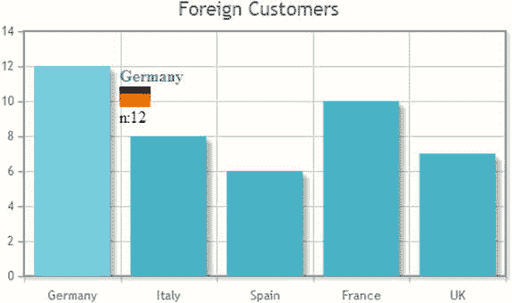

图 5-26。带有自定义工具提示的条形图

## 本章小结

在本章中，你已经了解了如何使用`BarRenderer`插件将数据以条形图的形式呈现。你开始看到，通过包含这个渲染器插件，主 jqPlot 对象的结构如何逐渐被新的属性和对象所丰富。通过实际示例，你学会了如何使用`rendererOptions`更改属性和对象属性的值。

你还了解到，有时可以使用同一组数据获得不同的表示形式。知道如何选择更适合你需求的表示形式是本书的基本目标之一。为此，你使用了同一组数据，分别创建了**分组条形图**和**堆叠条形图**。在这两种情况下，你都实现了垂直和水平条形的数据表示。

在本章的后半部分，你查看了一些示例，这些示例演示了 jqPlot 如何允许你使用特殊函数处理**事件**。此外，你还进一步研究了**图例**组件以及使用 HTML 代码自定义图例的可能性。然后，你将相同的方法应用于**工具提示**。

通常，需要以条形图表示的数据类型也可能通过另一种图表类型很好地表示：**饼图**。在下一章中，你将了解 jqPlot 库如何处理这种类型的图表。

