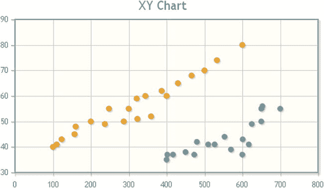
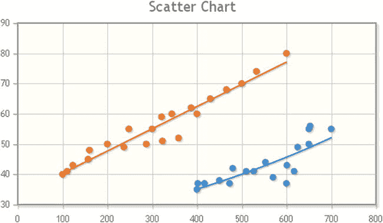
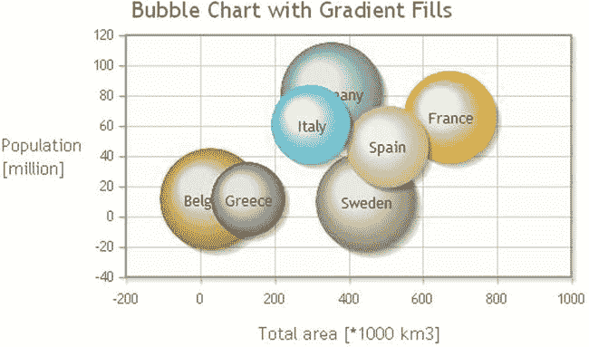
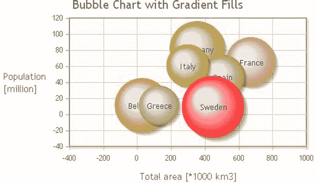
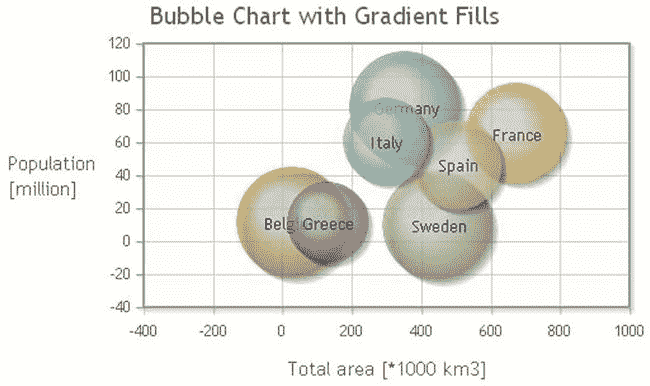
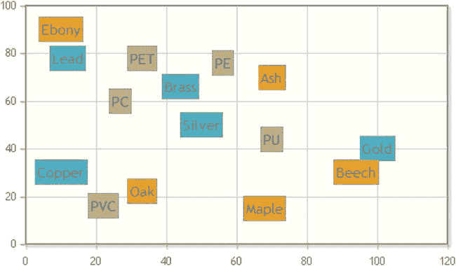

# 第 8 章：使用 jqPlot 绘制散点图和气泡图

在本章中，我将讨论一类在表示数据分布时特别有用的图表。你可能会经常发现自己对一组数据如何沿着由 x 轴和 y 轴定义的两个不同参数所定义的空间进行分布感兴趣。这种数据分布可以暗示相关性或聚类。

散点图是显示数据分布的最佳选择，尤其是在需要分析大量数据集时。因此，你将首先通过一个简单的示例学习如何实现这种图表。随后，你将看到一旦定义了两个不同的数据组（聚类），如何通过趋势线突出显示 x 和 y 变量之间的相关性。

最后，你将分析另外两种类型的图表：气泡图和块图。这些可以被视为散点图的变体——其中数据点被替换为气泡或块。当你需要用三个不同的参数表示数据时（散点图仅适用于两个参数），会使用气泡图；第三个参数由气泡的半径表示。块图是一种特殊的散点图，其中你使用包含标签的盒子来代替数据点。

## 散点图（xy 图）

乍一看，你可能会认为散点图（也称为散点图或 xy 图）是一种点未连接的折线图，但这将是一个错误。实际上，散点图以及气泡图和块图是一种特殊类型的图表。在散点图中，点由`(x, y)`对表示，但你可以得到许多具有相同 x 值的点，这使得用线连接它们既困难又没有必要。折线图的目的是跟踪 y 值在 x 值范围内的变化过程。散点图的目的是显示一组可能具有某种关系（可能是非线性的）也可能没有关系的点的集合。此外，你可能想要分析这些点及其在`(x, y)`空间中的分布，例如，当它们分布在空间上分离的组中时。

你使用默认设置（如折线图），禁用点之间的连线。让我们以两个可能呈现某种关系的`(x, y)`数据集合为例，如清单 8-1 所示。

***清单 8-1***。`Ch8_04a.html`

```
var data = [[400, 35], [402, 37], [650, 55], [653, 56], [650, 50],
            [700, 55], [600, 37], [601, 43], [450, 38], [473, 37],
            [480, 42], [417, 37], [510, 41], [553, 44], [570, 39],
            [527, 41], [617, 41], [625, 49]];
var data2 = [[100, 40], [600, 80], [200, 50], [300, 55], [400, 60],
             [500, 70], [123, 43], [110, 41], [157, 45], [160, 48],
             [237, 49], [248, 55], [287, 50], [321, 59], [359, 52],
             [387, 62], [466, 68], [533, 74], [344, 60], [323, 51],
             [430, 65]];
```

你输入的点不遵循任何顺序，这与折线图中的点不同。如前所述，你使用默认设置，通过将`showLine`属性设置为`false`来禁用点之间的连线（参见清单 8-2）。

***清单 8-2***。`Ch8_04a.html`（使用`false`禁用点之间的连线）

```
var options = {
    title: 'Scatter Chart',
    seriesDefaults: {
       showLine: false,
       showMarkers: true
    }
};
$.jqplot ('myChart', [data, data2], options);
```

由此，您将得到如图 8-1 所示的散点图，其中两组数据覆盖了图表的不同区域。这些数据点被清晰地划分为不同的组别。



图 8-1. 散点图

只有当两组数据都呈现出来时，判断它们遵循线性趋势还是指数趋势才有意义。此时，您可以使用`jqPlot`的趋势线功能。因此，您需要引入`Trendline`插件：

```
<script type="text/javascript" src="../src/plugins/jqplot.trendline.min.js"></script>
```

或者，如果您更倾向于使用内容分发网络（CDN）服务，可以按如下方式操作：

```
<script type="text/javascript" src="http://cdn.jsdelivr.net/jqplot/1.0.8/plugins/jqplot.trendline.min.js"></script>
```

然后，为两个序列都激活`Trendline`插件，并为每条线分配不同的颜色（参见代码清单 8-3）。

***代码清单 8-3***. Ch8_04b.html

```
var options = {
    title: 'Scatter Chart',
    seriesDefaults: {
       showLine: false,
       showMarkers: true
    },
    series: [{
       trendline: {
          show: true,
          color: '#0000ff',
          type: 'exponential'
       }
    },{
       trendline: {
          show: true,
          color: '#ff0000'
       }
    }]
};
```

最终，您将得到一个包含两个不同序列的散点图，每个序列都带有各自的趋势线，如图 8-2 所示。



图 8-2. 带趋势线的散点图

## 气泡图

当您需要以三维方式展示数据时，可以使用气泡图。每个实体由一个独立值的三元组`(v1, v2, v3)`表示。其中两个值通过绘制一个以`(x, y)`点为中心的圆盘来表示。第三个值则通过圆盘半径`(r)`来表示。因此，`(v1, v2, v3)`三元组必须转换为`(x, y, r)`。这三个值`(v1, v2, v3)`中哪个是半径，哪个是`x`或`y`，取决于图表设计者的技巧。

与 xy 图表类似，气泡图常用于识别所表示数据之间可能存在的关系，甚至观察它们是否属于不同的组别。这种方法常见于科学、医学和经济数据分析中。

`jqPlot`中有一个专门用于气泡图的插件：`BubbleRenderer`。因此，您需要在网页中包含此插件：

```
<script type="text/javascript" src="../src/plugins/jqplot.bubbleRenderer.min.js"></script>
```

或者，如果您更倾向于使用 CDN 服务，可以按如下方式操作：

```
<script type="text/javascript" src="http://cdn.jsdelivr.net/jqplot/1.0.8/plugins/jqplot.bubbleRenderer.min.js"></script>
```

输入数据数组的每个项目包含四个值：

`[x, y, radius, <label or object>]`

前两个值代表`(x, y)`坐标，第三个值（注意！）与气泡的半径成正比，最后一个值代表参考标签（实际上，您也可以传递一个对象；稍后会详细介绍）。代码清单 8-4 定义了一个数组，其中包含七个欧洲国家的特征值：`x`值代表国土面积；`y`值代表人口；半径代表经济价值。第四个值是报告国家名称的标签。

***代码清单 8-4***. Ch8_01a.html

```
var data = [[301,60,29392,"Italy"], [675,65,34205,"France"],
            [506,46,30625,"Spain"], [357,81,37896,"Germany"],
            [450,9,37333,"Sweden"], [30,11,37736,"Belgium"],
            [132,11,27624,"Greece"]];
```

现在，让我们分析如何设置`options`变量（参见代码清单 8-5）。您需要在`seriesDefault`对象中激活`BubbleRenderer`插件，并将`bubbleGradients`属性设置为`true`。这将为“气泡”填充颜色渐变，从而产生立体感：使圆盘看起来像是球体。如您所见，对于此插件，您无需创建一个包含气泡标签的数组，然后将其显式分配给`options`中的某个对象；标签会自动从输入数据数组中读取。需要在`options`中指定的设置很少且简单。

***代码清单 8-5***. Ch8_01a.html (设置`options`变量)

```
var options = {
    title: 'Bubble Chart with Gradient Fills',
    seriesDefaults: {
       renderer: $.jqplot.BubbleRenderer,
       rendererOptions: {
          bubbleGradients: true
       },
       shadow: true
    },
    axes: {
       xaxis: {
          label: "Total area [*1000 km3]"
       },
       yaxis: {
          label: "Population [million]"
       }
    }
};

$.jqplot ('myChart', [data], options);
```

最后，仅需这几行代码，您就能得到图 8-3 中展示的精美气泡图。



图 8-3. 气泡图

之前，我们提到了在输入数据数组中将对象作为第四个值传递的可能性。这里，我们将详细说明这涉及什么。您可以同时传递一个对象，该对象允许您定义每个单独元素（气泡）的标签和颜色。使用前面的示例（参见代码清单 8-5），您可以附加与默认序列不同的颜色。例如，假设您想强调某个国家相对于其他国家的价值。您选择瑞典，并为其分配红色。您为其他国家分配各种深浅不同的棕色。然后，将瑞典的数据移动到一个新的数组`data2`中；这是为了确保“瑞典”气泡始终位于前景，并且不会被其他气泡遮挡（参见代码清单 8-6）。

***代码清单 8-6***. Ch8_02.html

```
var data = [[301, 60, 29392, {label: 'Italy',color:'#b39524'}],
            [675, 65, 34205, {label: 'France', color:'#c39564'}],
            [506, 46, 30625, {label: 'Spain',color:'#a39544'}],
            [357, 81, 37896, {label: 'Germany', color:'#b39524'}],
            [30, 11, 37736, {label: 'Belgium',color:'#c39544'}],
            [132, 11, 27624, {label: 'Greece', color:'#a39564'}]];
var data2 = [[450, 9, 37333, {label: 'Sweden', color:'#ff2524'}]];
```

使用相同的`options`，您只需修改`jqplot()`函数，如代码清单 8-7 所示。您采用这个捷径，因为知道最右侧的数组项将是最后绘制的，因此会出现在前景中。

***代码清单 8-7***. Ch8_02.html (修改`jqplot()`函数)

```
$.jqplot ('myChart',[data, data2], options);
```

图 8-4 展示了结果。



图 8-4. 选定国家位于前景的气泡图

默认的颜色序列在这里很适合您，但您决定将渐变填充改为透明效果。为此，您必须添加`bubbleAlpha`属性，并为其分配所需的透明度值，如代码清单 8-8 所示。

***代码清单 8-8***. Ch8_01b.html

```javascript
seriesDefaults: {
    renderer: $.jqplot.BubbleRenderer,
    rendererOptions: {
       bubbleGradients: true,
       bubbleAlpha: 0.6
    },
    shadow: true
},
```

图 8-5 展示了带有渐变填充和透明效果的气泡图，透过该效果可以隐约看到底层的气泡。



图 8-5. 带透明度的气泡图

## 块状图

块状图（也称为块状图）与气泡图非常相似，但它使用矩形而非圆形。在这里，矩形的大小除了为那些在给定 `(x, y)` 坐标对上应用标签的矩形提供空间外，没有其他意义。

与气泡图一样，需要在网页中包含 `BlockRenderer` 插件：

```html
<script type="text/javascript" src="../src/plugins/jqplot.blockRenderer.min.js"></script>
```

或者，如果你更倾向于使用 CDN 服务，可以按如下方式操作：

```html
<script type="text/javascript" src="http://cdn.jsdelivr.net/jqplot/1.0.8/plugins/jqplot.blockRenderer.min.js"></script>
```

在本示例中，你将使用三个数据系列。输入数据数组的格式应为：

`[x, y, '标签']`,

现在，定义三个不同的数组，如代码清单 8-9 所示。

***代码清单 8-9***. Ch8_03.html

```javascript
var data1 = [[10, 30, '铜'], [100, 40, '金'], [50, 50, '银'],
             [12, 78, '铅'], [44, 66, '黄铜']];
var data2 = [[68, 15, '枫木'], [33, 22, '橡木'], [10, 90, '乌木'],
             [94, 30, '山毛榉'], [70, 70, '白蜡木']];
var data3 = [[22, 16, 'PVC'], [56, 76, 'PE'], [33, 78, 'PET'],
             [27, 60, 'PC'], [70, 44, 'PU']];
```

在 `options` 中，你只需在 `seriesDefault` 对象中激活 `BlockRenderer` 插件（参见代码清单 8-10）。

***代码清单 8-10***. Ch8_03.html（激活 `BlockRenderer` 插件）

```javascript
var options = {
    seriesDefaults:{
       renderer: $.jqplot.BlockRenderer
    }
};

$.jqplot ('myChart', [data1, data2, data3], options);
```

图 8-6 展示了你刚刚定义的块状图，其中每个系列用不同的颜色标记。



图 8-6. 块状图

## 本章小结

在本章中，你学习了如何表示分布。你可能会经常发现自己对研究数据在空间中的分布方式感兴趣，以便发现任何可能的趋势或聚类。根据你想要突出显示的内容，你可以选择通过散点图、气泡图或块状图来表示数据。此外，你还了解了如何突出显示分布的趋势。

在下一章中，我将汇集其他类型的图表，这些图表你尚未接触过，但它们是 jqPlot 库中的标准类型。首先，你将学习漏斗图以及如何通过 `options` 设置其属性。然后，你将了解贝塞尔曲线——它们是什么，以及如何通过 jqPlot 实现。


