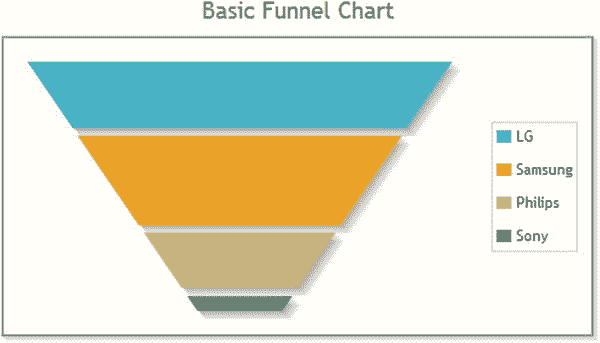
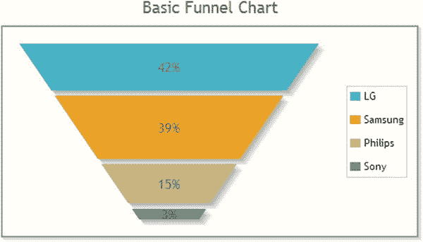

# 第 9 章：使用 jqPlot 创建漏斗图

漏斗图用于展示数据在逐级向下传递时逐渐减少的过程。该图表由一个倒置的金字塔或漏斗组成，分为不同的层级。每个层级都有其自己的区域，该区域与给定的百分比值成比例。漏斗图与饼图类似，两者都将整体划分为各个组成部分。但是，漏斗图指定了层级，这些层级以非常精确的顺序依次排列。这种顺序可以表示层级顺序、流程步骤等。饼图无法做到这一点。

## 创建漏斗图

即使对于这种专门的图表，`jqPlot` 也提供了一个特定的插件：`FunnelRenderer`。因此，你需要包含它：

```html
<script type="text/javascript" src="../src/plugins/jqplot.funnelRenderer.min.js"></script>
```

或者，如果你更倾向于使用内容分发网络（CDN）服务，可以按如下方式操作：

```html
<script type="text/javascript" src="http://cdn.jsdelivr.net/jqplot/1.0.8/plugins/jqplot.funnelRenderer.min.js"></script>
```

使用 `jqPlot` 时，你必须了解此渲染器插件的一个特定行为：`FunnelRenderer` 会按降序重新排列数据。最大值显示在漏斗顶部，较小的值则放在下方。每个漏斗部分的面积对应于其数据点的值相对于所有值总和（百分比）的比例。使用此渲染器时，你需要为输入数据数组使用以下格式：

`['标签', 值]`

因此，对于此示例，定义数据数组如下所示：

```javascript
var data = [['索尼', 1], ['三星', 13], ['LG', 14], ['飞利浦', 5]];
```

对于 `options`，你必须在 `seriesDefaults` 对象中激活 `FunnelRenderer` 插件，并且可以选择添加一个图例来报告系列的标签，如代码清单 9-1 所示。

***代码清单 9-1***. Ch9_01a.html

```javascript
var options = {
    seriesDefaults: {
       renderer: $.jqplot.FunnelRenderer
    },
    title: {
       text: '基本漏斗图'
    },
    legend: {
       location: 'e',
       show: true
    }
};

$.jqplot('myChart', [data], options);
```

图 9-1 是一个基本的漏斗图。



图 9-1. 一个简单的漏斗图

如你所见，项目的顺序已更改，值最高的元素位于顶部，依此类推，直到值最低的项目。这是基本图表，但你可以对其进行丰富，例如，通过添加报告百分比的标签。为此，你必须添加 `dataLabel` 属性，将其设置为 `'percent'`，然后通过将 `showDataLabel` 设置为 `'true'` 来启用它（参见代码清单 9-2）。

***代码清单 9-2***. Ch9_01b.html

```javascript
seriesDefaults: {
    renderer: $.jqplot.FunnelRenderer,
    rendererOptions: {
       dataLabels: 'percent',
       showDataLabels: true
    }
},
```

如图 9-2 所示，百分比值现在显示在漏斗图的相应部分中。



图 9-2. 带有图例和百分比的漏斗图

你可以进行进一步的更改。例如，假设你想要减小漏斗部分之间的间距，如图 9-3 所示。你可以通过传递给 `sectionMargin` 属性的值来实现这一点。通过将 `sectionMargin` 属性赋值为 `0`，你可以完全消除各部分之间的间距（参见代码清单 9-3）。

***代码清单 9-3***. Ch9_01c.html

```javascript
rendererOptions: {
    dataLabels: 'percent',
    showDataLabels: true,
    sectionMargin: 0
}
```


图 9-3. 各部分之间无间距的漏斗图

或者，你可能希望将各个扇区表示为未填充状态，并增加其边界线的宽度，如图 9-4 所示。为此，你需要使用两个属性：`fill` 和 `lineWidth`。首先，将 `fill` 属性设置为 `'false'`，这会使 `jqPlot` 绘制一个空白的扇区；然后，将 `lineWidth` 属性设置为 `4`，从而增加扇区边缘的厚度，使其更加清晰可见（请参阅代码清单 9-4）。


图 9-4. 一个未填充扇区的漏斗图

***代码清单 9-4***. Ch9_01d.html

```javascript
rendererOptions: {
    dataLabels: 'percent',
    showDataLabels: true,
    fill: false,
    lineWidth: 4
}
```

## 总结

在本章中，你学习了如何制作特定类型的漏斗图，以及如何通过 `options` 更改它们的属性。

在下一章中，我将介绍一个在前几章中已经提及的主题：控件。我将阐述在图表中引入控件的重要性，并理解每个控件背后都隐藏着一个 `options` 的属性。这为用户提供了实时选择属性值的机会。

