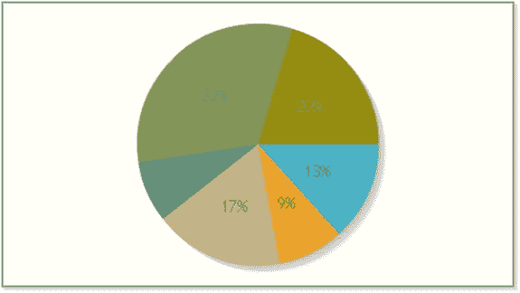
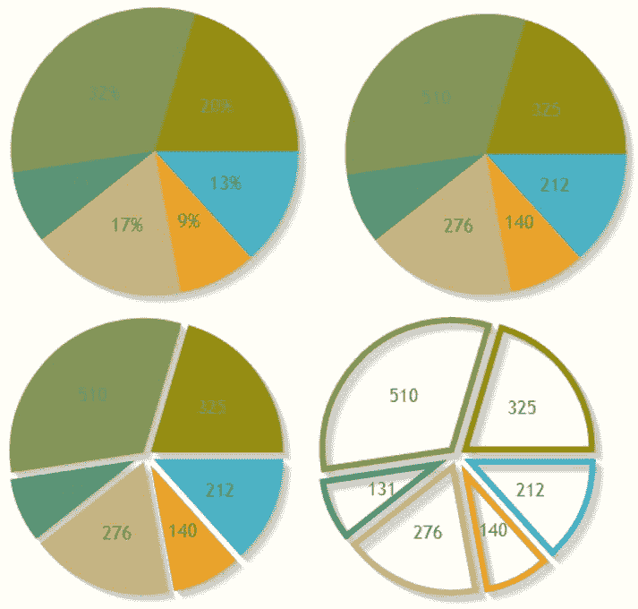

# 使用 jqPlot 创建饼图和环形图

饼图和环形图是展示数据构成部分分解的绝佳方式。饼图是一种被划分为多个扇区（或“切片”）的圆形图表，其主要目的是说明各部分的比例关系：每个切片的弧长与其所代表的数量成正比。环形图与饼图非常相似，但中心有一个孔洞，并且支持多个序列的比较。在本章中，你将了解这两种图表。本章最后将讨论多维饼图。

## 饼图

在 jqPlot 中，数据默认被解释为折线图。如果你想以饼图形式展示数据，则需要包含`PieRenderer`插件：

```html
<script type="text/javascript" src="../src/plugins/jqplot.pieRenderer.min.js">
</script>
```

或者，如果你更喜欢使用内容分发网络（CDN）服务，可以按如下方式操作：

```html
<script type="text/javascript" src="http://cdn.jsdelivr.net/jqplot/1.0.8/plugins
    /jqplot.pieRenderer.min.js"></script>
```

为了更好地理解这个插件的使用，我们以一个人在特定时期内摄入的食物量为例。在这种情况下，饼图被证明是数据表示的最佳选择。所有摄入的食物构成整个群体，而各种类型的食物则是你想要比较的组成部分。每种类型的食物将由一个通过不同颜色标识的切片表示。每个切片的大小将精确地反映出该食物类型在一个人饮食中所占的比例。你可以从一个包含`[label, amount]`值对的数据数组开始，如清单 6-1 所示。

***清单 6-1***。Ch6_01a.html

```javascript
var data = [['乳制品', 212],['肉类', 140], ['谷物', 276],
             ['鱼类', 131],['蔬菜', 510], ['水果', 325]];
```

现在，你可以定义选项了。如清单 6-2 所示，你需要激活该插件并将其应用于`defaultSeries`对象。

***清单 6-2***。Ch6_01a.html

```javascript
var options = {
    seriesDefaults: {
       renderer: jQuery.jqplot.PieRenderer,
       rendererOptions: {
         showDataLabels: true
      }
   }
};

$.jqplot ('myChart', [data], options);
```

图 6-1 展示了一个未指定额外属性的简单饼图。



图 6-1。一个简单的饼图

如图 6-1 所示，饼图在其扇区内默认显示百分比。相反，如果你想显示数值，如图 6-2 右上角所示，你需要在`renderOptions`中的`dataLabels`属性上设置`'value'`，如清单 6-3 所示。



图 6-2。设置饼图的不同方式

***清单 6-3***。Ch6_01b.html

```javascript
rendererOptions: {
    showDataLabels: true,
    dataLabels: 'value'
}
```

如果你想添加边距来分隔饼图的切片，如图 6-2 左下角所示，我们需要将`sliceMargin`属性设置为 6（参见清单 6-4）。

***清单 6-4***。Ch6_01c.html

```javascript
rendererOptions: {
    showDataLabels: true,
    dataLabels: 'value',
    sliceMargin: 6
}
```

此外，如果你想显示带有空心切片的饼图，如图 6-2 右下角所示，你可以将`fill`属性设置为`'false'`，并将`lineWidth`属性设置为 5，以便用稍粗的线条为切片描边（参见清单 6-5）。

***清单 6-5***。Ch6_01d.html

```javascript
rendererOptions: {
    showDataLabels: true,
    dataLabels: 'value',
    sliceMargin: 6,
    fill: false,
    // 用稍粗的线条为切片描边。
    lineWidth: 5
}
```

## 环形图


