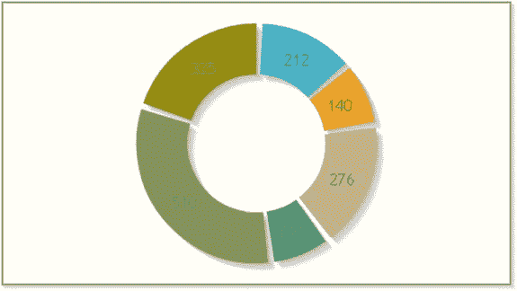
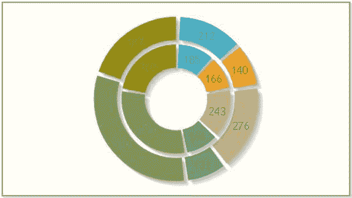
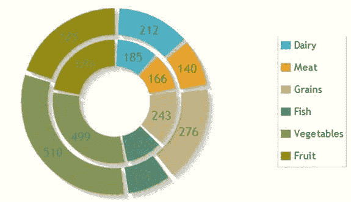
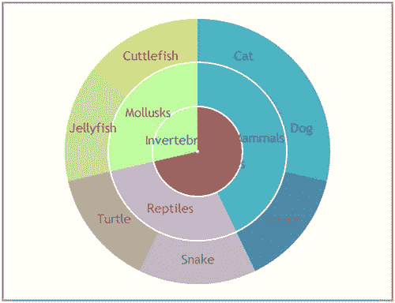

# 饼图与环形图

饼图的主要问题之一是它无法同时显示多个数据系列。因此，您必须决定是使用饼图分别表示每个系列，还是（更推荐）使用环形图（donut chart，也拼写为“doughnut chart”）。这种图表所需的选项与饼图完全相同；因此，从饼图到环形图的转换是立即可行的。您将通过一个简单的示例了解这种转换的简便性。

首先，与饼图一样，您需要包含一个特定的插件才能获得环形图：

```html
<script type="text/javascript" src="../src/plugins/jqplot.donutRenderer.min.js"> </script>
```

您需要在`options`对象中做的唯一更改是，在渲染器调用中将`pieRenderer`对象替换为`DonutRenderer`，然后在`rendererOptions`对象中修改第一个扇区的起始角度。默认情况下，图表从圆的左侧开始，但通常它应该从顶部开始。因此，有必要将`startAngle`属性设置为-90 度（参见清单 6-6）。

***清单 6-6***. Ch6_02.html

```javascript
var options = {
    seriesDefaults: {
    // Make this a pie chart.
       renderer:$.jqplot.DonutRenderer,
       rendererOptions: {
          showDataLabels: true,
          dataLabels: 'value',
          sliceMargin: 3,
          startAngle: -90
       }
    }
};
jQuery.jqplot ('myChart', [data], options);
```

这样，您就得到了一个环形图（参见图 6-3），它与图 6-2 右下角的饼图非常相似。



图 6-3. 一个简单的环形图

但是，我们选择使用环形图而不是饼图，是因为它允许我们同时表示多个数据系列，从而比较其组成部分的比例。因此，继续这个示例，您可以比较两组不同人群消耗的食物。清单 6-7 说明了如何添加另一个数据数组。

***清单 6-7***. Ch6_02.html

```javascript
var data2 = [
    ['Dairy', 185],['Meat', 166], ['Grains', 243],
    ['Fish', 166],['Vegetables', 499], ['Fruit', 370]
];
```

将这个第二个数组添加到`data`中，您修改了代码：

```javascript
$.jqplot ('myChart', [data, data2], options);
```

图 6-4 展示了报告两个数据系列的环形图。



图 6-4. 一个多系列环形图

查看图 6-4，您会立刻发现缺少了一些基本的东西：图例。图例是必需的，因为插件会自动为每个扇区分配一种颜色，如果没有颜色参考，就很难理解图表。因此，在将图例的`show`属性设置为`'true'`之后，您可以选择图例的位置。为了确定将图例放置在哪个位置，jqPlot 使用`location`属性，该属性可以分配与基本方向相对应的值：`'n'`（北）、`'s'`（南）、`'e'`（东）和`'w'`（西）。但是，也可以使用组合，例如`'ne'`，表示东北位置。

假设您决定将图例放在图表的右侧，那么您将`'e'`赋值给`location`属性（参见清单 6-8）。

***清单 6-8***. Ch6_02.html

```javascript
legend: {
    show:true,
    location: 'e'
}
```

图例会像图 6-5 所示，自动报告数据数组中包含的标签。



图 6-5. 带图例的多系列环形图

## 多层饼图

多层饼图是一种现代格式，非常适合可视化用于显示层次关系的数据。这种图表提供了一种层次结构，从圆心的一个根节点开始，您可以随着成员关系逐渐向外圈移动而进行跟踪。为了更好地理解这种图表，让我们以一系列动物为例，并逐步确定它们的层次分组。

作为输入数据数组，您需要插入三个数组（参见清单 6-9）。这将生成三个层次级别。在第一个数组中，您插入最底层，直到第三个数组，它代表根节点。

***清单 6-9***. Ch6_03.html

```javascript
var data = [['Cat', 1],['Dog', 1], ['Mouse', 1],['Snake', 1],
    ['Turtle', 1], ['Jellyfish', 1], ['Cuttlefish', 1]];
var data2 = [['Mammals', 3],['Reptiles', 2], ['Mollusks', 2]];
var data3 = [['Vertebrates', 5],['Invertebrates', 2]];
```

要生成多层饼图，您实际上需要修改一个环形图，将内孔的直径设置为零。在这种情况下，您需要显示由标签表示的动物或动物组的名称，而不是显示数值；您必须将`dataLabels`属性设置为`'label'`。最后要修改的是颜色集。jqPlot 提供的默认颜色并不合适，有必要为层次结构的每个级别定义一组颜色。最好为属于同一组的动物分配相似的颜色，并对层次结构的后续级别也这样做。在清单 6-10 中，特别注意分配给每个系列（层次级别）的颜色序列。

***清单 6-10***. Ch6_03.html

```javascript
var options = {
    seriesDefaults: {
       renderer:$.jqplot.DonutRenderer,
       rendererOptions: {
          showDataLabels: true,
          dataLabels: 'label',
          startAngle: -90,
          innerDiameter: 0,
          ringMargin: 2,
          shadow: false
       }
    },
    series: [
    {
       seriesColors: ['#4bb2c5', '#4baacc', '#4b88aa', '#bbb2c5',
                      '#bbaa99', '#c5dd99', '#dddd77']
    },
    {
       seriesColors:  ['#4bbbbb', '#ccb2c5', '#c5ff99']
    },
    {
       seriesColors:  ['#aa5555', '#a3ffaa']
    }]
};

$.jqplot ('myChart', [data, data2, data3], options);
```

最后，您的努力得到了回报，得到了图 6-6 中的多层饼图。



图 6-6. 一个多层饼图

## 总结

在本章中，您已经了解了 jqPlot 库如何允许您通过**饼图**（使用单个数据系列）或**环形图**（使用多个数据系列）来表示数据，同时快速了解了一些主要属性以及如何在选项中设置它们。在本章的最后部分，您创建了一个**多层饼图**：这是一个经典的示例，展示了如何通过适当修改某些属性来生成一种库未提供的标准图表类型。

在下一章中，您将看到 jqPlot 库如何让您实现**蜡烛图**，以及如何处理这种图表基础的特定数据格式**开盘-最高-最低-收盘 (OHLC)**。

