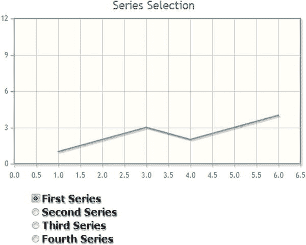
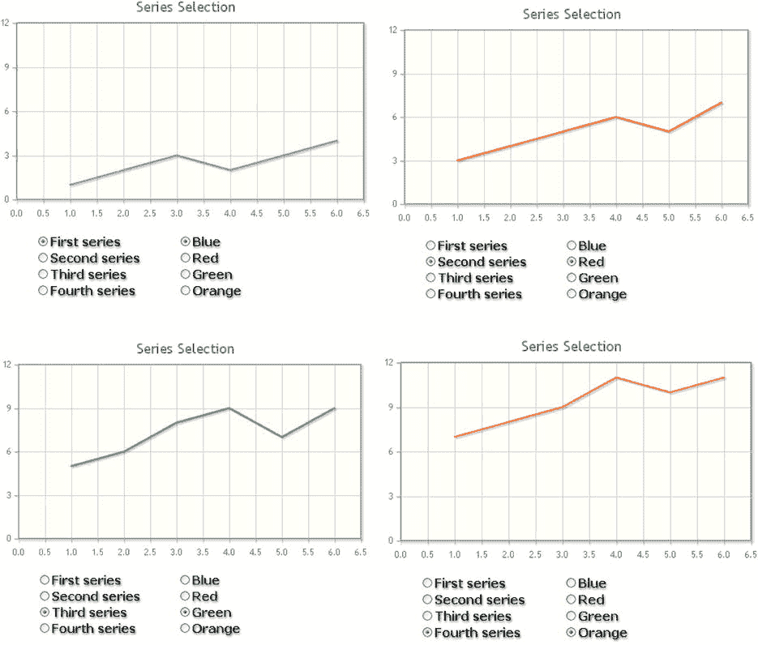
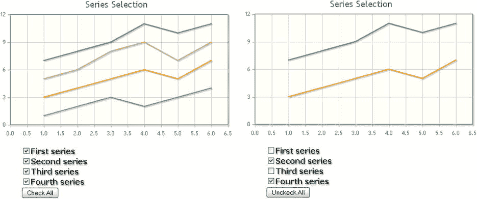

# 第 10 章 为图表添加控件


有时，在运行时直接从浏览器更改设置，然后使用这些新设置重新绘制图表会非常有用。一种典型的方法是添加活动控件。这些控件使图表具有交互性，允许用户实时做出选择，例如决定图表的呈现方式。通过插入控件，你赋予用户控制图表属性值的能力，而这些属性值通常需要在 `options` 中设置。

在本章中，你将学习如何在网页中引入控件。你还将考虑导致选择一种控件而非另一种的因素。一系列以三种最常用控件为例的示例，将带您更深入地探讨这个主题。

## 添加控件

一种对控件进行分组的方式是根据其功能。某些控件（例如，按钮、菜单）作为开关（命令控件）工作，用户可以通过它们触发特定事件或启动命令。其他控件（例如，复选框、单选按钮、组合框、滑块）则绑定到特定的值或属性。使用这类控件，用户可以通过文本字段（文本区域）进行选择或输入值。还有一些控件（例如，滚动条）具有导航功能，特别适用于需要移动对象的情况，例如移动列表中的选中项或框架/网页中的大图。

在这里，你将研究那些与值相关联的控件，这些控件允许用户通过做出选择来与图表进行交互。这些控件应以某种图形方式表示特定属性可以取的值（这些值通常就是你 `options` 对象中分配给属性的值，但仅限于你希望提供给用户的那部分）。你对控件的选择将取决于要设置的属性及其可以取的值：

*   要允许用户从一组值中做出单一选择（例如，三种可能的颜色之一），选择互斥的单选按钮作为控件是最佳的（参见图 10-1a）。
*   要允许用户选择图表中应显示哪些系列，你需要使用复选框（参见图 10-1b）。
*   要允许用户在特定属性的值范围内进行选择（例如，通过调整定义颜色的红绿蓝 (RGB) 值来更改对象的颜色），滑块通常是最佳选择（参见图 10-1c）（在这种情况下，你将使用三个滑块作为控件，分别对应红色、绿色和蓝色）。


图 10-1. 三种最常用的控件：(a) 单选按钮，(b) 复选框，(c) 滑块

可能的控件列表并不仅限于此。但是，理解这些控件背后的机制，能使图表开发人员处理绝大多数情况，包括那些最复杂的情况。

在接下来的示例中，你将了解如何将这三种控件应用到你的图表中。

## 使用单选按钮

为了说明控件的使用，让我们首先看看单选按钮。单选按钮是一组以列表形式分组的小按钮（参见图 10-1a）。它们通常表示为小的空心圆圈，旁边带有文本。如前所述，这种类型的控件与某个值或属性相关联。单选按钮的特殊之处在于它们的值是互斥的；因此，用户只能选择其中一个。

举例来说，我们以一个简单的多系列折线图为例，你希望允许用户决定显示哪个系列，而不是显示所有系列。要进行选择，用户将单击其中一个单选按钮，用圆点填充该圆圈。与该控件对应的系列随后将被绘制在图表上。

### 添加单选按钮控件

首先，你需要编写 HTML 页面，并导入所有必要的库（参见代码清单 10-1）。

***代码清单 10-1***. ch10_01.html

# 使用控件选择数据序列

```
<HTML>
<HEAD>
<TITLE>使用控件选择系列</TITLE>
<!--[if lt IE 9]>
<script type="text/javascript" src="../src/excanvas.js"></script>
<![endif]-->
<script type="text/javascript" src="../src/jquery.min.js"></script>
<script type="text/javascript" src="../src/jquery.jqplot.min.js"></script>
<link rel="stylesheet" type="text/css" href="../src/jquery.jqplot.min.css"/>
<script>
$(document).ready(function(){

//在此处添加您的代码

});
</script>
</HEAD>
<BODY>
<div id="myChart" style="height: 300px; width: 500px;"></div>
    <!-- 在此处添加包含控件的表格 -->
</BODY>
</HTML>
```

或者，如果您更喜欢使用内容分发网络 (CDN) 服务，可以使用以下代码：

```
<!--[if lt IE 9]>
<script src="http://cdn.jsdelivr.net/excanvas/r3/excanvas.js"></script>
<![endif]-->
<script src="http://code.jquery.com/jquery-1.9.1.min.js"></script>
<script type="text/javascript"
    src="http://cdn.jsdelivr.net/jqplot/1.0.8/jquery.jqplot.min.js"></script>
<link rel="stylesheet" type="text/css"
    href="http://cdn.jsdelivr.net/jqplot/1.0.8/jquery.jqplot.min.css"/>
```

您从一个折线图开始，其中将表示四组值。每个系列中的每个元素将由一个 (x, y) 值对表示；您将这四个系列的值插入到 jQuery `$(document).ready()` 函数内定义的数据集中，如代码清单 10-2 所示。

***代码清单 10-2***. ch10_01.html

```javascript
var dataSet = {
    data1: [[1, 1], [2, 2], [3, 3], [4, 2], [5, 3], [6, 4]],
    data2: [[1, 3], [2, 4], [3, 5], [4, 6], [5, 5], [6, 7]],
    data3: [[1, 5], [2, 6], [3, 8], [4, 9], [5, 7], [6, 9]],
    data4: [[1, 7], [2, 8], [3, 9], [4, 11], [5, 10], [6, 11]]
};
```

但是，与之前用不同颜色的线条显示所有四个序列不同，这次你为用户提供了每次只显示一个序列的机会。图表在浏览器中加载后，用户将能够选择四个序列中的任意一个并在它们之间切换，而无需加载新页面。

你首先只展示第一个序列（`data1`）（参见清单 10-3）。

***清单 10-3***. ch10_01.html

```javascript
var options = {
    seriesDefaults: {
       showMarker: false
    },
    title: '序列选择',
    axes: {
       xaxis: {},
       yaxis: {
          min: 0,
          max: 12
       }
    }
};

var plot1 = $.jqplot ('myChart', [dataSet.data1], options);
```

 **注意** 在此示例中，你将`$.jqplot()`函数返回的值存储在`plot1`变量中。这使你能够访问`jqplot`对象的内容、更改其值并调用其方法，包括`replot()`函数，该函数允许你重新绘制图表并包含新的更改。

用户将从一组可能的选项中选择一个；单选按钮是实现此目的的最佳控件选择。因此，让我们为每个单选按钮分配一个序列。如清单 10-4 所示，所有控件（按钮）都包含在表格内的一个内部列表中。每个按钮由一个`<input>`元素指定，其中四个序列也作为值被指定。

***清单 10-4***. ch10_01.html

```html
<table>
<tr>
  <td>
    <div>
      <ul>
        <li><input name="dataSeries" value="data1" type="radio" checked />第一序列</li>
        <li><input name="dataSeries" value="data2" type="radio" />第二序列</li>
        <li><input name="dataSeries" value="data3" type="radio" />第三序列</li>
        <li><input name="dataSeries" value="data4" type="radio" />第四序列</li>
       </ul>
    </div> </td>
</tr>
</table>
```

然而，仅在 HTML 页面中设置控件定义是不够的；你还必须创建将单选按钮与 jqPlot 图表关联起来的函数。根据哪个单选按钮处于`checked`状态，图表中将加载数据集中的不同集合。

当用户选择不同的单选按钮时，会将`checked`属性从`'false'`更改为`'true'`。单选按钮的状态变化会触发`change()`函数，该函数会检测到此事件。此函数将数据集中的新集合分配给`plot1`变量（包含有关 jqPlot 图表的所有信息），并最终强制重新绘制图表。这样，新数据就会在图表中呈现，而无需重新加载页面（参见清单 10-5）。

***清单 10-5***. ch10_01.html

```javascript
$(document).ready(function(){
    ...
    var plot1 = $.jqplot ('myChart', [dataSet.data1], options);
    $("input[type=radio][name=dataSeries]").attr("checked", false);
    $("input[type=radio][name=dataSeries][value=data1]").attr("checked", true);
    $("input[type=radio][name=dataSeries]").change(function(){
       var val = $(this).val();
       plot1.series[0].data = dataSet[val];
       plot1.replot();
    });
});
```

要自定义控件表格内的元素，你可以添加一些层叠样式表（CSS）样式，如清单 10-6 所示。

***清单 10-6***. ch10_01.html

```css
<style>
li {
    font-family: "Verdana";
    font-size: 16px;
    font-weight: bold;
    text-shadow: 1px 2px 2px #555555;
    margin: 3px;
    list-style: none;
}
</style>
```

如果你在浏览器中加载此网页，你将得到图 10-2 中的图表。



图 10-2. 使用单选按钮可以选择仅显示一个数据序列

现在，用户可以选择图表中要显示的序列。通过选择单选按钮作为控件，图表每次将只显示一组数据。

## 在图表绘制完成后访问属性

到目前为止，你已使用`options`对象来定义图表的属性值（通过更改默认值），然后将其作为参数传递给`$.jqplot()`函数。但这仅适用于在图表绘制之前对其进行设置。如果之后需要访问属性值，该怎么办？

事实上，通过将控件作为参数引入，你也引入了在图表绘制后更改这些属性的可能性。因此，必须有一种方法来访问这些值、编辑它们，然后运行命令重新绘制图表（就像你使用`replot()`函数时一样）（参见清单 10-5）。

你已经看到，你可以将 `$.jqplot()` 函数返回的整个 `jqplot` 对象作为值接收，并将其存储在一个变量中（在前面的示例中，是 `plot1` 变量），以便稍后访问其内容。

一个 `jqplot` 对象几乎包含了定义整个 jqPlot 库的所有对象及其属性和方法，并且每个特定的实例（例如 `plot1`）都是在特定图表的表示中实现的。

因此，当你编写 JavaScript 代码来定义处理特定事件（例如用户使用控件）的函数时，你可以在页面绘制图表后访问这些值并更改它们，然后运行命令以所需的更改重新绘制图表。这为你需要的图表增加了交互性。

继续前面的示例（参见清单 10-1 到 10-6），你会注意到所有线条都绘制为蓝色。现在让我们做一些更改，以便这次用户可以选择绘制序列的颜色。

为此，你在表格中添加另一组控件：第二列单选按钮，每个按钮代表一种颜色（参见清单 10-7）。

***清单 10-7***. ch10_02.html

```html
<table>
<tr>
  <td>
    <div>
       <ul>
          <li><input name="dataSeries" value="data1" type="radio" checked />第一序列</li>
          <li><input name="dataSeries" value="data2" type="radio" />第二序列</li>
          <li><input name="dataSeries" value="data3" type="radio" />第三序列</li>
          <li><input name="dataSeries" value="data4" type="radio" />第四序列</li>
      </ul>
    </div>
  </td>
  <td>
    <div>
       <ul>
          <li><input name="colors" value="#4bb2c5" type="radio" checked />蓝色</li>
          <li><input name="colors" value="#ff3333" type="radio" />红色</li>
          <li><input name="colors" value="#44bb44" type="radio" />绿色</li>
          <li><input name="colors" value="#ffaa22" type="radio" />橙色</li>
      </ul>
    </div>
  </td>
</tr>
</table>
```

接下来，将清单 10-8 中以粗体突出显示的行添加到你的 JavaScript 代码中。

***清单 10-8***. ch10_02.html

```javascript
$("input[type=radio][name=dataSeries]").attr("checked", false);
$("input[type=radio][name=dataSeries][value=data1]").attr("checked", true);
$("input[type=radio][name=dataSeries]").change(function(){
    var val = $(this).val();
    plot1.series[0].data = dataSet[val];
    plot1.series[0].renderer.shapeRenderer.strokeStyle = col;
    plot1.replot();
});

var col = "#4bb2c5";
$("input[type=radio][name=colors]").change(function(){
    col = $(this).val();
});
```

图 10-3 展示了用户如何通过选择四种不同颜色来决定要表示的数据系列。这是一个通过添加控件来增强用户与图表之间交互性的示例。



## 使用滑块

在前一个示例中，用户首先通过勾选第二列中的某个单选按钮来设置颜色，然后从第一列中选择要用该颜色表示的数据系列。因此，这个过程涉及两次选择，且发生在两个不同的时间点。这一次，我们将保持第一列不变（用户从中选择要显示的数据系列，且互斥），但用一组三个滑块来替换单选按钮列。在这种场景下，用户选择要显示的数据系列，当该系列以预定义颜色绘制在图表上后，用户可以通过调整构成颜色的三个 RGB 值来修改它。现在，我们有了一个选择，随后进行微调。

当需要在一个给定范围内滚动连续值来改变某个属性的值时，滑块就是所需的控件类型。在本例中，需要三个滑块，分别对应红色、绿色和蓝色，这样用户就可以调整 RGB 值来获得所需的颜色。

沿用上一个示例（参见代码清单 10-7 和 10-8），我们首先选择 jQuery 界面库（jQuery UI）来获取滑块（关于如何使用 jQuery UI 组件实现滑块的详细信息，请参见第 2 章）。因此，在将滑块添加到网页之前，必须导入该库的所有必要文件：

```html
<link rel="stylesheet"
    href="http://code.jquery.com/ui/1.10.3/themes/smoothness/jquery-ui.css"/>
<script src="http://code.jquery.com/ui/1.10.3/jquery-ui.min.js"></script>
```

 **注意** 如果你在本书附带的源代码所提供的工作区中工作（参见附录 A），可以使用以下引用访问工作区中已包含的库：

```html
<link rel="stylesheet" href="../src/css/smoothness/jquery-ui-1.10.3.custom.min.css"/>
<script type="text/javascript" src="../src/js/jquery-ui-1.10.3.custom.min.js"></script>
```

导入所有文件后，就可以开始在 HTML 表格中插入三个滑块了。如代码清单 10-9 所示，我们删除了包含单选按钮的第二列，并用一组 `<div>` 元素替换它（如果你直接从这一步开始，可以复制整个代码清单，而不仅仅是粗体文本）。jQuery UI 会将它们转换为滑块（参见第 2 章）。

***代码清单 10-9***. ch10_04.html

```html
<table>
<tr>
   <td>
      <div>
         <ul>
           <li><input name="dataSeries" value="data1" type="radio" checked />第一系列</li>
           <li><input name="dataSeries" value="data2" type="radio" />第二系列</li>
           <li><input name="dataSeries" value="data3" type="radio" />第三系列</li>
           <li><input name="dataSeries" value="data4" type="radio" />第四系列</li>
         </ul>
      </div>
   </td>
   <td>
       <div id="red">
          <div id="slider-text">
             <div id="0">0</div>
             <div id="1">255</div>
          </div>
       </div>
       <div id="green">
          <div id="slider-text">
             <div id="0">0</div>
             <div id="1">255</div>
          </div>
       </div>
       <div id="blue">
          <div id="slider-text">
             <div id="0">0</div>
             <div id="1">255</div>
          </div>
       </div>
   </td>
</tr>
</table>
```

此外，我们还为每个滑块添加了两个数值，并使用了 `slider-text id`。这些值只是用于显示三个滑块所覆盖的值范围（0–255）的最小值和最大值的标签。当需要在网页中为每个滑块表示一个刻度时，这种方法非常有用。

现在，让我们添加所有 CSS 样式指令，以确保这些新控件能够在现有页面的上下文中正确显示（参见代码清单 10-10）。

### 代码清单 10-10. `ch10_04.html`

```css
<style>
...
#red, #green, #blue {
    float: left;
    margin: 15px;
    left: 50px;
}
#red .ui-slider-range {
    background: #ef2929;
}
#red .ui-slider-handle {
    border-color: #ef2929;
}
#green .ui-slider-range {
    background: #8ae234;
}
#green .ui-slider-handle {
    border-color: #8ae234;
}
#blue .ui-slider-range {
    background: #729fcf;
}
#blue .ui-slider-handle {
    border-color: #729fcf;
}
#slider-text div {
    font-family: "Verdana";
    font-size: 10px;
    position: relative;
    left: 17px;
}
</style>
```

关于 JavaScript 代码部分，我们只保留管理用于选择所需系列的单选按钮的部分，并将其与处理通过三个滑块调整的 RGB 值的新代码部分集成，如代码清单 10-11 所示。然后，这三个 RGB 值通过一个适当的函数转换为十六进制数字，并组合成 HTML 颜色代码，该代码由井号（`#`）后跟六个十六进制字符（`'rrggbb'`）表示，其中每对字符代表一个从 0 到 255 的值，并转换为十六进制格式。

### 代码清单 10-11. `ch10_04.html`

```javascript
$(document).ready(function(){

...

$("input[type=radio][name=dataSeries]").attr("checked", false);
    $("input[type=radio][name=dataSeries][value=data1]").attr("checked", true);
    $("input[type=radio][name=dataSeries]").change(function(){
       var val = $(this).val();
       plot1.series[0].data = dataSets[val];
       plot1.series[0].renderer.shapeRenderer.strokeStyle = "#" + col;
       plot1.replot();
    });

var col = "4bb2c5";

function hexFromRGB(r, g, b) {
       var hex = [
          r.toString(16),
          g.toString(16),
          b.toString(16)
       ];
       $.each(hex, function(nr, val) {
          if ( val.length === 1 ) {
             hex[nr] = "0" + val;
          }
       });
       return hex.join("").toUpperCase();
   };

$("#red, #green, #blue").slider({
       orientation: "vertical",
       range: "min",
       max: 255,
       change: refreshPlot
    });

// 将 col 设置为默认值 "#4bb2c5";
    $("#red").slider("value", 255);
    $("#green").slider("value", 140);
    $("#blue").slider("value", 60);
```

```javascript
function refreshPlot() {
    var r = $("#red").slider("value");
    var g = $("#green").slider("value");
    var b = $("#blue").slider("value");
    var col = hexFromRGB(r, g, b);
    plot1.series[0].renderer.shapeRenderer.strokeStyle = "#" + col;
    plot1.replot();
}

$("[id=0]").css('top','90px');
$("[id=1]").css('top','-20px');
```

清单 10-11 中的最后两行代码使用了 jQuery 的 `css()` 函数，为特定的 HTML 元素选择集分配 CSS 样式（参见第 2 章）。该选择针对所有 `id = 0` 和 `id = 1` 的元素，即包含滑块刻度标签的 `<div>` 元素。通过设置 CSS 的 `top` 属性，可以将每个刻度标签放置在对应滑块旁边的特定高度位置。

在图 10-4 中，用户可以通过三个滑块修改 RGB 值，来决定要显示的数据系列并更改其颜色。


图 10-4. 添加了三个滑块控件以调整 RGB 级别的图表

## 使用复选框

在前面的示例中，用户只能从可显示的多个数据系列中选择一个。然而，用户通常希望能够决定哪些系列应该显示，哪些不应该显示，例如，同时显示两个或更多数据集。这涉及到在同一组内进行多项选择。为了让用户能够做出这种选择，你必须使用复选框。

通常，复选框以列表形式分组，由空框表示（参见图 10-1）。与单选按钮不同，这些控件不是互斥的，而是多选的。因此，你可以选择它们所代表的所有值、部分值或完全不选（而使用单选按钮时，必须选中一个项目）。

与单选按钮类似，每个数据系列都有一个复选框，如果某个复选框被选中，则对应的系列会显示在图表中。然而，与单选按钮不同的是，复选框彼此独立：它们的状态（选中或未选中）不会影响其他复选框的状态。

通常，当你有一组复选框时，添加两个具有“全选/取消全选”功能的按钮会非常有用，从而允许用户一键选择/取消选择所有复选框。

使用前面的示例（参见清单 10-9 到 10-11），数据集和选项设置保持不变；唯一需要更改的是传递给 `$.jqplot()` 函数的数据。在这种情况下，整个数据集将作为参数传递。

```javascript
var plot1 = $.jqplot ('myChart', [dataSet.data1, dataSet.data2, dataSet.data3, dataSet.data4], options);
```

让我们删除包含先前控件（单选按钮、滑块）的表格，并用一个包含复选框的新表格替换它，如清单 10-12 所示（如果你直接从这里开始，可以复制整个清单，无需考虑之前的控件）。此外，除了对应各个系列的四个控件外，你还可以在末尾添加一个按钮来管理“全选/取消全选”功能。

### 清单 10-12. `ch10_03.html`

```html
<table>
<tr>
   <td>
      <div>
        <ul>
          <li><input name="data1" type="checkbox" checked />第一系列</li>
          <li><input name="data2" type="checkbox" checked />第二系列</li>
          <li><input name="data3" type="checkbox" checked />第三系列</li>
          <li><input name="data4" type="checkbox" checked />第四系列</li>
          <li><input type="button" name="checkall" value="取消全选"></li>
        </ul>
      </div>
    </td>
</tr>
</table>
```

与单选按钮一样，你需要添加 jQuery 方法来绑定这些控件触发的事件。首先，定义每个复选框的状态。通常，它们应该全部被选中。然后，定义五个 jQuery 方法，用于启用或禁用要显示的数据系列，并强制重新绘制图表。

从代码中，你必须删除所有处理先前控件的行，并在其位置写入清单 10-13 中的方法。

### 清单 10-13. `ch10_03.html`

```javascript
$("input[type=checkbox][name=data1]").change(function(){
    if(this.checked){
       plot1.series[0].data = dataSet.data1;
       plot1.replot();
    } else {
       plot1.series[0].data = [];
       plot1.replot();
    }
});

$("input[type=checkbox][name=data2]").change(function(){
    if(this.checked){
       plot1.series[1].data = dataSet.data2;
       plot1.replot();
    } else {
       plot1.series[1].data = [];
       plot1.replot();
    }
});

$("input[type=checkbox][name=data3]").change(function(){
    if(this.checked){
       plot1.series[2].data = dataSet.data3;
       plot1.replot();
    } else {
       plot1.series[2].data = [];
       plot1.replot();
    }
});

$("input[type=checkbox][name=data4]").change(function(){
    if(this.checked){
       plot1.series[3].data = dataSet.data4;
       plot1.replot();
    } else {
       plot1.series[3].data = [];
       plot1.replot();
    }
});

$("input[type=button][name=checkall]").click(function(){
    if(this.value == "全选"){
       plot1.series[0].data = dataSet.data1;
       plot1.series[1].data = dataSet.data2;
       plot1.series[2].data = dataSet.data3;
       plot1.series[3].data = dataSet.data4;
       $("input[type=checkbox][name=data1]").prop("checked", true);
       $("input[type=checkbox][name=data2]").prop("checked", true);
       $("input[type=checkbox][name=data3]").prop("checked", true);
       $("input[type=checkbox][name=data4]").prop("checked", true);
       this.value = "取消全选";
       plot1.replot();
    } else {
       plot1.series[0].data = [];
       plot1.series[1].data = [];
       plot1.series[2].data = [];
       plot1.series[3].data = [];
       $("input[type=checkbox][name=data1]").prop("checked", false);
       $("input[type=checkbox][name=data2]").prop("checked", false);
       $("input[type=checkbox][name=data3]").prop("checked", false);
       $("input[type=checkbox][name=data4]").prop("checked", false);
       this.value = "全选";
       plot1.replot();
    }
});
```

如图 10-5 所示，用户现在可以选择希望在图表中显示的数据系列。



图 10-5. 带有复选框和按钮的自定义图例

如果你点击标有“取消全选”的按钮，所有复选框都将被取消选中，对应的数据系列将在图表中隐藏。随后，该按钮将显示标签“全选”。此时再次点击它，所有复选框都将被选中，对应的数据系列将显示在图表中。

最后一个示例中涵盖的功能与 *EnhancedLegendRenderer* 插件提供的图例非常相似（参见第 5 章中的“处理图例”部分）。在那种情况下，通过点击对应数据系列的彩色方块，你可以决定该系列是否应在图表中显示。但是，在这里，你还增加了一键全选和取消全选所有系列的可能性，而此功能目前尚未在该插件中实现（尽管有人正在提议添加）。这是另一个关于如何通过使用控件来扩展库所提供功能的小例子。

## 总结

