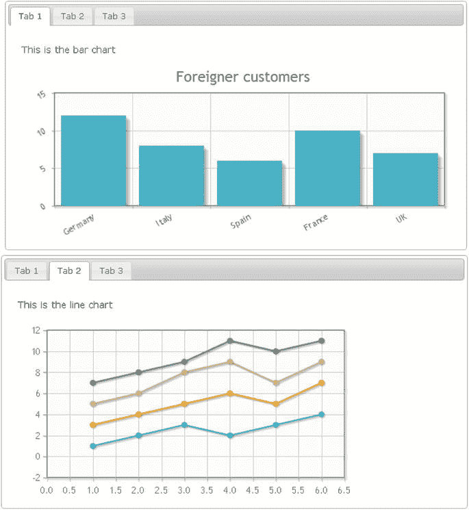
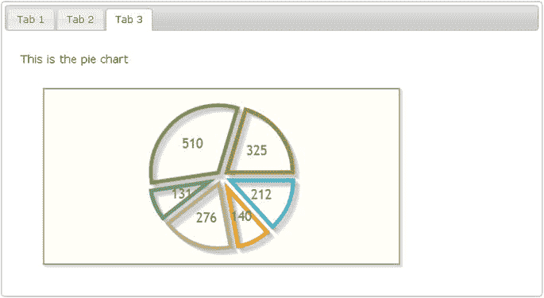
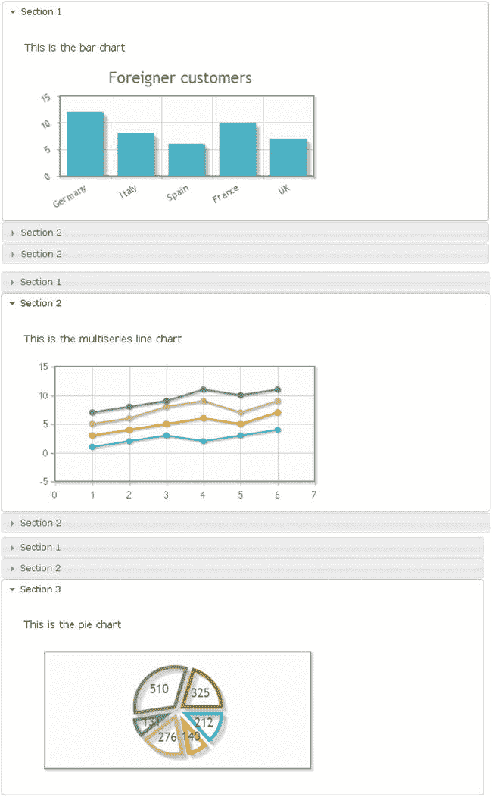
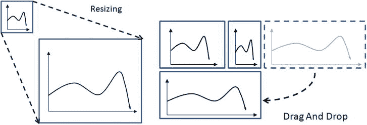
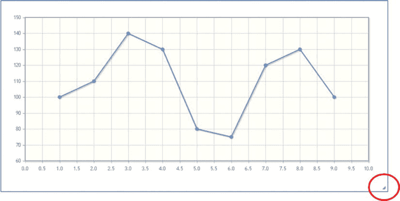
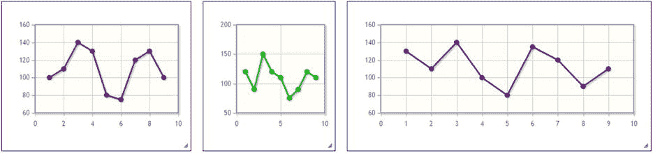
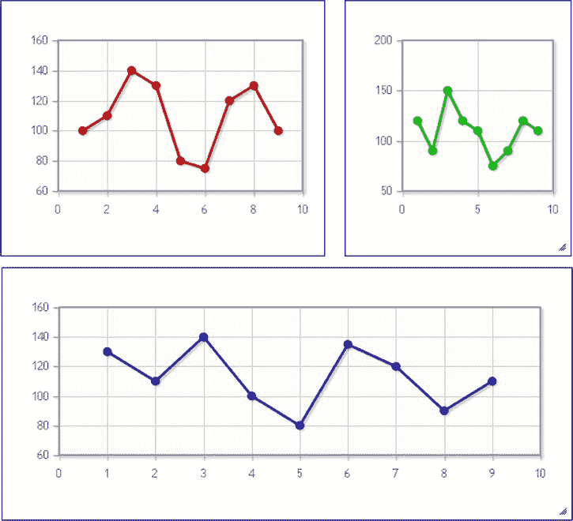

# 第 11 章 将 jqPlot 图表嵌入 jQuery 小部件

在本章中，你已经了解了如何使用各种控件（例如**单选按钮**、**滑块**和**复选框**）来增强图表的交互性。随着控件的引入，我们作为程序员不再是唯一能够直接控制图表属性值的人；通过此类控件，用户也能够做出适当的选择。

此外，你还学习了如何将 **jQuery UI 小部件**与`jqPlot`库集成，并将这些小部件**作为控件**使用。在下一章中，你将通过使用 jQuery UI 小部件**作为容器**来完善这一集成。这种组合极大地扩展了使用`jqPlot`库开发和呈现图表的可能性。

## 将 jqPlot 图表嵌入 jQuery 小部件

在第 2 章中，你看到了几个将 jQuery UI 小部件用作容器的示例。在本章中，你将利用这种能力在这些容器内呈现图表。这使你能够利用 jQuery UI 小部件的巨大潜力，进一步改进图表的呈现方式。

结合 jQuery UI 和`jqPlot`库的优势是多方面的：你可以在网页中占用相同空间的情况下显示更多图表，同时保持页面上下文的整洁有序。另一个优势是 jQuery UI 小部件可以调整大小，用户甚至也可以调整`jqPlot`图表的大小。

在本章中，你将探讨三个简单的案例，这些案例将充分展示上述优势。你还会更加熟练地使用 jQuery UI 小部件，甚至比在第 2 章中更加得心应手。

### 在选项卡中显示 jqPlot 图表

你将用作容器的第一个小部件是**选项卡**（参见第 2 章中的“选项卡”一节）。将图表插入选项卡内部，可以在有限区域内于同一页面上显示不同的图表。在此示例中，你将在三个选项卡（分别名为`Tab 1`、`Tab 2`和`Tab 3`）中放置三个不同的`jqPlot`图表。在第一个选项卡中放置柱状图，第二个选项卡中放置多系列折线图，最后一个选项卡中放置饼图。你不会详细分析这些图表，因为它们与前面章节中使用的图表类型完全相同。每种图表类型都需要其特定的插件，清单 11-1 列出了所需的插件。

### 清单 11-1. `ch11_01.html`

# 在 jQuery UI 容器中使用 jqPlot 图表

首先，你需要引入 jQuery、jqPlot 及其所需的插件。以下代码段展示了必要的文件引用：

```html
<!--[if lt IE 9]>
<script src="http://cdn.jsdelivr.net/excanvas/r3/excanvas.js"></script>
<![endif]-->
<script src="http://code.jquery.com/jquery-1.9.1.min.js"></script>
<script src="http://cdn.jsdelivr.net/jqplot/1.0.8/jquery.jqplot.min.js">
</script>
<link rel="stylesheet" type="text/css"
    href="http://cdn.jsdelivr.net/jqplot/1.0.8/jquery.jqplot.min.css" />
<script src="http://cdn.jsdelivr.net/jqplot/1.0.8/plugins/jqplot.pieRenderer.min.js">
</script>
<script type="text/javascript" src="http://cdn.jsdelivr.net/jqplot/1.0.8/plugins/jqplot.dateAxisRenderer.min.js"></script>
<script type="text/javascript" src="http://cdn.jsdelivr.net/jqplot/1.0.8/plugins/jqplot.canvasTextRenderer.min.js"></script>
<script type="text/javascript" src="http://cdn.jsdelivr.net/jqplot/1.0.8/plugins/jqplot.canvasAxisTickRenderer.min.js"></script>
<script type="text/javascript" src="http://cdn.jsdelivr.net/jqplot/1.0.8/plugins/jqplot.categoryAxisRenderer.min.js"></script>
<script type="text/javascript" src="http://cdn.jsdelivr.net/jqplot/1.0.8/plugins/jqplot.barRenderer.min.js"></script>
```

此外，你将使用 jQuery 小部件作为容器，这些也需要包含一些文件：

```html
<link rel="stylesheet" href="http://code.jquery.com/ui/1.10.3/themes/smoothness/jquery-ui.css" />
<script src="http://code.jquery.com/ui/1.10.3/jquery-ui.min.js"></script>
```

 **注意** 对于使用本书源代码提供的工作区的读者，您可以直接使用工作区中已包含的库。请参考以下引用：

```html
<script src="../src/js/jquery-1.9.1.js"></script>
<script src="../src/jquery.jqplot.min.js"></script>
<link rel="stylesheet" type="text/css" href="../src/jquery.jqplot.min.css" />
<link rel="stylesheet" href="../src/css/smoothness/jquery-ui-1.10.3.custom.min.css" />
<script src="../src/js/jquery-ui-1.10.3.custom.min.js"></script>
<script src="../src/plugins/jqplot.pieRenderer.min.js"></script>
<script src="../src/plugins/jqplot.dateAxisRenderer.min.js"></script>
<script src="../src/plugins/jqplot.canvasTextRenderer.min.js"></script>
<script src="../src/plugins/jqplot.canvasAxisTickRenderer.min.js"></script>
<script src="../src/plugins/jqplot.categoryAxisRenderer.min.js"></script>
<script src="../src/plugins/jqplot.barRenderer.min.js"></script>
```

随着网页中引入如此多的图形元素，层叠样式表（CSS）的使用变得愈发重要。您需要定义一些设置来修改选项卡的外观，使其符合您的需求。请在代码清单 11-2 中添加样式设置。

***代码清单 11-2***. ch11_01.html

```css
<style>
.ui-tabs {
    width: 690px;
    margin: 2em auto;
}
.ui-tabs-nav {
    font-size: 12px;
}
.ui-tabs-panel {
    font-size: 14px;
}
.jqplot-target {
    font-size: 18px;
}
ol.description {
    list-style-position: inside;
    font-size: 15px;
    margin: 1.5em auto;
    padding: 0 15px;
    width: 600px;
}
</style>
```

您将使用三种不同的图表，这些图表在前面的章节中已经使用过（折线图见第 4 章，柱状图见第 5 章，饼图见第 6 章）。因此，本章不再赘述其设置细节。将它们添加到我们的网页中，并将通常的目标名称 `myChart` 替换为 `chart1`、`chart2` 和 `chart3`。如代码清单 11-3 所示，在这些图表中，您直接在三个 `jqplot()` 函数内定义了 `options` 对象。它们的返回值分别存储在三个不同的变量中：`plot1`、`plot2` 和 `plot3`。这些变量将用于在 JavaScript 代码中处理各自的图表。

***代码清单 11-3***. Ch11_01.html

```javascript
var bar1 = [['Germany', 12], ['Italy', 8], ['Spain', 6],
            ['France', 10], ['UK', 7]];
var data1 = [1, 2, 3, 2, 3, 4];
var data2 = [3, 4, 5, 6, 5, 7];
var data3 = [5, 6, 8, 9, 7, 9];
var data4 = [7, 8, 9, 11, 10, 11];
var pie1 = [
    ['Dairy', 212], ['Meat', 140], ['Grains', 276],
    ['Fish', 131], ['Vegetables', 510], ['Fruit', 325]
];

var plot1 = $.jqplot ('chart1', [bar1], {
    title: 'Foreigner customers',
    series:[{renderer:$.jqplot.BarRenderer}],
    axesDefaults: {
       tickRenderer: $.jqplot.CanvasAxisTickRenderer ,
       tickOptions: {
          angle: -30,
          fontSize: '10pt'
       }
    },
    axes: {
       xaxis: {
          renderer: $.jqplot.CategoryAxisRenderer
       }
    }
});

var plot2 = $.jqplot ('chart2', [data1, data2, data3, data4],{});

var plot3 = $.jqplot ('chart3', [pie1], {
    seriesDefaults: {
       renderer: jQuery.jqplot.PieRenderer,
       rendererOptions: {
          showDataLabels: true,
          dataLabels: 'value',
          fill: false,
          sliceMargin: 6,
          lineWidth: 5
       }
    }
});
```

现在，需要在 `$(document).ready()` 函数的末尾添加 jQueryUI 的 `tabs()` 函数，如代码清单 11-4 所示。

***代码清单 11-4***. ch11_01.html

```javascript
$(document).ready(function(){
...
    $("#tabs").tabs();
});
```

此调用创建了选项卡容器，因此您需要将选项卡绑定到您的图表上（参见代码清单 11-5）。

***代码清单 11-5***. ch11_01.html

```javascript
$('#tabs').bind('tabsshow', function(event, ui) {
    if (ui.index === 0 && plot1._drawCount === 0) {
       plot1.replot();
    }
    else if (ui.index === 1 && plot2._drawCount === 0) {
       plot2.replot();
    }
    else if (ui.index === 2 && plot3._drawCount === 0) {
       plot3.replot();
    }
});
```

选择某个选项卡将重新绘制其中的图表内容。现在，在网页的 `<body>` 部分，您需要添加 jQuery UI 库将转换为选项卡的 `<div>` 元素。具体做法是，指定一个 `id` 为 `tabs` 的 `<div>` 元素。在其内部，定义一个包含三个项目的列表，每个项目代表一个选项卡。在列表之后，您必须再定义 `tabs` 的三个子分区：三个额外的 `<div>` 元素，分别命名为 `tabs-1`、`tabs-2` 和 `tabs-3`。您将把这些元素放入您的图表 `chart1`、`chart2` 和 `chart3` 中（参见代码清单 11-6）。

***代码清单 11-6***. ch11_01.html

```html
<div id="tabs">
    <ul>
       <li><a href="#tabs-1">Tab 1</a></li>
       <li><a href="#tabs-2">Tab 2</a></li>
       <li><a href="#tabs-3">Tab 3</a></li>
    </ul>
    <div id="tabs-1">
       <p>This is the bar chart</p>
       <div id="chart1" style="height:300px; width:650px;"></div>
    </div>
    <div id="tabs-2">
       <p>This is the line chart</p>
       <div id="chart2" style="height:300px; width:650px;"></div>
    </div>
    <div id="tabs-3">
       <p>This is the pie chart</p>
       <div id="chart3" style="height:300px; width:650px;"></div>
    </div>
</div>
```

图 11-1 展示了最终结果。





图 11-1. 一个包含三个选项卡的页面，每个选项卡内含有不同的图表

## 在折叠面板中使用 jqPlot 图表

另一种常用的 jQuery 容器是*折叠面板*。这次，您将把前面的三个图表放入折叠面板中。网页需要包含的插件列表与上一个示例相同。您需要对 CSS 样式进行一些修改；折叠面板有特定的 CSS 类，需要指定其属性。这些内容如代码清单 11-7 所示。

***代码清单 11-7***. ch11_02.html

```css
<style type="text/css">
.ui-accordion {
    width: 690px;
    margin: 2em auto;
}
.ui-accordion-header {
    font-size: 12px;
}
.ui-accordion-content {
    font-size: 14px;
}
.jqplot-target {
    font-size: 18px;
}
ol.description {
    list-style-position: inside;
    font-size: 15px;
    margin: 1.5em auto;
    padding: 0 15px;
    width: 600px;
}
.section {
      width: 400px;
      height: 200px;
      margin-top: 20px;
      margin-left: 20px;
}
</style>
```

与上一个示例一样，您必须创建 jQueryUi 小部件。可以通过调用 `accordion()` 函数来实现：

```javascript
$("#accordion").accordion();
```

您还需要将此折叠面板绑定到您的图表上，如代码清单 11-8 所示。当您选择一个折叠面板选项卡时，该事件会通过调用 `replot()` 函数确保相应的图表在其中被重新绘制。

***代码清单 11-8***. ch11_02.html

```javascript
$('#accordion').bind('accordionchange', function(event, ui) {
    var index = $(this).find("h3").index ( ui.newHeader[0]);
    if (index === 0) {
       plot1.replot();
    }
    else if (index === 1) {
       plot2.replot();
    }
    else if (index === 2) {
       plot3.replot();
    }
});
```

如您所见，定义手风琴的方式与定义选项卡非常相似。同样，您现在需要定义将在 HTML 代码中转换为手风琴选项卡的 `<div>` 元素（请参阅清单 11-9）。

***清单 11-9***. `ch11_02.html`

```html
<div id="accordion" style="margin-top:50px">
  <h3><a href="#">第 1 部分</a></h3>
  <div>
    <p>这是柱状图</p>
    <div class="section" id="chart1" data-height="200" data-width="400"></div>
  </div>
  <h3><a href="#">第 2 部分</a></h3>
  <div>
    <p>这是多系列折线图</p>
    <div class="section" id="chart2" data-height="200" data-width="400"></div>
  </div>
  <h3><a href="#">第 3 部分</a></h3>
  <div>
    <p>这是饼图</p>
    <div class="section" id="chart3" data-height="200" data-width="400"></div>
  </div>
</div>
```

如图 11-2 所示，结果与之前类似，但这次是通过垂直滑动手风琴选项卡来替换不同的图表。



图 11-2. 包含三个图表的手风琴小部件

## 可调整大小和可拖动的图表

您可以在图表中广泛利用的另外两个功能是允许用户调整容器区域的大小和拖动容器区域。网页中的可调整大小框架允许您任意更改其大小及其包含的对象的大小。此功能可以与页面内拖动元素的功能相结合，从而使它们能够占据相对于原始位置的不同位置。

除了使页面布局具有流动性之外，当您希望用户交互式地管理页面上不同框架所占用的空间时，此功能有时也很有用（请参阅图 11-3）。



图 11-3。将图表封装在 jQueryUI 容器中，您可以调整其大小并在页面上移动它们

在本节中，您将看到两个示例。在第一个示例中，您将重点介绍应用于折线图的调整大小操作。您将看到调整包含在容器中的图表大小是多么容易。在第二个示例中，您将通过添加另外两个折线图来进一步扩展该示例。一旦为所有三个图表启用了可拖动属性，您将看到如何根据自己的喜好更改它们的位置，甚至交换它们。

### 可调整大小的折线图

在此示例中，您将使用一个简单的折线图。因此，您将不再需要包含所有 jqPlot 插件，除了 jQuery 容器和基本 jqPlots 库所需的插件：

```
<!--[if lt IE 9]>
<script type="text/javascript" src="../src/excanvas.js"></script>
<![endif]-->
<script type="text/javascript" src="../src/jquery.min.js"></script>
<script type="text/javascript" src="../src/jquery.jqplot.min.js"></script>
<link rel="stylesheet" type="text/css" href="../src/jquery.jqplot.min.css" />
<link rel="stylesheet" href="../src/css/smoothness/jquery-ui-1.10.3.custom.min.css" />
<script src="../src/js/jquery-ui-1.10.3.custom.min.js"></script>
```

或者，如果您更喜欢使用内容分发网络（CDN）服务：

```
<!--[if lt IE 9]><script type="text/javascript" src="http://cdn.jsdelivr.net/excanvas/r3/excanvas.js"></script><![endif]-->
<script src="http://code.jquery.com/jquery-1.9.1.min.js"></script>
<script type="text/javascript" src="http://cdn.jsdelivr.net/jqplot/1.0.8/jquery.jqplot.min.js"></script>
<link rel="stylesheet" type="text/css" href="http://cdn.jsdelivr.net/jqplot/1.0.8/jquery.jqplot.min.css" />
<link rel="stylesheet" href="http://code.jquery.com/ui/1.10.3/themes/smoothness/jquery-ui.css" />
<script src="http://code.jquery.com/ui/1.10.3/jquery-ui.min.js"></script>
```

即使在这里，也需要指定一些 CSS 样式，如清单 11-10 所示。

***清单 11-10***。 `ch11_03.html`

```
<style type="text/css">
.chart-container {
    border: 1px solid darkblue;
    padding: 30px 0px 30px 30px;
    width: 900px;
    height: 400px;
}
#chart1 {
    width: 96%;
    height: 96%;
}
</style>
```

现在，在网页的 `<body>` 部分，添加 `<div>` 元素，该元素将是包含名为 `chart1` 的折线图的容器（请参阅清单 11-11）。

***清单 11-11***。 `ch11_03.html`

```
<div class="chart-container">
    <div id="chart1"></div>
</div>
```

现在，在将 `chart-container` 定义为容器之后，您可以使用两个 jQuery 方法来处理它——`resizable()` 函数添加了调整大小的功能，而 `bind()` 函数将调整大小的事件绑定到图表的重新绘制（请参阅清单 11-12）。

***清单 11-12***。 `ch11_03.html`

```
$(document).ready(function(){
    var plot1 = $.jqplot ('chart1', [[100, 110, 140, 130, 80, 75, 120, 130, 100]]);

    $('div.chart-container').resizable({delay: 20});
    $('div.chart-container').bind('resize', function(event, ui) {
       plot1.replot();
    });
});
```

结果是一个可调整大小的图表，如图 16-4 所示，右下角有一个小的灰色三角形。用户通过点击它，可以调整容器的大小，从而调整 jqPlot 图表的大小。



图 11-4。可调整大小的折线图

### 三个可拖动的折线图

从上一个示例开始，您将通过将另外两个折线图放置在两个独立的容器中来添加它们。这里的目标——除了使所有三个容器都可调整大小之外——是使容器可拖动。最终结果是一个包含三个折线图的网页，可以通过拖动来更改它们的位置，甚至可以交换它们的位置。

首先，对上一个示例进行一些小的补充。在清单 11-13 中，您添加了另外两个容器（`chart-container2` 和 `chart-container3`），其中包含新的折线图，分别命名为 `chart2` 和 `chart3`。

***清单 11-13***。 `ch11_03b.html`

```
<BODY>
<div class="chart-container">
    <div id="chart1"></div>
</div>
<div class="chart-container2">
    <div id="chart2"></div>
</div>
<div class="chart-container3">
    <div id="chart3"></div>
</div>
</BODY>
```

现在您已经为新折线图创建了容器，有必要通过三个不同的 `$.jqplot()` 函数来定义它们（请参阅清单 11-14）。这三个函数返回的值将传递给三个变量：`plot1`、`plot2` 和 `plot3`。这是因为每当容器发生更改时，您都需要通过在这三个变量上使用 `replot()` 函数来重新绘制三个图表中的每一个。

***清单 11-14***。 `ch11_03b.html`

```
$(document).ready(function(){
     var plot1 = $.jqplot ('chart1', [[100, 110, 140, 130, 80, 75, 120, 130, 100]],
        {seriesColors: [ "#bb0000"]});
     var plot2 = $.jqplot ('chart2', [[120, 90, 150, 120, 110, 75, 90, 120, 110]],
        {seriesColors: [ "#00bb00"]});
     var plot3 = $.jqplot ('chart3', [[130, 110, 140, 100, 80, 135, 120, 90, 110]],
        {seriesColors: [ "#0000bb"]});

    $('div.chart-container').resizable({delay:20});
    ...
});
```

现在，您将为这三个容器激活拖拽功能。这其实非常简单；您需要将函数添加到应用于每个容器的三个 jQuery 选择器中，如清单 11-15 所示。此外，您将像为第一个容器所做的那样，为两个新容器添加调整大小的功能。

***清单 11-15***. `ch11_03b.html`

```
$(document).ready(function(){
    ...
    var plot3 = $.jqplot ('chart3', [[130, 110, 140, 100, 80, 135, 120, 90, 110]],
       {seriesColors: ["#0000bb"]});

    $('div.chart-container').draggable({cursor: 'move'});
    $('div.chart-container2').draggable({cursor: 'move'});
    $('div.chart-container3').draggable({cursor: 'move'});

    $('div.chart-container').resizable({delay: 20});
    $('div.chart-container').bind('resize', function(event, ui) {
       plot1.replot();
    });
    $('div.chart-container2').resizable({delay: 20});
    $('div.chart-container2').bind('resize', function(event, ui) {
       plot2.replot();
    });
    $('div.chart-container3').resizable({delay: 20});
    $('div.chart-container3').bind('resize', function(event, ui) {
       plot3.replot();
    });
});
```

剩下的工作就是添加 CSS 样式，从而定义每个容器的初始位置和大小，如清单 11-16 所示。

***清单 11-16***. `ch11_03b.html`

```
<style type="text/css">
.chart-container {
    border: 1px solid darkblue;
    padding: 30px 0px 30px 30px;
    width: 300px;
    height: 200px;
    position: relative;
    float: left;
}
.chart-container2 {
    border: 1px solid darkblue;
    padding: 30px 0px 30px 30px;
    width: 200px;
    height: 200px;
    position: relative;
    float: left;
    margin-left: 20px;
}
.chart-container3 {
    border: 1px solid darkblue;
    padding: 30px 0px 30px 30px;
    width: 500px;
    height: 200px;
    position: relative;
    float: left;
    margin-left: 20px;
}
#chart1 {
    width: 96%;
    height: 96%;
}
#chart2 {
    width: 96%;
    height: 96%;
}
#chart3 {
    width: 96%;
    height: 96%;
}
</style>
```

在图 11-5 中，您可以看到页面初始加载时的布局。图 11-6 展示了一种情况，用户改变了第三个图表的位置和大小，使其对齐在其他两个图表的下方。



图 11-5. 网页显示了三个折线图，它们被包含在三个不同的容器中



图 11-6. 通过拖拽和调整容器大小，可以改变原始布局

## 本章小结

在本章中，您已经了解了如何利用 jQuery UI 库提供的小部件的潜力，这些小部件有助于改善图表的呈现方式。您已经了解了如何将多个图表包含在诸如折叠面板和选项卡之类的容器中，这样即使它们占据同一区域，您也可以逐个查看它们。您还了解了如何调整这些容器的大小，并将这种能力扩展到使用 jqPlot 库开发的图表。

到目前为止，您已经深入了解了图表的图形和表示方面。在下一章中，您将学习图表的核心：数据管理。到目前为止，为了使示例更易于理解，页面中定义的数据种类是有限的。实际上，数据不太可能定义在包含图表代码管理功能的同一个网页上。更可能的情况是，数据由外部文件或通过 SQL 查询从数据库提供。

