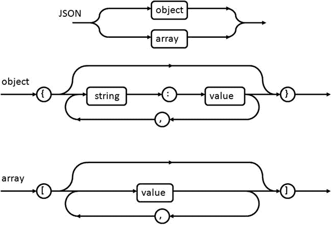
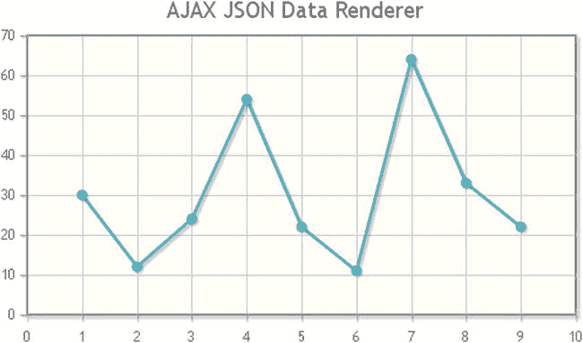
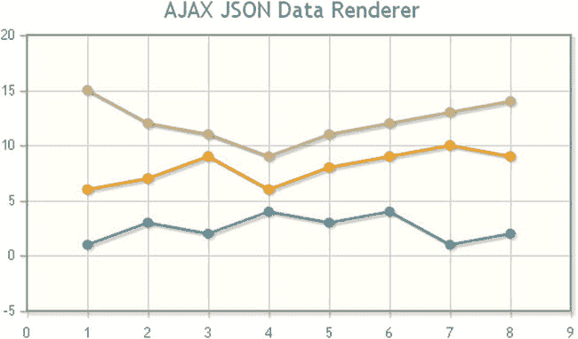
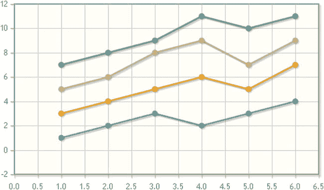
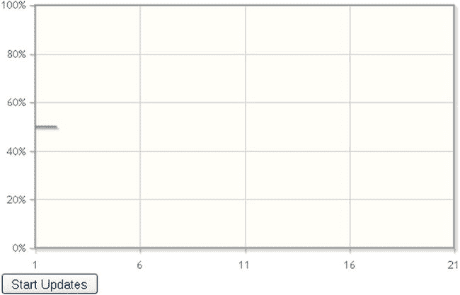
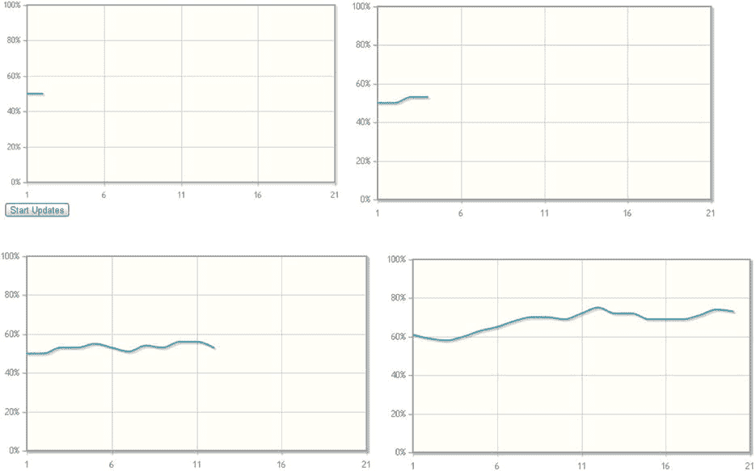

# 第 12 章：处理输入数据

一旦处理完图表的所有图形方面，就该更详细地分析输入数据了。在前面的章节中，您将输入数据的值分配给了数组。这些数组定义在与 jqPlot 代码相同的 HTML 页面中。您经常使用这两种方式：

```
var plot1 = $.jqplot ('chart1', [[100, 110, 140, 130, 80, 75, 120, 130, 100]]);
```

和

```
var data = [[100, 110, 140, 130, 80, 75, 120, 130, 100]];
```

实际上，为了获取这些数据，通常需要与其他技术进行交互，为此，您需要找到一种非常适合任何数据源的方法。需要使用一种通用的文本格式，这种格式易于被不同的脚本语言（尤其是 JavaScript）处理，并且对人类来说仍然易于理解，这导致了 JavaScript 对象表示法（JSON）格式的使用。您在第 1 章中已经简要了解了这种格式，但现在您将看到如何具体使用它来处理来自外部源的输入数据。

本章将详细研究 JSON 格式，首先说明这种格式的数据结构，然后向您展示如何将它们与 jqPlot 库一起使用。为此，您将看到两种处理 JSON 数据的不同方法——第一种使用 jqPlot 插件，第二种使用专门用于解析 JSON 数据的 jQuery 函数。

无论来自外部源的数据结构如何，如果您想全面了解真实数据的管理和处理，还需要考虑这些数据是如何生成的以及随之而来的获取方式。因此，在本章的最后部分，您将专门使用 jqPlot 库开发一个实时图表。

事实上，无论输入数据的格式如何，很多时候数据源不仅是外部的，而且是连续的——输入数据由一串数据组成，其中的值是一个接一个、连续不断地产生的。因此，显示此类数据的图表不仅需要管理来自外部源的数据格式，还需要能够持续自我更新，从而确保数据表示（在本例中为实时图表）始终是最新的。

## 使用 JSON 格式

本节将介绍 JSON 格式，包括将其与 jqPlot 库一起使用的各种选项。首先，您将通过分析一些语法图来了解 JSON 格式的数据是如何结构化的。然后，您将进入实践示例。

### JSON 格式

JSON 是一种数据交换格式。由于其树状结构，其中每个元素被称为一个名称-值对，因此人类易于读写，机器易于解析和生成。这是它日益普及的主要原因。

JSON 结构建立在两种不同结构的组合之上：数组和对象（参见图 12-1）。在它们内部，您可以定义所有常用的经典原始值，即使在其它语言中也是如此：数字、布尔值、字符串和空值。这使得其中包含的值可以在各种编程语言之间交换。（在 `www.json.org` 上，您可以找到所有处理 JSON 格式的语言列表，以及所有相关技术的列表，例如库、模块、插件等。）



图 12-1. JSON 的语法图

### 理解 JSON 语法图

为了更好地理解 Figure 12-1 中的语法图，你可以分析 JSON 格式的结构。需要注意两点：第一，对象和数组都包含一系列由图中`value`标签标识的值。`value`指的是任何类型的值，例如字符串、数字或布尔值，甚至可以是对象或数组。

此外，你可以很容易地推断出 JSON 结构是一个具有不同层级的树形结构。树的节点可以是数组或对象，而叶子节点则是其中包含的值。

## 示例分析

考虑一些示例。如果你有一个只有一层结构的 JSON，那么只有两种可能：

*   一个值数组
*   一个包含值的对象

如果将结构扩展到两层，则有四种可能（假设树是对称的）：

*   数组的数组
*   对象的数组
*   包含数组的对象
*   包含对象的对象

以此类推，情况会逐渐变得更加复杂。

经典的 JSON 结构正是你在本书中频繁使用的 jqPlot 库的`options`对象的结构。事实上，你已经看到，得益于每个值都关联了字符串的对象，这些树形结构可以描述任何类型的元素。即使是像图表这样非常复杂的元素，也能被轻松理解和操作。

## 实际案例：jqPlot 数据渲染器

# 使用外部数据源

本节将 JSON 作为一种交换格式，考虑外部数据源是文本文件的简单情况。在此示例中，你将使用由 jqPlot 库直接渲染的数据：`json2`插件。该插件允许你读取文件中 JSON 格式的数据，并将其用作输入数据。你唯一需要做的就是将外部源赋值给`dataRenderer`属性。

首先，创建一个空白 HTML 页面，如 Listing 12-1 所示。

`Listing 12-1`. ch12_01a.html

```
<HTML>
<HEAD>
    <TITLE>Chapter 12</TITLE>
<!--[if lt IE 9]>
<script type="text/javascript" src="../src/excanvas.js"></script>
<![endif]-->
<script type="text/javascript" src="../src/jquery.min.js"></script>
<script type="text/javascript" src="../src/jquery.jqplot.min.js"></script>
<link rel="stylesheet" type="text/css" href="../src/jquery.jqplot.min.css" />
<script>
$(document).ready(function(){
    //Add the JavaScript code here
});
</script>
</HEAD>
<BODY>
<div id="myChart" style="height:300px; width:500px;"></div>
</BODY>
</HTML>
```

为了让数据渲染器解释数据，外部源必须返回一个有效的 jqPlot 数据数组。要扩展图表以实现此功能，你需要包含`jqplot.json2`插件：

```
<script type="text/javascript" src="../src/plugins/jqplot.json2.min.js"></script>
```

或者使用内容分发网络（CDN）服务：

```
<script type="text/javascript"
    src="http://cdn.jsdelivr.net/jqplot/1.0.8/plugins/jqplot.json2.min.js"></script>
```

作为外部源，你可以选择一个包含数据的 TXT 文件。对于此示例，你将使用记事本或任何其他文本编辑器创建一个新的 TXT 文件。编辑好 Listing 12-2 中的数据后，将文件保存为`jsondata.txt`。

`Listing 12-2`. jsondata.txt

```
[[30, 12, 24, 54, 22, 11, 64, 33, 22]]
```

在你要管理外部文件中数据的网页上，需要添加 Listing 12-3 中的代码。

`Listing 12-3`. ch12_01a.html

```
$(document).ready(function(){
    var ajaxDataRenderer = function(url, plot, options) {
       var ret = null;
       $.ajax({
          async: false,
          url: url,
          dataType: "json",
          success: function(data) {
             ret = data;
          }
       });
       return ret;
    };
    var jsonurl = "./jsondata.txt";
    var options = {
       title: "AJAX JSON Data Renderer",
       dataRenderer: ajaxDataRenderer,
       dataRendererOptions: {
          unusedOptionalUrl: jsonurl
       }
    };
    $.jqplot ('myChart', jsonurl, options);
});
```

你将得到如 Figure 12-2 所示的图表，该图表直接从 TXT 文件获取数据。



Figure 12-2. 一个折线图，表示来自`jsondata.txt`文件的数据

如果你想插入多个序列，TXT 文件中的数据格式与输入数据数组使用的格式相同（参见 Listing 12-4）。使用编辑器将此数据复制到文件中后，将其保存为`jsondata2.txt`。

`Listing 12-4`. jsondata2.txt

```
[[1,3,2,4,3,4,1,2],
[6,7,9,6,8,9,10,9],
[15,12,11,9,11,12,13,14]]
```

Figure 12-3 显示了一个包含从 TXT 文件读取的三个序列的图表。



Figure 12-3. 一个多序列折线图，表示来自 TXT 文件的数据

## JSON 和 `$.getJSON()`

在 jqPlot 图表中使用外部 JSON 数据还有另一种方法。jQuery 提供了一个执行相同功能的方法，名为`$.getJSON()`，而不是使用`json2 jqPlot`插件作为数据渲染器。

此方法读取并解析 JSON 文件。它还可以通过发出 HTTP `GET`请求，直接从服务器加载 JSON 编码的数据。它被广泛应用于 Web 上的许多应用程序中，不仅仅用于 jqPlot。此方法有三个参数：

```
$.getJSON(url, data, success(data, textStatus, jqXHR));
```

只有`url`是必需的，其他两个参数是可选的。`url`是一个字符串，包含 JSON 文件的 URL 或请求的服务器 URL。`data`是一个字符串，将与请求一起发送到服务器，`success()`是一个回调函数，如果请求成功，它将被执行。

文件中包含的数据必须遵循 JSON 编码规则。因为你使用它们是为了被 jqPlot 编码，所以它们应该具有以下格式：

```
{ "series_name1": [ value1, value2, value3, ...],
  "series_name2": [ value1, value2, value3, ...], ... }
```

创建一个新的 TXT 文件并将其保存为`jsondata3.txt`。此文件包含来自四个不同序列的数据，如 Listing 12-5 所示。

`Listing 12-5`. jsondata3.txt

```
{"data1": [1,2,3,2,3,4],
 "data2": [3,4,5,6,5,7],
 "data3": [5,6,8,9,7,9],
 "data4": [7,8,9,11,10,11]}
```

下一步是调用`getJSON()`方法：

```
$.getJSON('./jsondata3.txt', '', myPlot);
```

你必须注意写入正确的 URL。在此示例中，TXT 文件与 HTML 文件位于同一目录中，因此你需要在文件名前添加`./`作为前缀。第二个参数是一个空字符串，因为你不需要向 URL 发送任何数据（它是一个文件，而不是服务器应用程序）。`myPlot`是函数的返回值，它检查`$.jqplot()`的加载是否成功。如 Listing 12-6 所示，你只需要添加自己的函数，并在其中定义`$.jqplot()`函数。在这种情况下，要传递的数据（例如`data1`、`data2`等）属于数据对象，因此必须作为`data.data1`、`data.data2`等传递。

`Listing 12-6`. ch12_02.html

```javascript
$(document).ready(function(){
    var myPlot = function (data, textStatus, jqXHR) {
       $.jqplot ('myChart', [data.data1, data.data2, data.data3, data.data4]);
    };
    $.getJSON('./jsondata3.txt', '', myPlot);
});
```

这样，您就获得了一个多系列折线图（参见图 12-4），效果如同直接在网页上编写数据，但通过与服务器及其他应用程序协作，您的能力得到了极大扩展。



图 12-4. 表示 TXT 文件中数据的多系列折线图

## 实时图表

实时图表会自动更新，从而让您能够表示来自持续产生数据源的数据流。该数据源可以是服务器、应用程序、连接到 PC 的设备等。正是在这种情况下，图表扮演了真正指示器的角色，即通过视觉方式指示某个属性如何随时间变化。

接下来，您将仅使用`jqPlot`库开发一个简单的实时折线图。例如，假设您要实现一个指示器，用于显示一个在 0%到 100%之间变化的量。这个量可以是某种资源（如 CPU）的消耗量，但也可以应用于许多其他场景，例如温度、参与者数量或连接数等。在本例中，您将从 50%的初始值开始，实时生成随机变化，这仅仅是为了模拟数据源。您可以将此示例适配到任何其他场景，只需将随机函数替换为从外部获取数据的函数即可。

您将实现一个包含折线图的网页，该图表中只有一小段设置为 50%的值（参见图 12-5）。这将是流式数据值的起点。



图 12-5. 获取数据前的实时图表，仅显示一小段作为起点

代码清单 12-7 展示了生成图 12-5 所示图表所需的全部代码。在`options`中，您定义了坐标轴的范围限制，以确保图表更新时坐标轴范围不变。为了使动画效果更流畅，您取消了线条上的标记并启用了`smooth`模式。在图表下方，您将插入一个按钮来启动实时更新。

`代码清单 12-7`. ch12_03.html

```html
<HTML>
<HEAD>
<TITLE>实时图表</TITLE>
<!--[if lt IE 9]>
<script type="text/javascript" src="../src/excanvas.js"></script>
<![endif]-->
<script type="text/javascript" src="../src/jquery.min.js"></script>
<script type="text/javascript" src="../src/jquery.jqplot.min.js"></script>
<link rel="stylesheet" type="text/css" href="../src/jquery.jqplot.min.css"/>
<script class="code" type="text/javascript">
$(document).ready(function(){
    data = [50, 50];
    var options = {
       axes: {
          xaxis: {min: 1, max: 21, numberTicks: 5},
          yaxis: {min: 0, max: 100, numberTicks: 6,
             tickOptions:{formatString: '%d%'}
          }
       },
       seriesDefaults: {
          showMarker: false,
          rendererOptions: {smooth: true}
       }
    };
var plot1 = $.jqplot ('myChart', [data], options);
});
</script>
</HEAD>
<BODY>
<div id="myChart" style="height: 300px; width: 500px;"></div>
<button>开始更新</button>
</BODY>
</HTML>
```

接下来，插入代码清单 12-8，您将捕获按钮的`click`事件，并将其链接到`doUpdate()`函数的执行。按钮被按下后，您可以将其从网页中删除。

`代码清单 12-8`. ch12_03.html

```javascript
$(document).ready(function(){
    ...
    var plot1 = $.jqplot ('myChart', [data], options);
    $('button').click(function(){
       doUpdate();
       $(this).hide();
    });
});
```

因此，在代码清单 12-9 中，您实现了生成随机变化的函数。

`代码清单 12-9`. ch12_03.html

```javascript
$(document).ready(function(){
    ...
    $('button').click(function(){
       doUpdate();
       $(this).hide();
    });
    function getRandomInt (min, max){
       return Math.floor(Math.random() * (max - min + 1)) + min;
    }
});
```

此函数生成介于`min`和`max`值（可以为负数）之间的整数值。这些值作为参数传递给函数。您设置了一个介于-3 和 3 之间的可能变化量，该变化量将应用于最后获取的值。实时值存储在一个名为`data`的数组中，该数组充当一种缓冲区。此数组仅包含 20 个值，因此最旧（最早）的值将被删除，新获取的值将插入到数组的最后一个位置。如图 12-4 所示，开始时您会看到一条振荡的线条，其长度延伸至整个图表。然后，线条的右端将随着所观察量的趋势而移动。

为了获得动画效果，您需要刷新图表，因此每次更新时，您需要销毁当前图表（`plot1`），用新数组替换数据数组，然后重新绘制整个`plot1`图表。最后，您需要调用`setTimeout()`函数，该函数将再次调用`doUpdate()`函数。这样，循环就会无限重复。您可以每秒（1000 毫秒）更新一次图表，但在其他情况下，这些值将根据源数据来选择。

继续向您的代码中添加代码清单 12-10。

`代码清单 12-10`. ch12_03.html

```javascript
$(document).ready(function(){
    ...
    function getRandomInt (min, max) {
       return Math.floor(Math.random() * (max - min + 1)) + min;
    }
    function doUpdate() {
       var last = data[data.length-1];
       if(data.length > 19){
          data.shift();
       }
       var newlast = last + getRandomInt(-3, 3);
       if(newlast < 0)
          newlast = 0;
       data.push(newlast);
       if (plot1) {
          plot1.destroy();
       }
       plot1.series[0].data = data;
       plot1.replot({resetAxes: true});
       plot1 = $.jqplot ('myChart', [data], options);
       setTimeout(doUpdate, 1000)
    }
});
```

图 12-6 展示了实时图表如何显示在 50%值附近变化的数据流。



图 12-6. 一个实时折线图，逐时刻显示数值

## 总结

在本章中，您了解了输入数据通常如何来自外部源，以及如何处理这些数据。特别地，您了解了如何将 JSON 格式的外部数据用作使用`jqPlot`库开发的图表的输入数据数组。关于实时生成数据的管理，您看到了一个简单但有效的示例，其中实现了一个实时折线图，该图表会随着获取数据的变化而更新。

