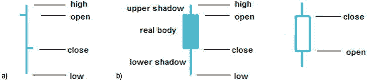
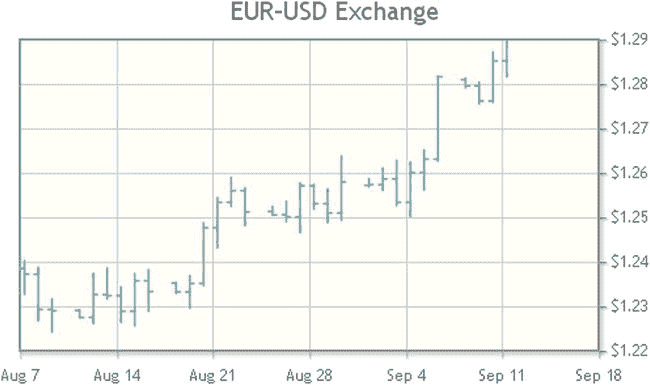
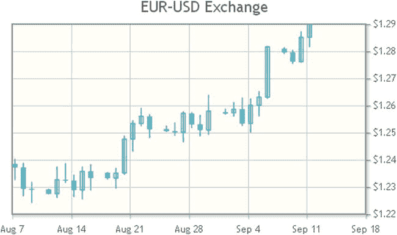
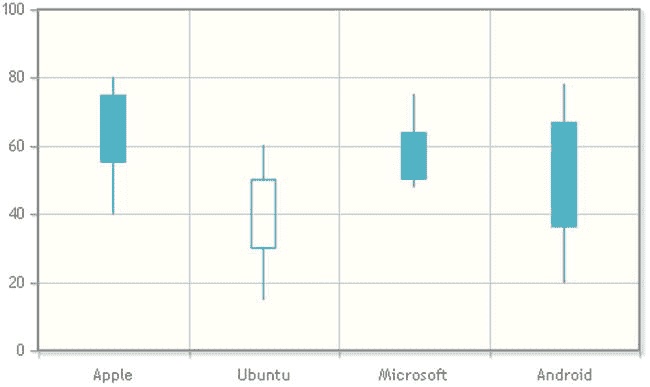

# 使用 jqPlot 绘制蜡烛图

## K 线图

K 线图广泛应用于分析货币随时间的变化或价格走势。这种图表由一系列称为 K 线的垂直柱状图组成。它们显示给定时间段内的开盘价、收盘价、最低价和最高价（参见图 7-1）。因此，这种图表通常被称为 OHLC 图（当它报告开盘-最高-最低-收盘值时）或 HLC 图（当它仅报告最高-最低-收盘值时）。


图 7-1. 表示 OHLC 数据的不同方式：(a) 线形，(b) 实体

K 线可以描绘为简单的线条，或描绘为两端带有线条（称为影线或阴影）的方框（称为实体）。每根 K 线的高度表示给定时间段内的价格范围。在方框表示法中，实体是开盘价和收盘价之间的区域。然而，如果 K 线由一条简单的垂直线表示，则两个小的水平刻度表示开盘价（左侧刻度）和收盘价（右侧刻度）。此外，在 K 线图中，数据点的颜色根据价格是上涨还是下跌而不同。

在本章中，你将看到如何表示特定的`OHLC`数据。你还将学习如何使用线条或实体来格式化此类图表。不过，首先你需要引入`OHLCRenderer`插件。

## OHLC 图

要使 jqPlot 能够绘制 K 线图，你必须在网页中包含一个特定的插件：`OHLCRenderer`。你还需要包含`DateAxisRenderer`插件，因为在 K 线图中，你通常将日期值放在 x 轴上：

```
<script type="text/javascript" src="../src/plugins/jqplot.dateAxisRenderer.min.js">
</script>
<script type="text/javascript" src="../src/plugins/jqplot.ohlcRenderer.min.js">
</script>
```

关于输入数据数组，你必须遵循特定的顺序：`['时间戳', 开盘价, 最高价, 最低价, 收盘价]`

在本例中，你将使用一组在线可用的真实数据。这些数据来自一个由名为 Dukascopy 的免费工具生成的逗号分隔值（CSV）文件，该工具也可在线获取（`www.dukascopy.com`）。你选择了 2012 年大约一个月期间的欧元兑美元汇率值。让我们将所有值赋给一个变量，如代码清单 7-1 所示。

***代码清单 7-1***. Ch7_01a.html

```javascript
var ohlc = [
['8/08/2012 0:00:01', 1.238485, 1.2327, 1.240245, 1.23721],
['8/09/2012 0:00:01', 1.23721, 1.22671, 1.23873, 1.229295],
['8/10/2012 0:00:01', 1.2293, 1.22417, 1.23168, 1.228975],
['8/12/2012 0:00:01', 1.229075, 1.22747, 1.22921, 1.22747],
['8/13/2012 0:00:01', 1.227505, 1.22608, 1.23737, 1.23262],
['8/14/2012 0:00:01', 1.23262, 1.23167, 1.238555, 1.232385],
['8/15/2012 0:00:01', 1.232385, 1.22641, 1.234355, 1.228865],
['8/16/2012 0:00:01', 1.22887, 1.225625, 1.237305, 1.23573],
['8/17/2012 0:00:01', 1.23574, 1.22891, 1.23824, 1.2333],
['8/19/2012 0:00:01', 1.23522, 1.23291, 1.235275, 1.23323],
['8/20/2012 0:00:01', 1.233215, 1.22954, 1.236885, 1.2351],
['8/21/2012 0:00:01', 1.23513, 1.23465, 1.248785, 1.247655],
['8/22/2012 0:00:01', 1.247655, 1.24315, 1.254415, 1.25338],
['8/23/2012 0:00:01', 1.25339, 1.252465, 1.258965, 1.255995],
['8/24/2012 0:00:01', 1.255995, 1.248175, 1.256665, 1.2512],
['8/26/2012 0:00:01', 1.25133, 1.25042, 1.252415, 1.25054],
['8/27/2012 0:00:01', 1.25058, 1.249025, 1.25356, 1.25012],
['8/28/2012 0:00:01', 1.250115, 1.24656, 1.257695, 1.2571],
['8/29/2012 0:00:01', 1.25709, 1.251895, 1.25736, 1.253065],
['8/30/2012 0:00:01', 1.253075, 1.248785, 1.25639, 1.25097],
['8/31/2012 0:00:01', 1.25096, 1.249375, 1.263785, 1.25795],
['9/02/2012 0:00:01', 1.257195, 1.256845, 1.258705, 1.257355],
['9/03/2012 0:00:01', 1.25734, 1.25604, 1.261095, 1.258635],
['9/04/2012 0:00:01', 1.25865, 1.25264, 1.262795, 1.25339],
['9/05/2012 0:00:01', 1.2534, 1.250195, 1.26245, 1.26005],
['9/06/2012 0:00:01', 1.26006, 1.256165, 1.26513, 1.26309],
['9/07/2012 0:00:01', 1.26309, 1.262655, 1.281765, 1.281625],
['9/09/2012 0:00:01', 1.28096, 1.27915, 1.281295, 1.279565],
['9/10/2012 0:00:01', 1.27957, 1.27552, 1.28036, 1.27617],
['9/11/2012 0:00:01', 1.27617, 1.2759, 1.28712, 1.28515],
['9/12/2012 0:00:01', 1.28516, 1.281625, 1.29368, 1.290235]];
```

在`options`中，你通过在`series`对象上调用`OHLCRenderer`插件来激活它。因为你需要处理 x 轴上的日期值，所以必须在`xaxis`对象中激活`dateAxisRenderer`对象。对于这种类型的图表，最好定义你想要表示的时间段，而不考虑输入数据，以便更精确地控制显示内容。为此，你在`xaxis`对象中指定了`min`和`max`属性。你还可以看到，使用`dateAxisRenderer`，你可以使用文字表达式（`'1 day'`、`'n days'`、`'1 week'`、`'n weeks'`、`'1 month'`、`'n months'`，其中`n`是任何大于 1 的整数）来选择刻度间隔。此外，请注意`yaxis`尚未定义，或者说 y 值已归属于`y2axis`。这样做是为了让 y 轴位于图表的右侧边缘，而不是默认的左侧边缘（参见代码清单 7-2）。

***代码清单 7-2***. ch12_01a.html

```javascript
var options = {
    title: 'EUR-USD Exchange',
    seriesDefaults:{ yaxis: 'y2axis'},
    axes: {
       xaxis: {
          renderer: $.jqplot.DateAxisRenderer,
          tickOptions: {formatString: '%b %e'},
          min: "08-07-2012 16:00",
          max: "09-12-2012 16:00",
          tickInterval: "1 weeks"
       },
       y2axis: {
          tickOptions:{ formatString: '$%.2f'}
       }
    },
    series: [{ renderer: $.jqplot.OHLCRenderer}]
};

$.jqplot('myChart', [ohlc], options);
```

现在你得到了图 7-2 中所示的 OHLC 图。


图 7-2. 一个带线条的 OHLC 图

## 使用真实 K 线实体和影线

你刚刚看到的 K 线图是用条形线格式化的。如果你想要一个带有真实 K 线实体和影线的盒子表示，你需要设置一个额外的属性：`candlestick`（参见清单 7-3）。

***清单 7-3***。`ch12_01b.html`

```javascript
series: [{
    renderer: $.jqplot.OHLCRenderer,
    rendererOptions:{ candleStick: true }
}]
```

现在，让我们看看替代条形线上水平刻度的真实 K 线实体。在图 7-3 中，白色盒子表示价格上涨（开盘价低于收盘价），黑色盒子表示价格下跌（收盘价低于开盘价）。


图 7-3。带有盒子的 OHLC 图表

## 比较 K 线图

有时，你需要比较特定时间点代表不同类别的 K 线图。在这种情况下，x 轴上没有日期，而是主题本身的名称。输入数据数组将有所不同；你必须使用从中获取数据的类别标签来分隔 OHLC 数据。对于每个实体，你插入一个包含五个值的数组：`[n, open, max, min, close]`

在这里，`n`是一个整数，对应于刻度数组的索引，而不是时间戳。因此，你在`data1`数组中定义这些 OHLC 值，如清单 7-4 所示。在`ticks`数组中，你使用四个不同的标签来指示四个 OHLC 值中的每一个。

***清单 7-4***。`Ch7_02.html`

```javascript
var data1 = [[1, 75, 80, 40, 55], [2, 30, 60, 15, 50],
             [3, 64, 75, 48, 50], [4, 67, 78, 20, 36]];
var ticks = ['Apple', 'Ubuntu', 'Microsoft', 'Android'];
```

你将调用`DateAxisRenderer`插件替换为调用`CategoryAxisRenderer`插件：

```
<script type="text/javascript" src="../src/plugins/jqplot.categoryAxisRenderer.min.js">
</script>
<script type="text/javascript" src="../src/plugins/jqplot.ohlcRenderer.min.js">
</script>
```

正如你在清单 7-5 中所见，`options`中的设置非常简单。首先，你必须在`renderer`属性中将`$.jqplot.DateAxisRenderer`替换为`$.jqplot.CategoryAxisRenderer`。此外，你将`ticks`数组分配给`xaxis`中的`ticks`对象。

***清单 7-5***。`Ch7_02.html`

```javascript
var options = {
    axes: {
       xaxis: {
          renderer: $.jqplot.CategoryAxisRenderer,
          ticks: ticks
       },
    },
    series: [{
       renderer: $.jqplot.OHLCRenderer,
       rendererOptions:{ candleStick: true}
    }]
};

$.jqplot ('myChart', [data1], options);
```

这个图表完美地展示了带有真实 K 线实体的盒子表示；当价格下跌时盒子被填充，当价格上涨时盒子为空（参见图 7-4）。


图 7-4。一个比较性的 K 线图

## 总结

在本章中，你已经了解了如何通过 K 线图来表示特定的 OHLC 数据。你还学习了如何使用线条或真实 K 线实体来格式化此类图表。在下一章中，我将讨论一整类具有共同特征的图表：它们的目标是表示数据的分布。通过这次探索，你将发现如何使用 jqPlot 库实现散点图、气泡图和块图。