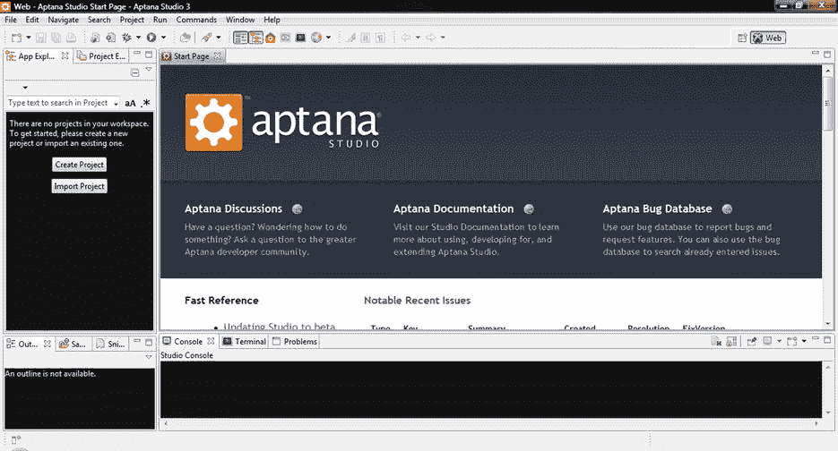
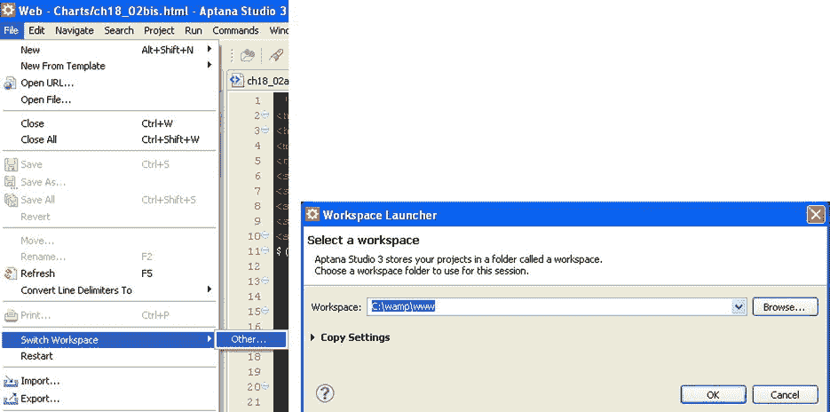
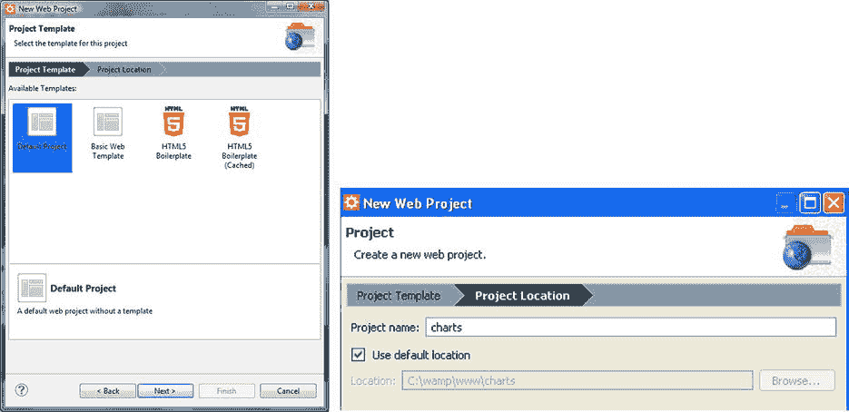
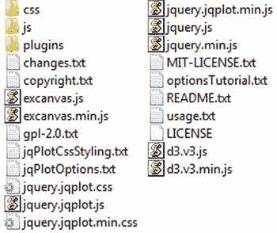
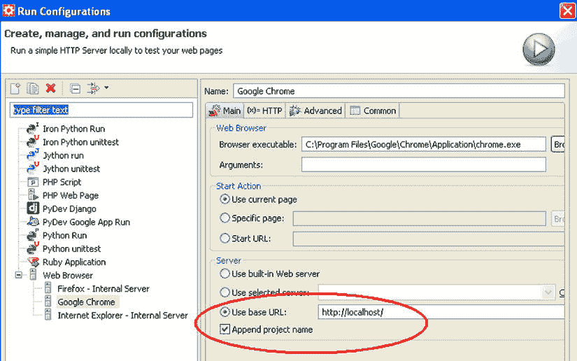

## 附录 A

## 本书示例指南


本附录提供了如何结合使用 XAMPP 和 Aptana Studio 在您的 PC 上创建一个开发环境的指南，该环境将允许您开发、运行和修复本书中给出的示例。

## 安装 Web 服务器

如今，在互联网上，您可以轻松找到免费的软件包，其中包含设置测试环境所需的一切，用于您的所有示例以及与 Web 世界相关的所有内容。

# Web开发环境搭建指南

这些软件包最大限度地减少了需要安装的程序数量。更重要的是，它们可以通过一次安装获得。这些软件包通常包含一个Apache HTTP服务器、一个MySQL数据库，以及用于编程语言PHP、Perl和Python的解释器。最完整的软件包是`XAMPP`（可从Apache Friends网站[`www.apachefriends.org/en/index.html`]下载）。`XAMPP`完全免费，其主要特点是它是一个跨平台软件包（支持Windows、Linux、Solaris、MacOS）。此外，`XAMPP`还包含一个`Tomcat`应用服务器（用于Java编程语言）和一个`FileZilla` FTP服务器（用于文件传输）。其他解决方案则特定于平台，如其名称的首字母所示：

*   `WAMP` (Windows)
*   `MAMP` (MacOS)
*   `LAMP` (Linux)
*   `SAMP` (Solaris)
*   `FAMP` (FreeBSD)

实际上，`XAMPP`是一个首字母缩略词；其字母代表以下术语：

*   `X`，代表操作系统
*   `A`，代表Apache，即Web服务器
*   `M`，代表MySQL，即数据库管理系统
*   `P`，代表PHP、Perl或Python，即编程语言

因此，选择最适合您平台的Web服务器解决方案，并将其安装在您的个人电脑上。

## 安装 Aptana Studio IDE

安装Web服务器后，需要安装一个集成开发环境（IDE），用于开发JavaScript代码。在本附录中，您将安装`Aptana Studio`作为您的开发环境。

访问`Aptana`网站 (`www.aptana.com`)，点击Products选项卡，找到`Aptana Studio 3`软件（在撰写本文时，最新版本为3.6.0）。下载独立版本（已集成Eclipse IDE）：`Aptana_Studio_3_Setup_3.6.0.exe`。

下载完成后，启动可执行文件以安装`Aptana Studio IDE`。安装结束时，启动应用程序，您应该会看到工作台打开，如图A-1所示。



图 A-1. Aptana Studio IDE 工作台

在安装`Aptana Studio`期间，软件会检测已安装的各种浏览器和Web服务器，并自动进行相应配置。

## 设置 Aptana Studio 工作空间

在开始开发本书中的示例之前，您必须创建一个工作空间。首先，您应该在`Aptana Studio`中设置工作空间，使其指向Web服务器的文档根目录。

以下是使用`XAMPP`时的典型路径：

*   Windows: `C:\xampp\htdocs`
*   Linux: `/opt/lamp/htdocs`
*   MacOS: `/Applications/XAMPP/xamppfiles/htdocs`

而对于`WAMP`，路径如下：

*   `C:\WAMP\www`

因此，从菜单中选择File  Switch Workspace  Other . . .。然后，在字段中输入Web服务器文档根目录的路径，如图A-2所示。



图 A-2. 在文档根目录上设置工作空间

## 创建项目

创建工作空间的下一步是在`Aptana Studio`中创建一个项目：

1.  从菜单中选择New  Web Project。
2.  出现如图A-3所示的窗口。选择Default Project，然后点击Next。
3.  输入“charts”作为项目名称。这将是工作空间中的一个目录，您将在此目录中使用`Aptana Studio`编写本书中描述的所有示例文件。



图 A-3. 创建默认项目

## 完成工作空间

设置好`Aptana Studio`工作空间并创建项目后，您就完成了工作空间的配置。

让我们打开文档根目录，并创建一个名为`src`的新目录。现在，您将在整本书中使用的工作空间由两个目录组成：

*   `src`
*   `charts`

`src`目录应包含所有与库相关的文件。

`charts`目录应包含与本书示例相关的所有HTML、图像和层叠样式表（CSS）文件（这实际上是一个项目）。每个示例文件都应在此目录中创建（如果您更喜欢以不同方式操作，也可以，但务必注意在HTML页面中引用库文件和图像时路径的不同）。

 **注意** 本书附带的源代码（可从Apress网站[`www.apress.com`]的源代码/下载区域获取）实际上已经打包在一个工作空间中。您会找到两个版本的`charts`项目：内容分发网络（CDN）版和本地版。`charts_CDN`目录包含所有引用CDN服务远程分发库的示例。`charts_local`目录包含所有引用`src`目录中库的示例。

## 用 jqPlot 库填充 src 目录

如果您选择通过引用本地库来开发HTML页面，则需要下载所有相关文件。这些文件将收集在`src`目录中。这是一个好方法，因为您可以开发多个使用相同库的项目，而无需为每个项目复制它们。

本附录中列出的版本是用于实现本书示例的版本。如果您安装其他版本，可能会出现不兼容问题，或者您可能会观察到与描述不同的行为。

### jqPlot 库版本 1.0.8（包含 jQuery 库版本 1.9.1）

1.  访问`jqPlot`网站 (`https://bitbucket.org/cleonello/jqplot/downloads/`)，下载该库的压缩文件（.zip、.tar.gz或tar.bz2）：`jquery.jqplot.1.0.8r1250`。
2.  解压所有内容。您应该会得到一个名为`dist`的目录，其中包含以下子目录和文件：
    *   `doc`
    *   `examples`
    *   `plugins`
    *   一系列文件（`jquery.min.js`、`jquery.jqplot.min.js`等）
3.  复制这组文件和`plugins`目录，并放入`src`中。

### jQuery UI 库版本 1.10.3，带有 smoothness 主题

1.  访问`jQuery`用户界面库（jQuery UI）网站 (`http://jqueryui.com/themeroller/`)，从`ThemeRoller`下载带有smoothness主题的库：`jquery-ui-1.10.3.custom.zip`。
2.  解压所有内容。您应该会得到一个名为`jquery-ui-1.10.3.custom`的目录，其中包含以下子目录：
    *   `css`
    *   `js`
    *   `development-bundle`
3.  复制`css`和`js`目录，并放入`src`中。

这样，您就得到了`src`目录，它应包含如图A-4所示的子目录和文件。



图 A-4. src 目录中包含的文件和子目录

 **注意** 按照惯例，您在`charts`目录中开发示例。如果您想以其他方式操作，则在将其他文件包含到网页中时，需要考虑新的路径。

如果您在`charts`目录内开发HTML页面，则需要使用以下代码：

```
<script type="text/javascript" src="../src/jquery.min.js"></script>
```

相反，如果您更愿意直接在文档根目录中开发，则使用以下代码：

```
<script type="text/javascript" src="src/jquery.min.js"></script>
```

简而言之，重要的是要考虑您正在包含的文件相对于您正在实现的页面的路径。

## 运行示例

在工作区创建或复制HTML文件后，若要在`Aptana Studio IDE`中运行它，请选择“运行”菜单中的“运行”，或单击工具栏上的“运行”按钮（参见图A-5）。


图 A-5. 工具栏上的“运行”按钮

您的默认浏览器将立即打开，并加载所选的HTML页面。

查看“运行配置”（参见图A-6），从“运行”图标的上下文菜单中选择“运行配置...”。例如，让我们将`http://localhost/`设置为您的基URL；为此，您需要选择“追加项目名称”选项，如图所示。然后，单击“应用”按钮以确认您的设置。



图 A-6. 必须为每个浏览器正确设置运行配置

现在，您已拥有轻松处理本书中所有示例所需的一切。

一旦您对`Aptana IDE`有了一定的熟悉度，您会发现它是一个开发许多其他项目（无论是JavaScript还是其他编程语言，如PHP）的绝佳环境。

那么，现在，尽情享受吧！

## 附录 A 总结

本附录提供了关于如何结合使用`XAMPP`和`Aptana Studio`在您的PC上创建开发环境的指南。选择使用这些应用程序并非强制性的，还有许多其他解决方案；互联网上有许多可用的应用程序可以执行类似的操作。但是，如果您希望实现并快速测试本书中描述的示例，这个环境将是一个不错的选择。

