# 使用 jqPlot 创建漏斗图

漏斗图用于展示数据在逐级向下传递时逐渐减少的过程。该图表由一个倒置的金字塔或漏斗组成，分为不同的层级。每个层级都有其自己的区域，该区域与给定的百分比值成比例。漏斗图与饼图类似，两者都将整体划分为各个组成部分。但是，漏斗图指定了层级，这些层级以非常精确的顺序依次排列。这种顺序可以表示层级顺序、流程步骤等。饼图无法做到这一点。

## 创建漏斗图

即使对于这种专门的图表，jqPlot 也提供了一个特定的插件：`FunnelRenderer`。因此，你需要包含它：

```html
<script type="text/javascript" src="../src/plugins/jqplot.funnelRenderer.min.js"></script>
```

或者，如果你更倾向于使用内容分发网络（CDN）服务，可以按如下方式操作：

```html
<script type="text/javascript" src="http://cdn.jsdelivr.net/jqplot/1.0.8/plugins/jqplot.funnelRenderer.min.js"></script>
```

使用 jqPlot 时，你必须了解此渲染器插件的一个特定行为：`FunnelRenderer` 会按降序重新排列数据。最大值显示在漏斗顶部，较小的值则放在下方。每个漏斗部分的面积对应于其数据点的值相对于所有值总和（百分比）的比例。使用此渲染器时，你需要为输入数据数组使用以下格式：

`['标签', 值]`

因此，对于此示例，定义数据数组如下所示：

```javascript
var data = [['索尼', 1], ['三星', 13], ['LG', 14], ['飞利浦', 5]];
```

对于 `options`，你必须在 `seriesDefaults` 对象中激活 `FunnelRenderer` 插件，并且可以选择添加一个图例来报告系列的标签，如代码清单 9-1 所示。

***代码清单 9-1***. Ch9_01a.html

```javascript
var options = {
    seriesDefaults: {
       renderer: $.jqplot.FunnelRenderer
    },
    title: {
       text: '基本漏斗图'
    },
    legend: {
       location: 'e',
       show: true
    }
};

$.jqplot('myChart', [data], options);
```

图 9-1 是一个基本的漏斗图。


图 9-1. 一个简单的漏斗图

如你所见，项目的顺序已更改，值最高的元素位于顶部，依此类推，直到值最低的项目。这是基本图表，但你可以对其进行丰富，例如，通过添加报告百分比的标签。为此，你必须添加 `dataLabel` 属性，将其设置为 `'percent'`，然后通过将 `showDataLabel` 设置为 `'true'` 来启用它（参见代码清单 9-2）。

***代码清单 9-2***. Ch9_01b.html

```javascript
seriesDefaults: {
    renderer: $.jqplot.FunnelRenderer,
    rendererOptions: {
       dataLabels: 'percent',
       showDataLabels: true
    }
},
```

如图 9-2 所示，百分比值现在显示在漏斗图的相应部分中。

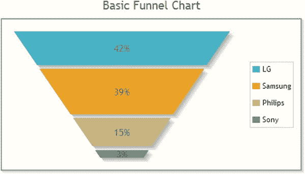

图 9-2. 带有图例和百分比的漏斗图

你可以进行进一步的更改。例如，假设你想要减小漏斗部分之间的间距，如图 9-3 所示。你可以通过传递给 `sectionMargin` 属性的值来实现这一点。通过将 `sectionMargin` 属性赋值为 `0`，你可以完全消除各部分之间的间距（参见代码清单 9-3）。

***代码清单 9-3***. Ch9_01c.html

```javascript
rendererOptions: {
    dataLabels: 'percent',
    showDataLabels: true,
    sectionMargin: 0
}
```

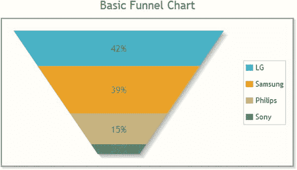

图 9-3. 各部分之间无间距的漏斗图
```

好的，作为一名高级文档工程师和翻译员，我将严格遵循您提供的注意事项和示例，将给定的英文文本翻译成中文。


# 排版后的内容

或者，您可能希望将各个扇区表示为未填充状态，并增加其边界线的宽度，如图 9-4 所示。为此，您需要使用两个属性：`fill` 和 `lineWidth`。首先，将 `fill` 属性设置为 `'false'`，这会使 jqPlot 绘制一个空白的扇区；然后，将 `lineWidth` 属性设置为 4，从而增加扇区边缘的厚度，使其更加清晰可见（请参阅代码清单 9-4）。

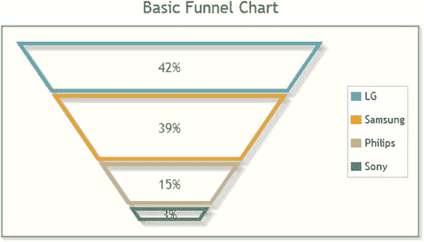

图 9-4. 一个未填充扇区的漏斗图

***代码清单 9-4***. Ch9_01d.html

```
rendererOptions: {
    dataLabels: 'percent',
    showDataLabels: true,
    fill: false,
    lineWidth: 4
}
```

## 总结

在本章中，您学习了如何制作特定类型的漏斗图，以及如何通过 `options` 更改它们的属性。

在下一章中，我将介绍一个在前几章中已经提及的主题：控件。我将阐述在图表中引入控件的重要性，并理解每个控件背后都隐藏着一个 `options` 的属性。这为用户提供了实时选择属性值的机会。

# 第 10 章


# 为图表添加控件

有时，在运行时直接从浏览器更改设置，然后使用这些新设置重新绘制图表会非常有用。一种典型的方法是添加活动控件。这些控件使图表具有交互性，允许用户实时做出选择，例如决定图表的呈现方式。通过插入控件，您赋予用户控制图表属性值的能力，而这些属性值通常需要在 `options` 中设置。

在本章中，您将学习如何在网页中引入控件。您还将考虑导致选择一种控件而非另一种的因素。一系列以三种最常用控件为例的示例，将带您更深入地探讨这个主题。

## 添加控件

一种对控件进行分组的方式是根据其功能。某些控件（例如，按钮、菜单）作为开关（命令控件）工作，用户可以通过它们触发特定事件或启动命令。其他控件（例如，复选框、单选按钮、组合框、滑块）则绑定到特定的值或属性。使用这类控件，用户可以通过文本字段（文本区域）进行选择或输入值。还有一些控件（例如，滚动条）具有导航功能，特别适用于需要移动对象的情况，例如移动列表中的选中项或框架/网页中的大图。

在这里，您将研究那些与值相关联的控件，这些控件允许用户通过做出选择来与图表进行交互。这些控件应以某种图形方式表示特定属性可以取的值（这些值通常就是您在 `options` 对象中分配给属性的值，但仅限于您希望提供给用户的那部分）。您对控件的选择将取决于要设置的属性及其可以取的值：

*   要允许用户从一组值中做出单一选择（例如，三种可能的颜色之一），选择互斥的单选按钮作为控件是最佳的（参见图 10-1a）。
*   要允许用户选择图表中应显示哪些系列，您需要使用复选框（参见图 10-1b）。
*   要允许用户在特定属性的值范围内进行选择（例如，通过调整定义颜色的红绿蓝 (RGB) 值来更改对象的颜色），滑块通常是最佳选择（参见图 10-1c）（在这种情况下，您将使用三个滑块作为控件，分别对应红色、绿色和蓝色）。

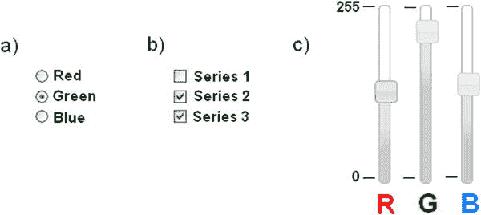

图 10-1. 三种最常用的控件：(a) 单选按钮，(b) 复选框，(c) 滑块

可能的控件列表并不仅限于此。但是，理解这些控件背后的机制，能使图表开发人员处理绝大多数情况，包括那些最复杂的情况。

在接下来的示例中，您将了解如何将这三种控件应用到您的图表中。

## 使用单选按钮

为了说明控件的使用，让我们首先看看单选按钮。单选按钮是一组以列表形式分组的小按钮（参见图 10-1a）。它们通常表示为小的空心圆圈，旁边带有文本。如前所述，这种类型的控件与某个值或属性相关联。单选按钮的特殊之处在于它们的值是互斥的；因此，用户只能选择其中一个。

举例来说，我们以一个简单的多系列折线图为例，您希望允许用户决定显示哪个系列，而不是显示所有系列。要进行选择，用户将单击其中一个单选按钮，用圆点填充该圆圈。与该控件对应的系列随后将被绘制在图表上。

### 添加单选按钮控件

首先，您需要编写 HTML 页面，并导入所有必要的库（参见代码清单 10-1）。

***代码清单 10-1***. ch10_01.html

```
<HTML>
<HEAD>
<TITLE>使用控件选择系列</TITLE>
<!--[if lt IE 9]>
<script type="text/javascript" src="../src/excanvas.js"></script>
<![endif]-->
<script type="text/javascript" src="../src/jquery.min.js"></script>
<script type="text/javascript" src="../src/jquery.jqplot.min.js"></script>
<link rel="stylesheet" type="text/css" href="../src/jquery.jqplot.min.css"/>
<script>
$(document).ready(function(){

//在此处添加您的代码

});
</script>
</HEAD>
<BODY>
<div id="myChart" style="height: 300px; width: 500px;"></div>
    <!-- 在此处添加包含控件的表格 -->
</BODY>
</HTML>
```

或者，如果您更喜欢使用内容分发网络 (CDN) 服务，可以使用以下代码：

```
<!--[if lt IE 9]>
<script src="http://cdn.jsdelivr.net/excanvas/r3/excanvas.js"></script>
<![endif]-->
<script src="http://code.jquery.com/jquery-1.9.1.min.js"></script>
<script type="text/javascript"
    src="http://cdn.jsdelivr.net/jqplot/1.0.8/jquery.jqplot.min.js"></script>
<link rel="stylesheet" type="text/css"
    href="http://cdn.jsdelivr.net/jqplot/1.0.8/jquery.jqplot.min.css"/>
```

您从一个折线图开始，其中将表示四组值。每个系列中的每个元素将由一个 (x, y) 值对表示；您将这四个系列的值插入到 jQuery `$(document).ready()` 函数内定义的数据集中，如代码清单 10-2 所示。

***代码清单 10-2***. ch10_01.html


```javascript
var dataSet = {
    data1: [[1, 1], [2, 2], [3, 3], [4, 2], [5, 3], [6, 4]],
    data2: [[1, 3], [2, 4], [3, 5], [4, 6], [5, 5], [6, 7]],
    data3: [[1, 5], [2, 6], [3, 8], [4, 9], [5, 7], [6, 9]],
    data4: [[1, 7], [2, 8], [3, 9], [4, 11], [5, 10], [6, 11]]
};
```

但是，与之前用不同颜色的线条显示所有四个序列不同，这次你为用户提供了每次只显示一个序列的机会。图表在浏览器中加载后，用户将能够选择四个序列中的任意一个并在它们之间切换，而无需加载新页面。

你首先只展示第一个序列（`data1`）（参见清单 10-3）。

***清单 10-3***. ch10_01.html

```javascript
var options = {
    seriesDefaults: {
       showMarker: false
    },
    title: '序列选择',
    axes: {
       xaxis: {},
       yaxis: {
          min: 0,
          max: 12
       }
    }
};

var plot1 = $.jqplot ('myChart', [dataSet.data1], options);
```

 **注意** 在此示例中，你将 `$.jqplot()` 函数返回的值存储在 `plot1` 变量中。这使你能够访问 `jqplot` 对象的内容、更改其值并调用其方法，包括 `replot()` 函数，该函数允许你重新绘制图表并包含新的更改。

用户将从一组可能的选项中选择一个；单选按钮是实现此目的的最佳控件选择。因此，让我们为每个单选按钮分配一个序列。如清单 10-4 所示，所有控件（按钮）都包含在表格内的一个内部列表中。每个按钮由一个 `<input>` 元素指定，其中四个序列也作为值被指定。

***清单 10-4***. ch10_01.html

```html
<table>
<tr>
  <td>
    <div>
      <ul>
        <li><input name="dataSeries" value="data1" type="radio" checked />第一序列</li>
        <li><input name="dataSeries" value="data2" type="radio" />第二序列</li>
        <li><input name="dataSeries" value="data3" type="radio" />第三序列</li>
        <li><input name="dataSeries" value="data4" type="radio" />第四序列</li>
       </ul>
    </div> </td>
</tr>
</table>
```

然而，仅在 HTML 页面中设置控件定义是不够的；你还必须创建将单选按钮与 jqPlot 图表关联起来的函数。根据哪个单选按钮处于 `checked` 状态，图表中将加载数据集中的不同集合。

当用户选择不同的单选按钮时，会将 `checked` 属性从 `'false'` 更改为 `'true'`。单选按钮的状态变化会触发 `change()` 函数，该函数会检测到此事件。此函数将数据集中的新集合分配给 `plot1` 变量（包含有关 jqPlot 图表的所有信息），并最终强制重新绘制图表。这样，新数据就会在图表中呈现，而无需重新加载页面（参见清单 10-5）。

***清单 10-5***. ch10_01.html

```javascript
$(document).ready(function(){
    ...
    var plot1 = $.jqplot ('myChart', [dataSet.data1], options);
    $("input[type=radio][name=dataSeries]").attr("checked", false);
    $("input[type=radio][name=dataSeries][value=data1]").attr("checked", true);
    $("input[type=radio][name=dataSeries]").change(function(){
       var val = $(this).val();
       plot1.series[0].data = dataSet[val];
       plot1.replot();
    });
});
```

要自定义控件表格内的元素，你可以添加一些层叠样式表（CSS）样式，如清单 10-6 所示。

***清单 10-6***. ch10_01.html

```css
<style>
li {
    font-family: "Verdana";
    font-size: 16px;
    font-weight: bold;
    text-shadow: 1px 2px 2px #555555;
    margin: 3px;
    list-style: none;
}
</style>
```

如果你在浏览器中加载此网页，你将得到图 10-2 中的图表。

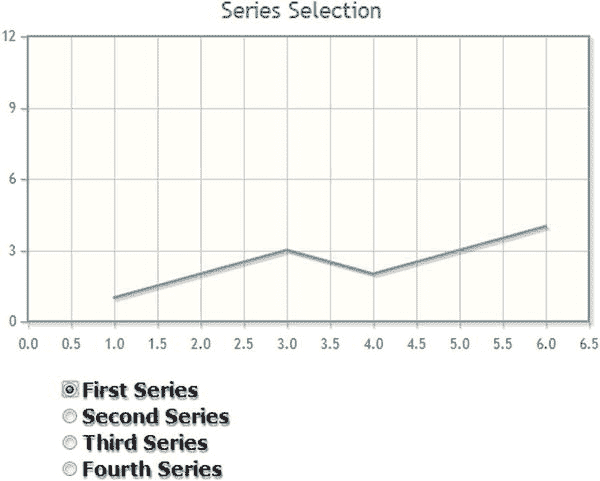

图 10-2. 使用单选按钮可以选择仅显示一个数据序列

现在，用户可以选择图表中要显示的序列。通过选择单选按钮作为控件，图表每次将只显示一组数据。

## 在图表绘制完成后访问属性

到目前为止，你已使用 `options` 对象来定义图表的属性值（通过更改默认值），然后将其作为参数传递给 `$.jqplot()` 函数。但这仅适用于在图表绘制之前对其进行设置。如果之后需要访问属性值，该怎么办？

事实上，通过将控件作为参数引入，你也引入了在图表绘制后更改这些属性的可能性。因此，必须有一种方法来访问这些值、编辑它们，然后运行命令重新绘制图表（就像你使用 `replot()` 函数时一样）（参见清单 10-5）。

你已经看到，你可以将 `$.jqplot()` 函数返回的整个 `jqplot` 对象作为值接收，并将其存储在一个变量中（在前面的示例中，是 `plot1` 变量），以便稍后访问其内容。

一个 `jqplot` 对象几乎包含了定义整个 jqPlot 库的所有对象及其属性和方法，并且每个特定的实例（例如 `plot1`）都是在特定图表的表示中实现的。

因此，当你编写 JavaScript 代码来定义处理特定事件（例如用户使用控件）的函数时，你可以在页面绘制图表后访问这些值并更改它们，然后运行命令以所需的更改重新绘制图表。这为你需要的图表增加了交互性。

继续前面的示例（参见清单 10-1 到 10-6），你会注意到所有线条都绘制为蓝色。现在让我们做一些更改，以便这次用户可以选择绘制序列的颜色。

为此，你在表格中添加另一组控件：第二列单选按钮，每个按钮代表一种颜色（参见清单 10-7）。

***清单 10-7***. ch10_02.html

```html
<table>
<tr>
  <td>
    <div>
       <ul>
          <li><input name="dataSeries" value="data1" type="radio" checked />第一序列</li>
          <li><input name="dataSeries" value="data2" type="radio" />第二序列</li>
          <li><input name="dataSeries" value="data3" type="radio" />第三序列</li>
          <li><input name="dataSeries" value="data4" type="radio" />第四序列</li>
      </ul>
    </div>
  </td>
  <td>
    <div>
       <ul>
          <li><input name="colors" value="#4bb2c5" type="radio" checked />蓝色</li>
          <li><input name="colors" value="#ff3333" type="radio" />红色</li>
          <li><input name="colors" value="#44bb44" type="radio" />绿色</li>
          <li><input name="colors" value="#ffaa22" type="radio" />橙色</li>
      </ul>
    </div>
  </td>
</tr>
</table>
```

接下来，将清单 10-8 中以粗体突出显示的行添加到你的 JavaScript 代码中。

***清单 10-8***. ch10_02.html

```javascript
$("input[type=radio][name=dataSeries]").attr("checked", false);
$("input[type=radio][name=dataSeries][value=data1]").attr("checked", true);
$("input[type=radio][name=dataSeries]").change(function(){
    var val = $(this).val();
    plot1.series[0].data = dataSet[val];
    plot1.series[0].renderer.shapeRenderer.strokeStyle = col;
    plot1.replot();
});

var col = "#4bb2c5";
$("input[type=radio][name=colors]").change(function(){
    col = $(this).val();
});
```

图 10-3 展示了用户如何通过选择四种不同颜色来决定要表示的数据系列。这是一个通过添加控件来增强用户与图表之间交互性的示例。

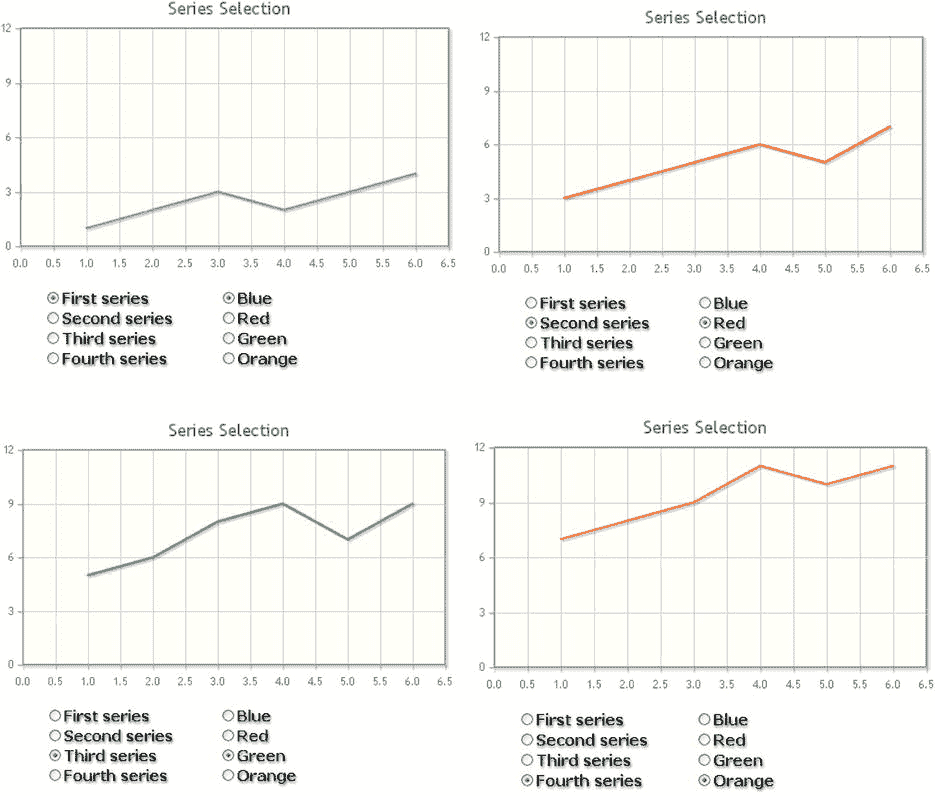

图 10-3. 用户可以选择不同的颜色与系列组合

## 使用滑块

在前一个示例中，用户首先通过勾选第二列中的某个单选按钮来设置颜色，然后从第一列中选择要用该颜色表示的数据系列。因此，这个过程涉及两次选择，且发生在两个不同的时间点。这一次，我们将保持第一列不变（用户从中选择要显示的数据系列，且互斥），但用一组三个滑块来替换单选按钮列。在这种场景下，用户选择要显示的数据系列，当该系列以预定义颜色绘制在图表上后，用户可以通过调整构成颜色的三个 RGB 值来修改它。现在，我们有了一个选择，随后进行微调。

当需要在一个给定范围内滚动连续值来改变某个属性的值时，滑块就是所需的控件类型。在本例中，需要三个滑块，分别对应红色、绿色和蓝色，这样用户就可以调整 RGB 值来获得所需的颜色。

沿用上一个示例（参见代码清单 10-7 和 10-8），我们首先选择 jQuery 界面库（jQuery UI）来获取滑块（关于如何使用 jQuery UI 组件实现滑块的详细信息，请参见第 2 章）。因此，在将滑块添加到网页之前，必须导入该库的所有必要文件：

```html
<link rel="stylesheet"
    href="http://code.jquery.com/ui/1.10.3/themes/smoothness/jquery-ui.css"/>
<script src="http://code.jquery.com/ui/1.10.3/jquery-ui.min.js"></script>
```

 **注意** 如果你在本书附带的源代码所提供的工作区中工作（参见附录 A），可以使用以下引用访问工作区中已包含的库：

```html
<link rel="stylesheet" href="../src/css/smoothness/jquery-ui-1.10.3.custom.min.css"/>
<script type="text/javascript" src="../src/js/jquery-ui-1.10.3.custom.min.js"></script>
```

导入所有文件后，就可以开始在 HTML 表格中插入三个滑块了。如代码清单 10-9 所示，我们删除了包含单选按钮的第二列，并用一组 `<div>` 元素替换它（如果你直接从这一步开始，可以复制整个代码清单，而不仅仅是粗体文本）。jQuery UI 会将它们转换为滑块（参见第 2 章）。

***代码清单 10-9***. ch10_04.html

```html
<table>
<tr>
   <td>
      <div>
         <ul>
           <li><input name="dataSeries" value="data1" type="radio" checked />第一系列</li>
           <li><input name="dataSeries" value="data2" type="radio" />第二系列</li>
           <li><input name="dataSeries" value="data3" type="radio" />第三系列</li>
           <li><input name="dataSeries" value="data4" type="radio" />第四系列</li>
         </ul>
      </div>
   </td>
   <td>
       <div id="red">
          <div id="slider-text">
             <div id="0">0</div>
             <div id="1">255</div>
          </div>
       </div>
       <div id="green">
          <div id="slider-text">
             <div id="0">0</div>
             <div id="1">255</div>
          </div>
       </div>
       <div id="blue">
          <div id="slider-text">
             <div id="0">0</div>
             <div id="1">255</div>
          </div>
       </div>
   </td>
</tr>
</table>
```

此外，我们还为每个滑块添加了两个数值，并使用了 `slider-text id`。这些值只是用于显示三个滑块所覆盖的值范围（0–255）的最小值和最大值的标签。当需要在网页中为每个滑块表示一个刻度时，这种方法非常有用。

现在，让我们添加所有 CSS 样式指令，以确保这些新控件能够在现有页面的上下文中正确显示（参见代码清单 10-10）。

***代码清单 10-10***. ch10_04.html

```css
<style>
...
#red, #green, #blue {
    float: left;
    margin: 15px;
    left: 50px;
}
#red .ui-slider-range {
    background: #ef2929;
}
#red .ui-slider-handle {
    border-color: #ef2929;
}
#green .ui-slider-range {
    background: #8ae234;
}
#green .ui-slider-handle {
    border-color: #8ae234;
}
#blue .ui-slider-range {
    background: #729fcf;
}
#blue .ui-slider-handle {
    border-color: #729fcf;
}
#slider-text div {
    font-family: "Verdana";
    font-size: 10px;
    position: relative;
    left: 17px;
}
</style>
```

关于 JavaScript 代码部分，我们只保留管理用于选择所需系列的单选按钮的部分，并将其与处理通过三个滑块调整的 RGB 值的新代码部分集成，如代码清单 10-11 所示。然后，这三个 RGB 值通过一个适当的函数转换为十六进制数字，并组合成 HTML 颜色代码，该代码由井号（`#`）后跟六个十六进制字符（`'rrggbb'`）表示，其中每对字符代表一个从 0 到 255 的值，并转换为十六进制格式。

***代码清单 10-11***. ch10_04.html

```javascript
$(document).ready(function(){

...

$("input[type=radio][name=dataSeries]").attr("checked", false);
    $("input[type=radio][name=dataSeries][value=data1]").attr("checked", true);
    $("input[type=radio][name=dataSeries]").change(function(){
       var val = $(this).val();
       plot1.series[0].data = dataSets[val];
       plot1.series[0].renderer.shapeRenderer.strokeStyle = "#" + col;
       plot1.replot();
    });

var col = "4bb2c5";

function hexFromRGB(r, g, b) {
       var hex = [
          r.toString(16),
          g.toString(16),
          b.toString(16)
       ];
       $.each(hex, function(nr, val) {
          if ( val.length === 1 ) {
             hex[nr] = "0" + val;
          }
       });
       return hex.join("").toUpperCase();
   };

$("#red, #green, #blue").slider({
       orientation: "vertical",
       range: "min",
       max: 255,
       change: refreshPlot
    });

// 将 col 设置为默认值 "#4bb2c5";
    $("#red").slider("value", 255);
    $("#green").slider("value", 140);
    $("#blue").slider("value", 60);
```

```javascript
function refreshPlot() {
    var r = $("#red").slider("value");
    var g = $("#green").slider("value");
    var b = $("#blue").slider("value");
    var col = hexFromRGB(r, g, b);
    plot1.series[0].renderer.shapeRenderer.strokeStyle = "#" + col;
    plot1.replot();
}

$("[id=0]").css('top','90px');
$("[id=1]").css('top','-20px');
```

清单 10-11 中的最后两行代码使用了 jQuery 的 `css()` 函数，为特定的 HTML 元素选择集分配 CSS 样式（参见第 2 章）。该选择针对所有 `id = 0` 和 `id = 1` 的元素，即包含滑块刻度标签的 `<div>` 元素。通过设置 CSS 的 `top` 属性，可以将每个刻度标签放置在对应滑块旁边的特定高度位置。

在图 10-4 中，用户可以通过三个滑块修改 RGB 值，来决定要显示的数据系列并更改其颜色。

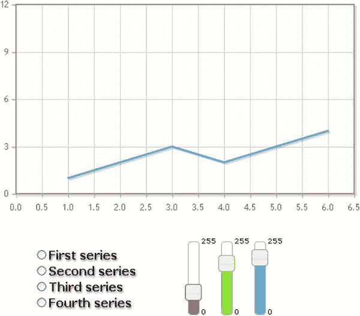

图 10-4. 添加了三个滑块控件以调整 RGB 级别的图表

## 使用复选框

在前面的示例中，用户只能从可显示的多个数据系列中选择一个。然而，用户通常希望能够决定哪些系列应该显示，哪些不应该显示，例如，同时显示两个或更多数据集。这涉及到在同一组内进行多项选择。为了让用户能够做出这种选择，你必须使用复选框。

通常，复选框以列表形式分组，由空框表示（参见图 10-1）。与单选按钮不同，这些控件不是互斥的，而是多选的。因此，你可以选择它们所代表的所有值、部分值或完全不选（而使用单选按钮时，必须选中一个项目）。

与单选按钮类似，每个数据系列都有一个复选框，如果某个复选框被选中，则对应的系列会显示在图表中。然而，与单选按钮不同的是，复选框彼此独立：它们的状态（选中或未选中）不会影响其他复选框的状态。

通常，当你有一组复选框时，添加两个具有“全选/取消全选”功能的按钮会非常有用，从而允许用户一键选择/取消选择所有复选框。

使用前面的示例（参见清单 10-9 到 10-11），数据集和选项设置保持不变；唯一需要更改的是传递给 `$.jqplot()` 函数的数据。在这种情况下，整个数据集将作为参数传递。

```javascript
var plot1 = $.jqplot ('myChart', [dataSet.data1, dataSet.data2, dataSet.data3, dataSet.data4], options);
```

让我们删除包含先前控件（单选按钮、滑块）的表格，并用一个包含复选框的新表格替换它，如清单 10-12 所示（如果你直接从这里开始，可以复制整个清单，无需考虑之前的控件）。此外，除了对应各个系列的四个控件外，你还可以在末尾添加一个按钮来管理“全选/取消全选”功能。

***清单 10-12***. ch10_03.html

```html
<table>
<tr>
   <td>
      <div>
        <ul>
          <li><input name="data1" type="checkbox" checked />第一系列</li>
          <li><input name="data2" type="checkbox" checked />第二系列</li>
          <li><input name="data3" type="checkbox" checked />第三系列</li>
          <li><input name="data4" type="checkbox" checked />第四系列</li>
          <li><input type="button" name="checkall" value="取消全选"></li>
        </ul>
      </div>
    </td>
</tr>
</table>
```

与单选按钮一样，你需要添加 jQuery 方法来绑定这些控件触发的事件。首先，定义每个复选框的状态。通常，它们应该全部被选中。然后，定义五个 jQuery 方法，用于启用或禁用要显示的数据系列，并强制重新绘制图表。

从代码中，你必须删除所有处理先前控件的行，并在其位置写入清单 10-13 中的方法。

***清单 10-13***. ch10_03.html

```javascript
$("input[type=checkbox][name=data1]").change(function(){
    if(this.checked){
       plot1.series[0].data = dataSet.data1;
       plot1.replot();
    } else {
       plot1.series[0].data = [];
       plot1.replot();
    }
});

$("input[type=checkbox][name=data2]").change(function(){
    if(this.checked){
       plot1.series[1].data = dataSet.data2;
       plot1.replot();
    } else {
       plot1.series[1].data = [];
       plot1.replot();
    }
});

$("input[type=checkbox][name=data3]").change(function(){
    if(this.checked){
       plot1.series[2].data = dataSet.data3;
       plot1.replot();
    } else {
       plot1.series[2].data = [];
       plot1.replot();
    }
});

$("input[type=checkbox][name=data4]").change(function(){
    if(this.checked){
       plot1.series[3].data = dataSet.data4;
       plot1.replot();
    } else {
       plot1.series[3].data = [];
       plot1.replot();
    }
});

$("input[type=button][name=checkall]").click(function(){
    if(this.value == "全选"){
       plot1.series[0].data = dataSet.data1;
       plot1.series[1].data = dataSet.data2;
       plot1.series[2].data = dataSet.data3;
       plot1.series[3].data = dataSet.data4;
       $("input[type=checkbox][name=data1]").prop("checked", true);
       $("input[type=checkbox][name=data2]").prop("checked", true);
       $("input[type=checkbox][name=data3]").prop("checked", true);
       $("input[type=checkbox][name=data4]").prop("checked", true);
       this.value = "取消全选";
       plot1.replot();
    } else {
       plot1.series[0].data = [];
       plot1.series[1].data = [];
       plot1.series[2].data = [];
       plot1.series[3].data = [];
       $("input[type=checkbox][name=data1]").prop("checked", false);
       $("input[type=checkbox][name=data2]").prop("checked", false);
       $("input[type=checkbox][name=data3]").prop("checked", false);
       $("input[type=checkbox][name=data4]").prop("checked", false);
       this.value = "全选";
       plot1.replot();
    }
});
```

如图 10-5 所示，用户现在可以选择希望在图表中显示的数据系列。

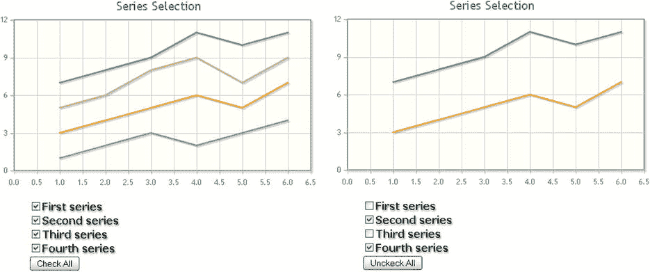

图 10-5. 带有复选框和按钮的自定义图例

如果你点击标有“取消全选”的按钮，所有复选框都将被取消选中，对应的数据系列将在图表中隐藏。随后，该按钮将显示标签“全选”。此时再次点击它，所有复选框都将被选中，对应的数据系列将显示在图表中。

最后一个示例中涵盖的功能与 *EnhancedLegendRenderer* 插件提供的图例非常相似（参见第 5 章中的“处理图例”部分）。在那种情况下，通过点击对应数据系列的彩色方块，你可以决定该系列是否应在图表中显示。但是，在这里，你还增加了一键全选和取消全选所有系列的可能性，而此功能目前尚未在该插件中实现（尽管有人正在提议添加）。这是另一个关于如何通过使用控件来扩展库所提供功能的小例子。

## 总结


# 第 11 章 将 jqPlot 图表嵌入 jQuery 小部件

在本章中，你已经了解了如何使用各种控件（例如**单选按钮**、**滑块**和**复选框**）来增强图表的交互性。随着控件的引入，我们作为程序员不再是唯一能够直接控制图表属性值的人；通过此类控件，用户也能够做出适当的选择。

此外，你还学习了如何将**jQuery UI 小部件**与`jqPlot`库集成，并将这些小部件**作为控件**使用。在下一章中，你将通过使用 jQuery UI 小部件**作为容器**来完善这一集成。这种组合极大地扩展了使用`jqPlot`库开发和呈现图表的可能性。

---

## 将 jqPlot 图表嵌入 jQuery 小部件

在第 2 章中，你看到了几个将 jQuery UI 小部件用作容器的示例。在本章中，你将利用这种能力在这些容器内呈现图表。这使你能够利用 jQuery UI 小部件的巨大潜力，进一步改进图表的呈现方式。

结合 jQuery UI 和`jqPlot`库的优势是多方面的：你可以在网页中占用相同空间的情况下显示更多图表，同时保持页面上下文的整洁有序。另一个优势是 jQuery UI 小部件可以调整大小，用户甚至也可以调整`jqPlot`图表的大小。

在本章中，你将探讨三个简单的案例，这些案例将充分展示上述优势。你还会更加熟练地使用 jQuery UI 小部件，甚至比在第 2 章中更加得心应手。

### 在选项卡中显示 jqPlot 图表

你将用作容器的第一个小部件是**选项卡**（参见第 2 章中的“选项卡”一节）。将图表插入选项卡内部，可以在有限区域内于同一页面上显示不同的图表。在此示例中，你将在三个选项卡（分别名为`Tab 1`、`Tab 2`和`Tab 3`）中放置三个不同的`jqPlot`图表。在第一个选项卡中放置柱状图，第二个选项卡中放置多系列折线图，最后一个选项卡中放置饼图。你不会详细分析这些图表，因为它们与前面章节中使用的图表类型完全相同。每种图表类型都需要其特定的插件，清单 11-1 列出了所需的插件。

***清单 11-1***. `ch11_01.html`

```html
<!--[if lt IE 9]>
<script src="http://cdn.jsdelivr.net/excanvas/r3/excanvas.js"></script>
<![endif]-->
<script src="http://code.jquery.com/jquery-1.9.1.min.js"></script>
<script src="http://cdn.jsdelivr.net/jqplot/1.0.8/jquery.jqplot.min.js">
</script>
<link rel="stylesheet" type="text/css"
    href="http://cdn.jsdelivr.net/jqplot/1.0.8/jquery.jqplot.min.css" />
<script src="http://cdn.jsdelivr.net/jqplot/1.0.8/plugins/jqplot.pieRenderer.min.js">
</script>
<script type="text/javascript" src="http://cdn.jsdelivr.net/jqplot/1.0.8/plugins
    /jqplot.dateAxisRenderer.min.js"></script>
<script type="text/javascript" src="http://cdn.jsdelivr.net/jqplot/1.0.8/plugins
    /jqplot.canvasTextRenderer.min.js"></script>
<script type="text/javascript" src="http://cdn.jsdelivr.net/jqplot/1.0.8/plugins
    /jqplot.canvasAxisTickRenderer.min.js"></script>
<script type="text/javascript" src="http://cdn.jsdelivr.net/jqplot/1.0.8/plugins
    /jqplot.categoryAxisRenderer.min.js"></script>
<script type="text/javascript" src="http://cdn.jsdelivr.net/jqplot/1.0.8/plugins
    /jqplot.barRenderer.min.js"></script>
```

此外，你将使用 jQuery 小部件作为容器，这些也需要包含一些文件：

```html
<link rel="stylesheet" href="http://code.jquery.com/ui/1.10.3/themes/smoothness/jquery-ui.css" />
<script src="http://code.jquery.com/ui/1.10.3/jquery-ui.min.js"></script>
```


 **注意** 对于使用本书源代码提供的工作区的读者，您可以直接使用工作区中已包含的库。请参考以下引用：

```html
<script src="../src/js/jquery-1.9.1.js"></script>
<script src="../src/jquery.jqplot.min.js"></script>
<link rel="stylesheet" type="text/css" href="../src/jquery.jqplot.min.css" />

<link rel="stylesheet" href="../src/css/smoothness/jquery-ui-1.10.3.custom.min.css" />
<script src="../src/js/jquery-ui-1.10.3.custom.min.js"></script>
<script src="../src/plugins/jqplot.pieRenderer.min.js"></script>
<script src="../src/plugins/jqplot.dateAxisRenderer.min.js"></script>
<script src="../src/plugins/jqplot.canvasTextRenderer.min.js"></script>
<script src="../src/plugins/jqplot.canvasAxisTickRenderer.min.js"></script>
<script src="../src/plugins/jqplot.categoryAxisRenderer.min.js"></script>
<script src="../src/plugins/jqplot.barRenderer.min.js"></script>
```

随着网页中引入如此多的图形元素，层叠样式表（CSS）的使用变得愈发重要。您需要定义一些设置来修改选项卡的外观，使其符合您的需求。请在代码清单 11-2 中添加样式设置。

***代码清单 11-2***. ch11_01.html

```css
<style>
.ui-tabs {
    width: 690px;
    margin: 2em auto;
}
.ui-tabs-nav {
    font-size: 12px;
}
.ui-tabs-panel {
    font-size: 14px;
}
.jqplot-target {
    font-size: 18px;
}
ol.description {
    list-style-position: inside;
    font-size: 15px;
    margin: 1.5em auto;
    padding: 0 15px;
    width: 600px;
}
</style>
```

您将使用三种不同的图表，这些图表在前面的章节中已经使用过（折线图见第 4 章，柱状图见第 5 章，饼图见第 6 章）。因此，本章不再赘述其设置细节。将它们添加到我们的网页中，并将通常的目标名称 `myChart` 替换为 `chart1`、`chart2` 和 `chart3`。如代码清单 11-3 所示，在这些图表中，您直接在三个 `jqplot()` 函数内定义了 `options` 对象。它们的返回值分别存储在三个不同的变量中：`plot1`、`plot2` 和 `plot3`。这些变量将用于在 JavaScript 代码中处理各自的图表。

***代码清单 11-3***. Ch11_01.html

```javascript
var bar1 = [['Germany', 12], ['Italy', 8], ['Spain', 6],
            ['France', 10], ['UK', 7]];
var data1 = [1, 2, 3, 2, 3, 4];
var data2 = [3, 4, 5, 6, 5, 7];
var data3 = [5, 6, 8, 9, 7, 9];
var data4 = [7, 8, 9, 11, 10, 11];
var pie1 = [
    ['Dairy', 212], ['Meat', 140], ['Grains', 276],
    ['Fish', 131], ['Vegetables', 510], ['Fruit', 325]
];

var plot1 = $.jqplot ('chart1', [bar1], {
    title: 'Foreigner customers',
    series:[{renderer:$.jqplot.BarRenderer}],
    axesDefaults: {
       tickRenderer: $.jqplot.CanvasAxisTickRenderer ,
       tickOptions: {
          angle: -30,
          fontSize: '10pt'
       }
    },
    axes: {
       xaxis: {
          renderer: $.jqplot.CategoryAxisRenderer
       }
    }
});

var plot2 = $.jqplot ('chart2', [data1, data2, data3, data4],{});

var plot3 = $.jqplot ('chart3', [pie1], {
    seriesDefaults: {
       renderer: jQuery.jqplot.PieRenderer,
       rendererOptions: {
          showDataLabels: true,
          dataLabels: 'value',
          fill: false,
          sliceMargin: 6,
          lineWidth: 5
       }
    }
});
```

现在，需要在 `$(document).ready()` 函数的末尾添加 jQueryUI 的 `tabs()` 函数，如代码清单 11-4 所示。

***代码清单 11-4***. ch11_01.html

```javascript
$(document).ready(function(){
...
    $("#tabs").tabs();
});
```

此调用创建了选项卡容器，因此您需要将选项卡绑定到您的图表上（参见代码清单 11-5）。

***代码清单 11-5***. ch11_01.html

```javascript
$('#tabs').bind('tabsshow', function(event, ui) {
    if (ui.index === 0 && plot1._drawCount === 0) {
       plot1.replot();
    }
    else if (ui.index === 1 && plot2._drawCount === 0) {
       plot2.replot();
    }
    else if (ui.index === 2 && plot3._drawCount === 0) {
       plot3.replot();
    }
});
```

选择某个选项卡将重新绘制其中的图表内容。现在，在网页的 `<body>` 部分，您需要添加 jQuery UI 库将转换为选项卡的 `<div>` 元素。具体做法是，指定一个 `id` 为 `tabs` 的 `<div>` 元素。在其内部，定义一个包含三个项目的列表，每个项目代表一个选项卡。在列表之后，您必须再定义 `tabs` 的三个子分区：三个额外的 `<div>` 元素，分别命名为 `tabs-1`、`tabs-2` 和 `tabs-3`。您将把这些元素放入您的图表 `chart1`、`chart2` 和 `chart3` 中（参见代码清单 11-6）。

***代码清单 11-6***. ch11_01.html

```html
<div id="tabs">
    <ul>
       <li><a href="#tabs-1">Tab 1</a></li>
       <li><a href="#tabs-2">Tab 2</a></li>
       <li><a href="#tabs-3">Tab 3</a></li>
    </ul>
    <div id="tabs-1">
       <p>This is the bar chart</p>
       <div id="chart1" style="height:300px; width:650px;"></div>
    </div>
    <div id="tabs-2">
       <p>This is the line chart</p>
       <div id="chart2" style="height:300px; width:650px;"></div>
    </div>
    <div id="tabs-3">
       <p>This is the pie chart</p>
       <div id="chart3" style="height:300px; width:650px;"></div>
    </div>
</div>
```

图 11-1 展示了最终结果。

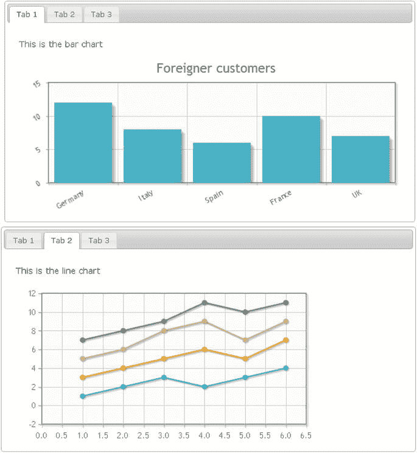

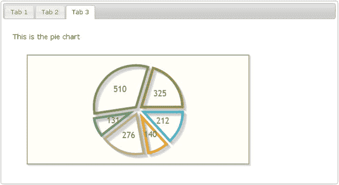

图 11-1. 一个包含三个选项卡的页面，每个选项卡内含有不同的图表

## 在折叠面板中使用 jqPlot 图表

另一种常用的 jQuery 容器是*折叠面板*。这次，您将把前面的三个图表放入折叠面板中。网页需要包含的插件列表与上一个示例相同。您需要对 CSS 样式进行一些修改；折叠面板有特定的 CSS 类，需要指定其属性。这些内容如代码清单 11-7 所示。

***代码清单 11-7***. ch11_02.html

```css
<style type="text/css">
.ui-accordion {
    width: 690px;
    margin: 2em auto;
}
.ui-accordion-header {
    font-size: 12px;
}
.ui-accordion-content {
    font-size: 14px;
}
.jqplot-target {
    font-size: 18px;
}
ol.description {
    list-style-position: inside;
    font-size: 15px;
    margin: 1.5em auto;
    padding: 0 15px;
    width: 600px;
}
.section {
      width: 400px;
      height: 200px;
      margin-top: 20px;
      margin-left: 20px;
}
</style>
```

与上一个示例一样，您必须创建 jQueryUi 小部件。可以通过调用 `accordion()` 函数来实现：

```javascript
$("#accordion").accordion();
```

您还需要将此折叠面板绑定到您的图表上，如代码清单 11-8 所示。当您选择一个折叠面板选项卡时，该事件会通过调用 `replot()` 函数确保相应的图表在其中被重新绘制。

***代码清单 11-8***. ch11_02.html

```javascript
$('#accordion').bind('accordionchange', function(event, ui) {
    var index = $(this).find("h3").index ( ui.newHeader[0]);
    if (index === 0) {
       plot1.replot();
    }
    else if (index === 1) {
       plot2.replot();
    }
    else if (index === 2) {
       plot3.replot();
    }
});
```


如您所见，定义手风琴的方式与定义选项卡非常相似。同样，您现在需要定义将在 HTML 代码中转换为手风琴选项卡的 `<div>` 元素（请参阅清单 11-9）。

***清单 11-9***。 `ch11_02.html`

```
<div id="accordion" style="margin-top:50px">
  <h3><a href="#">第 1 部分</a></h3>
  <div>
    <p>这是柱状图</p>
    <div class="section" id="chart1" data-height="200" data-width="400"></div>
  </div>

<h3><a href="#">第 2 部分</a></h3>
  <div>
    <p>这是多系列折线图</p>
    <div class="section" id="chart2" data-height="200" data-width="400"></div>
  </div>

<h3><a href="#">第 3 部分</a></h3>
  <div>
    <p>这是饼图</p>
    <div class="section" id="chart3" data-height="200" data-width="400"></div> </div>
</div>
```

如图 11-2 所示，结果与之前类似，但这次是通过垂直滑动手风琴选项卡来替换不同的图表。

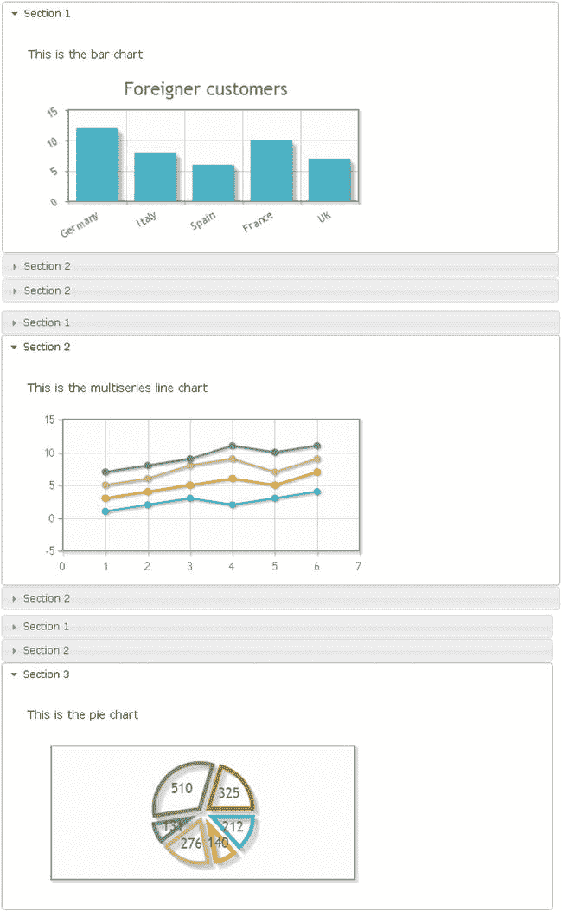

图 11-2。包含三个图表的手风琴小部件

## 可调整大小和可拖动的图表

您可以在图表中广泛利用的另外两个功能是允许用户调整容器区域的大小和拖动容器区域。网页中的可调整大小框架允许您任意更改其大小及其包含的对象的大小。此功能可以与页面内拖动元素的功能相结合，从而使它们能够占据相对于原始位置的不同位置。

除了使页面布局具有流动性之外，当您希望用户交互式地管理页面上不同框架所占用的空间时，此功能有时也很有用（请参阅图 11-3）。

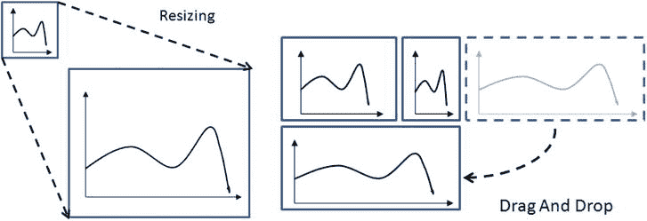

图 11-3。将图表封装在 jQueryUI 容器中，您可以调整其大小并在页面上移动它们

在本节中，您将看到两个示例。在第一个示例中，您将重点介绍应用于折线图的调整大小操作。您将看到调整包含在容器中的图表大小是多么容易。在第二个示例中，您将通过添加另外两个折线图来进一步扩展该示例。一旦为所有三个图表启用了可拖动属性，您将看到如何根据自己的喜好更改它们的位置，甚至交换它们。

### 可调整大小的折线图

在此示例中，您将使用一个简单的折线图。因此，您将不再需要包含所有 jqPlot 插件，除了 jQuery 容器和基本 jqPlots 库所需的插件：

```
<!--[if lt IE 9]>
<script type="text/javascript" src="../src/excanvas.js"></script>
<![endif]-->
<script type="text/javascript" src="../src/jquery.min.js"></script>
<script type="text/javascript" src="../src/jquery.jqplot.min.js"></script>
<link rel="stylesheet" type="text/css" href="../src/jquery.jqplot.min.css" />
<link rel="stylesheet" href="../src/css/smoothness/jquery-ui-1.10.3.custom.min.css" />
<script src="../src/js/jquery-ui-1.10.3.custom.min.js"></script>
```

或者，如果您更喜欢使用内容分发网络（CDN）服务：

```
<!--[if lt IE 9]><script type="text/javascript" src="http://cdn.jsdelivr.net/excanvas/r3/excanvas.js"></script><![endif]-->
<script src="http://code.jquery.com/jquery-1.9.1.min.js"></script>
<script type="text/javascript" src="http://cdn.jsdelivr.net/jqplot/1.0.8/jquery.jqplot.min.js"></script>
<link rel="stylesheet" type="text/css" href="http://cdn.jsdelivr.net/jqplot/1.0.8/jquery.jqplot.min.css" />
<link rel="stylesheet" href="http://code.jquery.com/ui/1.10.3/themes/smoothness/jquery-ui.css" />
<script src="http://code.jquery.com/ui/1.10.3/jquery-ui.min.js"></script>
```

即使在这里，也需要指定一些 CSS 样式，如清单 11-10 所示。

***清单 11-10***。 `ch11_03.html`

```
<style type="text/css">
.chart-container {
    border: 1px solid darkblue;
    padding: 30px 0px 30px 30px;
    width: 900px;
    height: 400px;
}
#chart1 {
    width: 96%;
    height: 96%;
}
</style>
```

现在，在网页的 `<body>` 部分，添加 `<div>` 元素，该元素将是包含名为 `chart1` 的折线图的容器（请参阅清单 11-11）。

***清单 11-11***。 `ch11_03.html`

```
<div class="chart-container">
    <div id="chart1"></div>
</div>
```

现在，在将 `chart-container` 定义为容器之后，您可以使用两个 jQuery 方法来处理它——`resizable()` 函数添加了调整大小的功能，而 `bind()` 函数将调整大小的事件绑定到图表的重新绘制（请参阅清单 11-12）。

***清单 11-12***。 `ch11_03.html`

```
$(document).ready(function(){
    var plot1 = $.jqplot ('chart1', [[100, 110, 140, 130, 80, 75, 120, 130, 100]]);

$('div.chart-container').resizable({delay: 20});
    $('div.chart-container').bind('resize', function(event, ui) {
       plot1.replot();
    });
});
```

结果是一个可调整大小的图表，如图 16-4 所示，右下角有一个小的灰色三角形。用户通过点击它，可以调整容器的大小，从而调整 jqPlot 图表的大小。

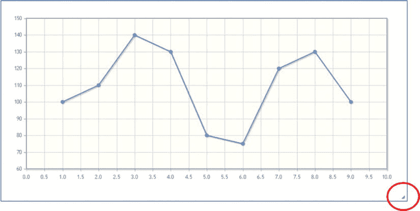

图 11-4。可调整大小的折线图

### 三个可拖动的折线图

从上一个示例开始，您将通过将另外两个折线图放置在两个独立的容器中来添加它们。这里的目标——除了使所有三个容器都可调整大小之外——是使容器可拖动。最终结果是一个包含三个折线图的网页，可以通过拖动来更改它们的位置，甚至可以交换它们的位置。

首先，对上一个示例进行一些小的补充。在清单 11-13 中，您添加了另外两个容器（`chart-container2` 和 `chart-container3`），其中包含新的折线图，分别命名为 `chart2` 和 `chart3`。

***清单 11-13***。 `ch11_03b.html`

```
<BODY>
<div class="chart-container">
    <div id="chart1"></div>
</div>
<div class="chart-container2">
    <div id="chart2"></div>
</div>
<div class="chart-container3">
    <div id="chart3"></div>
</div>
</BODY>
```

现在您已经为新折线图创建了容器，有必要通过三个不同的 `$.jqplot()` 函数来定义它们（请参阅清单 11-14）。这三个函数返回的值将传递给三个变量：`plot1`、`plot2` 和 `plot3`。这是因为每当容器发生更改时，您都需要通过在这三个变量上使用 `replot()` 函数来重新绘制三个图表中的每一个。

***清单 11-14***。 `ch11_03b.html`

```
$(document).ready(function(){
     var plot1 = $.jqplot ('chart1', [[100, 110, 140, 130, 80, 75, 120, 130, 100]],
        {seriesColors: [ "#bb0000"]});
     var plot2 = $.jqplot ('chart2', [[120, 90, 150, 120, 110, 75, 90, 120, 110]],
        {seriesColors: [ "#00bb00"]});
     var plot3 = $.jqplot ('chart3', [[130, 110, 140, 100, 80, 135, 120, 90, 110]],
        {seriesColors: [ "#0000bb"]});

$('div.chart-container').resizable({delay:20});
    ...
});
```


好的，作为高级文档工程师和翻译员，我将遵循您提供的注意事项和示例，将给定的英文文本翻译成中文。


现在，您将为这三个容器激活拖拽功能。这其实非常简单；您需要将函数添加到应用于每个容器的三个 jQuery 选择器中，如清单 11-15 所示。此外，您将像为第一个容器所做的那样，为两个新容器添加调整大小的功能。

***清单 11-15***. `ch11_03b.html`

```
$(document).ready(function(){
    ...
    var plot3 = $.jqplot ('chart3', [[130, 110, 140, 100, 80, 135, 120, 90, 110]],
       {seriesColors: ["#0000bb"]});

$('div.chart-container').draggable({cursor: 'move'});
    $('div.chart-container2').draggable({cursor: 'move'});
    $('div.chart-container3').draggable({cursor: 'move'});

$('div.chart-container').resizable({delay: 20});
    $('div.chart-container').bind('resize', function(event, ui) {
       plot1.replot();
    });
    $('div.chart-container2').resizable({delay: 20});
    $('div.chart-container2').bind('resize', function(event, ui) {
       plot2.replot();
    });
    $('div.chart-container3').resizable({delay: 20});
    $('div.chart-container3').bind('resize', function(event, ui) {
       plot3.replot();
    });
});
```

剩下的工作就是添加 CSS 样式，从而定义每个容器的初始位置和大小，如清单 11-16 所示。

***清单 11-16***. `ch11_03b.html`

```
<style type="text/css">
.chart-container {
    border: 1px solid darkblue;
    padding: 30px 0px 30px 30px;
    width: 300px;
    height: 200px;
    position: relative;
    float: left;
}
.chart-container2 {
    border: 1px solid darkblue;
    padding: 30px 0px 30px 30px;
    width: 200px;
    height: 200px;
    position: relative;
    float: left;
    margin-left: 20px;
}
.chart-container3 {
    border: 1px solid darkblue;
    padding: 30px 0px 30px 30px;
    width: 500px;
    height: 200px;
    position: relative;
    float: left;
    margin-left: 20px;
}
#chart1 {
    width: 96%;
    height: 96%;
}
#chart2 {
    width: 96%;
    height: 96%;
}
#chart3 {
    width: 96%;
    height: 96%;
}
</style>
```

在图 11-5 中，您可以看到页面初始加载时的布局。图 11-6 展示了一种情况，用户改变了第三个图表的位置和大小，使其对齐在其他两个图表的下方。

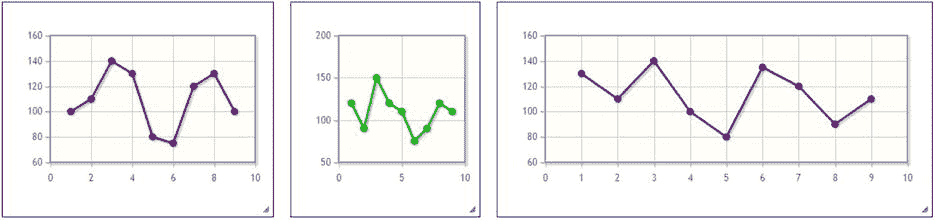

图 11-5. 网页显示了三个折线图，它们被包含在三个不同的容器中

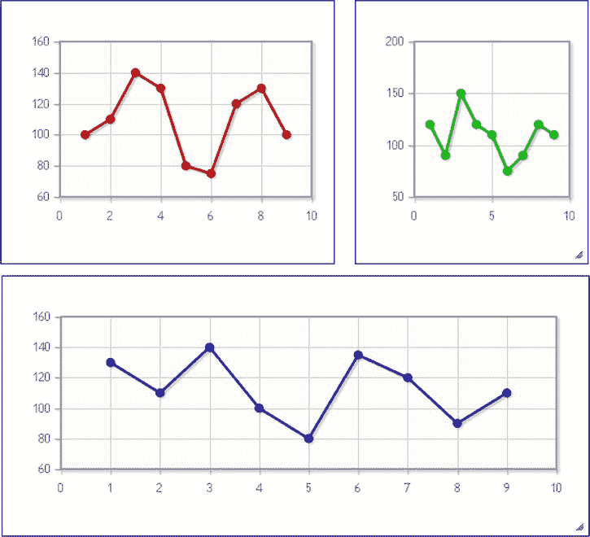

图 11-6. 通过拖拽和调整容器大小，可以改变原始布局

## 本章小结

在本章中，您已经了解了如何利用 jQuery UI 库提供的小部件的潜力，这些小部件有助于改善图表的呈现方式。您已经了解了如何将多个图表包含在诸如折叠面板和选项卡之类的容器中，这样即使它们占据同一区域，您也可以逐个查看它们。您还了解了如何调整这些容器的大小，并将这种能力扩展到使用 jqPlot 库开发的图表。

到目前为止，您已经深入了解了图表的图形和表示方面。在下一章中，您将学习图表的核心：数据管理。到目前为止，为了使示例更易于理解，页面中定义的数据种类是有限的。实际上，数据不太可能定义在包含图表代码管理功能的同一个网页上。更可能的情况是，数据由外部文件或通过 SQL 查询从数据库提供。

## 第 12 章


# 处理输入数据

一旦处理完图表的所有图形方面，就该更详细地分析输入数据了。在前面的章节中，您将输入数据的值分配给了数组。这些数组定义在与 jqPlot 代码相同的 HTML 页面中。您经常使用这两种方式：

```
var plot1 = $.jqplot ('chart1', [[100, 110, 140, 130, 80, 75, 120, 130, 100]]);
```

和

```
var data = [[100, 110, 140, 130, 80, 75, 120, 130, 100]];
```

实际上，为了获取这些数据，通常需要与其他技术进行交互，为此，您需要找到一种非常适合任何数据源的方法。需要使用一种通用的文本格式，这种格式易于被不同的脚本语言（尤其是 JavaScript）处理，并且对人类来说仍然易于理解，这导致了 JavaScript 对象表示法（JSON）格式的使用。您在第 1 章中已经简要了解了这种格式，但现在您将看到如何具体使用它来处理来自外部源的输入数据。

本章将详细研究 JSON 格式，首先说明这种格式的数据结构，然后向您展示如何将它们与 jqPlot 库一起使用。为此，您将看到两种处理 JSON 数据的不同方法——第一种使用 jqPlot 插件，第二种使用专门用于解析 JSON 数据的 jQuery 函数。

无论来自外部源的数据结构如何，如果您想全面了解真实数据的管理和处理，还需要考虑这些数据是如何生成的以及随之而来的获取方式。因此，在本章的最后部分，您将专门使用 jqPlot 库开发一个实时图表。

事实上，无论输入数据的格式如何，很多时候数据源不仅是外部的，而且是连续的——输入数据由一串数据组成，其中的值是一个接一个、连续不断地产生的。因此，显示此类数据的图表不仅需要管理来自外部源的数据格式，还需要能够持续自我更新，从而确保数据表示（在本例中为实时图表）始终是最新的。

## 使用 JSON 格式

本节将介绍 JSON 格式，包括将其与 jqPlot 库一起使用的各种选项。首先，您将通过分析一些语法图来了解 JSON 格式的数据是如何结构化的。然后，您将进入实践示例。

### JSON 格式

JSON 是一种数据交换格式。由于其树状结构，其中每个元素被称为一个名称-值对，因此人类易于读写，机器易于解析和生成。这是它日益普及的主要原因。

JSON 结构建立在两种不同结构的组合之上：数组和对象（参见图 12-1）。在它们内部，您可以定义所有常用的经典原始值，即使在其它语言中也是如此：数字、布尔值、字符串和空值。这使得其中包含的值可以在各种编程语言之间交换。（在 `www.json.org` 上，您可以找到所有处理 JSON 格式的语言列表，以及所有相关技术的列表，例如库、模块、插件等。）

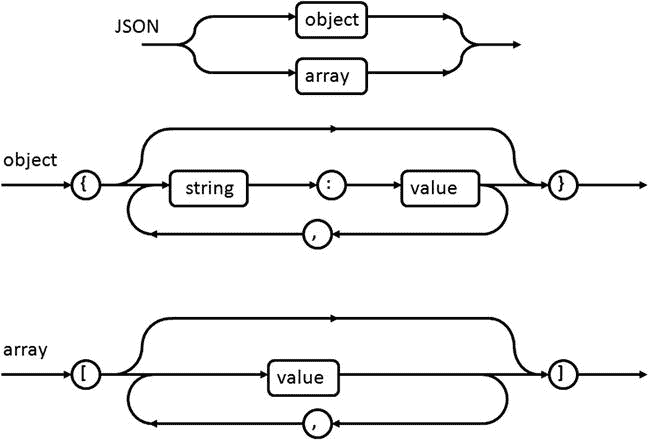

图 12-1. JSON 的语法图


### 理解 JSON 语法图

为了更好地理解 Figure 12-1 中的语法图，你可以分析 JSON 格式的结构。需要注意两点：第一，对象和数组都包含一系列由图中`value`标签标识的值。`value`指的是任何类型的值，例如字符串、数字或布尔值，甚至可以是对象或数组。

此外，你可以很容易地推断出 JSON 结构是一个具有不同层级的树形结构。树的节点可以是数组或对象，而叶子节点则是其中包含的值。

## 示例分析

考虑一些示例。如果你有一个只有一层结构的 JSON，那么只有两种可能：

*   一个值数组
*   一个包含值的对象

如果将结构扩展到两层，则有四种可能（假设树是对称的）：

*   数组的数组
*   对象的数组
*   包含数组的对象
*   包含对象的对象

以此类推，情况会逐渐变得更加复杂。

经典的 JSON 结构正是你在本书中频繁使用的 jqPlot 库的`options`对象的结构。事实上，你已经看到，得益于每个值都关联了字符串的对象，这些树形结构可以描述任何类型的元素。即使是像图表这样非常复杂的元素，也能被轻松理解和操作。

## 实际案例：jqPlot 数据渲染器

本节将 JSON 作为一种交换格式，考虑外部数据源是文本文件的简单情况。在此示例中，你将使用由 jqPlot 库直接渲染的数据：`json2`插件。该插件允许你读取文件中 JSON 格式的数据，并将其用作输入数据。你唯一需要做的就是将外部源赋值给`dataRenderer`属性。

首先，创建一个空白 HTML 页面，如 Listing 12-1 所示。

***Listing 12-1***. ch12_01a.html

```
<HTML>
<HEAD>
    <TITLE>Chapter 12</TITLE>
<!--[if lt IE 9]>
<script type="text/javascript" src="../src/excanvas.js"></script>
<![endif]-->
<script type="text/javascript" src="../src/jquery.min.js"></script>
<script type="text/javascript" src="../src/jquery.jqplot.min.js"></script>
<link rel="stylesheet" type="text/css" href="../src/jquery.jqplot.min.css" />
<script>
$(document).ready(function(){
    //Add the JavaScript code here
});
</script>
</HEAD>
<BODY>
<div id="myChart" style="height:300px; width:500px;"></div>
</BODY>
</HTML>
```

为了让数据渲染器解释数据，外部源必须返回一个有效的 jqPlot 数据数组。要扩展图表以实现此功能，你需要包含`jqplot.json2`插件：

```
<script type="text/javascript" src="../src/plugins/jqplot.json2.min.js"></script>
```

或者使用内容分发网络（CDN）服务：

```
<script type="text/javascript"
    src="http://cdn.jsdelivr.net/jqplot/1.0.8/plugins/jqplot.json2.min.js"></script>
```

作为外部源，你可以选择一个包含数据的 TXT 文件。对于此示例，你将使用记事本或任何其他文本编辑器创建一个新的 TXT 文件。编辑好 Listing 12-2 中的数据后，将文件保存为`jsondata.txt`。

***Listing 12-2***. jsondata.txt

```
[[30, 12, 24, 54, 22, 11, 64, 33, 22]]
```

在你要管理外部文件中数据的网页上，需要添加 Listing 12-3 中的代码。

***Listing 12-3***. ch12_01a.html

```
$(document).ready(function(){
    var ajaxDataRenderer = function(url, plot, options) {
       var ret = null;
       $.ajax({
          async: false,
          url: url,
          dataType: "json",
          success: function(data) {
             ret = data;
          }
       });
       return ret;
    };
    var jsonurl = "./jsondata.txt";
    var options = {
       title: "AJAX JSON Data Renderer",
       dataRenderer: ajaxDataRenderer,
       dataRendererOptions: {
          unusedOptionalUrl: jsonurl
       }
    };
    $.jqplot ('myChart', jsonurl, options);
});
```

你将得到如 Figure 12-2 所示的图表，该图表直接从 TXT 文件获取数据。

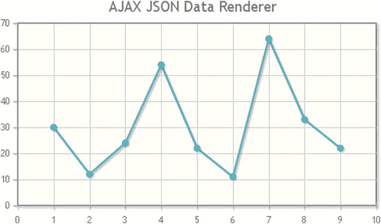

Figure 12-2. 一个折线图，表示来自`jsondata.txt`文件的数据

如果你想插入多个序列，TXT 文件中的数据格式与输入数据数组使用的格式相同（参见 Listing 12-4）。使用编辑器将此数据复制到文件中后，将其保存为`jsondata2.txt`。

***Listing 12-4***. jsondata2.txt

```
[[1,3,2,4,3,4,1,2],
[6,7,9,6,8,9,10,9],
[15,12,11,9,11,12,13,14]]
```

Figure 12-3 显示了一个包含从 TXT 文件读取的三个序列的图表。

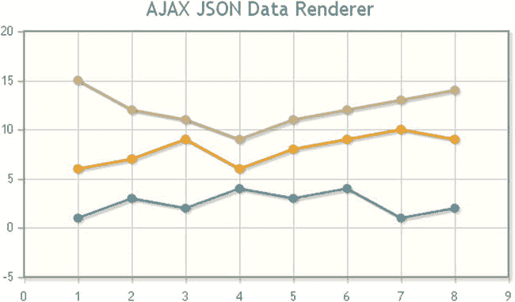

Figure 12-3. 一个多序列折线图，表示来自 TXT 文件的数据

## JSON 和 `$.getJSON()`

在 jqPlot 图表中使用外部 JSON 数据还有另一种方法。jQuery 提供了一个执行相同功能的方法，名为`$.getJSON()`，而不是使用`json2 jqPlot`插件作为数据渲染器。

此方法读取并解析 JSON 文件。它还可以通过发出 HTTP `GET`请求，直接从服务器加载 JSON 编码的数据。它被广泛应用于 Web 上的许多应用程序中，不仅仅用于 jqPlot。此方法有三个参数：

```
$.getJSON(url, data, success(data, textStatus, jqXHR));
```

只有`url`是必需的，其他两个参数是可选的。`url`是一个字符串，包含 JSON 文件的 URL 或请求的服务器 URL。`data`是一个字符串，将与请求一起发送到服务器，`success()`是一个回调函数，如果请求成功，它将被执行。

文件中包含的数据必须遵循 JSON 编码规则。因为你使用它们是为了被 jqPlot 编码，所以它们应该具有以下格式：

```
{ "series_name1": [ value1, value2, value3, ...],
  "series_name2": [ value1, value2, value3, ...], ... }
```

创建一个新的 TXT 文件并将其保存为`jsondata3.txt`。此文件包含来自四个不同序列的数据，如 Listing 12-5 所示。

***Listing 12-5***. jsondata3.txt

```
{"data1": [1,2,3,2,3,4],
 "data2": [3,4,5,6,5,7],
 "data3": [5,6,8,9,7,9],
 "data4": [7,8,9,11,10,11]}
```

下一步是调用`getJSON()`方法：

```
$.getJSON('./jsondata3.txt', '', myPlot);
```

你必须注意写入正确的 URL。在此示例中，TXT 文件与 HTML 文件位于同一目录中，因此你需要在文件名前添加`./`作为前缀。第二个参数是一个空字符串，因为你不需要向 URL 发送任何数据（它是一个文件，而不是服务器应用程序）。`myPlot`是函数的返回值，它检查`$.jqplot()`的加载是否成功。如 Listing 12-6 所示，你只需要添加自己的函数，并在其中定义`$.jqplot()`函数。在这种情况下，要传递的数据（例如`data1`、`data2`等）属于数据对象，因此必须作为`data.data1`、`data.data2`等传递。

***Listing 12-6***. ch12_02.html


```javascript
$(document).ready(function(){
    var myPlot = function (data, textStatus, jqXHR) {
       $.jqplot ('myChart', [data.data1, data.data2, data.data3, data.data4]);
    };
    $.getJSON('./jsondata3.txt', '', myPlot);
});
```

这样，您就获得了一个多系列折线图（参见图 12-4），效果如同直接在网页上编写数据，但通过与服务器及其他应用程序协作，您的能力得到了极大扩展。

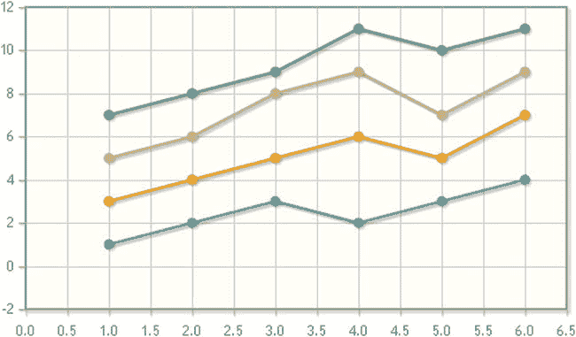

图 12-4. 表示 TXT 文件中数据的多系列折线图

## 实时图表

实时图表会自动更新，从而让您能够表示来自持续产生数据源的数据流。该数据源可以是服务器、应用程序、连接到 PC 的设备等。正是在这种情况下，图表扮演了真正指示器的角色，即通过视觉方式指示某个属性如何随时间变化。

接下来，您将仅使用`jqPlot`库开发一个简单的实时折线图。例如，假设您要实现一个指示器，用于显示一个在 0%到 100%之间变化的量。这个量可以是某种资源（如 CPU）的消耗量，但也可以应用于许多其他场景，例如温度、参与者数量或连接数等。在本例中，您将从 50%的初始值开始，实时生成随机变化，这仅仅是为了模拟数据源。您可以将此示例适配到任何其他场景，只需将随机函数替换为从外部获取数据的函数即可。

您将实现一个包含折线图的网页，该图表中只有一小段设置为 50%的值（参见图 12-5）。这将是流式数据值的起点。

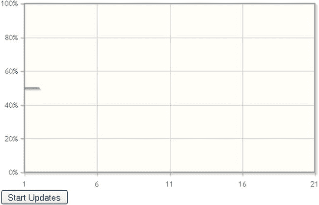

图 12-5. 获取数据前的实时图表，仅显示一小段作为起点

代码清单 12-7 展示了生成图 12-5 所示图表所需的全部代码。在`options`中，您定义了坐标轴的范围限制，以确保图表更新时坐标轴范围不变。为了使动画效果更流畅，您取消了线条上的标记并启用了`smooth`模式。在图表下方，您将插入一个按钮来启动实时更新。

***代码清单 12-7***. ch12_03.html

```html
<HTML>
<HEAD>
<TITLE>实时图表</TITLE>
<!--[if lt IE 9]>
<script type="text/javascript" src="../src/excanvas.js"></script>
<![endif]-->
<script type="text/javascript" src="../src/jquery.min.js"></script>
<script type="text/javascript" src="../src/jquery.jqplot.min.js"></script>
<link rel="stylesheet" type="text/css" href="../src/jquery.jqplot.min.css"/>
<script class="code" type="text/javascript">
$(document).ready(function(){
    data = [50, 50];
    var options = {
       axes: {
          xaxis: {min: 1, max: 21, numberTicks: 5},
          yaxis: {min: 0, max: 100, numberTicks: 6,
             tickOptions:{formatString: '%d%'}
          }
       },
       seriesDefaults: {
          showMarker: false,
          rendererOptions: {smooth: true}
       }
    };
var plot1 = $.jqplot ('myChart', [data], options);
});
</script>
</HEAD>
<BODY>
<div id="myChart" style="height: 300px; width: 500px;"></div>
<button>开始更新</button>
</BODY>
</HTML>
```

接下来，插入代码清单 12-8，您将捕获按钮的`click`事件，并将其链接到`doUpdate()`函数的执行。按钮被按下后，您可以将其从网页中删除。

***代码清单 12-8***. ch12_03.html

```javascript
$(document).ready(function(){
    ...
    var plot1 = $.jqplot ('myChart', [data], options);
    $('button').click(function(){
       doUpdate();
       $(this).hide();
    });
});
```

因此，在代码清单 12-9 中，您实现了生成随机变化的函数。

***代码清单 12-9***. ch12_03.html

```javascript
$(document).ready(function(){
    ...
    $('button').click(function(){
       doUpdate();
       $(this).hide();
    });
    function getRandomInt (min, max){
       return Math.floor(Math.random() * (max - min + 1)) + min;
    }
});
```

此函数生成介于`min`和`max`值（可以为负数）之间的整数值。这些值作为参数传递给函数。您设置了一个介于-3 和 3 之间的可能变化量，该变化量将应用于最后获取的值。实时值存储在一个名为`data`的数组中，该数组充当一种缓冲区。此数组仅包含 20 个值，因此最旧（最早）的值将被删除，新获取的值将插入到数组的最后一个位置。如图 12-4 所示，开始时您会看到一条振荡的线条，其长度延伸至整个图表。然后，线条的右端将随着所观察量的趋势而移动。

为了获得动画效果，您需要刷新图表，因此每次更新时，您需要销毁当前图表（`plot1`），用新数组替换数据数组，然后重新绘制整个`plot1`图表。最后，您需要调用`setTimeout()`函数，该函数将再次调用`doUpdate()`函数。这样，循环就会无限重复。您可以每秒（1000 毫秒）更新一次图表，但在其他情况下，这些值将根据源数据来选择。

继续向您的代码中添加代码清单 12-10。

***代码清单 12-10***. ch12_03.html

```javascript
$(document).ready(function(){
    ...
    function getRandomInt (min, max) {
       return Math.floor(Math.random() * (max - min + 1)) + min;
    }
    function doUpdate() {
       var last = data[data.length-1];
       if(data.length > 19){
          data.shift();
       }
       var newlast = last + getRandomInt(-3, 3);
       if(newlast < 0)
          newlast = 0;
       data.push(newlast);
       if (plot1) {
          plot1.destroy();
       }
       plot1.series[0].data = data;
       plot1.replot({resetAxes: true});
       plot1 = $.jqplot ('myChart', [data], options);
       setTimeout(doUpdate, 1000)
    }
});
```

图 12-6 展示了实时图表如何显示在 50%值附近变化的数据流。

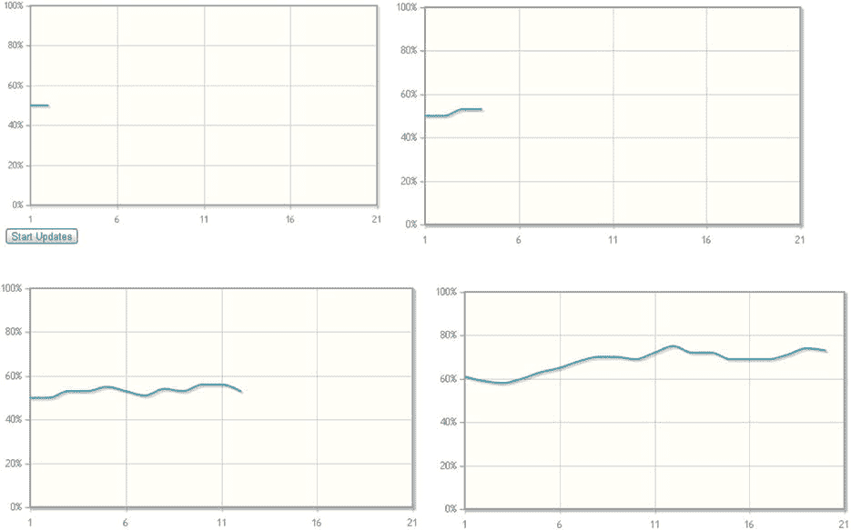

图 12-6. 一个实时折线图，逐时刻显示数值

## 总结

在本章中，您了解了输入数据通常如何来自外部源，以及如何处理这些数据。特别地，您了解了如何将 JSON 格式的外部数据用作使用`jqPlot`库开发的图表的输入数据数组。关于实时生成数据的管理，您看到了一个简单但有效的示例，其中实现了一个实时折线图，该图表会随着获取数据的变化而更新。

## 附录 A


## 本书示例指南

本附录提供了如何结合使用 XAMPP 和 Aptana Studio 在您的 PC 上创建一个开发环境的指南，该环境将允许您开发、运行和修复本书中给出的示例。

## 安装 Web 服务器

如今，在互联网上，您可以轻松找到免费的软件包，其中包含设置测试环境所需的一切，用于您的所有示例以及与 Web 世界相关的所有内容。


这些软件包最大限度地减少了需要安装的程序数量。更重要的是，它们可以通过一次安装获得。这些软件包通常包含一个 Apache HTTP 服务器、一个 MySQL 数据库，以及用于编程语言 PHP、Perl 和 Python 的解释器。最完整的软件包是 XAMPP（可从 Apache Friends 网站 [`www.apachefriends.org/en/index.html`] 下载）。XAMPP 完全免费，其主要特点是它是一个跨平台软件包（支持 Windows、Linux、Solaris、MacOS）。此外，XAMPP 还包含一个 Tomcat 应用服务器（用于 Java 编程语言）和一个 FileZilla FTP 服务器（用于文件传输）。其他解决方案则特定于平台，如其名称的首字母所示：

*   `WAMP` (Windows)
*   `MAMP` (MacOS)
*   `LAMP` (Linux)
*   `SAMP` (Solaris)
*   `FAMP` (FreeBSD)

实际上，XAMPP 是一个首字母缩略词；其字母代表以下术语：

*   `X`，代表操作系统
*   `A`，代表 Apache，即 Web 服务器
*   `M`，代表 MySQL，即数据库管理系统
*   `P`，代表 PHP、Perl 或 Python，即编程语言

因此，选择最适合您平台的 Web 服务器解决方案，并将其安装在您的个人电脑上。

## 安装 Aptana Studio IDE

安装 Web 服务器后，需要安装一个集成开发环境（IDE），用于开发 JavaScript 代码。在本附录中，您将安装 Aptana Studio 作为您的开发环境。

访问 Aptana 网站 (`www.aptana.com`)，点击 Products 选项卡，找到 Aptana Studio 3 软件（在撰写本文时，最新版本为 3.6.0）。下载独立版本（已集成 Eclipse IDE）：`Aptana_Studio_3_Setup_3.6.0.exe`。

下载完成后，启动可执行文件以安装 Aptana Studio IDE。安装结束时，启动应用程序，您应该会看到工作台打开，如图 A-1 所示。

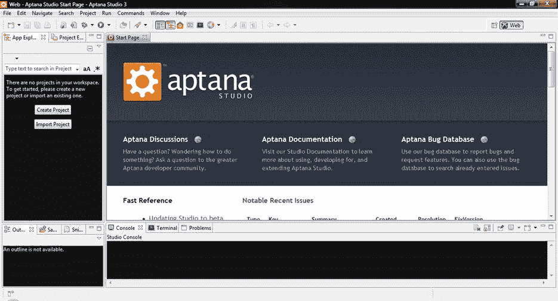

图 A-1. Aptana Studio IDE 工作台

在安装 Aptana Studio 期间，软件会检测已安装的各种浏览器和 Web 服务器，并自动进行相应配置。

## 设置 Aptana Studio 工作空间

在开始开发本书中的示例之前，您必须创建一个工作空间。首先，您应该在 Aptana Studio 中设置工作空间，使其指向 Web 服务器的文档根目录。

以下是使用 XAMPP 时的典型路径：

*   Windows: `C:\xampp\htdocs`
*   Linux: `/opt/lamp/htdocs`
*   MacOS: `/Applications/XAMPP/xamppfiles/htdocs`

而对于 WAMP，路径如下：

*   `C:\WAMP\www`

因此，从菜单中选择 File  Switch Workspace  Other . . .。然后，在字段中输入 Web 服务器文档根目录的路径，如图 A-2 所示。

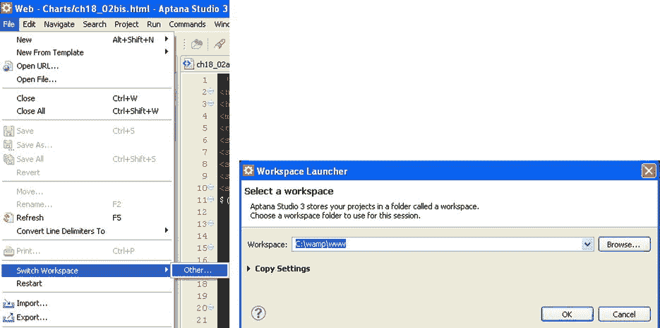

图 A-2. 在文档根目录上设置工作空间

## 创建项目

创建工作空间的下一步是在 Aptana Studio 中创建一个项目：

1.  从菜单中选择 New  Web Project。
2.  出现如图 A-3 所示的窗口。选择 Default Project，然后点击 Next。
3.  输入“charts”作为项目名称。这将是工作空间中的一个目录，您将在此目录中使用 Aptana Studio 编写本书中描述的所有示例文件。

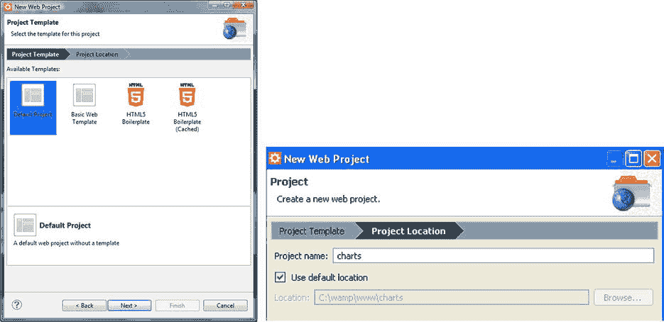

图 A-3. 创建默认项目

## 完成工作空间

设置好 Aptana Studio 工作空间并创建项目后，您就完成了工作空间的配置。

让我们打开文档根目录，并创建一个名为 `src` 的新目录。现在，您将在整本书中使用的工作空间由两个目录组成：

*   `src`
*   `charts`

`src` 目录应包含所有与库相关的文件。

`charts` 目录应包含与本书示例相关的所有 HTML、图像和层叠样式表（CSS）文件（这实际上是一个项目）。每个示例文件都应在此目录中创建（如果您更喜欢以不同方式操作，也可以，但务必注意在 HTML 页面中引用库文件和图像时路径的不同）。

 **注意**  本书附带的源代码（可从 Apress 网站 [`www.apress.com`] 的源代码/下载区域获取）实际上已经打包在一个工作空间中。您会找到两个版本的 charts 项目：内容分发网络（CDN）版和本地版。`charts_CDN` 目录包含所有引用 CDN 服务远程分发库的示例。`charts_local` 目录包含所有引用 `src` 目录中库的示例。

## 用 jqPlot 库填充 src 目录

如果您选择通过引用本地库来开发 HTML 页面，则需要下载所有相关文件。这些文件将收集在 `src` 目录中。这是一个好方法，因为您可以开发多个使用相同库的项目，而无需为每个项目复制它们。

本附录中列出的版本是用于实现本书示例的版本。如果您安装其他版本，可能会出现不兼容问题，或者您可能会观察到与描述不同的行为。

### jqPlot 库版本 1.0.8（包含 jQuery 库版本 1.9.1）

1.  访问 jqPlot 网站 (`https://bitbucket.org/cleonello/jqplot/downloads/`)，下载该库的压缩文件（.zip、.tar.gz 或 tar.bz2）：`jquery.jqplot.1.0.8r1250`。
2.  解压所有内容。您应该会得到一个名为 `dist` 的目录，其中包含以下子目录和文件：
    *   `doc`
    *   `examples`
    *   `plugins`
    *   一系列文件（`jquery.min.js`、`jquery.jqplot.min.js` 等）
3.  复制这组文件和 `plugins` 目录，并放入 `src` 中。

### jQuery UI 库版本 1.10.3，带有 smoothness 主题

1.  访问 jQuery 用户界面库（jQuery UI）网站 (`http://jqueryui.com/themeroller/`)，从 ThemeRoller 下载带有 smoothness 主题的库：`jquery-ui-1.10.3.custom.zip`。
2.  解压所有内容。您应该会得到一个名为 `jquery-ui-1.10.3.custom` 的目录，其中包含以下子目录：
    *   `css`
    *   `js`
    *   `development-bundle`
3.  复制 `css` 和 `js` 目录，并放入 `src` 中。

这样，您就得到了 `src` 目录，它应包含如图 A-4 所示的子目录和文件。

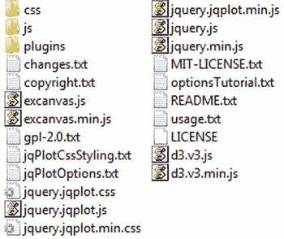

图 A-4. `src` 目录中包含的文件和子目录

 **注意**  按照惯例，您在 `charts` 目录中开发示例。如果您想以其他方式操作，则在将其他文件包含到网页中时，需要考虑新的路径。

如果您在 `charts` 目录内开发 HTML 页面，则需要使用以下代码：

```
<script type="text/javascript" src="../src/jquery.min.js"></script>
```

相反，如果您更愿意直接在文档根目录中开发，则使用以下代码：

```
<script type="text/javascript" src="src/jquery.min.js"></script>
```

简而言之，重要的是要考虑您正在包含的文件相对于您正在实现的页面的路径。

## 运行示例


好的，作为一名高级文档工程师和翻译员，我将严格遵循您提供的注意事项和示例，将给定的英文文本翻译成中文。


在工作区创建或复制 HTML 文件后，若要在 Aptana Studio IDE 中运行它，请选择“运行”菜单中的“运行”，或单击工具栏上的“运行”按钮（参见图 A-5）。


图 A-5。 工具栏上的“运行”按钮

您的默认浏览器将立即打开，并加载所选的 HTML 页面。

查看“运行配置”（参见图 A-6），从“运行”图标的上下文菜单中选择“运行配置...”。例如，让我们将 `http://localhost/` 设置为您的基 URL；为此，您需要选择“追加项目名称”选项，如图所示。然后，单击“应用”按钮以确认您的设置。

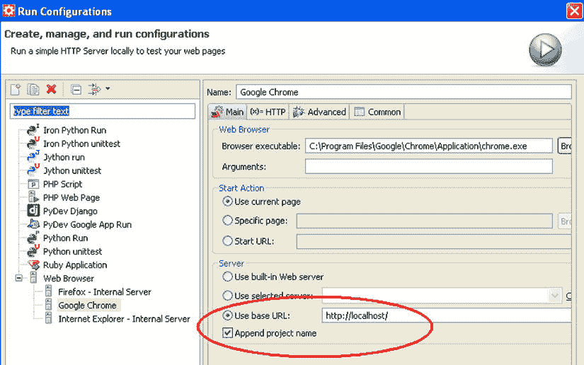

图 A-6。 必须为每个浏览器正确设置运行配置

现在，您已拥有轻松处理本书中所有示例所需的一切。

一旦您对 Aptana IDE 有了一定的熟悉度，您会发现它是一个开发许多其他项目（无论是 JavaScript 还是其他编程语言，如 PHP）的绝佳环境。

那么，现在，尽情享受吧！

## 附录 A 总结

本附录提供了关于如何结合使用 XAMPP 和 Aptana Studio 在您的 PC 上创建开发环境的指南。选择使用这些应用程序并非强制性的，还有许多其他解决方案；互联网上有许多可用的应用程序可以执行类似的操作。但是，如果您希望实现并快速测试本书中描述的示例，这个环境将是一个不错的选择。

## 附录 B


# jqPlot 插件

本附录列出了 jqPlot 发行版中可用的完整插件列表（参见表 B-1）。并非所有这些插件都在本书中进行了介绍；如需更多信息，请访问 jqPlot 网站 (`www.jqplot.com`)。

表 B-1。 jqPlot 发行版中可用的插件（版本 1.0.8）

| 名称 | 类型 | 描述 |
| --- | --- | --- |
| `$.jqplot.BarRenderer` | 渲染器 | 绘制条形图。 |
| `$.jqplot.BezierCurveRenderer` | 渲染器 | 将线条绘制为堆叠的贝塞尔曲线。 |
| `$.jqplot.BlockRenderer` | 渲染器 | 绘制 xy 块状图。块状图的数据点显示为带有内部文本标签的彩色方块。 |
| `$.jqplot.BubbleRenderer` | 渲染器 | 绘制气泡图。气泡图的数据点显示为带有可选内部文本标签的彩色圆圈。 |
| `$.jqplot.CanvasAxisLabelRenderer` | 渲染器 | 绘制轴标签，使用 `canvas` 元素支持高级功能，例如旋转文本。此渲染器使用单独的渲染引擎在画布上绘制文本。 |
| `$.jqplot.CanvasAxisTickRenderer` | 渲染器 | 绘制轴刻度，使用 `canvas` 元素支持高级功能，例如旋转文本。此渲染器使用单独的渲染引擎在画布上绘制文本。 |
| `$.jqplot.CanvasOverlay` | 插件 | 在图表上绘制叠加线条。 |
| `$.jqplot.CanvasTextRenderer` | 渲染器 | 由 Jim Studt (`http://jim.studt.net/canvastext/`) 编写的 `canvastext.js` 插件的修改版本。 |
| `$.jqplot.CategoryAxisRenderer` | 渲染器 | 渲染类别样式轴，系列中 y 数据值之间的像素间距相等。 |
| `$.jqplot.ciParser` | 插件 | 一个将自定义 JavaScript 对象表示法 (JSON) 数据对象转换为 jqPlot 数据格式的函数。 |
| `$.jqplot.Cursor` | 插件 | 一个表示光标的类，如同在图表上显示的那样。 |
| `$.jqplot.DateAxisRenderer` | 渲染器 | 将轴渲染为一系列日期值。 |
| `$.jqplot.DonutRenderer` | 渲染器 | 绘制环形图；x 值（如果存在）用作扇区标签，y 值给出扇区大小。 |
| `$.jqplot.Dragable` | 插件 | 使绘制的点可被用户拖动。 |
| `$.jqplot.EnhancedLegendRenderer` | 渲染器 | 绘制具有高级功能的图例。 |
| `$.jqplot.FunnelRenderer` | 渲染器 | 绘制漏斗图；x 值（如果存在）用作标签，y 值给出区域大小。漏斗图仅绘制单个系列。 |
| `$.jqplot.Highlighter` | 插件 | 当鼠标悬停在数据点上时高亮显示它们。 |
| `$.jqplot.Json2` | 插件 | 创建一个包含两个方法：`stringify()` 和 `parse()` 的 JSON 对象。 |
| `$.jqplot.LogAxisRenderer` | 渲染器 | 渲染对数轴。 |
| `$.jqplot.MekkoAxisRenderer` | 渲染器 | 与 `MekkoRenderer` 插件一起使用；将 y 轴显示为 0 到 1（0 到 100%）的范围，x 轴为每个系列显示一个刻度，并按所有 y 值的总和进行缩放。 |
| `$.jqplot.MekkoRenderer` | 渲染器 | 绘制一种在二维图形上显示三维数据的 Mekko 风格图表。 |
| `$.jqplot.MeterGaugeRenderer` | 渲染器 | 绘制仪表盘图表。 |
| `$.jqplot.Mobile` | 插件 | jQuery 移动端虚拟事件支持。 |
| `$.jqplot.OHLCRenderer` | 渲染器 | 绘制开盘-最高-最低-收盘、蜡烛图和最高-最低-收盘图表。 |
| `$.jqplot.PieRenderer` | 渲染器 | 绘制饼图；x 值（如果存在）用作扇区标签，y 值给出扇区大小。 |
| `$.jqplot.PointLabels` | 插件 | 在数据点处放置标签。 |
| `$.jqplot.PyramidAxisRenderer` | 渲染器 | 与 `PyramidRenderer` 插件一起使用；在底部显示两个 x 轴，在中心显示 y 轴。 |
| `$.jqplot.PyramidGridRenderer` | 渲染器 | 与 `PyramidRenderer` 插件一起使用；在 `canvas` 元素上创建网格。 |
| `$.jqplot.PyramidRenderer` | 渲染器 | 绘制金字塔图。 |
| `$.jqplot.Trendline` | 插件 | 自动计算并绘制所绘数据的趋势线。 |

## 索引

 A

Accordion 小部件

CSS 样式属性

描述

插图


动画多系列折线图

AnimateReplot 属性

Aptana Studio

IDE 安装

项目创建

运行按钮，工具栏

运行配置

src 目录

文件和子目录

jqPlot 库版本 1.0.8

jQuery UI 库版本 1.10.3

Web 服务器安装

工作空间

charts 目录

设置

src 目录

Aptana Studio 3 IDE

面积图

组合图

多个数据数组

多系列折线图

seriesDefaults

数组数据

数组

描述

forEach() 函数

对象

push() 和 pop() 函数

坐标轴，折线图

空白区域

min 和 max 属性

options 对象

pad 属性

刻度

axesDefaults 对象

CanvasAxisTickRenderer

无网格图表

直接定义的刻度

水平网格线

非均匀、带前缀的刻度

numberTicks 属性

Y 轴上的百分比值

属性

标题添加和标签

CanvasAxisLabelRenderer 插件

CanvasTextRenderer

代码清单

属性

 B

带状图

算术平均值

带状折线图

bdata 数组

置信区间/误差带

数据数组

描述

±3% 的区间

上下边界线

多系列折线图

非均匀带状折线图

rendererOptions

rgba() 函数

平滑带状折线图

值范围

柱状图 *另请参阅* BarRenderer 插件

barMargin 属性

BarRenderer 插件

添加值

animateReplot 属性

barDirection 属性

颜色

组合图


创建

自定义工具提示

数据分类

处理图例

分类

CSS 类

自定义图例

默认图例

定义

EnhancedLegendRenderer

位置属性

放置属性

堆叠柱状图

水平多系列柱状图

水平堆叠图

jqlotDataClick 事件

jqplotDataClick 事件

jqplotDataHighlight 事件

jqplotDataMouseOver 事件

jqplotDataUnhighlight 事件

jqplotRightClick 事件

标签属性

Marimekko 图

多系列柱状图

负值

选项

系列对象

间距修改

刻度标签旋转

刻度数组

垂直堆叠柱状图

垂直堆叠图

xaxis 对象

方块图

方块图。*参见* 方块图

气泡图

bubbleAlpha 属性

BubbleRenderer

数据显示

数据识别

jqplot() 函数

标签报告

选项变量

注意！

代码行

选中状态，前景

瑞典数据

透明效果

按钮

ch2_07.html

ch2_08.html

描述

图标丰富

类型表示

简单、提交和锚点

  C

蜡烛图

蜡烛图

描述

OHLC 图

实体和影线

渲染器属性

刻度数组

CanvasAxisLabelRenderer 插件

CanvasTextRenderer

笛卡尔坐标轴

层叠样式表 (CSS) 类

层叠样式表 (CSS) 样式

CDN。*参见* 内容分发网络 (CDN)

图表控件

复选框

命令


功能

属性

单选按钮（*参见* 单选按钮）

滑块（*参见* 滑块）

图表技术

柱状图

气泡图

蜡烛图

元素

坐标轴标签

双刻度图表

四轴不同刻度

图例

数据点标签与提示、数据点

二维

直方图

折线图

在 Web 上

Canvas *与* SVG

DOM

HTML5

JavaScript 开发（*参见* JavaScript 开发）

饼图

雷达图

复选框

“全选/取消全选”功能

自定义图例

EnhancedLegendRenderer 插件

jQuery 方法

列表

序列数量

组合框

ch2_09.html

ch2_10.html

在下拉菜单中

内容分发网络（CDN）服务

CSS 自定义

应用于标题

Ch3_02e.html

描述

自定义工具提示

柱状图

jqplotDataHighlight 事件

jqplotDataUnhighlight 事件

jqplot() 函数

PNG 文件

 D

DOM

警告对话框

ch2_03a.html

创建并插入新元素

元素

移除、隐藏和替换元素

ready() 方法

树形结构

万维网联盟（W3C）

环形图

Ch6_02.html

描述

多序列

简单

带图例

 E

EnhancedLegendRenderer

醒目效果

 F, G

Firebug 与 DevTools

console.log() 方法

描述

Mozilla Firefox 扩展

网页信息

漏斗图

CDN 服务

数据格式

填充属性


FunnelRenderer 插件

图例与百分比

lineWidth 属性

sectionMargin 属性

seriesDefaults 对象

showDataLabel

无空格

 H

处理输入数据

JSON 格式（*参见* JSON 格式）

实时图表

高亮显示，折线图

光标高亮器

光标坐标

数据点高亮

options 对象

x 和 y 值

醒目效果

HTML 格式

高低折线图

直方图

HTML 格式

数据点高亮

formatString 属性

 I

集成开发环境 (IDE)

 J, K

JavaScript 数据

数学函数

随机数据生成

JavaScript 开发

Aptana Studio 3 IDE

数据类型

描述

jsFiddle，JavaScript 库

在线 IDE jsFiddle

运行与调试

JavaScript 对象表示法 (JSON) 格式

数组与对象

$.getJSON() 方法

jqPlot 数据渲染器

$.jqplot() 函数

多系列折线图

数值标签

jqlotDataClick 事件

jqPlot

柱状图（*参见* 柱状图）

折线图（*参见* 折线图）

jqPlot 图表

手风琴式布局

CSS 样式设置

可拖拽折线图

容器类型

特性

初始位置与尺寸容器

布局容器

replot() 函数

jQueryUI 容器

jQueryUI tabs() 函数

<div> 元素

可调整大小的折线图

bind() 函数

CDN 服务

chart1

resizable 函数

结果

标签页

变量

jqplotDataClick 事件

jqplotDataHighlight 事件

jqplotDataMouseOver 事件

jqplotDataUnhighlight 事件


jqPlot 库

添加绘图容器

CDN 服务

Ch3_01.html

Ch3_03a.html

Ch3_03b.html

Ch3_03c.html

图表生成

数据集合

分布

创建折线图

模块化结构

无标记的多系列图表

系列不显示标记的多系列图表

多系列折线图

选项（*参见* 选项）

插件

jqPlot 插件

jqplotRightClick 事件

jQuery 库

与 DOM（*参见* DOM）

CDN 方法

链式方法

jQuery UI（*参见* jQuery UI）

本地方法

方法

在 Web 服务器上

选择器

ch2_01a.html

ch2_01b.html

ch2_01c.html

检查元素，Google Chrome 浏览器

三个 `<div>` 元素内的变量文本

包装集

jQuery UI

手风琴小部件（*参见* 手风琴）

按钮（*参见* 按钮）

组合框（*参见* 组合框）

描述

Google 托管库服务

官方 CDN jQuery 网站

进度条（*参见* 进度条）

滑块（*参见* 滑块）

选项卡（*参见* 选项卡）

jQueryUI 容器

jQueryUI tabs() 函数

JSON 格式。*参见* JavaScript 对象表示法 (JSON) 格式

JSON 语法

 L

限制线

添加按钮

按钮类型

定义

水平限制线

JavaScript 函数

jQuery UI 小部件

lineup() 和 linedown() 函数

下限和上限阈值

垂直线

CanvasOverlay 插件

horizontalLine 和 dashedHorizontalLine

lineCap 属性

下限和上限

折线图

面积图（*参见* 面积图）

坐标轴（*参见* 坐标轴，折线图）

带状图（*参见* 带状图）

笛卡尔坐标轴

图表外观，CSS

背景颜色


图表容器类

文件提取

网格设置

`<div>` 元素

多系列折线图

选项对象

刻度标签和标题

日期值

`DateAxisRenderer` 插件

逐日数据点值

不同的 x 输入值格式

`formatString` 属性

时间值

`fillBetween` 对象

高亮（*参见* 高亮，折线图）

JavaScript 数据

限制线（*参见* 限制线）

对数刻度

多系列（*参见* 多系列折线图）

趋势线

x, y 值

传入数组的索引

线性图

非均匀分布的点

缩放

光标插件

传入数据的可用性

折线图提取

宏观视图

`resetZoom()` 方法

`zoom` 属性

对数刻度

指数

半对数刻度

值

  M, N

马赛克图

`MekkoAxisRenderer`

Mekko 图

`MekkoRenderer`

模块

`Ch3_05a.html`

`Ch3_05b.html`

`myCss.css`

`myJS.js`

简单折线图

多层饼图

`Ch6_03.html`

层次关系

表示

多系列折线图

动画图表

数据数组

自定义颜色集

`jqPlot()` 函数

多数组

多个数组

`seriesColors` 属性

透明度级别

描述

线条和标记样式

线条图案和宽度

`linePattern` 属性

多个 y 轴

平滑折线图

  O

OHLC 图表

`dateAxisRenderer` 对象

`DateAxisRenderer` 插件

Dukascopy

欧元兑美元汇率值

`OHLCRenderer`

带线条


选项

处理

坐标轴

Ch3_02c.html

Ch3_02d.html

聚焦于 Y 轴特定范围的折线图

插入

为折线图添加标题

Ch3_02a.html

Ch3_02c.html

描述

隐藏折线图中的网格线

对象

 P, Q

饼图

Ch6_01a.html

Ch6_01b.html

Ch6_01c.html

Ch6_01d.html

描述

多级（*参见* 多级饼图）

PieRenderer 插件

简单

设置方法

便携式网络图形（PNG）图像文件

进度条

ch2_11a.html

ch2_11b.html

描述

使用动画 GIF，动态外观

 R

雷达图

单选按钮

访问属性

CDN 服务

change() 函数

CSS 样式

第一个系列表示

HTML 页面

jQuery $(document).ready() 函数

多系列折线图

范围图

实时图表

doUpdate() 函数

流式数据

渲染器和插件

柱状图

Ch3_04a.html

Ch3_04b.html

描述

使用不同颜色的柱状图

 S

散点图

CDN 服务

数据收集

默认设置

定义

趋势线插件

趋势线

滑块

ch2_12.html

ch2_13.html

代码部分

描述

按系列分组，复杂控件

十六进制格式

jQuery css() 函数

数值

RGB 值

小部件

平滑折线图

辅助坐标轴

 T, U, V

选项卡

ch2_06.html

描述

多个面板

ready() 方法

TickRenderer 属性

趋势线

 W

Web 技术支持

 X, Y, Z

XAMPP

XY 图。*参见* 散点图
