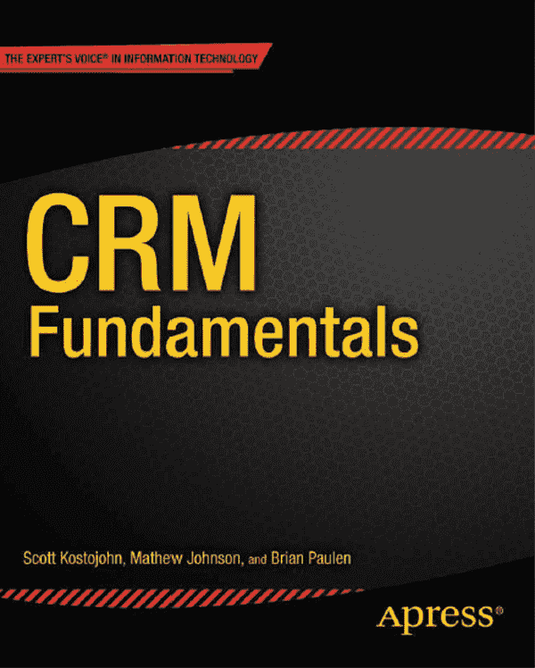
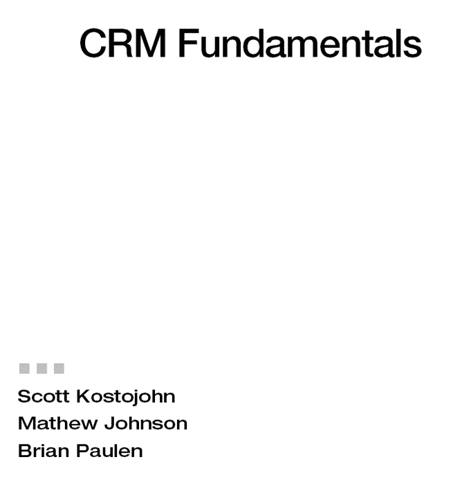

# CRM 基础

版权所有 © 2011 斯科特·科斯托约翰、马修·约翰逊和布莱恩·保伦

保留所有权利。未经版权所有者及出版商事先书面许可，本作品的任何部分不得以任何形式或通过任何方式（电子或机械，包括影印、录音，或任何信息存储或检索系统）进行复制或传播。

ISBN-13（平装）：978-1-4302-3590-3

ISBN-13（电子版）：978-1-4302-3591-0

本书中可能出现商标名称、标识和图片。对于商标名称、标识或图片的每一次出现，我们不使用商标符号，而仅以编辑方式使用这些名称、标识和图片，以利于商标所有者，并且无意侵犯商标权。

本出版物中使用的商号、商标、服务标志及类似术语，即使未明确标识，也不应理解为对它们是否受所有权保护的意见表达。

总裁兼出版人：保罗·曼宁
主审编辑：杰弗里·佩珀
技术审校：汤姆·麦金尼
编辑委员会：史蒂夫·安格林、马克·贝克纳、埃文·白金汉、加里·康奈尔、乔纳森·格尼克、乔纳森·哈塞尔、米歇尔·洛曼、詹姆斯·马卡姆、马修·穆迪、杰夫·奥尔森、杰弗里·佩珀、弗兰克·波尔曼、道格拉斯·庞迪克、本·雷诺-克拉克、多米尼克·沙克沙夫特、马特·韦德、汤姆·韦尔什
协调编辑：詹妮弗·L·布莱克威尔
文字编辑：金·温普塞特
排版：Bytheway Publishing Services
索引编制：SPI Global
插图制作：SPI Global
封面设计：安娜·伊什先科

本书通过施普林格科学与商业媒体有限责任公司（地址：`233 Spring Street, 6th Floor, New York, NY 10013`）在全球范围内分销。电话：`1-800-SPRINGER`，传真：`(201) 348-4505`，电子邮件：[`orders-ny@springer-sbm.com`](http://orders-ny@springer-sbm.com)，或访问[`www.springeronline.com`](http://www.springeronline.com)。

如需翻译信息，请发送电子邮件至[`rights@apress.com`](http://rights@apress.com)，或访问[`www.apress.com`](http://www.apress.com)。

Apress 及 friends of ED 的书籍可批量购买用于学术、企业或促销用途。大多数图书也提供电子版和许可证。如需更多信息，请参考我们的特别批量销售–电子版授权网页：[www.apress.com/bulk-sales](http://www.apress.com/bulk-sales)。

本书中的信息按“现状”提供，不附带任何保证。尽管在编写本作品时已采取一切预防措施，但作者和 Apress 对因本作品所含信息直接或间接造成的任何损失或损害，均不承担任何责任。

## 内容速览

 关于作者

 关于技术审校

 致谢

 引言

 第 1 章：引言

 第 2 章：CRM 成功的要素

 第 3 章：制定 CRM 路线图

 第 4 章：评估软件与顾问

 第 5 章：规划初始 CRM 实施

 第 6 章：执行初始 CRM 实施

 第 7 章：维护与演进 CRM

 索引

## 目录

 关于作者

 关于技术审校

 致谢

 引言

 第 1 章：引言

定义 CRM

本书的目的

CRM 价值的来源

支持数据驱动型学习型组织

消除低效，提升员工生产力

提供更优质的客户体验

为商业决策提供信息

为 CRM 做好准备

章节总结

 第 2 章：CRM 成功的关键要素

人员

流程

技术

期望

陷阱

总结

 第 3 章：构建 CRM 路线图

为何对 CRM 项目采用分阶段方法？

耗时过长

没有机会融入反馈意见

构建初步路线图

评估当前状况

中途制定路线图

总结

 第 4 章：评估软件与顾问

CRM 软件市场

功能范围：完整 CRM 套件与专业应用

部署模式

应用程序访问方式

许可模式

选择正确的 CRM 软件

CRM 应用的评估标准

软件评估流程

选择正确的顾问

评估标准

结语

 第 5 章：规划初次 CRM 实施

管理 CRM 项目

理解项目阶段

变更管理

项目沟通

持续的项目管理

资源/供应商管理

高管支持

总结

第六章：执行初步 CRM 实施

设计阶段
“现状”流程定义
“未来”流程定义
规则与升级机制
用例定义
功能规格说明书编写
自定义开发
将自定义开发作为 CRM 项目的一部分进行管理
技术规格文档编写
系统集成
提供更完整的客户视图
自动化业务流程
集成的类型
集成工具
在 CRM 项目中管理数据层集成
开发集成方案
集成测试
在 CRM 项目中管理用户界面集成
系统间数据关联
报告与分析
什么是有效的报告？
指标需具体明确
指标需由指定部门或小组明确负责
指标需可量化衡量
指标需能及时生成
对于给定的计分卡，关键绩效指标（KPI）数量必须控制在可管理的少数几项
关键绩效指标（KPI）必须有明确目标
关键绩效指标（KPI）必须与组织的整体目标保持一致
报告来源
报告工具
设计报告
报告培训
数据迁移
你的项目需要数据迁移吗？
评估数据来源
设计数据迁移方案
数据迁移工具
测试数据迁移：模拟迁移
规划实际数据迁移
数据迁移总结与关键经验教训
实施测试
CRM 应用测试的类型
制定测试计划
实施培训
启动解决方案
系统切换
初始应用管理
推动应用采纳
变革管理
人员管理：新的工作职能
整合所有要素：CRM 实施项目计划示例
常见项目问题及规避方法
范围蔓延
设计过于复杂
软件驱动的项目
缺乏高管支持
管理相互冲突的优先级
应用采纳率低
本章小结

第七章：维护与发展 CRM

指导委员会的角色
维护 CRM
支持员工与收集反馈
增强 CRM 功能
变更控制流程
路线图制定与执行
管理大型应用增强项目
新应用版本与升级
监控供应商生态系统
会议
新的独立软件供应商 (ISVs)
用户组
博客与通讯
顾问
关于 CRM 维护与发展的最终思考
结论

索引