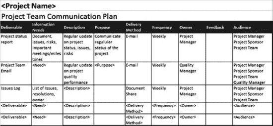

# 第1章

## 引言

### 定义CRM

对于企业而言，世界正以无情的速度变得越来越充满竞争。技术创新降低了准入门槛，曾经专业化的产品和服务变成了商品，每个市场都突然变得拥挤不堪。客户体验作为差异化因素对企业越来越重要；与此同时，客户本身也变得更加成熟、要求更高、忠诚度更低。

为了成功，企业需要比竞争对手更高效地运营，员工必须更有生产力和效率，产品和服务必须更紧密地贴合客户需求。他们必须做出更多“正确”的决策，并且必须更快地做出这些决策。这种高水平的绩效需要信息——关于业务运营、关于现有客户和潜在客户、以及关于竞争对手的信息。

为了应对这些趋势，企业加强了对客户的关注——在决策中更频繁地审视客户视角，调整业务流程和组织以提供更好的客户体验，并通常更周到、更审慎地管理客户信息和关系。软件工具应运而生，以支持企业这种对客户和客户管理的新关注。这种加强客户关注的商业策略以及为支持它而出现的业务应用类别，都被称为“客户关系管理”（CRM）。在本书中，我们将使用“CRM计划”来描述企业为加强客户关注而部署的人员、流程和技术，而“CRM应用程序”则用来描述技术元素，通常以一个CRM软件包为核心。我们将在下一章详细探讨计划的不同要素。

### 本书目的

本书旨在为任何负责领导或参与所在组织CRM项目的人提供参考。我们的目标是让读者对CRM的价值有扎实的理解，概述构成成功CRM项目的要素，并详细说明成功启动CRM项目所需的步骤。我们特意避免深入探讨具体的CRM应用程序或CRM的技术元素。市面上已有大量书籍详细介绍各种CRM应用程序的方方面面，可以帮助你的管理团队提高效率。我们想写一本这样的书，为不懂技术的管理人员提供信息，帮助他们整合CRM项目的各个部分，避免常见的陷阱，并选择合适的应用程序和咨询合作伙伴来协助他们。

本书内容大致按照实际应用的顺序组织。第二章阐述了构成一个完整且成功的CRM项目的要素，以便你了解各个组成部分及其如何协同工作。第三章指导你如何构建路线图——即实施CRM的计划，包括项目目标和实施时间表。第四章涵盖了为你的组织选择合适CRM应用程序和咨询合作伙伴的流程。第五章详细介绍了规划路线图实施的细节，第六章则涉及各个CRM项目的执行。最后，第七章描述了维护和发展CRM的策略。

### CRM价值的来源

既然我们已经明确了“CRM”的含义，并提供了本书的高层概述，接下来让我们探讨一个企业或任何组织为何会启动这样一个项目。CRM的价值何在？

#### 支持数据驱动型学习型组织

一套有据可查、持续执行的流程与一个支持、监控并报告这些流程的业务应用程序相结合，为敏捷、学习和发展的组织奠定了基础。这种敏捷性可以帮助你在竞争中保持领先一步。除了在帮助用户高效执行业务流程方面发挥直接作用外，CRM应用程序的报告和仪表板还充当着组织的“仪表盘”——通过让你持续评估哪些有效、哪些无效，检验假设并尝试改进，然后基于结果做出数据驱动的决策，从而支持敏捷性。

思考一下与一位销售主管的以下对话：

> *CRM顾问*：你知道客户为什么从你这里购买产品吗？
> 
> *经理*：我大概知道一些。他们购买是因为客户服务好，而且我们的产品更出色。
> 
> *CRM顾问*：你是怎么知道的？
> 
> *经理*：通过和一些客户的交流。
> 
> *CRM顾问*：你知道对于不同的客户，这些因素中哪一个最重要吗？
> 
> *经理*：不，我想我不知道。
> 
> *CRM顾问*：你知道你最常输给谁，以及原因吗？
> 
> *经理*：我有个想法，但同样没有实证数据支持。

这是一个组织在尝试实施CRM项目未成功或根本未尝试时的相当常见的互动。如果我们询问关于销售管道可见性、销售周期时长、输单分析或客户服务查询数据（查询需要多长时间解决，首次呼叫解决多少等）时，我们也会得到类似的回答。你听过那句古老格言“*你无法管理你无法衡量的东西*”——一致的流程和一个成熟的CRM应用程序可以为衡量和管理提供所需的平台。

#### 消除低效，提高员工生产力

了解你当前的流程是开始分析CRM应用程序可能带来的改进的第一步。整本书都在专门讨论流程定义和改进，因此我们不会在本书中深入探讨这些主题；我们的目标是展示一个CRM系统如何通过正确的分析和实施，帮助在你的流程中创造效率。

CRM带来效率提升的几个例子包括：

*   **改善潜在客户管理**，通过将来自网站联系表单的线索直接输入CRM中相应销售团队的工作队列。
*   **自动分配** 入站的潜在客户给合适的销售代表，依据是地理位置、类别等。这种自动分配能更快地将线索交到销售代表手中。
*   **自动升级或重新分配服务问题**，基于定义的标准，如优先级、问题类型、存在时间、类别等。这带来了更高效的问题管理和改善的客户体验。服务问题不再能“被遗漏”。
*   **在大额销售交易上提醒管理层**——当销售交易超过某个收入门槛时，CRM应用程序可以自动提醒销售领导团队，以便他们能够看到该交易并协助客户团队。
*   **CRM的商业智能元素** 可用于对已成功转化为客户的线索进行画像，然后对入站线索进行评分，以帮助销售团队成员优先安排电话，专注于与过去成功线索最相似的线索。
*   **在CRM内管理报价生成**，确保销售代表创建有效的报价（包括必要且兼容的组件/产品），并确保所有代表使用正确的定价和最新的产品可用性信息。这减少了新销售团队成员的上手时间，并大幅降低无效报价的频率。
*   **关联与客户的所有互动**（电话、重要电子邮件、电子邮件通讯、参加展销会等），以分析销售驱动力、赢单或输单原因、重复业务等。

##### 案例研究：CRM增强的销售流程

在这个组织中，销售团队使用Excel电子表格向客户发送提案。这些电子表格包含产品信息（名称、价格、依赖关系），因此当产品变更推出时，需要向所有销售人员发送新的电子表格“模板”。这个过程存在很大的出错风险：

*   **销售人员可能会错误地使用旧版本的电子表格。**
*   **销售人员可能会修改（而且经常修改）Excel模板以满足自己的需求，而未经经理、财务、产品开发等部门的批准——这可能导致销售无法履约的产品、不符合公司规定等。**

为了了解整个组织的销售预测情况，这个过程还意味着销售人员需要负责将他们的提案信息输入一个单独的数据库。重复录入是一个大问题，因为：

*   **数据录入错误使得预测变得困难。**
*   **销售人员电子表格中更新的数据并不总是能在预测数据库中更新。**
*   **销售人员通常等到交易接近成交时才将交易录入预测数据库，以避免在那些没有进展的交易上浪费精力。这导致了组织预测不准确。**

解决方案是推出一款CRM应用程序和新的预测流程来捕获销售信息。新的解决方案减少了销售团队的数据录入工作，提高了预测准确性，并包含了报价生成工具，增强了管理层对报价的控制。其他一些运营数据库也被整合到CRM解决方案中，以便运营人员能够从销售信息中受益，并在售后关键交接环节与销售团队更好地协作。

#### 提供更佳的客户体验

为客户提供最满意、最高效的互动体验，已成为日益重要的差异化竞争优势。如今的客户忠诚度远不如从前——他们往往只需花几分钟在网上搜索，就能找到你的产品或服务“更好”的替代方案。此外，博客、评分网站和社交媒体等技术工具，也放大了消费者“口碑”传播的规模和影响力，使得积极的客户体验变得愈发重要。

客户对“可接受的互动体验”的期望值在不断演变，如今至少包含以下几点：

*   与他们互动的每位客服代表都应能查阅贵组织与客户过往的所有互动记录，涵盖从购买到服务的各个环节。拨打服务电话的客户不应为了查找上次与贵组织沟通的信息而被迫转接多次。
*   应提供自助服务选项，让客户能够全天候（每周7天，每天24小时）自行获取信息或发起基本交易。
*   贵组织应通过客户偏好的任何渠道（电子邮件、电话、短信等）与他们进行沟通。

只需考察一下零售银行业务，就能轻易了解客户对互动的期望发生了怎样的变化。就在不久之前，所有零售银行业务还都是在银行的“营业时间”内，由柜员在分行网点内办理的。随着时间的推移，该行业推出了一项又一项创新，为客户提供了越来越好的体验（同时往往也降低了成本）。先是推出了免下车银行服务，然后是自动取款机，再后来是网上银行。在此过程中，一些银行开始延长营业时间，以提供更多便利。而现在，已有好几家银行允许你通过手机进行交易，并通过短信向你发送余额更新信息。

CRM程序能以多种方式支持贵组织满足这些期望的努力：

*   从客户角度对与CRM程序相关的业务流程进行评估，可以带来改善客户满意度的变革。
*   CRM应用程序作为客户信息的中央枢纽，由所有面向客户的员工共享，帮助每位员工在客户面前展现出信息充分、令人信赖的形象。
*   CRM应用程序的工作流自动化功能可提供一个平台，根据事件自动向客户发送通信信息。
*   CRM应用程序可作为客户网络门户的数据存储库，从而实现自助服务。
*   对CRM应用程序进行数据挖掘，可以根据客户档案识别出他们可能感兴趣的产品、服务和促销活动。

#### 为业务决策提供信息

您的CRM程序提供了一个收集客户信息的平台，并使这些信息能够轻松提供给业务领导者进行审查和分析。过去那些依赖传闻证据，或需要经过漫长而艰巨的数据收集和汇总才能做出的决策，如今可以轻松地通过CRM应用程序中的相关信息得到支持。可以从中获得关于组织及其客户的全新洞察，发现新的机遇或竞争威胁。

CRM数据有助于为决策提供信息的一些常见领域包括以下内容，以及每个领域可能回答的问题：

> 销售预测
> 
> 我们本月/季度能否实现收入目标？销售额将如何在不同区域和产品线之间分布？
> 
> 销售管理
> 
> 我的销售人员表现是否达标？他们在完成交易和开发潜在客户之间是否合理分配了时间？我的销售管道健康状况如何？他们正在丢失哪些交易，原因是什么？
> 
> 产品规划
> 
> 不同类型的客户在购买哪些产品？他们会同时购买哪些产品？我们每条产品线的主要竞争对手是谁，他们在什么情况下会取胜？为什么有些产品收到的客户服务咨询比其他产品多？
> 
> 客户服务人员配置
> 
> 我的问题处理量随时间如何变化？人员配置水平如何影响问题解决时间？互动或升级的数量是否随时间减少？
> 
> 营销活动规划
> 
> 过去哪些潜在客户来源最有效？成功潜客的特征是什么？哪些类型的营销活动能激发最大兴趣？

除了提供一套静态指标来监控业务的持续健康状况和绩效外，CRM程序还可以在业务规划中发挥积极作用。

近年来社交媒体工具使用率和重要性的提升，可以使CRM成为一个更有用的平台，用于了解客户并为业务决策提供信息。随着越来越多的客户通过博客、Facebook和Twitter等工具分享他们的意见、需求、喜好和厌恶，我们可以整合更多的此类数据，以丰富存储在CRM应用程序中的客户和市场档案。如今，已有许多工具和服务能够挖掘这些信息并将其整合到CRM应用程序中。除了这种被动的信息收集角色外，贵组织还可以主动利用这些社交媒体工具，使用客户正在使用且偏好的工具，与客户开辟新的沟通渠道。这些新渠道可用于发布公司最新动态、提供促销活动以及收集反馈。

### 为CRM做准备

#### 为组织变革做好准备

在启动新的CRM计划之前，为组织变革做好准备是CRM成功的重要推动因素。变革（即便是朝着更好的方向）往往都会遭遇阻力，因为人们对自己现有的流程感到舒适。周密的准备可以消除这种阻力，帮助员工看到变革的积极面，并从容应对新流程和新应用带来的不可避免的突发问题。那么，如何恰当地让组织为变革做好准备呢？根据我们的经验，以下主要组成部分已被证明是行之有效的：

> **数据驱动文化**
>
> 追求数据驱动文化意味着将流程文档化，收集有关其有效性的数据，基于数据做出改变，然后再根据数据评估变革的成功与否。整个过程应在可行范围内进行沟通。这种变革方法将帮助员工了解哪些情况会被识别为潜在的变革点，变革如何制定，以及这些变革的有效性如何衡量。这种有条不紊的方法会让人相信变革并非随意之举；变革是基于重要的业务目标而进行的，并且会对其成功与否进行严格评估。其结果是形成一个更乐于接受变革、更愿意支持变革的员工群体。显然，CRM计划的部分目的是为数据驱动文化建立一个框架——但尽可能在启动CRM项目之前就培养这种文化，将大有裨益。
>
> **高管支持**
>
> 获得高管对整个实施过程，尤其是对其所带来的变革的支持，对于计划的成功至关重要。高管需要充分参与，以便能够指导决策，并传达实施项目的愿景及其预期收益。
>
> **沟通**
>
> 沟通至关重要，这样人们才能知道将要发生什么，从而为即将到来的变革做好准备。首先制定一个类似于图1-1的沟通计划非常重要，该计划需要明确谁需要什么信息、何时需要、他们如何提供反馈、谁负责传递信息以及使用什么渠道。

***图 1-1.** 示例项目沟通计划*

> **培训**
>
> 显然，培训是任何技术实施的一部分；然而，在规划你的项目时，有几个关键点需要留意。尽早并经常进行培训有助于员工适应新技术和新流程，从而减少阻力。
>
> **反馈**
>
> 至关重要的是，人们需要有一种方式来表达新技术/流程对他们的工作生活产生了何种影响（积极或消极的）。当然，你无法处理每一条反馈（也无法完全按照个人期望的方式处理），但仅仅承认、考虑并以非常诚实的方式解释这些反馈这一事实本身，就能在很大程度上促使员工接受变革。
>
> **认可**
>
> 表彰那些在履行职责过程中正确使用CRM系统的员工，可以为其他人树立积极的榜样。这不仅奖励了期望的行为，还能展示这些人在其工作职责中（如节省时间、减少数据录入等）获得的好处。认可个人的一些好方法包括：由项目“倡导者”向团队发送电子邮件、给予小额激励奖励（如礼品卡），以及在团队会议上特别提及。

## 章节总结

CRM是一种战略，旨在加强对客户关系的开发、维护并从其中获取最大价值。你的CRM计划包括人员、业务流程和技术组件。

本书旨在为非技术背景的业务主管提供必要的信息，以成功规划和启动CRM计划。

一个实施良好的CRM计划能带来诸多价值，包括提高员工生产力与效率、改善客户体验、增强业务洞察力，以及培养数据驱动的学习文化。

让组织为吸收变革做好准备，是使你的CRM计划启动更成功的基础工作。