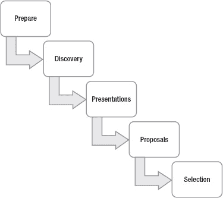
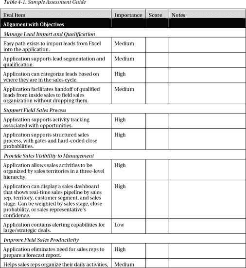
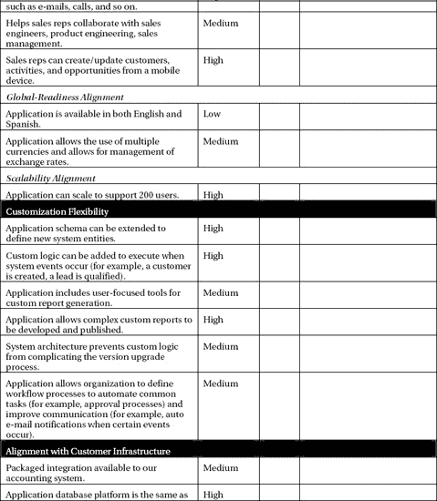
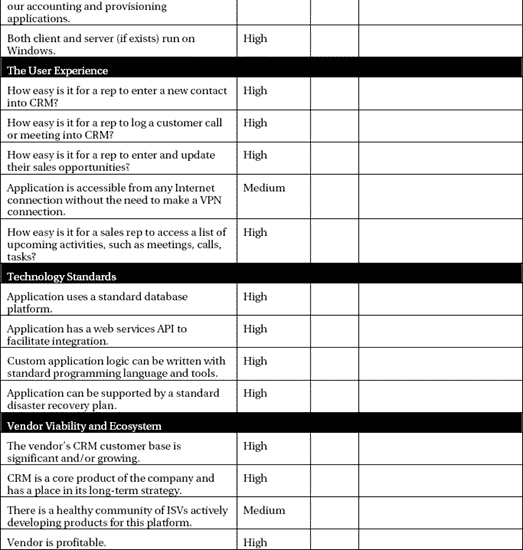
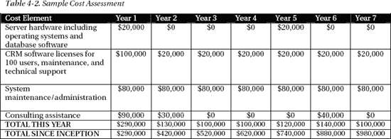

# 第 4 章

## 评估软件与顾问

在前两章中，我们看到一个成功的 CRM 项目是人员、业务流程和技术的结合，共同帮助组织实现 CRM 目标。尽管支持 CRM 项目的技术只是其中一部分，但它对项目的成功影响重大。许多组织因为 CRM 应用程序昂贵、不灵活或难以使用，导致项目受阻甚至被放弃。

本章旨在提供一套流程和关键标准，供你用来选择合适的 CRM 应用程序以及合适的咨询合作伙伴来支持 CRM 项目。虽然我们分开描述软件和顾问的评估，但实践中这两个过程常常相互交织，因为 CRM 供应商通常在销售周期早期就引入合作伙伴。某款 CRM 应用程序可能在软件评估中明显胜出，但如果其咨询支持不力，你可能需要考虑其他选择。

### CRM 软件市场

CRM 软件市场广阔且变化迅速。本节不会列出当前主流应用的详细目录，而是描述 CRM 产品之间的一些关键变量，帮助你理解如何比较和分类应用程序。这些变量包括功能范围、部署选项、应用程序访问方式和许可模式。

#### 功能范围：全套 CRM 套件与专业应用

传统的 CRM“套件”包含支持三个前端业务功能（市场营销、销售和客户服务）的特性。销售功能通常包括潜在客户管理、销售机会管理和报价制定。市场营销功能允许对潜在客户和客户进行细分，并通过多种媒介（电子邮件、电话和直邮）与这些潜在客户协调沟通。客户服务通常包括问题管理和知识库。除了每个部门从应用功能中获取的价值外，全套 CRM 套件承诺的价值在于它能促进跨部门的信息共享。如果组织要面向客户呈现统一形象，这种共享是必要的。

此外，还有大量更专业的 CRM 应用程序，它们针对特定的业务功能（例如营销需求生成、客户服务与支持）、特定环境（呼叫中心应用）或特定行业（财富管理、非营利组织）。这些应用在各自领域可能比全套套件产品更便宜或功能更丰富，但在选择专业应用前应仔细考虑。将多个专业的部门级应用整合起来以获取无缝的客户视图所面临的挑战，可能会超过这些应用相对于 CRM 套件的任何优势。

### 部署模式

在组织内部署 CRM 应用有多种选择，各有不同的成本、风险和收益。本节将介绍最常见的三种：本地部署、应用托管/服务器托管和软件即服务。

##### 本地部署

这是部署 CRM 等客户端-服务器软件应用的传统模式；客户将软件安装在自己场所的服务器硬件上。这种部署模式给予客户最大程度的控制权，因为他们可以根据需要选择和升级服务器硬件。他们可以实施任何偏好的备份和灾难恢复计划。这种模式也便于集成；身份验证和网络安全方面的复杂性通常低于将 CRM 应用托管在组织网络之外的情况。这种模式的缺点在于服务器硬件和 IT 人员方面的成本。

在 CRM 市场的低端，存在“仅客户端”而非“客户端-服务器”的应用。这些应用旨在作为个人生产力工具，通常面向销售人员。该领域的资深应用是`ACT!`，其他产品包括`GoldMine`和微软的`Business Contact Manager`。这些应用是出色的个人生产力工具，但不适合寻求将信息共享与协作纳入 CRM 项目的组织。尽管许多此类供应商已推出多用户、网络版产品，试图在 CRM 市场低端竞争，但根据我们的经验，这属于“本性难移”的情况。这些产品从根本上并非为企业级使用而设计，应避免选用。

##### 应用托管与服务器托管

在这种模式中，客户购买软件，然后将其安装在第三方场所的服务器硬件上并使用。客户可能拥有服务器（服务器托管），也可能不拥有（应用托管）。软件许可可以是永久许可或订阅模式。对于应用托管，提供商通常提供服务器维护、备份和灾难恢复。对于服务器托管模式，提供商可能只提供电力和网络连接。这些部署模式相比本地部署，IT 负担更轻，但控制权也更少。

#### 软件即服务

软件即服务（`SaaS`）模式，由 [Salesforce.com](http://Salesforce.com) 在 CRM 市场中率先采用，如今已站稳脚跟并日益壮大，这得益于近期云计算的兴起，使其成为自行管理技术基础设施的可接受替代方案。该模式试图将企业软件从一种资本资产转变为一种按需购买和消耗的公用服务。

理解软件即服务的最简单方法，或许是将其视为订阅许可（如前所述）与外包、远程服务器基础设施的结合。其最常见的形式是，客户按每用户/每月付费，并通过信用卡支付。软件通过互联网访问，客户对底层基础设施既不可见，也无责任或控制权。供应商通常会承诺一定的服务可用性水平（以“正常运行时间”衡量，即服务可用的营业时间百分比），若未达承诺将面临财务处罚。对于 IT 资源有限的组织而言，软件即服务模式可能极具吸引力。自行管理基础设施所带来的所有麻烦和可变成本都被消除，取而代之的是一笔可预测的固定月度成本和一项服务——你的员工无论在世界何处，只要能够连接互联网，就可以随时使用。然而，一些组织可能制定了隐私或安全策略，不允许将客户数据托管在公司网络之外。

这种便利性伴随着更高的成本；在典型的应用生命周期内，软件即服务应用程序的总软件成本通常高于本地部署的应用程序。另一个需要考虑的关键因素是非货币性的：即与此类应用相关的控制权丧失。一旦你在某个 CRM 应用中累积了多年的历史数据并培训了用户，你便在许多方面被“锁定”。此时再迁移到其他应用，成本可能极其高昂。然而，`SaaS` 提供商可能会以你目前无法预料的方式更改其条款或定价。当他们这样做时，这种高额的转换成本将赋予他们在后续任何谈判中的巨大优势。我们听说，摆脱一个糟糕的 `SaaS` 应用就像摆脱一段糟糕的婚姻——往往是一次混乱、充满争议且代价高昂的经历。

#### 应用访问方式

用户与 CRM 应用的交互方式是评估 CRM 应用时的另一个考虑因素。

- *客户端应用程序*：这种用户在其计算机上安装应用以访问 CRM 的方式正在 CRM 市场中消失，取而代之的是 `Web` 浏览器访问和移动设备访问。这种访问形式的主要优势在于能够提供比当前基于浏览器的应用（尽管 `Web` 应用正在快速追赶）更丰富的应用功能，并且能够在本地缓存 CRM 数据以实现离线使用。
- *Web 应用程序*：这是当今 CRM 市场中应用访问的主导方式。通过安全的 `Web` 浏览器访问 CRM 应用。其优势在于随处可访问性；只要计算机能连接互联网，即可使用 CRM，并且无需在计算机上安装任何软件。部署和维护此类 CRM 应用也极其简单，因为无需在用户计算机上安装、升级或修补任何软件。
- *移动设备访问*：随着智能手机和平板电脑等手持设备在性能、灵活性和普及率方面的不断提升，通过移动设备访问 CRM 正变得越来越重要。一个设计良好的移动应用可以对移动办公人员（他们通常希望在拜访客户时记录笔记和安排会议）的用户采纳率产生重大影响。他们还可以利用设备功能（例如，摄像头、`GPS`）实现新的应用场景，例如生成前往客户所在地的导航路线。
- *集成 `Microsoft Outlook` 的应用*：一些 CRM 供应商提供与 `Outlook` 集成的 CRM 客户端应用或附加组件，以便将 CRM 功能集成到 `Microsoft Outlook` 中。CRM 用户有相当大比例的屏幕时间是在 `Outlook` 中工作，它也是与客户互动的主要工具。通过将 CRM 功能集成到 `Outlook` 中，可以简化多个 CRM 用户场景，例如在 CRM 中记录与客户的电子邮件互动和会议，以及创建新的联系人记录。

### 许可模式

对于刚接触企业软件世界的读者来说，目前存在多种不同的许可模式，这些模式对软件的初始成本和持续成本都有影响。这些模式的不同之处在于许可的内容、许可期限、许可的用户类型以及许可的访问方式。这些差异将在下文描述。

#### 许可内容：命名用户、设备、连接数……

命名用户许可指的是一种模式，其中许可证被购买并分配给单个用户；只有这些用户被授权使用该软件，但他们可以使用自己选择的任何计算机或设备来使用。这可能是最常见的许可形式。

有些软件是许可给特定计算机的。这在呼叫中心环境中很常见，在那里多个班次的用户在不同时间使用同一组计算机。无论有多少不同的个人使用它，计算机本身是获得许可的。

在并发许可模式下，组织为特定数量的与应用服务器的并发（即同时）连接申请许可。这通常由服务器软件管理，该软件会拒绝超出所购并发许可证数量的连接。这种模式在软件仅需偶尔使用但用户群体庞大时非常有用。会计软件通常以此方式许可；一个十人会计团队可能只为会计软件包许可三到四个并发许可证，因为这些用户并非一直使用该应用，而是在一天中根据需要登录和退出。

##### 许可期限：永久性许可 vs. 订阅式许可

永久性许可是最为人熟知的许可期限；它至今仍是基于 `PC` 的软件许可的主要形式。顾名思义，在此模式下购买产品允许用户永久使用该软件的权利。通常会有一些重要的限定条件；在大多数情况下，需要支付单独且重复的维护费用，以获得技术支持和安装使用后续软件版本的权利。如果用户选择不支付维护费，未来的版本通常必须按全价购买。

订阅式许可类似于“租赁”模式。用户仅有权在订阅期内使用软件。通常，技术支持与升级权利已包含在订阅许可中，无需额外付费。

##### 其他需要考虑的许可场景

还存在许多可能与 CRM 软件相关的其他许可场景，在评估过程中，应当了解每个供应商的许可模式如何处理每个相关场景。其中一些场景包括以下几点。

#### 终端客户与合作伙伴访问

许多业务场景需要非员工以受控方式访问 CRM 软件。以下两个常见示例可说明此情况：

-   组织开发并实施与其 CRM 应用程序相连的客户门户。该门户允许客户登录并直接在 CRM 应用程序中查看/输入数据（例如地址更新、电子邮件偏好设置及客户支持工单）。
-   组织开发并实施与其 CRM 应用程序相连的合作伙伴门户。该门户允许组织将合格的销售线索分配给渠道合作伙伴，同时渠道合作伙伴可更新销售进展、申请营销材料及注册客户。

由于 CRM 许可证成本相对较高，为所有需要访问 CRM 的客户和合作伙伴购买此类许可证通常成本高昂。因此，许多 CRM 供应商提供特殊的“外部访问”或“外部连接器”许可证，旨在以合理成本允许非员工访问 CRM 软件。

#### 只读访问

在组织内部，除了常规的 CRM 应用程序事务型用户外，可能还存在一组仅需查看 CRM 信息、无需输入或编辑信息的用户。常见的例子是高级管理人员，他们不直接与客户打交道，也没有信息需要录入 CRM，但需要从 CRM 中获取汇总报告并偶尔进行只读访问。

考虑到这些用户较低的使用频率，客户反对为其购买完整的用户许可证。许多 CRM 供应商已对此做出回应，推出了“只读”或“报表”许可证，其价格相比完整许可证有大幅折扣。

### 选择合适的 CRM 软件

选择 CRM 软件可能是一件复杂的事情：市场上充斥着标榜为“CRM”的产品，但它们在成本、功能、复杂性、架构和灵活性方面差异巨大。选择适合您业务的产品充满挑战，需要深思熟虑的流程和一套清晰的评估标准来对候选 CRM 应用进行评分。

#### CRM 应用评估标准

在本节中，我们将描述一套标准，您可利用这些标准来评估特定 CRM 应用与您组织需求的匹配程度。

##### 与您的组织和目标的一致性

这是本评估标准中最直观、最基础的原则。您需要评估特定 CRM 应用与您的组织、目标及优先事项（依据您自身的 CRM 路线图所定义）的契合程度。该标准可进一步细分为以下子标准：

-   *功能/特性匹配度*：如果问题的根源在于服务部门，就不要选择以销售为中心的 CRM 应用——这类应用的服务功能往往是事后添加来“凑齐”产品线的。如果您销售团队的移动性很高，请确保所选产品具备符合需求的移动设备平台。
-   *全球化就绪度*：如果您的员工和客户遍布全球，请仔细审视每个产品的多币种和多语言能力。它如何处理汇率存储与更新？增值税及其他国际税务问题呢？全球字符集呢？您可能会惊讶地发现，许多为美国市场设计的产品无法处理多种语言数据录入所需的双字节字符。同时需询问该应用是否针对地理上分散的办公室之间的广域网环境进行了优化。
-   *可扩展性匹配度*：如果您的 CRM 用户群体可能增长到 1000 人或更多，请以可扩展性为着眼点，严格审视每个产品的技术架构，并要求每个供应商提供用户数量相近的参考客户。许多 CRM 应用是为个人和小团队设计的；其在低端市场的成功促使它们向更高端市场进军，服务越来越大的客户。其开发团队试图让应用适合这些“企业”客户，但他们无法摆脱产品底层架构的限制——这根本不适合此类场景。

##### 定制灵活性

一旦您选定了 CRM 应用，您的咨询合作伙伴将通过实施过程与您的组织合作，确定如何利用 CRM 支持业务。你们将共同确定对业务流程和 CRM 产品的修改，以交付最佳解决方案。方案构建完成后，培训用户并投入生产，您的团队将开始自主运行，咨询合作伙伴的项目团队则会淡出，转而帮助下一位客户。

问题可能由此开始。您的 CRM 设计初衷是支持当前运营的业务。然而，下一个新产品领域、新客户细分市场、新部门以及新的组织结构很快就会接踵而至。如果您无法使 CRM 系统与时俱进，跟上业务发展的步伐，您会发现随着时间的推移，它的实用性和相关性越来越低，为组织提供的价值也越来越少。一个选择是请回您的咨询合作伙伴来修改系统布局和行为，但这可能需要较长的前置时间来安排资源，花费时间来让新团队熟悉您的业务，并产生成本。更理想的是，您的内部团队能够在重新配置和定制 CRM 解决方案方面发展出一定程度的自给自足能力。

基于此目标，针对 CRM 产品需要提出的一些关键问题包括：

-   该应用的定制和配置能力如何？
-   提供了哪些工具？
-   不同类型的定制需要哪些技能？
-   如何开发自定义报表？

然后，将这些问题答案与您内部团队成员的技能进行比较，并考虑必要时在市场上获取这些技能的成本，从而评估您在没有外部支持的情况下发展“演进”系统能力的可行性。

##### 与现有基础设施的一致性

此标准是关于在评估潜在应用时，不应孤立对待，而应将其置于您组织现有客户数据平台的背景下进行考量。我所说的“客户数据平台”是指用于存储和处理客户信息的现有系统，例如财务核算系统、服务管理系统、客户门户网站、电子邮件系统等。由于 CRM 应用以客户为中心，它们需要与其他系统集成和交互，因此应尽可能建立在兼容的软件基础设施之上。这将使您能够以最小的难度和成本开发这些集成，并简化客户数据平台的管理。您的技术环境中使用的技术种类越多，`IT` 团队需要掌握的技能就越多，这可能导致团队规模扩大，从而影响成本。例如，如果您的组织使用 `Oracle` 数据库运行 `SAP` 财务核算系统，并使用 `Lotus Notes` 处理电子邮件，那么 `Microsoft Dynamics CRM` 可能不是最佳的 CRM 解决方案选择，因为它运行在 `SQL Server` 平台上，并与 `Microsoft Outlook` 电子邮件客户端紧密集成。

#### 用户体验

可用性是评估 CRM 解决方案时至关重要的因素。如果你思考 CRM 项目成功所需的各个环节，用户采用率往往是最薄弱的一环，也是许多项目失败的根源。说得更直白些，糟糕的用户体验比任何其他因素都更可能导致 CRM 项目失败。CRM 战略依赖于每个面向客户的员工的参与；在大多数情况下，这些员工的关键作用是通过在 CRM 应用程序中输入数据，向组织其他部门提供有关其客户及互动情况的信息。

如果 CRM 应用程序难以使用、学习或耗时过长，就会与最终用户产生摩擦。这种摩擦最终可能导致用户放弃 CRM 解决方案，尤其在以下任一情况成立时：

-   用户认为其使用几乎没有直接益处。
-   你的企业文化中，管理层无法或不愿将 CRM 作为业务的强制组成部分。

一旦这种放弃趋势开始，就会像正反馈效应一样加速发展。最终用户对 CRM 解决方案的贡献越少，系统生成的管理报告价值就越低，CRM 作为监控绩效和团队活动的工具作用也越小。这会削弱管理层对该工具的热情和投入，从而使用户更容易放弃此解决方案，如此循环。

有多种策略可以防止这种情况，并确保 CRM 的采用和成功。许多是与人及流程相关的策略，并且很大程度上与实际使用的 CRM 应用程序无关。然而，在选择 CRM 软件时，用户采用率绝对是一个考量因素。从应用程序的角度来看，促进采用的关键因素是易用性和它能为最终用户提供的价值。为评估可用性和最终用户价值，你需要试图了解应用程序的以下几个方面：

-   为了达成你对 CRM 的要求，每个最终用户角色（销售人员、客服人员、市场协调员等）需要在 CRM 应用程序中做什么？
-   访问和使用该解决方案难度有多大/耗时有多长？完成上一项中确定的任务需要多少次点击和多少个屏幕？
-   用户学习该解决方案的难度如何？它与用户已经使用或熟悉的工具相似度有多高？
-   该解决方案在哪些方面为最终用户提供了价值？它在哪些方面加快或消除了手动任务，或提供了他们目前不具备的新洞察？对每个最终用户角色而言，CRM 应用程序净属`工作制造者`还是`工作减负者`？

如果你对这些问题的评估普遍持否定态度，并且发现 CRM 可能对你许多最终用户来说是净`工作制造者`，那么你需要将其与 CRM 在业务其他方面增加的价值进行权衡，并仔细考虑尽管存在此问题，你仍能推动该工具被采用的可能性。

#### 技术标准

此标准与“与你现有基础设施保持一致”有很多共同点，但这里，你试图了解的并非 CRM 应用程序底层技术与现有基础设施的比较，而是它在多大程度上基于行业标准技术构建。如果你在技术咨询领域待得够久，就会听闻一些恐怖故事：有的企业长期固守老旧的应用程序，或使用晦涩技术定制开发了一个。然后他们找不到任何理解并能操作该程序的开发人员或顾问。它很难甚至无法与其他系统集成。报告工具无法访问它。它从多方面引发麻烦，并且运营成本可能高得惊人。相比之下，构建在标准平台（标准数据库、标准编程语言、可通过符合标准的网络服务访问）之上的应用程序则易于处理得多。

## 供应商实力与生态系统

你选择的 CRM 应用程序背后供应商的实力、投入度和活力是一个重要的选择标准，因为 CRM 应用程序的生命周期很长，而更换 CRM 应用程序可能是一项复杂且昂贵的工程。你希望选择一个会持续投资其 CRM 应用程序的供应商，以开发创新的新功能，利用新技术，并在其依赖的其他产品更新时相应地更新自己的应用程序。因此，在评估那些非上市公司（因其财务状况难以判断）、市场份额持平或下滑、不盈利，或刚进入 CRM 市场的供应商时，务必谨慎。

供应商的**生态系统**指的是围绕 CRM 应用程序的支持性产品和组织社区。生态系统的要素包括：

-   咨询合作伙伴：具备安装、配置和定制 CRM 应用程序技能和经验的服务公司。
-   独立软件供应商（ISV）：生产附加或互补产品以增强 CRM 应用程序能力的软件公司。
-   培训机构：专门培训 CRM 应用程序用户和管理员的服务公司。
-   用户组：通常为本地性质的协会，由定期会面、交流最佳实践和分享 CRM 应用程序使用经验的客户组成。

一个充满活力的、不断成长的供应商与一个繁荣的生态系统通常是相辅相成的。强大的生态系统将为您作为客户带来更好的体验；您会发现一个庞大而成功的 ISV 社区，拥有更多种类的产品、多个经验丰富的本地咨询合作伙伴供选择、便捷的培训选项，以及一个活跃的客户社区，可以相互交流和学习。

### 成本

了解获取和部署 CRM 应用程序的成本。这应尽可能包含所有成本——这里相关的行业流行词是`总拥有成本`（TCO）。不仅要考虑硬件、软件许可证和咨询等直接成本，还要考虑管理该应用程序所需内部资源的数量和类型及其相关成本。这些成本应考虑一个合理的时间段；我们通常建议考虑五到七年。

关于成本的话题，如果不提及 CRM 实施的`投资回报率`（ROI）分析，则是不完整的。坦率地说，这很可能不值当。正在准备对新的 CRM 应用程序进行大规模投资的组织，通常希望进行 ROI 分析，以描述 CRM 投资的回收期和回报来源。他们通常会要求供应商提供此分析或协助其构建。根据我们的经验，这几乎总是浪费时间，因为这种分析很少是可信的。CRM 根本就不是一种能轻易量化收益的产品。做出更好的商业决策值多少钱？服务人员与销售团队共享系统并能轻松提醒他们机会，由此带来的新销售值多少钱？分析师很快就发现自己只能猜测数字，试图找出听起来合理的数值，以便为分析量化这些收益（例如，`每月将有 20 个新增潜在客户通过 CRM 应用程序从服务部门传达给销售部门`）。通常可以包含少数几个可量化的场景——通常围绕简化报告流程——但这些最终并不能描绘出完整的图景。

有些投资决策可以通过详细而严谨的 ROI 分析来辅助决策，但 CRM 应用程序的选择不属于此类。

## 软件评估流程

本节概述的流程可用于从竞争激烈的市场中为您的组织挑选最合适的 CRM 应用。我们将详细描述该流程，但在深入探讨之前，有几个关键点需要重点说明：
- 整个评估工作的基础，是对您组织的状况、计划和需求进行深入周到的研究。这项工作通常体现在第 3 章所述的 CRM 路线图中。如果不了解“合适”对您而言意味着什么，就无法选出合适的应用。
- 在整个流程中，务必对每个产品和供应商使用相同的标准并收集相同的信息。整个流程的目标是尽可能促进进行公平的比较。许多供应商会“建议”一个偏向其自身产品的评估流程；如果您最终对每个产品采用不同的流程，您将无法进行有效比较并做出选择。

CRM 评估流程包含图 4-1 所示的步骤。

**图 4-1.** CRM 应用程序评估流程

### 评估准备

以下是评估的准备工作步骤。

#### 确定评估团队

每个利益相关者群体都应有代表成为评估团队的成员；这包括将使用新 CRM 应用的每个业务部门的经理，以及能够从技术角度评估该应用的信息技术部门代表。理想情况下，最终决策者应在此层面参与，但在许多情况下这是不可行的。

### 制定评估评估指南

该文档描述了所有需要评估的具体项目，并将用于评估和记录每个 CRM 应用在各项目上的表现。确切的文档结构并不重要，应反映您自身的情况和需求。

表 4-1 描述了一个示例评估指南。该文档以表格形式组织，评估项目按标准区域排列。每个项目都设有列，用于记录相对重要性、被评估的 CRM 应用对该项目的满足程度以及备注部分。

### 成本评估

CRM 供应商采用的不同许可模式有时会使公平比较变得困难。最佳方法是定义一个标准成本框架，然后让每个供应商针对其应用完成该框架。表 4-2 给出了一个示例模板，但您应根据自身情况按需调整。

以下是关于该模板的一些说明：
- “服务器硬件”适用于需要安装在您自有数据中心服务器上的本地部署 CRM 应用。第 5 年出现的重复成本代表着定期的硬件升级。
- “CRM 软件许可”行表示支付给 CRM 软件供应商的总成本，不包括实施费用。
- “系统维护/管理”旨在汇总与维持 CRM 应用运行相关的成本。例如，如果需要一名全职管理员，则需将该资源的成本纳入分析。这是一个难以精确估算的因素，但一些指导原则可能会有所帮助。软件即服务供应商在这一领域的成本通常较低，因为该模式不涉及服务器管理（修补、备份和灾难恢复）。然而，大部分管理成本与用户支持、报表支持和业务分析相关，这些与部署方式无关。总体而言，一个有用的预算经验法则是：对于小型 CRM 部署（按用户/范围衡量），预算为 0.25 至 0.5 个全职人力工时；中型部署为 1 至 3 个全职人力工时；大型部署为 4 至 8 个全职人力工时。
- “咨询服务”在第 1 年包含初始实施费用，并在第 2 年包含较小规模的费用。通常，在头一两年，与您的咨询合作伙伴签订某种支持协议是很有用的，因为您的内部团队仍在熟悉应用。如果您投入内部资源来管理和运营 CRM，那么对这种支持的需求预计会逐渐减少，但您可能仍会需要合作伙伴参与重大的开发工作或 CRM 版本升级（这就是为什么第 6 年咨询服务中额外包含了 40,000 美元的费用）。

### 确定并研究潜在供应商

有多种潜在方法可以识别潜在的供应商和 CRM 应用，并将范围缩小到少数几个进行全面的评估。以下是关于 CRM 应用和供应商的一些信息来源：
- 分析师报告：主要的技术分析公司（Gartner、Forrester、Aberdeen 等）都会关注 CRM 市场，并定期发布报告，详细介绍市场上的供应商及其相对的优劣势和前景。这些报告通常由被重点介绍的供应商自己提供。
- CRM 媒体：有一些专注于 CRM 的商业期刊。
- 同行交流与行业组织：这不仅是了解其他企业正在使用什么应用的好途径，也能让您感受到不同供应商的客户对其应用的满意度。
- 用户组：市场份额较大的供应商很可能在您所在的地区设有活跃的用户组。多数用户组都欢迎潜在客户参加会议，这是获得关于产品“未经筛选”观点的好地方。
- 财务报告：如果您正在研究的供应商是上市公司，它们的年报可以为了解其业务健康状况和战略方向提供参考。
- CRM 会议：虽然参会费用可能不菲，但对于短名单上的供应商，参加他们的客户会议会是极富教育意义的经历。您将有很多机会了解产品、听取客户分享他们的成功与挫折，并亲眼目睹供应商的生态系统全貌。

这项初步研究的目标是将 CRM 市场缩小到一个由两到三个应用组成的“短名单”，以便进行全面的评估。

### 发现阶段

发现阶段的目标是让供应商了解您的组织及其需求，使其能够阐述并演示其应用程序将如何满足您的具体要求，并让您对每家供应商的应用程序有一个概览性的熟悉程度。

有些人倾向于将客户与供应商的关系视为天然对立，不愿分享有关自身情况和目标的详细信息。根据我们的经验，这种观点并无益处。它会迫使供应商进行泛泛而谈的演示，价值有限，并将评估应用程序是否合适的大部分工作不公平地推给客户，而本应与供应商共同分担。发现过程是双向的：供应商了解客户的需求，以及他们需要提供哪些信息来支持评估；而客户则了解供应商及应用程序的细节。

每家供应商可能都有自己收集您 CRM 需求的方法，让他们各自按自己的方式组织流程通常没有坏处。您可以提供的一种方法是“工作跟随”，让处于关键岗位、将成为 CRM 应用程序用户的员工参与，供应商与这些用户坐在一起，观察他们的活动以及现有工具如何支持他们。

客户在这一阶段的重要任务包括：

-   为每家供应商全面介绍业务概况以及推动 CRM 计划的原因。
-   引导每家供应商了解评估指南，使其清楚在演示中必须满足哪些需求。
-   确保向每家供应商传达相同的信息。

计划让评估团队中的主题专家以及可能的 CRM 执行发起人在此阶段与供应商会面。供应商可能希望与这些人员会面，就您的情况提出澄清性问题。准备一份详细、定制化的演示内容对供应商而言耗时费力；他们会竭尽全力确保对情况以及决定选择的驱动因素有完整的理解。完成发现阶段所需的会议次数将取决于您组织的规模和 CRM 需求的复杂性；一个只有单一地点、仅需导入和筛选潜在客户工具的小型企业，其流程将比一个试图向数百或数千用户推广集成的销售、营销和客户服务应用的全球性企业简单得多。

### 供应商演示

这是流程中每家供应商正式阐述其解决方案如何满足您的需求、为何优于竞争对手以及可能产生何种成本的环节。安排演示时，应留出足够的准备时间，让每家供应商能够制定出针对您组织需求的高质量演示方案，并且不要在同一天安排多家供应商；这些会议对参与各方来说都可能非常耗费精力。以下是一些充分利用供应商演示的指南：

-   坚持要求供应商明确说明演示中的哪些元素是标准功能，哪些是第三方附加组件，或者是为此次演示或某位客户后续定制开发的。对于定制开发项目，询问涉及的大致开发工作量。
-   坚持要求每家供应商演示关键的用户体验场景。如果这些场景是标准功能，他们应能展示如何在应用程序中完成这些操作。
-   确保您在演示结束时，评估指南和成本评估都已填写完整。

### 后续阶段

在完成供应商演示并与内部团队进行总结汇报后，理想情况下，您将能够根据各应用程序在评估标准上的表现及其成本对其进行排名。接下来的主要步骤是核实客户评价。此外，此时如果供应商尚未介绍实施合作伙伴，您应向他们征求建议，推荐当地那些在成功交付项目方面拥有良好业绩记录的公司。我们将在本章后面介绍评估咨询合作伙伴的方法。

核实客户评价是评估过程的重要部分。要求提供两到四个客户评价，这些客户要么来自您的行业，要么具有类似的面向客户的流程。虽然本地客户因有面对面交流以及亲眼看到应用程序“实际运行”的前景而颇具吸引力，但地点的重要性不及找到与您组织最为匹配的客户评价来源。充分的准备将使您能够从客户评价会议中获得最大价值，并充分利用对方的时间。以下是本次讨论的一些建议问题/主题：

-   实施经验
    -   初始实施项目的范围是什么？
    -   项目耗时多久？
    -   成本是多少？是否有成本超支？这些情况是如何告知您的？
    -   哪些部分进展顺利，哪些部分具有挑战性？
    -   关于该应用程序，有什么让您感到意外？
-   用户采纳
    -   用户对该应用程序的采纳情况有多成功？
    -   哪些应用程序区域给用户带来最多困扰？
-   成本
    -   需要多少全职员工以及什么角色来支持和维护该应用程序？
-   整体体验
    -   如果让您再次做决定，您还会选择这个应用程序吗？

### 选择

结合已完成的评估指南、成本评估以及入围应用程序的客户评价报告，应该可以得出清晰的排名。如果您的合作伙伴评估与应用程序评估同时进行，这通常是常见做法，那么每家应用程序对应的合作伙伴实力无疑也应作为一个考量因素。合同谈判在选定之后进行。

#### 变体：现场访问

客户评价核查的一种变体是现场访问，即供应商协调组织一次到现有客户现场的访问。这样可以与更多不同角色（用户、经理、管理员和 IT 人员）进行更详细的讨论，并有机会进行工作跟随，亲眼看到应用程序的实际运行。

#### 变体：试点项目和概念验证项目

在某些情况下，使用前述流程选择并实施 CRM 应用程序被认为风险过高，不可接受。试点项目或概念验证可以进一步验证所选应用程序是否能够实现组织目标，但需要额外的预算，并且会延迟决策和实施时间。

`概念验证`通常涉及安装应用程序的试用版本，并投入足够的咨询预算来配置应用程序，以探索和验证风险最高的场景。该应用程序绝不用于生产数据。

`试点项目`则指范围有限但完整的实施，通过一部分用户在生产环境中评估该应用程序。例如，一家公司可能先将 CRM 实施到一个较小的子公司或特定的地理区域作为试点，然后再决定是否在全组织范围内推广。

无论是试点项目还是概念验证，其目标都是使组织能够做出基于现有信息无法做出的决策。要使这些努力具有任何价值，必须事先明确规划出结果将如何导向决策。以下是一些关键问题：必须证明什么才能对更大的项目做出“放行”决策？这能否客观衡量？如果能，如何衡量？如果不能，决策时将采用谁的解读？

## 选择合适的顾问

评估咨询合作伙伴比评估应用程序要简单得多。与评估应用程序一样，需要考虑多项标准。但在考虑标准之前，您可能正在问自己一个更根本的问题：我到底是否需要顾问？CRM 供应商投入大量营销精力强调其应用程序的易用性和部署速度。演示让配置看起来像点击操作一样简单。我们难道不能自己做，省下这笔钱吗？

作为以帮助组织成功实施 CRM 为职业的个人，您可能会认为我们对这个问题的回答缺乏可信的客观性，但我们坚信顾问所创造的价值。以下是咨询合作伙伴能带来的几个具体示例：

-   对特定 CRM 应用程序拥有深厚的技术技能和经验。咨询合作伙伴可以通过了解 CRM 应用程序的所有功能和平台能力，以及如何最好地利用它们来解决您的特定业务问题，从而帮助您设计出满足业务需求的最优解决方案。此外，配置和开发工作可以由咨询合作伙伴更快地完成；在大多数情况下，他们不是“边做边学”，并且通常可以利用过去项目中积累的预置解决方案库。
-   对 CRM 实施流程有深刻理解，包括如何有效开展需求和设计会议、如何管理开发和测试环境、如何将数据迁移到 CRM，以及如何最好地培训一线销售代表等等。您的组织中可能从未有人做过这些事。
-   在成功组织如何使用 CRM 应用程序方面拥有丰富的经验，包括它们如何将自身流程与所选应用程序融合，以提供最佳客户体验或简化运营。

CRM 通常是组织的一项重大投资；使用优质的咨询合作伙伴是一种风险缓解措施，有助于确保这项重大投资获得回报。

### 评估标准

评估顾问通常比评估软件更简单。以下标准将帮助您为 CRM 项目做出明智的合作伙伴选择。

### 实施 CRM 应用程序的经验

最明显的标准是合作伙伴在您所选应用程序方面的经验。理想情况下，合作伙伴应拥有数年使用该应用程序的经验，并且其团队中有多名具备此经验的独立顾问。如果 CRM 供应商提供合作伙伴认证计划，请询问每家合作伙伴在该计划中的级别。

在确定项目范围后，需询问潜在合作伙伴在每个项目元素上的经验和熟练程度。例如，如果您需要定制组件，请了解合作伙伴编程人员的经验和深度。如果您需要与任何现有业务线应用程序集成，合作伙伴会推荐哪种集成工具，以及他们何时成功部署过此类集成？

### 您的行业经验

一个成功的 CRM 实施项目是双向教育的过程；您向合作伙伴学习应用程序知识，而为了有效开展工作，他们必须了解您和您的业务。如果合作伙伴曾与您所在行业的组织合作过，他们将在学习过程中占据优势。

### 与您组织规模相匹配的经验

不同规模的组织会给成功的 CRM 实施带来不同挑战。风险领域、业务场景和实施方法会因组织规模而变化。不要期望小型企业合作伙伴能够在企业级层面成功运作，也不要期望企业级合作伙伴能够适应和调整以满足小型企业的需求。

### 人员配置方案和项目管理方法

确保您了解每个合作伙伴为您项目制定的人员配置方案。有多少顾问，分别担任什么角色？这些顾问会同时参与多少个其他项目？理想情况是拥有专职资源；如果任何合作伙伴要求其人员同时处理超过两个项目，那将是一个严重的危险信号。CRM 项目的复杂性使得同时有效管理多个客户的进度、配置和需求变得非常困难，最终往往会顾此失彼。

了解潜在合作伙伴的项目管理方法。寻找能够实现以下目标的方法：
- 让客户了解项目进度和预算状况
- 防止项目出现“意外”超支
- 在项目适当节点设置审查和审批里程碑，以防偏离轨道
- 让您的内部团队准备好，在项目完成后能够管理 CRM

### 地点

技术正在使远程工作人员更容易参与项目，而不再有历史上与地理分散项目团队相关的沟通问题和由此产生的生产力损失。然而，与一个非本地或计划为您的项目分配远程资源的合作伙伴合作，仍有一些考量因素。

某些项目角色适合远程工作。开发和测试工作通常可以由远程人员成功完成，尽管我们建议额外花时间确保规格说明足够详细，因为远程开发人员本质上比现场参与业务流程和设计会议的开发人员更难把握客户需求。

我们建议不要尝试使用远程资源来执行流程分析和应用程序设计这两个项目组成部分；项目的这些阶段正是我们之前描述的双向教育发生的时候，这最好面对面完成。一起待在配有白板的会议室里所花的时间是无可替代的。

因此，对于远程合作伙伴，请确保他们计划让分析师和设计人员现场工作，并了解相关成本，因为差旅费用会转嫁给客户。

### 成本

实施 CRM 的咨询成本因项目范围而异，差异巨大。从希望部署基本 CRM 功能以支持其计划增长的中小型市场企业，到需要复杂集成和多源数据迁移的大型企业。一个大致的经验法则是，软件与服务的成本比例预期为 1:0.75 到 1:2，该比例随组织的复杂性而变化。

### 针对咨询合作伙伴的推荐调查

对咨询合作伙伴进行推荐调查，其重要性不亚于对 CRM 应用供应商的调查。与供应商一样，请尝试与每个潜在合作伙伴的两到四位推荐客户沟通，并力求找到与您组织及项目范围最匹配的客户。

除了合作伙伴的总体表现及客户的满意度外，向咨询合作伙伴的推荐客户深入了解的一些具体领域如下：

- **团队的稳定性**：一些咨询公司将项目（尤其是大型项目）视为“旋转门”，定期轮换顾问，原因可能是竞争项目需要人员，或者顾问需结束其他项目以向其他客户提供较短的项目启动周期并保持高利用率。这些人员变动可能具有破坏性且低效，因为新资源需要熟悉情况，而离开的资源总会带走一些信息。请避免选择将此视为常态而非例外的合作伙伴。与此相关的一点是，要询问顾问在该组织的任职年限。高流动率可能是该组织存在问题的危险信号，可能会影响您的项目。
- **预算执行情况**：CRM 咨询合同通常按工时及材料计费结构签订，这意味着项目没有像固定费用或不超过上限安排那样的内置成本“上限”。采用工时及材料方式是有必要的，因为项目在开始时无法被充分定义，以至于咨询合作伙伴无法在不加入过高安全边际（从而导致项目成本高到无法接受）的情况下提供固定报价。然而，其结果便是，合作伙伴的预算执行情况是需要了解的一个非常重要方面。一些咨询合作伙伴倾向于为了赢得项目而低价投标；了解合作伙伴过去与预算估算相比的执行情况，应有助于评估其可能产生的真实成本并据此进行规划。
- **文档与知识转移**：在您的 CRM 合作结束数月后，您可能需要更改某项自定义逻辑的功能方式、修改培训文档，或重新审视 CRM 应用与其他业务应用之间的信息集成方式。优秀的合作伙伴会留下一套详尽且组织良好的文档，描述应用及其完成的工作，并会带领您的一位或多位员工了解这些文档。糟糕的合作伙伴则只会留下一堆杂乱无章的文档，有的完整，有的不完整，这可能迫使您像侦探一样去弄清楚您的应用是如何工作的以及为何如此开发。

### 最后思考

CRM 选择过程可能令人感到不知所措且望而生畏。理想情况下，本章通过概述一套系统性的选择流程，已经减轻了您的部分压力。一切始于您的 CRM 路线图，随后是精心制定评估指南。一旦指南完成，它将成为您的试金石，帮助您专注于重要事项，避免被供应商演示和介绍中的花哨噱头所分心。