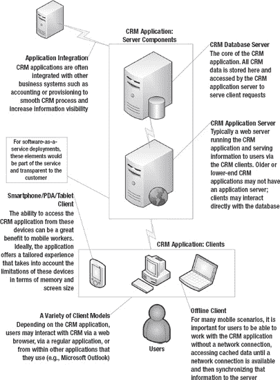
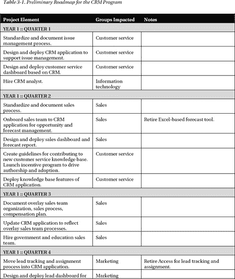
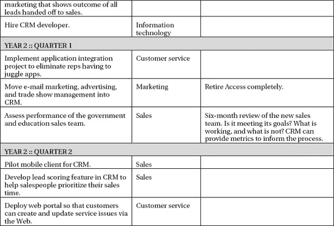

# 第 2 章：CRM 成功的组成部分

一个成功的 `CRM` 计划提供了帮助组织持续改进和优化其获取及服务客户方式的平台。商业世界日益激烈的竞争会奖励那些了解客户、并能迅速采取行动抓住机遇、应对挑战的组织。

强调我们使用“`计划`”（`program`）这一术语很重要；`CRM` 的成功远不止购买并安装一个 `CRM` 应用程序那么简单。`CRM` 计划的核心是持续审视和演变你的客户互动，以提供更好的客户体验，并帮助组织实现其与客户相关的目标。`CRM` 应用程序本身只是用来交付卓越客户体验、简化面向客户的操作、并深入了解客户和业务的工具。

`CRM` 计划的成功建立在四大支柱之上：让组织中合适的“`人员`”在 `CRM` 计划中扮演正确的角色，实施精心设计的内部和面向客户的“`流程`”，实施正确的支持性“`技术`”，并为成功的样子以及实现成功所需的努力和成本设定合理的“`期望值`”。让我们依次审视每个组成部分。

### 人员

你的 `CRM` 计划将需要来自组织不同部门的人员扮演不同的角色。职位头衔和要求将取决于组织，但对于大多数组织而言，要实现成功的 `CRM` 实施，应分配以下角色。

#### 执行发起人

执行发起人是最终对组织内 `CRM` 计划成功负责的高级管理人员，并负责以下事项：

-   为 `CRM` 计划争取必要的资金。
-   指导 `CRM` 路线图的持续制定过程，确保路线图与组织的战略目标紧密对齐。路线图制定将在第 3 章中详细描述。
-   确保需要为 `CRM` 计划做出贡献的组织内不同部门在管理层面上有所参与。
-   为 `CRM` 计划设定目标，并对个人和团队进行问责。
-   作为组织内 `CRM` 相关问题的最终决策者。

`CRM` 执行发起人的重要资质包括：

-   必须是 `CRM` 的“信徒”。他的语气、参与度和热情都会对 `CRM` 计划产生巨大影响。
-   应熟悉组织中面向客户部门的人员和流程。财务或 `IT` 高管并非此角色的理想人选。

员工会追随他们的领导者；执行发起人对 `CRM` 频繁、大声且充满热情的专注，将向整个组织传达出 `CRM` 是其“`DNA`”的一部分，每位员工都需要确保对其给予优先关注。除了这种布道，高管还需要让每一层管理层对其部门的 `CRM` 成功负责。

#### 指导委员会

指导委员会是组织内指导 `CRM` 项目的关键机构。它应由您的执行发起人主持，并包括来自所有关键 `CRM` 相关群体（例如，内部销售、外勤销售、客户服务和市场营销）以及 `IT` 部门和 `CRM` 管理团队的代表。委员会应定期召开会议；会议频率需根据实际情况而定。

指导委员会的职责包括：

-   管理生产环境 `CRM` 应用的持续变更控制流程。此流程用于对 `CRM` 应用的配置变更进行正式评估和批准。在 `CRM` 上线后，用于确保提议的变更不会干扰任何群体对 `CRM` 的使用，并与整体 `CRM` 路线图保持一致，同时将这些变更传达给各 `CRM` 相关方。开发并实施变更控制流程详见第 6 章。
-   制定并维护组织的 `CRM` 路线图。该路线图描述了随时间推移增强 `CRM` 项目的计划，以及这些增强如何支持组织的战略目标。路线图可能描述要添加到 `CRM` 的新功能、要迁移到应用的新用户组，或者要实施并使用 `CRM` 支持的新业务流程。路线图制定的详细内容见第 3 章。
-   基于路线图规划 `CRM` 的预算需求。

`CRM` 指导委员会成员的重要资质包括：

-   能够准确地向指导委员会代表其所在群体的需求。
-   能够理解指导委员会提出的 `CRM` 项目变更将如何影响其所在群体。
-   能够投入足够的时间充分参与委员会的各项活动。

`IT` 代表可以帮助告知委员会可能影响 `CRM` 项目的计划内 `IT` 举措，并协调 `IT` 组织为 `CRM` 应用提供的支持。对于软件即服务（`SaaS`）应用，此角色的重要性较低，因为 `IT` 部门对这些应用的责任通常很小或不存在；而对于本地部署的 `CRM` 应用，此角色则更为关键。

`CRM` 管理团队负责管理 `CRM` 路线图的执行、`CRM` 应用的增强以及用户的培训和支持。他们通常是应用专家，并可以帮助确定如何利用该应用来实现指导委员会确定的业务目标。

#### 实施团队

负责 `CRM` 项目初始推广的实施团队的组成，将根据您组织的复杂程度以及初始实施项目而有所不同。在本节中，我们将描述实施团队中的关键角色；在许多情况下，一个人可能会扮演多个角色。

##### 执行发起人

发起人的角色已在前面描述过，与整个 `CRM` 项目一样，此人也负责初始实施的成功。通常，发起人希望及时了解项目的状态和进展，并通过清除官僚障碍、鼓励公司内部参与来协助实施团队，以支持实施的成功。

##### 项目经理

初始 `CRM` 实施是一项复杂的工程，需要来自众多部门的输入，并可能改变组织所有面向客户的员工的行为和流程。专职的项目经理对于规划项目、确保项目按时进行以及在整个过程中保持沟通至关重要。

##### 主题专家

主题专家是团队中对受 `CRM` 影响的业务领域有深刻理解的人员，他们将指导流程设计和 `CRM` 应用设计，以实现项目目标。例如，对于一个以销售为重点的项目，主题专家团队可能包括销售总监、一位经验丰富的外勤销售代表和一位经验丰富的内部销售代表。重要的是，主题专家要了解当前的“`一线`”情况（当前流程和正在使用的工具）以及更宏观的图景——他们所在领域对于 `CRM` 的长期组织愿景，以及有助于实现该愿景的近期项目目标。

一些组织倾向于不让个人用户/贡献者（例如，前面例子中的销售人员）参与流程，原因可能是担心他们投入项目时间会影响其生产力，或者是担心他们无法从“大局”角度思考并做出贡献。根据我们的经验，这是一个严重的风险。通常，尤其是在较大的组织中，高管们并不充分了解组织基层（实际发生客户互动的地方）的真实运作情况。如果他们是在流程和应用设计中提供意见的唯一声音，那么当前的流程和工具与新的 `CRM` 解决方案之间可能会出现难以弥合的鸿沟。

##### `IT` 代表

通常，`CRM` 项目的推广包含重要的技术组成部分：一个新的 `CRM` 应用、对现有 `CRM` 应用的一系列修改、用于简化运营的新应用集成，或新的报告和分析工具。因此，将 `IT` 部门纳入项目团队非常重要。他们在项目中的职责可能包括采购和维护服务器硬件、更新客户端机器、协助咨询团队进行网络和服务器访问，以及可能进行一些开发和测试工作。对于本地部署，`IT` 组织还将负责灾难恢复计划和应用备份。

##### 用户培训师

初始 `CRM` 实施项目的一个重要组成部分是用户培训。项目团队中的培训师需要向用户传达，他们的工作流程作为项目的一部分将如何改变，以及应如何使用新的技术工具来支持这些新流程。一些组织设有专门的培训部门，而另一些组织则从被培训的部门抽调培训师；实施团队中的主题专家最终往往需要为其所在小组扮演培训师的角色。

##### 部门倡导者

“倡导者”是受 `CRM` 影响的每个员工群体中的关键联络人。他们通常接受了额外的培训，并可能参与了设计流程，负责帮助推动其所在小组内 `CRM` 流程和工具的成功应用与推广。倡导者充当 `CRM` 应用及 `CRM` 相关流程的一线用户支持，并在项目启动后作为 `CRM` 实施团队的“眼睛和耳朵”，发现摩擦点和问题。他们在“宣传”新流程和工具方面也扮演着关键角色。

##### 咨询合作伙伴团队

如果您聘请了咨询合作伙伴来协助您，他们的项目负责人和项目顾问将在实施过程中发挥关键作用。通常情况下，合作伙伴的项目负责人和您组织的项目经理将携手合作来管理项目。

#### 部门支持者

这些支持者，如先前所述，是在组织中参与客户流程的各个团队内工作的一群人，他们充当着团队与 `CRM` 指导委员会及 `CRM` 管理团队之间的持续沟通桥梁。这些支持者通过以下方式为您的 `CRM` 项目带来巨大价值：

-   协助员工培训与指导，包括分享围绕 `CRM` 应用使用的最佳实践。
-   将所在团队员工关于流程和应用的反馈传达给 `CRM` 指导委员会和/或管理团队。
-   积极发声支持 `CRM`；因此，挑选那些被视为各部门领导的人选会很有帮助。

支持者在各自部门扮演着 `CRM` 项目“耳目”的角色。他们能观察到面向客户的员工实际如何使用该应用，从而了解哪些方面运行良好，哪些方面存在问题。他们是流程与应用改进创意的绝佳来源，并且能在基于对流程运作方式的错误假设而制定计划时，提醒整个 `CRM` 团队。此外，在帮助本部门为流程与应用变更做好准备方面，他们也发挥着重要作用。

#### `CRM` 管理团队

`CRM` 管理团队肩负两大使命。第一是持续、定期地维护 `CRM` 项目；这包括多种任务，例如：

-   为 `CRM` 应用提供最终用户支持。有时 `IT` 部门内设有提供基础、“一级”支持的集中式服务台，但即便如此，`CRM` 管理团队在更复杂的问题上仍需担当升级支持的角色。可能还存在一些更复杂的常规任务，用户需要协助，例如数据加载、群发邮件和复杂查询。
-   维护 `CRM` 应用的运行状况。同样，根据您 `IT` 部门的架构，某些任务可能由 `CRM` 管理团队之外的人员处理，但这些任务包括：为 `CRM` 应用及底层操作系统和数据库软件应用软件更新，确保应用在本地和异地都定期备份，以及准备和演练灾难恢复。如果您使用的是软件即服务应用，则无需这些任务。
-   管理 `CRM` 应用中的用户，包括为新员工创建账户、为离职员工停用账户，以及在员工调岗或变更角色时调整安全访问权限。

第二大使命是识别、规划并实施对 `CRM` 流程和应用的增强。这些增强可能由用户提出，并作为第 6 章概述的常规 `CRM` 变更控制流程的一部分来处理，也可能是 `CRM` 路线图的一部分。`CRM` 路线图是 `CRM` 项目发展的阶段性计划，该计划始终在演进。如何制定和维护 `CRM` 路线图将在下一章讨论。这些增强的范围可以从相对较小（在 `CRM` 应用的对象中添加字段，或自动化邮件通信以平滑流程中团队间的交接）到意义重大（如将新部门纳入 `CRM` 项目）。

以下部分角色可能由 `IT` 部门的成员担任。如果并非如此，特别是当您的 `CRM` 应用由公司自行托管时，`CRM` 管理团队中最好有 `IT` 部门的代表，即使他们只是作为“虚拟”团队成员，了解 `CRM` 管理团队的工作动态。

##### `CRM` 项目负责人

`CRM` 项目负责人是 `CRM` 项目的总体项目经理和协调者。此人负责管理 `CRM` 的日常维护以及增强流程（常规变更控制和路线图执行）。此人的关键技能包括：

-   强大的项目管理技能。
-   了解组织中面向客户的部分，并对面向客户的员工有同理心。
-   能够自如地在高管层面进行沟通。
-   拥有管理技术系统、供应商和软件开发人员的经验。

##### `CRM` 业务分析师

`CRM` 业务分析师的职责是结合三种理解，来帮助定义一个使组织更高效并实现其业务目标的未来状态。第一种理解是员工目前的工作方式，第二种是组织的 `CRM` 目标，第三种是对如何配置和定制 `CRM` 应用的深入理解。结合这些，业务分析师可以概述如何修改给定的工作流程及支持的 `CRM` 应用，以使组织更成功。

`CRM` 业务分析师的关键技能包括：

-   流程设计/再造经验。
-   技术系统需求收集经验。
-   为软件应用制定功能规格说明的经验。
-   对所选 `CRM` 应用的深入理解和经验。
-   对 `CRM` 应用所支持业务流程的深入理解。

##### `CRM` 管理员

`CRM` 管理员是维护和修改 `CRM` 应用的核心人物，并且，除了接下来描述的 `CRM` 开发人员外，通常是 `CRM` 管理团队中技术性最强的成员。此人处理用户支持问题，维护应用健康，管理用户，并根据需要进行配置更改。此外，此人通常还管理数据导入和任何产品附加组件的安装。

`CRM` 管理员的关键技能包括：

-   管理基于企业数据库应用的经验（仅限本地部署 `CRM` 需要）。
-   对所选 `CRM` 应用的深入理解和经验。

##### `CRM` 开发人员

大多数 `CRM` 应用可以通过一套不需要深厚技术技能的配置工具进行有限的修改。然而，在大多数情况下，实现定制的业务逻辑以支持组织的特定业务流程、构建与其他应用的集成，或开发高度定制的报告，都需要编程。因此，具有显著复杂性的组织应考虑在 `CRM` 管理团队中配备一名软件开发人员。

所需的具体技能和经验将由组织选择的 `CRM` 应用决定。

##### `CRM` 培训师

培训是 `CRM` 项目中的一个持续过程。新员工加入组织，`CRM` 流程和应用的增强都需要对现有员工进行持续培训。通常，这种培训在部门内部进行，往往由前面提到的部门支持者负责。然而，规模较大的组织可能会在 `CRM` 管理团队中设置一名培训师。这些专职培训师与部门支持者合作，共同制定培训材料和课程。重大的应用或流程变更也可能需要 `CRM` 管理团队介入，为员工提供培训，而非在部门内部处理。

#### 让团队成员适配你的组织

用“角色”来命名这一部分可能比“人员”更贴切。我们概述了实现 `CRM` 项目成功所需的一系列角色。具体由哪些人员来承担这些角色，很大程度上取决于你的组织以及 `CRM` 项目的范围。举两个例子或许能帮助说明：

> **示例一：**
>
> 假设一家小企业希望利用 `CRM` 来提高销售部门的效率和透明度。
>
> `CRM` 管理员/`CRM` 培训师：苏珊（信息技术部）
>
> `CRM` 执行发起人：阿尔伯特（总裁）
>
> 销售部门倡导者/`CRM` 项目负责人/`CRM` 业务分析师：简（销售总监）
>
> 指导委员会：阿尔伯特、简、苏珊
>
> 在这个例子中，苏珊处理所有与 `CRM` 应用相关的技术任务：支持、维护、用户管理和配置。简是 `CRM` 项目的推动者；她管理 `CRM` 路线图，确保销售人员采用流程和应用，并寻找利用 `CRM` 解决业务问题、改进客户流程的新机会。阿尔伯特担任执行发起人；他与简一起处理预算问题，与 `CRM` 供应商谈判等。该团队没有开发技能，当需要开发时，会寻求外部顾问的帮助。
>
> **示例二：**
>
> 假设一家拥有全球员工的大型组织，在其庞大的销售部门和小型客服部门中使用了 `CRM` 流程和应用。
>
> `CRM` 管理员：彼得（应用分析师）
>
> `CRM` 开发人员：亚瑟（应用开发人员）
>
> `CRM` 项目负责人/`CRM` 业务分析师：黛安（销售运营经理）
>
> `CRM` 执行发起人：莱斯利（首席运营官）
>
> 销售部门倡导者：汤姆（内部销售总监）、安妮（美国区域客户经理）、理查德（英国区域客户经理）、丽莎（拉丁美洲区域销售经理）
>
> 客服部门倡导者：厄尔（客服代表）
>
> 指导委员会：莱斯利、黛安、弗兰克（销售副总裁）、吉尔（客服副总裁）、罗宾（信息技术总监）、菲利普（市场营销副总裁）
>
> 这个更大的组织需要一个更大的团队。技术任务由彼得和亚瑟分担。黛安是整体项目的推动者；她的销售运营背景是理解销售团队工作方式以及如何最佳改进的重要资产。更大的组织意味着需要更多的倡导者，以确保一线员工有充分的代表性和覆盖。由于内部有开发人员（亚瑟），该组织相对自给自足，通常不需要聘请外部咨询合作伙伴。

这两个例子凸显了在将组织中的人员映射到 `CRM` 项目角色时需要注意的几个重要准则：

-   确保指导委员会包含所有面向客户部门的代表。注意，在示例二中，即使该组织目前仅在销售和客服部门使用 `CRM` 应用，指导委员会中仍有一位市场营销部门的高管。
-   对于员工地域分布广泛的组织，确保不同地区在 `CRM` 项目中有代表。否则，某些地区的员工可能会觉得不适合他们的流程和应用被强行推行，而他们在过程中没有发言权。注意，在示例二中，销售部门的倡导者来自不同地区。
-   一人承担多个角色是例外，而非惯例，尤其是在较小的组织中。在示例一中，简是项目的核心，负责多个不同角色。角色如何在团队中分配将取决于每个成员的技能、经验和兴趣，以及你项目的性质和范围。

### 流程

我们将分两部分讨论 `CRM` 流程。第一部分将讨论你的组织已在面向客户的部门中实施的运营流程。这些始终是 `CRM` 项目的焦点；组织启动 `CRM` 项目是为了产生一系列与客户相关的结果，而 `CRM` 项目则通过改进或重塑其业务流程来实现这些结果。第二部分将回顾为管理 `CRM` 项目本身而需要建立的新流程，具体指持续的维护和增强流程。

#### 运营流程

每个组织及其流程都是独一无二的，这使我们无法就你自己的运营流程应该是什么样子或应该做哪些更改提供具体的模板或指导。然而，根据我们协助客户建立和执行 `CRM` 项目的经验，我们观察到并可以描述一些作为 `CRM` 项目目标而反复出现的常见流程改进类别。

##### 为客户运营提供指标和可视性

许多组织缺乏精心设计的方法来记录客户互动信息，使得这些信息无法被广泛看到并采取行动。一切都通过电子邮件处理，或者通过每月报告艰难生成、审阅一次，然后就被扔到某个文件夹里。缺乏系统化信息收集的平台。以这种方式运营任何规模的组织，都好比没有仪表地驾驶飞机。你依靠的是传闻和“感觉”，几乎没有能力预测未来或从过去学习。无法判断流程变更或新投资的影响。就像你可以通过一组提供飞机性能信息的仪表来更有效地驾驶飞机一样，如果你的组织也实现了“`仪表化`”，你就能更有效地管理它。`CRM` 应用可以被视为一种为你的对客流程实现仪表化平台的方式，该平台允许你定义关键指标，然后收集数据，将这些指标作为你业务流程的一部分提供出来。这种驱动指标并获得运营可见性的能力，是许多组织启动 `CRM` 项目的重要动力。

一个简单的例子可能有助于具体化这些关于指标和流程的理论讨论：

假设一个组织正在权衡对垂直市场营销的投资。遗憾的是，该组织只有关于其客户市场领域的传闻信息，因此对于要瞄准哪些市场以及在每个市场要重点推广哪些产品缺乏量化的理解。

认识到这一点后，`CRM` 团队做出了以下调整：

1.  在 `CRM` 应用中创建一个属性，用于按市场领域对客户和潜在客户进行分类。
2.  修改内部销售团队的资格认定流程，使其包括获取潜在客户的市场领域，并将信息录入 `CRM`。
3.  要求客户经理团队更新 `CRM`，为他们的每位客户录入市场领域信息。
4.  修改客服团队的问题创建流程，增加一项检查，看 `CRM` 中是否包含客户的市场领域信息，如果没有，则收集该信息。
5.  创建一份报告，按市场领域分解客户、潜在客户和商机，并展示每个市场领域的平均交易规模和产品组合。

60 天后，这份报告提供了可行的洞察，揭示了哪些市场为组织带来了最多的收入，以及哪些产品在每个市场领域最为成功。这些信息使营销团队能够制定出成功几率最大的垂直市场营销策略。

这个例子凸显了 `CRM` 通过人员、流程和技术的结合，来实现组织“`仪表化`”并收集信息以回答有意义的业务数据这一强大功能。

## 改善部门间的客户“交接”

糟糕的客户交接问题屡见不鲜，可能导致收入损失和客户体验下降。两个例子可以说明什么是糟糕的交接：

> **示例 1**：将合格的销售线索从内部销售/市场部门移交给现场销售代表
>
> 在许多企业中，线索的初步筛选由市场部门或内部销售部门完成；只有高度合格的线索才会移交给现场销售团队。这种交接通常通过电子邮件完成，但有许多方式可能导致失败：如果现场销售代表正在休假、遇到电子邮件问题，或者只是疏忽了邮件，线索就可能被遗漏。内部销售人员在线索移交后，完全无法得知其后续进展。
>
> **示例 2**：升级支持问题
>
> 大型支持组织通常按层级划分；问题会按顺序分配给经验更丰富、专业度更高的支持代表，以充分利用每个人的能力。在这种模式下，客户可能需要与两到三位不同的代表沟通，才能解决问题。在许多情况下，这种从一位代表到下一层级的“交接”是“冷启动”的，意味着新代表在与客户互动前对问题没有任何背景了解，迫使客户向每一位接手的代表从头开始解释问题。这对客户来说是一个令人沮丧且低效的过程。

CRM 应用程序有可能改善您组织中的交接问题。

*   **示例 1**：CRM 工作流自动化可以防止项目“从缝隙中掉落”。交接后，如果在一定时期内无任何活动，系统可以触发重新分配或发送电子邮件通知。
*   **示例 2**：让面向客户的员工都在同一个 CRM 应用程序中工作，可以更简单地在交接时传递背景信息，从而确保客户或潜在客户获得尽可能无缝的体验。

## 实施并执行结构化的销售方法论

CRM 应用程序非常适合帮助实施结构化的销售方法论。这些方法论包含了经过验证的最佳实践，而 CRM 应用程序可以引导销售人员持续遵循这些方法论。此外，CRM 可以让销售管理层清晰了解销售人员遵循方法论的程度，以及它对销售业绩的影响。详细的 CRM 分析功能可以帮助组织定制和调整方法论，以进一步提升绩效。

## 聚焦营销支出

市场团队面临的一个典型挑战是了解其营销支出的收入影响，以便将资金分配给能产生效果的营销项目，并取消无效的项目。相互割裂的营销和销售系统使得许多组织甚至无法记录一个成功转化为客户的潜在客户所接触过的营销活动。

CRM 应用程序不仅能够连接销售和营销团队，还能用于测试不同的营销方法（例如，不同的直邮信件或名单来源），并通过销售周期来衡量其效果。

## 精准定位营销触达

对于那些客户信息分散在多个系统中的组织而言，根据购买历史、订单量、地理位置、网站活动等条件，针对特定客户和潜在客户发送特定营销信息，可能是一项数据管理任务，困难到难以实施。这不仅需要将所有数据汇集到一个环境中进行筛选，还必须建立并维护一个客户 ID 对照表，以确定会计系统中的`账户 #245`、营销数据库中的`客户 #8879`以及网站跟踪应用中的`访客 #98786`是同一个实体。

将客户信息集中到 CRM 应用程序中，并与会计系统和网站等其他关键应用程序建立周密的集成，可以简化这项任务。在 CRM 中拥有所有用于筛选和定位营销触达所需的标准，可以在不进行复杂的数据处理（合并来自不同应用程序的数据）的情况下，实现更个性化的营销。

## 实现客户自助服务

客户自助服务是一项明智的举措，有望同时降低服务成本和提高客户满意度。一个健康的自助服务渠道可以让组织用更少的客服人员服务相同的客户群，并为客户提供更快、更高效的服务体验。对于仅有基础客服工具的组织来说，自助服务是 CRM 项目三大常见关注领域之一，另外两个是实施结构化问题跟踪和开发可搜索的知识库工具。通常，自助服务是这三个领域中最后发展的一个；组织首先希望理顺其内部的问题管理流程并建立起知识库，然后才为客户提供自助服务选项。

在 CRM 项目中实现客户自助服务最常见的方式是部署客户门户网站。这是一个安全的网站，客户可以登录并以受控方式直接与 CRM 应用程序交互，无需客服代表协助。客户在门户网站中常见操作包括：在知识库中搜索问题解决方案；创建、查看或更新已有的服务问题；下载手册和数据表等支持材料；以及更新个人资料信息（地址、电话号码等）。

## 管理服务升级

与实施结构化客户服务问题管理流程（这通常是 CRM 项目的一部分）相辅相成的是，制定与问题升级相关的政策。设计良好的服务部门和升级政策可以帮助在提供积极客户体验与控制服务成本之间取得平衡，对于客户合同中明确规定了所需响应和解决时间的组织来说尤为重要。

当今 CRM 应用程序中强大的工作流逻辑有助于遵守升级策略，并能自动完成服务团队内问题的分配，以及团队内部和与客户之间的相关沟通。

## 分析

许多组织发现自己一次又一次地被迫在缺乏可靠客户数据的情况下做出重要的商业决策。他们发现，要么是没有收集所需的信息，要么是信息收集了，但分散在众多部门和应用程序中，无法在合理的时间或成本内进行整合。

CRM 应用程序能够提供帮助，因为它将客户信息集中在一个位置，并包含强大的查询和报告工具用于分析。对于更复杂的需求，可能需要一个更完整的商业智能计划，而 CRM 只是众多数据源中的一个，其他数据源可能包括财务会计应用程序、服务排程应用程序或资源调配应用程序。

我们鼓励所有启动 CRM 项目的组织，将部分关注点放在报告和分析上。这是管理者和高管与 CRM 应用程序交互并从中实现价值的主要方式。如果这些利益相关者群体对 CRM 不满意，他们的参与度就会降低，从而危及整个项目的成功。

### CRM 维护流程

上一节重点介绍了一些组织在 CRM 项目中寻求改进的常见业务流程领域，而本节将介绍维护和发展 CRM 项目所需的流程。这些 CRM 维护流程将在第 3 章和第 6 章中详细说明。

#### 支持

面向员工的 CRM 项目支持可分为业务流程支持、CRM 应用程序支持以及两者的交叉部分。

由于 CRM 项目通常包含重新设计面向客户的流程，CRM 团队需要准备好为员工提供支持，解答他们关于流程步骤以及如何处理异常的问题。完善的文档和培训显然能发挥作用，但流程支持的需求始终存在。

CRM 应用程序支持类似于任何业务应用程序的技术支持：用户在使用软件时遇到问题、看到错误消息，或者只是忘记了如何在应用程序中完成任务。

这两类支持的交叉部分在培训和文档中常被忽视。例如，你可以培训用户如何在 CRM 应用程序中鉴定线索，但这还不够；他们还必须理解在线索流程中，何时才被视为“合格”，以及应采取的相应行动。销售流程可能规定了一系列客户会议，而 CRM 应用程序培训则展示了如何记录客户会议，但`所有`客户会议都应该录入 CRM 应用程序吗？如果不是，哪些会议应该录入？需要为它们录入哪些信息？这种关于如何在业务流程背景下使用 CRM 应用程序的说明，在 CRM 培训中常常被遗漏。

#### 培训

培训是 CRM 项目中持续进行的一部分。随着新员工加入组织，他们需要接受面向客户的流程培训，以及如何使用支持这些流程的 CRM 应用程序的培训。当流程得到优化、应用程序功能得到增强，或者新软件版本带来重大变化时，现有员工需要接受额外的培训。管理团队也能从定期的应用程序培训中受益，尤其是在新软件版本发布时。

大多数培训都是以业务流程为基础，在员工所在的部门内部开发和交付的，但 CRM 管理团队可能在通用应用程序培训中扮演一定角色。

我们见过多种成功用于 CRM 培训的培训形式，包括传统的课堂式、网络研讨会和自定进度的在线培训。一些客户还制作了常见应用程序操作的短视频，用户可以在内部网站上访问这些视频。

#### 技术维护与灾难恢复

本地部署的 CRM 应用程序与其他企业软件一样，需要一系列流程来支持它们，包括数据备份和灾难恢复、软件补丁、定期硬件升级等。这些流程的细节超出了本书的讨论范围。

作为软件即服务提供的 CRM 应用程序则不需要这些流程。

### CRM 增强流程

有两个并行执行的流程负责 CRM 项目的发展与增强。第一个是持续的变更控制流程，它处理对 CRM 流程或技术进行的小规模、临时性的变更和增强。第二个是更复杂的路线图制定与执行流程，它确保 CRM 项目持续支持组织的战略目标，并用于规划和实施重大的项目变更。我们将在本节中描述每个流程。

#### 变更控制

为使其有效，CRM 项目必须覆盖整个组织，并以某种形式触及所有面向客户的部门。客户流程跨部门运作，而 CRM 应用程序通常是各部门员工共享的、用于记录客户交互的核心平台。由于这种相互关联性，对 CRM 项目的变更可能产生广泛影响，必须加以控制；如果每个部门都可以不经协商或沟通，就自行按其认为合适的方式做出变更，则可能导致混乱和无序。一个设计良好的变更控制流程可以防止这种情况发生，并包括以下内容：

*   一个用于收集和编录来自 CRM 项目所有参与部门提出的 CRM 流程或 CRM 应用程序变更建议的系统
*   定期举行会议，审查、讨论并批准/推迟/否决提出的变更
*   定期向组织内的 CRM 社区通报已提出/已批准/已否决的变更，以及已批准变更的实施时间表
*   一个持续的小版本发布计划，CRM 应用程序的变更可被纳入其中，进行详细设计、开发、测试和部署

与这个持续的变更控制流程并行的是路线图制定与执行流程，该流程推动 CRM 项目的重大计划性变更。

## 路线图制定与执行

CRM 路线图是 CRM 项目的长期规划，用于管理重大增强，更重要的是，确保 CRM 项目与组织的战略业务目标保持一致。路线图定义了未来一到两年的主要 CRM 举措，并基于组织的规划制定。

主要涉及两个核心的路线图流程。第一个是其持续的制定过程。路线图需要不断更新，以始终反映未来两年的规划。这需要与组织的高级领导层、CRM 执行发起人以及指导委员会保持互动。第二个流程是 CRM 计划的具体执行。

路线图举措可能涉及 CRM 项目的任何部分，包括人员、业务流程以及 CRM 应用程序。下面，我们为一家名为 `ABC Industries` 的虚构公司提供了一个示例路线图，该公司是一家高科技设备制造商。`ABC Industries` 近期启动了一个 CRM 项目，并在销售组织内部署了一个新的 CRM 应用程序，计划在全公司范围内逐步推广。

**示例 CRM 路线图：`ABC Industries`**

| 时间 | 举措 |
| :--- | :--- |
| 2011 年第一季度 | 为新产品规划销售业务流程 |
| | 规划并执行 CRM 应用程序增强以支持新产品 |
| | 针对新产品的销售团队开展流程和应用程序培训 |
| 第二季度 | 审查电子邮件沟通策略 |
| | 推广集成的电子邮件营销解决方案 |
| 第三季度 | 升级 CRM 应用程序版本 |
| 第四季度 | 根据需要审查和修订问题管理流程 |
| | 在客户服务和技术支持部门实施用于问题管理的 CRM 应用程序 |
| 2012 年第一季度（续） | 在客户服务和技术支持部门实施用于问题管理的 CRM 应用程序 |
| 第二季度 | 将网站流量和行为跟踪集成到 CRM 应用程序中 |
| 第三季度 | 审查和修订销售区域策略 |
| | 实施人员和流程变更 |
| | 实施相关的 CRM 应用程序变更 |
| 第四季度 | 设计并实施客户自助服务门户 |

关于路线图，需要记住的一个重要点是它们是“可调整的”规划，且需要不断修订。它们旨在代表 CRM 项目的当前计划，但必须随着环境和组织目标的变化而改变。

## 技术

对许多人而言，CRM *就是*一项技术，仅此而已。如果你曾是这些人中的一员，那么理想情况下，你已开始意识到技术只是拼图的一部分；它是工具，是赋能者。但它必须与你的组织模式和业务流程协同发展，才能取得成功。在本节中，我们将重点概述 CRM 应用程序和技术。我们将在第 4 章中深入研究如何选择适合你组织的 CRM 应用程序。

### CRM 应用程序基础设施概览

其核心在于，CRM 应用程序是一个数据库，用户通过应用服务器，使用多种不同的客户端与之交互。图 2-1 展示了典型 CRM 应用程序技术架构的概览。

**图 2-1.** 典型的 CRM 应用程序基础设施

你的 CRM 基础设施的复杂性将反映你组织的规模。小型 CRM 实施可能仅使用一台物理服务器同时扮演应用服务器和数据库服务器的角色。企业级 CRM 部署可能需要多台服务器来分散大量用户的负载，并提供冗余以避免系统停机，其环境还可能包含网络负载均衡器和专用存储设备等其他硬件组件。你的咨询合作伙伴和 IT 团队应协同工作，预测你环境中的 CRM 应用程序使用情况，并据此调整基础设施规模。在做基础设施决策时，请考虑你的发展路线图；如果你的硬件规模仅适配试点用户的负载，那么当你将应用程序推广给更大的用户群体进行生产使用时，你可能会非常失望。

作为技术行业向云计算总体趋势的一部分，大多数领先的 CRM 应用程序供应商现在都将其产品作为“软件即服务”或“云”应用程序提供。在这种模式下，图 2-1 中概述的服务器组件由供应商透明地拥有和管理。应用程序以订阅方式购买，并通过互联网访问。如果应用程序通过网页浏览器访问，客户无需安装任何软件。部署模式（传统的本地部署与软件即服务）的选择应取决于多种因素，包括长期成本、IT 支持资源的可用性、待存储数据的敏感性、所需的定制和集成水平等等。

### 生产、开发和测试环境

除了你的生产 CRM 应用程序部署之外，你很可能还需要运行一个或多个额外的 CRM 应用程序部署，用于开发、测试或培训目的。

可能作为你初始启动 CRM 的一部分，或者随着你需求的发展，你可能会发现需要为你的 CRM 应用程序开发自定义组件，也许是添加新功能或与你组织中的其他业务系统集成。在生产环境中开发自定义组件充满风险，我们强烈建议不要这样做。它可能会干扰生产用户，可能导致系统停机或中断，并且可能损坏数据。

彻底的测试对于确保新的自定义组件按设计运行，并且不影响任何现有功能或流程至关重要。理想情况下，应使用第三个专门的 CRM 测试环境。该环境应在硬件、软件基础设施版本等方面尽可能与生产环境匹配，以便对在测试中表现良好的自定义组件迁移到生产环境后也能正常运行提供高度信心。将开发和测试分离到不同的环境中非常重要；对于任何规模较大的开发工作，这两个活动实际上无法在同一环境中进行。测试人员需要一个稳定、一致的运行着已知代码集的环境来进行工作。如果开发人员不断向系统中注入新编写的代码，测试人员将无法工作。

大型组织有持续且重要的培训需求，许多组织会为此设置独立的环境。我们也见过测试和培训共享环境的情况，但这可能会让受训者感到困惑，因为他们可能会看到正在开发中的、生产环境中尚不存在的新功能。

无论你打算在你的 CRM 项目中管理多少个环境，花时间规划好两个重要流程的步骤都是值得的：

*   **从生产环境刷新开发/测试环境：** 定期地（也许在开发项目之间），你需要将你的开发环境和测试环境与生产环境同步，使它们再次成为生产环境的副本。这可以确保这些环境不会逐渐偏离生产环境，并为这些环境带来新鲜数据以协助开发和测试。该流程应有完善的文档记录、可重复，并且理想情况下不应过于繁重。隐私政策可能要求开发环境和测试环境中省略或混淆来自生产环境的某些数据（例如，社会安全号码）。
*   **将自定义组件从开发环境迁移到测试环境再到生产环境：** 记录将自定义组件从开发环境迁移到测试环境再到生产环境的“流程”和“技术”步骤非常有价值。流程步骤很可能作为你开发方法论的一部分来定义，并为每个环境规定相应的门禁和质量标准。迁移自定义组件的“技术”步骤将根据你的 CRM 应用程序而有所不同。

请注意，这些流程可能会因你的 CRM 应用程序部署方式（本地托管或通过软件即服务）而存在显著差异，但无论你的部署模式如何，对非生产环境的需求以及执行这两个流程的能力都是存在的。

### 源代码管理

大多数 CRM 部署都能从使用某种形式的源代码控制中受益，并应利用它来管理配置和自定义组件。使用源代码控制的好处很大，而其开销远没有你想象的那么显著。如果管理超过一名开发人员的任何开发工作，没有源代码控制很快就会崩溃。对于非开发人员而言，源代码控制系统管理着配置和自定义组件的源代码（通常有几十到几百个小文件），并提供以下好处：

*   帮助防止或管理不同开发人员独立对同一文件进行更改时发生的冲突
*   允许访问文件更改的历史记录，并可根据需要恢复到文件的先前版本
*   允许运行软件的多个版本，以实现分支开发并帮助隔离错误

有多个供应商提供多种源代码控制选项，包括一些功能强大、免费的开源应用程序。

### 常见的 CRM 应用程序功能

作为 CRM 应用程序领域的入门介绍，本节将概述领先 CRM 应用程序中的常见功能。这将提供一个框架，帮助你更快、更有效地理解和评估不同的应用程序。

## 客户

客户记录是 CRM 应用的核心，大多数其他信息都围绕它展开。这些记录分为“帐户”或“公司”记录，用于代表您与之互动的组织；以及“联系人”或“个人”记录，用于代表个人。

应关注的关键客户功能包括：

-   能够添加字段，以多种方式对客户进行分类——按销售区域、市场细分或行业
-   能够跟踪多种类型的组织，既可以使用客户记录，也可以使用合作伙伴、供应商和潜在客户等其他记录
-   能够创建多个临时关系来关联帐户和联系人，以表示可能存在的各种重要关系
-   能够轻松跟踪与客户的互动，如会议、电话、电子邮件和传真

## 市场营销

市场营销功能旨在帮助执行和跟踪外呼营销活动，例如直邮、邮件群发和电话销售呼叫。一个关键因素是，营销线索能多好地延续到销售领域，以帮助将收入与营销活动联系起来。这是营销团队普遍面临的挑战，也是 CRM 应用非常适合解决的问题。

应关注的关键营销功能包括：

-   能够独立于客户管理嫌疑/潜在客户信息，用于资格认定和营销目的
-   能够使用各种标准建立列表，然后针对列表执行营销活动
-   能够将营销活动组织成营销战役，以便进行规划
-   能够以稳健的方式执行直接电子邮件营销（例如，跟踪邮件打开、退回和转发；使用丰富的邮件模板；以及管理选择加入/退出流程）
-   能够将销售和客户获取活动与营销工作联系起来

## 销售

销售部门是 CRM 应用的发源地（早期称为销售力量自动化 [SFA] 应用），销售团队也一直是 CRM 计划的主要驱动力。将 CRM 应用和精心设计的 CRM 流程引入销售团队有多种动机——最普遍的包括：让管理层更清晰地了解销售活动和销售管道，帮助支持结构化的销售方法论，减少行政工作并帮助销售人员提高生产力。

应关注的关键销售功能包括：

-   能够管理销售机会信息，如交易规模、预计成交日期、所售产品/服务以及销售周期中的阶段
-   能够定义和管理结构化的销售方法论
-   能够为客户和潜在客户创建演示报价
-   能够为向销售管理层汇报创建销售预测

### 服务

CRM 应用的客户服务功能旨在帮助组织记录客户问题，并有效管理直至问题解决。服务流程通常是组织内被研究最多、结构化程度最高的流程之一，因为它对客户体验有重大影响，并且需要在一个传统上非利润中心的部门控制成本。

在 CRM 应用内管理服务流程的其他好处包括：

-   服务人员通常是现有帐户内潜在后续业务的来源——通过让服务员工与销售人员使用相同的应用，可以简化团队之间的交接，工作流自动化可以防止潜在客户流失。
-   服务问题数据是一个丰富的信息宝库，可用于改进和完善组织的产品、服务及面向客户的流程。服务数据与客户数据之间的轻松关联，使得能够洞察服务问题类别在不同客户群体中的分布情况。

应关注的关键服务功能包括：

-   能够管理和分类服务问题（通常称为`案例`或`故障单`）。每个问题跟踪的信息可能包括服务流程阶段、问题类型、相关产品/服务以及问题负责人。
-   能够定义并支持针对不同类别问题的多种问题解决流程。
-   能够支持服务队列，以促进问题路由和解决。
-   能够部署自助服务门户，客户可以登录创建、更新和查看服务问题。
-   集成的 wiki 或其他知识库工具，以促进服务部门内部的信息共享。

### 安全性

尽管一些组织以“开放”方式配置其 CRM 应用（即每个用户可以看到应用中的所有信息），但许多组织需要能够对信息进行隔离。常见的例子包括销售信息、敏感客户信息（如社会安全号码或账号），甚至薪酬或佣金信息。CRM 应用中强大的安全模型将使您能够灵活地管理各种不同的安全场景。

应关注的关键安全模型功能包括：

-   能够在实体级别（例如，帐户、联系人、销售机会）和单个字段级别（例如，社会安全号码）保护信息
-   能够将权限打包成“角色”，并可分配给用户或组，以方便用户管理
-   能够处理安全例外情况——当用户需要访问应用中其当前范围之外的特定记录或记录集时
-   安全性应贯穿整个应用——适用于通过用户界面查看信息、任何搜索或查询工具，以及报表和仪表板

### 配置与定制

CRM 应用总是需要`配置`和`定制`，才能提供优雅的用户体验，并最大化其为您的组织带来的价值。每个组织都是不同的，需要记录不同类型的客户信息，并通过其 CRM 应用支持不同的业务流程。在讨论对 CRM 应用进行变更时，我们使用术语`配置`来描述无需编程即可使用应用的管理工具和功能进行的更改，而`定制`则指通过编程来更改应用。CRM 应用的配置能力和定制灵活性的程度与复杂程度，将决定您能在多大程度上根据当前和未来需求量身定制该应用，以及这种定制所需的工作量。

应关注的关键配置与定制功能包括：

-   无需编程即可扩展应用数据模型的能力。这包括为现有实体（例如“客户”和“销售机会”）添加新字段，以及设计新实体。您定义的新实体应功能完整，具备与现有实体相同的能力。
-   通过代码将自定义业务逻辑插入系统以改变其行为的能力，通常围绕系统`事件`（例如，创建新客户记录或重新分配销售机会）。
-   其他应用与 CRM 应用交互的能力。该应用是否存在应用程序编程接口（`API`）？其健壮性如何？

### 报告

CRM 应用价值的一大部分，是通过使用精心设计的报告来实现的，这些报告能提供业务洞察并支持明智决策。对于不直接与客户互动的员工而言，CRM 应用的直接价值可能完全来自 CRM 报告和仪表板。不要过分依赖开箱即用的报告——它们通常过于通用，不经过定制化很难发挥作用——而应将重点放在报表生成工具和数据的可访问性上。

需要关注的关键报表功能包括：

-   以用户为导向的工具，无需编程即可构建基础报表和仪表板。
-   通过标准协议（例如`ODBC`）使用其他报表工具开放访问数据，同时尊重应用的安全模型。例如，有些应用允许将数据导出到 `Microsoft Excel` 进行报告和分析。

### 工作流自动化

如果你认为 CRM 应用的关键功能之一是支持面向客户的业务流程，那么应用的工作流自动化功能就是一个重要的关注领域。

没有工作流自动化，大多数 CRM 应用本质上就是电子文件柜——以一种有组织、可搜索的方式存储客户信息。这很有价值，但将 CRM 应用定位为任何流程中的`被动`参与者——一个在不同步骤检索和存储信息的地方。正是工作流功能，结合应用于系统事件的自定义逻辑，才能使 CRM 应用成为流程中的`主动`参与者。一个简单的例子也许有助于强调这种区别：考虑一个合格的潜在客户从营销部门移交给外勤销售团队的情况。

> **被动型 CRM**
>
> 营销代表将资格认定通话中的信息输入到潜在客户表单。他判断该潜在客户达到“合格”标准，然后手动将其重新分配给合适的外勤销售代表，接着处理下一个潜在客户。在外勤，几天后的某个时候，外勤销售代表登录 CRM，导航到分配给她的一组新潜在客户列表。她打开这个潜在客户，并主动联系以安排初次会面。
>
> **主动型 CRM**
>
> 营销代表将资格认定通话中的信息输入到潜在客户表单。CRM 应用注意到该潜在客户符合预定义的资格认定标准——它会自动将其状态更改为合格，并根据组织的区域销售模型将其重新分配给合适的外勤销售代表。它会向营销代表和外勤销售代表发送电子邮件，告知移交事宜。它启动一个计时器；如果外勤销售代表在两天内未更新此潜在客户状态，系统将向该外勤销售代表及其经理发送提醒邮件。在外勤，就在同一天，外勤销售代表打开潜在客户路由邮件，并点击邮件中的链接阅读营销代表的备注，查找潜在客户的联系信息。他主动联系以安排初次会面。

区别应该很明显。在第一个例子中，CRM 应用只是一个存储库，而在第二个例子中，它则是一个主动参与者——采取行动并促进团队成员之间的沟通。这种能力由 CRM 应用的工作流自动化功能提供。

需要关注的关键工作流功能包括：

-   能够设计多步骤的工作流流程，这些流程可以响应应用事件（例如，记录的创建、更新、删除、重新分配）并执行多种操作（例如，创建新记录、重新分配记录、发送电子邮件或短信、更新记录）。这应无需编程即可实现。
-   能够进行分支并控制工作流流程的流转。
-   能够通过代码使用自定义逻辑扩展工作流流程。

### 社交媒体与 CRM 应用

社交媒体工具正作为一种新的沟通渠道兴起，个人通过它来相互互动以及与组织互动。这种沟通形式在重要方面与传统渠道不同，组织需要考虑其提供的客户互动机会。我们在此将社交媒体定义为诸如 `Facebook`、`Twitter`、博客、维基、评论网站和视频网站等工具，这些工具允许个人进行交流、创建和交换内容，并找到其他有相似兴趣或关注点的人。

社交媒体工具兴起的一个重要方面，是它们赋予个人影响公众舆论的力量。过去，一个组织需要管理一小部分关键的记者和行业分析师的意见，这些人拥有渠道，可以用他们选择传达关于该组织的任何信息来影响大量受众。社交媒体的兴起让每个个体都拥有了广泛分享他们对一个组织的不满、满意或分析的渠道。这在很大程度上复杂化了负责保护和提升组织品牌的营销和公关团队的任务。

社交媒体工具也为组织提供了一些有趣的新能力。收集产品与政策的反馈比传统方法（如焦点小组）更容易且成本更低，吸引客户参与产品规划和设计过程也是如此。通过 `Facebook` 和 `Twitter` 传达组织动态，以一种个人习惯且舒适的方式触达他们。

CRM 工具如何帮助管理组织的社交媒体形象和沟通？已有多种产品提供这些能力，它们通常与现有的主流 CRM 套件应用集成。提供的能力通常包括：

-   监控社交媒体工具（`Facebook`、`Twitter`、评论网站、博客等）中提及组织的内容，并帮助管理组织的回应
-   管理并追踪那些拥有广泛关注度且发表关于组织声明或内容的有影响力个人的活动
-   协调组织通过社交媒体工具的主动沟通
-   将个人的 CRM 记录与其在各种社交网站上的个人资料相关联，为 CRM 用户提供关于该个人及其关系的更全面视图

尽管社交媒体广受欢迎，但组织应谨慎周到地进入这个渠道，并考虑客户希望通过这些工具从与组织的互动中获得什么。研究表明，许多人仍然将社交媒体视为与朋友和家人联系的工具，可能并不欢迎组织的积极介入。

### 期望

这并不容易。CRM 项目的初始启动及其持续管理，都需要组织中众多人员投入大量的时间和精力。在对所需投入提高期望的同时，同样重要的是要克制对结果的预期，尤其是在项目启动阶段。CRM 可能给组织带来重大变革，而变革可能进展缓慢且早期收益有限。

正如`第 5 章`和`第 6 章`所详述的，成功启动一个 CRM 项目并随后进行维护和发展是一项重大工程。初始项目将意味着来自业务、技术和执行团队的一批人员在资本、时间和精力上的重大投入。这些人员需要齐心协力、相互协作并迅速做出决策以支持 CRM 的上线。他们需要像不知疲倦的啦啦队长和榜样一样，帮助 CRM 的种子扎根并成长为组织创造重大而持久价值的源泉。CRM 的持续维护和改进，要求指导委员会和 CRM 管理团队忠实地执行一套流程，定期识别、确定优先级并处理小的需求和改进，同时规划更大的举措，使 CRM 项目与组织目标保持一致，并扩大其覆盖范围和价值。

如果我们把启动和管理 CRM 项目的过程形容为一场攻坚战，这仅仅是为了在抑制 CRM 供应商的过度营销方面尽一点绵薄之力——他们一直传递着危险的信号：只要你购买他们的应用程序并安装，你的组织就会万事大吉，并将开始收获一个与自身及客户步调一致的企业的好处。CRM 应用程序*确实*能对您的业务产生惊人的积极影响，*确实*能帮助您转型为一个敏捷的组织，提供卓越的客户体验，并能迅速转向，抓住新的机遇。但应用程序本身无法为您做到这些——您必须“拥有”您的 CRM 项目，并明白成功的关键在于您自己。这就是为什么我们认为“合理的期望”是成功 CRM 项目的关键组成部分——对所需付出的努力、成本、短期结果以及长期结果都要有合理的期望。

#### 为面向客户的员工设定期望

面向客户的员工很可能在 CRM 项目启动过程中，其工作流程和使用工具都会发生变化。这过程不可能毫无痛苦和摩擦——正如关于变革管理的众多书籍所证实的那样。CRM 项目的最终成功将取决于这个群体能否接受它并克服任何过渡困难。为了确保这一结果，需要向该群体传达以下几点：

-   应传达 CRM 项目的总体愿景、预期收益以及该项目与组织战略目标之间的联系，以帮助赢得员工的认同。
-   CRM 指导委员会理解项目启动过程中会出现一些波折和问题——感谢员工的耐心，欢迎他们的反馈，并且已预留预算用于清除障碍和解决他们的关切。
-   尽管存在过渡期的挑战，管理层对 CRM 项目的承诺不会动摇。这并非“试验”、“测试”或“实验”，而是一项关键的组织战略，并且从现在起就是“业务运作的方式”。我们需要共同努力，把它做好。

### 陷阱

我们已经审视了构建成功 CRM 项目所需的人员、流程、技术和期望，那么指出我们观察到的一些组织失败或在通往 CRM 成功之路上无意中引入障碍的方式，可能很有启发意义。请务必注意，在您自己的 CRM 项目中避免重蹈这些覆辙。

#### 高管支持不力

如前所述，在项目启动后的几周内，启动 CRM 项目对实施团队和所有受影响的员工来说都可能是一项繁重的工作。事情不可能一开始就完美无缺，可能会经历一个令人沮丧的时期，需要不断优化流程和应用程序并逐步推进。一些员工可能会试图恢复原有的工作方式，并可能抵制使用 CRM 应用程序。如果这些员工是高绩效者，例如顶尖销售人员，经理们可能会倾向于睁一只眼闭一只眼。这种做法极具腐蚀性——向他人传递了 CRM 是“可选”的信号，并且由于将部分客户信息和互动置于 CRM 流程和应用程序之外，从而降低了项目的价值。

CRM 的执行发起人必须准备好应对此类采用挑战。发起人必须在整个组织中持续推销 CRM 的愿景，强调其价值，并让每个人都对全面参与 CRM 项目负责。同时，此人还必须努力保持 CRM 项目的灵活性，并吸纳员工反馈以消除问题、推动改进，从而使所有员工受益。

#### 未将“执行者”视为利益相关者

我们参与过的许多 CRM 项目中，都明显存在管理层与面向客户员工的实际工作方式脱节的情况。我们曾在会议中目睹一位经理描述一个流程如何运作，而一位销售代表当场反驳道：“但实际根本不是那样的。”

让面向客户的员工参与 CRM 项目的设计和开发，出于多方面原因是必要的：

- 正如前面的例子所显示，有时只有面向客户的员工——销售人员与客服人员——才了解流程实际如何运作以及工具实际如何使用。任何流程改进或 CRM 应用程序设计的基础，都是要清晰理解当前的运作方式。
- CRM 流程将由这些员工执行，CRM 应用程序也由他们使用，因此让他们在设计方式上拥有发言权是合情合理的。他们能提供管理者和高管无法提供的独特而有价值的视角。
- 他们在 CRM 应用程序设计期间提供了可用性“检查”。业务分析师可能希望收集关于客户的 50 个不同数据属性，以便进行细分和分析客户群。销售员工的代表则可以根据可用性问题提出反对意见，因为他们了解销售人员实际在与谁交谈以及可获得哪些信息，从而知道什么是真正可行的。
- 最终，CRM 项目的成功将取决于面向客户团队对 CRM 流程和应用程序的采纳。如果这些员工觉得在设计过程中他们的声音被听到了，并且这是“他们的流程”和“他们的应用程序”，而不是 IT 部门或高层管理者强加给他们的东西，那么他们将拥有更高的认同度，并成为项目更坚定的支持者。他们也会更积极地提供正面反馈，帮助改进项目。

#### 实施客户关系管理计划但缺乏清晰路线图

“量两次，切一次。”这句木工谚语同样适用于客户关系管理计划。充分的准备和细致的规划能够带来更成功的客户关系管理计划，并提升员工满意度。我们将在第 3 章中详细讨论路线图的规划与制定，但其根本在于：要批判性和战略性地思考那些能为组织带来最大利益的客户关系管理举措，考虑不同举措之间的协同效应等因素，并制定和传达一个分阶段实施的计划。

在没有路线图的情况下推进项目，可能会导致效率低下（未必先处理最高价值的领域）、令人困惑（人们无法前瞻性地理解何时发生什么以及为何发生）以及成本高昂（由于后续举措带来的影响，通常需要对部分工作进行返工和重新设计）。此外，伴随缺乏坚实计划而实施客户关系管理所带来的时断时续，会削弱项目的动力并损害团队的可信度。

#### 提供不充分的培训

无论出于何种原因，培训往往是高管们在试图降低拟议客户关系管理项目成本时关注的重点。“我们的员工很聪明”或“这又不是造火箭”等言论，常常发生在削减培训预算之前。对于规划客户关系管理举措的项目经理而言，培训工作往往事后才被想起，并且未能获得与其他项目组件同等程度的规划、准备和关注。

事实上，有效的培训是用户采纳率和整个项目成功的关键驱动因素。培训应针对不同角色进行定制，基于具体场景，并融合流程与应用程序培训，使员工了解流程如何运作，以及如何使用客户关系管理应用程序来支持该流程。实操环节对于保持受训者的参与度非常有价值。除了初始的上线前培训，明智的做法是规划后续培训和非正式的问答环节，以帮助客户关系管理团队监控员工在采纳客户关系管理流程和工具方面的成功程度，并为员工提供多次机会来解答他们的疑问。

#### 跳过数据迁移或数据清理

在上线前，有计划地将干净数据迁移到新的客户关系管理应用程序中，能以多种方式增加价值。它能减少员工的数据录入工作；减少或消除用户需要返回旧工具的情况，从而巩固向客户关系管理应用程序的切换；它还允许在客户关系管理应用程序内部更轻松地运行有意义的报告，以对比客户关系管理实施前后数据。

然而，在大多数客户关系管理计划中，数据迁移是一个需要大量工作、高额成本和高度复杂的领域，因此常常成为预算削减的诱人目标。高管们只有在经过深思熟虑和实事求是地评估对客户关系管理用户的影响之后，才应考虑取消这项工作，以确保正确平衡成本节约与项目风险。

#### 未能为所有利益相关者提供价值

客户关系管理计划自然会以不同方式为不同利益相关者群体提供价值。经理和高管会依赖客户关系管理报告和分析来深入了解其业务和客户，帮助他们做出更好的决策并更好地预测未来表现。面对客户的员工应该会发现，客户关系管理应用程序有助于他们保持条理、提高生产力，并最大限度地减少与其工作职能相关的行政开销。

制定一个初始客户关系管理项目，有可能只专注于为某一群体提供价值，而未能为另一群体提供价值。这是一种危险的做法，务必避免。在规划客户关系管理路线图时，应仔细关注，确保参与项目的每个团队都能从中至少获得一些价值。

为了说明这种风险，请考虑一个基本的初始客户关系管理计划启动案例，该计划涉及为一批销售人员部署新的销售方法论，以及为他们提供一个新的客户关系管理应用程序来管理其销售活动。

> **极端且有缺陷的方法一**
>
> 想象一个项目团队，由于担心用户采纳问题，专注于尽可能让销售人员顺滑地使用销售方法论和客户关系管理应用程序。每当他们抱怨应用程序要求输入过多关于其活动的信息时，团队便通过移除细节和简化来调整。销售人员感到不适的步骤被稀释或从方法论中移除。最终的结果是，一个效力不明的、被稀释了的方法论，以及一个被用户勉为其难支持、但未能收集足够信息来进行任何分析甚至无法创建完整销售管道的应用程序。
>
> 管理层面未能获得价值，导致他们回归到过去管理销售团队的那些临时性方法。他们对工具的缺乏兴趣清晰地传递给销售人员，后者逐渐疏远，直到再也没有人使用它。
>
> **极端且有缺陷的方法二**
>
> 这个例子中的项目团队大部分时间都与高管团队在一起，了解他们希望看到哪种销售仪表盘和分析，以及他们希望如何对销售信息进行细分。为了支持这些丰富的报告需求，由此产生的方法论和客户关系管理应用程序高度结构化——要求销售人员输入他们作为销售流程一部分所采取的每一个微小行动，并输入关于其商机、联系人和潜在客户的大量信息。很少关注销售人员的“日常工作状态”或什么样的流程和应用程序功能能帮助他们提高效率。销售人员提出的反对意见被“这是高管们需要的——这个项目得到了他们的全力支持”所反驳。
>
> 结果是一个臃肿、繁琐的流程和客户关系管理应用程序，令销售人员心生畏惧。没有两个销售人员以相同的方式使用该工具——其复杂性为如何使用它留下了众多选项。最终，它严重拖慢了销售人员的速度，以至于他们开始忽视它，直到月底，当知道经理们要运行预测报告时，他们才在疯狂的最后时刻，一次性输入当月所有活动的最低要求信息。销售人员很不高兴——该流程和应用程序是对他们工作的“税收”，对他们毫无帮助。经理们抱怨说，报告一个月只有一次是准确的，而且销售人员不愿意使用该应用程序。

这些例子故意极端化，以说明一个观点：你需要努力构建项目，使得每个利益相关者群体都能获得成功，并且每个群体都比以前更有生产力。

#### 试图一次性完成过多任务

我们曾看到客户试图将整个路线图塞进单个项目——这种“大爆炸”式方法试图一次性在所有计划部门及所有业务职能中启动 CRM 项目。尽管这种方法看似能最短时间内实现组织的全部 CRM 目标，但相比多项目路线图法，其风险极高且存在诸多弊端。这类项目大多会因自身规模而崩塌——存在过多利益相关方互相冲突、过多相互关联导致每个决策瘫痪，项目周期过长导致团队成员和发起人倦怠流失。

相比之下，多项目方法具有若干关键优势：

- 较短的序列化项目意味着组织能更快开始看见 CRM 价值，助力项目积累动力。
- 让部分流程和部门先上线运行，同时推进其他项目，可使经验教训反哺后续项目，提升整体项目质量。
- 小型聚焦项目更易成功执行——人员更少，“活动部件”更少，项目目标更少且更易对齐。

### 总结

成功 CRM 项目的组成部分分为三大类：人员、流程与技术。

- 在人员类别中，存在一系列重要角色。最重要的是执行发起人（作为项目领袖，必须设定方向并推动所有人前进）和部门倡导者（保持团队参与度，并将反馈传达给 CRM 管理团队）。
- 流程在 CRM 语境中具有双重含义：存在大量可通过 CRM 应用增强和支持的业务流程；同时需建立一套运营流程来管理 CRM 项目。设计这些运营流程是准备启动 CRM 项目的重要步骤。
- 除 CRM 应用外，技术组件还包括源代码管理应用以及维护 CRM 应用测试与开发环境的方案。

### 构建 CRM 路线图

制定周密审慎的 CRM 项目实施计划，有助于在组织优先级与举措、不同部门的需求与准备程度之间取得最佳平衡。随意无序的实施会导致业务流程割裂、员工不满和过度实施成本。规划 CRM 项目时，“预防胜于治疗”。

本章我们将探讨为 CRM 项目制定一至三年计划（即*路线图*）的流程。所有组织都应制定并维护 CRM 路线图——无论它们刚起步考虑 CRM，还是已有成熟成功的项目。路线图是一份持续演进的文档，反映不断变化的业务状况和优先级，并保持对未来一至三年的前瞻。下一节我们将讨论 CRM 分阶段方法的原理，随后探讨初始路线图的制定。

#### 为何采用分阶段方法实施 CRM？

当你形成 CRM 整体项目的初步愿景时，可能很想通过单个项目实现全部范围。这似乎是实现愿景最直接、最短的途径。我们强烈不鼓励这种试图从“无 CRM”直接过渡到“全 CRM 愿景”的“大爆炸”式方法。本节我们希望说服您：采用分阶段方法——将若干较小项目串联起来逐步推进至完整愿景并扩大 CRM 覆盖范围——是更明智的方式，且能提升项目成功率。为一次大推进构建内部动力看似容易，一次性向所有员工推广似乎比协调多个阶段更简单，但切勿被迷惑。

以下列举“大爆炸”方法中可通过分阶段方法解决的若干问题。

##### 耗时过长

像 CRM 这样的业务流程和技术应用项目周期越长，失败可能性越大——这由多重因素导致。项目团队的人员流失会削弱组织的制度记忆：新成员加入导致决策被反复讨论，进一步拖慢项目进度。项目范围越大，需要参与的干系人越多，这些人在决策中要求发言权，导致项目受委员会驱动而进展缓慢。疲劳耗尽项目发起人和其他高管的精力，他们日渐厌倦向越来越怀疑的员工推销项目益处，员工甚至开始怀疑项目能否真正启动。项目周期越长，从 CRM 流程与应用设计到实际推广的时间间隔就越长。以当今商业变革的速度，间隔越长，项目实际启动时与地面现实及员工需求的偏差就越大。

在分阶段方法中，每个项目范围更小、周期更短，目标与干系人更少。每个项目都建立在前一项目基础上，扩展 CRM 在组织内的覆盖范围，解决新部门或新业务流程的问题。本章稍后将介绍如何将项目拆分为多个阶段以构建路线图的指南。

##### 缺乏融入反馈的机会

采用分阶段方法，每个项目阶段结束后都有机会进行项目后评估，将经验教训和成功实践融入下一阶段。这样，随着你不断优化最适合组织的项目方法论，理论上每个阶段的项目执行质量都会逐步提升。而在“大爆炸”方法中，这种学习机会少得多，因为项目每个阶段基本上只执行一次。

#### 构建初始路线图

本节我们将聚焦构建初始路线图以启动 CRM 项目的流程。如果你已建立 CRM 项目并部署了 CRM 应用，我们将在“中途制定路线图”部分讨论实施 CRM 应用后制定路线图的特殊情况。

##### 评估现状

路线图规划的核心是评估现状与战略目标；对这些###### 当前业务流程

构建路线图时，一个有用的第一步是记录你当前实际运营的业务流程。你可能会发现，执行类似职能的员工或部门之间存在流程不一致的情况——这很常见。许多你规划的 CRM 举措可能都需要流程变革，而记录当前状态将有助于厘清变革所涉及的影响，并增进理解。这项工作还可能揭示出效率低下之处、导致客户体验不佳的流程，或是将一个用户或部门的最佳实践推广到其他用户或部门的机会。通常，只要切实可行，你就应力求流程的一致性——所有员工和部门以相同方式处理相同任务会带来诸多好处，而当客户感受到这种一致性时，也会改善其体验。

##### 当前客户信息应用

创建一个用于管理客户信息或客户相关流程的各类应用程序目录。该目录应描述每个应用程序的使用者、用途，以及这些应用在你组织流程中的使用背景。通过访谈用户，了解他们对每个应用优缺点的看法。这个过程很可能令人大开眼界。大多数组织都是以自下而上的草根方式，在应对不断变化的环境时，发展出自身的流程和工具，且缺乏战略视角。你很可能会发现多个应用程序持有相同信息、流程需要重复录入到多个应用中，以及大量用于解决特定问题的小型 Microsoft Excel 或 Access 解决方案。这种拼凑式的应用环境会阻碍用户生产力，并妨碍员工之间进行有效协作。我们并非建议一个组织内只能有一个单一的、大一统的应用，而是说你的应用组合理应是理性规划的成果——旨在最大化员工的生产力和效率，并提供卓越的客户体验。在大多数组织中，情况并非如此。

##### 寻找痛点

评估过程的一部分就是要在你面向客户的团队中“寻找痛点”。说得直白些，这些痛点可能预示着人员、流程或技术层面存在需要解决的故障。因此，要关注那些抱怨。谁在呼吁变革？哪个团队或职能部门持续无法达到期望？员工流动率是否更高？分析具体情况——根本问题是什么原因造成的？谁受到了影响，解决这个痛点的商业价值是什么？解决这个痛点是否符合组织的战略目标？

##### 战略目标

组织的战略目标和战略计划在塑造你的 CRM 路线图中扮演着重要角色。它们可能是路线图中相关举措的直接来源。例如，如果你的计划包括进入新市场或开拓新客户群体，这很可能需要调整 CRM 相关的人员、流程和技术来支持这一努力。除了直接贡献于 CRM 举措集合，你的战略目标也是一个重要的评判视角，用于评估哪些举措应纳入 CRM 路线图。例如，你可能需要降低那些支持某个因新战略方向而变得不再重要或即将被淘汰的产品线或销售渠道的举措的优先级。

##### 技术问题

大多数 CRM 项目都涉及技术组件，因此作为评估的一部分，了解你组织的技术现状和 IT 路线图会很有帮助，这样你就能相应地调整自己的路线图。例如，如果你的 IT 部门计划在第三季度对公司网络平台进行全面整改，你或许就不该在第二季度投资整合你的 CRM 应用和网站。重大应用部署、IT 人员数量变化以及 IT 技能结构变化都会影响你的路线图，应予以了解并纳入规划考量。

##### 警示信号

及早发现“警示信号”——即可能危及项目成功的那些问题——能为你争取最多时间来制定应对或规避计划。在进行评估时，持续记录你识别出的警示信号，并考虑如何应对。我们在成功推进 CRM 项目的过程中常见的警示信号包括：

- **高管支持不足或认同度低**：例如，一位不了解或不信奉 CRM 价值的销售主管，会使得一个以销售为重点的项目极难成功。高管层面的频繁更替也会阻碍 CRM 项目的发展，因为每位新领导都希望将自己的优先事项强加于项目之上，导致 CRM 无法在任何一个方向上积蓄动力。
- **有限的 IT 资源，加上不愿投资于咨询支持**：为了持续改进并适应不断变化的业务环境，你的 CRM 应用需要定期投入。没有 IT 资源（例如开发人员、测试人员）的组织需要准备好通过合同方式获取这些技能，以确保项目的活力。我们常看到投资不足的领域是报表功能，组织似乎总是系统性地低估了相关的工作量。这是一个警示信号，因为有效的报表和分析是 CRM 为管理层提供关键价值来源。
- **受影响部门内部业务分析能力薄弱**：CRM 项目需要有注重细节、尽心尽责的管理团队才能成功。这些团队需要有了解组织及其流程，并具备足够应用知识来帮助将业务需求转化为应用能力的人员。

## 将 CRM 愿景拆分为项目

一旦你完成了评估，应该就能确定多个部门或业务流程可以在人员（例如，人员配置、员工角色和职责等）、流程或技术工具方面得到改进。接下来的目标是将这些改进整合成独立的项目，并按时间表对这些项目进行排序。这是路线图制定的核心。我们在本章前面部分已经描述了分阶段实施方法背后的基本原理，这里不再赘述；在本节中，我们想提供一些你需要考虑的视角，以了解如何将你的各种需求分组到各个项目中，以及如何以最有利的方式对它们进行排序。虽然没有硬性规定，但确实有一系列需要考虑的因素会有所帮助：

- **业务影响**：你将通过评估了解到组织中需求最大的领域，以及哪些领域最能提升生产力和效率。在其他因素相同的情况下，优先推进这些领域是合理的。
- **按部门**：围绕单个部门开展项目具有诸多优势；它能最小化所涉及的利益相关方数量，从而简化项目管理。员工能用单一工具（`CRM` 应用）完成越多工作，他们就更容易看到该工具的价值并接受它。
- **按业务流程**：仅改变业务流程的*一部分*可能导致脱节且不可行。例如，假设一家软件公司设有客户服务部门和软件质量团队。当问题与软件缺陷相关时，通常会从客服部门升级到软件质量团队。试想一下，将客服部门的问题管理流程迁移到新的 `CRM` 应用，但让软件质量团队继续使用旧的 `Access` 数据库。问题会通过客服部门顺利升级，`CRM` 工作流处理任务重新分配和通知。但当需要升级到软件质量团队时，流程就突然“掉下悬崖”——客服代表不得不将 `CRM` 服务工单中的信息复制粘贴到邮件中，发送给软件质量团队的某人。此人收到后，又需将邮件中的详细信息复制粘贴到 `Access` 系统中，由其团队处理。此时再无自动化或工作流。客服部门在 `CRM` 应用中无法看到问题进入软件质量团队后的状态，因此无法在客户来电时提供任何信息，只能记下留言并跟进。这对员工和客户都不理想，其根源在于将同一业务流程分散到多个 `CRM` 项目中。
- **按地域**：组织如果有地理上分散的团队，且各团队与本地客户合作，则适合开展独立的 `CRM` 项目。地处偏远或规模较小、倾向于在某一地点处理多种流程的团队，通常愿意并渴望参与能简化其流程的试点项目。
- **按时长/投入**：大型 `CRM` 项目可能会陷入困境，有时甚至因自身负担过重而失败——陷入无休止的分析循环或永无止境的开发阶段。在其他条件相同的情况下，在路线图中优先安排一两个范围较小、风险较低的项目是有价值的。如果能让一部分员工成功上线并使用该程序，并开始为组织带来一些收益，这将有助于为 `CRM` 在组织中积累动力，并消除 `CRM`“不切实际”或“永远不会实现”的担忧。你也会开始从员工那里获得真实的反馈，这些反馈可以用于改进未来的项目。

设计项目时还需考虑另一个因素：结果——每个项目的成败如何评判？各部门对其参与的项目期望得到什么结果？理想情况下，每个项目都应包含明确且达成共识的成功标准，以便客观地衡量项目成果。

### 人员协调

完成 `CRM` 评估并根据上一节所述因素制定了初步的项目路线图后，你的路线图规划工作尚未结束。启动 `CRM` 项目所需投入巨大，因此从“人员角度”评估你的路线图草案至关重要。与路线图中涉及的各部门负责人逐一沟通，探讨以下问题：

- **可用带宽**：部门是否清楚了解 `CRM` 团队针对其参与的项目会提出哪些“需求”？部门能否在必要的时间内抽调合适的人员，以确保项目成功？你的 `CRM` 团队无法独自交付成功的 `CRM` 项目——每个项目都应被视为 `CRM` 团队与相关部门之间的伙伴关系。你需要确认每个部门都已准备好并能够各尽其责、充分参与。
- **认同度**：组织内不同高管对 `CRM` 项目及其收益的“信任度”各不相同。你可能会发现有些人持怀疑甚至敌对态度，原因可能是他们过往的不良经历或团队的性质。他们可能将 `CRM` 项目视为“干扰因素”。如前所述，强大且充满热情的高管支持是 `CRM` 项目成功的关键因素。因此，如果你遇到此类态度，应将其视为重大警示信号。你或许需要深思熟虑，如何安排和构建涉及由“`CRM` 怀疑者”领导的部门的项目。例如，避免将初始项目设在这些部门；更好的做法是先用其他团队取得早期胜利，建立 `CRM` 的势头，再着手处理这些部门。如果必须尽早将其纳入路线图，则应尝试扩大项目范围，纳入由职位相当且是“`CRM` 坚定支持者”高管领导的部门，以确保有强大的高管领导力。

### 试点项目与“概念验证”项目

试点项目和“概念验证”项目可被视为另一种类型的 `CRM` 项目，应根据需求将其纳入路线图。这些特殊项目服务于特定目的——在大规模项目启动前，以小范围、低风险的方式验证特定要素（即流程或技术工具）。这两个术语常被混用，但在我们的术语体系中，它们具有不同的含义。

*试点项目*是指一个完整的项目，它将为整个组织规划的变革应用于一小部分群体，以预览变革对整体组织可能产生的结果。这个项目的完整性体现在受影响的业务单元会改变其实际业务运作方式，而非模拟或测试。例如，在向 2000 名美国本土一线销售人员推广用于协作生成客户提案的新流程与技术工具之前，组织可能会选择在洛杉矶办公室的 100 名销售人员中先进行为期六个月的试点。这种方法能最大程度降低组织风险——若变革产生负面影响或未能达成目标，仅影响 5%的销售团队。其弊端自然是时间延迟：若试点大获成功，这种保守方式将导致其余销售团队错失六个月的收益。试点成功的关键在于预先设定成果预期——何种成果会触发全组织推广？何种情况会引发方案修改或终止？这些成果如何衡量？由谁衡量？

*概念验证*是一个范围更小的项目，通常旨在全面开发前验证技术工具的可行性。在概念验证中，组织实际业务运作方式不会发生改变；它只是一个研究项目，用于在大规模实施前以小范围方式探索某项技术是否可行。例如，假设一家纸制品公司希望为外勤销售团队配备移动设备，使其能在客户现场通过公司 `ERP` 应用发起各类交易（如创建新订单、查询订单状态、申请折扣审批）。移动设备供应商保证可以实现这些功能，但他们未曾将该设备与公司 `ERP` 系统集成，对实现远程交易所需突破的公司网络安全架构也知之甚少。在启动面向全球销售团队的完整设计与开发项目之前，该公司选择先进行概念验证。目标是构建一个轻量级示例应用，通过远程连接公司 `ERP` 系统查询订单状态。这显然是一个小型项目，仅需有限的设计与开发工作（应用无需考虑美观或易用性——销售员永远不会看到它，且只需支持单一交易类型）。但若成功，它将*证明*供应商能够突破公司网络安全架构并与 `ERP` 系统交互。证实这些关键点大大降低了大型项目所伴随的风险。与试点项目类似，这种风险缓释的代价是时间与成本——完整项目需在概念验证期间暂停，而加入概念验证阶段将增加整体方案成本。与试点相同，概念验证的目标及何种成果构成“验证”标准，应在项目启动前深思熟虑。

试点项目和概念验证项目都能有效控制 `CRM` 计划中的风险，但必须考虑其进度与成本影响。

### 示例路线图实践

在本示例中，我们将以虚构的支付处理软件公司 `IdeaShare` 为例。`IdeaShare` 过去数年保持缓慢但稳步的增长态势，但近期经历了领导层更迭。新管理层希望以更激进的策略推动增长，目标是通过上市或被收购实现价值。为驱动增长，他们制定了新战略计划，包含以下目标：拓展目前尚未涉足的教育与政府市场业务；投资客户服务以扭转疑似影响销售的低劣服务口碑；建立合作伙伴销售渠道；加速开发 `IdeaShare` 的下一代产品。`IdeaShare` 首席运营官菲奥娜·史密斯受 CEO 及所有者的委托，负责探索公司内部 `CRM` 计划的可行性。

请注意，本示例旨在帮助阐明本章概念；我们优先考虑此目标，而非追求示例的高度现实性。

#### CRM 评估结果

菲奥娜以一个月时间的访谈开启了 `CRM` 项目工作。她与思想维度公司在销售、市场营销、客户服务、产品开发和信息技术等部门的各级人员进行了交流。她还采访了现有客户和潜在客户，了解他们与思想维度公司打交道的体验。在梳理笔记时，菲奥娜注意到了以下几点：

**销售**

- 大部分销售流程要么通过电子邮件驱动，要么依赖微软的 `Excel`。预测方式相当原始，基于 `Excel` 进行。每年都会替换掉业绩最差的 10% 的销售代表。团队内部缺乏协作或专业发展活动。
- 销售组织内部在政府或教育市场领域并无相关经验。
- 新任销售副总裁（上任仅一个月）对 `CRM` 应用程序有经验，并且非常渴望有机会将其引入组织。

**市场营销**

- 市场营销工作包括参加行业三大关键年度展会、在主要行业期刊投放平面广告、网络广告以及批量电子邮件营销。
- 营销团队使用营销总监开发的一个复杂的微软 `Access` 数据库来管理其活动。这位营销总监对 `CRM` 不以为然，声称自己“用过所有的 `CRM`”，但没有一个能像他的数据库那样贴合他们的业务需求。
- 营销部门的主要抱怨是缺乏来自销售部门关于其线索的反馈——没有人费心去“闭环”，让他们了解线索的后续情况。
- 在公司内部，营销部门普遍被认为是一个运作良好、高效的团队。

**客户服务**

- 客户通过电话或电子邮件报告问题。通过电子邮件报告的问题会从 `support@ideashare.com` 转发给整个 15 人的客户服务代表团队，他们通过电子邮件来“认领”要处理的问题。各个代表正在处理的问题对他人不可见。客户服务经理通过监控电子邮件来防止任何问题“被遗漏”。
- 客服代表需要在三个应用程序之间来回切换才能为客户服务——使用计费应用程序处理计费问题，使用许可应用程序处理许可问题，以及使用 Bug 追踪器查看已升级给产品开发团队的问题状态。
- 客户服务经理对他们部门流程的了解是基于传闻的；制定任何衡量指标都是一项艰苦的工作。
- 培养一名新客服代表上岗所需的时间很长；大多数常见问题及解决方案的知识是“部落式”的，仅存储在资深服务代表的大脑中。在“学徒期”期间，新代表很少能在首次通话中解决问题，通常需要请教资深代表。

**信息技术**

- 信息技术团队保持精简。其员工能够维护公司的网络和关键应用程序，并为用户提供帮助台支持，但没有预算或人员编制来开展新计划。团队成员基本上是纯粹的“技术人员”，而非懂技术的业务人员。

**客户及潜在客户**

- 客户总体上对思想维度公司的产品感到满意，但对他们所获得的服务普遍不满。投诉包括解决问题时间长，以及信息不足的服务代表似乎对同一问题在不同时间给出不同的答案。
- 无论规模大小，客户都赞扬销售团队理解他们的需求，并愿意投入时间帮助他们了解思想维度公司的产品以及哪些产品最能满足他们的需求。

#### 初步路线图

菲奥娜回顾了她的笔记和观察结果，并就每个团队对 `CRM` 项目的潜力得出以下结论。

**销售**

销售团队需要在其处理和销售活动的方式上引入更多的结构。对于一个希望上市或寻求收购方的组织来说，“原始”的预测方法是行不通的。一个定义明确且一致的销售流程，结合现代的 `CRM` 应用程序，可以解决预测问题。计划中的合作伙伴渠道也需要一个比 `Excel` 更强大的应用程序来追踪合作伙伴的销售活动。从人员角度来看，鉴于围绕这些市场的战略目标，缺乏教育和政府部门的背景令人担忧。菲奥娜的结论是，为了在这些市场取得成功，需要建立一个由具备所需领域背景的外部人员组成的覆盖式销售团队。最后，无论是小客户还是大客户都反映从思想维度销售团队那里得到了“大量时间”，这一点让菲奥娜感到担忧。销售代表们是否在明智地决定如何投入他们的销售时间？他们是否有足够的信息来判断潜在客户的潜力？这似乎是 `CRM` 项目可能带来的另一个改进领域。

**市场营销**

菲奥娜知道，通过结合销售流程的修改（要求代表在关闭线索之前记录线索结果）以及市场营销和销售部门共享的 `CRM` 应用程序，可以解决市场营销部门的线索可见性问题。她还知道，当市场营销部门被要求增加线索生成量并将生成的线索分配给新的合作伙伴渠道时，他们的 `Access` 数据库将无法胜任。因此，`CRM` 在这里显然可以发挥作用。然而，公司合作伙伴渠道的计划在战略规划中处于较晚阶段，而且营销总监显然需要一些说服才能支持 `CRM` 项目。她的结论是，市场营销不应该是 `CRM` 项目初期阶段关注的焦点。

**客户服务**

菲奥娜得出结论，缺乏结构化的工单管理流程以及支持该流程的应用程序是这里根本的问题。这不仅能防止问题被遗漏，而且对最常见问题类型的更深入了解可以为新代表培训提供信息并缩短他们的上岗时间。通过 `CRM` 应用程序而不是电子邮件来管理工单，也更容易生成用于监控小组运营情况的衡量指标。知识库工具（为客服代表提供一个可搜索的地方来汇集他们的知识、流程和最佳实践）也是一个重要的需求；它将有助于新代表的上岗，并减轻资深代表的辅导负担。最后，菲奥娜预测，一些精心设计的 `CRM` 集成可以最大限度地减少代表在处理问题时需要兼顾的不同应用程序的数量。

**信息技术**

`IT` 团队的精简性质对菲奥娜来说是一个警示信号。`CRM` 项目的成功需要一个在技术方面拥有扎实业务理解能力的人，能够将业务需求转化为技术需求，并管理与 `CRM` 相关的技术工作。他们还必须能够将 75% 到 100% 的时间投入到 `CRM` 项目中。菲奥娜随后为 `CRM` 项目制定了一个初步路线图，如`表 3-1`所示。

菲奥娜的下一步计划是与她的领导团队会面，并与销售、市场营销、客户服务及信息技术部门的负责人单独会面，以完善路线图并讨论成果/成功因素（例如，对于这些项目中的每一项，“完成”意味着什么？）。

## 中期制定路线图

上一节中的示例路线图描述了 `IdeaShare` 这一组织正计划初次推行 `CRM` 项目的情景。但如果你所在的组织已经推出了 `CRM` 项目和应用程序，而你的目标是更严格地管理该项目，以帮助更多员工从 `CRM` 中获得更大价值，那又该如何？本章概述的通用两步流程——先评估、后规划路线图——同样适用于这种情况。从某些方面看，这种情况比“从零开始”更容易。员工已经熟悉了 `CRM` 的概念以及组织选定的 `CRM` 应用程序。挑战在于“第一印象无法重来”。员工对 `CRM` 已形成看法，且可能难以改变，若为负面看法，则可能阻碍未来的 `CRM` 举措。在这种情况下，确保路线图制定过程透明且具有包容性就显得更为重要。

## 总结

本章涵盖以下内容：

- 采用分阶段方法实施 `CRM`（由多个较小项目组成）比试图一次性完成一个大型项目更有效、风险更低。
- 从详细评估当前状况开始规划路线图。
- 人员协调是路线图规划的关键部分，以确保受影响的团队有足够带宽和动力来支持 `CRM`。
- 如果情况合适，可考虑试点项目和概念验证项目。

