# 第 5 章：规划初始 CRM 实施

至此，本书已讨论了将对 CRM 项目成功产生重大影响的一些要素。当您和您的团队在 CRM 实施的初始阶段工作时，牢记一个成功 CRM 项目的各个组成部分，将有助于您专注于手头的任务。

本章中，我们将重点规划 CRM 项目第一阶段的实施。我们将引导您了解实施的典型阶段，聚焦于如何划分可用工作，并讨论一些可能成就或破坏实施的具体细节。更具体地说，我们将关注应在项目开始前进行评估或完成的概念。尽管许多概念之间互不相关，但评估每个高层级项目至关重要。在尝试有效规划您的计划时，它们都非常重要。我们将概述图 5-1 中展示的概念。

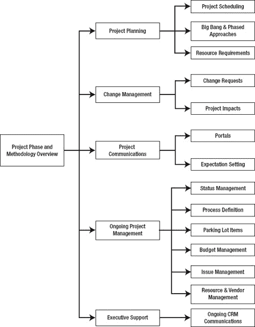

**图 5-1.** 方法论组件概览

最后，正如我们在第 3 章中讨论的，在完成本章的任务和文档时，始终牢记您的 CRM 路线图，这将有助于引导您并解答出现的任何问题。

## 管理 CRM 项目

执行 CRM 项目的初始阶段，需要您在严格的项目管理与分析方法和满足最终用户需求、为其创造最终价值所需的灵活性之间取得平衡。维持严格方法所需的大部分基础工作已在您制定 CRM 路线图时完成。其余部分可在实施的初始阶段完成。

此时，有必要回顾一下 CRM 路线图或项目与特定项目或阶段之间的区别。本章中的实施是特定于项目的。通常，一个项目会有明确的开始和结束日期，并向最终用户交付有限的功能集。每个项目都将构成更大路线图或计划的一部分。

在下一节中，我们将开始向您概述构成项目的要素。首先，我们将向您介绍实施的典型阶段。

### 理解项目阶段

存在数十种用于实施技术应用的常用高层级方法论。从一开始，许多组织就对某种方法论有偏好，坦白说，大多数方法论都可以用于或改编以适应您的 CRM 项目。根据我们实施 CRM 应用的经验，我们将提供一些关于最常用且最成功方法论的信息，并推荐一个最终综合了多种方法优点的流程。这将为您在组织中实施应用时提供可用的工具。

#### 软件开发生命周期 (SDLC)

`SDLC` 是一个用于创建或修改系统的高层级流程及相关任务集合。本章稍后概述的方法论都利用了经典 `SDLC` 流程的某些部分，因此在实施过程中，当你为每种方法论寻找最佳实践时，将有机会利用其中的不同组件。话虽如此，它们往往在以下方面存在差异：完成任务的速度、在任务完成与继续推进之间的灵活性，以及它们鼓励你跟踪和利用的详细程度。`SDLC` 的通用组成部分如下：

> *规划/分析：* 规划/分析活动，通常也称为*设想阶段*，是概述项目目标、定义项目投资回报率（`ROI`）以及为实施阶段确定角色和职责的地方。同时，此活动也完成应用程序的设计，并收集、审查需求，与团队评审，最终以某种形式确定下来。这种设计可以采用多种方法，其中一些变体将在后续文本中提及，但最终，在此阶段结束时，实施阶段的需求已被识别并锁定。
>
> *实施：* 实施活动专注于构建在实施规划/分析阶段确定的任何范围内的项目。在 `SDLC` 的这一活动期间，还会进行单元测试，并根据需要修复错误。根据你选择的设计方法，构建阶段所需时间可能多也可能少，但最终，当此阶段结束时，应用程序的开发将完成。许多非常关键的实施组件，包括各种类型的测试，也需要在此时完成。我们将在本章后面更详细地介绍各种测试类型。
>
> *部署与支持：* 部署活动侧重于向最终用户推出应用程序，并在发布后提供支持。正是在实施的这一环节中，会进行最终用户和管理员培训。随后，应用程序将推送给最终用户，并在部署后提供相应的支持。

第 6 章的大部分内容将专注于为上述要点提供更多细节。将概述关于设计、开发、测试、培训及部署的具体细节。对于本章而言，既然我们已经确定了作为实施一部分要完成的高层级活动，接下来我们将为实施这些活动的各种方式提供更多细节。

## 瀑布模型方法论

在技术领域，更具体地说，在 CRM 实施中最常用的方法论之一是瀑布模型。这种方法论被设计为一系列连续的步骤，一个接一个，各个阶段如同瀑布般流动。图 5-2 展示了一个简单的瀑布模型图形示例。

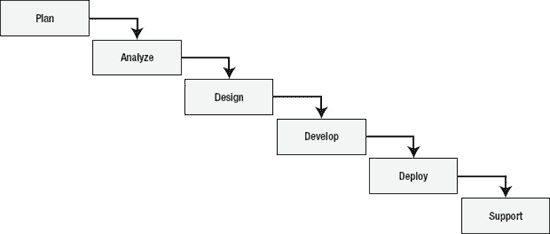

**图 5-2.** 瀑布模型方法论

对瀑布模型方法论而言，最重要的是顺序。通常，一个步骤必须 100% 完成才能进行下一步。此外，这种方法论非常注重文档化。瀑布模型僵化的结构常常给实施团队带来问题。CRM 项目很少直线推进，因此，拥有创造性和调整项目计划以适应团队需求的能力非常重要。对文档化的高度关注也给项目团队带来了沉重负担。利益相关者往往因为自己的“日常工作”而分身乏术，再加上详细文档的负担，常常导致他们的所有工作都受到影响。

## Scrum 方法论

另一种常见的方法是 Scrum。这种方法论的主要前提是短而固定周期的设计和开发循环。`Scrum` 周期通常为两到四周，并且包含非常固定的范围。这些周期通常被称为*冲刺*。每个冲刺都以一次讨论开始，项目团队在会中评审收集到的所需功能列表。然后，团队识别出能够在两到四周的冲刺周期内成功开发的功能，接着开始工作。

`Scrum` 方法论的一个关键前提是，一旦确定了冲刺，就不能更改。话虽如此，另一个关键原则是灵活性。由于冲刺持续时间短，用户群体可以更容易地改变想法或处理需求的方法，并在随后的冲刺中实施该更改。被识别为下一个冲刺功能的项目被称为*冲刺待办列表*。

尽管冲刺时间很短，但 `SDLC` 中确定的许多活动仍被使用，尽管是以一种简化的方式。简短的设计和开发阶段之后是新功能的演示。这个演示替代了较长项目中更详细的培训活动。本质上，使用 `Scrum` 方法论的项目团队会定期、简短地开会，涵盖冲刺生命周期中在规划/分析阶段讨论的任何事项。从组织角度来看，图 5-3 展示了如何查看一个包含多个冲刺的项目。

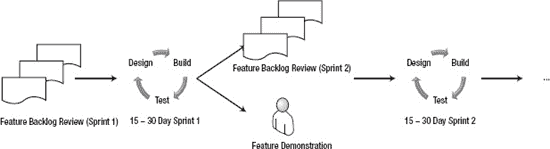

**图 5-3.** `Scrum` 方法论

## 迭代开发方法论

上述两种方法论在与 CRM 实施结合时都存在一些局限性。根据我们的经验，实施失败的最大原因之一是缺乏用户认同。瀑布模型的一个挑战在于，必须完成一个阶段才能开始下一个阶段，这要求项目团队制定非常详细的设计文档。该文档是在最终用户参与下制定的，并在开发开始前进行评审。最终，用户群体下一次看到应用程序是在用户验收测试期间，因此这种方法可能会让用户对某些假设或取舍感到惊讶或失望。

许多 CRM 实施包含的功能足够多，以至于与 `Scrum` 方法相关的短期设计会议和快速开发周期难以满足用户对初始实施的期望。即使是最小的 CRM 实施也可能需要数周时间，而大型实施则可能需要 6 到 12 个月甚至更久。此外，`Scrum` 项目的一个关键前提是向用户简要演示新功能，而不是完整的用户培训周期。对于大多数初始实施而言，花费大量时间向用户介绍应用程序（包括它如何帮助提高工作效率）非常重要。

由于这些以及许多其他方法论相关的局限性，我们经常在项目中采用一种衍生自迭代开发方法论的方法。这种方法通常被称为*迭代与增量开发方法论*。其理念是在较短的时间内（增量）通过重复的（迭代）设计过程来循环开发应用程序。从视觉上看，该方法论与瀑布模型非常相似，但有两个关键区别：

- 使用迭代开发方法论时，各阶段之间存在重叠。特定阶段要完成的大部分工作可以在上一阶段结束前开始。
- 在设计阶段，迭代方法为实施团队提供了一种机制，可以收集需求、构建或配置应用程序的各个部分，然后重复这一过程。实施团队可以根据需要重复多次迭代，以从用户那里获得适当的反馈。

图 5-4 展示了迭代与增量开发方法论与本章前面提到的瀑布模型有何不同。

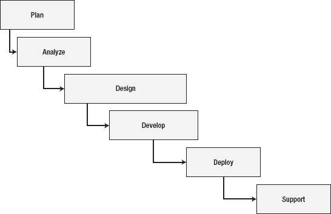

**图 5-4.** 迭代方法论

正如您从图 5-4 中看到的，各阶段相互重叠，允许在一个阶段完成之前就开始另一个阶段的任务。由于迭代的原因，该方法论的设计阶段通常比其他阶段更长。此外，您通常可能会看到一个较短的纯开发阶段，因为部分开发和配置工作是在设计阶段完成的。迭代过程应如图 5-5 所示。

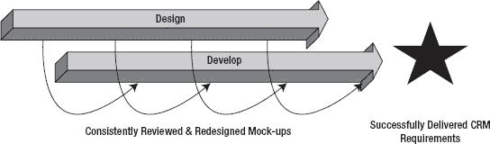

**图 5-5.** 迭代设计与开发

迭代过程应涉及尽早让最终用户看到应用程序。这样做将确保以下几点：

- *用户认同*：让用户通过应用程序参与进来，会让他们对最终结果更加投入。此外，由于设计时间线的延长，项目的动力应能持续到结束。
- *准确的需求捕获*：迭代过程为用户和实施团队提供了在需求锁定之前多次审查和更改需求的机会。这种方法不是构建一个设计文档并希望它能准确捕获需求，而是允许用户在最终结果完全定义之前就看到它。
- *设计与构建的一致性*：这两个阶段的高度重叠，在整个开发过程中提供了额外的一致性和检查点。

正如我们在本节开头所述，许多组织都有自己经常用于技术实施的方法论。只要您确保调整该方法论，让用户能够尽早并频繁地看到应用程序，那么这种方法是可行的。

### 计算投资回报率

计算和衡量 CRM 项目的投资回报率可能是一项具有挑战性的任务。很少有组织能够成功衡量诸如员工生产力或效率等指标的“之前”与“之后”数据。通常，无法衡量这些项目是实施背后的一个重要原因。尽管如此，为了组织领导团队的利益，并协助向用户传递信息，确定一些在部署后需要跟踪和报告的项目非常重要。

为确保全面覆盖，您可能需要在部署前花一些时间来识别需要跟踪的重要项目，这样您才能最终确保项目成功。

### 项目规划

为项目管理进度及相关事项选择适当方法的第一步，是确定初始项目进度和里程碑。项目规划作为一个概念，不仅包括管理进度，还包括管理相关资源和任务。

无论您选择哪种项目规划方法，都应考虑提供一套高层的项目里程碑，并向更大的用户群体展示里程碑的整体状态。虽然项目团队成员会更看重更详细的任务和日期列表，但有些人可能更喜欢一个简单的状态，说明项目是否按计划进行，以及如果存在问题，其严重程度如何。

### 项目进度规划

针对项目及其相关任务的进度规划，你可以选择多种方式。表 5-1 展示了一个极其简单的示例，供你参考。

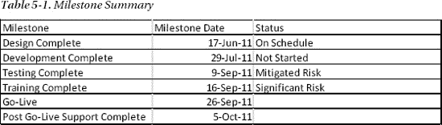

对于核心项目团队，除了总结里程碑之外，你还可以选择制定一份简单或更复杂的项目计划。对于简单计划，使用类似电子表格的工具可以让你轻松自定义计划，以响应团队的需求。采用此方法，你至少需要跟踪以下内容：

*   *任务*：在此模型中，重点是识别对项目成功至关重要的任务。这些任务可能是高关注度的任务，需要大量资源协调的任务，或涉及整个项目重大风险的任务。
*   *日期*：通过简单模型，跟踪开始和结束日期能让人们了解特定任务将在何时进行。你也可以选择识别那些需要主题专家（`SME`）或核心项目团队以外人员大量参与的关键日期。
*   *资源*：识别参与任务执行的各方，将使整个项目团队就高层级任务的所有权达成共识。
*   `SME` *时间投入*：项目期间经常出现的一个问题是：“在某些阶段，我的 `SME` 需要投入多少时间？”在项目规划阶段向他们提供这些信息，将使他们能够规划好自己的时间，并确保项目团队在实施阶段获得所需的时间投入。

图 5-6 展示了一个基于电子表格的示例，说明如何跟踪这些项目。

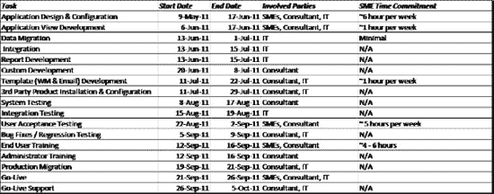

**图 5-6.** 高层级项目进度表

这种高层级方法非常适合小型项目，或对经典 `SDLC` 活动及流程有深入了解的组织。对于更复杂的项目，或需要在项目期间获取额外信息的团队，则应考虑采用更复杂的项目规划流程。

有许多工具可用于管理更复杂的项目任务。一种常用工具是 `Microsoft Project` 软件。这些工具允许你管理除简单解决方案所列项目之外的信息，例如：

*   *详细的资源跟踪*：使用众多可用复杂工具中的一种，你可以将特定资源关联到特定任务。
*   *资源平衡*：大多数此类应用程序还能帮助项目经理进行资源平衡。通常存在相关报告，概述特定时期内过度分配的资源。
*   *里程碑与任务*：与简单格式不同，大多数复杂的项目管理工具允许你在一个文档中同时跟踪详细任务和高层级里程碑。用户随后可根据自身角色选择查看适当级别的细节。
*   *任务状态*：经典项目计划中的每个任务还关联着一个属性，允许你跟踪状态或完成百分比。在图 5-7 显示的项目计划示例中，“功能设计草案”任务包含一条黑色线条，表示该任务的完成进度。
*   *项目基线化*：复杂项目管理工具的一个出色功能是，能够轻松地滑动任务的开始或结束日期，并让其他后续任务也随之移动。这种方法的一个缺点是会丢失原始日期的历史记录。因此，许多项目规划工具允许你建立项目基线，从而冻结初始日期。任何更新都将针对该基线进行跟踪。图 5-7 是一个完整项目计划的示例。

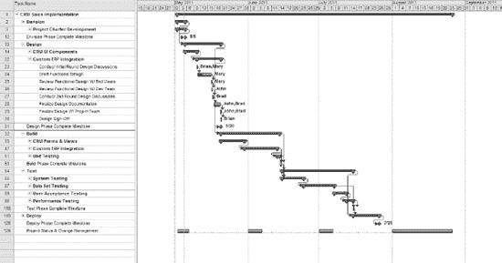

**图 5-7.** 详细项目进度表

你的项目计划（最终也是项目章程文件）中需要包含的其他事项，包括与此项目相关的任何现有项目依赖关系。清晰地看到项目与资源分配之间的重叠，将有助于你在流程中提前降低风险。

### 大爆炸方式与分阶段方式

对项目初始阶段影响最大的因素之一，是你的组织在实施时是采用大爆炸方式还是分阶段方式。最终，此决策应在你开始第一阶段之前，基于你在流程初期定义好的路线图做出。尽管如此，许多组织在初始阶段遇到范围蔓延时，仍倾向于忽视路线图。以下是这两种方式的简要概述：

*   *大爆炸方式*：大爆炸方式通常比任何分阶段方式包含的范围要大得多。通常，多个用户组（例如销售、服务和营销）会包含在同一个实施中。大爆炸式项目通常包含一些报表、必要的集成以及其他项目，使得组织只剩下少量可遗留到未来阶段的项目。
*   *分阶段方式*：分阶段方式涉及将关键范围项拆分为不同的阶段，以降低风险，并让用户社区逐步适应每个阶段的单项功能集。当采用分阶段方式时，诸如报表、集成和自定义代码等事项通常会被安排到后续阶段，以降低初始阶段的风险。分阶段还能确保所构建的内容是基于用户与应用程序的交互需求，而不是基于某些初始的高层级设计。

根据我们实施 CRM 项目的经验，我们通常建议客户采用分阶段方式。用户采用率通常更高，最初几个阶段的风险更低，并且由于后续阶段构建的内容是由用户使用应用程序时的需求（而非早期设计讨论）所决定，因此“被废弃”的代码也更少。

### 确定资源需求

在记录下项目所需执行的所有任务之后，你就可以开始确定完成工作所需的适当资源。正如我们在第 4 章中讨论的，这些资源可能来自多方面，并有不同的侧重点。花费时间提前确定这些资源，对于项目的成功至关重要。

### 识别关键团队技能

项目的规模、类型和复杂度将决定完成任务所需的技能。对于简单的项目，单个资源可能身兼数职。在大型实施过程中，可能需要多人共同承担一个“角色”，以确保具备完成既定任务所需的知识。

无论项目规模大小，这些关键角色在大多数项目中都很有用。再次强调，完成既定工作需要多少人，将决定人员具体承担哪些角色，以及每个角色需要多少人。

- **`项目经理`**：`项目经理` 是整个项目团队的单一联络人。`项目经理` 负责确保方法论中所有步骤和可交付成果得到执行。此人承担项目成功交付、以及及时向项目资源沟通项目进展和状态的主要责任。此外，此人还需为 `CRM` 建模设计、配置和定制活动提供总体指导。
- **`分析师`**：项目 `分析师` 通常负责广泛的任务。应用设计、配置/定制和上线的大部分工作通常都落在 `分析师` 身上。鉴于其对项目的功能性了解，大部分测试计划制定、培训计划制定以及培训课程的实施也将由项目 `分析师` 负责。
- **`开发人员`**：`开发人员` 负责构建自定义代码、集成、报告、数据转换脚本及相关可交付成果。如果项目范围包含任何架构或数据相关的工作，此资源将是主要联系人。
- **`测试人员`**：在更复杂的项目中，可能会使用独立的资源在上线前完成应用程序及相关功能的测试。
- **`其他`**：根据复杂程度，我们在 `CRM` 项目中通常还会看到其他几个角色：
    - `CRM` 架构师
    - 专职培训师
    - 网络/基础架构工程师
    - 用户体验设计师

需要强调的是，这些角色虽然重要，但对于较小的项目，许多可以由同一个人来担任。

### 内部资源与供应商资源

在第 4 章中，我们花了时间提供关于如何评估使用内部资源与供应商资源的需求的信息，特别是评估潜在供应商的标准。就本章而言，关键是将资源需求与组织内部的技能进行比较。我们常常看到，当组织试图承担超出其时间或技能范围的项目任务时，他们就为项目增加了风险。

如果需要利用供应商资源，本章列出的大部分项目或任务都需要进行扩展，以包含来自供应商团队的信息。例如，尽管供应商可能会为您提供关于其团队任务和活动的状态报告，但整体项目状态需要更新，以融合内部和供应商资源的状态。

供应商资源无疑可以帮助推进实施交付，但也会使整体项目管理变得更加复杂。最终，如果项目既需要内部资源也需要外部资源，那么引入合适的供应商将大大降低项目中的许多风险。

#### 变更管理

无论范围在实施过程中被多么谨慎地管理，我们之前讨论的结构化与灵活性之间的平衡，再加上结构化的项目方法论，都不可避免地会导致范围变更。这些范围变更可能是项目团队有意识决策的结果，也可能是项目中出现问题的结果。当变更发生时，您可以使用多种工具来跟踪这些事项。

#### 变更请求

`变更请求` 流程允许项目团队记录项目范围的功能和技术更新。此文档也应被用来记录和跟踪范围变更对项目工时和预算的影响。您可以在第 6 章中找到更多关于 `变更请求` 流程的信息。

#### 项目影响

`项目影响` 文档看起来与 `变更请求` 文档非常相似，但通常是在不太乐观的情况下提出的。无论是内部问题还是涉及供应商资源的问题，`项目影响` 通常代表着项目面临的重大风险，或者某些消耗了大量不必要时间或预算、需要向整个项目团队说明的事项。图 5-8 展示了一个 `项目影响` 声明的示例。

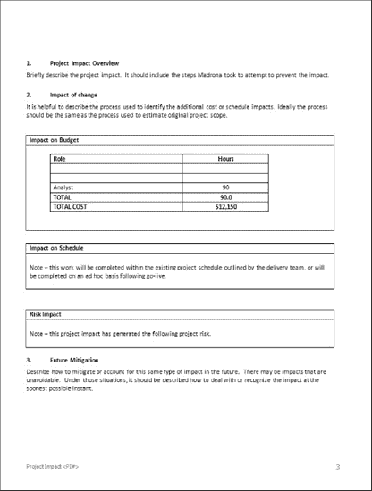

**图 5-8.** `项目影响` 示例

### 项目沟通

在整个项目过程中进行有效沟通，是其最终成功的重要因素。更重要的是，您如何以及何时与整个项目团队沟通，将极大地影响他们对项目和成果的看法。在项目规划阶段，请确保考虑好您将在整个项目中使用的各种沟通媒介、沟通频率以及消息内容。

#### 门户网站作为项目管理工具

如今，许多公司利用门户技术作为辅助管理项目的工具。正如状态报告一样，门户网站可以成为满足不同利益相关者群体需求的工具，并有助于确保对文档和其他信息的适当跟踪。以下是在项目中门户网站的一些具体用例：

- **`状态报告`**：取决于项目的规模和范围，利用门户网站作为呈现状态报告的工具可以使查看和协作变得更容易。在大多数门户网站中，您有机会将摘要和详细信息分到不同部分。这本质上与将状态报告分成不同部分的效果相同，但可以避免项目经理发送可能会在收件人收件箱中丢失的电子邮件。
- **`文档管理`**：对于各种规模的项目，管理、交换和更新文档可能是一项具有挑战性的任务。使用具有文档管理功能的门户技术可以简化此流程。大多数此类技术都能管理签入/签出流程，概述文档的更改，并提供版本控制功能给用户。
- **`常规信息共享`**：随着项目复杂度的增加，涉及的资源数量通常也会增加。当资源列表扩大到包括内部和外部（供应商）资源时，拥有一个允许协作的工具就变得很重要。
- **`日志记录`**：如果您的项目有任何复杂性，在实施过程中您很可能会遇到一些风险。状态报告可用于突出显示这些风险，提供关于正在采取的缓解措施的说明或评论，并提供所遇问题及所采取措施的历史记录。

### 期望设定

无论选择分阶段实施还是一次性全面上线，关键在于尽早并持续地设定用户期望。部署后出现的许多问题往往源于期望设定不当，而非应用程序本身的问题。我们在本书中介绍的不少工具，都可以通过多种方式来实现这一点：

- **`启动会议`**：启动会议是为组织设定期望基准的绝佳工具。无论是口头说明还是记录在项目章程中，这次会议可能是广大用户群体首次了解即将交付的内容及交付时间。将此次会议作为工具，并结合状态报告中持续传达的信息，将确保为用户设定恰当的期望。
- **`状态报告`**：正如本章前面所述，状态报告中包含的信息会影响组织内的用户。在状态报告中反复使用关于范围或交付时间表的微妙（有时甚至并不微妙）信息，长期来看将有助于引导用户的期望。
- **`高管沟通`**：虽然高管沟通对于激发用户对 CRM 应用程序的热情和使用至关重要，但将其作为设定用户期望的工具也同样重要。将以设定期望为目的、措辞策略性的更新信息，与突出应用程序亮点功能相结合，既能设定期望，又能激发用户热情。

除这些工具外，在用户群体中找到合适的骨干分子来担任“布道者”，并与有困难的用户协作，也能极大地保障成功。来自同事或同伴的帮助，往往比来自“官方”CRM 实施团队的支持更有效。

### 持续项目管理

一旦确定了项目当前阶段的范围，以及交付该范围的适当资源，就可以进入管理模式，跟踪已确认的任务和时间表。与项目规划工具类似，在管理项目范围、预算和资源状态等高层信息时，也有多种选择。

接下来，我们将提供一些在 CRM 实施过程中常用的标准模板示例。

#### 状态管理

项目启动后，你需要持续汇报实施状态。这些状态可用于多种目的：

- **`经典项目管理`**：为项目整体利益着想，掌握项目总体状态以及围绕项目预算、资源和范围的任何问题或关切，并定期向高管指导委员会提供信息，这非常重要。如果不维护和共享这些信息，整个团队（最终用户和项目领导团队）可能会产生不匹配的期望，或对项目期间做出的重要决策理解不一致。
- **`减少会议次数`**：在大型项目中，实施团队往往需要向多个不同的利益相关方群体汇报项目状态。无论这些群体是在寻找相同的信息还是不同深度的信息，你可能都需要安排讨论来提供信息。一份格式得当的状态报告，能为每个群体提供恰当层级的信息来回答他们大部分的状态疑问，从而无需召开独立的会议。
- **`CRM 布道`**：正如我们在全书中所讨论的，激发对 CRM 的热情，并让组织内部了解该工具及其功能，最终将影响项目的成功。状态报告除了可以突出风险或问题等较为“负面”的事项外，也可以用来突出项目中的正面进展。你可以选择纳入近期成果或即将发布、能为用户带来积极益处的功能亮点。
- **`风险缓解`**：最后，在实施过程中，你很可能会遇到一些风险。状态报告可以用来突出这些风险，提供关于正在采取的缓解措施的说明或评论，并记录遇到问题的历史及处理步骤。

`图 5-9` 中的状态报告示例列出了你可以选择纳入自定义状态报告中的多项内容。根据项目的复杂程度，你可以在生成的状态报告中包含部分或所有这些部分。你也可以根据所在组织的项目管理方法论，添加一些有实际意义的部分。

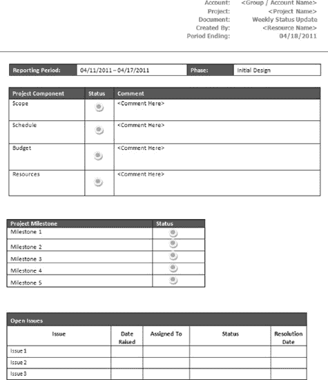

**图 5-9.** 概要状态报告

状态报告的第一页为那些希望通过可视化方式了解项目状态的人员提供了高层级信息概览。读者可以快速浏览与范围、进度、预算和资源相关的信息，并通过简要文字和“交通灯”图形，评估是否需要介入已识别的问题。

对于那些寻求更多信息的人员，你可以选择提供更详细的内容，如 `图 5-10` 所示。

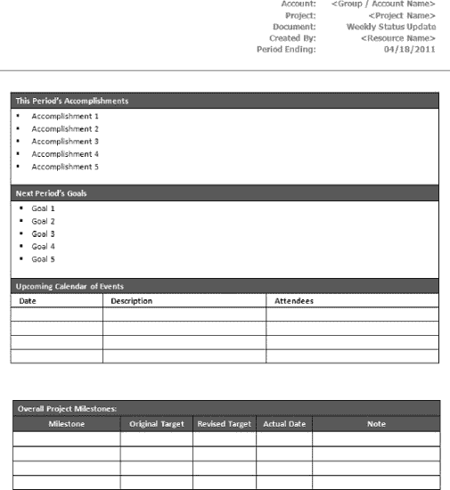

**图 5-10.** 详细状态报告

状态报告的这部分允许你汇报在本次报告周期内完成的具体任务，以及下一报告周期需要重点关注的事项。提供这些信息有助于确保实施团队每周都能将注意力集中在正确的活动上。“即将举行的活动日程”部分能帮助不同信息层级的人员了解后续报告周期内计划召开哪些会议。最后，文档中的“里程碑”部分持续更新里程碑的计划日期与实际日期。

#### 流程定义的重要性

正如本章前面所述，你选择的实施方法论将对应用程序的设计方法产生重大影响。我们将在本章后面讨论具体的设计方法和交付物。目前，无论采用何种方法论，都必须认识到流程定义的重要性。在许多 CRM 项目中，最常见也最容易纠正的错误之一，就是忽视分析“当前”流程以及评估需要在实施阶段纳入的“未来”流程变更。

至少，分析“当前”流程能使实施团队确保项目阶段的范围包含在新应用程序中复刻现有流程所需的功能。理想情况下，对“未来”流程的持续评估，将使整个团队能够将所需流程与你所选 CRM 应用程序的功能进行对比。这实际上有助于缩小范围、降低成本并降低风险，因为一些未来所需的功能可能通过应用程序本身就能简单实现。

#### 追踪“待办事项”项

在初始实施阶段开始前需要计划的另一项内容是，追踪和管理那些被视为重要但不属于项目当前阶段的范围项。实施团队常犯的另一个错误涉及在项目中纳入额外的范围。一旦项目启动，用户群体可能会对项目经理施加很大压力，要求将新项纳入项目范围。虽然在某些情况下这种纳入确实合理，但追踪和分类这些项将使项目经理和指导委员会能够在被请求变更范围时，就如何变更以及是否变更做出明智决策。`图 5-11` 展示了一个用于追踪这些项的简单而高效的电子表格示例。

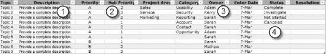

**图 5-11.** 待办事项追踪示例

1. **`主题与描述`**：尽管非常基础，但主题与描述应用于捕捉所反映的范围变更的高层概况及稍详细的说明。该电子表格将由广大用户群体使用，因此提供易于理解的描述可以预先消除用户的疑问。
2. **`优先级与子优先级`**：同时包含优先级和子优先级，使项目指导委员会在评估新的范围请求时能够进行非常精细的判断。如果出现额外的时间或预算，这种对请求范围项的详细排序将有助于做出深思熟虑的决定，明确纳入哪些范围。
3. **`负责人`**：这是另一个与范围项相关的简单追踪信息。尽管如此，它也非常重要。待办事项请求的负责人最终将负责推动必要的额外需求，以便就能否将该范围纳入项目做出明智决策。通常，此人还负责初步确定优先级，然后将该项提交给指导委员会审查。
4. **`日期与解决方案`**：正如本节前面提到的，广大用户群体可能会使用此电子表格来追踪其请求的进展。为他们提供更新的条目日期和状态，将使他们确信请求正在推进中。

还有一些其他数据点可能对您的项目团队也有价值。最常添加的信息与日期相关，并且确保用户群体能持续感受到他们请求并高度重视的项的最新进展。

#### 过度自定义带来的挑战

与在实施初始阶段采用“大爆炸”方法所导致的问题非常相似，项目团队很容易陷入试图通过过度自定义应用程序来满足用户需求的情况。过度自定义在更大规模、多功能实施中更可能发生。例如，当两个利益和销售流程截然不同的销售团队使用同一个实施时，就可能添加过多的字段、自定义配置和自动化功能。最终，在应用程序中添加过多的内容可能导致以下问题：

- **`用户困惑`**：用户在培训期间及发布后快速上手应用程序的能力，将决定初始实施的成败。如果字段过多，或者用户收到由应用程序生成的大量电子邮件或任务，他们很可能会感到困惑并放弃使用该实施。
- **`不必要的流程影响`**：与上一点非常相似，如果应用程序的新功能要求用户遵循他们不熟悉的流程关卡，他们可能难以采用该应用程序。
- **`额外支持成本`**：在发生过度自定义的情况下，用户要么难以使用工具，要么需要“紧急”变更，以便让他们对所开发的解决方案感到更舒适。无论哪种情况，都需要内部或供应商团队提供支持，以保持应用程序的正常推进。

过度自定义是可由整个实施团队控制的事项。采用迭代方法并结合应用程序审查，以确保用户对应用程序的构建方式感到满意，这将防止日后出现意外。此外，使用状态报告和项目章程等经典范围管理工具，并结合管理待办事项，将使初始实施的重点集中在为用户群体增加最大价值的项上。

### 预算管理

根据您团队内部运作方式的不同，您可能需要也可能不需要跟踪内部预算的费用明细。如果您正在使用供应商，您肯定需要确保能追踪他们按照您的既定预算进行支出。

预算管理可能是一件棘手的事情，因为它很容易被供应商钻空子。您如何管理预算以及使用哪些工具来识别预算风险，取决于您所负责项目的类型或规模。

如果您正在进行一个小型的初始项目，您可能只有与项目启动相关的少量支出，然后是后续每月固定金额的支出。在这种情况下，关键在于跟踪预算支出以及每月完成的工作量。这将使您能够判断每月的价值是否达到或超过了支出金额，无论是内部还是外部支出。

如果您的团队在 CRM 项目的第一阶段专注于一个大型项目，成本通常变化很大。大型项目相关工作所投入的精力可能从几周到几年不等，几乎涵盖了中间所有的时间跨度。您用于管理预算的工具可能千差万别；不过，我们将提供一个示例，并对特定部分的价值加以说明。`图 5-12` 展示了一个可用于管理预算和跟踪任何偏差的工具示例。

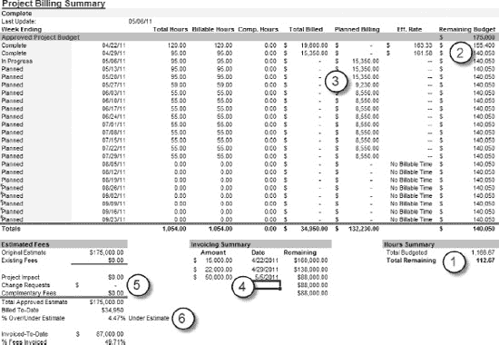

**图 5-12.** 预算跟踪示例

1. **`总支出与预算跟踪`**：此工具部分使您能够查看分配的总预算，并了解已支出的金额。根据项目状态，您可能需要就应保留多少可用预算做出明智的决策，但最终，这里的数据将帮助您做出判断。
2. **`剩余预算`**：在项目的任何阶段，您都可以通过查看单一数字来了解剩余预算的金额。
3. **`每周预算支出`**：查看每周的预算工时和支出是预算管理难题中非常重要的一环。首先，这种可见性使您能够将每周支出与项目计划进行对比，确保两者匹配。其次，这使您能够为大型项目做出更重要的预算决策，例如剩余预算有多少，以及它是否在项目剩余阶段得到了合理分配。
4. **`发票状态`**：项目经理和供应商资源通常需要负责在传统预算之外提供发票状态的更新。使用此模板，您可以为指导委员会提供供应商提交的任何发票的日期和金额。
5. **`项目影响及变更请求跟踪`**：此模板中的简单自动化功能使您能够在同一个地方跟踪项目影响和变更请求，与原始预算并列。通过将它们添加到这个电子表格中，总预算数字会增加，从而使项目管理团队在评估预算状态时能够使用总预算数字。
6. **`整体预算状态`**：通过将所有项目纳入预算电子表格，您将能够立即判断项目超出或低于预算的百分比。

项目越大，预算被不当使用的风险就越高。在大型项目中，存在团队花费 80% 的预算却仅交付 10% 功能的风险。一旦发生这种情况，实施团队就会陷入困境，因为他们已经向用户社区做出了承诺，但成本却持续显著高于最初预期。

归根结底，项目管理团队需要理解的最重要一点是，在任何时间点了解预算的状态。无论这个状态是关于总支出、即将发生的支出，还是仅仅关于本周将使用多少工时，找到一种提供此信息的机制是关键。

### 问题管理

尽管我们可能开始显得有些重复，但做好准备管理问题是项目规划中另一个重要的方面。就像待定事项和状态报告一样，让用户了解问题是让他们信任实施团队的长远之道。除了这一潜在价值之外，管理问题还关乎问责制和风险管理。

为了在整个项目生命周期中成功管理问题，拥有一个跟踪机制（无论多么简单）都很重要。该工具还将允许核心项目团队管理这些问题的责任归属，确保项目团队中的相关人员能进行适当的跟进和分类处理。`图 5-13` 展示了您可用于跟踪问题的一个简单而有效的模板示例。

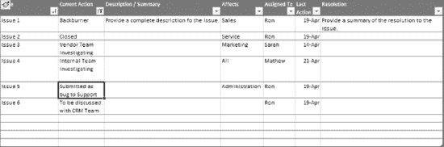

**图 5-13.** 问题管理跟踪示例

### 资源/供应商管理

无论您的项目规模如何，您都需要管理某种形式的资源。与许多与项目规划和管理相关的活动一样，提前设定适当的期望将使您从长远来看更加成功。

如果您专注于内部资源，我们经常看到的一个错误是没有为内部资源完成任务留出足够的时间。除非您的组织非常幸运，拥有曾参与过 CRM 项目的员工，否则许多任务所需的时间将比预期的要长。此外，取决于您组织的内部情况，您可能需要花费额外的时间向项目指导委员会汇报资源状态。无论情况如何，您的项目管理工具——特别是项目计划中的资源分配部分和状态报告——都可以帮助您在内部管理资源期望。

如果您处理的是涉及供应商的项目，情况就会变得更加复杂。所有用于管理内部资源的相同技术也可以用于管理供应商。供应商组织通常会在其实施时间之外提供一定量的项目管理时间。与内部资源一样，供应商资源将是项目计划的一个组成部分，他们付出的努力也应包含在任何状态更新中。

我们有机会合作过的大多数供应商都声誉极佳，并专注于做符合客户最佳利益的事情。不幸的是，也有一些供应商的声誉并不那么出色。对于后者，在涉及供应商的实施过程中，以下是一些您可能需要考虑的问题。

- **`诱饵调包`**：在销售周期中的某些情况下，供应商会向您展示某个人作为项目的资源，但在项目开始前却将该资源调换。尽管咨询组织很少在合同签署前承诺具体的资源，但最终分配到您项目的资源，其技能和经验应与销售过程中所做的承诺保持一致。
- **`支出与预算`**：正如我们在本章预算管理部分所概述的，谨慎管理预算和工时将确保预算与所需工作量保持一致。完成了项目的大部分工作，却没有完成实施的预算，这会使整个团队处于非常不利的地位。
- **`“合作伙伴模式”`**：作为一个实施 CRM 的团队，在无需增加不必要开销的情况下，成本已经足够高了。一些咨询组织采用合作伙伴模式，即由一名高级资源在项目上计费时间，却不提供相应的价值。请确保参与项目的所有人，无论是资深还是初级，都为实施提供了价值。
- **`知识转移`**：供应商很容易只专注于实施，而不向内部项目团队提供所需的信息。请确认您的供应商已预留足够的时间来恰当地支持工具部署，并将代码、文档和流程知识等信息转移给内部团队。
- **`工具与流程`**：顾问们对特定的 CRM 工具及相关实施会采取不同的方法。有时，顾问很容易只关注工具，并调整组织的流程来适应现有功能。您应确保供应商准备调整工具来满足您组织的流程需求，而不是改变您的流程去适应工具。
- **`咨询培训`**：每位顾问都会经历第一个项目，但为了确保您组织的最终成功，了解供应商所带来团队的背景至关重要。如果项目中安排的是较初级的资源，请确保他们得到供应商组织的适当支持，并要求折扣费率以弥补该资源不可避免的适应期。

这些例子只是您在与供应商团队合作时可能遇到的一些陷阱。重申一下，对于大多数供应商，您可能不会遇到这些问题，但带着对潜在风险的认知进入项目状况，从长远来看可以防止问题的发生。

# 规划、管理与高管支持

## 典型的供应商合同

供应商采用的合同类型和格式差异很大；然而，在您的组织和参与项目的任何供应商之间，有两类高级别的文件可能是有意义的。

第一份文件通常称为`专业服务协议`（PSA）或`主服务协议`（MSA）。这份文件的经典目的是概述管辖两个组织之间关系的条款和条件。这份文件将作为一个总括性文件，所有项目工作都在其下进行定义和完成。

第二份常见文件通常称为工作说明书（SOW）。这份文件是项目特定的，通常涵盖项目的范围、假设、可交付成果以及单个项目成本。

图 5-14 展示了一份 PSA 的示例目录，其中列出了一些您应预期在供应商提供此文件时看到的内容和一些注释。

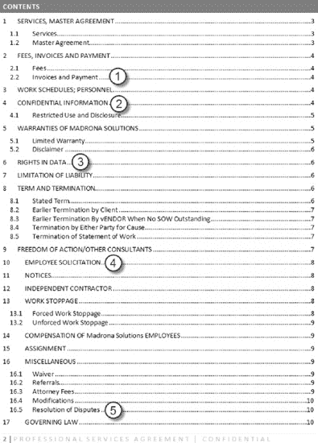
**图 5-14.** PSA 目录

以下是一些需要关注的关键项目：

1. **开票结构**：标准的 PSA 将概述您与供应商之间的开票条款。这些条款包括开票频率，以及您在支付供应商发票时应遵循的标准付款条件。通常，大多数供应商每两周或每月开一次发票，并要求按“Net 30”付款条件支付。
2. **保密信息**：几乎每份 PSA 都包含关于保密信息的条款。根据您的供应商 PSA 的友好程度，该条款可能是双向的，也可能仅侧重于保护供应商的保密文件和资料。显然，从您组织的角度来看，该条款也需要包含对您在项目期间暴露的信息、文件和流程的保护。
3. **数据权利**：总的来说，文件中的数据权利部分将讨论由供应商执行的任何项目工作的可交付成果的归属问题。虽然这看起来相当直接，但在 CRM 项目中，这部分可能会变得复杂。因为您为项目付费，所以您假设自己将拥有项目期间开发的任何知识产权是合理的。当讨论配置的所有权时，挑战就出现了。正如您可能想象的，如果您向 CRM 应用程序添加了一个名为“账户名称”的字段，供应商不能将此项定制的独家所有权授予您，因为他们未来的许多客户可能会请求相同的形式。因此，数据权利部分通常包含对定制的一些共同所有权，您在审查 PSA 时应预料到这一点。
4. **员工招聘**：与保密信息部分非常相似，PSA 的这一部分可能是双向的，也可能只保护供应商免于您雇佣其资源。最终，在项目期间，您双方可能都希望得到这种保护，以确保资源持续专注于手头的任务。
5. **解决与争议**：PSA 的这一部分处理您与供应商之间可能出现的任何问题。这部分将讨论任何争议将在何处解决，并且，如果适用，仲裁是否是本协议的一部分。根据我们的经验，加入仲裁条款是个好主意，以防万一出现问题，因为它能让您尽可能避免法律诉讼。

在审查 PSA 时，您需要考虑的一个整体问题是文件中的条款是双向的。文件中有很大一部分内容可以并且应该是双向的。例如，如果供应商要求您避免雇佣他们的资源，那么您期望获得同等待遇也是公平合理的。

图 5-15 展示了一份典型 SOW 的目录。

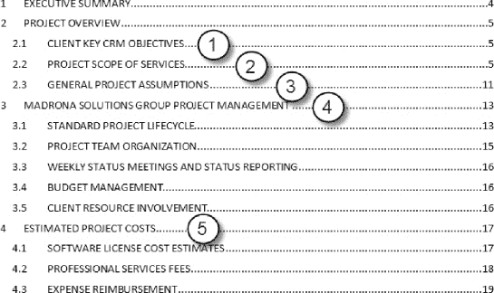
**图 5-15.** 工作说明书目录

1. **关键目标**：尽管大多数工作说明书（SOW）的这一部分篇幅较短，但这是供应商阐明其对项目目标理解的机会。这些条目可能以概要形式呈现，但若目标清单中遗漏了重要事项，建议与供应商进行沟通。
2. **项目服务范围**：文档中的范围部分为 SOW 中最重要的章节。该部分将概述作为项目组成部分交付的具体范围、定制化、代码、集成等内容。范围部分将明确需交付的条目、与这些范围条目相关的具体可交付成果，以及供应商为将范围条目限定在合理层级所做的任何假设。
3. **通用假设**：此部分与范围部分中明确的假设有所不同，因为它涉及一些关于项目的更高级别假设。诸如报告、工作流、培训和部署功能等条目，可通过一个整体时间块（而非特定范围条目）来处理，并可能附带相关的通用假设。
4. **供应商项目管理**：根据我们的经验，部分供应商会在 SOW 中提供有关其项目管理方法和交付模式的详细信息，但也有一些不会。如果你有机会要求供应商包含此信息，这将使你能够在流程早期了解其方法论。
5. **项目预估成本**：SOW 中的成本部分将是决定是否推进解决方案的关键。该部分将包含三个主要组成部分：
    - **软件**：无论选择何种类型的应用程序（托管型或本地部署型），都会产生一些软件成本。请确保贵方供应商提供了与不同模式相关的成本。这也是应提供任何第三方软件成本的部分。
    - **服务**：此处将概述与 SOW 中列出的范围条目相关的专业服务成本。这些成本应包括实施成本、部署后支持成本，以及供应商提供的任何项目管理的成本。
    - **差旅**：尽管并非所有项目都包含差旅，但确保供应商已明确任何预期成本，包括酒店、租车、机票/交通和/或每日津贴的估算，将避免日后产生混淆。你可能还需确保供应商符合贵公司的差旅政策，包括提前获得差旅批准或使用指定酒店。

正如我们在本节前面提到的，不同供应商的合同差异很大。确保合同包含我们列出的大部分或全部内容，将使你能够在开始实施之前尽可能多地覆盖各种情况。

## 高管支持

一旦你完成了项目筹备所需的所有规划任务和文档生成，就必须获得启动项目所需的所有高管支持。在本书中，我们探讨了拥有支持整体 CRM 计划的高管团队的价值。在这个阶段，焦点应放在当前的具体项目上。

在此实施阶段，高管支持可能来自两个主要来源：一位高层管理者以及项目指导委员会。无论是专注于项目启动，还是与整个项目团队达成一致，项目章程文件都可以成为确保团队朝着相同且正确方向前进的工具。

项目章程应由核心项目团队成员制定。许多关键的章程条目，如风险、项目时间表和项目依赖关系，需要来自不同利益相关方的输入，可能无法仅由项目经理知晓。让涉及任何风险或时间依赖关系的人员参与进来并获得他们的认可，将确保项目经理有能力在项目期间有效管理这些问题。在你与团队合作制定章程后，应计划向整个团队公布并征求反馈。图 5-16 是一个项目章程目录的示例。

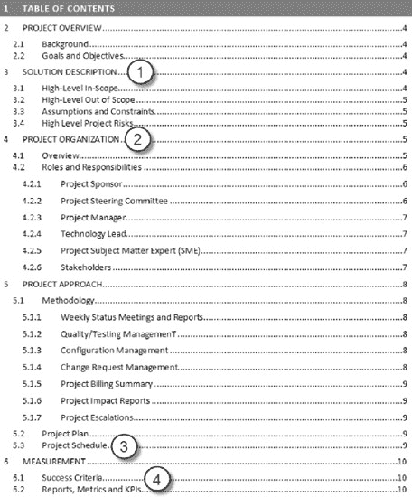
**图 5-16.** 项目章程目录

此文档的一些关键点包括：

1. **解决方案描述**：由于项目中的许多参与者可能未与项目发起人（以及供应商，如适用）就项目范围进行过讨论，因此概述范围内以及同样重要的范围外内容，将为项目团队提供发表意见的机会。如果项目团队中有人不同意范围之内或之外的某些内容，则可以适当地进行后续讨论。
2. **项目组织**：尽管项目组织部分看起来相当直接，但在前期正确识别哪些人将担任特定角色，将避免后续整体项目团队和用户的混淆。核心项目团队成员（包括主题专家、项目经理和技术负责人）以及指导委员会将被期望在项目期间做出决策，因此项目章程有助于确保这些角色中的人员理解其职责。
3. **项目时间表**：概述项目的关键里程碑将使整个项目团队能够确保不存在可能危及项目时间表的冲突。如果确实存在此类冲突，可以进行后续讨论，以尝试减轻与之相关的任何风险，或确定对项目时间表进行必要的更改。
4. **成功标准**：项目章程中最后也是最重要的一点是确定项目成功标准。让项目团队协助定义这些条目将确保他们对项目的成功有所投入。由于 CRM 项目所带来的价值往往具有模糊性，清晰地记录成功标准将使你能够在部署后阐明项目的成功，并极大地有助于为未来阶段获得资金或资源。

与本书中强调的大多数文档一样，贵组织使用的项目章程可能与前述不同。一些公司使用基于 PowerPoint 的单页摘要文档，另一些公司则使用更复杂的文档，但包含上述四个关键要素将确保项目团队成员之间的协调一致。

## 总结

在本章中，我们讨论了在规划和管理初始部署时你应该关注的要点。根据项目参与规模与复杂程度，其中一些内容可能显得多余，但寻找机会使用这些文档的简化版本，将确保你在项目期间不会遗漏任何内容。

我们首先重点讨论了项目规划或你将采取的方法。确保时间表满足利益相关方的需求、评估“大爆炸式”与分阶段实施方法，以及组建一支资源团队来交付工作，将为后续的项目规划活动奠定基础。接下来，我们介绍了维持项目顺利运行所需的持续项目管理活动。最后，也可能是最重要的一点，我们讨论了建立和传达来自高管团队的支持，以保持项目朝着正确的方向推进。无论是激发热情、确保资源承诺，还是解决问题，来自高管团队的支持和参与将贯穿整个项目。

在下一章中，我们将讨论项目的实际执行。我们将涵盖设计、开发、测试和培训以及其它主题。

