# 第 6 章：执行初始 CRM 实施

在上一章中，我们为您提供了规划 CRM 项目初始阶段所需的步骤。并非所有列出的工具和方法都适用于所有情况；最终，您需要根据您的组织以及计划实施的复杂性，找到对您有意义的工具和方法。

在本章中，我们将重点介绍如何执行 CRM 项目的初始实施。我们将关注实施的各个阶段，并提供有关您应使用的模板和流程的信息，以执行实施。与上一章类似，我们将讨论的许多内容都需要根据您的组织和项目的需求进行定制。

### 设计阶段

在上一章中，我们回顾了在实施期间可能使用的各种设计方法和原则。虽然所有这些方法都可能成功，但我们建议在设计阶段采用迭代方法。

#### “现状”流程定义

在大多数实施的设计阶段，一个经常被忽视的步骤是对组织当前或“现状”流程的文档记录和分析。记录并确保对流程事项达成共识，将为您带来两个好处：

*   **应用对齐**：我们将在本章后面讨论的一个事项是，使您的应用程序与组织的业务流程保持一致。CRM 实施中最大的陷阱之一是允许技术驱动使用场景和业务流程。预先定义您的流程，将确保您的实施团队（包括供应商）勤勉工作，以使应用程序满足您的业务流程，而不是技术的流程。
*   **流程更新**：预先分析您的流程将使您的团队能够审查这些流程，并确定它们是否适合公司未来的发展。花时间审查每个流程可能会如何改变或改进，同样将使您能够确保应用程序满足这些需求。

图 6-1 中显示的流程文档是一个简单流程图的示例。它结合了普通的方框到方框流程和通常称为*泳道*流程的流程。泳道允许您按所涉及的人员或部门来分解流程，使他们能够有效地对流程的准确性提出意见，并让您看到应用程序可能对特定角色产生的影响。

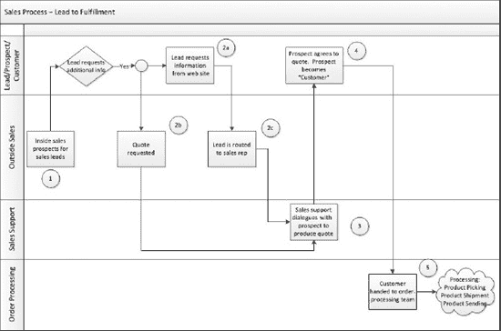

**图 6-1.** “现状”流程图

在图 6-1 所示的流程图中，您会注意到代表了四个角色，或*人物角色*。根据图表的结构以及您用来构建图表的技术，您可能还能够将高级流程图链接到更详细的流程图。此外，您可以选择突出显示图表的特定部分，并提供有关某个方框或活动的额外细节或内容。为此，您可以利用图 6-1 中的编号气泡，并在一个单独但相关的文档中添加注释。

在进行“现状”流程分析时，不仅要考虑识别发生的步骤或操作，还要考虑识别流程的产出。如果在任何阶段产生了报告或文档，请利用分析过程的机会，花时间评估当前的产出以及这些项目将如何随着新的 CRM 系统而改变。

#### “目标”流程定义

一旦评估了“现状”流程，就需要以批判性的眼光来评估该流程，以期进行改进，并确定应用程序可以自动化关键功能、改进业务审计或简化沟通的机会。这些讨论对用户来说通常很痛苦，因为许多人习惯于以某种方式或根据特定流程进行操作。虽然这可能需要时间，但现在努力解决流程中的变化，最终将使您的实施更加成功。

“现状”流程图可以作为任何定义的“目标”流程的起点。突出显示任何更改将使将来更容易比较两者。最后，在开发新流程时，您应该考虑使用某些符号来突出显示任何已定义的自动化点。

图 6-2 显示了“现状”流程图，其中标识了一些小的更改，从而创建了“目标”流程图。

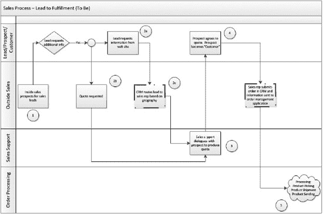

**图 6-2.** “目标”流程图

虽然更改很小，但您会注意到此流程图中有一些差异，用两个边框较粗的方框突出显示。这两个更改都代表了流程的变更以及应用程序可以促进的自动化。

#### 规则与升级

一旦定义了“现状”和“目标”流程，您就应该清晰地记录在流程分析中识别出的自动化。在这一点上，此文档可以相对宏观，但应捕捉每个自动化部分的重要特征。

图 6-3 提供了一个用于跟踪业务规则和自动化的简单模板。

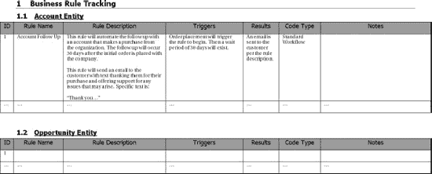

***图 6-3.** 业务规则跟踪模板*

模板中的大部分列都是不言自明的。根据您选择的 CRM 应用程序，将使用不同类型的代码或 CRM 功能来实现特定的自动化部分。

## 用例定义

许多组织选择围绕一组*用例*来组织设计过程。用例以逐步的方式描述用户和应用程序之间为完成某些任务而进行的交互。定义用例为您的团队提供了一个机会，就应用程序需要解决的用户场景和流程达成共识。即使是简单的实施，也需要多个用例来勾勒用户的任务和流程。对于较大的、新的应用程序实施，可能需要数十个用例。用例及其内容不应与应用程序功能混淆，因为它们差异很大。用例定义将主要通过两种方式提供帮助：

*   **流程一致性**：开发和完善用例提供了一个方便的框架来进行详细的流程讨论，并确保所有各方在流程的步骤、参与者及其基本原理方面保持一致。在设计过程早期确保这种一致性，可以使后续工作更顺利，并有助于防止在设计后期出现过程差异时产生不愉快的意外。
*   **完整测试**：在设计阶段开发用例将有助于确保在部署的测试阶段完成完整的测试。很多时候，端到端的系统测试是基于实际构建的内容完成的，而不是基于已批准的设计（预期要构建的内容）。这是一个重要的区别。设计用例将为在项目后期阶段制定的测试计划提供一组基线信息。

图 6-4 显示了一个可用于记录您的用例的模板示例。

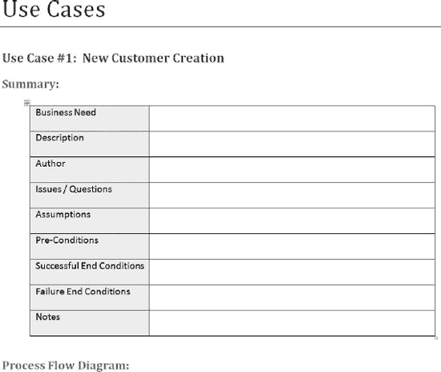

***图 6-4.** 用例示例*

以下是对用例文档每个部分所包含信息的快速概述：

*   ***业务需求**：提供用例所涉及业务流程的概要或标题。*
*   ***描述**：利用描述字段，更详细地说明特定用户用例所解决的业务流程。若你能提供用例的前后对比视图，则可能利用这些信息来评估项目的最终成功。*
*   ***作者**：作者是编写用例的人。*
*   ***问题/疑问**：在编写用户用例时，你常会发现一些问题，这些问题将影响系统实现方式以解决用例。此外，如果你能在项目团队审阅此用例时为其识别并总结出任何疑问，可在此处追踪记录。*
*   ***假设**：如果你对涉及的业务流程或用户（在用例中常称为*参与者*）做出任何假设，请在此处记录这些信息。仔细记录假设是成功运用用例的关键之一。用例通常会被转化为用户测试计划，因此记录关于用例触发条件或作为用例一部分的流程步骤的假设，将有助于更轻松地生成测试计划并进行更有效的测试。*
*   ***前置条件**：前置条件允许你定义在用户用例中识别的流程被“允许”发生之前必须满足的条件，例如某种形式的审批。*
*   ***触发器**：使用触发器部分来记录触发用例中已识别步骤的用户或流程操作。以学生尝试注册大学课程为例，学期开始、新课开设等，都是需要完成注册流程的触发器。*
*   ***成功结束条件**：模板的这一部分可用于记录指示用例成功完成的标准。例如，沿用上述学生注册的例子，成功结束条件即为学生能够使用我们设计的任何应用程序成功注册。*
*   ***失败结束条件**：模板的这一部分可用于记录指示用例以失败告终的标准。例如，如果前面提到的学生不被允许或无法使用该应用程序注册课程，这就可以记录为失败结束条件。*
*   ***备注**：用例文档的备注部分可用于记录任何其他信息，这些信息不能恰当地归入之前确定的文档部分中。*

除了图 6-4 提供的模板外，用例通常还包括信息流以及应用程序将如何满足特定用户需求的模型或线框图。图 6-5 展示了一个示例，说明如何为一个报告用例展示这种信息流和模型。

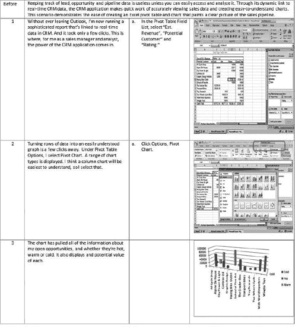

**图 6-5.** 详细用例示例

图 6-5 所示的示例也可作为用户验收测试计划 **错误！未找到书签。** 的基础。提供清晰的步骤、这些步骤发生的位置，以及用户如何与应用程序交互的可视化示例，将使他们能够全面测试该应用程序。

#### 功能规格说明开发

设计拼图的最后一块是功能规格说明文档，它将我们到目前为止介绍的所有元素整合在一起。该文档旨在描述你将要实施的应用程序的预期或期望的业务行为。你会注意到，图 6-6 中展示的许多条目都记录了在项目过程中从流程或设计讨论中产生的需求或假设。

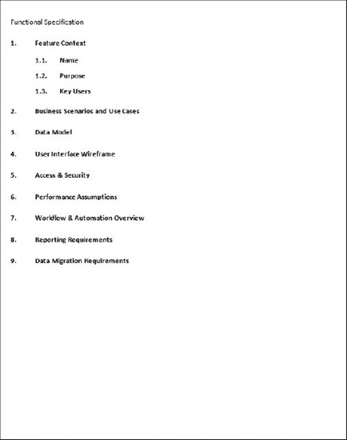

**图 6-6.** 功能规格说明目录

你会注意到，图 6-6 中的大部分条目已经在设计阶段的不同节点被审阅或讨论过。功能规格说明文档可以作为整合所有独立流程和工作流需求的机制。

一旦你的项目团队批准了功能规格说明，在设计阶段此时可以产出的另一份文档是技术规格说明文档。技术规格说明是一份由开发团队创建的文档，用于概述那些无法使用 CRM 应用程序中可用的标准配置或工作流工具来构建的应用程序组件的设计、开发和测试计划。我们将在本章的“自定义开发”部分提供关于技术规格说明文档的更多信息。在结束项目的设计阶段之前，请务必至少考虑以下常见的设计陷阱：

*   ***报告设计延迟**：由于许多组织最初过于关注功能和表单设计，因此报告需求的识别和设计常常被忽视。通过提前设计报告，或者至少与其余功能和表单并行设计，将确保在整体设计中考虑到应用程序的必要输出。*
*   ***数据迁移错误**：不要将数据迁移的设计留到设计阶段结束时或构建阶段开始时。与报告一样，请确保你在整个设计阶段都在进行数据迁移工作。从你以前的应用程序中迁移的数据，在如何以及迁移到新 CRM 应用程序的何处方面会有一些限制。了解这些限制并通过 CRM 的设计来解决它们，将使整个数据迁移过程进行得更加顺利。*
*   ***技术 vs. 流程**：我们在本章前面提到了这个陷阱，稍后我们将更详细地讨论它，但确保你的团队承诺坚持你的业务流程，更重要的是，推动你选择的 CRM 应用程序去满足这些流程需求，将是项目实施成功的最关键因素之一。*

### 定制开发

在某些情况下，您选择的 CRM 应用的标准功能可能无法充分支持您的业务流程，或者附加功能可能对您团队的生产力产生巨大影响。所有主流 CRM 应用供应商都预见到了这一点，并在不同程度上设计了他们的应用，允许其合作伙伴和客户为其增添新功能。由于定制功能是为满足您独特的需求和情况而设计的，因此它们可能极具价值。然而，在将定制开发作为 CRM 项目一部分进行着手之前，有几个重要的考量因素：

- **成本**：定制开发通常涉及为您的 CRM 应用从零开始编程，以实现新功能或新特性。这可能会很昂贵，并且总开发成本在定制组件的所有设计工作完成之前难以精确估算。这可能导致成本超支。
- **升级路径**：向您的 CRM 应用添加定制代码可能会使从一个版本升级到下一个版本变得更加困难，并且每次 CRM 应用发布新版本时，这些代码都需要进行测试并可能需要返工。
- **您自身的 IT 资源**：您是否有具备相应技能和带宽的内部资源来构建、或至少维护和定期增强定制组件？如果没有，您与您的 CRM 咨询合作伙伴关系如何？他们作为您的开发合作伙伴，未来是否可能保持良好的连续性？您是否接受将这部分工作外包所带来的成本影响？
- **CRM 供应商路线图**：您是否计划构建一个已在您的 CRM 应用供应商路线图中的功能？如果是，是否可以等待？
- **ISV 生态系统**：这个功能是否可以通过为您的 CRM 应用添加 ISV 附加产品来充分满足？在所有功能相同的情况下，购买现成产品几乎总是比开发定制组件更好。

我们的目的并非劝阻您进行定制开发；事实上，在我们所见过的、最具价值和变革性的 CRM 项目中，有些就包含了直接针对客户特定流程和挑战而开发的定制组件。但这些组件的价值必须经过深思熟虑，并且必须谨慎管理，因为它们可能会对您的项目预算和进度构成风险。

#### 管理作为 CRM 项目一部分的定制开发

如果您选择将定制组件的开发作为 CRM 项目的一部分，请理解这与标准应用功能相关的设计和配置流程有着根本性的不同。如果那个流程类似于为您的新车选择配置和颜色，那么定制开发则更接近于从零开始设计汽车。这种差异为管理您项目中的定制开发部分提供了一些指导原则：

- **严格对待文档**。创建一份详细的**功能规格说明书**作为设计流程的输出，并在设计变更时保持其更新。
- **规划几个中间开发里程碑**来评估原型，特别是对于复杂组件。这让您能够切实感知开发进度，并在需要时进行方向修正。
- **避免功能蔓延**。扩展功能集对预算和进度的影响，远不止新功能额外的开发成本那么简单。总会有发布下一个版本的机会，所以不要试图一次完成所有事情；相反，应以某种方式记录需要但超出范围的功能，以便在未来的开发中进行评审和设定优先级。
- **谨慎管理离岸开发团队**。市场上将定制开发工作外包到成本较低地区的趋势日益增长。这可能是一种成功的模式，但需要您付出更多努力来确保其成功。确保您谨慎选择开发合作伙伴。找一个对您选择的 CRM 应用有丰富经验的合作伙伴。计划让您的文档比通常情况更加详细。没有面对面的交流，澄清事情的机会就会减少，通过电话/电子邮件进行澄清也可能更加困难。计划与开发合作伙伴定期沟通进度。监控他们的工作量，确保您有效利用了他们的时间。

## 技术规格说明书

功能规格说明书定义了**要构建什么**。它关注成果和用例，并描述应用应该在什么时候、为谁、在什么流程的什么阶段做什么事。技术规格说明书则专注于**如何实现**：即需要构建什么来交付功能规格说明书所描述的能力。功能规格说明书是一份由分析师驱动的文档，并吸纳了开发团队的输入，而技术规格说明书则是一份由开发者驱动的文档，并吸纳了分析师/设计团队的输入。技术规格说明书有多种风格和变体，但大多数都会涉及图 6-7 中的主题。

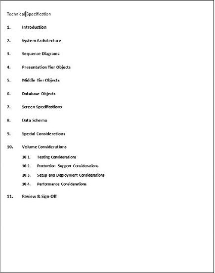

**图 6-7.** 技术规格说明书目录

### 集成

应用集成是 CRM 项目中的一个常见组成部分，可以极大地提升您的 CRM 应用的价值和影响力。在本书中，我们将集成定义为以编程方式将业务应用链接在一起；例如，一个应用中的数据在另一个应用中可见，或者一个应用中的操作可以触发另一个应用中的不同操作。集成的常见理由包括提供更完整的客户视图和自动化业务流程。我们来详细探讨每一点。

#### 提供更完整的客户视图

CRM 项目常被提及的一个潜在好处是实现客户的“360 度视图”：在一个地方、一个应用中，员工可以浏览组织与某个客户在所有部门间的所有互动。CRM 应用因其以客户为中心的设计，自然而然地适合扮演这个角色，但如果没有应用集成，这一愿景就无法实现。您的组织将继续需要专门的业务应用来管理某些类型的客户信息。例如，您的会计应用将管理发票和付款。集成可以使这些信息在 CRM 应用中、在客户上下文中可用，这样，除了 CRM 原生数据（如销售机会、服务工单和电子邮件通信）之外，您的 CRM 用户还可以查看来自会计应用的信用状态、发票和付款信息。其他应用也可以通过同样的方式集成，最终 CRM 成为用户获取客户全貌的中心场所。这使得面向客户的员工能够向客户展现统一的形象，并提供更有意义、更令人满意的互动。

#### 自动化业务流程

许多客户的业务流程会跨越应用程序的边界。例如，新客户入职流程始于 CRM 应用程序中的赢单机会或订单，但很快会进入会计系统，在那里必须创建新的客户记录、启动订单履行，可能还需要准备发票。对于服务型组织，已售出的项目和客户可能需要在企业项目管理应用程序中创建。

如果没有应用程序集成，这些流程跨越应用程序边界时，可能会引发延迟、冗余且易错的数据录入以及信息不完整等问题。来自一个应用程序的信息必须手动重新输入到另一个应用程序中。一个部门的操作或事件必须通过电子邮件、电话或会议通知给其他部门。

应用程序集成允许这些应用程序之间的交互以编程方式发生，由应用程序事件触发，且无需用户干预。当公司在 CRM 应用程序中的状态从“潜在客户”变为“客户”时，客户信息会自动传递给会计系统，并创建相应的客户记录。会计团队可能会收到一封自动发送的电子邮件来提醒他们这一事件。如果赢得了一个服务型销售机会，CRM 中的该事件可以触发在企业项目管理应用程序中创建客户和项目记录，以便交付团队可以着手规划服务交付。

在另一种用于自动化业务流程的集成形式中，另一个应用程序的用户界面元素会被嵌入到 CRM 应用程序中，这样在流程中的某个特定时刻，CRM 用户可以在 CRM 内部快速手动输入数据，或在另一个应用程序中发起交易。当需要用户监督或判断信息如何输入到其他应用程序时，这种方式非常有用。

#### 集成类型

CRM 项目中常见两种集成类型：`数据级`集成和`用户界面`集成。在某些场景下，一种比另一种更合适；您的集成需求以及应用程序的特性将指导您选择合适的方法。

##### 数据级集成

数据级集成涉及将数据从一个应用程序物理复制到另一个应用程序。这种类型的集成在设计、开发和测试上通常更为复杂。然而，它的优势在于使一个应用程序的数据能够完全用于另一个应用程序的所有功能。例如，如果通过集成将会计系统的发票复制到 CRM 中，它们就能用于 CRM 报表、触发 CRM 中的通知和其他工作流规则、可以通过 CRM 安全模型进行保护、能够被纳入 CRM 生成的电子邮件中，等等。

数据级集成需要定义的一个方面是数据的“流向”；例如，我们给出的例子中客户记录通过集成从 CRM 应用程序流向会计应用程序。如果在会计应用程序中有人更新了客户记录（比如更改了电话号码），会发生什么？这个更改是否应该反向流动，更新 CRM 中该客户的记录？必须就数据应如何通过集成流动，以及哪个系统“主控”哪些数据（换句话说，该系统版本的数据始终被认为是“真实的”，并覆盖所有其他系统）做出决策。

## 用户界面集成

这种集成形式涉及将一个应用程序的界面元素（或来自该应用程序的数据报表）嵌入到另一个应用程序中。数据从未从一个应用程序物理移动到另一个应用程序；只是将其`视图`呈现给另一个应用程序中的用户。当关键需求仅仅是想向用户展示数据，或让用户更容易发起交易时，这种方式非常有用。这种类型的集成在设计上比数据级集成更简单。回顾上一节中发票集成的例子，与其实现数据级集成将发票数据复制到 CRM 应用程序，我们可以开发一个用户界面集成，即在 CRM 客户记录的一个选项卡中显示来自会计系统的客户发票报表。CRM 用户可以像查看 CRM 应用程序本身的一部分一样查看这些信息。但是，他们无法通过 CRM 搜索工具查询这些数据，这些数据也不能参与 CRM 工作流自动化及其他 CRM 功能。

### 集成工具

对于用户界面集成，通常所需的定制编程量很小，并且不需要集成工具。大多数 CRM 应用程序都包含在用户界面中嵌入外部内容的功能；向基于浏览器的客户端发展的趋势使这变得更加容易。

对于数据级集成，纯粹的定制开发仍然是一种选择，但编程工作量要大得多。大多数组织选择实施现成的集成工具，然后使用它来构建数据集成。该工具提供了底层功能（例如错误处理）、连接常见业务应用程序的适配器，以及大量数据转换功能，以方便映射和转换数据，将其从一个应用程序移动到另一个应用程序。使用这些工具所节省的编程工作量很容易证明其成本是合理的，并且结果更易于使用和管理。工具的选择将主要由所需的集成类型、涉及的应用程序以及您团队的技术专长和基础设施来决定。

### 在 CRM 项目中管理数据级集成

集成工作遵循任何 CRM 项目常见的“设计-构建-测试-部署”流程，但在本节中，我们将讨论一些特定于数据级集成工作的任务。

#### 识别集成场景和涉及的应用程序

第一步是规划出期望的集成场景、数据流向以及涉及的应用程序。此信息可以简洁地通过表格来描述，如 表 6-1 所示。

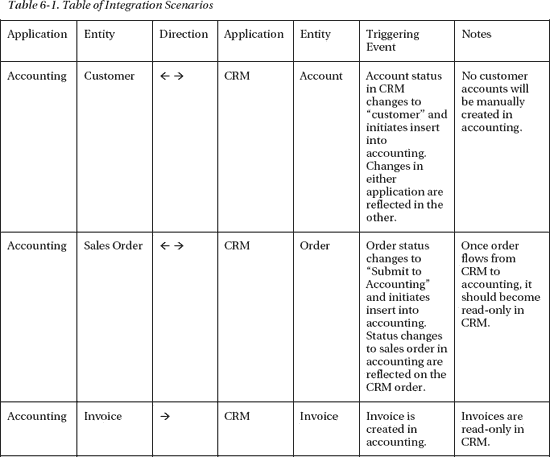

#### 映射数据

一旦您勾勒出集成场景，就必须为每个场景制定数据映射。这项工作与数据迁移所需的数据映射非常相似；您可以将集成视为一种持续的数据迁移。对于每个场景，您必须定义两个应用程序之间的字段如何映射，并且必须记录数据从一个系统传递到另一个系统时所需的任何转换（表 6-2）。

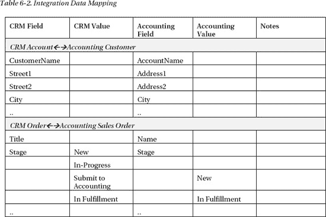

#### 开发集成

集成开发存在一些值得讨论的独特挑战；所有关于管理定制开发工作的技巧在此都适用。

集成开发的一个特定要求是，开发团队需要为集成涉及的每个应用程序准备一个测试实例。这可能涉及大量的设置工作，应在集成工作的预算和时间表中予以考虑。

### 集成测试

与 CRM 项目的其他组件一样，集成也应有文档化的测试计划。在集成中，让业务利益相关者和主题专家参与尤其重要。通常，需要那些熟悉与 CRM 集成的应用程序的专家来发现集成中的问题。

### 管理 CRM 项目中的用户界面集成

用户界面集成工作更接近于标准的定制开发工作，而非数据层面的集成。设计和开发用户界面集成时，会面临一些独特的挑战，值得讨论；所有关于管理定制开发工作的技巧在此均适用。对于用户层面和数据层面的集成而言，都必须解决的一个挑战是如何将数据从一个系统链接到另一个系统；这一主题将在下一节进行描述。

### 在系统间链接数据

开发集成的核心挑战之一，是如何将数据从一个应用程序链接到另一个应用程序。例如，对于 CRM 应用中代表琼斯公司的客户记录，集成程序如何才能在会计系统中找到代表同一组织的记录？需要存在某种`唯一链接`，用于告知集成程序：一个应用中的记录 #123 与另一个应用中的记录 #435 代表的是同一个现实世界实体。你可能已经猜到，仅凭名称是不够的；如果会计系统中的记录名为 Jones Corp 呢？

解决这一挑战的常用方法是将来自一个应用的唯一标识符，存储在另一个系统对应记录的字段中。几乎所有数据库应用中都存在的唯一标识符，其功能正如你想象的那样：它唯一标识一条记录，就像社会安全号码唯一标识一个美国公民。因此，如果琼斯公司在 CRM 中是记录 #123，在会计系统中是记录 #435，我们就可以修改这些系统，让它们互相跟踪对方的标识符，如图 6-8 所示。

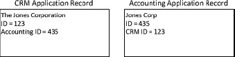

**图 6-8.** 管理唯一标识符

这种机制使得集成过程能够在应用之间正确地移动数据。如果要集成多个应用，更合理的做法或许是管理一个单独的唯一标识符表，而不是将这些信息直接存储在应用本身中。

从集成部署的这一刻起，集成过程将负责管理新创建记录的唯一标识符，具体方式可以是将标识符从一个系统填充到另一个系统，或者更新一个单独的标识符表。潜在的挑战出现在两个应用中`已有`的记录上。集成过程很可能需要能够将这些记录链接起来，例如，以便处理数据更新。因此，从一开始，要么两个应用中的所有记录都必须包含来自另一个应用的标识符，要么标识符表必须被完整填充。在许多情况下，组织已经以某种方式解决了这个问题，并确定了某种跨系统唯一标识记录的方法。如果你的组织尚未解决，那么你的集成计划、预算和时间表必须将完成这项工作所需的时间和精力考虑在内。通常，这项工作的大部分可以编程完成（例如，通过名称匹配和使用地址信息等方式），但这需要错误检查和异常处理，这可能是一个相当费力的手动过程。

## 报表

报表通常是 CRM 项目的核心要素。除了作为用户的生产力工具以及作为简化和自动化业务流程的机制外，CRM 应用带来的关键价值在于提供了做出更优商业决策所需的信息，而这类信息大多通过报表来获取。

报表相关的工作贯穿 CRM 项目的各个阶段：

- **构想阶段**：在此阶段，需确定项目的高层目标。在许多情况下，报表是一个或多个目标的核心。例如，“获取销售代表活动和绩效的客观衡量指标”或“按产品线了解支持成本”等目标，都表明报表将是解决方案的核心。
- **设计阶段**：在此阶段，需要定义所需报表的细节，以及为获取数据以生成报表而需要捕获信息的业务流程和应用配置。例如，如果某个销售报表需要按规模对商机进行分类，那么在销售流程中的哪个环节由谁捕获该信息？他们将在 CRM 应用中的何处以及以何种格式输入该信息？你不能脱离流程和应用设计来独立考虑报表设计。
- **构建阶段**：在此阶段，需使用适合报表类型的工具来开发报表。
- **部署阶段**：报表应包含在系统测试和用户验收测试中，以确保其准确无误并满足 CRM 利益相关者的需求。报表也应包含在培训内容中，培训不仅要涉及如何运行报表的具体操作，还应涵盖所显示数据的来源和含义。

### 什么是有效的报表？

识别合适的指标或关键绩效指标（KPI）并设计有效的报表本身就是一个主题，深入探讨该主题超出了本书的范围。在另一本书《Pro SQL Server 2008 Analytics：Delivering Sales and Marketing Dashboards》中，Brian Paulen 和 Jeff Finken 提供了关于如何识别和评估 KPI 的信息。在此，我们将提供一些在设计 CRM 报表时需要牢记的指导原则。首先，一个好的指标应能很好地适应你的组织，它需要考虑到你的目标、可用数据的质量，并且能够被你的团队轻松理解。这一定义在图 6-9 中得到了有效展示。

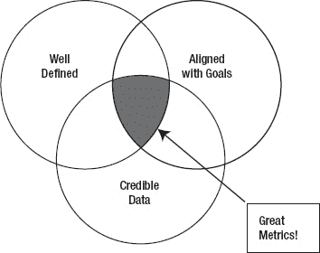

**图 6-9.** 什么是好的指标

以下是一组核心原则，任何组织都可以利用它们来验证一套基础 KPI，这些 KPI 可以作为全面销售和市场营销分析计划的核心业务指标。关于 KPI 的发展及其在组织战略中的作用的更深入信息，以下资源非常出色：David Paramenter 的《关键绩效指标》和 Paul Niven 的《平衡计分卡逐步实施指南》。要使 KPI 在推动业务绩效方面发挥作用，你需要有一个关于什么构成良好 KPI 的标准。此外，组织需要了解这个标准，以便能够积极参与到 KPI 的管理和持续完善中。以下是我们鼓励客户遵循的核心原则：

- 指标是具体的。
- 指标由特定部门或小组明确负责。
- 指标是可衡量的。
- 指标能够及时生成。
- 对于给定的记分卡，KPI 的数量必须限制在可控的少数几项。
- KPI 必须有目标值。
- KPI 必须与组织的总体目标保持一致。

让我们逐一详细审视这些原则。

### 关键绩效指标（KPI）定义原则

#### 指标需具体明确

具体明确是指指标拥有精确的定义，能够被轻松解释，并使组织内的任何理性人员都能理解。销售和市场指标中最常见的不符合具体性要求的例子是`预测收入`。这并不是说没有必要衡量`预测收入`，但该指标的定义必须完全清晰，并能在整个组织内得到充分理解。

对于许多与我们合作的客户，我们会询问什么是`预测收入`，得到的回答通常是：这显然是指与销售团队当前正在推进的未结交易相关的收入。这或许正确，但依然缺乏足够的具体性。

一个优秀且具体的`预测收入`指标定义可以如下所示：

> "CRM 中记录的所有已通过资格审核、预计在本季度内完成交易的有价值交易的加权值。所有交易的价值已根据当前汇率转换为美元。此计算可通过将预测价值求和，再乘以 CRM 中的成交概率字段来完成。"

这是一个良好的指标定义，因为它明确且详细，任何熟悉业务和关键业务系统的人都能清晰地理解该值在汇总层面呈现的含义。如果没有类似这样详细的定义，那么审阅这些 KPI 的管理会议很容易演变成对指标意图的质疑（它是否包含潜在客户还是仅包含后期阶段的交易？是否根据成交概率进行了加权？），而本应用于讨论公司总体方向的宝贵时间则浪费在理解这些数字上。

#### 指标需由特定部门或小组明确负责

责任归属能将指标从仅仅“有趣”转变为“可被采取行动”。关键在于，要使一个指标在推动组织前进方面发挥作用，必须有特定的个人或部门对其是否按计划推进负责。

知道产品销售的附加维护率可能很有趣，但如果没有明确的人对此附加率负责，它就不足以成为一项 KPI。通过坚持“指标必须有人明确负责，才值得花费时间衡量和展示”这一标准，你便执行了一项关键的筛选活动，有助于你将精力集中在少数真正驱动业务的关键指标上。

#### 指标需可衡量

所有打算在计分卡中展示的要素都必须能够量化。衡量员工满意度是一个很棒的概念，但如果没有相应的业务流程和系统来持续跟踪当前的满意度，它就不是一个相关的 KPI，因为你无法在不猜测的情况下使用该指标进行决策。

或许你会确定某个指标至关重要，这会促使你围绕它定义流程和系统，以便将其纳入计分卡。这可能是对时间和资源的极佳利用，但我们强烈建议，除非你具备了衡量的能力，否则不要将指标称为 KPI。这不仅包括捕获指标的系统，还包括确保一致性、审计追踪和监督的业务流程。

#### 指标需及时生成

在 KPI 管理中，另一个看似微小的细节是关注指标可被追踪的时间间隔。如果你的周度计分卡中有七个指标中的两个仅按月报告，那么这些指标的价值就值得怀疑。

我们意识到并非所有指标都遵循相同的周期，但我们强烈建议，为了确保你的 KPI 对决策有用，你必须能够按照固定的常规时间间隔重复生成每个指标，以便它能与其他关键绩效指标结合使用，从而全面了解组织的当前状况。

#### 特定计分卡的 KPI 数量必须控制在可管理的少数几个

我们的一位重要客户请我们审阅其管理报告。他们邀请我们过去，并自豪地向我们展示了一本每月生成的、厚达 50 页的手册，其中包含了该 200 人部门几乎所有运营的指标。他们解释说，问题在于这本手册汇编耗时过长（约 20 天），而且不幸的是，翻阅它的人并不多。

结论是，当前的报告需要更加自动化，并且需要大力推广这本新手册，以便人们知道应该查阅它来改进绩效。我们询问了该文档的负责人（总经理）是否经常参考它。他说：“不，信息量实在太大，我无法理解。我没有一整天的时间去弄清楚它所有含义。”

我们表示赞同，并建议让组织中的每个管理层级都拥有一份与其角色相关、并包含他们能控制和影响的指标的计分卡。每个此类计分卡应该展示五到十个关键指标，因为我们相信这大致是一个个体能够真正关注并产生影响的项目数量。

这种结构的关键在于，随着组织层级的上升，计分卡中的指标与组织战略直接对齐。许多组织认为衡量尽可能多的业务流程会带来更好的绩效，但我们的发现几乎相反。那些精心选择衡量内容，并有选择性地只追踪相对较少指标的组织，往往拥有最广泛采用且最持久的计分卡项目。

#### KPI 必须有目标值

KPI 容易出问题的一个方面在于，从战略会议上制定的理论化指标，过渡到日常实际的管理和追踪。KPI 成功的关键在于，能够有效地从制定 KPI 转向基于已确立的 KPI 来设定和管理目标值。

设定目标的关键点如下：

- 设计的目标指标需在一个由现有业务流程支撑的、可存储和访问量化结果的系统中被捕获。
- 达到或未达到目标，应在该计分卡所考核的部门/人员的可控范围内。
- 目标必须有清晰的时间限制，并与业务现实和组织战略保持一致。我们多次看到，良好的目标被设计拙劣的软件所破坏，这些软件要么未设定达成目标的时间线，要么将目标均匀地分摊到各个月份，而忽略了可能影响许多指标的季节性因素。

#### 关键绩效指标必须与整体组织目标保持一致

请认识到，只有在头脑中有一个明确的组织目标时（换句话说，如果你的目标是让组织每年增长 50% 并拓展至新地区，那么你的关键绩效指标将与你旨在维持 10% 增长并最大化利润时的指标截然不同），这些指标才能产生正向且长期的积极影响。制定关键绩效指标的团队必须非常谨慎地确保所选的前瞻性指标，能够真正引导组织走向其期望实现的目标。这句话乍看可能显而易见，但一个常见的失败案例是，负责开发关键绩效指标的团队过于沉迷于制定创造性指标的过程，以至于忽视了需要交付与组织达成目标明确关联的、简单明了的指标。

### 报表数据源

客户关系管理系统（CRM）报表通常针对事务性数据库（即客户关系管理应用程序实际使用的数据库）或专门用于报表的独立数据库（常被称为`数据仓库`）来执行。

针对事务性数据库生成报表是最简单的方法；无需移动任何数据，也无需维护单独的数据库。然而，这种方法有几个缺点：

- 时间序列数据有限或根本不存在：客户关系管理应用程序中数据随时间变化的信息具有潜在的业务价值。然而，针对事务性数据库生成报表只能提供执行报表时数据的一个快照。数据仓库可以随时间累积趋势数据，以回答包含时间维度的问题。例如，事务性数据库报表可以回答“我当前的销售管道有多大？”这个问题，但无法回答“过去六个月我的销售管道规模是如何变化的？”
- 整合额外数据源的能力有限或根本不存在：许多报表需要从包括客户关系管理系统在内的多个来源获取信息，以提供完整的图景。客户关系管理应用程序通常不支持为报表目的，将其他应用程序的数据导入其数据库。
- 性能影响：报表通常包含复杂的数据库查询，可能会给运行它们的系统带来压力。这可能会影响所有用户使用客户关系管理应用程序时的响应速度和性能。

针对独立数据仓库生成报表消除了这些问题，但会增加额外成本，并使客户关系管理项目更复杂。必须定义数据仓库的结构，然后创建常规任务，以便将来自事务性数据库的新数据或更新数据同步到数据仓库。针对数据仓库运行的报表从来都不是“实时”的，从某种意义上说，它们并不代表事务数据的当前状态，而只代表数据仓库上次同步时的状态。

选择使用事务性数据库还是数据仓库进行客户关系管理报表生成，与客户关系管理项目相关的大多数决策一样，是在业务价值、成本、风险与复杂性之间的一种权衡。

### 报表工具

客户关系管理领域有几种不同类型的报表工具，它们适用于不同目的并具有不同特性。你可能最终会组合使用多种工具来满足你的报表需求。

#### 呈现型报表工具

这类工具擅长开发相对静态的报表，这些报表定期运行，以处理一系列重复出现的业务问题，并呈现给决策者。它们通常能生成视觉上吸引人的报表，但灵活性有限（除非更改报表的编程），并且交互性有限或根本不存在。仪表板报表是这些报表中特定的、图形密集型版本。

通常，客户关系管理应用程序会包含一些基本的呈现型报表工具，作为应用程序的一部分，从事务性数据库中检索数据。

#### 数据分析工具

如果说呈现型报表工具旨在展示预定业务问题的答案，那么数据分析工具则旨在探索数据以发现趋势和诊断业务问题，而无需预先设定具体问题。这些工具显然不太强调最终结果的精美度，但包含的功能可以让分析师过滤和细分数据，尝试不同的可视化方案，并执行统计分析。

数据分析工具通常不由客户关系管理供应商提供，必须单独从商业智能软件供应商处采购。

### 报表设计

理想情况下，报表设计是一个涉及业务用户、业务分析师和报表开发人员的迭代协作过程。设计过程的核心是报表规格说明文档，它描述了报表的功能，充当流程的接触点，并确保所有人保持一致。

报表规格说明有多种风格和变体，但大多数都会涉及图 6-10 中的主题。

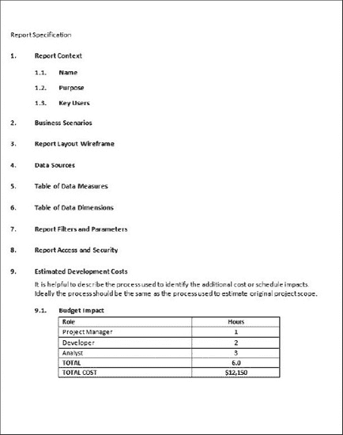

**图 6-10.** 示例报表规格说明

### 报表培训

鉴于客户关系管理项目预算紧张，很容易忽略报表方面的培训。这很可能是一个错误，原因如下：

- 即使报表技术简单直观，通常也需要对数据进行培训。用户需要理解数据的含义、来源以及在进入报表前的过滤方式。如果报表包含复杂的计算，这些也需要向用户阐明。这些信息对于用户建立对报表的信任至关重要，而信任是报表驱动决策所必需的。
- 报表用户通常是高级管理人员，他们对客户关系管理项目具有重大影响。他们的满意度和热情对项目的成功至关重要，因此值得投入培训精力，以确保他们获得积极的体验。
- 与呈现型报表和仪表板不同，数据分析工具是复杂的软件包，需要培训才能有效使用。你可以考虑将业务分析师送到你的分析工具供应商那里接受专门的应用程序培训。

### 数据迁移

数据迁移是指通过编程方式将数据从一个应用程序或系统复制到另一个。这是许多 CRM 项目的重要组成部分。假设一个组织正在实施新的 CRM 应用程序：一旦软件安装完成，该应用实际上就是空的。它不包含任何客户账户、联系人或潜在客户信息。这些信息需要用户根据需要手动输入，逐步填充 CRM 数据库，这是一个费力、低效且令人沮丧的过程。但通常情况下，现有应用程序中已拥有这些客户信息；它可能是一个即将被淘汰的旧版 CRM 应用。数据迁移工作会利用软件工具将这些信息从现有应用复制到新的 CRM 应用中，这样用户开始使用新 CRM 时，大部分数据就已经存在了。这使用户能够以最少的录入量开始高效工作，同时无需查阅已淘汰的旧应用即可访问客户和潜在客户的重要历史信息。

数据迁移并不仅限于新 CRM 的实施项目。例如，一个组织可能希望淘汰现有的独立客服应用，并将其以销售为核心的 CRM 应用扩展至包含服务功能。这个项目可能涉及将客户和服务历史信息从客服应用迁移到 CRM 应用中，以便服务用户能够轻松开始使用 CRM 来管理工作。

执行良好的数据迁移可能极具价值，它可以帮助用户顺利过渡到新应用程序，并节省无数小时的手动数据录入时间。在数据集庞大的情况下，数据迁移是填充新应用的唯一可行方式。然而，数据迁移通常困难、昂贵且不完美。在本节中，我们将提供指导，说明如何评估特定项目是否需要进行数据迁移，以及如果需要，如何规划和执行数据迁移工作。

#### 你的项目需要数据迁移吗？

鉴于数据迁移的难度和成本，明智的默认做法是不将其纳入项目，只有在经过仔细考量证明其价值后才添加。将数据纳入 CRM 的业务价值必须与迁移所付出的努力相匹配。评估以下因素以确定数据迁移是否合理：

*   相关数据是否以某种结构化格式存在？数据迁移可以从数据库、电子表格和其他结构化应用中完成，但对于电子邮件等非结构化数据通常不可行。
*   数据的复杂程度如何？数据中的多重关系、自由格式的备注和文件附件都会使迁移复杂化。
*   数据集的大小。对于小型、简单的数据集，让用户或临时工作人员手动将数据重新录入新应用程序，可能比执行编程式数据迁移更具成本效益。
*   项目完成后旧应用的可用性。如果源应用不会因迁移而被淘汰，或者项目完成后仍可使用，那么仅需用户偶尔查阅的数据可能无需迁移。
*   数据质量。如果数据质量非常差，从头开始可能比迁移后再清洗数据更省力。
*   数据的业务价值。将当前数据放入 CRM 应用的价值必须与迁移相关的成本进行权衡。

#### 评估数据源

每个考虑进行迁移的数据源（即应用程序或数据库）都必须从多个不同角度进行审视，既要用于决定是否迁移，也要能够设计和执行迁移。

##### 数据访问

首先要克服的障碍是数据访问；你的数据迁移工具必须以编程方式访问源应用程序的数据。通常有直接的解决方案：数据迁移工具会附带“连接器”，使其能够轻松连接到流行的源应用。或者，如果源应用将其数据存储在标准数据库（例如，`SQL Server`、`MySQL`、`Oracle`）中，大多数数据迁移工具可以毫无困难地访问它。对于使用晦涩或专有数据存储的数据源，通常可以通过应用程序内的某种导出工具来访问数据，该工具会将数据输出为标准格式，然后你的数据迁移工具可以读取该格式。如果是这种情况，务必要确保此导出功能包含应用程序用来将记录相互关联的唯一记录标识符（例如，联系记录与其父账户记录）。如果你的数据源使用专有数据存储格式且没有可用的导出功能，那么最好的办法可能是寻求应用供应商的帮助来访问数据。

##### 理解数据模式

一旦能够访问数据，真正的工作就开始了。你必须理解数据的结构，以便设计数据迁移过程来复制重要数据并保留不同类型数据之间的关系。有些应用程序附带文档（通常是其软件开发工具包（`SDK`）的一部分）来描述数据模式。如果你使用应用程序的数据导出功能，这项工作量会大大简化，因为你通常会一次导出一个业务实体的数据。如果没有，你就需要像侦探一样去解码应用的数据模式。你需要为每个业务实体（例如，账户、销售机会）确定数据存储在哪些列和表中，以及不同业务实体之间的关系是如何管理的。应用程序的用户可以通过向你展示如何浏览应用界面并指出哪些数据是重要的且必须迁移来提供帮助，但他们通常并不熟悉应用的数据模式。为每种类型选择几条记录，并交替通过应用界面和直接查看数据本身来查看这些记录，通常能让你足够了解数据模式，从而完成迁移。

##### 数据质量

几类数据质量问题会显著增加数据迁移的难度。其中最常见的问题或许是不一致的应用程序使用方式；这表现为不同用户使用相同的应用程序字段存储不同的信息，或者不同用户对应用程序术语的解释存在差异（例如，一位用户将某个潜在客户评为“合格”，而另一位用户则将同一潜在客户评为“不合格”），还包括简单的间歇性使用情况（例如，只有少数用户会费心输入其潜在客户的邮寄地址）。其他问题虽然直截了当，但可能需要投入大量精力。例如，对于自由文本的国家/地区字段，有些用户输入了“United States”，有些输入了“USA”，还有些输入了“U.S.A.”或“US”，数据迁移过程必须处理所有这些变体。抽查记录、用户访谈和数据库查询有助于评估源系统中数据的质量，从而确定将其迁移到 CRM 应用程序的价值。

同样重要的是要注意，即使在单个应用程序内部，数据质量也可能存在差异。例如，客户信息可能得到严格维护和更新，而潜在客户信息仅由少数用户使用，这些用户的数据录入习惯随意且缺乏标准化。

如有可能，最好优先独立于数据迁移来解决质量问题。俗语“垃圾进，垃圾出”常被用来描述这样一个事实：如果输入迁移过程的数据质量很差，那么您的 CRM 应用程序就会充满低质量的数据。数据迁移并不能解决数据质量问题。

#### 设计数据迁移

设计数据迁移包含两个部分。第一部分是*功能*设计，它描述了将迁移哪些类型的数据（按业务实体划分，例如“客户”、“联系人”、“服务工单”）、每种类型将迁移哪些记录（全部、最近六个月、还是仅活跃记录？），以及对于每种类型，数据将如何映射到 CRM 应用程序。*技术*设计则描述了迁移将如何完成，其结构将由所选迁移工具决定。技术设计不在本书的讨论范围之内；在本节中，我们将重点关注功能迁移设计。

每个将参与数据迁移的源应用程序都需要其自身的功能和技术设计。

数据迁移设计，如同应用程序设计（本章前面所述），是一个耗时耗力的过程，需要了解源应用程序及其使用方式的项目团队成员，以及最终确定的 CRM 应用程序设计的共同参与。

##### 功能设计：迁移哪些数据？

熟悉源应用程序的项目干系人和主题专家应该能够就应用程序管理的重要业务数据以及为达成项目目标必须导入 CRM 的数据提供指导。对于这个问题，你可能会听到一个敷衍了事的答案：“当然是全部数据。” 事实上，添加到迁移中的每个业务实体都会增加成本和复杂性，而且应用程序中的所有数据都能提供足够价值而值得纳入迁移过程的情况非常罕见。

##### 功能设计：每种类型迁移哪些记录？

待迁移的数据量会影响数据迁移过程的成本和复杂性。它会显著增加开发、测试和执行迁移所需的时间。对于被确定为迁移组成部分的每种数据类型，都要考虑是需要迁移整个数据集，还是只迁移最有价值的一个子集。以从一个 CRM 应用程序迁移到另一个为例，你可能会问自己：“我需要保留五年前与客户的通话记录吗？” 或者“超过两年未更新的潜在客户真的还有价值吗？”

##### 功能设计：映射

一旦确定了要迁移的数据类型以及每种类型内的记录，下一步就是记录数据的映射方式。这种映射在三个级别上进行，如下所述。

###### 实体映射

实体映射是最高级别的映射，在此级别，根据源应用程序每个数据类型的业务意图及其提供的功能，将其映射到相应的 CRM 业务实体。通常这种映射是直接且直观的，但也可能存在需要更多考虑的映射。例如，也许源系统有一个名为“销售拜访”的实体，而目标系统有“会议”和“电话”这两个实体。必须决定将“销售拜访”记录映射到哪里。也许这些记录中的大多数代表面对面的会议，在这种情况下，可能会决定将它们映射到“会议”。又或者，“销售拜访”中有一个标志位，用于指示该拜访是面对面还是通过电话进行的，并利用此信息来决定每一个“销售拜访”是创建“会议”还是“电话”。

实体映射的结果可以用诸如表 6-3 所示的简单表格记录下来。

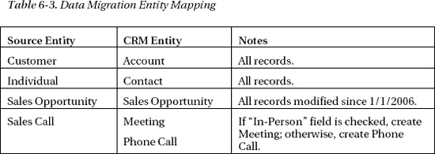

###### 字段映射

实体映射完成后，就可以进行字段级映射。此工作包括：对于要从源应用程序迁移的每个实体，确定要迁移的每个数据字段以及应将数据插入到哪个 CRM 字段中。理想情况下，这些映射很简单；只需从源应用程序的`ABC`字段取值，然后插入到 CRM 应用程序的`XYZ`字段即可。但是，随着源应用程序中数据质量的下降，字段映射的复杂性开始显现。考虑这样一种情况：源应用程序中的某些用户将某部分数据放在`ABC`字段中，而其他用户则将相同数据放在`DEF`字段中。此时，不再是简单的字段到字段映射，而是需要加入一些逻辑，例如“先在`ABC`字段中查找；如果为空，则在`DEF`字段中查找，然后将得到的信息复制到 CRM 应用程序的`XYZ`字段。” 那么，如果源中的一条记录在`ABC`字段*和*`DEF`字段*同时*有数据，你又如何决定如何处理呢？理想情况下，你开始理解为什么数据迁移会是一项如此困难、不精确且成本高昂的工作了。记录所有权映射是数据迁移的另一个复杂元素。旧应用程序中属于前雇员的记录，在新应用程序中应如何分配？是应该为新应用程序中的前雇员创建用户记录以尝试保留记录历史，还是在迁移过程中将所有此类记录重新分配给当前员工？

字段映射可以通过扩展表 6-4 来记录。

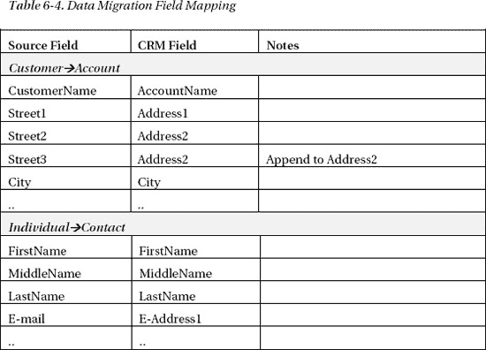

###### 值映射

映射工作的最后一级是值级别。在此，我们需要针对字段映射表中的每一行，确定在将数据复制到 CRM 应用程序之前，需要对源应用程序中的数据进行的任何转换。这些“转换”的一些示例如下。

####### 选择列表映射

在映射到 CRM 应用程序中的选择列表字段时，几乎总是需要这种转换。选择列表字段，也称为下拉列表框或简称为列表框，是一种用户输入信息时可以从有限选项集中选择单个值的字段类型。需要进行转换的原因有两个。首先，要映射的字段内容可能不完全包含相同的值。例如，考虑销售机会记录中用于跟踪机会销售阶段的字段。在作为源系统的旧 CRM 应用程序中，可用选项为“新建”、“进行中”、“合同阶段”、“已赢单”和“已丢单”。然而，新 CRM 应用程序采用了一种新的销售方法论，其阶段包括“新建”、“资格确认”、“方案制定”、“谈判”、“已赢单”和“已丢单”。为了将销售机会从源应用程序复制到新 CRM 应用程序，我们必须定义如何将源应用程序中的销售阶段值转换为 CRM 应用程序中的对应值。此定义需要熟悉源应用程序及其数据以及新 CRM 应用程序设计的项目团队提供输入。这些映射可以通过扩展表 6-5 的格式以纳入字段值来进行记录。

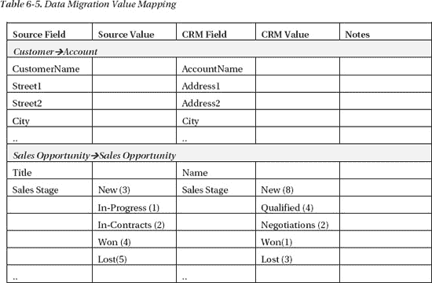

即使源应用程序与新 CRM 应用程序之间的某个字段值完全一致，也可能需要进行值映射。应用程序通常不会存储我们在列表框中看到的实际文本，而是存储数字代码。因此，例如，应用程序不会在数据库中为机会的销售阶段存储单词*New*，而是存储“3”，这是与单词*New*关联的数字。然而，CRM 应用程序可能为“新建”设置了不同的数字代码，比如“8”。因此，即使两个应用程序中下拉列表的文本选项相同，当我们将销售阶段值从源应用程序复制到 CRM 应用程序时，也必须将“3”改为“8”。

##### 数据查找

某些字段需要通过数据查找才能将源应用程序映射到 CRM。以销售机会中的“销售代表”字段为例。该字段的值表示负责此机会的销售人员。此字段通常链接到源应用程序中一个单独用户表中的相应记录。迁移过程必须从源应用程序的销售机会表中获取该值，使用此值在用户表中查找销售人员，然后在 CRM 中找到该人员对应的用户值，并将其填写到 CRM 中的相应字段。

##### 数据解析

不同的应用程序以不同方式处理相同的信息；这可能导致在数据迁移过程中需要解析数据。例如，假设源应用程序将个人姓名存储在一个名为“姓名”的单一字段中，而您的 CRM 应用程序则为姓名各组成部分分别设置字段（例如，“名字”、“中间名”和“姓氏”）。数据迁移过程必须以某种方式将源数据拆分为各个部分，并将正确的部分传递给 CRM 中正确的字段。

这是一个数据迁移可能变得混乱且不精确的例子。虽然拆分姓名的算法（如上一个示例中所需）表现良好，但并非完美，当遇到“Dr. Sally Brown”或“William Van Winkle”时可能会出错。“Van”是中间名还是姓氏的一部分？

#### 数据迁移设计确认

一旦数据迁移设计完成并记录在案，由团队进行正式确认至关重要。这是一个责任节点，团队应理解他们是在确认已审阅并考虑了该设计，并认为其符合业务需求。数据迁移设计是一项注重细节的任务，需要耐心。在此投入的时间是值得的，因为一旦流程构建完成后再更改设计，可能会导致大量的返工和成本。

### 数据迁移工具

数据迁移可以通过多种技术工具实现；深入探讨这些工具超出了本书的范围。在本节中，我们将概述两种主要方法，以及每种方法的一些优缺点。

### 专用应用程序数据迁移工具

目前有许多专门用于帮助企业将数据迁入和迁出企业应用程序（如 CRM）的产品。这些产品具有一系列引人注目的优势，使其在大多数情况下成为最佳选择：

*   迁移通过用户界面设计和执行；无需编程经验。
*   针对流行应用程序的预构建连接器，若您的应用程序有可用连接器，可快速轻松地设置基本迁移。
*   拥有丰富的函数集，可轻松在数据迁移过程中执行数据转换。

这些应用程序通常可以按永久许可（用于持续的应用集成，需要类似数据集成工具）或临时许可（用于一次性数据迁移）获取。通常，通过使用现成的数据迁移工具所节省的开发人员或顾问时间，远超过其许可成本。

### 自定义数据迁移工具

另一种数据迁移方法是构建自己的迁移应用程序，可以从头开始构建，也可以使用 Microsoft SQL Server Integration Services 等平台技术。如果您具备可用的开发专业知识，这种方法能提供最大灵活性，并且在数据来源不常见或有特殊性能要求的特殊情况下，可能是唯一可行的方法。

然而，该方法比使用现成的数据迁移工具劳动密集得多。您的开发人员需要熟悉源应用程序的数据模式或接口（以了解如何读取数据），以及 CRM 应用程序的接口（以成功将数据从源应用程序写入）。现成产品中内置的所有逻辑，如错误处理、日志记录、转换函数，可能需要从头编写。

### 测试数据迁移：模拟迁移

在数据迁移开发过程中，你的团队可能会在测试环境中运行多次小规模迁移，以完善迁移流程并发现问题。然而，至关重要的是，至少应使用要迁移的完整数据集执行一次迁移。这种“模拟迁移”可作为对迁移流程的测试、对迁移性能和时长的评估，以及最终数据迁移的一次预演。

模拟迁移的一些重要要素如下：

- 应使用完整数据集，并在将用于运行生产迁移的同一硬件上执行。此项演练的部分目的是了解数据迁移的时长；对于大型数据集，迁移过程可能需要数小时甚至数天。
- 项目团队的跨部门成员应参与测试和验证迁移结果。熟悉源应用程序及其数据的用户最有可能发现问题。
- 模拟数据迁移流程应事先完全编写为脚本，并对每个操作保留带时间戳的日志。模拟迁移与实际数据迁移之间可能相隔数周或数月；除非将每个步骤都纳入生产迁移的脚本，否则你不会记住模拟迁移中所执行的所有步骤。

验证数据迁移流程有几种常见方法：

- **查看数据迁移工具的错误日志**：这是一个很好的起点；大多数工具会记录失败的事务，从而能突出数据迁移流程中的问题。
- **查询测试**：此类测试涉及对源应用程序和 CRM 同时运行查询，以识别迁移问题。例如，如果源应用程序包含 50,000 个账户记录，那么在 CRM 中是否也创建了 50,000 个账户？如果没有，哪些记录未被创建以及原因是什么？查询也可用于测试迁移逻辑的特定部分。例如，查询可以提供源应用程序和 CRM 中按销售阶段划分的销售机会数量，从而让你验证映射逻辑是否正确应用。
- **抽查测试**：这涉及识别源应用程序中的一些记录，并逐字段地在 CRM 中对照检查，以验证所有数据均已正确转换，并且源应用程序中记录之间的关系已在 CRM 中忠实重建。在这三种测试形式中，这是唯一一种可以切实分派给项目团队成员的测试。

在让项目团队参与测试时，要提醒人们在描述问题时做到`具体`。理想情况下，应提供未正确迁移的具体记录和字段。像“CRM 中的数据看起来不对劲”这样笼统的评论是没有帮助的。

在模拟迁移测试结束后，你需要就数据迁移流程做出“是否继续”的决定。如果测试中发现的问题较小，且能够轻松修正并重新测试，那么你很可能已准备好继续进行。如果测试迁移发现了重大问题，你可能需要调整项目计划，在问题解决后安排第二次模拟迁移。

### 规划实际数据迁移

实际的生产数据迁移（用于填充新的 CRM 应用程序）通常在晚上或周末进行，以尽量减少对用户的影响。理想情况下，用户在周五下午 5 点之前继续使用旧应用程序工作，等到周一早上上班时，他们开始使用新的 CRM 应用程序，并发现所有数据都已迁移完成；这样他们就能专注于熟悉新应用程序，而不是录入数据。

在这种“理想”的数据迁移模型中，周五下午 5 点成为旧应用程序的“截止时间”。如果可能，此时整个应用程序应切换为“只读”模式，并准备一份用于迁移的数据提取。迁移过程将使用与模拟迁移相同的程序来执行。随后进行查询测试和抽查测试，以确保过程成功。

正如你可能想象到的，许多（即便不是大多数）CRM 数据迁移并不遵循这种简单模式。你自己的迁移细节将决定你自己的时间表和流程。

#### 数据迁移时间表

除了作为数据迁移流程的最终测试并提供“是否继续”决策的机会外，模拟迁移还能让你极其重要地了解迁移过程的持续时间。

理想情况下，迁移过程的持续时间应能适配标准的非工作时间窗口，例如一个晚上或一个周末。如果不行，理想情况下组织能接受一定程度的停机，以便有足够的时间窗口来执行迁移。如果停机不是一个可接受的选项，通常可以将数据迁移分段进行，以消除停机时间，同时仍能让用户保持工作效率。例如，对于实际数据迁移，与其一次性迁移所有五年的客户活动数据（这可能需要四天处理时间并需要停机），不如只迁移最近一年的数据，然后在每个连续的非工作窗口中逐步迁移更旧的数据，直到所有数据迁移完毕。

#### 脚本

规划数据迁移的一部分工作是制定详细的脚本，即一系列需要按精确顺序执行的任务，以成功完成迁移。该脚本在数据迁移流程的技术开发过程中创建并完善，并通过模拟迁移进行验证。要使模拟迁移具有任何价值，实际数据迁移必须使用`相同的脚本`以`相同的方式`来执行。

### 数据迁移总结与关键经验教训

以下是关键经验教训：

- 数据迁移是大多数 CRM 项目的重要组成部分，可能极具价值，但除非有足够的业务价值证明其必要性，否则不应贸然进行。它可能困难、昂贵且不精确。
- 你或许听过一句关于数据迁移的常见表述：“垃圾进，垃圾出。”数据迁移并不能神奇地清理、标准化和去重数据；如果你的源应用程序存在质量问题，数据迁移只会将这些问题转移到你的 CRM 应用程序中。
- 不要将数据迁移测试外包给你的咨询伙伴；他们不掌握数据和源应用程序的背景与理解，难以轻松识别问题并察觉“看起来不对劲”的情况。确保你的团队参与其中。

## 实施测试

对于任何企业应用而言，测试都是初始实施项目及所有未来开发项目的重要组成部分。像 CRM 这类企业应用中出现重大应用错误或停机，可能会严重阻碍业务运营，造成巨大的负面影响；而轻微的应用错误对于用户来说，则是持续产生挫败感、摩擦以及对工作不满的根源。一个因重大错误而受损的新应用上线，可能会给该应用留下污点，在问题解决后的数周乃至数月内，都会妨碍应用的采用率，并降低您期望实现的价值。

虽然您可能会与咨询合作伙伴合作，进行 CRM 应用的初始实施以及后续的增强项目，但测试是一个无法完全外包的工作领域。您的咨询团队能够熟练地执行单元测试、系统测试、集成测试和性能测试，但他们无法主导用户验收测试。在这个领域，您的团队对业务、数据和流程的了解至关重要。由 CRM 各个利益相关方群体的代表积极参与的、稳健的用户验收测试，是 CRM 项目成功的关键要素。

## CRM 应用测试的类型

在本节中，我们将重点介绍 CRM 项目中可能需要的不同类型的测试、它们的目的以及如何将它们整合到您的项目中。

### 单元测试

这是在开发过程中，开发人员对新增或增强的应用功能进行的初步测试，在进行此功能标记为完成之前进行。这是应用开发人员的核心职责，应作为过程的自然组成部分纳入所有 CRM 开发中。此测试应探索该功能的每一个可能的逻辑分支，以确保其按设计中的规范运行。此测试在隔离环境中进行，不测试不同功能之间的相互作用。

### 系统测试

当所有 CRM 应用功能的开发完成并部署到测试环境中后，系统测试可确保它们能够相互融合，并且在存在完整功能集的情况下仍能正常运行。通常，单个功能可能会以单个功能开发人员未预见的方式相互影响，因此一起测试完整的功能集至关重要。系统测试通常在 CRM 项目生命周期的构建阶段结束时执行，此时所有功能都已开发完成并经过单元测试。

### 集成测试

在许多组织中，CRM 应用会与其他业务应用（如会计或供应系统）进行集成。集成测试旨在验证应用之间的连接是否正常运行，数据是否从一个应用流向另一个应用，以及（如果需要）是否被正确转换。

### 性能测试

对于使用最简定制开发的 CRM 应用部署来说，性能测试不太重要，但对于那些具有大量定制开发的应用则至关重要。大数据集和大量用户可能会对 CRM 应用的性能产生意想不到的不利影响，导致响应速度缓慢、超时错误和用户沮丧。地理上分散的用户群也可能引发 CRM 应用的性能问题，因为国家间的网络连接可能很差，从而影响 CRM 客户端和服务器之间的通信。如果您的项目包含大量定制开发，并且存在一个或多个加剧因素（如数据量、高用户数或地理分布），请确保您的项目团队已将性能测试纳入其项目计划中。

将重点放在定制开发的性能测试上，是因为主要 CRM 应用供应商所使用的测试用例很可能既包含大数据集也包含大量并发用户（假设您使用的是针对您组织规模设计的应用）。在合适硬件上运行的标准应用，很可能已经过测试，并在比您自身更严格的场景下通过了测试。另一方面，定制开发从未经过测试，而且开发人员有多种方式编写在高负载下会失败的代码。

### 用户验收测试 (UAT)

用户验收测试是 CRM 项目生命周期中一个关键的验证步骤。在用户验收测试之前，所有 CRM 组件都已通过单元测试和系统测试，并且所有数据都已迁移。此时，测试环境本质上与上线后的生产环境相同。用户验收测试涉及执行 CRM 应用将要支持的关键业务场景，以验证以下几点：

- 在已批准的应用设计文档中描述的所有功能均能按设计团队的意图运行。
- 设计和开发完成的应用满足项目目标，并已准备好上线。

用户验收测试的一个独特之处在于，它由应用用户自己执行：可能是销售经理，或客户服务代表。在此之前的所有测试主要由技术团队进行。用户测试的另一个独特之处在于其全面性；应用功能、迁移的数据、集成以及其他应用领域都在用户测试中一并得到检查。

## 制定测试计划

完善的测试计划会探索并验证应用的所有逻辑分支以及所有重要的业务场景。测试计划应编写得足够详细，以便多人能够可靠且一致地执行。

### 系统测试计划

系统测试计划由测试用例组成；每个测试用例包括以下要素，通常以表格结构排列并按功能领域分组：

- `ID` 是每个测试用例的唯一标识符。
- `行动` 描述了测试人员在应用内应执行的确切步骤。
- `预期结果` 描述了行动应产生的结果，以便测试人员评估应用是否通过或未通过该测试用例。
- `通过/失败` 指示应用结果是否与预期结果匹配。
- `实际结果` 对于失败的测试，描述了应用表现出的行为。
- `测试日期/时间` 是执行测试用例的日期和时间。
- `测试人员` 是执行测试用例的个人。
- `环境` 描述了用于测试的环境的技术细节，例如哪个测试环境、哪个测试客户端机器等。
- `备注` 是关于测试用例的额外描述性注释。

图 6-11 和 6-12 显示了一个示例系统测试计划，分别是测试前和测试后的状态。

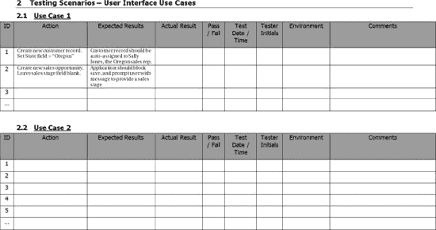

**图 6-11.** 示例系统测试计划（测试前）

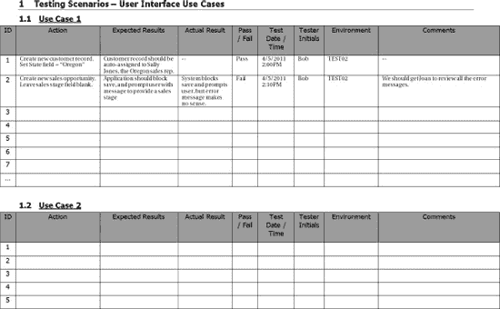

**图 6-12.** 示例系统测试计划（测试后）

### 用户验收测试计划

用户验收测试计划在格式上不同于系统测试计划，以体现此类测试的不同视角和目标。用户验收测试的真正目的并非“找漏洞”，而是验证经过配置的 CRM 应用能否支持业务流程并达成应用目标。在 CRM 应用设计阶段提供关键输入的业务用户，可能因缺乏应用经验而无法预见到最终应用将如何工作；用户验收测试让他们能够验证应用“可用”并能优雅地支持用户完成工作。基于这一重点，用户验收测试计划围绕关键业务场景构建，例如图 6-13 和图 6-14 中所示的场景。你可能会发现，组织用户验收测试的过程既是培训也是测试，因为用户通常需要一定程度的培训才能有效测试和评估应用的就绪程度。

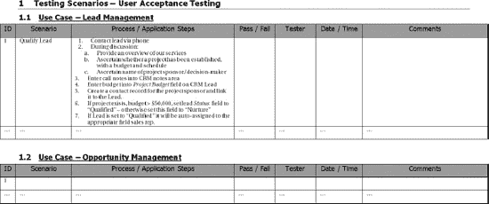

**图 6-13.** 用户验收测试计划（测试前）

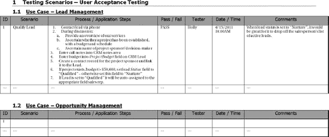

**图 6-14.** 用户验收测试计划（测试后）

## 实施培训

培训在 CRM 项目中常常被置于次要地位，但对于项目的成功至关重要。每次您的 CRM 项目发生变化，无论是流程变更还是应用升级，都必须考虑培训。培训有助于确保团队正确执行业务流程，一致地使用 CRM 应用，从而最大化生产力。即使没有任何变更，培训仍然是 CRM 项目中持续存在的重要环节，因为您仍然需要培训新员工和岗位调动人员。

### 培训目标

培训的明显目标是确保组织内的人员理解其工作中需要执行或支持的面向客户流程，并能自信地在这些流程的上下文中使用 CRM 应用。新流程和应用可能令人困惑和畏惧，因此正式培训项目极具价值——通过引导用户学习新内容并提供提问和讨论例外案例的机会，这比让用户自行摸索或依赖非正式的“在职培训”更成功。

培训的另一个重要目标是促进 CRM 流程和 CRM 应用的一致应用。流程和应用在使用一致时价值更高，这需要让每个人都达成共识。正式培训是实现这一目标的绝佳途径。

### 成功培训计划的要素

与 CRM 项目的大多数要素一样，培训的成功始于周全的计划。在本节中，我们将描述有效培训计划的几个要素。

#### 兼顾流程与应用

CRM 培训的一个常见缺点是，有时会完全聚焦于 CRM 应用。组织认为应用是新的/不同的/令人畏惧的，因此培训内容侧重于登录应用、搜索客户信息、录入不同类型的交互（`订单`、`商机`）以及执行报表等主题。

这种以应用为中心的不足在用户开始实际使用应用时会变得明显，导致疑问、困惑和不一致的使用方式。用户会提出诸如“我知道`如何`将新线索转化为合格商机，但`何时`应该这样做？”或“我如何判断一个服务案例是否应标记为`紧急`？”之类的问题。这些问题表明用户对与应用程序相关的流程和术语缺乏清晰理解，而非对其使用操作的困惑。

最佳的培训会逐步引导用户了解其工作职能需要支持的流程，并在每个步骤中演示需要在 CRM 应用中采取哪些操作。还应讨论常见的例外情况及其处理方法。

#### 定义术语

对术语的混淆及其导致的 CRM 应用使用不一致或错误，是 CRM 项目中的常见问题。请确保在培训内容中明确界定应用中使用的任何术语，并在 CRM 应用设计中努力避免在不同语境下使用不同的术语。您可能还希望在培训材料中包含此信息，以便用户在日后遇到问题时可以查阅。

#### 多次培训接触

反复接触培训材料有助于人们“巩固”理解。不要依赖单独的一次培训课程作为培训计划的全部。理想情况下，应将内容分散到几次课程中，以避免长时间课程导致注意力下降，并提供重复关键要素的机会。确保在主要培训之后，定期安排非正式的跟进培训或问答环节。

#### 为受众定制培训

如果呈现的内容与学员自身的工作职能相关，他们的参与度会最高。与其提供通用培训或包含仅适用于部分培训受众的特定角色内容，不如举办多次针对特定角色的培训课程。可以在通用课程中涵盖某些主题，然后让学员按角色分组进行更具体的课程。

#### 包含练习和示例

动手练习有助于发现培训参与者的疑问和困惑点，增强他们对应用的熟悉度，从而提升信心，并打破培训课程的单调感。虽然从培训基础设施的角度来看，设置动手练习（必须在培训场地提供运行 CRM 应用的机器）稍显复杂，但根据我们的经验，这种投入是值得的，因为它能显著提升培训质量。常见情况的示例，特别是针对例外案例的示例，也是对培训内容的有益补充。

#### 高管参与

对于新启动的 CRM 项目，培训将是大多数人接触该项目和 CRM 应用的第一步。根据我们的经验，由项目的执行发起人介绍培训，向参与者说明组织为何启动 CRM 项目、由此应实现的收益以及培训参与者需要做出哪些努力才能使项目成功，这非常有帮助。正如我们在本书其他部分所讨论的，组织领导层持续公开支持 CRM 对于成功推动应用至关重要。培训是实现这一目标的绝佳机会。

#### 不要忘记帮助资源

确保您的培训告知参与者在培训结束后可获得的不同支持选项。这可能包括用于提问的邮件列表、专家用户的“办公时间”，或内网网站上的帮助和培训内容。

### 培训方法

接下来，我们将描述我们所见过的两种最常见的 CRM 项目培训方法：现场课堂培训和网络研讨会式培训。还有其他方法，例如在线自学课程，但这两种是我们常见且最经济有效的方法。

#### 课堂培训

这是经典的、由讲师现场指导的培训形式。我们发现这是最有效的培训方式。理想情况下，内容应融合讲座、演示、应用展示以及学员的动手练习。小组人数应控制在 15 人以内，以确保培训具有互动性，并且讲师在必要时能够给予每位学员个别关注。每次培训时长不应超过四小时，并安排充足的休息时间。

动手练习通常意味着培训参与者需在培训期间使用自带的笔记本电脑或培训室提供的电脑。这些练习应严格管控，仅限练习时间内使用电脑，以帮助参与者专注于培训内容，避免他们沉溺于查看邮件或其他工作。

对于地域分散的组织来说，组织线下课堂培训可能既困难又昂贵。我们观察到，有些组织通过将培训与预先计划好的活动（如全国销售会议）相结合来成功实施培训，届时所有受影响的员工本就需要集中开会。

## 网络培训

与线下课堂培训相比，网络培训更易于组织，成本也更低（无差旅费用）。它还可以轻松录制以供重复使用。然而，它也存在一些缺点。讲师与学员之间的互动更加困难。学员经常在培训期间“走神”，处理副业或补看邮件。讲师无法观察学员的面部表情或肢体语言，可能在不知不觉中“失去”听众。动手练习的后勤工作可能更复杂，因为软件可能需要安装在远程用户的个人电脑上，而不是培训室里的一批机器上。

### 培训资料

一套精心设计的培训资料能让你的培训课程更高效，并为参与者提供可参考的帮助材料，帮助他们适应新流程以及新版或增强型 CRM 应用。

#### 指南

培训指南应根据角色定制，并组织成逐步引导读者完成每个业务流程的结构，同时引用 CRM 应用中对应的操作步骤。截图是一个重要元素，能使应用操作指南更易于理解。培训指南还应包含某种形式的“组织术语表”，或以某种方式定义员工可能遇到的所有术语。

培训指南也必须保持更新；每当流程发生变化或 CRM 应用得到增强时，指南中受影响的文字和截图也应同步更新。

尽管通常以简单的文档形式准备，但将培训指南内容通过协作工具（如 `Wiki`）在线提供给用户也有其优势。这使用户能够轻松搜索指南、添加评论，甚至可以用额外信息更新指南。

图 6-15 展示了一份简单的、以销售为重点的培训指南的示例目录。

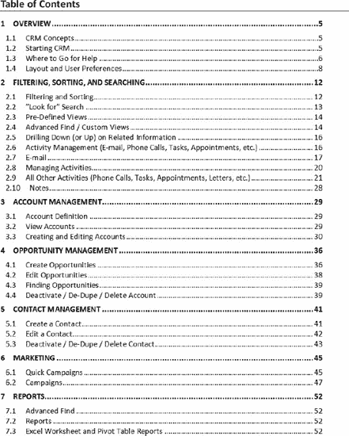

**图 6-15.** 培训指南示例目录

除了更标准的培训指南，许多组织发现关注常见问题也很有价值。我们历来使用快速参考指南作为提供此类信息的工具。如果该工具可打印，并最好能过塑，以便用户贴在办公室或放在电脑包里携带，那将会很有帮助。虽然你的指南会因你选择实施的应用而有所不同，但图 6-16 是快速参考指南可能的样子示例。

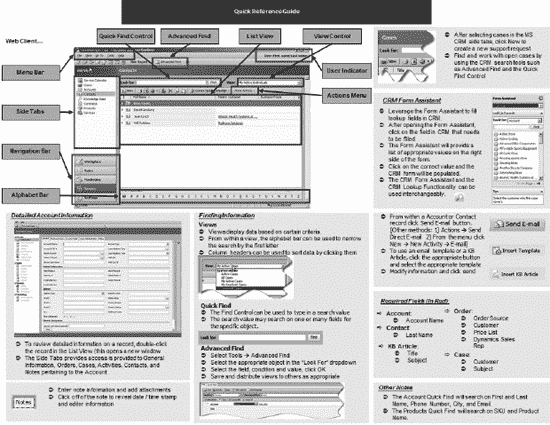

**图 6-16.** 快速参考培训指南示例

#### 录制的演示视频

录制的演示视频展示应用界面，同时演示者执行特定任务并配以语音解说。制作这些视频很简单，不需要昂贵的设备或软件。可以录制常见场景（例如，“创建服务工单”或“向订单添加产品”），并将其发布在内网网站或培训 Wiki 上，供应用用户观看。

#### CRM 团队会议

在启动 CRM 项目时，安排定期的 CRM 团队会议会很有帮助。这些会议可用于非正式培训，让员工描述他们在 CRM 项目中遇到的问题、困难或挫折。这是一个很好的方式，可以保持对员工在 CRM 方面动态的把握，并了解如何增强流程和应用以提供更好的体验。它也为员工提供了一个互相解答 CRM 问题的场所，这有助于巩固对应用的共同拥有感，从而促进用户采纳。

### 持续培训

培训是 CRM 项目持续不断的一部分。尽管与改变流程或增强 CRM 应用相关的项目会带来培训活动的高峰，但必须为现有员工制定定期的培训计划，以巩固他们使用不一致或不正确的领域，并让用户了解 CRM 应用中可能提高其生产力的新功能。此外，组织内会出现人员流动，新员工和岗位变动的员工也需要培训。

新员工培训通常由各职能区域内指定的培训师负责。应挑选那些深刻理解本部门流程、认识到 CRM 对团队和组织的价值，并具备有效沟通和培训软技能的人员。CRM 管理团队最适合牵头对用户进行关于新的或未使用过的 CRM 应用功能的定期培训。

## 启动解决方案

一旦你完成了所有必要的培训活动，就应该开始专注于首次功能阶段的部署。在此过程中，你的团队和组织都应预见到会经历一些阵痛。无论用户过去使用什么，新的应用很可能都会给他们带来巨大的变化。为这些阵痛做好准备，更重要的是，协助你的用户完成过渡过程，将使你和你的团队能够成功推动项目至完成。

### 切换上线

切换上线（或正式启用）的过程根据实施的类型和复杂程度而有很大差异。围绕切换上线，最需要关注的是规划和沟通。清楚了解谁在做什么、何时做，将意味着整个过程更顺利。应用正式上线可能压力巨大，时间紧迫且任务繁多。

虽然我们在第 7 章也提供了类似的示例，但图 6-17 中的模板将允许你跟踪上线任务、负责人以及任务需要完成的时间。虽然你未必总能准点完成，但以这种方式规划所有任务能让你看到全局。

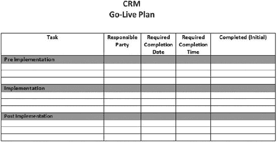

**图 6-17.** CRM 上线计划示例

根据你是否需要从其他应用迁移，你可能需要在周末内完成各种上线活动。这样你可以在此过程中开展工作，同时尽可能减少对用户群体的干扰。

接下来，我们将重点介绍作为上线过程一部分的几个关键组成部分。

#### 最终数据迁移

正如我们在本章前面所讨论的，最好在非工作时间进行上线数据迁移。这不仅最大限度地减少了对用户的干扰，还会使数据迁移及其准确性测试的过程更加容易。概括来说，此流程包括清除测试数据迁移期间完成的所有工作、执行生产环境迁移、监控迁移完成情况，以及在迁移完成后验证数据。考虑让用户参与数据验证过程，以确保他们对数据的有效性有切身利害关系。

正如我们刚才提到的，在周末完成此流程是更可取的方法。如果你无法利用周末时间完成这项工作，则需要在你的计划中安排时间执行初始迁移、验证数据，然后完成一个包含初始迁移与期间完成的工作之间数据差异的迁移。

#### 客户端应用安装

根据您使用的 CRM 应用程序，有些可能会为您提供在实施过程中实现客户端用户界面或加载项产品的机会。如今，基于电子邮件在大多数公司环境中的重要性，许多此类客户端安装都是在您的电子邮件应用程序中进行的，并能为用户提供一种无缝的方式，在 CRM 应用程序和电子邮件之间管理信息。如果此安装是您需要关注的重点，请考虑以下事项：

-   **谁来安装？**：执行安装的显而易见的选择是最终用户自己、您的内部 IT 团队，或者协助您实施工作的供应商。尽管每一种都有其优势，但通常您的内部 IT 团队对您的内部基础设施最为熟悉，可能能够快速完成安装。鉴于其对客户端的熟悉程度，您的供应商或许也能快速提供协助，但从成本效益角度来看，这可能使其成为次要或第三选项。
-   **安装前提条件**：大多数需要安装的应用程序都有软件前提条件，需要在实际客户端应用程序安装之前进行安装。除了物理安装之外，您还应该花时间验证终端用户的计算机是否足够强大以支持客户端安装。不幸的是，许多公司 IT 环境为其用户采购的是最低配置的计算机，硬件问题可能导致严重的性能问题，从而危及上线初期的应用采用率。
-   **部署方法**：取决于您的 IT 团队的专业水平，您可能需要逐个安装这些客户端。在更大、更成熟的 IT 环境中，可能有可用的部署工具将这些更新推送到客户端机器上，从而减轻内部 IT 或供应商员工的负担。如果您最终采用这种方法，请花一点时间与 IT 团队一起验证初始设置，以确保您的用户社区第一次就能正确获得客户端。

虽然如果您使用的是带有必需或可选客户端应用程序的应用，评估这些考虑因素很重要，但通过使用基于 Web 的应用程序，您可以避免许多此类复杂情况。根据所选的 CRM，可能对允许的浏览器版本有限制，但该过程应该会简单得多。

### 沟通

在切换过程中，向不同的利益相关方提供可靠的沟通流将有助于您的团队应对可能出现的任何问题，并且还将在需要您的项目领导团队或用户社区关注的事情出现时，提供必要的“保护伞”。

根据切换过程的持续时间，考虑每天提供一次或两次更新。利用这些更新来沟通状态、解决已经出现的问题，并引入一个有趣的功能供您的用户社区查看。

图 6-18 显示了一个简单但有效的模板，您可以用它来提供这些更新。

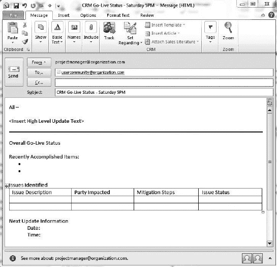

**图 6-18.** 示例：上线用户沟通

除了常规的用户更新之外，如果出现任何问题，在问题变得严重之前进行沟通将使您的上线更有可能成功。除了尽快寻求支持外，让您的项目领导团队参与到任何关键问题或决策中，将使他们能够更积极地参与。

### 部署后支持

完成上线流程并部署应用程序后，您需要切换到应用支持模式。作为部署的一部分，您应该预期会花一些时间与用户一起回答问题或提供有关如何使用特定应用组件的信息。第 7 章从更长远的角度探讨了这种支持，但规划短期需求也很重要。

如果您在项目中聘请了供应商，他们通常也会在刚上线后的一段时间内为您和您的用户提供一些支持。无论谁负责此项任务，请审阅第 7 章中列出的要点，并选择那些对您的实施有意义的内容。

## 初始应用管理

像上线后支持一样，持续的应用程序管理在第 7 章中有更详细的介绍。尽管如此，识别出一些部署后立即需要思考的焦点问题仍然很重要。在本节中，我们将重点介绍几个早期的考虑因素。

### 推动采用

作为 CRM 实施的一部分，快速推动采用将决定您的上线是能迅速成功并获得正面评价，还是陷入用户问题和投诉的泥潭。确保用户看到应用程序的适当价值，并充分使用它，将有助于保持事态的积极发展。组织常犯的一个错误是，在部署新的 CRM 工具后，允许用户继续使用或查看旧的应用程序。这是实施团队可能犯的最严重错误之一，因为它为用户社区提供了借口的机会，并且只会造成混乱。当然，如果您要关闭旧系统，您需要花适当的时间确保旧系统中的数据和所需功能在新系统中可用。此外，在启动后的初期阶段，可见且积极的高管支持对于帮助用户牢记 CRM 的价值和愿景，并鼓励员工坚持使用，直到他们熟悉新流程和应用程序，非常重要。

#### 胡萝卜 vs. 大棒策略

为了确保所交付解决方案的采用，高级管理人员可以在“胡萝卜”和“大棒”策略之间做出选择。虽然这两种方法都有其优点，但方向决策取决于管理层风格以及组织中其他应用的现有采用情况。根据我们的经验，很少有管理者在没有“胡萝卜”的情况下有决心让“大棒”奏效，因此在上线过程推进时要记住这一点。“胡萝卜”可能包括表彰积极使用应用的用户，或者为帮助推广应用而提供的小额奖金。“大棒”的一个例子（对于销售团队）可能是制定一项政策，即除非交易在 CRM 应用程序中记录和跟踪，否则不会为赢得的交易支付佣金。

##### 将关键绩效指标与薪酬和 CRM 使用挂钩

推动应用程序使用的一种更常见“大棒”式手段，是将个人的目标或薪酬与 CRM 的使用挂钩。无论你期望的 CRM 使用是像跟踪邮件通信或活动这样简单，还是像提供关于销售机会的详细销售阶段和状态信息这样复杂，你都应该能够成功地找到无可争议的指标来管理薪酬。考虑定义一个算法，综合考量使用情况、记录更新数量以及跟踪的活动数量，为每个用户生成一个分数。你还可以确保用户只对在系统中留存了特定时长的销售机会获得佣金提成。这将防止有人只在拿到已签署合同时才录入信息。

### 变更管理

如同本节中的大多数主题一样，变更管理在第 7 章中有更详细的讨论。在系统上线后，立即利用我们在第 7 章中提供的工具来跟踪关于应用程序的任何即时反馈至关重要。你可能需要在上线后定期安排指导委员会讨论，甚至在初期每天进行 10 到 15 分钟的会议，以讨论出现的任何高优先级问题。指导委员会应准备好审查问题，并迅速向团队更新进展情况和缓解措施（如果适用）。此外，持续沟通应用程序的状态、新工具带来的好处以及关键功能的亮点，将有助于你塑造更积极的展望，并对团队提出的任何关切做出更及时的响应。

### 人员管理：新工作职能

CRM 的实施本身不会改变你员工的工作方式；但它可能需要他们在现有职责范围内以不同的方式运作。也许以前人们会用手工将纸质订单交给会计部门处理，而现在他们自己在 CRM 中录入。也许用户过去需要花费大量时间报告管道状态，而这个过程现在已经自动化了。无论他们是有了更多时间投入到工作中高价值的部分，还是日常工作流程有了细微变化，你都应该准备好过渡期间根据需要给予他们尽可能多的支持。

## 整合：CRM 实施项目计划示例

在本章中，我们按主题组织内容，例如数据迁移、报告等，而不是按照你将如何按时间顺序组织项目工作。在图 6-19 中，我们展示了一个高层次的项目计划，以帮助阐明这第二种视角：项目工作实际上是如何在日历上铺开并完成的。

关于该图表的一些重要说明：

-   图中描述了我们讨论过的迭代式项目流程。设计工作会持续深入到迭代构建阶段，并根据项目团队与 CRM 应用程序原型交互后做出的调整而进行。
-   由于报告、集成和数据迁移设计最终都依赖于应用程序的设计，在迭代方法中，这些设计在初始设计阶段之后很可能会有所变化，以反映在迭代过程中对应用程序所做的修改。在应用程序设计最终确定之前，所有其他设计都不能“板上钉钉”。
-   每个阶段内列出的项目没有特定顺序，不反映其完成的先后顺序。

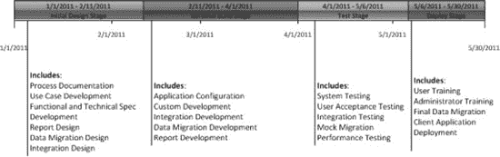

**图 6-19.** 高层次项目计划

## 常见项目问题及如何避免

现在，我们已经为你概述了可用于帮助你实施 CRM 应用程序的各种流程和工具，我们想概述一下 CRM 实施中出现的几个经典项目问题。我们将提供这些问题的一些症状或原因，并提供一些关于可采取的避免措施的信息。

### 范围蔓延

在本书的不同地方，我们都谈到用分阶段法或大爆炸法来实施 CRM。“范围蔓延”是阐述同一挑战的另一种说法。允许过多的范围，或者总体需要过多变革的范围进入你的 CRM 实施，将在你推出第一个版本的 CRM 应用程序时带来重大挑战。定义解决方案是否范围过度的不仅仅是范围的数量，还有范围的复杂性。如果你包含了大量的集成、多个系统替换或其他复杂项目，你的用户社区可能会被这种变革压垮。

专注于小而可控的部署是降低范围蔓延风险的最简单方法。如果可能，将实施的第一阶段分解为一小批有意义、能为最终用户社区提供独特价值的范围。一旦你成功完成了一个阶段，找到更多的时间、预算和成功就应该是顺理成章的过程。如果你确实需要在第一阶段进行大规模实施，请严格审查范围项，以确保没有某一用户组被变革过度负担。你还可以投入额外的时间进行培训和用户支持，以帮助缓解因范围数量较大而增加的额外风险。

### 过度复杂的设计

无论是简单设计账户和联系人实体，还是专注于 CRM 应用程序中一整套自定义实体和属性，试图让它们满足所有人的所有需求，会很快在表单布局和可用性方面引发冲突。无论是审视 CRM 表单，还是考察 CRM 程序中集成和自定义项的复杂性，这种冲突都存在。一次构建太多内容，或者没有仔细管理用户的期望，都可能导致 CRM 系统的设计乃至最终实施变得过于复杂，并引发用户采纳方面的问题。

我们经常听到我们的客户和其他顾问谈论尽量使用现成功能。这绝对是避免 CRM 应用程序过度复杂设计的一个起点。除了关注原生 CRM 功能，让一个能在项目中客观审视各种定制化或自动化请求，并就最初应该构建什么提供指导的人参与进来，将有助于确保你的设计既能满足用户需求，又能保持尽可能简洁。

### 软件驱动的项目

大多数组织常犯的一个错误是，让各种 CRM 应用程序中可用的功能来驱动整个实施。无论是为了适应新的 CRM 工具而改变现有正常工作流程，还是仅仅因为某个功能在工具中可用就实施它，这都会立即将工具的采用置于风险之中。任何时候，当用户被要求为了技术而改变流程时，他们更有可能抵制应用程序，并寻找新应用程序的变通方法。此外，这种方法常常导致范围蔓延，从而引发许多相同的问题。

利用当今可用的技术，几乎任何东西都可以在 CRM 应用程序中进行定制或构建。专注于使用这些工具，使应用程序适应你组织期望的流程。我们认识到，无休止地在 CRM 工具中构建功能既昂贵又耗时，因此，优先处理那些最能促进流程的项目可能很重要。但最终，通过正确的关注和持续的投入，你将能够实施所有必要的功能来满足所有流程要求。

### 缺乏高管支持

在项目的几乎各个阶段，获得适当层级的高管支持，对于找到合适的供应商（如适用）、帮助确定实施团队的优先事项以及指导整个项目全局都至关重要。初始部署之后，高管支持对于推动用户采用该解决方案、确保任何出现的问题都能得到适当沟通并以恰当方式处理，同样至关重要。如果在任何时刻，高管团队的支持力度，甚至仅仅是沟通程度开始减弱，这都将对你的项目构成风险，需要迅速处理。

管理围绕高管支持力度或程度出现的任何问题通常相当直接。幸运的是，大多数高管在面临会让他们损失金钱或信任的风险时都会做出回应，因此仅仅提出这个问题通常就能提高他们的参与程度。如果单凭这一招不起作用，可以寻找机会帮助他们处理诸如起草项目邮件之类的沟通事务。最后，确保他们在谈论 CRM 价值或处理任何问题时手头拥有所有必要信息，这将使他们更有可能深度参与整个流程。

### 管理不同的优先事项

无论冲突是集中在 CRM 实施上，还是将 CRM 的优先事项与某些无关事务相冲突，能否有效管理项目中各利益相关方不同的优先事项，将是获取他们适当参与程度的关键。如果项目团队成员对项目优先级有不同的看法，从项目一开始就处理这些问题将大有裨益。

项目章程、项目状态讨论甚至设计文档等工具都可以用来团结团队并提请注意任何重要问题。如果冲突存在于 CRM 优先事项与其他组织举措的优先事项之间，那么你的执行发起人和项目指导委员会将是解决问题的最佳机制。你的组织规模越大，这类冲突发生的可能性就越高。如有必要，请计划在你的项目计划中预留一些额外时间，以应对整个项目中优先级的小幅变动。

### 应用程序采用

我们在本章前面部分讨论过应用程序采用。基于这些信息，本章此部分所概述的所有项目都可能导致应用程序采用率不足。应尽可能避免出现诸如优先事项分散用户精力、范围过度、高管支持力度不温不火的观感等问题，以便用户能适应新应用程序。应用程序采用方面的问题可能会破坏你的初始实施以及你获得支持（和资金）的能力。

迅速解决问题至关重要。在整个过程中为你的团队提供额外的培训、支持时间和资源，将有助于顺利实施，并为你的团队在未来的任何阶段做好充分准备。

## 总结

在本章中，我们概述了初始 CRM 项目的不同要素。这些主题中很多都足以单独成书，因此我们提供了我们认为足够的信息助你起步，并提供了一些简单却有效的模板供你使用。基于我们深厚的 CRM 咨询经验，我们也致力于识别出典型 CRM 实施中常见的一些陷阱。综合来看，我们希望这些信息能足够让你成功迈出 CRM 项目的第一步。

*   在项目初始阶段，花时间记录将受 CRM 影响的流程，有助于协调团队，使项目更顺利，减少意外情况。
*   在设计阶段进行正式的用例开发，对设计过程和后续的测试工作都大有裨益。
*   定制开发会给项目带来风险，但也能显著提升应用的价值及其与组织流程的契合度。
*   数据迁移是一项困难且成本高昂的任务；尽可能限制其范围，并对其价值保持现实态度。
*   将 CRM 与其他业务应用集成，能让员工提供更好的客户体验，并提高他们的工作效率。
*   报告是项目的关键要素；在项目开始时就应考虑期望的报告成果，并在整个设计过程中定期回顾，以确保完成的应用能够交付这些成果。

## 维护与演进 CRM

本书前面的章节提供了你成功规划和启动 CRM 项目所需的信息。从长远来看，正是对 CRM 的持续维护和演进，或称 `管理`，才能使你视自己的投资为有价值。

本章的目标是为你提供必要的信息，以便在初始部署后继续演进你的 CRM 项目。虽然我们会谈及持续的维护对长期成功至关重要，但实际上，正是维护与 CRM 持续成长和进步的结合，才能让你清晰地看到成功。CRM 实施的初始阶段可能进展顺利，但如果没有持续的管理，该项目最终将无法再为你的组织增加价值。

### 指导委员会的角色

第 2 章介绍了指导委员会及其在 CRM 项目中的作用。尽管该团队在 CRM 初始部署后角色有所变化，但委员会对 CRM 项目的长期成功依然至关重要。指导委员会需要继续充当所有 CRM 相关事务的核心枢纽。其持续关注的要点应包括以下内容：

*   `CRM 推广宣传`：指导委员会应计划继续充当组织内 CRM 项目的主要宣传者。无论是为了获取未来阶段工作的资金支持，还是出于未来项目成功对组织的重要性，成功的信号都需要尽早并频繁地传递。因此，指导委员会有必要大力宣传初始实施阶段的积极成果，并迅速应对出现的任何问题。最后，指导委员会还可以宣扬组织的战略 CRM 愿景，并阐明 CRM 应用程序带来的商业效益。
*   `变更控制与路线图规划及执行`：指导委员会也是让高管和决策者齐聚一堂、进行持续性决策的最佳机制。尽管该团队的会议频率可能不如 CRM 初始启动阶段那么高，但高管层参与重要决策，将使未来阶段的工作、快速修复及任何问题的处理更加迅速高效。
*   `高管支持`：组织在实施 CRM 项目时，通常会面临不同程度的员工采纳率。实施后，指导委员会有责任确保员工按照预期使用流程和应用程序。这通常可以通过适当的“胡萝卜加大棒”组合来实现，并且需要根据组织的具体情况量身定制。一些可能的激励措施示例如下：
    *   将销售人员部分薪酬与其商机中存储的信息挂钩
    *   根据客户满意度或是否履行对客户的服务水平协议（`SLA`）承诺，为客户服务团队提供奖金
    *   跟踪线索到商机的转化率，并激励营销团队协助完成转化

此外，当您寻求提高使用率、收集反馈或处理任何出现的问题时，指导委员会可以确保相关负责人从员工那里获得适当的时间和回应。这将在组织内营造一种协作的环境。

#### 会议频率

在 CRM 初始实施阶段，指导委员会会频繁开会（通常每周一次），以确保项目方向符合预期。CRM 启动后立即维持这一会议频率仍然至关重要。我们经常看到客户在项目启动一两周后就立刻取消指导委员会会议。除了为项目相关的高级领导团队提供一个快速解决问题的机制外，指导委员会还能在启动后的关键时期发出积极、统一的声音。

随着时间的推移，可以适当降低会议频率。启动后几周内，可考虑将会议改为每两周一次。大约 60 天后，可以开始考虑每月讨论一次。由于相当多的 CRM 实施失败是因为缺乏长期的后续跟进和发展，因此拿 CRM 应用程序的长期成功去冒险是不明智的；所以，请保持指导委员会的参与，并继续召开这些会议。

#### 会议议程

与指导委员会的会议频率类似，这些会议的讨论主题在启动后也会发生变化。关注的焦点大多从管理启动项目团队（内部或供应商）转向确保员工得到支持以及规划下一版本发布。

图 7-1 中的示例议程为部署后指导委员会会议的主题提供了一些参考。尽管列出的许多项目看似与实施主题相似，但您仍应预期在启动后将诸如可交付成果之类的任务分配给相关人员。持续检查这些项目的状态以确保应用程序不断演进非常重要。

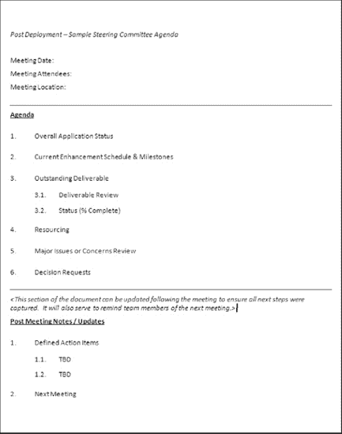

**图 7-1.** 指导委员会会议议程示例

#### 与会人员与职责

在初始部署之后，会有多个不同的个人或角色参加指导委员会会议。通常参加此会议的人员类型包括：

*   初始项目发起人
*   部门支持者
*   支持负责人/提供支持的团队成员
*   负责监控/维护 CRM 应用程序的 `IT` 人员

务必记住，初始实施阶段担任这些角色的人员在实施后可能会发生变化。此外，当您在后续版本中推出 CRM 应用程序的新功能或更改流程时，组织内可能会有其他人应该加入指导委员会。

### 维护 CRM

部署 CRM 应用程序后，迅速过渡到维护模式至关重要。此项目阶段的核心任务包括为用户提供所需支持、对应用程序问题进行分诊处理，以及确保关键的 CRM 文档保持最新状态。

#### 为员工提供支持并收集反馈

为了推动 CRM 持续发展，营造一种让员工感到被支持、问题不会恶化的氛围至关重要。组织能否快速处理那些不可避免的问题，最终将对 CRM 的成功以及获取财务及其他资源以持续发展项目的能力做出巨大贡献。

支持员工的一种方式是确定特定的负责人，他们既是 CRM 项目的倡导者，又充分了解 CRM 流程和应用程序，足以成为各自特定用例方面的专家。以下是一些此类人员的示例：

-   **利益相关者**：项目的利益相关者是那些比普通员工更关心项目成功的个人。项目利益相关者应准备好充当倡导者。此外，对于许多支持和持续维护任务，鉴于其对整体项目的重要性，被明确认定为利益相关者的个人需要比其他人员得到更多关注。
-   **部门负责人**：部门负责人将为 CRM 团队提供针对特定部门流程和 CRM 需求的总体指导。此人通常是销售或服务经理之类的人物，可能对高管团队有影响力。此人的部分职责如下：
    -   作为上线后出现的任何问题的升级联络点
    -   参与持续的流程和应用程序设计工作
    -   充当应用程序的功能专家，帮助支持其业务部门内的用户，并且在应用程序允许的情况下，对用户部署后所需的小修改进行调整
-   **项目发起人**：项目发起人将为 CRM 团队提供广泛未来阶段计划的总体指导。此人通常是比迄今为止所概述的任何角色都更高级别的高管。此人的部分职责如下：
    -   在与指导委员会打交道时提供高管指导
    -   确保团队成员和其他项目利益相关者有空并在需要时提供设计反馈

#### 识别问题

作为实施整体支持的一部分，能够快速识别并解决出现的任何问题非常重要。组织应利用其利益相关者和部门负责人充当耳目，倾听员工的问题。留意员工反复提出的问题、应用程序使用问题以及闲聊中的反馈，以帮助识别问题。跟踪出现的问题也有助于识别常见问题。能够识别这些问题并快速做出反应，将有助于您防止 CRM 社区内滋生不满情绪。

#### 提供持续支持

作为 CRM 项目启动流程的一部分，您或您选择的供应商将在短时间内为最终用户提供 CRM 应用程序支持。仅仅因为这段时间结束并不意味着对该应用程序的支持可以终止。组织应评估其可用的支持选项，以帮助在前进过程中提供这种支持。

尽管有时会被忽视，但在提供长期支持时，组织常犯的一个错误是只针对已部署的技术和配置提供支持。在 CRM 部署过程中，您很可能会改变组织的流程，因此确保部门负责人和/或利益相关者能够支持解决出现的任何流程问题也同样重要。

最后，鼓励您的应用程序支持人员不断地深入探究表面技术问题之外的原因。虽然可以通过更改设置或更新某些数据来快速解决问题，但以这种方式看待支持可能会导致您忽略问题的根本原因。根本原因被忽视的时间越长，一旦问题被发现，其影响就越严重。

除了利用应用程序来跟踪问题之外，可以考虑的其他一些支持机制如下。

##### 电子邮件反馈

考虑为您的用户社区提供一种通过电子邮件提交反馈的方式。除了提供指向 CRM 应用程序的链接外，电子邮件为他们提供了一种通过他们熟悉的工具快速简便地提交反馈的方式。根据与 CRM 项目相关的争议程度，也可以进行调整，允许员工发送匿名电子邮件。

为确保在收到反馈时获得适当数量的信息，请考虑向用户提供一个类似图 7-2 中所示的模板用于提交问题。

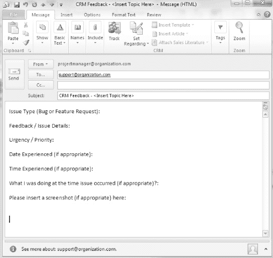

**图 7-2.** 支持请求电子邮件模板

需要向员工强调的关键点是，在概述问题时尽可能提供详细信息的重要性。支持资源掌握的信息越多，他们就越有可能解决问题。

##### 集中式反馈收集

收集和跟踪反馈的另一种选择是使用集中式位置。根据贵公司的技术成熟度，这可能简单到共享文件夹中的电子表格，也可能复杂到组织内外部都可访问的门户。无论采用哪种方法，收集的信息都是相同的。

通过这种方式捕捉问题和反馈的一个明显优势是它为用户提供的透明度。当然，这需要 CRM 团队持续更新和监控，但假设能做到这一点，用户可以持续感到自己参与了这个过程。提供持续的状态更新可能使用户在联系团队之前自行解决部分问题。图 7-3 显示了一个用于跟踪用户提出的反馈和问题的快速模板。

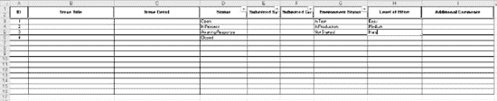

**图 7-3.** 问题跟踪列表

##### 办公时间与答疑辅导会

在决定如何支持您的 CRM 社区时，第三个组成部分可以是设立“办公时间”或定期的答疑辅导会。此类会议通常为您的团队提供两个重要价值：

-   **一致性**：定期的办公时间将为您的员工提供一个可以求助的、一致的支持渠道。提前安排这些时间还将使用户感到安心，因为他们知道在未来某个确定的时间，支持资源将可用，以解答任何问题或处理疑虑。
-   **减少随机性**：实施支持的一个主要风险是整个团队被支持请求打乱工作节奏。这不仅意味着支持水平或质量的下降，还可能导致员工感到被忽视。通过安排明确的时间，可以训练您的员工将请求保留到这些预定时间。此外，支持资源可以利用这段时间专注于用户关心的问题，无论是倾听他们的诉求还是解决问题。

##### 更新文档

在初次上线后，随着员工逐渐适应，让 CRM 流程和应用程序在一段时间内保持不变，将有助于用户建立对它们的熟悉感和舒适度。这种舒适感是用户采用率和最终上线成功的关键。

在刚上线后的这段时间里，应用程序很可能会有许多小改动。这些改动将迅速解决用户提出的问题，或修复在应用程序实施测试阶段未被发现的小缺陷。一项常被忽视的任务是更新培训文档和支持资源以反映这些改动。这些文档越及时更新，您的 CRM 社区就越有可能在需要时将其作为自助资源加以利用。

一旦尘埃落定，您或许有机会向 CRM 社区提供额外或增强版的文档。这些文档的设计可以超越最初的培训指南，增加额外价值。虽然这些新增或更新的文档可能对现有员工有所帮助，但它们也可以用于支持新员工入职时的快速成长。此类文档的示例如下：

- **培训视频**：增强现有员工培训材料的一种方法是着手建立一个培训视频库。这些视频时长可在二到五分钟之间，重点突出 CRM 应用程序的某个特定流程或领域。
- **功能亮点**：在组织内促进 CRM 增长的另一个选择是不断寻找小方法来为 CRM 社区提供额外价值。其中一种方式是在部署后的每周提供简短的信息片段，为用户重点介绍一个新颖的、常被忽略的或虽小但功能强大的 CRM 应用程序特性。除了让 CRM 在全组织内保持关注度，突出这些特性还能为那些日常重度使用应用程序的用户提供即时、切实的价值。
- **使用成功案例**：虽然与突出应用程序内的功能非常相似，但为员工讲述更宏大的成功故事可能会提供额外的动力，促使他们有效使用 CRM。这类亮点的示例可能包括一个关于 CRM 应用程序如何促进团队或员工之间协作以实现预期成果（比如赢得一个销售机会）的故事。

##### 追踪反馈与评估工作量

正如我们之前讨论过的，持续监控和追踪员工的反馈非常重要。对已收到的反馈以及如何处理这些反馈保持透明，将让您的 CRM 社区感受到参与感，并鼓励他们继续积极参与 CRM 项目。

在本节中，我们将介绍收到反馈后该怎么做，以及如何评估与任何必要改动相关的工作量。变更控制流程应持续运行，并且可能同时存在多个迭代。

### 增强 CRM

一旦您的应用程序上线且运行稳定，更具体地说，当支持请求减少到零星几个时，就该考虑 CRM 路线图的下一步了。增强功能将使您能够继续向用户群体展示进展，从而推动应用程序的采用。

#### 变更控制流程

变更控制流程是一个持续的过程，帮助组织对其 CRM 项目进行变更和增强。图 7-4 展示了该流程的运作方式。

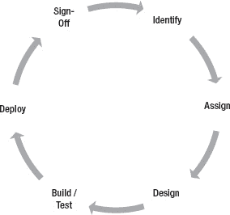

**图 7-4.** 变更控制流程

变更控制流程的各个阶段如下：

- **识别**：变更控制流程的识别阶段包括根据用户反馈，确定需要对 CRM 应用程序或流程进行的任何变更或更新。虽然追踪这些信息是成功的一半，但理解这些变更如何影响项目，并从宏观上了解进行这些变更所需的条件也同样重要。在该流程的此步骤中，应使用一个文档来清晰概述更新内容以及随之所需的时间或资金。图 7-5 显示了一个示例文档。

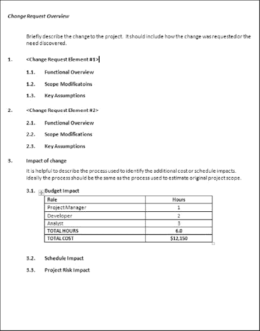

**图 7-5.** 示例变更请求文档

##### 变更控制流程的阶段

-   **分配**：在流程的分配阶段，指导委员会将根据其他项目对变更请求文档进行优先级排序。如果指导委员会决定优先处理某个特定项目，则应为其分配一名负责人，以管理后续流程。该负责人不一定是执行具体工作的人，而是最终确保工作完成的人。在此阶段应考虑的其他事项如下：
    -   **优先级 vs. 其他事项**：此特定事项相对于团队提出的其他事项的优先级如何？这也是指导委员会基于对整体组织的洞察，在企业内其他项目并行的背景下，为 CRM 更新设定优先级的地方。
    -   **资源配置**：对 CRM 应用程序的变更可由内部资源处理，也可外包给供应商。由指导委员会负责做出此决定。
    -   **发布周期**：一旦确定了优先级和资源配置，就可以评估发布周期。通常，诸如业务旺季、季度或财年末以及其他因素，可能会导致公司加快或放缓发布节奏。
-   **设计**：变更控制流程的设计阶段与完整 CRM 实施的设计阶段非常相似。在变更控制流程中实施范围项时，其规模通常远小于完整的生命周期项目。因此，可以考虑采用简化的设计阶段。设计文档可能仅包含一份简短的功能规格说明和解决方案实施大纲。这种详细程度既能避免在小型事项上花费过多时间，又能确保设计考虑到之前已实施的其他重要事项。
-   **构建/测试（针对应用程序变更）**：与设计阶段类似，构建和测试阶段通常也会有所简化。在此阶段的构建环节，将对 CRM 进行配置更改，和/或编写代码以满足需求。在测试环节，应完成第 6 章中概述的标准测试。这些测试类型包括：
    -   **单元测试**：单元测试包括对配置更改或开发的组件进行简要测试。同样，由于变更请求事项的性质，此类测试通常完成得很快。
    -   **系统测试**：系统测试包括对 `schema` 和用户界面组件的端到端审查。这使项目开发人员和分析师能够首次审查这些更改在与其他应用程序组件结合时的表现。
    -   **回归测试**：在变更控制流程中，回归测试是需要关注的最重要事项。它使项目团队能够测试现有功能，以确保功能在最新发布中没有发生变化。在确定每个测试阶段之后，都应完成回归测试。未完成适当数量的回归测试，可能会将新问题引入稳定的 CRM 应用程序，从而引发用户的不信任和长期问题。
-   **部署**：变更控制流程的下一个阶段是部署变更。在大多数情况下，由于变更的规模较小，此过程相当简单直接。此时，指导委员会的责任是确保任何变更的部署不与组织内其他项目或优先级发生冲突。
-   **签收**：一旦项目部署完毕，关键是要与指导委员会（如果合适的话，也包括最初提出问题的用户）进行反馈。正如我们多次讨论过的，这项工作将确保流程正确完成，并保持用户对整体实施的参与度。

#### 路线图制定与执行

第 2 章引入了 `CRM` 路线图的概念，第 3 章提供了构建此路线图以将组织业务目标与 `CRM` 计划对齐的信息。当您确定新的 `CRM` 流程或新的 `CRM` 应用程序功能时，始终牢记此路线图至关重要。根据组织的敏捷性，您可能会在推进过程中有意识地添加或调整路线图计划，但在讨论过程中以路线图为指导，将确保您始终朝着之前定义的最终成功状态前进。以下示例说明了如何在路线图中处理一个计划，以及最终组织的流程和应用程序可能发生的变化。

> **示例**
>
> 贵公司已使用 `CRM` 两年，并遵循了本章概述的变更控制流程。作为行业增长期的一部分，您决定收购另一家公司。这家公司位于与您当前所在市场不同的地区。在评估此次收购应如何改变 `CRM` 应用程序时，您必须回答许多问题。
>
> 应用相关问题
>
> 由于公司新增了办公地点，您需要评估其对 `CRM` 应用程序的影响。以下是一些重要问题：
>
> - 新办公地点将如何影响用户访问应用程序的方式？您的组织是否一直为员工提供远程访问，还是我们需要评估此项需求？
> - 是否有任何当地习俗或规则会影响我们使用 `CRM` 的方式？我们是否需要在对报价和订单文档中包含其他语言？
> - 鉴于新地点，组织是否需要运行不同的报告？
>
> 一旦您回答了这些问题，您就可以进行特定的应用程序更新，以适应这个新用户群体。
>
> 流程相关问题
>
> 除了更新 `CRM`，您可能还需要考虑更新整个组织的 `CRM` 流程。以下是一些值得提出的问题：
>
> - 您将如何让新的销售团队熟悉我们的 `CRM` 工具？应该进行哪些培训？
> - 被收购的公司是否有任何独特的销售流程，在我们整合时必须考虑？您的现有销售团队是否有机会从他们的销售模式中学习？
> - 是否存在我们可以进行的流程或自动化更新，以实现更流畅的销售流程，无论地理位置有何差异？

最终，在处理路线图中的计划时，同时考虑应用程序和流程的变更至关重要。除了处理这些独立的计划外，随着公司发展、经济形势变化或您寻求利用市场机会，您的业务环境也可能会发生变化。利用这些情况本身并无不妥，尤其是在您的 `CRM` 环境方面，但这也使得定期审查和持续更新您的 `CRM` 路线图变得更加重要。

考虑到这一点，尽管本章前面定义的变更控制流程主要关注初始部署后对 `CRM` 的管理，但还有一个类似但明显不同的流程，用于管理与执行路线图相关的更大规模增强。本节将重点介绍初始项目实施流程与后续项目流程之间的差异。

##### 管理大型应用增强功能

本章前面部分，我们介绍了管理增强功能的流程。该流程同样适用于管理大型项目。图 7-6 展示了跟踪电子表格中的两处小补充：“类型”列和“风险”列；这些将帮助你区分那些可以快速部署作为临时项目的功能，与那些需要大规模部署或新阶段的功能。

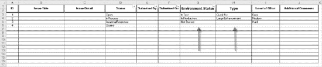

**图 7-6.** 问题列表 + 类型和风险列

与快速修复相比，大型增强功能也需要更多的规划。虽然你可以相对快速地发布快速修复，并且大多使用内部资源完成小型更新，但对于规模更大的新阶段项目和升级，则需要投入更多思考。

###### 安排部署

与小型快速更新相比，新项目或升级相关的部署安排考虑因素更为重要。项目或升级的规模越大，造成不必要的变更、错误或引起用户群体普遍担忧的风险就越高。

以下是一些重要的部署安排考虑因素：

- **对用户的影响**：
  - 变更的综合清单对当前用户群有何影响？
  - 用户现有的流程或用例会发生重大变化吗？
  - 用户在使用初始部署时是否仍然存在困难？

这些都是需要思考的重要问题。如果对用户的影响很大，你可能需要更加留意组织中正在发生的其他事情，比如季度末、高支持量等。如果应用中建模的流程会发生重大变化，那么留出额外的用户验收测试或培训时间可能很重要。最后，如果用户在使用初始部署时仍然存在困难，那么推迟第二个项目，直到使用情况稳定下来，可能是合理的。

- **工作量**：未来的阶段或升级将会涉及不同程度的工作量。与初始实施一样，后续项目的工作量也可能差异很大。这种工作量也与升级相关的工作量不同，因为任务和关注点将完全不同。这些差异将在本章后面部分进行说明。
- **风险**：在后续项目或升级部署过程中，许多因素可能导致风险判定。其中一些因素包括：
  - **范围项数量**：通常，范围项数量越大，风险越大。虽然情况并非总是如此，但更大的范围意味着需要管理的更多、测试的更多，并且在部署过程中引入错误的地方也更多。
  - **部署时机**：评估风险时，部署时机很重要。时机不当可能意味着用户对设计的关注度降低，难以专注于用户验收测试，或者由于其他优先级事项，用户可能会很快忘记培训内容。
  - **产品版本的生命周期**：这更多是升级时需要考虑的问题，但也应适用于任何未来阶段。产品版本可用的时间长短也会影响用户可能面临的潜在问题，以及部署前需要完成的测试量。

###### 资源：供应商 vs. 内部

如第 4 章所述，在初始实施过程中，选择完成大部分工作的资源（通常是供应商）需要做出不少决策。在考虑未来阶段或升级时，应当继续评估其中的许多标准。以下是一些额外的考虑因素：

- **谁是正确的供应商？** 你最初用于评估供应商的许多标准在后续项目或升级期间仍然适用。话虽如此，还有两个更重要的问题：
  - 哪个供应商更有可能与你的团队合作？既然你的团队已经接受了培训，并且已经与应用程序合作了一段时间，那么哪个供应商更有可能成为实施过程中的合作伙伴，而不是需要拥有整个实施过程？一些供应商更有可能支持小型的、兼职的实施，而另一些供应商则更适应大型的、全职的、多成员的团队。请注意，如果你决定在初始项目和后续项目之间更换供应商，你应该为设计变更预留一些额外的时间和预算。新的供应商会为现有流程或应用程序带来新的想法或精简的方法。
  - **内部团队应该做多少工作？** 既然你的团队已经在第一阶段学习过，并且在初始部署后一直在使用该应用程序，那么团队在下个阶段或升级期间应该承担多少工作？部分答案取决于内部实施团队的知识和技能。总体而言，你的团队应该更有能力主导工作，并且在未来的阶段中与供应商合作时应感到自如。

###### 测试

后续项目或新版本 `CRM` 应用中通常包含的功能数量，加上对现有用户群的潜在影响，意味着测试具有额外的重要性。虽然所有经典的测试方法都应完成，但回归测试变得日益重要，尤其是你距离原始部署的时间越久远。

在进行后续实施测试时，无论进行何种类型的测试，做到以下四点都很重要：

- 审查先前用于其他阶段和快速修复的测试计划。
- 制定详细的回归测试计划，以有效测试旧功能、新功能以及两者之间的衔接。
- 确保投入大量时间进行用户验收测试。在项目团队为用户提供较长的时间段（两到三周）来测试你的环境上的旧功能和新功能之前，用户经常会发现应用程序的问题。
- 测试环节结束后，留出时间修复或更新应用程序。

#### 内部版本管理

管理新功能和新版本的发布需要深思熟虑。作为指导部署的指导委员会或团队，版本管理活动通常分为两类：

- **基础设施迁移/版本管理**：大多数后续阶段和升级将包括搭建或开发及/或测试环境。作为版本发布的一部分，必须有人负责管理代码和定制化功能在这些环境之间的提升。
- **新功能/流程版本管理**：不可避免地，当发布大量新功能或一个新的应用版本时，用户与应用交互时所遵循的流程将会改变。确保用户有时间消化这些流程变更、更新他们的使用场景，并解答他们的疑问，对于顺利过渡到新版本或新功能集大有裨益。

在管理整体版本时，可以结合使用两种类型的文档来帮助跟踪相关任务。图 7-7 是一个核对清单，可用于识别上线过程中的所需任务。在部署之前或实际部署过程中的任何时间点，都可以参考此核对清单。

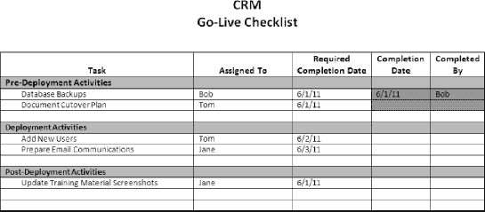

**图 7-7.** `CRM` 上线核对清单示例

除了这份文档，我们还发现一份关于发布流程的分步指南是避免最后一刻出现问题的有用工具。虽然任何文档都不太可能捕捉到所有问题，但一份精心制作的、包含截图和详细步骤的文档将有助于让部署团队感到安心。图 7-8 是此类文档的一个示例目录。

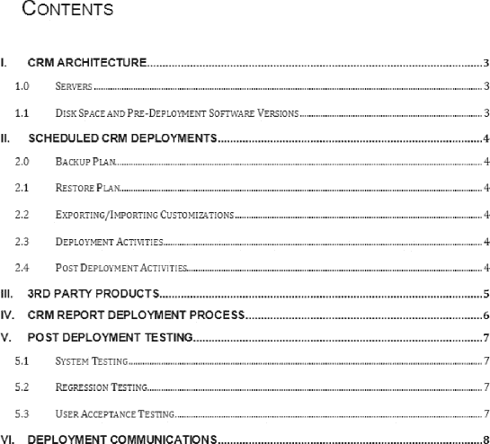

**图 7-8.** 部署分步指南

请注意，此文档的具体内容将根据您的 `CRM` 托管情况而有所不同。如果您依赖供应商来托管应用程序，那么许多备份和恢复活动将由其负责完成。此外，部署报告等内容的过程可能会因服务器和应用程序所在位置而改变，但制定一个确保它们得到适当部署和测试的计划非常重要。再次强调，只要时间允许，提供带截图的逐步说明将能缓解部署过程中的问题。

#### 新应用版本与升级

在本章中，我们讨论了指导委员会的职责以及如何处理新阶段和部署。我们概述的关于管理版本和部署新功能的概念，无论您是在同一版本的应用上部署新功能，还是正在为团队进行版本升级做准备，都是有效的。

在本节中，我们将提供一些具体的指导和建议，帮助您了解在专注于升级时可能会遇到的情况。

##### 基于云的应用

如果您使用的是托管型 `CRM` 应用程序，您的升级过程与本地部署的 `CRM` 实例将有很大不同。根据您的托管方式，您需要做出一些不同的决定，过程也会略有不同，但最终，升级过程的责任将主要落在托管供应商身上。一些具体差异如下：

- **供应商托管型 `CRM`**：如果您在早期选择了供应商托管模式，那么您在升级过程中几乎不需要做什么。通常，大多数托管供应商会提供一个升级计划表或日期，届时您的 `CRM` 实例将被升级。您的主要职责是管理您企业中已安装客户端的任何更新或变更。根据托管供应商的不同，至少了解其备份程序以防升级失败可能是明智之举，但可信的 `CRM` 供应商对此流程已有完全成熟的方案。
- **共置型 `CRM`**：如果您在选定 `CRM` 应用程序时选择了共置模式，那么升级相关的责任可能存在一些灰色地带。根据您与供应商的托管协议，您可能负责也可能不负责执行升级。如果您负责升级，那么本章前面概述的版本管理流程、测试等对您来说将非常重要。如果共置托管供应商负责您的升级，那么询问有关备份和恢复程序、必要的基础设施升级以及新客户端安装的问题，将确保您覆盖所有基础。

##### 本地部署应用

对于本地部署的应用程序，升级过程类似于本章前面概述的决策和版本管理流程。您基本上可以将这个新版本视为实施的一个未来阶段。与升级相关的一个主要考量（新功能通常没有）是基础设施升级的必要性。根据 `CRM` 应用程序新版本的发布频率，您的应用程序可能需要新版本的数据库软件、操作系统或客户端软件才能正常工作。如果这些中的任何一项需要与 `CRM` 应用程序一起升级，则需要额外的规划、测试和文档记录以确保成功迁移。

##### 应用测试版

许多 `CRM` 供应商也会提供其新 `CRM` 版本的测试版访问权限。实施测试版应用既有优点也有缺点。

**以下是优点：**

- 通常情况下，成为测试版参与者会给客户带来一些优势。无论这个优势是许可证或托管成本的短期优惠，还是作为测试版客户带来的一些宣传效应，您都应该期望从实施预发布软件中获得一些价值。
- 通过使用测试版软件，您将比其他客户更早地接触到新功能。根据这些功能及其对您组织的重要性，能够使用它们可能会为您的用户群体增加价值，并/或解决您组织当前面临的挑战。

**以下是缺点：**

- 根据您的托管决定，实施测试版软件可能会带来一些额外的麻烦。您在测试过程中参与得越早，当应用程序对其他客户普遍可用时，您就越可能需要重新安装该应用。
- 如果您的组织在技术上并不成熟，那么实施固有缺陷的软件所引发的问题以及由此给用户群体带来的焦虑，可能不值得其带来的好处。
- 您觉得有用或计划进行定制的功能，可能会从软件的最终版本中被砍掉。

#### 监控供应商生态

无论您是刚刚完成初始部署，还是在 `CRM` 之旅中经历了多个阶段或升级，密切关注与您特定 `CRM` 应用相关的供应商生态都至关重要。在本章的这一节，我们将提供一些关于监控工具相关动态的各种方法的高层信息。

### 会议

许多大型 `CRM` 供应商都会举办年度会议。投资派人参加这些活动，能让您了解对组织至关重要的新应用功能。

这些会议通常包含一个功能主题方向，这可能对您的主题专家、项目发起人或部门倡导者有所裨益。作为指导委员会的成员，了解即将发布的版本中提供了哪些功能，将有助于您确定开发工作的优先级并协助管理版本发布。

大多数会议还包含一个更偏技术主题的方向。这些方向是让您的内部团队进一步熟悉 `CRM` 技术的绝佳途径。参加技术方向的会议（其中许多包含动手实验）将使您的内部团队能够向产品专家提问，并学习自行执行更多实施任务。

##### 新的独立软件供应商

随着 `CRM` 供应商不断发展其产品，`CRM` 用户需要持续关注独立软件供应商的格局。当需要新功能时，独立软件供应商为客户提供了“购买”与“构建”的选择。在计划推出新功能时，了解可用的独立软件供应商选项，将使您能够做出最明智的决策。

独立软件供应商领域另一个持续的变化与产品供应商的升级有关。产品供应商的一个主要目标是持续向客户提供高需求的功能。从根本上说，这一目标与独立软件供应商的目标相冲突；独立软件供应商的动机是在客户发现问题时填补应用程序的空白。因此，很自然地，当 `CRM` 供应商发布包含与独立软件供应商产品类似功能的新版本应用程序时，独立软件供应商必须适应并创建新产品，或为其现有产品添加实质上更好的功能。

##### 用户组

如果您所在的组织位于较大的都市区，您还可以参与由您的 `CRM` 产品赞助或以其为中心的用户组。与会议一样，参与用户组也有许多好处。正如我们之前提到的，紧跟独立软件供应商领域的变化，将有助于您在组织内扩展 `CRM` 的使用。通常，独立软件供应商会作为演讲者参与用户组，使您能够快速、无压力地了解市场上新的独立软件供应商产品。

参加用户组的另一个巨大优势是有机会与其他同行交流，了解他们如何使用 `CRM` 应用程序解决问题。您可能正在处理与其他非竞争公司类似的业务问题，因此能够拥有一个开放的讨论论坛，可能会为您试图解决的业务问题提供更简单、更具成本效益的解决方案。

##### 博客和通讯

许多产品供应商和顾问都会撰写博客和制作通讯，以解答其各自应用程序中常见的问题或事项。从您的角度来看，这两类内容可能也有不同的侧重点，因此让组织内有人同时关注这两者非常重要。

- **博客**：产品供应商和顾问的员工通常会定期撰写博客文章。由于大多偏向其各自的产品，这些文章往往具有特定的性质。尽管如此，确实也存在关于使用 `CRM` 解决业务问题的通用型博客，它们以与技术无关的方式来应对这些挑战。博客文章很少是宽泛的，而是具有特定的性质，要么侧重功能，要么侧重技术，但不会两者兼备。
- **通讯**：与产品供应商相比，顾问在提供通讯方面往往更加积极主动。通讯内容通常有意地广泛，以吸引广泛的读者群。

##### 顾问

正如我们在第 4 章中讨论的，可以使用一系列标准来评估和选择您的 `CRM` 顾问。在完成部署的初始阶段后，您显然会对您选择的供应商以及未来阶段希望在该供应商中寻找的特质有更好的感觉。

正如我们在本章前面所讨论的，您可能希望在后期的运维供应商中寻找与第一阶段供应商不同的特性。随着您的团队技能的增长，您可能会发现自己需要的供应商服务时间更少，因此找到一个具有灵活支持和参与模式的供应商，将能在继续获得最佳服务的同时节省资金。

最后，与独立软件供应商渠道中的情况非常相似，供应商也在不断改变他们的产品和服务重点。通过阅读他们的博客和通讯，并在不频繁使用其服务的时期定期与他们保持联系，当您决定开展额外工作时，您将能够快速与合适的顾问接洽。

### 关于维护和发展 `CRM` 的最终思考

在本章中，我们讨论了在 `CRM` 计划初次启动后需要您关注的事项。优先处理这些事项，同时始终牢记您的 `CRM` 路线图，将使您能够在组织内发展和扩展 `CRM` 的使用。上线后，您所做的几乎每件事都会对 `CRM` 社区产生影响。因此，一个明确的测试流程、一个与新功能和项目相关的计划，以及关注、倾听和支持您的员工，将使您能够继续取得进展，并最终通过 `CRM` 计划取得成功。

## 结论

理想情况下，您读完本书时，对启动、管理和发展组织 `CRM` 计划的能力会充满信心和乐观。我们的意图是将这项可能令人生畏的任务分解成各个组成部分，详细描述每个部分，并让您了解它们是如何协同工作的。`CRM` 不是火箭科学，但它需要勤奋、精力和深思熟虑；您和您的组织将从投入中获得相应的回报。

最后，我们想再给您几条建议：我们认为这是实现 `CRM` 成功的“大局观”要点，比我们提供的任何应用功能或文档模板都更重要。

### 沟通

努力与所有 `CRM` 利益相关者建立开放、定期的对话，包括高级管理人员、`CRM` 应用程序用户、`CRM` 管理团队、`IT` 代表、经理等。这对于及早发现可能影响计划的问题、识别改进机会以及确保组织中的关键人员始终是 `CRM` 计划的支持者至关重要。不同的利益相关者群体可能偏好不同的形式；对于高级管理人员，定期午餐会可能合适；而对于最终用户，某种定期的 `CRM` “开放时间”会议可能是建立联系的最佳方式。关键是，找到一种方式与所有 `CRM` 利益相关者群体进行有意义的定期互动。

### 成为 `CRM` 的倡导者

特别是在建立新的 `CRM` 计划时，频繁、公开地支持 `CRM` 非常重要。在与组织的沟通中，持续强调 `CRM` 对您的使命和组织目标的重要性，并寻找机会表彰为计划做出巨大贡献的员工，以及展示组织在 `CRM` 投资上取得的切实成果。

### 监控 `CRM` 应用程序使用情况

如果某个特定群体或关键用户在 `CRM` 应用程序中的活动减少，这是一个需要调查的重要危险信号。这可能表明某个群体的流程已经改变，而 `CRM` 应用程序不再能很好地支持它们。发生这种情况时，用户会开始在 `CRM` 应用程序之外开发自己的工具和变通方法，从而导致应用程序使用量下降。

### 用技术解决实际问题

在规划CRM项目的路线图时，你可能会忍不住让应用程序来主导方向，专注于新的应用功能和附加组件，然后试图在组织中为其寻找一个能增加价值的位置，以此证明它们有理由出现在路线图上。这是本末倒置。请警惕这种思维潜入你的项目团队。要关注组织所面临的挑战和机遇。首先理解业务问题，然后再开始寻找解决方案。我们并非建议你对新的应用功能一无所知，只是希望你首先关注业务需求。如果技术不能解决组织关心的问题，那么它比无用更糟糕。

同样的主题贯穿于CRM项目在应用设计和报表设计的整个过程中，所以要始终专注于解决实际问题，不要仅仅因为技术存在就部署它。大量未使用的应用功能和花哨的仪表盘只会让用户感到困惑，并分散他们对需要完成的工作的注意力。确保你呈现给用户的一切都对组织有价值。

### 根据你的组织调整我们的指导

本书的内容基于我们与众多组织合作建立和发展成功CRM项目的经验，但正如大多数事物一样，CRM并没有一种放之四海而皆准的方法。如果你试图逐字逐句地严格应用本书中概述的方法，可能会举步维艰。请理解你所在组织的运作方式，并运用你的判断力，将本书中的指导原则应用到你的具体情况中。
