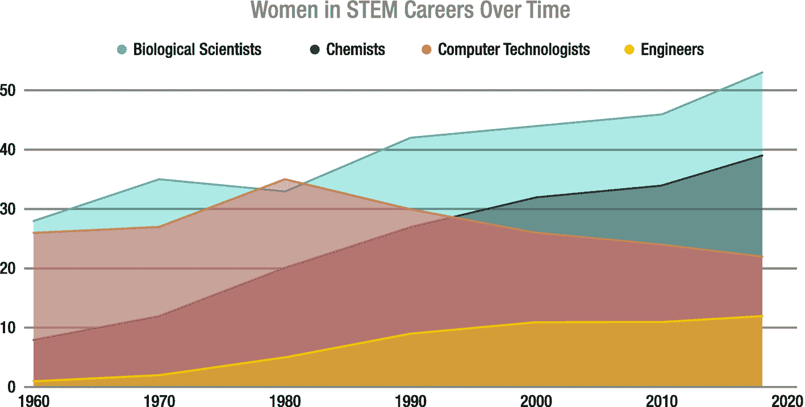

# 2. 女性在科技领域面临挑战背后的复杂性

我当年在为多家公司工作、推进职业生涯时，丝毫未曾预料到15年后自己会为甲骨文效力。我的职业生涯带来了绝佳机遇，让我能与业界优秀的人才、导师以及我崇拜的偶像共事。它教会我如何避免早年经历过的某些陷阱，而我所学到的坚韧、导师的指引以及他人的赞助支持，正是我能在科技领域持续成功、而他人却错失机遇的关键所在。我的亲身经历、他人愿与我分享自身故事的能力，以及我收集的数据，让我对女性在科技领域（`WIT`）面临的挑战与机遇有了极为宏观的认知。

我从所有经历中学到的是：万事皆有因，每个挑战都蕴含着益处，而单纯的“行动”本身就蕴藏着巨大的力量。

我本人有着奇特的病史和非传统的科技领域入行经历，这也从多方面说明了为何这些故事需要被分享。该领域的大多数人并非拥有计算机科学学位的大学毕业生。事实上，他们更可能来自多元背景，或是被发现对科技有天然亲和力，又或是出于需求满足而成为了“意外踏入科技领域的人”。每个人都是复杂的生命体，要理解他们各自是谁，需要围绕性别、成长背景和文化进行深入探讨，并且必须包含研究数据。我在此的目标是坦诚探讨这些话题，讨论我们是成长背景、经历和所获机遇的产物，以及这些因素如何决定成功与失败之间的差异。

脚注 ¹ ² ³

## 复杂性

我很想说，我们对科技领域女性及信息问题所有挫败感的简单根源在于性别，但实际情况比这更复杂。一部分人会告诉你，男性和女性在生理上存在差异，这就能解释一切。尽管他们关于差异存在的观点是正确的，但研究表明，考虑到所有差异，最终数据并不足以解释我们今天所看到的巨大排斥鸿沟。

科学研究已证实，男性比女性拥有更多的灰质。同时，这些研究也证明女性比男性拥有更多的白质。^(⁴) 灰质用于从视觉、肌肉控制到决策等一切功能，而白质则用于加速突触间的连接。这导致女性的神经连接比男性传导更快，尽管男性拥有更大量的灰质——科学家用此来解释为什么男性和女性的平均智商总体相当。神经回路图谱显示，女性左右半球的连接远比男性更紧密，而男性的前后连接则更紧密。虽然男性在协调和感知任务上通常优于女性，但女性在复杂的社交情境和多任务处理中能更有效地互动。对于男性大脑优越的每一个领域，科学家都在女性大脑中发现了相应的补偿性平衡特征。

### 失调还是动态？

以注意力缺陷障碍（`ADD`/`ADHD`）为例，[研究](https://www.understood.org/en/learning-attention-issues/child-learning-disabilities/add-adhd/adhd-in-girls)^(⁵)表明，男孩和女孩受到的影响不同，因为颞叶活动低下的影响非常显著。问题不在于医学专业人士认为女孩患`ADD`的可能性更小，而是由于大脑生理差异对症状的影响以及文化期望，导致女孩被诊断的频率较低。

我在家中三个女孩中排行老大，也是我们这一代第一个出生的女孩。任何熟悉出生顺序研究的人或许更能理解，是什么在驱动我、让我较少受到多动症（`ADHD`）挑战或行业其他女性经历的影响。

长子/女更可能模仿父母，并对自己抱有很高的期望。^(⁶) 我从一开始就表现出多动症倾向，高度活跃且容易分心。我提出很多问题，当答案不能满足我时（我的母亲经常被我无休止的问题惹恼），我会无畏地自己去寻找答案。

### 男孩更有趣

我记得和我的年长表哥们一起玩耍，努力跟上他们的节奏。他们和我妹妹们一样，身材高大，浅棕色头发，蓝色眼睛。而我身材娇小，坐不住，渴望做他们正在做的任何事情。我们在密歇根湖沿岸的密歇根上半岛乡村长大，夏季有大量时间在户外活动。如果男孩们要挑战对方站在小溪里，看谁能在冰冷的水中坚持最久，那我也会加入。这种竞争性游戏和其他冒险活动，常常让大人们为我——一个在这些大男孩中的小女孩——担心。我记得他们忧心忡忡地喊我，不让我跟着男孩们干那些事。我会不停地问为什么我不能玩和他们一样的游戏，直到他们被问烦了，丢下一句“因为你是个小女孩。” 这种情况频繁发生，让我将“女孩”与“受限制”联系在了一起。到五岁时，我记得我想成为一个男孩，因为那似乎就是自由和乐趣的代名词。

### 邻家女孩

作为三姐妹中的老大，我有两个妹妹，很幸运，但中间的妹妹是邻家女孩的理想形象。我的妹妹克丽丝蒂留着金色长卷发，蓝色大眼睛，她周围的成年人很快就将她视为女孩应有的完美典范。她是一个甜美随和的孩子，比她那个精力旺盛、留着深色精灵短发、充满好奇心的姐姐更坐得住。我很快注意到大人们如何称赞她漂亮的金色卷发和随和的性格。我意识到她在成长过程中有多么轻松——她仅仅通过自己的外貌和行为就满足了他们的期望。她是我们的《小妇人》中的艾米，^(⁷) 随着我们长大，我对她得到的关注愈发羡慕。

事实是，草总是那边更绿。文化可能对我们抱有期望，有些人自然更能适应，但这也有其弊端。克丽丝蒂在43岁时被诊断出癌症。她从一个健康快乐的母亲（有两个孩子）和妻子（有一位爱她的丈夫），迅速意识到她原本设想孩子离巢后实现梦想的承诺，很快就被这种毁灭性疾病扼杀了。我们深入谈过她对未来的期望，尽管她的未来正在迅速消逝。她告诉我，有一个出版过不止一本书的姐姐和另一个正在攻读硕士学位的妹妹，让她意识到，无论她多么热爱自己的生活和家庭，她有一些梦想被搁置了，因为文化教育她要把一切置于自己的欲望之前。

正如她身边如此多的女性一样，她只是在许多方面遵循着文化对我们的教导。我们听到，自己的梦想常被视为自私，而我们要做的是照顾周围的人。“`Carpe diem`”（抓住当下）这句格言，在意外降临时变成了未兑现的承诺。克丽丝蒂在确诊后仅仅100天就去世了，她永远不会被遗忘，但梦想却未能实现。她的离世，让我找到了更强大的内心力量，也让我对童年时代不肯安坐、驱使我竭尽全力取得成就这件事，再无任何遗憾。

## 非主管的“超能力者”

我无法安于现状，这驱使我去承担比许多同龄人更繁重的工作量。我并非在与他人竞争，我只与自己较劲，但对某些人来说，他们很难不把我视为竞争对手。我喜欢忙碌，并且极度厌恶无所事事。比起无事可做，我宁愿做些乏味的任务；而患有`ADHD`意味着，只要有机会，我就乐于接受有挑战性的工作。哪个雇主不想要一个积极高效、热爱忙碌的员工呢？管理层了解每位员工的工作量至关重要，但我们这种家长式的工作环境，却可能让能力不足的领导者挑拨员工彼此对立。这引发了女性在行业内最常见的一些抱怨。

除了创意或工作成果被他人据为己有，大多数从事科技行业的女性，其表现水平都高于同龄男性同事，然而这些男同事却更有可能获得晋升、加薪和更高职位。^(⁸)  我指导过的一位女性喜欢说：“平庸的女性没有立足之地。”我可以证明，我身边职场女性的能力都非同凡响。即使像我这样直言不讳的人，也多次在事实上扮演着“主管”的角色，却既无正式头衔也无相应薪酬。当我指导过越来越多行业内的女性后，我才恍然大悟：这并非个例，而是其他女性同样普遍面临的境遇。

尽管这些女性在履行相关职责，并且通常比她们的男性同行做得更好，但到了提拔某人进入领导岗位的时候，她们却被忽视或跳过。这些故事显示出明显的偏见：做决策的管理者要么不把女性视为领导角色，要么想当然地认为女性对管理人员不感兴趣。

这种偏见的另一种表现形式是：认为女性愿意“自愿”做更多工作，或者想当然地认为她们甘愿默默付出，而男性则更倾向于设定界限，除非有明确的晋升或经济回报预期。^(⁹)  由于我们对女性抱负的不适应，即使女性真的设定了这些期望，也可能会招致怨恨，或被贴上“不讨喜”或“难以管理”的标签。^(¹⁰)

对女性而言，设定期望并识别出何时被分配了超出职责范围的不公平责任固然重要，但当她们试图这样做时，却如同一把双刃剑。这就像走钢丝，我们需要小心翼翼，确保在划定这些界限时，不会触发任何人的偏见，也不会因设定边界而遭遇怨恨的反噬。一旦确定管理层愿意坦诚对话，就很有必要通过比较你与男性同事被寄予的期望，来辨明这种要求上的差异是否源于偏见。在这种情况下，你可以向管理层提出以下一些礼貌而直接的问题：

*   “我和 `XXXX` 的职位相同，应该承担类似的工作任务，对吗？”

*   “你会把这个<行政任务>分配给 `XXXX` 吗？”

*   “对于我未能获得那个<技术性或高规格>项目，您能否给我一些建设性的反馈？”

不带指责地询问经理，请他诚实地审视分配给你与其他团队成员的任务。如果你担心自己的情绪会泄露这次谈话有多么令人困扰，那么在去找经理谈话之前，先找一位值得信赖的朋友或同事进行角色扮演演练。

如果讨论的是你正在履行某个岗位的职责，但一位男性同事却被考虑晋升，以下几点或许会有帮助：

1.  事先做些研究，弄清楚你是否在流程的任何一个环节曾被考虑过。如果没有，就问原因何在。这可能只是一个简单的疏忽，当然，也可能是偏见所致。

2.  弄清楚你的男性同事为什么被考虑。通过一次对话，对情况的解释可能会让管理层意识到之前的疏忽。与管理层冷静地沟通，或许能帮助他们认识到你也是一个候选人。

3.  一如既往，目标始终是教育和达成目标，而非追究责难。如果你感觉自己变得越来越沮丧，可以考虑先感谢他们的时间，待自己整理好思绪后再重新讨论此事。

## 孤独之地

根据任何一份特定女性科技从业者调查所涵盖的岗位，女性仅占技术职位的13%至26%。^(¹¹) 由于团队通常由四到五人组成，这往往让女性技术专家成为团队中唯一的女性。作为群体中的少数派，一般的科技工作氛围比其他大多数部门显得更缺乏吸引力。在我们努力让更多女性进入科技领域的同时，这一现实目前可能让这个地方对女性而言显得格外孤独。我非常感激我的男性同事，但我发现，拥有女性同事能提供男性同事很少能给予的互动。对一个全男性团队而言，工作场所中的同事情谊优势是任何福利都无法弥补的。

由于我们处在一个父权社会，女性的需求历来由他人决定，而当我们今天成为某个行业的少数派时，这种影响仍有所残留。许多人声称女性天生不倾向于科技领域，但如果我们回顾早期的`STEM`教育，就会知道这并不成立。如果我们想理性地看待这个问题，还需要审视家用电脑曾经的营销方式以及科技职场氛围。

大量数据表明，在企业计算兴起之初，计算机工作被视为“行政性”工作，因此由女性承担。即便当时女性在劳动力中所占比例极低，1960年仍有27%的女性从事该行业。这一切在20世纪80年代发生了改变，随着家用电脑成为现实，电视上开始出现面向男孩推销电脑的广告。到1990年，计算机科学领域的女性比例约为35%^(¹²)；而20年内，这一比例下降至如今的不足20%。图2-1展示了`STEM`职业中女性比例随时间的变化。

图 2-1. 1965-2014年女性在主要职业中的增长情况。数据来自 [`https://www.npr.org/sections/money/2014/10/21/357629765/when-women-stopped-coding`](https://www.npr.org/sections/money/2014/10/21/357629765/when-women-stopped-coding)

当科技席卷全国并纳入教育体系时，它并未被分解为批判性思维、语言和电子学，而是被捆绑成一个复杂的学科。女孩从小就被教导，聪明是一种竞争，而男孩不喜欢与她们所吸引的对象竞争。^(¹³) 到八九岁时，这一点便体现在年轻女孩对其`STEM`教育技能的看法上，表现为否认自身能力并犹豫不决。问题不在于她们做不到，而在于“女孩不擅长数学”这一观念的积极强化和持续反馈。这种反馈常被认为是导致女孩尽管在多项研究中数学和科学成绩优于男孩，却仍声称自己能力较弱的原因。

与此同时，有科学数据显示，女孩在学习新语言时表现优于男孩，但几乎没有研究解释为何她们在计算机语言学习方面同样不出众。^(¹⁴) 我们也可以从先前女孩在数学教育中取得成功的相关数据推断，由于该语言被归类为科学或数学的一部分，因此对成功可能性的预期会影响最终结果。

关于女孩如何学习以及我们如何教授编程的研究，促使像“女孩编程”（`Girls Develop It`）和“黑人女孩编程”（`Black Girls Code`）这样的团体致力于改变文化对女孩接触编程的影响，以及计算机语言的教学方式。它们更新了“女孩不擅长数学或科学”的陈旧偏见，重新思考`STEM`教育的授课方式，并时常消除其中的文化偏见。这些项目的[成功](https://www.wraltechwire.com/2014/04/15/girl-develop-it-rdu-is-a-huge-and-growing-success-14415/)^(¹⁵) 不言自明。“黑人女孩编程”的创始人[金伯利·布莱恩特](http://www.blackgirlscode.com/about-bgc.html)^(16)) 不断分享着与我自身经历以及我认识的几乎所有科技女性相似的故事，这些故事正是该项目的推动力。这些项目旨在以更符合女孩学习方式的方式教授技术，项目更注重协作，而不是将孤立编程作为初始学习方法。“女孩不擅长数学”之类的偏见在这些团体中不被接受，因为所有参与者本身性别相同，性别因素便被排除在方程之外。

我曾注意到许多来自中东和印度国家的女性，她们的`STEM`技能远超美国女性。当我质疑这些国家的教育体系是否远胜于美国时，却找不到相关数据。一个持续出现的趣闻是，即便在她们祖国存在强烈的针对女性外出工作的文化偏见，这些女性也常常在与男性同伴分开的学校就读——这让我想起了“女孩编程”和“黑人女孩编程”项目的成功。那些在性别隔离环境中长大的人推测，这消除了课堂上与男性同伴的竞争挑战，使她们只需与女性同伴竞争。我注意到，她们专注于高等数学和科学导向的中等教育，更少担心男性同学对她们的看法，而更多关注如何作为成年人从教育中获益最大化。当男孩们正在形成自身竞争天性时，移除他们早期竞争方式带来的文化影响，似乎促使这些女性在成为年轻成人后更加坚定自信。这证明了我们不同文化之间的偏见差异，以及这些差异如何影响女性的教育质量。

## 福利部门

教师岗位可能会宣传对在职父母有吸引力的福利待遇，因为人们知道大多数教师是女性且处于育龄。如果你去问硅谷的普通专业人士，一份技术工作最理想的福利是什么，你很可能会听到以下回答：

-   休闲星期五
-   游戏室
-   欢乐时光或精酿啤酒时间
-   豆袋椅或其他休闲坐席区
-   零食和饮料

上面的清单读起来像是游戏玩家的梦想，但对普通职场母亲来说并非如此。大约在2009年，这是任何希望吸引顶尖技术人才的公司都会提供的清单。人力资源部门已经开始摆脱这种刻板印象，但很多时候，`IT`管理层和`IT`团队并没有。由于男性在该领域占主导地位，福利自然主要面向大多数人。我上一家公司的本地办公室仍然有零食间、啤酒冰箱和游戏室。男同事们每周至少去玩一次飞盘高尔夫。团队氛围很好，但办公室里的少数女性几乎总是与这些活动格格不入。我是一个常被排除在外的“怪女人”，因为我在科技行业摸爬滚打二十年后，已经明白这类社交的重要性。我也承认，刚入职时我曾把技术支持经理误认为是办公室经理，因为我只收到她发来的邮件，通知我们她订了什么零食，或者完成了哪些行政工作。我感到很糟糕，因为我自己的偏见和知识并没有让我避开这个问题。我不明白为什么这些任务会落到她头上，但正如我们所知，这类任务可能被视为行政工作，而女性很可能会被分配这些任务，即使她的职位头衔本应有所不同。

公司开始认识到技术员工性别多元化的价值，并利用不再局限于传统的福利待遇来吸引更多女性。^(¹⁷) 零食正从刻板的程序员/游戏玩家类型的奇多和功能饮料转向健康选择（谢天谢地，男同事们也同样支持这一改变）。团体外出活动设计得更具包容性，让所有人都能参与，我们也看到健身房会员、多元化团体、哺乳室等福利的出现。

我们看到更灵活的工作安排，以及根据生产力而非在办公室的时长来进行绩效评估。最大的挑战是让管理层接受这一点，因为男性同事发现，他们和女性一样欣赏更好的工作/生活平衡和更健康的选择。这从来不是为了剥夺那些已经在职的人的利益，而是为了向那些从一开始就应该被包括在内的人表示欢迎。

## 从一开始

虽然我已经谈到了成长环境和性别，但我们是否意识到，我们甚至在出生之前就被性别所定义？随着医学的进步，父母很少会对孩子的性别感到意外。有了这些信息，我们用粉色和蓝色装饰育儿室，购买具有性别区分的玩具，并根据我们孩子的性别预期，以不同的方式与他们互动。

有一部很棒的[视频](https://www.youtube.com/watch%253Fv%253DnWu44AqF0iI%2526feature%253Dshare)，^(¹⁸) 其中两个小孩穿着与他们的性别相反的服装。在与他们互动的大人面前，完全没有提及幼儿的性别。孩子们被放在一个摆满各种玩具的房间里，结果反复发现，大人们会把汽车和卡车递给“男孩”，并以更多肢体活动的方式与“他”互动。“女孩”则被递给洋娃娃，互动方式也更具养育性。他们也用更温柔的语气与他们认为的“女孩”说话。如果“男孩”摔倒了，大人会建议他自己站起来，拍拍身上的灰，而“女孩”则常常得到帮助和安抚。

当大人们得知孩子们的真实性别时，他们明显感到惊讶，并且意识到自己与每个孩子的互动方式有多么不同。他们没有意识到自己根据*认为*的孩子的性别而产生的性别偏见和选择。我想起我的二姐在成长过程中受到多少关注。我很瘦，留着黑色短发。我表现得更像男孩，更可能坐不住，典型的 ADHD 代表。我的妹妹则是小女孩模范行为的缩影。她有着金色的长发和蓝色的大眼睛，能够安静地坐着而不必经常被责骂。当我们和妈妈一起外出时，人们会走到我们面前，很快就把注意力集中在 Kristi 身上，告诉她她是个多么漂亮的小女孩，接着常常会有人评价说我妈妈“有幸生了两种不同类型的孩子”。这是一种委婉的说法，意思是一个孩子符合他们对女性性别的期望，同时又没有冒犯另一个不符合期望的孩子。

有趣的是，我妈妈在成长过程中大部分时间都和她父亲在一起。我理解她和他的联系，因为他是我最喜欢的约瑟夫爷爷。她最好的朋友是一个也想成为男孩的小女孩，一有机会就穿男孩衣服。她的成长经历造就了一个展现出更男性化沟通风格的女人。如果你问性别怎么能和沟通挂钩，我们先引用一句话：

> 男人互相侮辱却并不当真。女人互相赞美却并非真心。

上面这句话描述了男性和女性如何以不同的方式建立社交和联系。当男人讨论体育并成为朋友时，他们会用女性通常不会用的方式戏谑地互相侮辱。我丈夫是三个男孩中的老二。他讲了一些他们之间互相搞的恶作剧。听了这些故事后，我不确定大多数男孩是如何平安长大成人的。关于恶作剧、侮辱和相互挑战的故事数不胜数。有些故事会让他妈妈担心，但俗话说，“男孩子就是男孩子。” 这种行为有多少是由我们抚养他们的方式差异造成的？

当一个女人遇到另一个女人时，传统的女性沟通者会赞美对方的容貌或衣着。“我喜欢你的鞋子！” 或者“你的发型太棒了。” 我也有男性化的沟通风格，当女性赞美我的外表时，我仍然会给出尴尬的回应。我会怯生生地说谢谢，但这种女性化的社交方式不是我从小熟悉的。我曾经是个笨拙的孩子，成长过程中女性朋友不多，而且如前所述，我妈妈不会用这种方式与其他女性沟通或社交。来自母亲的赞美转瞬即逝，少之又少。这些赞美是大多数女性被教育用来彼此联系的方式。如果一个男人走近另一个男人说：“喜欢你的发型”，对方的反应通常会非常尴尬。这种沟通风格也导致女性更习惯听到赞美，但在互动中接受批评的准备不足。当批评反馈不具备建设性时，对女性来说可能意味着某人不想与她们建立联系或社交，这也是为什么我们常听说女性更敏感。真相可能更复杂，因为我们在文化上倾向于将赞美作为一种社交方式。另一方面，男性在应该接受有价值的建设性批评时可能学不到东西，但当处于对立位置时，他们更可能泰然处之。这是一个我们两个性别可以互相学习的沟通领域。

## 直截了当，但不要过于直白

母亲随着年龄增长变得温和了，现在她常会告诉我们她爱我们。但我觉得，小时候我更多的是让她感到疲惫，而非愉悦。她那种务实直率的沟通风格，带来了一种生活哲学：`用心去感受，用头脑去思考，说出你的真实想法，不要把这两者混淆。` 尽管她觉得我需要说出真实想法，但母亲对大多数事情似乎都不愿发表意见，这让我只能自己摸索。而这也恰恰教会我，我的直觉比周围任何人都更准确，并让我学会相信自己——当你在专业团队中属于少数派时，这是一种巨大的力量。

“直觉”这个词在职场中会引起各种有趣的回应。我从不否认自己拥有强烈的直觉，但我常常思考，为什么在讨论男性时，我们更可能说他们“相信自己的直觉”（trusting their gut），而形容女性时，对同样甚至更敏锐的能力，却用“直觉”（intuition）这个词，仿佛它是虚无缥缈的东西。我的直觉，不过是我对情境和他人高度敏锐的观察力。我获取信息，并能看到全局，但如果有人想贬低这种能力，就会称之为“直觉”；而当他们想认可一位男性同事的类似能力时，就称之为“本能”。这往往源于我们不信任女性。向人们指出这类偏见非常重要——不是以对抗的方式，而是作为讨论，要认识到贡献者的价值正被区别对待。

我们确实不信任女性。已经有[文章](https://www.huffingtonpost.com/damon-young/men-just-dont-trust-women_b_6714280.html)^(¹⁹)收集数据并记录了这一现象，探讨其成因。我们常常告诉女孩，从很小的时候起，她们就是在“反应过度”或“情绪化”。男孩被教导要压抑情绪，而我们却向女性解释，她们天生就是感性而非理性或逻辑的，并且她们的情绪在任何情况下都显得夸张。

男性从小就被教育要为自己的信念和言论挺身而出，这是“信任男人说的话”这种旧习的遗存。而另一方面，女性却经常被要求分析和自我怀疑：

*   “你觉得你是不是反应过度了？”
*   “你觉得你是不是误解了他/她的意思？”
*   “你为什么不给他/她一个机会？”（这通常发生在女性对自己接触的人做出判断之后。）
*   “你确定你听对了吗？”

我坚信，这就是为什么研究发现女性比男性更容易患上“冒名顶替综合征”，以及为什么她们被认为不够果断的原因。^(²⁰) 我们告诉女孩要怀疑自己的诸多想法和决定，难怪她们总是自我怀疑。

### 相信自己

如我所说，我天性孤僻。我喜欢特立独行，我的直觉敏锐地告诉我，什么时候问题是别人的，而不是我的错。随着我磨练这些技能，它在我成长过程中给了我巨大的帮助，我开始相信自己胜过任何人。这也需要足够自力更生的能力去独自前行。我学会了享受独处，而不是渴望那些可能质疑我自信的人的陪伴。这带来了一个有趣的效果——我更能抵御欺凌，并且倾向于为身边的人挺身而出。

当我面对那些偏见更深的人时，如果我雄心勃勃地努力达成和男性同事一样的目标，他们的不适感很快就会暴露出来。公司可以选择建设性地处理这个问题，也可以任由其演变成霸凌。我都经历过。我无意主动与霸凌者挑起对抗；我只是按照我认为能为公司创造最大价值的水平去工作，但当霸凌者的行为倾向被发现时，通常为时已晚，无法避免冲突。请记住——我的意图是明确的，并期望他人也能以同样的方式回应。事实是，偏见是无意识的，它往往既让表现出偏见的人感到困扰，也让被针对的人感到沮丧。施害者通常意识到自己的行为有些不公或不正确，但由于偏见更为微妙，并且成长经历告诉他们这种偏见是可以接受的（例如，家庭中母亲全职在家的状况更好，或者女性在技术领域不如男性有能力），而不是他们亲身经历的那样，这会导致施害者将怒火发泄在目标身上，而不是向内寻找解决方案。

不过，这也是解决这个问题的部分答案。它不是完整的解决方案，但你的处理方式可能有助于找到解决办法：

1.  当你被要求分析或自我怀疑时，首先调查一下向你提出这个要求的人的动机。这通常是无意的，但你可能会发现其根源在于个人不安全感、对女性抱负的不适，或其他偏见。
2.  认识到这一点后，你就可以得出结论，问题出在对方身上，而不是你，然后你可以根据情况，做出是否要继续进行下去的决定。仅仅知道这是别人的问题，并不能自动让你继续前进，但它应该促使你反思：是否有一个合理的理由，阻碍你实现下一步目标。
3.  不要害怕就该挑战与对方进行坦诚的沟通。你应该能很快判断出，这是否是一个教育对方的机会，或者此人是否已拒绝成长。
4.  如果需要第三方作为调解人，请考虑一位专注于发展和解决问题，而不是偏袒任何一方的人。
5.  随着你的职业发展和成熟，你可能会发现自己越来越不在意、也必须越来越不在意他人的看法。雪莉·桑德伯格即使面对多数人的反对，也能坚持做自己认为正确的事，这比刚进入科技公司第一年的简容易得多。行动就是力量，你做得越多，成就越大，坚持做对的事，而不是别人对你的期望，就会变得越容易。
6.  也要知道何时该离开。人们离开的不是公司，而是他们的经理。如果你经理的偏见限制了你的发展，那就去寻找一家拥有能促进你成长的经理的新公司。

## 协作杀手

当我们因信任缺失和机会不足而难以成功时，偏见也可能导致协作匮乏。^(²¹) 有些男性可能仅仅因为社交尴尬而不太与女性同事合作，另一些人则会因不安全感而减少协作。由于女性常处于竞争环境中，我们可能会发现有些女性也不太愿意与其他女性合作。这种协作缺失不仅会限制学习机会，还可能影响职业发展、工作满意度，以及企业从员工个人潜能中获益的能力。在会议和电子邮件中，女性可能收到更少的反馈，甚至毫无回应，这导致女性发言减少。我亲身经历过这种情况，深知其存在。我曾多次加入邮件讨论，虽然同事之间互动频繁，但我却收不到任何回应或只有零星回复。有时我甚至需要向信任的密友确认，我的邮件是否被群组收到。我还发现自己更可能在线下或仅在一对一交流中获得回复。我注意到，这种情况往往发生在我提出技术解决方案时。这让我不得不承认，人们对于承认解决方案出自女性之手感到不适。

这类互动常常导致女性在晋升和加薪时被忽视，因为缺乏展示其贡献的协作机会，她们在管理层面前变得"隐形"。^(²²) 既然女性本就被较少视为领导者，当她们解决问题或迎接挑战时得不到认可，科技行业就会产生更多"隐形领导者"。^(²³)

史蒂夫·马丁说过："做到优秀，让他们无法忽视你。"但正如我们之前讨论过的，即使女性表现更出色，也可能比男性同事更不显眼。要克服这一点，我建议女性每周记录自己的工作成果。即使经理没有要求，也要将这份记录作为流程的一部分发送给他/她。如果对方询问，只需回答："没人知道我在做什么，如果有人问起你，我不让你了解我带来的价值，那就是我的失职。"这不仅是在为他们提供服务，也能为你自己创造可见度。

不要害怕让别人知道你在做什么以及取得了什么成就。我们已经认识到，社会对女性的野心存在不适感。不久前，我参加一个演讲晚宴时被介绍给另一位演讲者。尽管我们在最初见面的环节中参与了多次技术讨论，他还是误以为我从事市场营销。基于我们互动中他已知的信息，这个假设显得很奇怪，但他随后确认道：鉴于我似乎了解这么多技术，我的技术背景一定很有趣，并问我做过什么。我简要介绍了自己的职业生涯，但等我讲完后，他说："嗯，我不像你那么擅长自我推销，但是……"显然，他对一个坦然面对自身成就的女性感到不适。同时，如果再有人问起，我依然会如此回答——这是他的问题，不是我的。我不需要他对我的经历表示认可。几个月后，我赢得了他的尊重，他对我也放松了许多。

## 向上攀升

我的简历确实很有分量，但这得益于我在多个行业和技术领域的工作经历。

如果我长期待在一家公司 5-10 年，我不可能获得如今的经验或视野。业界有位男性同行在向别人介绍我时曾开玩笑说："凯琳待不长……"因为我差不多每两年就接受新的机会。我会迅速纠正他，并反问：在薪水和经验上处于领域前 1% 有什么不好？我将这个建议传授给我指导的技术专业人士——只在一家公司待 2-3 年，我有几个理由：

1.  大多数公司不提供养老金，因此现有退休计划可以转入新公司。
2.  技术日新月异，跳槽到新公司能提供新的学习机会。在一家公司有 10 年经验的技术人员，通常很难与在五家公司各有 10 年经验的人竞争。
3.  平均加薪幅度为 2-7%，而新公司的职位可以提供 10-30%的加薪幅度。这是一次显著提升，考虑到因育儿而中断工作造成的性别薪资差距，以及因性别偏见导致的晋升损失，这能有效缩小差距。

对于想招聘你的信息技术专业人士来说，一份每两年更换工作的简历很少会得到负面评价。由此获得的经验和薪资增长将对你的下一份职业发展大有裨益，超过任何可能的弊端。

脚注 1 2 3 4 5 6 7 8 9 10 11 12 13 14 15 16 17 18 19 20

