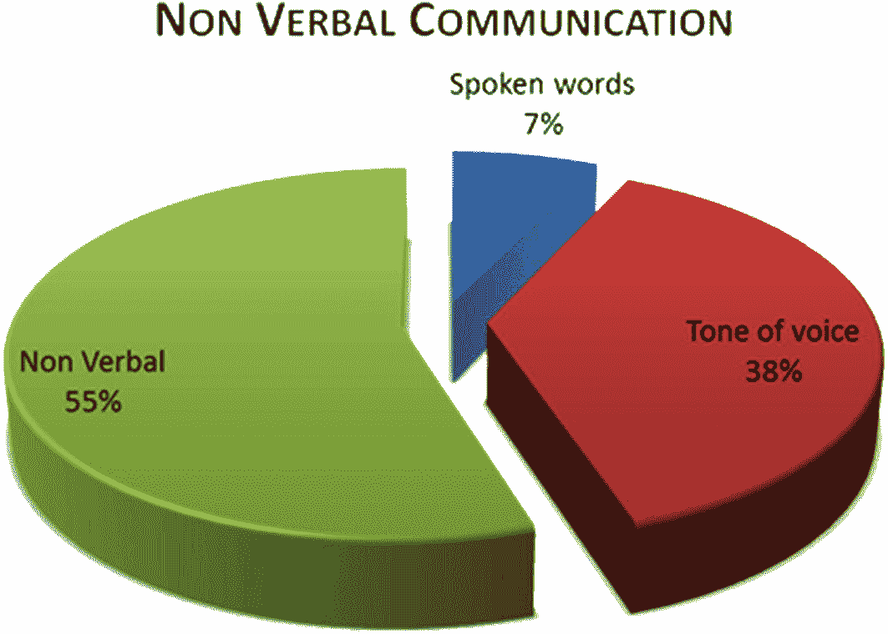

# 3. 将善意转化为积极改变

在职业生涯的各个角色、公司和技术道路上，沟通始终是一个绕不开的话题。沟通不仅关乎我们如何表达，也关乎我们如何倾听和观察。我刚加入微软时，得到了萨提亚·纳德拉的新书《刷新》。^(²⁴) 他在书中写道：“那些积极倾听的人更有可能被听到。”积极倾听是一种你可能认为女性更擅长的特质，但事实上，我们在这方面面临的挑战和男性一样多。男性倾向于说而不太愿意听，而女性则愿意听，但并非积极主动地倾听。^(²⁵) 杨百翰大学的学者最近一项研究发现，我们要么不太愿意与说话者互动，要么在该发声时害怕开口。^(²⁶) 我们点头说“听到了”，但其实点头是为了给说话者安慰和认同，而非为了积极倾听并参与对话。^(²⁷) 当我们提问时，常常问错问题（很可能我们已经知道答案，却试图向说话者证明我们在听），而男性则会针对我们已知的答案展开不必要的细节和宝贵时间，浪费了真正需要讨论的内容的时间。女性凭借敏锐的观察力，能察觉出对方何时不愿继续对话，即使需要直接介入，也会选择回避（这又回到了信任和成长环境的问题上）。

研究已经证实，沟通与说什么关系不大，而更重要在于怎么说（图 3-1）。^(²⁸) 微表情、完整的面部表情、语气变化以及周围人的反应，都比言辞本身传达更多信息。在一个越来越依赖电子邮件、社交媒体和其他非语言沟通形式的世界里，即使非语言沟通占比超过 90%的[理论](https://ubiquity.acm.org/article.cfm%253Fid%253D2043156)^(²⁹)已被证伪，我们仍然需要面对挑战。

图 3-1

非语言沟通

## 从指导到合作

女性赋权告诉我们，在书面沟通中应该更直接^(³⁰)，但因为我与配偶之间复杂而有趣的关系，我对这个话题也有深刻的见解。我的丈夫蒂姆是我在数据库领域的第一位导师。初次见面时，我正在一家领导力薄弱的公司工作。蒂姆被请来调解他合同下的一位数据库管理员（`DBA`）与我的首席 `DBA` 之间的关系。他手下的 `DBA` 威胁要退出合同，蒂姆希望能在他们之间找到共同点。我还记得与他的第一次会面，他的技术能力和与在场所有人打交道的外交手腕让我印象深刻。

之后，公司聘请蒂姆为我们的`DBA`团队教授一些所需的高级数据库技能，课程便立即开始了。这是我的第一个`DBA`职位，我当时正在考虑离开数据库团队，加入另一位已经转到项目管理团队的初级`DBA`。那个团队有更强的领导力和女性导师，极具吸引力，但我因向往更深层次的技术职位而犹豫不决。当蒂姆的数据库备份与恢复课程结束时，他问我的经理我是否真的要离开数据库管理团队。老板确认后，他建议老板不要让这件事发生，因为我在课程中已超越了其他所有人，并且拥有强大的天赋技能——我们至今仍称之为“诀窍”。是的，这个我八年后约会并结婚的男人，正是那个把我留在技术行业的关键支持者。

## 内幕消息

多年来，我们的指导关系已转变为专业合作伙伴关系。最近，流传着一个故事^(31)：两个团队成员，一男一女，共用一个电子邮件账户。唯一不同的是他们的签名。男性同事一直以为自己工作效率更高，并且从未真正考虑过客户与他互动的方式与他的女性同事有何不同，直到他经历了一段因无谓的提问、阻力和障碍而备受挫折的时期。直到他发现自己发送的所有邮件都带着女同事的签名，他才开始意识到可能发生了什么。他想进一步实验以收集更多数据，不敢相信正在发生的事情。他征求了女同事的同意，她同意进一步测试，于是他们用一周时间互相用对方的签名发送邮件。这位男性同事经历了职业生涯中最沮丧的一周之一。他发现完成任何事情都需要两倍的时间。人们无时无刻不在质疑他，用无关紧要的细节浪费他的时间。甚至有一位客户试图约他出去。而在此期间，他的女性同事表示，她度过了职业生涯中最轻松的一周。人们不与“他”争辩，只是照做她要求的一切，甚至主动提供额外帮助。这是一个广为人知的故事，但对我丈夫和我来说，这并非什么新鲜事。

在 Oracle 社区中，只有少数几对“知名”夫妻。对蒂姆和我来说，这是一段天作之合的合作关系。我们合作得非常好，属于同一个公共和私人团体，曾一起在董事会任职，甚至直到最近还在同一家公司工作。有好几次，蒂姆建议我按照他惯常的方式沟通。几乎每次我采纳他的建议后，我们俩都后悔了。这并非因为我需要严格遵循对女性的期望，或“像男人一样行事”，而是因为成功取决于谨慎、微小的改变，这些改变在他可接受的直接方式与对女性处理该情况应有的期望之间架起了桥梁。

有一次，蒂姆觉得我没有对经理表现出应有的直接。他与这位经理认识多年，便问我是否介意他改写我计划发送的电子邮件草稿。他担心我的经理会绕过职业界限，限制我的职业发展。蒂姆写了这封邮件，尽管我犹豫不决，但我也没有任何证据表明蒂姆关于我“不够直接”的看法是错误的。我一直在谨慎地运用外交手腕，希望能达成妥协。蒂姆认为，正是因为我未与他以书面形式明确设定界限和期望，才导致我遇到这个挑战，他断定问题更多出在我的沟通方式上。我选择发送了他写的邮件，并很快收到了经理的回复。经理表示，他对我的直接方式非常不满，并认为我或许需要考虑寻找新公司的机会。

我想明确一点——毫无疑问，我表现得非常出色，并且此前一直获得优秀的评价。尽管总有另一位负责人挂着正式头衔，但我是那个在需要时指导并为 DBA 团队提供支持的人。我也在自己的正常职责之外做了大量工作，不仅有益于我的职业生涯，也惠及了公司。我在会议上发言、撰写文章、发掘新人才并举办网络研讨会。

# 发出那封邮件后，局势似乎有所缓和，但我随后被要求限制外出活动，理由是存在利益冲突。我远非唯一从事这类活动的员工，但却是唯一被要求停止的人。这件事对我丈夫而言是一次警醒，他意识到自己让我的工作陷入了风险，这也让他警觉到，当人们第一次面对一种看似合理的偏见时，即使目标对象是自己的配偶，这种偏见也会显现出来。

在那之后的几年里，我们时不时地会进行一些“测试”。提姆会推荐一些方案，而我会发送出去，观察他人的反应。当我需要及时完成某件事，却因大量浪费在提问或要求上的时间而影响截止日期，且提姆与我平级时，我会让他单独发送同样的请求。人们多么乐意满足他的需求，或者他几乎不会遇到多少反对意见或质疑，这既令人惊讶又让人沮丧。我不喜欢浪费时间，当我想完成某件事时，有时让他发封邮件或与另一个会用没完没了的问题和讨论浪费女性时间的人交谈，反而变得更简单。我强烈建议，当女性怀疑自己正以这种方式浪费时间时，找一位值得信赖的男性同事去发送请求，看看他们的体验是否不同。这令人愤怒，如果你极其繁忙，你根本没有时间让这种偏见耗费你的宝贵时间。

## 他说，她说

在本章开头，我们讨论了**如何**沟通与**说了什么**同样重要。

男性和女性在沟通上存在生物学差异。我们并不否认这一点研究^(³²)。同时，我们也会根据性别学习不同的沟通方式。例如，当女性点头时，她们是在让说话者知道自己听到了。而当男性在他人对他说话时点头，则表明他同意对方的观点。不难看出，这种差异会在混合性别的讨论中造成混淆。在与以男性为主的会议听众交流时（好吧，我几乎所有的会议都是这样），我会尽量减少点头；但在女性信息技术（`WIT`）活动上，我会经常点头，让主要是女性的听众知道我在倾听。

关于“升调”也有重要的研究^(³³)，这个术语指的是有人在陈述句结尾时提高语调。这会使句子听起来像是一个问题，并削弱陈述的力量。这是一种常被认为与女性相关的沟通风格，且通常建议避免使用。当女性被告知要更直接，减少句末的升调时，这些建议可能会显得过于苛刻。由于女性的嗓音通常音调更高，即便这一点也会在追求权威形象以晋升的职业世界中成为批评的焦点。

仅仅改变我们交谈方式的几个方面，就能产生巨大影响。

*   **使用陈述句**——与其说“能在明天下班前完成吗？”，不如说“我期望你在明天下班前完成。”
*   **为每一次会议或你想进行的对话，记录下重要的想法或谈话要点**。与自己约定，要做出贡献并让人听见你的声音。
*   **记下笔记以保持专注，聚焦于谈话的目标**。男性通常不习惯边想边说，而是倾向于直奔主题。如果你想详细讨论或涉及多个话题，请安排一次会议并附上议程，以便设定预期。
*   **说话前深吸一口气**。这有助于控制你的音调不过高，并避免可能偏离重点的显著语音变化。
*   **你的肢体语言会影响你的声音表现**。不要害怕占据空间。如果让你的观点被听到很重要，那就设法在说话时站起来，双脚与肩同宽；即使坐着，也要坐直，可以考虑将双手放在大腿上，双肘向外。

## 令人不适的雄心

当谈到女性和雄心这个话题时，许多人会告诉你，他们对这两者的结合没有意见，但浏览一下网上关于政界女性、最高管理层女性以及任何挑战传统角色的女性的评论，你会很快意识到我们还有很长的路要走。我曾参与过关于人们对于女性展现雄心感到不适的广泛讨论。在我的职业生涯中，我主要与男性共事，就像我们年轻时模仿周围成人的行为一样，我们将这种习得的技能带入了商业世界，模仿周围的人。当我在一个男性主导的领域里事业蒸蒸日上时，我开始模仿男性同僚的策略和方法，这并不令人意外。我很快就注意到一个模式：不同的人对我像周围男性那样处理问题时做出的反应，与对我的男性同僚们做同样事情时的反应截然不同。多年来，我将其归结为我个人的某些特质导致了他人不那么热情的反应，而我的男性同僚做同样的事时则不然。直到我开始与其他有同样描述的女性交流，我才意识到这常常是因为我的性别。

如果你认为男性是这种反应的“罪魁祸首”，那么就像在其他偏见领域一样，我发现所有性别都会对女性的雄心感到不适。其他女性同样可能对女性产生负面反应，就像男性一样。女性在职场中成为霸凌者的可能性几乎与男性同僚一样高。^(³⁴) 大量数据表明，这是对偏见的一种反应^(³⁵)——那些女性曾被建议要强硬或表现得像男人一样，并选择了一条通过欺凌行为来展示她们认为这意味着什么的道路。我从未发现任何研究能证实这是否与成长经历或偏见有关，但我所认识的那些表现出霸凌行为的人，确实符合某种模式。

历史上确实有数据表明，在大多数文化中，女性被教育要“监督”其他女性。^(³⁶) 当这种监督带有明显的偏见时，我们很难指出来，因为这是女性对自己的性别抱有偏见。当偏见针对的是异性时，社会更容易知道该如何反应。我们倾向于使用俚语，比如“猫打架（cat fight）”，而且我经常听到将成功女性监督周围其他女性的行为称为“蜂后（Queen Bees）”。

被贴上“蜂后”标签的女性在社会中角色艰难。我发现她们通常是自己职业和专业群体中的先驱。我毫不怀疑她们拥有强大的领导能力，但她们常向我承认，自己被指责为“专横跋扈”。她们通常比后来者面临过更严峻的挑战，因为她们是铺路者。由于与偏见和先前歧视打交道的压倒性经历，她们可能为了达到今天的地位而做出过妥协，因为她们面临的机会更少，也缺少能挑战她们所扮演的预期角色的代表性人物。

在我所在的技术社区中，一些先于我们的女性建立起了防御机制，以确保在并不那么欢迎她们、且没有如今这些政策的旧环境中生存下来。当这些故事与我分享时，我认识到仅在最近几年我们就取得了多么大的进步。由于这段历史，这些女性对偏见的反应与年轻一代略有不同。她们更倾向于对不适当的情况或被机会绕过的情况耸耸肩，或者声称这对自己没有影响。

## 当年轻一代开始踏入她们的舞台，她们感到威胁

我很少遭遇这些女性通过直接攻击竞争对手来巩固自身地位或进行错误自卫的情况。毫无疑问，她们付出了巨大努力才达到今天的位置，而在男性主导的世界里，她们将年轻而有能力的女性视为切实的威胁。我发现，在不让步于自身目标的前提下，找到降级事态的方法对于克服这种局面至关重要。赢得她们支持的最佳方式之一，就是在那些曾将你视为目标的女性自身成为偏见靶子时，挺身而出为她们辩护。

### 象征性女性

关于在科技领域设定女性配额的优势与劣势，存在大量讨论。^(³⁷) 一些人认为，通过配额制展现代表性，能让那些不习惯在行业中看到女性的人逐渐适应，有助于将其变为常态。另一些人则认为，这是引入女性的错误方式，配额制会边缘化已存在的男性，并且无法解决偏见问题。"象征性配额"指的是某个团体、董事会、活动等寻找一位行业内的女性并让其参与其中，要么将其作为"象征性女性"而忽视所有其他女性，要么让女性参与进来，但并非在其专业领域做出贡献。当我刚开始在技术社区发表演讲时，我发现少数已存在的女性常常被我取代，因为我就是填补配额的新女性。这些同行会被告知："我们已经有女性担任主题演讲嘉宾/专家小组成员/演讲者了"，这让我遭到了她们的怨恨。这给人一种印象，即女性在这个团体中只有一席之地，并在现有女性之间制造了竞争。这阻碍了她们互相支持并改善代表性。当我开始理解这一点（并在我亲自指导的一些女性开始受到关注、取代了我的"一席之地"时，我亲身体验到了这一点），我才真正理解了这种偏见的复杂性。

当被邀请参加不突出我们技术技能、或只是让我们为"感觉良好"的活动贡献时间的"科技界女性"活动时，我决定拒绝。代表性固然重要，但必须正确实现。当我身边的女性被忽视而我继续得到认可时，我会尽力突出她们的成就，让她们获得与我相同的认可。赞助行业中已有的女性，与支持新进入的女性同样重要。

### 彼此支持

当我遇到来自女性同行的明显偏见时，这很难理解，更不用说知道如何应对了。多年来，我不得不在潜意识中面对这一点，因为我们需要记住，偏见可能非常无意识。我被迫问自己："如果涉及的是男性同行，我会作何反应？" 意识到我们从生命之初就将偏见作为社会可接受行为的一部分，这令人惭愧，而对自己诚实则能促进个人成长。

如果我是偏见的对象，我会分析当前情况，并尝试从对方的角度看问题。我会尽力化解引发问题的局面。不过，这并非意味着我接受他人的恶劣对待。正如我们之前讨论过的，你可以体谅他人的感受，同时坚持自己的立场。当一位女性同行当面或在网上对我不好时，我会尽量给予她信任，但希望这只是个一次性事件。如果这种情况发生不止一次，据我所知，我会让自己远离她的影响圈。因为我不喜欢浪费时间，所以对于我认为愚蠢的行为，我也没太多耐心。

### 直说无妨

偏见认为女性说话应该更温和。^(³⁸) 我们都听过这样的说法：如果你没有什么好话要说，那就什么也别说。然而，我却变得非常擅长以人们愿意听的方式说出需要说的话。目标是记住你希望从对话中得到什么——无论是道歉、达成一致还是妥协——说出有助于大家达成目标的话。

即使有了这个目标，我听到的关于与我互动的描述，却往往与实际发生的情况大相径庭。我们对于直来直去的女性可能会感到非常不自在，正因如此，女性发展出了一种说话方式，其含义会因语调、抑扬顿挫和面部表情而有所不同。^(³⁹) 当这种情况发生时，最好直接与误解的人沟通，在情况变得无法控制之前澄清事实。忽视它并不会让它消失。如果对方似乎不讲道理，你可能别无选择。记住要肯定自己的努力。因果报应自有安排，会向相关人员揭示那个人的真面目，而你则能节省时间与宝贵的精力。

### 赞美她心

女性在沟通方面技艺高超，最能体现这一点的是南方女性如何因"赞美你的心"这句话背后的多重含义而闻名。说出这三个字可能意味着：

1.  她们钦佩你。
2.  她们为你感到遗憾。
3.  她们受够你了。
4.  她们觉得你是个白痴。
5.  她们可能在计划晚餐时如何给你下毒。

希望第 5 种情况不会发生，但我敢肯定，你们每个人脑海中都回荡着可爱的南方慢吞吞的语调，用不同的抑扬顿挫反复说着"赞美你的心"，而每次的含义都截然不同。正如我们在其他章节讨论过的，沟通是一项复杂的技能。

反过来，女性需要记住，尽管她们的语气意图和声音的抑扬顿挫可能表达一种意思，但接收者可能会像男性使用同样直接的沟通方式那样，对女性产生反感。花时间让听者复述你所说的话，并确认每个人都理解一致、信息以预期的方式被接收，这是值得的。

## 自我价值

薪酬福利是性别薪资差距的核心问题，尽管一些网站声称能提供薪资透明度，但人们对此议题仍存在显著分歧。^(⁴⁰) 在我指导男性和女性时，发现女性需要薪资指导的比例与男性相比存在明显差异。我深知这些女性面临的挑战。我可以相当直接，也不怕问别人可能回避的问题，但我也有外交手腕，尽管这并非总能让我在各种情况下都成功。

大约在 2010 年，我注意到自己的薪资与男性同龄人之间存在鸿沟。那些经验更少、责任更轻的男性获得的加薪幅度和"官方"头衔都超过了我。我并不害怕在欢乐时光和社交活动中与男性同事打成一片，而且我发现，喝了一两杯啤酒后，男性们就开始讨论那些我们一直被告知不宜谈及的话题。他们开始分享自己的薪资，以及他们是如何获得了那些我曾被告知不可能、不符合上层管理当前风格、或此前根本不存在的头衔的。普遍的说法是，男性会要求女性不会要求的头衔和加薪，但几乎在每一个案例中，这都并非事实。事实上，我的研究表明，女性往往比涉及的男性更直接，但她们的诉求却被忽视了。^(⁴¹)

我想起自己曾经的一份合同；在那期间，公司一直表示非常希望我成为全职员工。当合同最后一天录用通知书送达时，书面上的薪资比我与他们讨论过的少了 20000 美元。`CIO`对我感到失望并不意外，并解释了事情的原委。在我合同到期前一个月，他们聘用了一位应用经理，而她接受了一个与其职位预期相比`非常低`的薪资。她入职后，公司进行了一次重组，我被安排向她汇报工作。而我当时并不知道，公司有一项规定：任何员工的薪资都不能超过其直属上司的 5%。因此，由于汇报关系的变更，我的录用条件受到了影响。

需要明确的是，这位新应用经理能力很强，并且拥有出色的领导才能。在她上任仅几周内，我就与她建立了良好的工作关系，也很乐意为她工作。直到今天，我既不知道她是否不清楚自己应得的薪资，还是出于其他原因仅仅接受了一份低薪报价，但我从未问过。

我与应用经理和 `CIO`就如何处理这份不足的录用条件讨论了一段时间，我们都认为进行薪资谈判是上策。他们不想失去我，但也有点担心。`CEO`并非以人际交往能力著称，每个人似乎，嗯，都很怕他。我很有信心，凭借我的薪资历史和经验，这不会成为问题；并且有了应用经理的支持，谈判成功的几率非常高。

一周后，我们会见了 `CEO`。虽然他并非最亲切的人，但他问了一些我觉得相当合理的问题，于是我们开始了谈判。应用经理非常明确地表示，基于我的技术能力和我所取得的成就，她觉得我要求薪资是应得的，而且她对我挣得比她多没有意见。`CEO`结束了会议，但对他将如何回应谈判没有给出任何暗示，只是要求给他一些时间研究一下。

### 感谢参与

当天晚上，我接到了派遣公司的电话。他们非常慌张，只是说 `CEO`联系了他们，他们不知道如何告诉我这个消息，因为他们听到的关于我的都是好评，但 `CEO`只是说我的合同到期了，他们决定不再续约。我的服务不再被需要了。他们谨慎地告诉我不要联系他们，也不要就这个决定提出任何异议，因为 `CEO`可能会让我在这个行业里日子难过。当时，我的职业生涯还没有达到今天的高度，虽然感到震惊，但我默默地接受了他们的话和这个决定。我很沮丧，受到如此对待，但家里有三个孩子要养，我掸了掸身上的尘土，投出了简历，三天之内就被一家新公司录用了，薪资比我之前要求的还高。

现在你可能会想，故事到此结束了，但并没有。之后发生的一件事让我对接受低薪的影响有了深刻的认识。前一家公司在接下来的几个月里，一直以那份低薪报价招聘我的替代者。我仍然会和前同事一起吃午饭，得知他们终于招到了人，而且我认识他们选中的那个女人。我还是个`初级 DBA`的时候，和她丈夫共事过，而她的闺蜜是“安”。我很惊讶地听说这个女人，“琼”，以那么低的薪资接受了这个职位，考虑到她高级别的技能水平。一年后，我和安再次共事。我问她为什么觉得琼会接受这份工作。安说琼的丈夫收入很高，而且琼在上一份工作中遇到了职场霸凌的问题，于是决定接受这份低薪报价，以摆脱之前的环境。

不过，琼也没待多久。不到一年，她就离开了，因为她很难全身心投入一个薪水与自身价值不符的岗位。随后，公司用新的候选人填补了 DBA 的职位，每年都换不止一个人，薪资却始终维持着那个低标准。从与前同事的交谈中得知，工作质量下降了，`CEO`也越来越觉得数据库管理员对公司没什么价值。在我与前同事的最后一次互动中，听说他们正在考虑完全取消团队中的数据库管理员职位，转而由应用部门来支持数据库。

关于接受低薪（即使只是为了摆脱糟糕的工作环境）的影响，我们学到了什么？

每当有女性接受了低薪，这影响的往往不仅仅是她个人的生活质量，还会影响到她周围的女性。这可能会拖累她们，长期影响她们的薪资水平。大多数公司在任何招聘流程的谈判阶段，都会询问候选人之前或现在职位的薪资，而这部分数据也会作为主要公司背景调查的一部分提供。

对于开出低薪的公司来说，其影响可能不那么明显。为高技术职位提供低薪会影响候选人的质量，并且往往会因为员工满意度不足，导致公司在员工投入和人员流动方面付出更高的代价。

## 提升自身价值

职场霸凌者形式多样，而他们因决策失误给公司造成的损失，往往比我们通常认为的更为巨大。^(⁴²) 正如我们讨论过的，一个普遍现象是，员工并非离开公司，而是离开上司；当控制问题被误认为领导技能时，这种现象尤为常见。

在进行谈判时，最重要的一点是记住：这不仅关乎你作为员工的价值，也关乎公司替换你需要付出的成本。

-   一个接替你职位的新候选人对薪资的期望是多少？
-   培训、交接与入职的成本是多少？
-   公司会因时间损失、生产力下降以及内隐知识流失而付出多少代价？

当我们确定自己对雇主的真正价值时，需要将这些因素全部考虑在内。由于管理者未考虑这些因素而给行业造成的成本是天文数字，而在你开启谈判话题时，礼貌但直接地与你的经理讨论这一点，符合所有人的最佳利益。我的经历是个特例，但重要的是要明白，凡事皆有因。无论你信仰什么（精神上或宗教上），你都需要相信自己，并相信更好的机会终会到来。

如何开启加薪谈判的话题，是我职业生涯中未曾讨论过的领域。在进入第一次薪资谈判前，我做了大量研究，不仅学习策略，还掌握了基本步骤。我学到的一件事是，女性在开启这个话题时，常常需要指出谈判如何对公司比对自身更有利。

“我希望有机会与公司就当前薪资/职位变更等进行谈判。我知道，失去员工专长、招聘流程（包括候选人搜索和面试）以及后续交接会带来巨大的成本增加。如果我不以专业的方式提出此事，并请求我们考虑晋升/加薪，*而非*简单地寻找新公司的新职位，那将是我的失职。”

上述的表达方式和措辞准确地展示了公司——而不仅仅是你——如何能从给你加薪中获益。在期望加薪时，这是一种常见的做法，用以转移偏见，聚焦于共同利益。

在谈判中，女性不必孤军奋战。在前一章中，我们讨论了如果技术专业人士在一家公司停留超过 3 到 4 年，往往会缺乏益处。任何希望留住员工（尤其是技术员工）超过 5 年的公司，都没有正视当今职场的现实。这突显了一个重要方面：将具有强大领导力的人才安排到位，以充分发挥你拥有的技术专业人员的作用。投资于他们的未来有助于推动公司的未来。我相信，如果一家公司能持续在技术上挑战员工、提供技术职业发展，并在职业、个人和经济上善待员工，员工就不会离开。即使你入职时遇到了一位优秀的经理，你也可能会在某个时候遇到领导层变动，而自然的做法就是换团队或换公司。

希望我们都曾在这样的公司工作过：经理超出我们的期望，我们有优秀的团队成员，工作也充满挑战。这只会激励你尽可能多地拥有这样的工作环境。认为工作必然痛苦、我们应当害怕它的想法，与我们最初投身技术职业的初衷背道而驰。我们本应对技术充满热情，我们的目标是高效工作并在职业生涯中成长。这并非说我们不会有想忘记的日子；而是说，好日子应该远多于坏日子。

## 开口，你就会得到

由于女性在为自己谈判方面存在刻板印象的劣势，我学到了一个技巧，在我的整个职业生涯中都受益匪浅。根据我的经验，女性会以男性导师或同伴中难以找到的热情为其他女性进行谈判。这可能是因为女性作为照顾者成长起来的缘故，我们更倾向于提供见解，并告诉另一位女性她在某个录用条件中吃了亏。一些在谈判中给予我巨大帮助的女性强调，她们希望我能拥有她们当初入职公司时希望自己拥有的信息。

无论男女，如果能在潜在雇主内部找到资源来审视你的录用条件，都能让你占据显著优势。2014 年我在审查甲骨文公司的录用条件时，我的导师玛丽·梅尔加德帮我审阅了录用通知，凭借她在甲骨文工作二十多年的内部经验，她为我提供了关于部门管理健康状况、录用条件中应做的调整，甚至我应以何种组织级别入职的宝贵建议。

从那以后，我总是在为一家公司工作之前，先在公司内部建立人脉网络，寻找值得信赖的资源，他们能提供关于薪资、对外人而言可能晦涩难懂的内部组织级别的宝贵见解，并告知有哪些福利和津贴可以争取纳入录用条件。

## 薪资并非唯一的谈判筹码

当一份录用通知摆在桌面上时，如果你并非急于签字，那么问问自己为什么？卡点在哪里？

1.  你是否将负责一个新的技术领域？要求将培训课程作为录用条件的一部分。
2.  前后职位之间是否存在保险空档期？告知招聘经理你对此职位的诚意，但你（或你的家人）不能没有保险，询问他们能否承担`COBRA`保险的费用。一家公司曾向一位受指导者提供签约奖金，用以支付她的`COBRA`费用。
3.  病假天数有损失？看看能否争取更多的浮动假或年假作为补偿。
4.  从团队协作变成独立工作？技术团队学习的损失可能很大。要求时间参加用户组或技术会议，以支持你学习。
5.  弹性工作制，无论是为了满足个人需求调整工作时间，还是在家工作。

遣散费是另一个需要考虑的收入领域。由于技术发展迅速，遣散费应被视为一个机会，而非失败。在一次因收购而整合公司数据中心后，我接受了自愿遣散。我没有休息一天就开始了新的工作机会，但如果你发现自己处于这种情况，你应该像对待其他任何谈判一样来考虑。

1.  通常，你会发现遣散费包存在一定的谈判空间。了解其他人获得了什么，然后决定你自己的重要目标是什么。
2.  如果无法增加经济补偿，考虑将付费的`COBRA`保险或培训课程作为遣散费的一部分。
3.  再次，联系你信赖的知己，请他们审视并给出关于这个遣散费包的诚实反馈。导师可能有你未曾考虑到的见解。

如果公司无法提供你期望的薪资怎么办？花点时间了解年度绩效考核的时间表。确保你的绩效考核间隔不超过一年，更好的是，看看能否在入职 3 个月或 6 个月时安排一次特别考核，并在那时有机会加薪。

列出一份对你和你职业未来重要的事项清单。没错，钱不是万能的，但如果你没有得到与你价值相符的报酬，你很可能会离开。员工流失对任何公司来说代价高昂，原因是生产力损失、培训成本、签约奖金等。这不仅仅对你而言值得考虑，对你正在考虑的公司而言，他们也值得提供一个足以让你留下的、有价值的录用条件。

### 当机会来敲门

在我撰写第一本由我主编的书籍时，我希望至少有一位女性合著者。当时，监控和自动化领域中有一些技艺超群的女性。我毫不犹豫地联系了其中几位，询问她们是否有兴趣撰写一个章节。寻找男性合著者毫无困难，也有几位主动提出撰写章节的人在该领域技术专长有限。而我联系并甚至邀请成为合著者的女性，对我的合作请求反应却截然不同。

她们对自己的资质心存疑虑，对接受机会犹豫不决。我接触的两位女性都要求给她们时间，以确认自己能否满足书籍写作的要求。对于这两位女性，我等了几个月才收到回复，而到了那时，成为作者的机会早已消失。正如我们许多人已知的，这些女性希望确保自己具备 110%的资格和可用性来完成她们签约的任务，最终却因犹豫不决，在确认自己是合适人选的过程中错失了良机。^(⁴³) 男性作者似乎没有这个难题。他们中许多人立即回复了我，而且我经常被告知我的反应像大多数男人——先答应，之后再应对挑战。我信任自己，能毫不迟疑地判断自己能否完成某事。

在指导那些对降临的机会感兴趣的年轻女性时，我常告诉她们不要过度思考机会，直接答应就好。细节问题之后自然会解决。我们过于担心所有人和事，却把自己放在了最后。我的父母曾告诉我，他们必须把自己放在第一位。如果他们不这样做，就无法照顾我们这些孩子。小时候，我对此感到相当冒犯。难道不应该把我放在第一位吗？随着年龄增长，我领悟到了其中的智慧。如果照顾者不先照顾好自己，他们就会变得虚弱，无法为所照顾的人提供支持。这对我们所有人都是一个教训。

此外，你能为孩子做的最好的事情莫过于树立一个好榜样。我们可以希望孩子“照你说的做”，而不是“照你做的做”，但孩子们都非常善于观察。你的所作所为和生活方式会对我们的孩子产生巨大的影响。当我最小的孩子乔什和我一起参加“带孩子上班日”时，他第一次来大约是 6 岁。乔什和我长得不太像，他金发碧眼，但精力水平绝对像我。工作人员把他和其他孩子分开，让他们和负责引导孩子们度过一天的人一起做项目。他们最终让他安分下来，把他放到一把办公椅上，他快速转着椅子，并让他画出自己心目中 IT 人士的样子。虽然我儿子父母双方都是技术人员，但他画了一个女人。商业智能经理看着画说：“我知道你妈妈是谁！”尽管他的父母都是技术人员，但他看到的是我经常在用电脑工作，我成了 IT 人员的代表。通过树立榜样、拥有强烈的职业道德和为生活中的一切设定优先级，我塑造了女性在科技领域的形象。

### 矛盾的信息

那么，为什么机会敲门时，男性比女性更少犹豫？男性（以及受更多男性影响的女性）被教导要敢于冒险，少关注细节。他们被教育说，如果机会敲门时不接受，别人肯定会接手。他们被教导要更多地相信自己，而不是前方的挑战。正如我们之前讨论的，男孩更倾向于用冒犯性言语交流并相互挑战。因此，不难理解为什么男孩比女孩更早开始相信自己的能力。当他们成年后，男性收到的矛盾信息更少，而且说实话——他们一开始会在意这些信息吗？可能性小得多。

让我们聚焦于女性收到的矛盾信息数量。女性从很早就开始听到这些信息，远多于男性。从穿什么、吃什么，到和谁交朋友、和谁约会。直到我观察到给我的女儿和儿子们传递的信息差异时，我才意识到问题有多严重。亲戚们似乎只关心我儿子的恋爱情况。如果他们对某人有好感，亲戚们似乎就只在意这个，然后就不再过问。而我的女儿则不同：她应该化妆，应该比现在更瘦；但当她化了妆，又说化得太浓了；她太瘦了需要增重，这样才能吸引男孩。在她青春期前，他们希望她穿裙子；可当她开始成熟并更喜欢穿裙子时，他们又告诫她不要穿得太性感。他们总是密切关注某个时刻她露出了多少皮肤。他们一会儿想要她永远是他们的“小女孩”，下一刻又谈起“在她这个年纪”，我婆婆已经生下了我丈夫。她刚毕业，就被祖母的评论吓到了：说她班上所有女孩都穿得很暴露，她需要多遮住一些；可接着又评论街上一个穿着和她同款裙子的年轻女子多么吸引人。就像家庭聚餐一样，她回到家时既焦虑又沮丧，因为我在养育她的方式和家人那套她无法满足的期望之间存在着天壤之别。

由于偏见通常是习得的，我也记得当我给女儿剪了个短短的波波头时，我前夫有多么生气。他生硬地告诉我，他想能给她梳头，扎马尾辫和编辫子。我提醒他，她的头发又细又直，每天早上都会缠成一个巨大的结，而每天早上听着她哭喊梳理的人也不是他。他坚持说他想要一个孩子是为了实现这个做父亲的幻想。我告诉他，我们最小的儿子乔什有一头可爱的金色卷发，我们可以为了这个目的把他的头发留长。从那以后，我很少再听到他抱怨，但这提醒了我们，在日常琐事中，我们与传统的联系以及对性别认同的执着是多么紧密。

## 过于直接的方向

我的直接沟通风格既让我受益，也给我带来了困难。研究探讨了女性如果更直接可能带来的好处，^(⁴⁴)但由于我在童年时期更常与男性互动，成长过程中女性朋友也不多，我因此变得更为直接，并拥有一种男性化的沟通风格。我可以告诉你事实并非如此，而且研究也证明了这一点。^(⁴⁵)我曾遇到过一些经理，他们向人力资源部投诉，说我过于咄咄逼人；幸运的是，人力资源代表纠正了他们，并说道：“不，她不是咄咄逼人，她是坚定自信，这不是她的问题，而是你的问题。”

有些经理会很快面对自己的偏见（这通常是无意识的），并继续与我这位员工建立富有成效的职业关系。因为我乐于提供反馈（有人会说是对反馈很坚定），所以我知道自己能在大多数员工不愿尝试的方面帮助经理成长。我总是努力做到建设性，并体察经理对我的需求。很多时候，要经过几次交谈我才会意识到，他们对我的直接沟通风格感到不适，然后我需要调整，帮助他们适应这种风格。在中间地带寻求妥协才是一种得体的方式。这并不是要削弱自我，而是让我专注于目标，并尽可能实现最高的工作效率。

员工很少是因为离开公司，而通常是因为离开经理。那些我曾指导过的人问我，在我注意到的最常见、最能预示我无法与某个经理成功合作的红旗信号是什么。当经理对我说“你伤害了我的感情”或“我的感情受到了伤害”时，这就是让我不寒而栗的红旗信号。听到这句话，我就知道陷入了困境。如果同事这么说，你通常可以绕开他们，并希望能达成理解。你们处于平等地位，这可能会很麻烦，但你有可能设法解决。但当对方是经理时，这就真正构成了严重问题的隐患：

1.  这句话是男性经理或同事不会对另一个男人说的。
2.  这种反应源于经理或同事无法用看待同岗位男性的眼光来看待你。
3.  他们与女性互动的方式，就像与母亲或浪漫伴侣互动一样，仅仅基于情感回应，而且很可能除了浪漫关系外，几乎没有女性朋友。
4.  与一个只用狭隘眼光看待你的经理相处，将很难解决分歧或发挥你的潜力。

我曾多次遇到这种红旗信号，而我指导过的每一位经历过此事的女性，都将其描述为自己经历过的最困难的管理处境之一。

### 失败的起步

我一直对科技很着迷，但作为上世纪 70 年代出生的孩子，那时没有如今这样的机会或科技来称之为“科技”。我痴迷于乐高积木，还喜欢拆解并重新组装小型电子产品。当时没人把这看作未来的职业，而我们也正步入 20 世纪 80 年代那种“蓝色和粉色分道”的年代，所以我的父母并非刻意给我买女孩玩具，但我同样也没得到化学套装或最早的电脑。我天性孤僻，自从得到一台带单色计算器显示的小型电子拼字游戏机后，我便能开心地一连玩上好几个小时。

因为我的独处状态，我很少加入群体，所以当机会来临时，我必须抓住它，而其他人则更倾向于选择自己的朋友。这些经历让我更相信自己，也有很多人取笑我，说我无论做什么都会失败。我加倍努力，向所有人证明他们是错的。

### 误导

我个人在沟通风格上的经历，很好地提醒了我们，在追求更直接的表达时，向女性传递的往往是混杂的信息。我嫁过的那些男人常常很高兴，说我“不像其他女人”。我说话直接，对自己的需求也很明确。直到第二次离婚后，我才注意到一些有趣的事情。我孩子的父亲反复声称我出乎意料地离开了他，让他毫无准备。听到这些后，我问他是否还记得那些周复一周的谈话——我让他坐下来，向他解释我感受到的沮丧。我会平静地陈述，我需要我们的婚姻做出改变，因为我已接近要提出离婚的程度了。他记得那些谈话，但似乎并没有把这些话与我结束婚姻联系起来。在我最后一次离婚时，我从另一位前夫那里听到了非常相似的评论。当被问及为什么我与他就我的沮丧和不满进行的持续讨论，没有让他意识到我无法从婚姻中得到继续维持所需的东西时，他坦言他觉得没必要认真对待这些讨论。就像我之前的那个前夫一样，因为我冷静而直接，他低估了我的不满和沮丧程度。尽管我们读到很多文章都说男性渴望一个直接、言出必行的女性，但根据我自己的经验，我发现偏见要求我情绪激动、歇斯底里，否则就不会被认真对待。

这同样也回到了信任缺失的问题上。尽管我非常清楚地表明，如果无法达成某种妥协，我就会离婚，但两位前夫都声称，由于我平静的态度，他们认为我并未认真考虑离婚。

下次你听到某个女性在没有任何讨论的情况下就做出反应时，问问她是否曾与任何人谈及这个问题。我们往往倾向于认为，女性在情绪低落时会反应过度，而当她们像社会要求的那样保持冷静时，我们又低估了她们所说的话。

你可能会发现，有证据表明她表达得非常清楚，我恳请如果她声明自己确实说过，那么请相信她。没有什么比被怀疑更能让我们觉得没有必要发声了。我们需要学会倾听女性使用的词语。我们越多地与身处男性主导领域或拥有更男性化沟通风格的女性打交道，她们在讨论中就越不可能落入传统上预期的女性行为模式，因此，尽可能将刻板印象留在工作场所之外至关重要。

### 快乐、光鲜的人们

在我所关注的技术界女性专题讨论会中，超过 98%的参与者都是那些看似拥有一切的女性。组建一个技术界女性专题讨论会本应是一个合乎逻辑的过程，但通常，它们让与会者坐在那些成就似乎遥不可及的代表面前，或者让听众在活动结束后感觉自己像个失败者。一个专题讨论会应当既能激励人心，又能引起与会者的共鸣。这个讨论会也必须让人有代入感，所以如果它看起来不真实，就容易导致会议失败。谢丽尔·桑德伯格（Sheryl Sandburg），尽管她在她的书*《向前一步》*中显得平易近人，但仍然遭受了难以置信的大量批评。^((46)) 我们一直在讨论我们对自己女性的批评有多么严苛。有人会质疑一位女性为什么选择工作、是否待在家里、是选择“向前一步”还是退居幕后。对于谢丽尔来说，在那个管理级别上，女性的代表性实在太少，以至于对于那些并不梦想成为 C 级高管（`CEO`、`COO`、`CIO`等）的人来说，她仍然是一位她们无法产生共鸣的女性。

在我设计的每一个技术界女性专题讨论会中，我都尝试邀请一位 C 级高管，但也会把我自己——一位拥有独特技术职业道路的女性——包括进来。然后，我还会尝试邀请一位处于职业生涯中期的女性、一位刚刚开始成长的女性，以及一位男性。正如我经常说的，我们都是解决方案的一部分，而我始终拒绝参加任何一个不包括男性的技术界女性专题讨论会。你不想搞一个全是男性的技术界女性专题讨论会——那完全没意义，但让男性参与对话的唯一方式就是让他们也感到受欢迎。要做到这点，邀请一位能在讨论会上解释他们如何能更好地成为包容性盟友的男性，会产生巨大的不同。

作为多元化和包容性倡议的一部分，“科技界女性”计划已经取得了长足的进步，但在我看来，其中许多计划仍“缺乏力度”。换句话说，它们仅仅讨论女性技术职业面临的挑战，却忘记了跟进，去创建能够改变现状的流程和政策。当女性和有色人种无法晋升到管理岗位时，你就能识别出这类计划。他们无法代表自己，也无法影响那些导致现状的偏见。现有的这些倡议必须成熟起来，不能只停留在谈论问题上，而应切实采取行动。我们必须能够看到一个清晰的路径，让女性和有色人种能够被提拔到管理和领导岗位。我还发现，这些计划往往会回避真实的对话。它们总是只要求宣扬积极、让人感觉良好的言论。对于任何想要避免关于性别和偏见的尴尬对话的人来说，这些团体很棒。它们对于社交活动很好，但如果一位女性的技术职业因本书讨论过的任何挑战而停滞不前，这些活动很可能会让她无法找到如何建设性应对这些挑战的方案。一位我在多个项目上合作的女性将这些团体称为“开心/快乐的人们”。认识到这种区别以及这些团体提供的价值（只是与那些直面偏见和挑战的团体所提供价值不同）很重要。我们都是解决方案的一部分。

### 职称浪潮

我们的文化常常低估女性的能力，即便有“每个成功男人的背后，都有一个伟大的女人”这样的说法，但我们仍会将男人的成就归功于他本人。当情况反转过来时，男性依旧被归功的现象非常普遍。由于我和我丈夫在同一行业、服务于相同的团体，他经常对人们因我正在做、且与他完全无关的工作而感谢或祝贺他感到恼火。我意识到，这在科技界的女性与其男性同事之间一定也时有发生。这不仅发生在那些可能羞于谈论自己成就的女性身上，也发生在那些显然已经完成了工作，但功劳却毫无悬念地被归给她们的男性同事的人们身上。

我收到过无数封（多到数不清）来自女性的电子邮件，她们觉得自己的工作成果被归功于他人。她们已经意识到了这对职业生涯的影响，比如晋升被绕过、项目机会错失。当管理者相信一项成就是由完成它的技术专家以外的其他人所达成时，管理者很难做出恰当的奖励。这正是我们的盟友发挥作用的时候，也是每个人都是解决方案一部分的时刻。他们挺身而出，纠正那些将科技界女性所取得的成就归功于他人的错误信息。每一件本该属于她们的小小成就被归给他人，都是她们职业道路上的一次倒退。

#### 循序渐进

为了吸引最优秀的应聘者，职称必须与机会相匹配。我拥有非常罕见的技术、演讲和管理技能组合。这使我能够创建自己的职称，从而以我希望的方式引导我的职业生涯。在一家前雇主雇佣我接替某人时，他们合并了两个职位。尽管我不属于市场部，但这个职位却包含了令人厌烦的“市场”一词作为职称的一部分。我谨慎且策略性地作为录用条件的一部分进行了协商，让经理知道这个职称是阻止我签字的唯一因素。我得以立即在`LinkedIn`上使用我偏好的职称，并且在六个月内，官方的职称也在`HR`内部完成了更改。

如果有人声称职称在一家公司里不重要，首先要做的事就是识别说出这句话的人的职称。对于那些已经取得成就的人来说，可能会有一种自然反应，即保护自己的地位，阻止他人取得同样的成就，并让人感觉难以企及。我们都想变得特别。这本身没有错，除非它被用来影响他人的道路。一旦你识别出这个人的职称，并判断他们是否已经获得某个高职称是影响因素，那么就专注于职称这个方面，并再次提出你的要求。当女性讨论她们提出职称要求遭拒的经历时，一些用来描述她们的词语会反复出现：

*   野心太大
*   权力欲强
*   咄咄逼人
*   玩弄权术（等级制度可能被视为如此）
*   缺乏团队精神

职称不仅对你当前或即将担任的职位重要。它也会引导你在未来获得更高的薪水和更好的机会。拥有“主管”头衔，你获得的薪水和奖金会比没有这个头衔时更高。当有人在`HR`核实你的工作经历时，“代理主管”这个头衔几乎毫无意义。如今很少有公司会使用专业推荐人，而且，收集这些信息的人很少会知道你曾是“代理主管”，也不在乎这一点，他们只想知道你是否履行了你所担任职称的职责。

## 跟我“男式说教”？

对大多数女性而言，“男式说教”（Mansplaining）是一种令人恼火的体验。“男式说教”的官方定义是：“男性以居高临下或屈尊俯就的态度，（通常）向女性解释某事。”^(⁴⁷) 如果女性花时间解释为什么不应该这样做，我们往往又会显得像“五十步笑百步”。你很难发现有强大领导力的人会进行“男式说教”。这种行为的根源源于某些人格特质，而这些特质与强大领导力并不相符，因为它们源于不安全感。

研究还指出，“男式说教”源于男性和女性看待人际网络的方式不同。^(⁴⁸) 女性可能会排斥与自己竞争的另一个女性，而男性则会试图“压倒”另一个男性，因为他们将竞争视为一个阶梯，挑战在于证明谁是最聪明的顶端者。这种相互较劲、证明自己更聪明的需求，可能会在他们与其他男性竞争的同时，也蔓延到向女性证明自己的价值上，导致他们解释各种事实数据，即使对方——他们正在解释的对象——可能在该话题上受过更专业的教育。

我也没少遭遇“男式说教”。最近就发生了一件有趣的事。我在魁北克的一个会议上演讲。一位同为演讲者的人开始向我详细解释，作为法裔加拿大人意味着什么。他说他自己并非法裔加拿大人，但我需要知道加拿大裔和法裔加拿大人之间的怨恨都源于某个特定的历史事件。他花了 20 多分钟不断强调这一点，我注意到餐桌旁的其他演讲者要么戴上了耳机，要么忙于手头事务，要么看着我翻白眼。注意到他们的行为，我确信自己不是唯一一个觉得这位老兄解释得有点过头、而且他试图给我留下超过必要印象的人。是的，他并非刻意“男式说教”，但他确实在这么做。他从没问过我的国籍，而且说实话，他早就表明自 2009 年起就认识我了。我几乎插不上嘴，本想通过解释我的家族在 18 世纪末从新斯科舍省来到安大略省来引导话题。最后我得出结论，一定是我没能很好地说明自己是法裔加拿大人，于是便让他说完，然后他离开了。

之前戴着耳机的那位演讲者摘下耳机，摇摇头笑了。他说：“好个老兄（插入名字），他是个顾问，他签的每一份咨询合同上都有你的名字。他本该知道不应该向你解释什么是法裔加拿大人！”我的娘家姓 `PotVin`，直接翻译自法语，意思是“一瓶酒”，但在魁北克，它是贿赂的俚语。我当时不知道的是，每份合同都是法语的，并要求你签字同意不接受任何“贿赂”。这属于行为准则的一部分，但就像俚语已成为美式标准英语的一部分一样，它也已融入魁北克法语。魁北克是美洲最古老的定居点之一，在旧时代，甚至在皮毛贸易之前，酒精就是货币。在新泽西，你可能常听到用“`grease money`（润滑钱）”这个俚语指代贿赂；在魁北克，他们用 `potvin`。

当你遭遇“男式说教”时，重要的是找到一种方式，通过理解这种行为的根源或需求来实现内心的平静。“男式说教”源于一种文化——一种期望男性知道所有问题的答案和解决方案，以便超越周围人的文化。是详细解释，还是礼貌地先确认对方是否已经了解相关信息，这种需求上的差异实际上是无关紧要的。“男式说教”有时也是一种弥补不安全感的方式——一种显得自己更聪明的需求，尤其是在试图给面前的女性或群体留下深刻印象的时候。请记住，单纯的紧张或焦虑也可能导致他们选择这种行为。虽然这很令人沮丧，但如果这个人并非以这种行为著称（或者这是你第一次遇到），我建议尽量表现得大度，放过这位冒犯者。如果这种情况持续很长时间，或者影响了你的工作效率或任务完成，比方说在一次只有一次机会的会面中，你的第一印象或表现至关重要，那么就不要犹豫，打断这位“男式说教者”。我个人倾向于选择“不造成伤害”的原则，但当太多女性因为这类行为而在晋升、头衔和展示自我的机会面前被忽视时，这些就是我们制止这种行为、站出来发声的理由。

用一句简单的“正如我刚才说的……”或“请让我说完……”来打断对方，可能是一种更温和的方式，让你能表达自己的意见，而无需直接指出对方在“男式说教”。如果我必须指出“男式说教”正在发生，我会试着开个玩笑：“请继续，再向我详细解释一下我的职责……”或者“真的吗？？我的产品是那样的吗？？”对于“偶然的男式说教者”，他们会很快意识到错误，不仅会停止这种行为，而且之后很少会再犯。

而对于屡教不改者，他们可能在缺乏安全感和自我意识之外，还伴随着对女性的不尊重。这种极少数情况可能需要不同的方法。找到一位对此情况敏感且冒犯者尊重的男性同伴是最好的选择之一。冒犯者更有可能听从男性同伴的话，而且正如我们讨论过的，我们要时刻牢记目标，是为了教育，而非惩罚。我们都是解决方案的一部分，让男性帮助其他男性克服偏见和局限，与我们帮助女性超越自身偏见的作用同样重要。

## 你倒是挺横啊

有时候，男性在女性面前解释基本概念或试图以贬低女性的方式证明自己的学识，这与职场平等关系近期的变化有关。不过，这种行为并非男性独有。当我们谈论职场霸凌者时，研究发现女性成为霸凌者的可能性比男性更高。^(⁴⁹) 个人心中可能积累了某种程度的挫败感，不安全感可能驱使他们变得直接具有攻击性，管理层对此也可能存在一些行为上的顾虑，但没人能理解这个人愤怒的根源。有人曾与我分享过一句至理名言，每当我遇到这类愤怒情绪时，总会想起它：

> “在那些一直享有特权的人看来，平等可能就像压迫。”

这句话的解释是：对于那些因种族、宗教或性别而一直受到优待的人来说，随着平等程度的提高，他们突然发现特权不再。特权不等于平等，平等也并不意味着给予特权。一个很好的例子是即将登机的乘客。就在登机前，他们被告知登机区进行了重新划分，以使每个区域组的乘客数量相等。

一些原本在 1 区和 2 区的乘客被调整到了 3 区和 4 区，尽管登机人数和顺序并未改变，只是部分乘客的登机区编号从 1、2 区变成了 3、4 区。如果你是被调整到更高编号区域的乘客，尽管除了登机牌上的号码和广播呼叫的区域号外，你的登机流程并无不同，你仍可能感到一种压迫感。有些人会要求更多的平等，这是很自然的。他们一定觉得自己受到了压迫，即使数据不支持这一点，因为身份地位发生了变化。重要的是，有这种感觉的人要明白：他人的平等并不意味着你权利的减少——这不像一架飞机，头顶行李舱的空间有限，装满了就没有了。平等不是这样运作的。

那些因平等的推进而感到被压迫的人，他们的沮丧情绪值得我们同情，但我们不能为他们不当或反社会的行为提供理由。较为常见的不当行为表现如下：

-   煤气灯效应
-   项目破坏
-   隐瞒信息
-   霸凌
-   将自己的错误归咎于他人
-   挑起争端
-   孤立
-   散布谣言

对于前文第一个项目符号中的术语“煤气灯效应”，其定义是“一种心理操纵形式，旨在向目标个人或目标群体的成员心中播下怀疑的种子，使他们怀疑自己的记忆、感知甚至精神是否正常。通过持续否认、误导、自相矛盾和撒谎，试图动摇目标并使其信念失去合法性。”

职场中的女性霸凌者通常比男性霸凌者更不直接。^(⁵⁰) 部分霸凌行为可追溯到之前讨论的象征性配额，但对男性来说，这可能是一种从被误导的压迫感中转移注意力的方式。

在最坏的情况下，个人可能会发出威胁，甚至诉诸暴力。最后这类人通常需要人力资源部门、法务部门以及安保或警察介入。他们不是那种可以与之讲道理的人。随着职场暴力事件增多，认识到这些危险或那些在职场行为不当者的存在至关重要。他们通常首先会针对女性和多元化群体发泄。^(⁵¹) 如果他们的行为不太引人注目，他们可能只是将多元化群体排挤出职场，但他们很可能需要一个发泄愤怒的出口，并开始针对留下来的人。最有可能的目标是那些最能干、最能满足他们不安全感的高效员工。

与这类性格的人打交道很困难，但重要的是尽量只进行集体会面，避免任何私下会面。要求以书面形式进行互动；例如，“我这里真的很忙，你能帮个忙，发邮件跟进一下吗？”如果你过去有过不愉快的互动经历，你可以考虑请经理来调解。记录下你能记录的一切，再次强调，当你周围的人可能没有意识到情况有多严重时，数据很重要。一位优秀的经理会建设性地处理问题，并明确表示霸凌行为是不可接受的。

## 左右为难的人力资源

作为最后的手段，可能需要让人力资源介入，但如果你希望留在当前的工作岗位，这通常是唯一的选择。如果公司无法直面问题，并且不当行为仍在继续（与歧视或骚扰相比，他们更难以直接处理偏见问题），那么请考虑寻找新的工作机会。在离职前，务必从公司和同事那里获得推荐信，并尽可能减少与侵犯者的接触，直到你能够离开。始终将这些情况视为领导力不足，而非技术领域的常态。我有幸与一些非常出色的人共事过，他们的积极影响远远超过消极面的十倍。

在我指导面临霸凌情况的男女员工时，我很快发现人力资源部门有一条他们试图不去逾越的微妙界限。他们不仅需要为公司的人事管理承担几乎所有责任，而且当涉及几乎总是让情况变得复杂模糊的人时，他们还被期望以非黑即白的方式处理问题。

我所经历的人力资源部门处理涉及偏见的问题最终圆满解决的案例只有几个，我很高兴地说，这两件事都发生在近期，这让你明白近年来我们在偏见这个话题上取得了多大的进步。我了解到无数起男性同事或经理在职场跟踪女性的事件。在几乎所有案例中，女性要么辞职，要么被人力资源部门用钱打发了事。大多数情况下，公司政策不足以处理这类问题，而由于人力资源需要保护公司，让问题自行解决反而更容易。`#MeToo` 运动带来了显著变化，其中大部分是好的，但正如任何变革一样，也存在一些极端情况。就像有一章关于与同事社交网络的内容一样，现在有些男性声称，出于担心被诬告，他们根本不会与女性同事进行任何社交活动。^(⁵²) 作为一个曾经历过男性同事跟踪的女性，我不知道为什么有人会想要编造一个被跟踪的场景。目前不存在能让女性在任何公司都轻松应对此类问题的政策，事后想在这个行业找到工作也更加困难。

如同应对霸凌行为一样，当同事或经理表现出强迫行为时，应采取类似的策略：

1.  记录一切。告诉他们你很忙，并非常感谢他们通过电子邮件提出请求。如果有电话通话，请使用有记录功能的系统，网络会议也是如此。将录音文件保存在工作场所之外，存储在本地，并在你与涉事公司保持雇佣关系的期间一直保留。你的工作就是 `CYA`（保护你自己）。

2.  查明公司关于霸凌、跟踪和骚扰的政策。这些是人力资源部门最近采用的政策，如果你所在公司的人力资源部门比较进步，他们会知道如何以着眼于为所有相关方寻求解决方案的方式来处理。

3.  如果你的职位允许调至其他团队，找一个理由调走，这个理由不必直接针对其行为，但要做好记录。直接处理，尤其是强硬地处理，可能会加剧加害者对受害者的行为。

## 驾驭职场人际网络

你每周要在工作上花费 40 到 50 个小时，自然会与周围的人建立联系。对于群体中孤身一人的女性而言，这可能是一个难以应对的局面。在男性主导的行业中，女性私下里常讨论这样一个话题——我们如何在保持职业距离的同时，又能与男性同事建立友谊？我们如何确保自己能像男性同事一样，在社交活动中充分利用人际网络？这对我们许多人来说至关重要，有助于获得晋升机会，并被管理层看到。

为什么这如此重要？在探讨人际网络和职业社交的作用时，我们发现女性常常未被考虑晋升和管理职位。不是因为她们被认为没有管理潜力，而是因为她们不够频繁地出现在管理层视野中，从而未被了解。

研究表明，女性认为只要自己做好工作，就能得到应得的晋升和加薪。^(⁵³) 数据证明，这更多是能力与曝光度的结合。如果你不参加公司或部门的社交活动，那么在领导做决策时，你就不会出现在他们的脑海里。

工作场合的社交活动有多种方式能对你的职业产生巨大影响。在喝酒或午餐时，同事们会讨论薪资——这些薪资数据比你在 `Glassdoor` 或其他按地区和领域显示收入数据的网站上找到的更具价值。在较新的组织中，随着薪资透明度的引入，不讨论薪资已经越来越过时了。了解与你同地、在同一公司担任相同职位的同事的收入，能为我们提供每个人都需要的至关重要的数据。这能以前所未有的方式影响性别收入差距。我记得第一次与男性同事讨论他们收入的情况。我拥有更多年的经验，支持过更多的平台，但他们的薪资却更高。当我询问他们是如何确定谈判薪资时，他们承认是在社交时从男性同事那里听来的，于是我也开始这样做。这些谈话很随意，从不仓促——只是群体中关于什么公平、别人挣多少的简单交谈。这让我大开眼界，意识到不同人的薪资差异有多大，不仅公司之间不同，就连相同职位的同事之间也如此。这让我明白自己有多大的价值，以及像 `Glassdoor` 这样的网站能提供给我的信息有多有限。

### 获取关键信息

有大量数据表明，美国普通民众的收入并未随着生活成本的增加而增长，^(⁵⁴) 然而股市却在蓬勃发展，失业率，尤其是在科技行业，保持在较低水平。当我们认识到女性每挣 74 美分，男性就能挣 1 美元的收入差距时，^(⁵⁵) 女性充分利用人际网络，为未来的职业发展在收入和职位上谋取最大利益，就显得至关重要了。

我还意识到，不仅职位安排，就连晋升也常常是在部门午餐和社交活动中决定的。如果女性不参与这些团体活动，她们就可能被排除在考虑范围之外。挑战在于如何社交而不招致批评或谣言的抨击。尽管男性和女性都希望相同的行为能得到相同的对待，但在现实社会中，这仍未实现。我和我丈夫处于相同的职业和社交圈。我们约会了 6 个多月才公开关系，但不出所料，当蒂姆得到赞扬和拍背鼓励时，我却收到了不少不受欢迎的回应。一个男人问我，在“蒂姆玩腻之后”，他是否有机会。部分不当回应来自我非常尊敬的男人，在短时间里，我因无法接受自己仅因技术贡献而未被这些人尊重这一事实，便疏远了那个圈子。

作为一名导师，我也遇到了这个挑战。我发现我指导过的一位女性曾与一些男性同事一起出去社交，而这些同事我以前也多次与之社交过。区别在于，她是一位有魅力的年轻女性，而且从事销售工作，她没意识到自己的玩笑被当成了调情。尽管她和那位她以为在开玩笑的男同事都已婚，但她在行为上受到了绝大多数负面评价，而那位男同事却因她所谓的关注而地位提升。从那时起，这位年轻女性便不再参加任何后续活动，不久后也离开了数据库领域。

如果有人问我，为什么我觉得带有性暗示的玩笑以及同事间的私人关系谣言在工作场合是不可接受的，那么前面的讨论就是一个很好的例子。如果你排列出六个人，三男三女，分成三对，假设第一对是随意的男女关系，第二对约会不到一个月，第三对是已婚夫妻。如果第二天早上我们得知这三对中每对都有过性接触，我们会如何看待每个人？

第一对：男性——猛男
* 女性——荡妇

第二对：男性——他得手了
* 女性——丢人现眼

第三对：男性——他走运了
* 女性——她献身了

总体描述显示，男性获得了地位的提升和积极评价，而女性则地位下降，背负了负面标签。由于大多数文化中都存在这种双重标准（有些文化更甚），因此认识到任何性方面的讨论，甚至包括关于女性同事、下属甚至老板的“更衣室谈话”，都应被视为不可接受的，这一点至关重要。希望前面的例子能说明，文化是如何不成比例地贬低你所谈论的职业女性的地位，同时又人为地抬高了男性的地位。

### 社交安全网

问题来了：如何在充分利用宝贵人脉的同时，又不让自己陷入困境？

1.  参加三人或以上的社交活动。

2.  像男性之间互动那样与男性交往。研究表明，有些男性会错误地判断女性的兴趣，所以要友好，但要保持距离。避免触碰男性的手臂或摆弄自己的头发。这些是媒体中常用的示好信号。要对男性同事的妻子和孩子表现出兴趣，并始终尊重他们的妻子，以你希望被对待的方式对待她们。

3.  所有活动都应在公共场所进行，例如团体午餐、欢乐时光或团队活动。

4.  如果你是活动中唯一的女性，且与所有男同事一起参加活动感到不适，可以询问你的经理，是否可以让另一部门的女性同事加入。

5.  如果你感觉被某位男同事刻意排除在社交活动之外，可以找另一位你和他都信任的男同事来协助支持，帮助你融入。

6.  如果某位男同事对你行为不当，你可能需要一点时间来消化发生的事情。并非所有人都能立刻做出反应。虽然我一直钦佩那些能对冒犯行为迅速做出绝佳回应的人，但我并非那种性格。我更倾向于先了解发生了什么，思考事情发生的原因——是我误解了吗？还是对方另有意图？——然后再考虑如何最好地处理这种情况。如果你觉得有效，可以要求与冒犯者单独谈话，或者请第三方作为调解人旁听。解释你对这次互动感到不适，说明是哪种行为导致了不适，然后为对方未来应如何与你互动设定明确的界限。保持冷静，专注于解决问题的目标。

公司赞助的活动应该对任何性别、种族或宗教的人都能够接受。如果情况并非如此，可以考虑请人力资源部门制定一项以包容为目标的部门政策。20 年前可以接受的活动，在当今的反歧视法律下，可能会让公司付出高昂代价。与其让公司面临诉讼，不如你与他们合作，共同解决过时的社交惯例，这对企业来说更值得。

脚注 1 2 3 4 5 6 7 8 9 10 11 12 13 14 15 16 17 18 19 20 21 22 23 24 25 26 27 28 29 30 31 32

