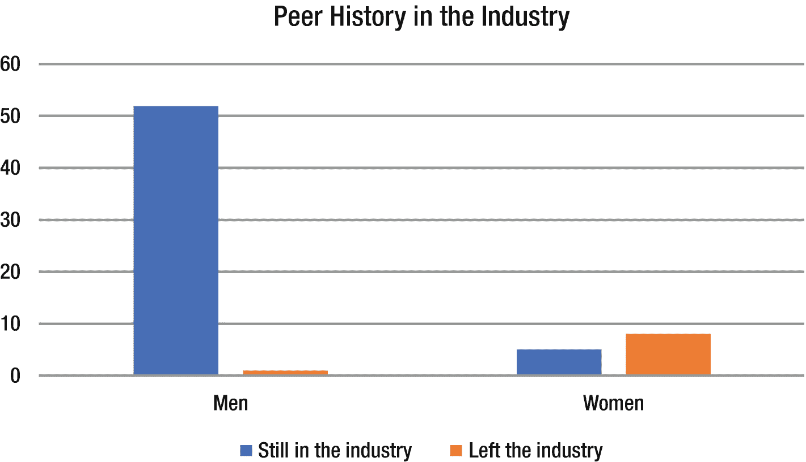
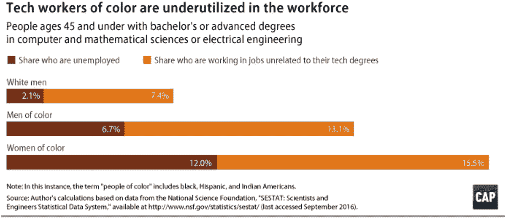
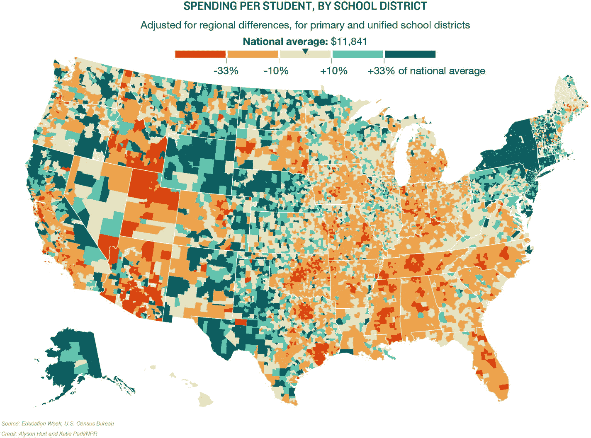
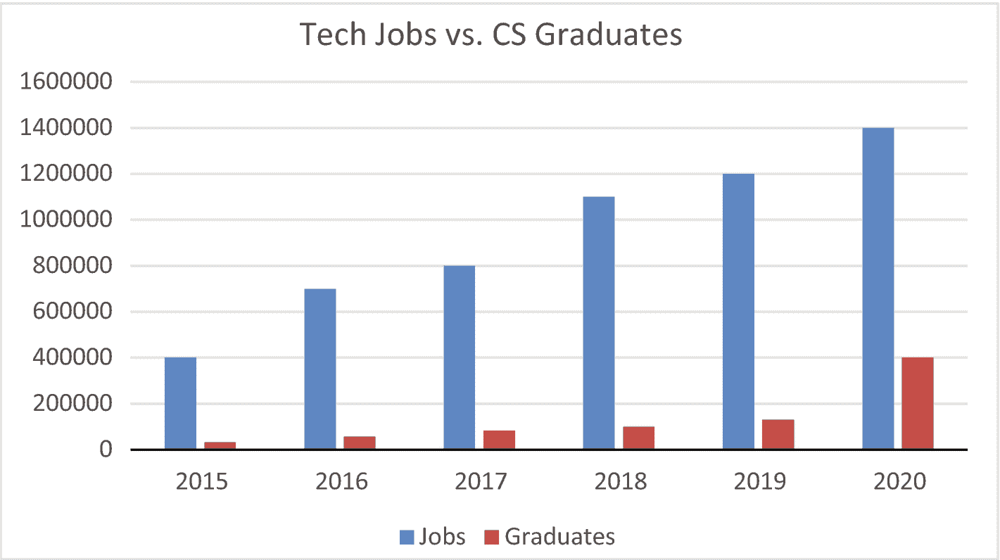
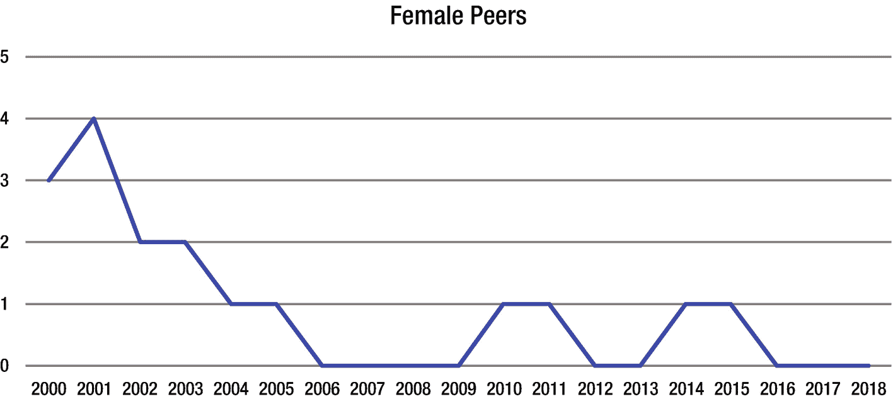

# 1. 故事背后的数字

事实是由证据和数据支持的信息，而观点则基于个人经验和看法。由于偏见源于个人的经历和观点，一些读者怀疑其存在也是很自然的。本章将涵盖一些亲身经历以及背后的数据，以帮助我们在这段旅程中前行。

## 我对偏见的认识

在这个行业摸爬滚打了十年后，我迎来了与一位女性同僚合作的最后机会之一，我们称她为“安”。早在 2004 年，安曾是我的首席数据库管理员，我非常尊重她的技术能力及其领导才能。在目睹了她前一年充满挑战和混乱管理决策的遭遇后，她被迫离开了我们共同任职的公司。她与一位男性同僚“乔治”之间产生了冲突，矛盾持续升级，却未得到管理层或人力资源部门的调解，最终她选择辞职。我对自己无法提供帮助感到无力，因为我和这两位当事人都是朋友，并且当初推荐了他们各自的职位，使他们得以入职这家公司。我确信无疑地意识到，我亲眼目睹了乔治因安的天然领导力而产生的不安全感。

数据库管理员的工作往往压力巨大，而我们所在公司由于业务需求，压力更甚于平均水平。当灾难降临时，安表现得冷静而深思熟虑；而乔治，无论技术多么精湛，却总是脾气暴躁，动辄对周围的人发火。虽然对乔治的行为感到失望，但更让我沮丧的是管理层——他们看不到安的领导才能，反而在雇佣两人仅仅一个月后，就让乔治晋升到了安之上。当初我推荐雇佣他们时，明确建议让安担任领导角色，让乔治承担执行任务，因为他正如我所评价的那样，是一匹“老黄牛”——我自己也属于这种类型，所以很容易识别。

随着安和乔治之间的矛盾激化，人力资源部门几乎无力掌控局面。安离开了公司，并在不久后从技术界退休。安的离职对我打击很大，我试图弄明白当初如何才能帮上更多忙。几个月后，我也离开了这家公司，失去了两位同僚，也失去了一位朋友。我失去了安这位同僚，因为我觉得自己辜负了她；也失去了乔治这个朋友兼同僚，因为我不确定究竟是谁辜负了我们所有人。

不久后，我联系了安并约她共进午餐。初次见面时，她给出的离开技术行业的理由听起来合情合理，但从她说话的方式、语气中的伤感，以及我对她经历的了解来看，我知道事情远不止如此。

安起初不愿多说，但当我强调自己为所发生的一切感到困扰时，她似乎因找到倾诉对象而松了口气。我承认自己在应对整个事件时存在失误，不确定当初如何能在前公司更好地支持她。我与她进行了长谈，并在接下来的几个月里多次交流。她描述了数十年来阻碍她职业发展的种种挫折以及持续不断的小挑战。这些情况中没有一件是明目张胆的歧视，但全都是难以明确界定的显性偏见。她曾试图解决，却屡屡惨败，因为这些情况都处于灰色地带。而她向我倾诉得越多，我越意识到自己也曾经历过许多类似的挑战。和安一样，我过去并未将这些归为性别问题，只是单纯以为只有自己遇到这种情况。在我职业生涯的这个阶段，“偏见”这个词很少被提及（即便有也很少）。而此时此刻，我们正在说出无数女性默默诅咒却不敢言说的心声。

## 女性同僚的消失

我与安的经历发生在 2011 年，比谢丽尔·桑德伯格出版其畅销书《向前一步》早了两年。当时无论是纸质媒体还是网络上，关于女性在科技行业面临挑战的报道都少之又少。当我发现越来越多女性处于岌岌可危的境地时，我开始深入探究这些挑战，试图理解我们世界中偏见的根源。那时，在我自己的职业圈子里，我曾与 50 多位男性和 13 位女性数据库管理员共事。经过快速研究（图 1-1），我发现我的一位前男性同僚已退休离开数据库管理行业，但女性同僚的情况则截然不同。与我共事的十三位女性中，有八位已经离开了技术行业。三人虽然退休，但都属于提前退休（五十多岁），其余人则转行进入了其他通常更多元化的领域。这些数字引人深思，我意识到自己必须深入挖掘，了解背后的原因。

图 1-1. 我数据库职业生涯中的同行业同僚史及女性同僚的消失

天生的好奇心使我成为敏锐的观察者，但即使是自己的偏见也会蒙蔽你的双眼。我突然面对这个事实，意识到从我第一份数据库管理员工作起，偏见就已存在。当时我与另一位女性“黛比”同时被聘为数据库管理员，但我们两人都没有相关经验。黛比刚毕业，拥有计算机科学学位并专攻数据库技术。她单身未婚，没有孩子；而我已婚，有三个孩子（包括一个新生儿），并且没有任何数据库技术的学位或认证。她似乎凭借多年的正规教育迅速适应了工作，而我则全靠自己的天分和才智艰难支撑，希望没人注意到我对数据库知之甚少。黛比拥有技能，而我则是那个“假装直到成功”的人。

入职九个月后，黛比找到我说：“凯琳，我是一名在科技行业工作的黑人女性。这行真的干不下去，我决定转到项目管理团队去。”虽然感到惊讶，但我理解她离开的原因。我们的团队领导能力很差，而项目管理团队则由一位极具天赋且天生具备领导才能的女性领导。我记得自己当时想：“如果她拥有所有这些优势都无法坚持，那我又怎么可能做得到？”我从宏观层面接受了她离开的原因，但并未将偏见的影响、女性在科技行业的处境以及多元化等因素纳入考量。我自己的偏见告诉我，这只是她个人的决定，而我的白人特权或类似的挑战与我的成功和失败毫无关系。

## 数字中的力量

数据（图 1-2）显示，有色人种在科技行业中的占比极低。不分性别来看，黑人在科技岗位中仅占不到 3%，而西班牙裔占比不到 5%。^(¹) 美国国家科学基金会统计了那些拥有技术学位但从事非技术领域工作（或持有技术学位却处于失业状态）的人群数据，发现有色人种男性和女性的比例远高于白人男性。^(²)

图 1-2. 有色人种在科技行业中的未被充分利用

我们科技界的许多人都已注意到缺乏多样性的问题，而不仅仅是行业中的女性人数稀少。当我开始在技术活动中演讲时，我注意到有色人种之间会相互联系，并且无论旨在促进多元与包容的举措看起来多么有力，有色人种似乎始终难以真正突破并实现代表性。

这一挑战可能部分源于经济因素以及我们资助学校的方式（图 1-3）。除了有色人种面临更高的贫困风险外，学校的资金依赖于当地学区的房产税。如果一名学生已经身处低收入家庭，并且所属学区也属于低收入地区，那么该学区的学生人均教育支出从当地企业和房产税中获得的资金，将远少于那些税收资金更为充裕的学区。

图 1-3. 美国各学区学生人均支出

学校资源有限，以及教育侧重点与劳动力需求之间的脱节（图 1-4），进一步加剧了这一挑战。1980 年我上高中时，学校提供了学习`Basic`编程语言的课程，以及计算机体系结构课程。三十年后，我的孩子们正在上学，然而仍有 41 个州不要求高中文凭必须完成任何技术教育。

图 1-4. 空缺技术岗位 vs. 计算机科学毕业生

在学校能接触到计算机课程的孩子，更可能学习的是办公软件技术（电子表格、文字处理文档和演示文稿），*而非*实际的批判性思维或编程教育。科罗拉多州是美国大学受教育人口比例最高的州之一，但我的孩子若想参加`Java`编程课程，就必须去职业学校学习。我所在学区的职业学校已经背负着“学业困难学生才会去”的污名，这对技术的未来意味着什么？

美国劳工统计局预计，到 2020 年将有 140 万个新的技术岗位需要由熟练劳动力来填补，但根据计算机科学教育统计，美国届时大约只有 40 万计算机科学毕业生能填补这些岗位。^(³) 教育的目的是为年轻人未来做准备，但如果我们继续将中等教育（读写算）的重点放在文学、历史和生物上，并将技术视为“社团”或“课后活动”，那么我们永远无法将技术作为未来就业核心来教授。有多少英语文学专业和历史专业的学生目前正在从事本领域工作或处于失业状态？我们教授文学、历史和生物，是认为学生可能有热情和机会将其作为职业。难道我们不应用同样的投入去教授技术，使之成为毕业的基石吗？鉴于未来十年我们对技术人才的需求比例，我们看待技术教育的方式必须改变。

因此，我支持许多将技术带给公立学校系统之外孩子的草根项目。`Black Girls Code`广为人知，但亚特兰大由 Jeremy Harms 运营的`Vine City Code Crew`也是一个绝佳范例，它将编程带入城市中心的孩子中间——这些孩子可能因家庭低收入而无法在家中培养对编程的热爱，或因学校资源匮乏而错失机会。创始人 Kira Wetzel 创办了`Girls + Data`（我最初是通过 Mindy Curnett 了解到的），该项目为女孩们提供了在更轻松的环境中学习编程的机会，培养未来的技术人才。寻找这些能让原本无缘接触技术的孩子了解技术的草根组织并不难。只需要在`meetup.com`上注册一个账号并进行搜索；随着越来越多人认识到培养技术创造者（而不仅仅是消费者）的重要性，这样的组织每天都在涌现。

### 科技——女性的舞台

随着岁月的流逝，我发现自己从最初全是女性数据库管理员（DBA）的团队，逐渐变成了一个高级 DBA 团队中几乎唯一的女性 DBA（图 1-5）。

图 1-5. 我历任团队成员中的女性同龄人数量

由于经济和个人需求，我需要独自承担抚养孩子的责任。而 DBA 这份职业，以其灵活的工作时间、补休制度和远程办公的可能性，正好能够应对孩子生病在家、家长会，以及作为单亲监护人所需处理的其他事务。

当普通人想到技术专业人士时，脑海中往往会浮现两种相互矛盾的刻板印象：
- 第一种是四十多岁、长发、衣着邋遢的男性，坐在黑暗里，面前摆着游戏屏幕、一袋奇多和一瓶功能饮料。
- 第二种则是传统意义上的“书呆子”，穿着整洁但过时的衣服，胸前口袋插着笔，戴着一副黑框眼镜。

这两种“刻板印象”都不符合实际情况。科技领域的多样性正在日益增长，并且与日俱增。也正因如此，技术工作听起来可能不像是一个有孩子的年轻母亲该待的地方。然而事实上，我发现我的数据库管理员工作，比大多数做护士或房产经纪的朋友，更能支持职场母亲的需求。如果我需要在周末或晚上工作，我通常可以在家办公。如果需要带孩子去看医生或参加家长会，也很容易安排，同样，待在家里照顾生病的孩子并同时工作也并非难事。随着技术的进步，这一切也变得越来越容易。在过去的十年里，我得以远程办公，最大限度地利用我的时间，减少了通勤，从而能更高效地服务于公司，也更好地照顾家庭。

对于那些认为科技行业的工作就是每周工作 60-80 小时、必须第一个到办公室、最后一个离开的人，我想说，这并非因为技术本身是个糟糕的职业选择，而是因为这些例子代表了糟糕的工作环境和糟糕的领导力。这种情况并非不存在，但随着我职业生涯的成熟，我发现，与其说是追求工作与生活的平衡，不如说是找到适合自己的平衡点。

我曾因需要远程办公或请假带孩子看医生，而受到同事和经理的严厉评判，他们质疑我对工作的投入。但我会提醒他们，关注我的工作产出效率，以及我（即使在承担家庭责任时）的**可联系性**。这才是重要的，这才是衡量工作表现和最终业绩的关键。有一种明显的偏见，将价值与每周的工作时长挂钩，但这是职场中一个巨大的谬误。如果你能在 40-45 小时内完成另一个员工需要 60-90 小时才能完成的工作，那么哪个员工更有价值？如果一个在家办公的员工可以随时待命，那么每晚待到晚上 7-9 点又真的能提供什么价值呢？我们是在为生产力**与**“瞎忙活”赋予价值吗？我们都需要学会如何“面试”公司，弄清楚他们看重的是什么，因为这决定了你对工作、对职业、最终对公司业绩的满意程度。

正如你所猜到的，我是弹性工作制的坚定支持者，特别是那些允许远程办公的。虽然面对面的交流对于同事、经理和客户来说价值巨大，但对于技术工作，有相当一部分是无需在办公室进行的独立工作时间。在这种时候，员工是被当作专业人士聘用的，也应该被如此对待，允许他们远程办公。这样做能为公司节省大量成本（比如工伤保险、办公空间和资源方面），好处并非单向的。不过，男女在申请弹性工作制时，所受到的对待存在差异。

2017 年，福尔曼大学对 600 名工作年龄的成年人进行了一项调查。研究人员向受访者展示了一段他们认为是员工与人力资源部门之间的对话，并改变了对话内容，使其包含或不包含对弹性工作制的不同请求，同时改变了提出请求者的性别。有些请求与家庭无关，有些则是因为育儿需要。受访者需要根据“讨喜度”、“对工作的投入度”、“可靠性”来评判这些请求，并且假设自己是人力资源代表，是否会批准该请求。结果显示，受访者给男性的“讨喜度”平均打分为 70%，而女性仅为 57%。他们认为男性更投入、更可靠，尽管请求的内容完全相同，只是性别被改变了。

尽管研究清楚地表明，男性更有可能获得弹性工作制而不受同样的负面评价，但我却很少见到我的男性同事申请休假。相反，我更多是看到他们将家庭责任推给妻子，这样他们就能避免向老板申请弹性。我理解他们为什么这么做——开口请假确实令人不快。作为一个离异的家长，在我获得作为雇佣条件之一的弹性工作制之前，我很少能享受到这种“奢侈”。我的前夫往往指望不上，所以我承认，为了避免和他发生争执，我更倾向于寻找那些支持弹性工作制的公司。

除了弹性工作制，薪酬也很重要，这对大多数人来说都是如此。正如我所说，我既是有经济责任的家长，也是监护家长，因此薪酬在潜在职位的考量中占据很高的比重。

我花了很多年才学会如何争取在科技行业取得成功所需的条件。我先是学着争取让工作日更高效所需的条件，然后努力学会如何争取让生活更成功所需的条件，再之后才是我的职业生涯。我们通常能被赋予的许多改变，都必须“推销”给公司。让企业明白，投资于员工能为他们带来价值，这应该成为每份简历上突出且备受追捧的技能。

## STEM 领域的挑战

2011 年对我来说是意义重大的一年。在“安”离开后，我开始联系许多我发现已经离开这个行业的女性。我与她们进行了一些坦诚、开放的对话，收集了她们对我疑问的回答，以了解她们离开的原因，并在存在文化模式时将其记录下来。其中一些同行已经准备好与我谈论偏见问题，她们似乎卸下了沉默的负担；而另一些人则对自己离开的原因讳莫如深。更常见的是，我发现她们和我一样，都被教导不要讨论偏见这个话题，我们也从未承认过它的存在。社会教会了我们如何巧妙地制造借口来为所发生的事情辩解，而如果我们真的对现实发出声音，就有可能被认为“不够酷”。

科技领域的许多女性并不符合传统“邻家女孩”的模式。我们可能拥有古怪的特质、兴趣和行为，让人们试图理解我们行为的动机。为了应对这一点，我们仍然会落入一种预期的行为模式。我们变成了“酷女孩”，而不是简单地拥抱真实的自我；我们可能会假装喜欢运动、低俗的笑话和传统的男性消遣方式。由于我们热爱 STEM（科学、技术、工程和数学）领域，我们那些更传统的女性同龄人可能会拒绝让我们融入她们的圈子。每个人都渴望被喜欢，因此我们自然会尝试找到一个能被接纳的群体。如果我们的同性群体不接受我们，我们就会做出让步，以符合周围男性最认可的“不像其他女孩”的酷酷形象。我们常常会选择更男性化的消遣方式，并表现出较少的女性特质，这能在一定程度上保护我们免受不必要的好意。无论我们偏离这一切有多远，我们仍然是文化和偏见的产物。尽管我们喜欢声称自己独立自主，但自我们从子宫中娩出的那一刻起，我们就被塑造了——被穿上蓝色或粉色的衣服，被给予男孩或女孩的玩具，男孩被告知不要哭，女孩被告知她们有多漂亮，这一切甚至发生在我们学会爬行之前。

这些数字是惊人的，并且随着我们阅读本书的各个章节，这些数字还会累积增加。在文化和偏见之间，存在着一个持续的关于接纳的挑战。但得益于过去几年的行动倡议，我已经从少数敢于直言的人之一，变成了定期发声的数千人之一。有了所有这些倡议，许多人担心数字并没有像预期的那样增长，但当增长停滞时，我并没有感到太惊讶。我在为他人提供指导方面非常成功，但这从来都不是传统的指导方式，而且鉴于我们起点很低，这在这个阶段根本无法自我维持。就像一棵小树苗，它需要呵护和滋养才能成长为更强大的存在，直到它拥有足以支撑自己的根系和坚实的基础。

我希望这本书能向其他人提供洞见，告诉他们如何以女性所需的方式指导她们走向成功，同时也能展示出赞助、建立人脉以及给予女性那些我们周围人常常避而不谈的选择是多么重要。在文化上，男孩们被培养时不仅掌握了“技能”，还获得了这些重要的机会；而女孩们则只能自己摸索，独自前行。女性几乎不知道如何从专业同行那里获得赞助，她们更可能被教导的是如何调情。我们被指导如何吸引别人的注意，却没有学会如何建立人脉、构建关系网络来促进自己的职业发展。我们因“被看到”而获得奖励，而非“被听到”；我们被教导在商界要学会积极倾听他人发言，而正是这些人，在奇怪为什么我们不更频繁地发言。我们没有接受过如何在这些未知的商业领域取得成功的教育，同时却又经常被告知，我们的一些最大优势在商界反而是劣势。

幸运的是，我一直是一个尊重数据甚于观点的人。并不是说我不重视经验，恰恰相反。我对各种情况有着极其敏锐和准确的直觉，但总是用数据来确保我的观察不会因为我自己或他人的偏见而变得盲目。这种观察技巧让我以及那些前来寻求我见解的人受益匪浅。这也是一项用于审视技术环境的技能——不遗漏任何信息，收集所有数据来理解复杂的状况。由于偏见往往是无意识的，我自身的成长背景、性别和经历可能会蒙蔽我的视野，因此在做出决定、制定行动计划或提出解决方案之前，收集数据并进行研究至关重要。

正如我所说，当我最初注意到有如此多的女性同行正在离开这个行业时，我开始进行研究。令人惊讶的是，2011 年可用的数据非常有限。我常常不确定该研究什么，但我知道在我的观察中，一些模式正在形成，而它们背后一定有原因。

斯坦福大学的性别研究网站以及随后雪莉·康奈尔的 TED 演讲，提供了最早的数据来解释我所熟悉这些模式。该网站上的文章是最早以科学的方式记录性别偏见的研究成果之一，提供了与我开始记录的模式相匹配的数据。我很欣赏雪莉的演讲，因为她以教育大众为基础，用科学的方法审视数据。她的演讲发人深省，数据也令人难以忽视，即使有很多人难以接受。这是一个宏大的话题，所以我并非要强加于人，但始终愿意讨论。专注于教育和开放对话的最大积极面之一，就是有越来越多的人想要参与这些对话。

挑战存在着显著差异，这不仅取决于文化，还取决于地域。我住在科罗拉多州，该州女性离开科技行业的比例远高于全国平均水平，尽管我们拥有全美最高的大学学历人口比例之一。全国平均水平是女性在职业生涯的 4 年内会离开科技行业，而科罗拉多州则不到 4 年。犹他州是我们的邻州，但由于地理位置和文化的不同，那里一个用户组的女性主席并不太担心如何留住科技领域的女性。她最大的挑战是让女性接受高等教育，因为那里的许多女性被期望大学一毕业就结婚。这种差异是文化性的，因为两州之间不仅存在教育差异，还存在宗教差异。

## 意外踏入技术之路

我在近 30 岁时才进入技术领域，那是 20 世纪 90 年代末，正值数据库职业发展的黄金时期。我毫不羞赧地承认，自己并没有计算机科学学位。由于一种疾病影响了我 20 多岁头几年的生活，我几乎没有什么大学学历可以倚仗。

22 岁那年，我开始出现奇怪的偏头痛，这与我从十几岁起就患有的偏头痛模式不同。这些新的“偏头痛”大约每六个月发作一次，带来一种碾压般的剧痛，常常像刀割一样从大脑右后侧向上蔓延，并伴有麻木和视力丧失。视力丧失主要在左侧，活动能力也同样受损。疼痛会持续几个小时，一旦消退，我便无精打采，会睡上一两天。由于看医生费用高昂，而当时我是一名审计员，经济上并不稳定，而且保险对许多项目都有免责条款，除非万不得已，我都不愿就医。

经历了数次这样的偏头痛和两天的昏睡后，我意识到左眼视野仍缺失了大约 10%，这足以让我去寻求专业医疗帮助。我被转诊给一位神经科医生，他为我做了核磁共振后，告知我患过中风，而且这已经不是第一次了。那 10%的视力缺失是永久性的，但我的“中风”并非典型类型。大多数中风是由高血压和血管堵塞引起的，然而血液检测显示我存在出血问题，而且血压极低。进一步的血液检测发现我自身免疫抗体呈阳性，于是风湿免疫科医生也加入进来开始研究。

在接下来的四年里，我经历了五次确诊的中风。到 1993 年，医生告诉我，最好的情况是到 40 岁时失明，最坏的情况则是死亡。我立即寻求了第二诊疗意见，幸运地找到了一位对查明病因感兴趣的神经科医生。而自身免疫性疾病的特点就是，每个人的病因都独一无二。对我来说，1994 年底生下第一个儿子的孕期，在很大程度上给出了答案——它让我进入了缓解期。当我的自身免疫问题在 2004 年再次出现时，起初与关节有关（类似类风湿性关节炎），到 2014 年则定型为结缔组织病，但再也没有回到过去那种使人衰弱的血管疾病状态。

不过，那些年来的中风还是对我造成了严重损伤。我缺失了近 9 年的记忆；左眼视野失去 48%，需要接受语言和物理治疗，并且再也无法胜任之前的审计员工作。在脑子恢复期间，我仍需谋生，于是去了 Kinney 鞋店工作。是的，我在零售店卖鞋。我在接受物理治疗的同时慢慢康复，而我的语言模式也受到了影响，所以还需要进行语言治疗。如今大多数人看不出来，因为我是一名专业演讲者，但我的“大脑词库”仍有些问题，有时会念错一些单词。请对我多一点耐心——考虑到我已经取得了多大的进步，这根本不算什么。除了这一点和我的视野缺失外，几乎看不出二十多年前我经历过什么。

然而，康复之路并不简单。我记得 25 年前在鞋店工作时，坐在一堆鞋子前，需要按尺码把它们整理到鞋架上。这个简单的任务花了我好几天。我非常沮丧，因为我脑子里就是想不明白怎么先把 5 码放好，然后是 5.5 码，接着是 6 码，如此类推。关键在于，我向来非常执着。有老板说我固执，有时甚至有点偏执，但这在我中风康复过程中帮了大忙。我只是拒绝放弃，不断尝试，最终把整个鞋架的鞋子都按顺序放好了。在我大脑恢复的过程中，我以这种方式应对每一个挑战，虽然第一次很少成功，但拒绝放弃，坚持到底。

我前面的路还很长。我年轻时学到的所有知识都荡然无存。我必须重新学习开车，方向感也受到了影响。我们就不提有多少次我发现自己到了城市*相反*的一边，而不是我要去的地方了——如果你对丹佛有所了解，就会知道这是一座非常容易辨认方向的城市。只有西边有山，而且几乎在任何地方都能看到它们。我很难回忆起自己当时为什么连方向都分不清。我也不会再记账或使用其他学过的基本技能了。就像整理鞋架一样，我不断尝试，直到最终成功。

伴随记忆的丧失，在最后一次中风大约六个月后，我的脑雾开始散去。我发现自己嫁给了一个我几乎不记得曾约会过的男人，更别提结婚了，而且我当时已怀第一个孩子五个月。我努力康复，变得独立，并在最后一次中风后不到一年就成了单亲妈妈。这本该是一个令人恐惧的前景，但我想我当时太忙于每天在小事上取得成功，以至于无暇过多考虑自己冒的风险。现在回顾过去，我敢肯定地说，没有什么比当时的情况更令人望而生畏了，这可能也是我现在看起来如此无所畏惧的原因。

随着大脑的恢复，我从卖鞋转而到 Circuit City 卖电脑。公司发现我有软件天赋，于是我开始做桌面支持。我后来与两个年幼孩子的父亲结了婚，他建议我去 US West（现为 Centurylink）做一名桌面支持专家。他明确表示我已经准备好了，因为他手下的“一些人年薪 4 万美元，却连在`C:/`提示符下加载微软 Windows 都不会。”我以一名桌面支持人员的身份开始了工作，毫无网络或办公室环境的工作经验。与现在一样，我接手了别人都不愿碰的挑战，而这些挑战恰好是数据库应用程序。似乎很少有人具备这方面的专业知识，但我阅读了所有能找到的资料，并努力靠自己解决问题。当时 Oracle 还是 16 位版本，7.3.4 版刚刚发布。我发现一个荒唐的现象：如果使用不同版本的多个 Oracle 应用程序，用户居然需要在不同的工作站上运行每个程序。我找到了一种方法，通过切换 Windows 95 中的`win.ini`文件来改变 Oracle 目录的路径，从而实现了他们声称不可能做到的事——一个工作站运行多个 Oracle 应用程序。Oracle 公司询问能否派代表来审查我的脚本和配置，审查完成后，他们向 US West 的首席技术经理建议“把她培养成 DBA”。