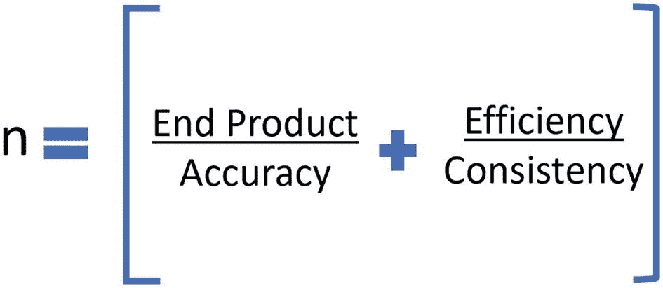
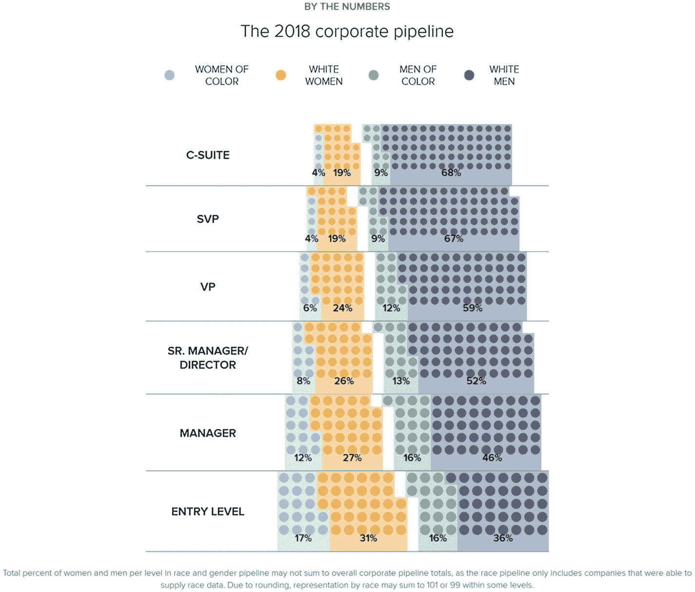

# 4. 认清你的道路，就是掌握你的道路

你的道路必须属于你自己。来自朋友、经理、导师或支持者的任何建议都无法改变这一点。如果你花点时间研究，就会发现这些建议往往反映了建议者自身的`期望`。大多数建议者很少将自己的经历或欲望，与他们给周围人的建议区分开来。因此，我强烈建议女性重视找到自己的声音。

## 未来

我们之前讨论过女性找到自己的自己的声音，进而找到自己的道路是多么困难。因此，我认为在未来，年轻女性会发现女孩团体至关重要。与更具传统竞争性的环境相比，这些团体更有可能教会年轻女性更早地找到自己的声音。这并非要混淆体育运动的作用——让年轻女性参与体育运动，同样能培养团队协作和（更多时候）健康的竞争技能。这有助于为女性提供机会，制定策略来应对针对她们的攻击性行为，并接纳自身的优势。

如果你是一位成年女性，正在寻找自己的道路和声音，请确保学会信任自己，我指的是真正地`信任自己`。你是独一无二的，你需要成为你能成为的最好的自己。要做到这一点，要知道最了解你的人是你自己。媒体和我们的社会花费了大量的时间和金钱来告诉我们什么行为和外貌更受欢迎，但女性在拓宽“女性”的定义方面，需求正在发生显著变化。我们的社会开始接纳和关注历史上曾隐身的女性，例如计算机时代的先知阿达·拉芙莱斯，以及格蕾丝·霍珀——后者现在每年都有一个女性科技活动，2018 年的参会人数上限为 20，000 人^(⁵⁶)。最近，美国国家航空航天局的人肉计算机凯瑟琳·约翰逊、多萝西·沃恩和玛丽·杰克逊的故事被拍成了电影《隐藏人物》。我们正在经历变化的不仅仅是科技领域，甚至包括另一个男性主导的行业——政治。在 2018 年的中期选举中，超过 2200 名女性竞选公职^(⁵⁷)。认识到我们世界中的这种变化，人们开始称之为`第三次女性解放浪潮`的到来。拥抱这个浪潮，让你的职业和生活成为“女性是什么以及能成为什么”这幅全景图的一部分。

相信你的想法、你的计划和你对什么适合你以及对你重要的人来说是正确的直觉。当一个想法、一个计划与你的直觉三者一致，而你身边的人却试图影响你去做他们想让你做的事情时，你要坚定自己的决心。失败与成功之间，往往就在于是否有远见，知道何时该坚持己见。建立对自己的信任将有助于你构建自己的道路，并知道何时接受反馈或建议，何时应该走自己的路。拒绝建议可以做到优雅且不带有个人攻击性。这仅仅是达成了一个简单的共识：对一个人有效的方法，未必是适合你的正确道路。

与周围人相处的另一个挑战在于，他们所谓的建设性反馈或批评。很少有人接受过如何给出建设性反馈的培训^(⁵⁸)。这导致许多与我交谈过的人收到的反馈要么价值不大，要么没有提供他们可以继续前进的选择。即使他们提出了开放性问题，请求建议的人也很少能获得真正有建设性的反馈。

如果有人持续提供价值不大或毫无价值的反馈，就要学会在需要建设性反馈时避免向他们求助。对于那些只会给出负面反馈或悲观论调的人，这只会打击你的积极性，除非这种沟通是开放式的，并能从中汲取积极的东西，否则你可能应该远离这种消极情绪。

# 通往你的人生之路

周围人的意见——家人、朋友、顾问和同辈——很容易让你偏离自己的道路。我们的家人可能出于好意，但他们眼中的我们往往不是“现在的我们”，而是“过去的我们”。我仍会时常提醒自己，我的孩子们已经成年了，并试着回想自己在他们这个年纪时的状态。我那时怀揣什么梦想？我拥有哪些资源，或者我在自己身上发现了什么？我经常告诉孩子要提前规划。他们希望未来是什么样的？他们的目标是什么？能否将这些目标分解成小任务，一步步去实现？拥有一份清晰的目标和步骤清单，能够确保你最终实现那些整体看来似乎遥不可及的成就。

首先，列一个大纲，并将其分为三类：

* **职业发展**
* **个人生活**
* **超越自我**

这份清单应保持在较高层次，以免陷入过多细节，或让你觉得难以获得那些小小的成就感。同时，也要学会奖励自己取得的小成就。正如我之前所说，行动本身蕴含着力量，但如果你不肯定那些微小的成功，你将没有精力去跨越那些巨大的障碍。

当你开始构建这份清单时，请记住，并不存在我们在电视节目和书籍中听到的那种理想的工作/生活平衡，让你获得个人成功感。就连亚马逊 CEO 杰夫·贝佐斯也声称，“工作/生活平衡”这个说法会消磨人的意志。^(⁵⁹) 对有些人而言，成功可能意味着他们每天都能按时接孩子放学。对另一些人来说，成功可能意味着每天有固定时间去健身房锻炼，或者拥有一笔培训预算来提升专业知识，或者是以上各种元素的组合。你会注意到，我并没有提及我自己在很多人眼中成功的标志（演讲、写作和职业发展）。你的道路意味着，这种平衡将为你量身定制一套属于你职业、个人生活甚至更高层面的需求组合。这与我认为什么重要毫无关系，而这也是你在寻求指导和导师时的关键考量因素。

在考量职业清单时，我希望你不要考虑从 HR 那里听来的标准工作福利或待遇，而是思考什么能让你的生活更轻松、更高效、更满意。在识别什么对你重要、能确保你履行职业和个人责任时，要跳出思维定式。需求并不等同于欲望，但这并不意味着在我们逐步构建道路时，你会对欲望毫不在意：

*   我需要灵活的工作时间/兼职/合同职位。
*   我需要一位不事无巨细的管理者/来自领导的明确期望。
*   我需要一个协作的团队/独立工作的环境。
*   我需要能够在家人需要我的时候，随时在他们身边。
*   我需要一份有技术挑战、专注于数据科学/编程/项目管理的职业。
*   我需要远程/在办公室办公。

你的欲望清单应该作为第二份清单，以及你未来道路的延伸。

*   你想做什么？`以从现在起5个月、2年、5年为时间节点来规划。`
*   你想去哪里？`你是想走技术路线、管理路线、进入一个不同行业，还是可能创业？`
*   你想达成什么？`你是渴望成为引领团队的人，还是更倾向于合作和/或支持的角色？`
*   你对职业成功的定义是什么？`不要让杂志或媒体告诉你成功是什么。成功是对你个人和职业生活感到满意。这个定义也会变化，所以如果你的成功观随时间改变，不要惩罚自己。`

## 这是关乎个人的

我们常被告知个人生活与职业必须分开，但随着技术的进步和职业的要求，职业渗透到个人生活中是自然而然的事。作为女性，我们仍然承担着[更多的家庭责任](https://www.bls.gov/news.release/atus.nr0.htm)。^(⁶⁰) 根据美国劳工统计局的最新数据，平均每天仍有 49%的女性从事某种家务劳动，*而*男性只有 19%。^(⁶¹) 研究同样表明，谁来做家务仍然是夫妻争吵的首要话题，并且我们发现，社会自然地对那些传统上更偏向女性而非男性责任的家务活赋予了更少的价值。^(⁶²)

这会对女性的职业道路产生重大影响，因为对她们个人时间的需求（在某些人看来）会成为支付女性更低薪酬的借口。我曾与值得信赖的同事公开辩论过这个话题，最终不得不构建出以下公式：

真正的公式要复杂得多，但为了尽可能简单地解释：

最终得出

我曾有过一些同事，他们在办公室待上 10 多个小时，却为企业创造极少甚至没有价值。他们只完成一些基础任务，却没有改进任何能为公司增加收入或显著提升团队表现的流程。每周在办公桌前坐 50 个小时或更久却贡献甚微，不应让这样的人比另一位每周出勤 40 小时、但任务表现远超平均水平、积极主动和/或为团队带来改进的员工更优秀。企业开始意识到这一点，并基于这项研究重新调整他们眼中优秀团队成员的标准。^(⁶³)

尽管有了这些认识，职场妈妈承受的压力依然存在巨大的偏见。不仅仅是个人责任的需求在影响着我们看待职业女性的方式。^(⁶⁴) 从整体文化来看，人们认为职场女性比男性同行能力更差、投入更少、更不勤奋。^(⁶⁵) 在开始这场讨论之前，我必须首先明确：目标是要摆脱偏见，专注于平等，*而不是*让女性看上去比男性同事更优秀。

### 局限偏见依旧存在

在一项得到高度支持的皮尤研究中，54%拥有 17 岁以下子女的男性认为，全职母亲是养育孩子最理想的情况。^(⁶⁶) 当女性被纳入研究后，这一比例的增加无疑更为显著，因为这既是一种文化观念，也是一种自然认知。

作为 2006 年发布的一篇论文^(⁶⁷)的组成部分，由我的`玛丽埃塔学院`进行，并由`凯莉·麦金托什`和`威廉·鲍尔博士`撰写的研究表明，职场母亲和全职母亲对孩子的成长影响差异甚微。不工作的父母在孩子年幼时能提供更多个人时间，并在活动期间给予支持；而职场父母的孩子在学校表现更佳，也更为独立。随着女性受教育程度和职业发展的提升，她们的薪资也随之增长，从而增加了子女所能获得的照料与服务。我们常听到“养育一个孩子需要举全村之力”，对于那些没有家人或朋友支持体系的父母来说，这些服务能让家庭中的每个人都受益。这项研究的核心结论是：无论你是全职母亲还是职场母亲，两者对孩子来说并无优劣之分，这应该是一个家庭的选择。研究还表明，美国文化对于女性外出工作仍然存在显著的偏见和争论，尽管数据证明事实并非如此。

### 没有“儿童席”

接着我们进入另一个常令人不适的领域，那就是不想要自己孩子的职场女性所面临的挑战。尽管逻辑告诉我们，这与男性不想要孩子没什么不同，但针对女性的次级偏见让她们不被人信任或相信，这使她们处于一个非常艰难的境地。^(⁶⁸) 在面试工作机会或晋升机会时，这些女性被问及将来是否打算生孩子的情况并不少见。尽管这与同事或雇主毫无关系，但她们不生育的决定仍受到质疑，并常被告知“你会改变主意的”。同样，选择不要孩子的女性常被指责为“自私”，而作为一个母亲，我认为恰恰相反。当一个人决定要孩子时，常见的原因是他们想要一个孩子去爱，以延续血脉，或满足其他欲望。选择生孩子并非一种无私的行为。无私体现在后来你（但愿）向孩子展现的爱，以及你如何将孩子培养成社会中有价值的一员。一旦你做到了这一点，你就完成了心愿之外的责任，但这个决定很少是没有想要满足的欲望而做出的。我们甚至读到过文章，称从未生育的女性更可能感到不满足。正如我们已经明确指出的，认为只有传统选择才能带来满足感的想法是一种迷思——每个女性都有自己的道路，而决定她一生是否成功的标准清单，就像她本人一样独特。

我最小的妹妹`金柏莉`是一个觉得自己当姑姑更快乐、并决定不生孩子的女性。她令人无比振奋，拥有法学硕士学位，在一家很棒的公司从事知识内容工作，并在湾区享受着她的生活。如果她当初选择成为母亲，我看不出她能给世界带来更多价值。她极其独立，生活充实，拥有忙碌而成功的职业生涯，一有机会就去旅行。而我的二妹则不同，她一生大部分时间都做兼职工作，将母亲身份放在首位。`克里斯蒂`在更传统的人生选择中找到了满足感，我认为她如果走`金柏莉`的道路，不会感到同样满足。关键在于掌握我们各自的旅程，我们所有人都应该有机会选择那条最适合自己独特个性的道路，而不仅仅是遵循传统规范或媒体所定义的“成功”。

我自己在为人母方面的抉择则介于我姐妹之间。我是三个亲生子女和两个年长继子女的母亲。虽然我比二妹孩子多，但我一直在工作，每次休完短暂的产假后便立即返岗。当我很忙碌的时候，我最为快乐，这在我作为职场母亲的身份上体现得淋漓尽致。我爱我的孩子们，甚至在孩子们很小的时候请了住家保姆（这并不像听起来那么光鲜，而且当你有了三个孩子，这通常比传统的日托更便宜）。我的孩子们年幼时，我是一位单身母亲，请住家保姆为我的孩子们提供了更传统的成长环境，同时我得以发展自己的事业，以最好的方式供养他们。这是我的道路——我自己的旅程。15 年后，我的第二位保姆成了我最好的朋友之一。我雇用她做住家保姆时，她是一位单身的新手母亲，这种安排虽然并非传统（通常保姆没有孩子），但效果很好。她可以和她自己的孩子待在家里，而我也有人能在家里陪伴我的三个孩子。直到所有孩子都到了上学的年纪，我才选择换成标准的课后托管班。

# 不是你的秘书

作为一名职场母亲，我面临的最大挑战是：我身边的男性可以将家庭责任转嫁给家人以应对工作难题，而我却要不断寻找平衡两者的方法。在我刚步入职场时，管理者们几乎没有处理员工在非工作时间远程工作或孩子生病时在家办公的经验。尽管我的上司们尽力体谅我的处境，但那时是 21 世纪初，那一代人中的许多人仍然明显依赖妻子和家人来承担那些我只能依靠自己的职责。我的前夫成长于一个传统的全职母亲家庭，所以他还在慢慢接受自己需要为孩子付出更多的观念，而且我身边也没有任何亲人可以帮忙。2010 年，我下定决心今后只寻求远程工作岗位。当时技术已经足够成熟，让技术型远程办公变得便捷。

正如其他人容易评判的那样，这并非因为我在履行职责上不如男性同事。我的表现一直优于周围的人，但远程工作让我不再需要解释为什么需要离开办公室 15 分钟去接孩子放学，或是在孩子发烧时居家办公，这大大减轻了不必要的压力。当我的同事们可能白天在办公室厨房闲聊或偷懒来减压时，我往往充分利用在办公室的时间，而在家办公时也同样如此。我的工作效率极高，但由于我的团队几乎全是男性，我在生活中各方面确保责任落实的需求与他们是不同的。尽管这还不到二十年前的事，但当时对我作为一名单身职场母亲所面临的不平衡处境，人们的认识还很少。未来最大的希望之一在于，我经常听到男性同事现在强调接送孩子、照顾生病的孩子或其他挑战的重要性。当今的远程办公机会让这一切对每个人都变得更加容易。这不再仅仅是女性寻求的福利，也惠及了男性面临的责任需求。

根据最近关于该话题的研究，只有 46%的美国人在工作周的某个时段在家办公。^(⁶⁹) 尽管我们取得了诸多进步，但从 2009 年到 2017 年，在家办公的员工比例一直持平。这一比例持平的部分原因在于一些公司将远程办公政策改回坐班制，这是一个令人沮丧的趋势。远程工作并不适合所有人，但对于那些可行的人来说，它能创造一种和谐，并且随着技术进步，它日益接近在办公室工作的体验。

## 远程办公之问

如果你正在考虑如何为自己提出弹性工作制的话题，请记住远程办公对于某些技术岗位比其他岗位更容易实现。数据库管理员或开发者面临的挑战会比项目经理少，后者可能需要定期进行面对面会议或接触不太懂技术的业务用户。在与上司或同事进行任何讨论之前，请确保你已具备支持过渡到远程工作场所的技术条件。

你需要回答的问题：

1.  你是否有独立的办公室——远离家庭和家人的干扰？
2.  你的手机和 Wi-Fi 信号质量如何？
3.  如果出现网络中断，你是否能去办公室工作，或者有备选方案来弥补？
4.  你是否需要从台式工作站更换为笔记本电脑？
5.  你的团队多久进行一次面对面会议？与客户/用户的会议呢？

用于沟通的软件可能包括：

*   `Slack`
*   `Teams`
*   网络会议软件，例如 `Webex`、`Skype` 等。

用于任务分配的软件：

*   `Jira`
*   `MS Project`

对于任何从事技术工作且对代码或脚本有版本控制需求的人来说，还需要额外的代码仓库和跟踪软件，例如 `Subversion`、`Github`、`Git` 等。一个集中的文档存放位置非常有益，可以确保重要信息不会只保留在本地工作站上。

你需要确保自己可以通过电话和计算机轻松远程访问。你计划工作的地点，手机和 Wi-Fi 都应有出色的信号和服务。或许你可以考虑投资一个`MiFi`，这是一种小型设备，可为设备提供连接到移动运营商的移动热点。很多人问我这与切换到手机热点有何不同，其优势在于，如果你有一个专用热点，你的电脑就不需要与手机上的所有应用和服务争夺带宽。

一旦你做好研究并确认拥有支持远程工作的技术，就整理好你的案例提交给管理层。谈话应以非正式的方式开始，以“试探”决策者的态度。如果你是第一个提出远程工作或弹性工作制要求的人，提出这个话题可能并不容易，但如果你有一位好的领导，他/她应该会乐于接受这样的对话。一旦同意进行正式讨论，请确保安排一个会议邀请来记录后续的对话，并在每次会谈后跟进，以继续推动决策。

关注远程办公的相关数据可能效果不一——总会有一些来源对远程工作者持负面看法。雅虎和惠普是最近两家要求所有远程员工回到办公室的公司。尽管雅虎继续劝阻远程办公，但惠普很快意识到他们无法在现有办公空间容纳 30 万远程员工，于是转而采用弹性工作制来适应所有人。如果有人拿这两家公司作为理由反对你考虑远程工作的选项，那么强调这两家公司的股价以及缺乏多样性，有助于反驳这些观点。在召回远程员工后的三年内，雅虎和惠普都遭受了重大损失，同时伴随着员工流失。

如果你成功获得了远程工作的提议，过渡到远程工作环境可能涉及一个过渡期，在此期间部分天数仍要在办公室办公。如果你已经在现任职位上工作了一段时间，并且有高于平均水平的绩效记录，那么试用期不应超过几个月，并且需要与管理层达成一致。要获得弹性工作制，先尝试每周远程工作 2-3 天就足以证明远程工作选项的可行性，并计划记录下成功经验以及经验教训。

### 惠及众人

灵活的工作安排和远程办公是科技行业两大最重要的进步。^(⁷⁰)这不仅惠及女性。我认识的最优秀的父亲们都采用远程办公，而过去十年间，我在五家公司远程工作，且主要与全男性团队合作，也接触过不少居家办公的父亲。灵活的工作安排、更少的通勤时间以及更多的亲子时光，让他们能更多地陪伴孩子，建立起更紧密的联系；正因如此，他们也更有可能分担家务责任，而不仅仅是育儿工作。在我看来，这不仅对孩子的成长有益，^(⁷¹)对伴侣也同样有利。那些有工作且与配偶/伴侣拥有更平等关系的女性，生活中的压力和需求会更少。她们对生活和感情关系的满意度也更高。^(⁷²)听起来或许有些奇怪，但这对于在家庭责任上分担更平等的离异夫妇也同样适用。我一直抱有这样一种信念：即使离婚了，我也相信曾爱过前配偶是出于正当理由，并会希望对方得到自己期望的对待。我非常清楚“一个巴掌拍不响”的道理，分手时也是如此——即使你被动，对方主动，你们双方都对关系未能长久负有责任。那些已经分开的父母，若能花时间相互尊重，并牢记每个人对孩子都很重要，就应当暂时放下自己的感受。将孩子置于个人情感之上应成为优先事项。通过消除这些挑战并实现有效的共同养育，职场母亲便能专注于养家糊口。

有了这种清晰的认知，就谈到了女性如何在拥有此类成熟共同养育关系中获得更好的发展。拥有支持性共同育儿伙伴和责任分工的女性，在职业生涯中表现更佳。^(⁷³)试想一下，如果每天能省去一项主要需求，你将会变得更加成功。由于女性在任意一天从事家务劳动的可能性比男性高出 49%（男性为 19%），因此每天减少一项需求就能极大地改变她们的时间安排。^(⁷⁴)如果你能意识到这种差异，并建立更平等的责任分工，那么这对女性在事业（而不仅仅是生活）中取得成功将产生重大影响。

尽管我过去对事业投入极大，但直到 2010 年，我仍感到不堪重负。当时我抚养着三个孩子，并且要应对一个正经历所谓“中年危机”的伴侣。我们曾许下承诺：如果发现彼此都不快乐，就放对方自由，而我毅然践行了承诺。他在四十多岁时意识到自己想要亲生孩子，而同样年过四十的我，则坚持要陪伴上一段婚姻中亲生的三个孩子长大成人，直至他们离巢。到 2011 年，我的第一位导师蒂姆·戈尔曼重新走进了我的生活。随着时间推移，我们双双离婚，并开启了如今这段美好的恋情与伴侣关系。

### 至关重要的支持

关于女性成功事业与支持性伴侣关系的研究已日益为人所知。^(⁷⁵)当女性比伴侣更成功时，文化氛围往往会让男性处境极其艰难。当女性有机会选择工作或居家时，男性仍只有一条路可走——养家糊口。^(⁷⁶)除非我们能更包容地接受男性退居传统上属于女性的家庭角色，否则职场上的女性同样会继续受到束缚。除非各方都能平等地做出贡献，否则平等就无从谈起。^(⁷⁷)

女性的职业道路选择同样受到伴侣意愿的影响。这不仅在于询问伴侣是否支持你全力投入事业，更在于——如果你赚得比他们多，他们会作何反应？如果有孩子，当孩子生病/需要从学校或课外活动地点接回时，谁负责请假？是轮流承担还是由一人全权负责？那些家务活又该如何处理？

我无法想象，如果没有配偶蒂姆·戈尔曼的支持，我的成就会打多少折扣。他坚定不移的支持对我的事业和家庭投入程度产生了巨大影响。因为知道有他在背后支持，我减少了许多焦虑和压力，这让我能迎难而上，完成那些原本可能无法做到的挑战。

许多我曾指导过的女性抱怨说，配偶虽然嘴上乐意帮忙，但自己每次开口请求都耐心耗尽，最终不得不亲力亲为，反而浪费了更多时间去求助于配偶。那么，伴侣是否愿意在无需被要求或提醒的情况下，主动承担 50%的家务呢？

有些夫妇（无论男女）会默认收入较低的配偶应该承担更多家务……前提是那位配偶是妻子。^(⁷⁸)理解这一点至关重要，因为这可能给初入职场的女性带来压力（考虑到性别薪酬差距，以及女性在孩子上学后重返职场的情况，这往往对女性影响更大），如果她在家庭中承担了更多负担，她的事业就更难取得成功。

## 学校教育

社会仍然期望女性承担主要照顾者的角色。^(⁷⁹) 就像我的前夫，当他带着孩子去学校时，总会被问到“我”什么时候能来，仿佛他只是个次要的替代品。这对他来说可能非常沮丧，我也理解他有时会放弃的原因。父母必须向社会明确：双方都对孩子成长负有责任；如果父母双方都工作，可能只有一人能参加学校的活动或承担相关职责。我们的学校体系在应对双职工家庭和单亲家庭方面仍然面临挑战，根据我的经验，大多数学校依然如此。

近年来，学校的作息安排也发生了变化。有些学校在原有的春假基础上增加了秋假，而另一些学校则全年上学，只在全年穿插几个长假期。由于各学区的假期时间不同步，这可能会对在职父母的职业生涯产生严重影响——考虑到需要调整安排去适应假期的一方往往是预期更高的那位，而这个人更可能是女性。这种额外的压力，加上年轻一代对养育责任的观念变化，导致父母双方都可能面临职业生涯目标受影响的风险。

我曾被学校管理人员指责，因为我有工作而“没有认真承担母亲的责任”。另一位管理人员甚至告诉我的前夫，我必须要辞掉工作，开始陪一个孩子上学——尽管她已经被告知我是家庭的主要经济来源。我的前夫对此非常愤怒，开玩笑说：“你知道如果她那样做，我得付多少抚养费吗？？”

现在有一些特许学校和网络学校，它们更能理解父母时间有限的情况，要么将作业限制在校内完成，要么提供课后辅导项目，确保孩子们在校期间充分利用时间，这样他们就能在一天结束时与父母共度美好时光。

不过，事情也有光明的一面。年轻一代，尤其是那些有在职母亲的男性，更有可能支持自己配偶的事业。^(⁸⁰) 他们更多地参与到孩子的生活中，并且不再仅仅局限于“养家糊口”的角色。我们看到公司里正在推行多元化和包容性举措，使薪资透明化，从而可以解决复杂的性别薪酬差距问题。

通过[亚马逊的土耳其机器人平台](https://www.mturk.com/mturk/welcome)（一个用于小规模任务的在线平台）进行的一项[研究](http://econgrads.berkeley.edu/emilianohuet-vaughn/files/2012/11/JMP_e.pdf)，包含了 2000 名参与者，要求他们完成两轮数据录入，每正确录入一条就获得报酬。该研究展示了第一轮和第二轮工作表现的差异：第一轮中，一组参与者只看到自己的收入；第二轮测试中，另一组参与者不仅看到自己的收入，还看到了其他参与者的收入。

第二组测试中，由于掌握了薪资信息，参与者“工作更努力，表现显著提升”。他进一步指出，在第一轮中表现优异、了解自己收入的参与者，在第二轮中会更加努力，以保持或超越自己的原有水平。^(⁸¹)

像 SumAll（一家社交媒体管理公司）、WholeFoods（现为亚马逊所有）和 GrantTree（一家总部位于伦敦的借贷初创公司）等公司，都加入了薪资透明化的新趋势。我最喜欢的社交媒体工具之一 Buffer（一款社交媒体内容管理工具）就实行了完全的薪资透明——从 CEO 到最新入职的员工都是如此。该公司非常推崇透明的薪资模式，他们甚至增加了一个薪资公式计算器，可以为任何企业设定每个人的薪酬。

所有这些变化一点一滴地累积起来，为女性在职场——进而也在科技领域——取得成功创造了不同。这让你在决定自己是要成为技术奇才、拥有灵活时间的专业技术人员、走向高管层，还是自己创业时，更容易找到自己的道路。

### 设定目标

科技领域总会有一些女性，她们不甘于仅仅成为 IT 环境中的一名员工。她们的雄心壮志告诉她们：“你会走得更远。”她们已经瞄准了高管层的职位，或者立志创办自己的公司。

尽管世界仍在发展，我们也在努力增加科技领域的女性人数，但高管层仍然处境艰难。在《财富》500 强公司中，名叫大卫（David）的 CEO 人数比所有女性 CEO 的人数还要多。^(⁸²) 《财富》100 强公司的情况也类似，所以这不仅仅是“女性在和大人物们竞争”的问题。看到某个职位上的女性人数甚至少于拥有某个单一名字的男性人数，这组对比数据会让人非常清醒。^([⁸³fn83)) 女性在公司的领导角色上仍然严重落后。尽管多元化和包容性已成为多数办公室的新口号，但正如我们在本书中已经讨论过的，这在许多公司的高层可能并未带来真正的改变。

我很幸运能有机会与几位男性 CEO 交流，而令我感兴趣的是，他们对于阻碍女性取得他们（在我看来）轻而易举就能获得的成就的挑战，了解得有多么少。阻止女性达到高管层的根本挑战在于，这削弱了她们实现终生梦想和抱负的能力。

在我的职业生涯中，我一直避开高管办公室，愉快地走向服务器机房。因此，当被问到这类问题时，我想了解这些女性面临的独特挑战，以及我如何才能帮助她们。除非我深入研究数据，否则我无法成为一名有效的导师。而数据中既有明显的相似之处，也有一些显著的不同。

#### 被看见

与科技领域的女性一样，那些走向领导岗位和高管层的女性也难以被认可和倾听。如果女性在会议和项目中发言时不被听取，她们就无法获得男性同行所能得到的机会。如果考虑晋升人选时，她们的名字没有被提到，她们也可能被忽略。从高级管理层那里获得支持，让自己的名字被知道、让贡献被认可，这至关重要。这对科技领域的女性同样重要，但在晋升之路上更是如此。

#### 建立人脉

我指导过的一位女性，科马尔·戈亚尔，在建立人脉方面做得非常出色。作为一位高级合伙人，她还鼓励女性领导者互相支持：当她们无法接受某个机会或需要推荐别人时，*首先*推荐另一位女性。正如我们刚刚讨论的，女性常常被忽视，因此有意识地努力首先将成功机会引向其他女性，可以带来巨大的改变。这看起来像是一种特殊待遇，但你们中有多少人听过“老男孩俱乐部”？这是为了平衡竞争环境的关键，直到女性达到再也不需要这样做的地步。

#### 专注

如果你和任何一位 CEO 交谈，他们了解自己的业务，也知道如何增加收入。他们“眼不离球”（专注目标）。这对于那些正朝着这些职位努力的女性来说同样至关重要。找出什么对公司是重要的——短期和长期目标。找到你能帮助公司实现这些目标的方法，你就会在高级管理层中更加显眼，也更有机会实现自己的目标。想办法让你工作外的活动也能为你的最终目标添砖加瓦。任何时候，如果你能通过一项任务实现多个目标，那就是一次胜利。

## 自信

我们常听说女性不如男性自信，这一点也不奇怪，因为从小到大，我们常被要求反思自己的想法，却很少被鼓励去承担风险。花点时间教会自己进行经过权衡的冒险。你克服的风险越多，就会对自己越有信心。每次开会时，都致力于做出一个扎实的贡献。每个季度接手一个新项目，主动去做别人都不想做或最具挑战性的那个。这份努力会是值得的，自信则是锦上添花。学会优雅地失败。正如你会反复听我说起，成功者与失败者之间唯一的区别就是坚持。学会“装到你成功为止”（fake it till you make it）。在我的职业生涯中，与 95%的男性共事时，我总是惊叹于男人们常常只掌握完成任务所需 10%的知识，却表现得像专家一样。这不是害怕失败，而是知道可能会失败，但学习与成功的机会更大。这是女性应该向男性同行学习的重要一课。他们从小就被赋予这种心态，这在商界极其有益。

## 无所畏惧

要领导他人，就必须有人愿意追随。女性不应害怕听到自己的声音。学会自信地表达，并且表达得体。去掉那种让陈述听起来像提问的“升调”。站着对一群人讲话时，要占据空间——双脚与肩同宽，说话时不要害怕用手势。不要试图让自己显得“渺小”，就像女性在文化上被教导的那样，交叉双腿坐着。说话时要学会清晰地发音。女性，尤其是那些对各类科技感兴趣的，往往倾向于语速较快。为了帮助听众理解，要学会清晰发音，以消除沟通误解。

在进入会议室或在众人面前发言前，务必准备好关键论点并清晰列出数据。男性从小被培养去识别和辩论细节，这对那些被教导要接纳并转化细节以使说话者感到被接纳的女性来说，可能会非常沮丧。要准备好充分阐述自己的观点，同时也要利用机会请辩论者私下继续讨论，以便你能实现最初的目标。不要让那个人把你“带进兔子洞”，陷入偏离主题的闲聊中。

如果你发现自己的完美主义影响了变得更无所畏惧的能力，考虑寻找方法来解决它。有句谚语说：“你想要的一切都在恐惧的另一边。”害怕不完美往往源于我们对批评的恐惧。女性承受着来自四面八方的批评；要足够自信地将这一切抛诸脑后，去承担看似不可能的事情，确实困难。这时，向知己倾诉、进行冥想/瑜伽，或寻找其他排解方式来抚慰这些恐惧，就显得尤为重要。

如果被“内心的魔鬼”，即你自己的消极想法或行为所困扰，可以考虑在日记中记录下这些想法和行为。这将给你时间去制定一个行动计划，以应对当它们真正发生时该如何反应，然后付诸行动。开始记下对抗消极想法的方法。例如：

*“我永远无法在股东面前发言。”*

开始列出你可以提高演讲技巧的方法。加入当地的`Toastmasters`演讲俱乐部，寻找能帮助你进步的同伴，并拥有一个安全的环境来磨练你的演讲技巧。

这也将使你能够追踪自己的进步，以及持续出现的机会。

## 赞助人与导师

对于身处高管层的人来说，这两者甚至更为重要。像`LinkedIn`和`Twitter`这样的社交媒体平台，让你能够轻松接触到那些对你职业生涯的成功产生巨大影响的人。主动联系他们，无论这看起来多么令人畏惧。建立一个与你职业目标一致的、强大的个人品牌。确保拥有不仅能提供指导，而且在你有困难时、当你不在场时能在一旁提供支持的人。

除了辅导方面的挑战，处于领导层的女性在薪资上也难以与男性同行达到同等水平。^(⁸⁴) 与技术类特定职位不同，领导岗位的薪资范围差异很大。没有明确的薪资预期，这正是你的人脉网络极具价值之处。我们需要无所畏惧地询问周围人的薪酬，也要勇于争取自己应得的价值。

在谈判上一份职位时，招聘代表问我是否“固守”于之前的薪资，因为新职位包含高额的销售奖金作为一部分。我不假思索地回答：“我想如果我不坚持自己的薪资底线，那我就辜负了科技界所有女性。”电话那头传来笑声，但并未继续追问。两周后，他们回复，同意了我之前的薪资水平，并额外增加了 30%的奖金涨幅。这是我的瞬间反应，但正是因为我已决定坚守薪资预期，才得以在换工作时保住了期望的薪资涨幅。我们是专业人士，我们的时间理应与男性同行一样得到同等的报酬。

### 赢得认可

社会教导我们，谦逊是一种魅力。当男性被告知成功者应自信时，害羞而轻声细语的女性却常被描绘为讨人喜欢。^(⁸⁵) 而那些敢于做自己并对此充满自信的女性，却可能被视为缺乏吸引力、不可信，甚至更糟。因此，我们不太愿意讨论自己的成就，甚至可能被认为令人望而生畏。

希望晋升到领导岗位的女性，必须愿意以身作则，承认自己及其团队的成就。尽管我们常听说，能认可团队成就的管理者才是真正的领导者，但如果女性本身不够引人注目，无法首先获得管理职位，那么一切皆是徒劳。与你的男性同行不同，你必须更多地突出自己的贡献，否则就会面临被忽视这一无法回避的问题。

不要让他人在你的道路上设置障碍，从而剥夺你的方向。天生具有领导力的女性会被称为“专横”，或者不被视为坚定自信，而被贴上“咄咄逼人”的标签。

1.  纠正这些针对那些表现与男性同行并无二致的女性的负面词汇。
2.  不要让这些词汇阻止你走向领导岗位。

当你开始取得成功并步步高升时，请记得回馈。让更多女性担任领导职务、使女性成为领导层常态的最佳方法，就是在你提升自己的同时，也帮助他人。主动接触并赞助或指导你身边的女性。帮助她们取得你所取得的成就，这样我们所有人才能共同进步。

女性占职场人数的 50%，然而在科技领域或领导层中，她们的比例并未得到体现（图 4-1）。^(⁸⁶)

**图 4-1** 2018 年职场女性研究——企业人才管道

要改变这一现状，我们需要承担更多风险，并为更严峻的挑战做好准备。尽管我为女性提出了许多改变的建议，但这同样需要我们周围的世界发生改变。任何人都会告诉你，文化是最难改变的事物之一。我们需要继续提高声音，提升我们身边的女性，这意味着**我们所有人**都要参与其中。女性无法独自完成这一切，这意味着我们世界中的男性也是解决方案的一部分。

脚注 1 2 3 4 5 6 7 8 9 10 11 12 13 14 15 16 17 18 19 20 21 22 23 24 25 26 27 28 29 30 31

