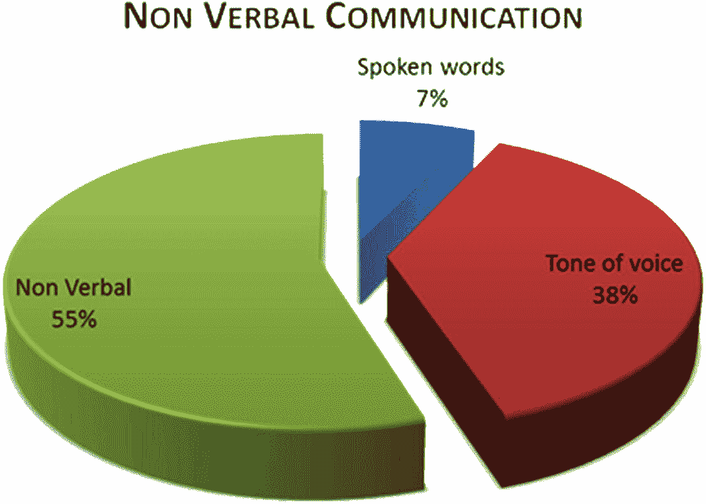

# 3. 将善意转化为积极改变

在职业生涯的各个角色、公司和技术道路上，沟通始终是一个绕不开的话题。沟通不仅关乎我们如何表达，也关乎我们如何倾听和观察。我刚加入微软时，得到了萨提亚·纳德拉的新书《刷新》。^(²⁴) 他在书中写道：“那些积极倾听的人更有可能被听到。”积极倾听是一种你可能认为女性更擅长的特质，但事实上，我们在这方面面临的挑战和男性一样多。男性倾向于说而不太愿意听，而女性则愿意听，但并非积极主动地倾听。^(²⁵) 杨百翰大学的学者最近一项研究发现，我们要么不太愿意与说话者互动，要么在该发声时害怕开口。^(²⁶) 我们点头说“听到了”，但其实点头是为了给说话者安慰和认同，而非为了积极倾听并参与对话。^(²⁷) 当我们提问时，常常问错问题（很可能我们已经知道答案，却试图向说话者证明我们在听），而男性则会针对我们已知的答案展开不必要的细节和宝贵时间，浪费了真正需要讨论的内容的时间。女性凭借敏锐的观察力，能察觉出对方何时不愿继续对话，即使需要直接介入，也会选择回避（这又回到了信任和成长环境的问题上）。

研究已经证实，沟通与说什么关系不大，而更重要在于怎么说（图 3-1）。^(²⁸) 微表情、完整的面部表情、语气变化以及周围人的反应，都比言辞本身传达更多信息。在一个越来越依赖电子邮件、社交媒体和其他非语言沟通形式的世界里，即使非语言沟通占比超过 90%的[理论](https://ubiquity.acm.org/article.cfm%253Fid%253D2043156)^(²⁹)已被证伪，我们仍然需要面对挑战。

图 3-1

非语言沟通

## 从指导到合作

女性赋权告诉我们，在书面沟通中应该更直接^(³⁰)，但因为我与配偶之间复杂而有趣的关系，我对这个话题也有深刻的见解。我的丈夫蒂姆是我在数据库领域的第一位导师。初次见面时，我正在一家领导力薄弱的公司工作。蒂姆被请来调解他合同下的一位数据库管理员（`DBA`）与我的首席 `DBA` 之间的关系。他手下的 `DBA` 威胁要退出合同，蒂姆希望能在他们之间找到共同点。我还记得与他的第一次会面，他的技术能力和与在场所有人打交道的外交手腕让我印象深刻。

之后，公司聘请蒂姆为我们的`DBA`团队教授一些所需的高级数据库技能，课程便立即开始了。这是我的第一个`DBA`职位，我当时正在考虑离开数据库团队，加入另一位已经转到项目管理团队的初级`DBA`。那个团队有更强的领导力和女性导师，极具吸引力，但我因向往更深层次的技术职位而犹豫不决。当蒂姆的数据库备份与恢复课程结束时，他问我的经理我是否真的要离开数据库管理团队。老板确认后，他建议老板不要让这件事发生，因为我在课程中已超越了其他所有人，并且拥有强大的天赋技能——我们至今仍称之为“诀窍”。是的，这个我八年后约会并结婚的男人，正是那个把我留在技术行业的关键支持者。

## 内幕消息

多年来，我们的指导关系已转变为专业合作伙伴关系。最近，流传着一个故事^(31)：两个团队成员，一男一女，共用一个电子邮件账户。唯一不同的是他们的签名。男性同事一直以为自己工作效率更高，并且从未真正考虑过客户与他互动的方式与他的女性同事有何不同，直到他经历了一段因无谓的提问、阻力和障碍而备受挫折的时期。直到他发现自己发送的所有邮件都带着女同事的签名，他才开始意识到可能发生了什么。他想进一步实验以收集更多数据，不敢相信正在发生的事情。他征求了女同事的同意，她同意进一步测试，于是他们用一周时间互相用对方的签名发送邮件。这位男性同事经历了职业生涯中最沮丧的一周之一。他发现完成任何事情都需要两倍的时间。人们无时无刻不在质疑他，用无关紧要的细节浪费他的时间。甚至有一位客户试图约他出去。而在此期间，他的女性同事表示，她度过了职业生涯中最轻松的一周。人们不与“他”争辩，只是照做她要求的一切，甚至主动提供额外帮助。这是一个广为人知的故事，但对我丈夫和我来说，这并非什么新鲜事。

在 Oracle 社区中，只有少数几对“知名”夫妻。对蒂姆和我来说，这是一段天作之合的合作关系。我们合作得非常好，属于同一个公共和私人团体，曾一起在董事会任职，甚至直到最近还在同一家公司工作。有好几次，蒂姆建议我按照他惯常的方式沟通。几乎每次我采纳他的建议后，我们俩都后悔了。这并非因为我需要严格遵循对女性的期望，或“像男人一样行事”，而是因为成功取决于谨慎、微小的改变，这些改变在他可接受的直接方式与对女性处理该情况应有的期望之间架起了桥梁。

有一次，蒂姆觉得我没有对经理表现出应有的直接。他与这位经理认识多年，便问我是否介意他改写我计划发送的电子邮件草稿。他担心我的经理会绕过职业界限，限制我的职业发展。蒂姆写了这封邮件，尽管我犹豫不决，但我也没有任何证据表明蒂姆关于我“不够直接”的看法是错误的。我一直在谨慎地运用外交手腕，希望能达成妥协。蒂姆认为，正是因为我未与他以书面形式明确设定界限和期望，才导致我遇到这个挑战，他断定问题更多出在我的沟通方式上。我选择发送了他写的邮件，并很快收到了经理的回复。经理表示，他对我的直接方式非常不满，并认为我或许需要考虑寻找新公司的机会。

我想明确一点——毫无疑问，我表现得非常出色，并且此前一直获得优秀的评价。尽管总有另一位负责人挂着正式头衔，但我是那个在需要时指导并为 DBA 团队提供支持的人。我也在自己的正常职责之外做了大量工作，不仅有益于我的职业生涯，也惠及了公司。我在会议上发言、撰写文章、发掘新人才并举办网络研讨会。

