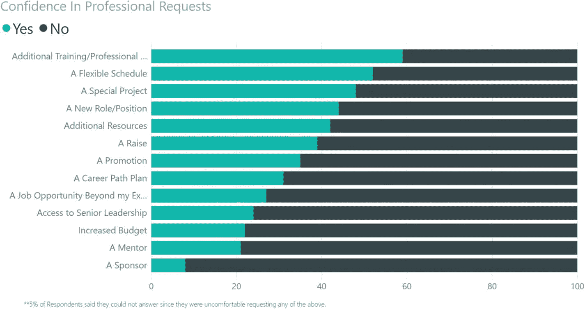

# 5. 如何寻找导师并获取赞助

尽管建议可能并非寻找方向的最佳途径，但导师可以帮助你避免陷阱，介绍人脉机会，如果他们是一位优秀的导师，还能提供赞助。赞助的重要性常常被误解，并且这个术语可能与指导相混淆，但它们是两件不同的事情，因为并非所有导师都会提供赞助。

> “指导是受邀参加派对；赞助是被邀请跳舞。”
> 
> —— 维娜·迈尔斯

## 让我引导你

男性从小就能获得指导，重点是让他们为现实世界做好准备。^(⁸⁷) 正如我之前提到的，团队运动可以提供关于团队合作、领导力以及如何在团队环境中保持竞争力的初步准备。随着女子运动开始像男子运动一样受到重视，你会发现女性正在获得自信、培养竞争精神，并学习如何成为团队的一员。^(⁸⁸)

作为 70 后和 80 年代初出生的一代，我记得在团队中，只有少数女孩会全身心投入运动。她们似乎有一种潜在的担忧：男同伴会如何看待她们——是缺乏女性气质，还是对男性的阳刚之气构成威胁？在我们社会中，许多有毒的男子气概特质在很小的时候就被灌输，而且男女双方都期望男孩具备这些特质。如果我们把“有毒的男子气概”^(⁸⁹) 简单地理解为对阳刚之气的极端要求（同时局限于男性），那么，正如期望女性仅仅表现极端阴柔会限制女孩一样，我们就能更清晰地看到我们所有人都是问题的一部分，以及我们如何都能成为解决方案的一部分。“像个男人一样”，也被称为“男子汉框框”，这种对有毒男子气概的推崇无处不在。它告诉女性，要被认为“优秀”，就应该“拿出男子气概”；而当男性表现不佳时，他们常被用女性身体部位来称呼，或者被问他们是否要像个女孩一样哭泣。^(⁹⁰)

这种指导助长了这种现象。过去几年在指导女性时，我常常告诉她们，在男性周围时，需要表现得更像他们，简单地接受“更衣室”谈话，并在遇到不适情况时保持沉默。如果你想“跟大男孩们一起玩”，这是意料之中的事。存在一种明显的偏见，即优先考虑男性的舒适感，不仅在职场上，在整个世界中也是如此。^(⁹¹)

时代在变化，年轻女性在成年后，在工作如何做自己、如何兼顾工作与家庭挑战方面，获得了越来越多的支持。然而，在指导有抱负的女性时，我们在很多方面似乎仍然有所欠缺。我上学时，虽然相当独立，但“要变得完整就必须结婚”的观念仍然强加于我；即使我决定工作，也被暗示这比找伴侣次要。自那之后的一代人，在与我所指导的女性以及我自己的孩子交谈时，我发现我们仍然更多地根据女性的个人关系，而非她们的职业成就来评判她们。当大部分针对我儿子的问题是关于他们业余时间做什么、他们的教育和职业规划时，他们却仍然在问我女儿的外貌和感情状况。

## 寻找我的导师

找到卓有成效的导师来帮助你继续走向成功可能是一项挑战。^(⁹²) 首先要做的是将寻找导师的过程**正式化**。当我丈夫最初听到我称他为我的第一位导师时，他很惊讶，因为我们从未进行过正式的谈话，我去找他并要求他指导我。导师制是指有人帮助指导你的职业生涯并提供建议，而最好的导师还会为你提供机会上的支持。总会有人自然而然地伸出援手，想要帮助周围的人做得更好。这些人就是天生的导师，应该因其作为导师的贡献而被认可。他们凭借这样一个简单的事实赢得这个头衔：即使没有正式请求，他们也会进行指导（图 5-1）。

图 5-1

在请求导师/支持者方面缺乏信心，毕马威

我曾正式指导过数十位男性和女性，但我有更多的指导关系是在我们之间没有正式协议的情况下进行的。从未有过正式的讨论，个人问我是否愿意指导他们，或者我同意指导。这种情况只是在我们交谈中自然发展，最终结果是双方都获得了成长。直到后来在讨论、社交媒体或书面交流中，当他们以这个头衔来称呼我时，我才意识到自己是他们的导师。

尽管并非有意，但大多数支持者和导师会倾向于那些让他们想起自己的人。^(⁹³) 由于这些人中绝大多数是白人男性，这让我们处于不利地位^(⁹⁴)——你需要期望自己拥有不止一位导师，并且因为你是女性，可能需要一个群体来提升你职业生涯的成功率，这比你的男性同行更需要。

尽管我很幸运有出色的导师，但我发现不同性别的导师能提供给我的东西存在明显差异。男性能够提供更多机会，而女性则能帮助我增强能力，并教会我如何获得更多职业满足感。与男性相比，这些女性更倾向于支持我的决定和我所走的道路（请记住，我今年五十多岁，比许多会阅读这本书的读者年长一代）。当我讨论自己想要实现的目标时，女性导师会仔细倾听。我自然而然地与那些不太可能评判我或被我雄心壮志吓到的女性产生共鸣。

关于这个话题——请记住我们对女性雄心的不适感，这可能会影响导师关系。拥有那些不受此影响或能够克服这一点的导师至关重要，这很重要。有一些明显的迹象可以让你知道导师关系是否不合适，但寻找导师的女性也必须相信自己的直觉，来判断是否匹配不当。

寻找导师可以从专业团体和会员组织开始。虽然在当前工作场所寻找导师看起来很吸引人，但如果指导进展不如预期，可能会造成尴尬的局面。^(⁹⁵) 如果导师无法兑现承诺，或者将失败归咎于个人，这可能会增加复杂性。由于可能出现这些问题，我建议在工作场所之外寻找指导。

## 制定计划

计划以拥有多样化的导师为目标——那些可能在个人生活、职业发展以及人脉拓展方面指导你的人，尽管我强调了寻找女性导师，但也不要回避两种性别的导师。男女导师的主要区别在于，男性最有可能与你分享**他们**是如何取得现有成就的。可能会要求一套严格的步骤和目标。对女性而言，最成功的指导情况是帮助引导她们了解自己想要实现什么，并帮助她们制定实现这一目标的步骤。一位好的导师不会回避艰难的决定，也不会回避要求个人反思可能阻碍自己的因素。这一切都应该在开放和支持性的对话中完成。包含前进选项的建设性反馈也应该是目标的一部分。

导师的反馈应尽可能包括前进的选项。这并不是说导师会拥有所有答案，但他们应该对讨论持开放态度，以帮助你找到你独自可能无法发现的克服困难的机会。

当你处理自己的挑战和目标清单时，也要单独列出那些你面临更大困难的挑战。把它们视为正在进行的工作，并归入第三类。我们都不是完美的，很多时候，接受弱点并寻找变通方法，是持续成长且不被一个挑战困住的最佳途径。

## 女性导师——你在哪里？

当你在寻找导师时，尤其是在技术领域，你可能会很难找到女性导师。也许我们需要改变看待导师的方式。正如我们不太可能考虑女性晋升、认可她们的想法，或视女性为领导层一样，我们在考虑谁会是好导师时，也不太可能考虑她们。

我人脉圈中那些与我有相似经历的人也经历了类似的情况。有无数次，即使经过多年的正式指导，我也没有被认可为某人的导师。同一个人更可能将我的配偶视为他们的导师，即使我与他们的接触非常有限，几乎就好像有我作为导师意味着蒂姆和我是捆绑在一起的，认可一个人与认可另一个人没有区别。为什么这种情况会持续发生？对许多人来说，当他们介绍自己并向他们希望留下印象的人讨论自己的技术背景时，拥有一位年长男性作为导师在他们看来比那位实际指导过他们的女性更有威望。同样，这与女性提出想法或完成工作却不被认可的情况并无不同。它继续使女性因贡献和能力而被忽视的情况持续存在。

当您寻求并接受指导时，请确保给予应有的认可。消除那种无意识的偏见，即认为女性所做的是自愿行为，而男性做同样的事情则必须被认可和赞誉。将这种认可传递下去，希望当你成功并成为他人寻求的导师时，它最终会回馈给你。

## 赞助我

在指导之上，下一个层级便是赞助。赞助某人意味着介绍、建立人脉并推荐个人获得机会。研究表明，女性获得赞助的可能性比男性同行低三倍。^(⁹⁶) 由于你的赞助者很可能是职位更高的人，甚至可能是 C-level 高管，他们会为你和你的晋升发声，因此明智地选择至关重要。这是你成长中必不可少的一部分，因为有赞助者的女性更有可能被考虑承担那些如果没有导师的推荐就无法企及的拓展性任务。一旦你在职业生涯中取得了坚实的成就记录，并初步获得了导师的益处，就应考虑寻求赞助。赞助者可以是你的导师，也可以是另一个人。鉴于偏见使女性不那么显眼，这个统计数据并不令人意外。并非女性不努力，只是在形成推荐名单以促成赞助时，她们被想起的频率往往更低。

最近一篇文章讨论了女性获得赞助少于男性的原因之一，即围绕赞助存在一种对女性的偏见，这种偏见常常来自女性自身。^(⁹⁷) 当被提供赞助时，很大比例的女性将其视为“作弊”。这是一个深刻的概念，我意识到自己也属于这一类。我一直是那种试图独自完成所有事情的人，常常选择艰难的道路。即使别人主动提出要帮助我或赞助我，也是如此。我花了相当长的时间才学会接受赞助，而不是将其视为达成最终目标的捷径。当我思考自己在职业生涯中接受赞助的复杂看法时，不难理解我为何会有这种感觉。有多少次，成功的女性被人侮辱，将她的成功归功于别人——可能是导师或男性团队成员，即使他们可能根本没做什么工作？又有多少次，在讨论一位有魅力、成功的年轻女性时，会有“她靠睡上位”的窃窃私语，即使是现在？

这种文化偏见会给大多数女性带来焦虑，驱使她们独自去做所有事情，我强烈认同将赞助视为作弊的观点。我十分理解为什么女性会回避赞助，从而错失更高效晋升的机会。你必须比这种恐惧更强大，并认识到，如果不利用赞助，它会影响你的成长以及你与男性同行一样快速晋升的能力。

最近，一位女性同行哀叹女性之间相互赞助的匮乏。虽然我知道自己是少数积极赞助周围人的人之一，但我也深知其困难所在。“象征性女性”的情况导致一位女性赞助另一位女性后，自己却失去了位置，因为社会在我们晋升时倾向于用新女性替换原有女性，而不是增加女性名额。这是一个反复出现的问题：人们认为女性在会议桌前只有有限的席位，如果一个人上升，其他人往往会跌落，而不是一起上升。第二个挑战是，女性在职场上已经承受了巨大压力，而科技领域和高级管理层中的女性寥寥无几，因此，在我看来，让男性赞助女性是使女性赞助变得可持续的关键。

## 下一步

当我们超越了赞助的需求及其复杂性之后，下一个重点就是如何通过提高自身可见度来获得赞助。正如我们在前几章讨论过的，女性找到安全且高效的方式来建立人脉至关重要。如果你不在活动中演讲或展示，社交媒体仍然是最好的方式之一。在线论坛、Twitter、LinkedIn/LinkedIn 群组和 Meetup 是让你提高可见度并构建人脉网络的最佳途径之一。

Twitter 是一个高度社交化的网络，但尽管平台覆盖范围广阔，其中也会形成一些小团体，围绕兴趣爱好、商业、专业或特定领域。粉丝数量并不等同于在该平台上的成功。理解如何与那些提供优质内容、并能为你引荐行业内其他人的人建立联系至关重要。了解哪些话题标签（`#`）与你的行业和兴趣相关。使用它们可以有效地与正确的人建立联系。一旦关注了合适的人，与他们互动并分享信息，就可能为你带来合适的导师或赞助者。

正如我在前一章中推荐的，LinkedIn 提供了一个更安全的社交媒体平台来建立人脉。每次会议后，花点时间在 LinkedIn 上与所有参会者建立联系。考虑加入与你专业领域相关的 LinkedIn 群组。发表见解，分享你的成就，并对那些你视为潜在导师或赞助者的人的帖子进行回复。

Meetup 是另一个覆盖范围广泛的平台。在`meetup.com`上创建账号很容易，搜索你感兴趣的群组也同样简单。只需在应用的搜索栏中输入主题并点击搜索按钮即可。Meetup 活动通常在工作后或周末举行，提供会员资格以及参与活动的潜在导师和赞助者。进行简短的自我介绍，随后在 LinkedIn 上跟进连接，是给活动中某人留下印象的好方法。

这种形式让你能打造出代表你技能并保持真实性的专业品牌。最大的障碍是克服恐惧，开始回复或发帖。花点时间仔细思考你的回复和帖子，不要害怕提问。潜在的赞助者总是在寻找那些工作出色、乐于学习且有自己的声音的人。不要害怕发出你的声音。

尽管赞助者和导师存在一些重叠，但你会开始注意到区别：赞助者会主动联系你，告诉你他们有一个适合你的机会。这可能是一份工作、一个在你专业领域为独特项目做贡献的机会，或是一个让你的职业生涯更进一步的机会。导师会告诉你门在哪里，而当有人敲门时，赞助者会为你打开那扇门。

一个赞助者人脉广泛。在我的情况下，我在被推荐了太多机会之后，自己也成为了一名赞助者。与其拒绝，不如把可用的机会推荐给别人，这对大家都有好处。这有助于保证机会能持续向我敞开（进一步消除女性面临的不被看见的问题）。有些人可能不愿与他人分享机会，但这是让潜在赞助者去赞助他人的好方法。我建议，随着你自身的机会开始增多，开始赞助那些有潜力的人。这始终是关于传递善意，并且如果你这样做，迟早会发现它会回报给你。

你应该考虑哪些机会，取决于你的发展路径。如果你希望在职业生涯中晋升，赞助可能意味着结识一位在你梦想工作或公司任职的人，这对你来说可能很重要。如果你希望写作，考虑先写博客，然后可以转化为文章，或者先写书评，再尝试撰写一两本书的章节。

赞助也可以以非传统的形式出现——比如有人希望工作时间更灵活，而得知你也有此意，可能会找到一个分享全职工作角色的机会。赞助有时需要跳出框框思考，去构建那些在传统的成功观念中可能不存在的机遇。

## 导师，先疗愈自己

这引出了寻找受指导和赞助对象的问题。关于如何成为导师，已有大量资源，但关于如何找到值得指导的对象却鲜有提及。这对我而言是一个学习过程：从寻找那些我认为被忽视的人开始，并在实践中不断学习。是的，我的指导风格更偏向同伴互助。我在此提供建议和赞助，但同时也展现自己不过是凡人。如果一位导师过于完美、过于自我保护，从不显露自身缺点，可能会让受指导者觉得他们取得的成就遥不可及。导师最宝贵的技能之一便是保持真实和人性。接纳自身缺陷，并展示我们每天为变得更好而付出的努力，对于希望追随我们脚步的人来说，是更有力的榜样。

在完成多次成功程度各异的指导后，以下是总结出的最有效的方法。

1.  进行“两位受指导者+一位导师”的模式，而非一对一指导。这提供了机会：若导师忙碌，同伴可提供支持。

2.  寻找那些“渴望”成功的人。没有雄心，便无法成功。

3.  导师必须希望受指导者最终比自己更成功。业内许多年长女性面临的挑战之一在于，她们被告知：女性若想成功，就必须让出自己已获得的位置。我们必须摒弃这种陈旧的偏见，推动女性在领导力和成功方面获得更多平等。

4.  寻找受指导对象时，要将不安全感纳入考量。随着突然的成功、头衔和公众认可，一些人在晋升过程中可能会陷入内心挣扎。这场战斗最终无人是赢家。如果渴望成功的人更关注他人的成就而非自身，那么与其赞助他们，不如在专注力和自信方面加以指导。我经历过太多因内心深受不安全感折磨而造成的破坏。花时间去了解你正考虑的指导对象。

5.  无需制定正式的指导会议日程——有些人需要更多时间，另一些人只需被指明方向或获得一些赞助，便能充分利用机会。给予人们恰好需要的东西。

6.  要求你指导过的人将善意传递下去。除非你做到这一点，否则指导与赞助便无法持续。让你支持和给予机会的人，将这份善意传递给他人并加以发扬。

对于那些有长期指导协议的人来说，你可能会面临如何解决女性在科技领域面临的问题，以及如何为她们提供建议的挑战。我们大多数人发现，女性导师能提供的最大益处是支持。当我们身处男性主导的工作环境时，理解对于克服有影响力的经历至关重要。尽管我们可能渴望理解，但要做到这一点却极具挑战。这并非削弱男性盟友的力量，而是让我们明白，亲身体验某事会显著影响我们与受指导者建立联系的方式。

### 快乐、光鲜的人们

你指导得越多，就越会意识到如此多的女性正经历着同样的偏见和挑战。你与她们交谈得越多，希望你不会变得沮丧或愤怒，而是更清楚地意识到解决问题的方法，并想出若不与他人交谈就永远不会想到的解决方案。我认为，这是我与那些“为什么非要谈论我们面临的挑战？”、只想谈论科技女性世界积极变化的人之间最大的挑战。有一次，我描述自己如何被指示在一个活动上只能谈论科技女性的“积极”方面，而组织者不会容忍任何关于偏见、歧视或女性离开科技行业比例的讨论。听到这些，我极为敬佩的一位女性——Equili 的创始人伊莱恩·穆拉诺^(⁹⁸^)打趣道：“哦，你是说那些‘快乐光鲜’的人！”我用这个词来形容那些要求我避免坦诚讨论、只坚持积极话题的人。我认为我们迫切需要鼓励和积极的话语，但当我们回避进行真诚的、带着敏感性的对话，而每个人都有各自的经历时，这会阻碍我们搭建桥梁、寻求解决方案来应对所面临的现状。

我发现，我在甲骨文公司支持的许多科技女性议题，都源于坦诚的讨论——有时并不令人舒适，但因为建立在相互尊重的基础上，结果总是向好的方向发展。我愿意倾听并共情那些可能与我观点相左的人的经历，但毫无疑问，我们结束对话时的情况，远比未曾发生对话时要好。我在此传达的信息是：不要放弃，不要回避艰难的对话。这并不意味着你要放弃立场，而是意味着要寻求共同立场进行公开讨论。能通过他人的眼睛看世界，力量无比强大，往往能帮助你解决那些你曾认为不可能解决的问题。

什么是共同立场？

-   进入对话前，首先要认定所有参与者都能贡献有价值的东西。

-   展现尊重，并期望对方同样给予尊重。

-   聚焦于对话的目标。如何最好地分享你的观点，让对方理解你的出发点。

-   记住，“正确”并不等同于“做正确的事”。

-   带着让双方都能从对话中获益的目标参与其中。

-   无论别人怎么说女性道歉太多，永远准备好道歉，并请对方澄清或详细说明他们所说的话，*而非*将其视为针对个人。

这种方法在许多不同情境下都能奏效，而不仅限于科技女性议题。在讨论任何困难问题（无论是个人还是职业冲突）时，持有这种心态，可以使对话更富有成效。

### 霸凌者

我确信你们中有人想知道，这种方法对职场霸凌者或那个对任何人都毫无尊重可言的人是否有效。工作场所总会有难缠的人——有些是“一视同仁”的霸凌者，有些则对女性或其他少数群体抱有偏见。如何应对难缠的人，是我职业生涯和个人生活中多次面临的挑战。

我们先从已经讨论过的一个观点开始——社会对那些不符合传统角色和特质的女性感到不适。其中一部分是人类与生俱来的生存本能，但很大程度上是文化构建的结果。已有研究^(⁹⁹)证明，我们的性别更多由大脑而非身体决定，但我并非要在此争论这个议题。我在此要讨论的是，女性在以男性为主导的行业中工作时所面临的挑战，尤其是当她们可能不具备某些更传统的女性特质时。

根据澳大利亚政府和 Comcare 公司的研究，员工报告称其中 20% 的人曾在职场遭遇过欺凌。^(¹⁰⁰) 收集的数据显示，每 30 名员工中就有 1 人是惯犯欺凌者，在某些情况下，这种欺凌可能持续数年。鉴于如此高的数字，也就不难理解为何他们同时记录到 84% 的员工会在职业生涯中遭遇欺凌。欺凌还导致员工认为其工作环境具有压迫性，并且 65% 的人出于恐惧不会举报事件。这项研究中最令人震惊的数字是关于暴力和威胁的。23% 的员工表示他们在职场中曾遭遇过“威胁行为”，15% 的人曾遭受过人身攻击。

由于欺凌可能涉及领导层，该研究记录显示，66% 的受访者报告称其职场欺凌者是经理或主管。

当我们与那些对女性在抱负、行为或兴趣方面表现出较不符合文化特质而感到不适的人发生冲突时，可能会引发失控局面。我一直说，我能激发出职场欺凌者最恶劣的一面。这类人往往竭尽全力隐藏自己的不安全感，试图表现出最好的一面，而当我出现，不费吹灰之力就表现得比他们出色时，情况就变了。即使我搞砸了，我也能坦然面对自己的弱点，因此我会承担全部责任，甚至倾向于从中找到积极的一面。这会让职场欺凌者的世界天翻地覆。他们突然直面自己无法掌控的不安全感（这才是他们成为欺凌者的真正原因），而那种偶发的行为开始升级，通常这时他们就会开始针对我。这种情况往往来得如此突然，让我内心涌起一种可怕的感觉，我知道自己触发了他们，必须开始策略性地行动，以缓和他们的行为。作为目标，欺凌者和我要耗费巨大的精力来处理这件事，这大大减少了用于提高生产力的时间——这一点我深有体会。作为一个不喜欢浪费时间的人，你可以想象，这件事对大多数人来说可能已经压力很大，但对我来说更是糟糕得多。

我们从小就被灌输工作不应该是快乐的，所以才叫“工作”，但最近有许多研究计算了职场欺凌给公司带来的成本。^(¹⁰¹) 生产力和人员流动方面的损失是巨大的，这也是我在这些情况下能够占据上风的关键。我必须补充一点，当这些情况发生时，我还比较年轻，正处于那个阶段。这或许看起来无关紧要，但如今，我既没有精力也没有意愿，留在一家纵容职场欺凌者、导致严重人员流失或损害的公司里工作。无论是作为目标还是作为顾问，我都拥有丰富的经验，我强烈建议，如果情况变得无法忍受，就离开那个工作场所。女性成长过程中，可能较难将自己与工作场所分开，在职场欺凌者存在时不至于影响健康。所以，是的，工作不会总是充满乐趣，但它也不应该让你痛苦或生病。

还有那些注重细节的人会想知道，什么才算是职场欺凌者？

欺凌者是指那些使用贬低、辱骂和/或反社会行为，影响他人在工作场所发挥生产力的人。他们可能会试图将其掩盖在政策或规程背后，但对大部分人群表现出偏袒，并且通常每次只选择一个人作为目标。欺凌行为往往针对我们文化中更容易下手的对象——女性和少数群体。我注意到最有趣的一点是，如果一个欺凌者赶走了工作场所中所有的女性和少数群体，他们接下来就会对留下的人下手，几乎像上瘾一样需要一个目标，并从拥有对手中获得快感。

如果你在办公室里与一个职场欺凌者共事，以下是我的建议：

1.  如果这种行为刚开始，看看是否有可能策略性地缓和它，并且是否有办法让你与这个人合作，或者被调到另一个部门/团队，从而减少你与他们合作或为其工作的必要。

2.  寻找另一份工作。如果欺凌行为无法忍受，或者有可能影响你的职业生涯，那就尽快离开。

如果你仍然决心打这场正义之战，那么事实是这样的——这是一场极其耗时耗力的战斗。职场欺凌者生活在一个他们拥有对手的世界里，而你正是他们锁定目标的那个人。你可以策略性地试图避开他们，让他们在挑起其他争端时暂时忘掉你，但迟早，他们很可能会再次将负面注意力集中到你身上。如果欺凌者就是你的经理，那么你的处境就更糟了，因为你必须向欺凌者汇报工作。员工离开的是老板，而不是公司，所以这种不幸的组合可能会造成一个相当难以克服的局面。

我曾与两位在我之前工作中向我汇报的欺凌者交过手。第一位欺凌者在技能方面存在不足，并对我天生的领导能力和技术能力感到威胁。她通过仅仅向高层管理人员汇报领导职位的情况而得以幸存，而那些向她汇报工作的人，直到问题发生六个月或更久之后，才知道自己替她背了技术错误的责任。到那时，任何人提出要处理这个问题似乎都显得斤斤计较，于是这种行为持续了下去。

在我负责完成两个大型项目后回来接管我们团队的整理工作，并实施了一个任务管理系统，该系统以电子方式记录并历史追踪我们团队中谁负责哪项工作之后，情况发生了变化。当她开始将她的错误归咎于我和其他人时，我去找了我们上一级的经理，请他处理此事。他说他不能，也不愿进一步解释。我向他说明，如果他不管，我就去找人力资源部。他说：“请便，请尽管去。” 我对他的行为感到困惑，于是打印了所有证据，证明她才是那些执行有误的任务的负责人，并把这些证据带到了人力资源部。我冷静而仔细地向他们解释了这给公司带来的收入和生产力损失，并非常明确地告诉他们，我只是希望这个问题得到处理。我向他们说明，不给她适当的领导和支持来帮助她成为更好的技术专家，对她也是不公平的。

我在周四下班前与人力资源部会面。接下来的周一早上，他们就让那位欺凌者走人了。我记得自己当时很沮丧，因为问题没有从一开始就积极主动地得到解决，以至于最终我去找人力资源部时，导致了更严重的后果。缺乏领导力是职场欺凌行为最大的诱因之一。^(¹⁰²) 如果没有强有力的领导者，期望往往无法设定，团队和个人之间的积极互动也会退化。一个强有力的领导者，也许会在事态失控之前，策略性地指导这位负责人，并让她承担责任，从而有望得到除解雇之外的不同结果。

### 第二次面对职场霸凌：一场团队之战

第二次面对职场霸凌时，这是一场团队共同努力的结果。数据库组向开发经理汇报工作，而我是首席数据库管理员（`Lead Database Administrator`）。这位开发经理在安全感方面存在严重问题。这些不安全感到了他会在给开发人员分配任务时，故意遗漏关键需求的程度，这样他就能在功能发布到生产环境后“拯救局面”，并感觉自己完成了工作。这是一个恶性循环，在我入职前已经持续了多年，而我是被雇来试图改变这一局面的。

在全面审查了各环境，并目睹了数月因这种做法导致的数据损坏后，`DBA`团队准备切断除读取之外的所有生产环境访问权限，并将所有开发活动隔离到开发团队自己新建的环境中。在锁定生产环境后，这位开发经理的行为出现了明显的断裂。他要求拥有生产环境的访问权限，并对我和数据库团队公开表现出敌意。我得到了运营经理的支持，网络和服务器管理员向他汇报，但生产数据库团队没有。在与他商议并获得支持后，我带着一份完整记录的计划去了人力资源部，计划是将`DBA`团队转移到运营部门下汇报，并清晰说明了为什么`DBA`团队向开发部门汇报存在利益冲突。

`DBA`团队在接下来的两周内被转移到了运营部门，并得以在接下来的两年里正式推行变更控制和代码审查。

从这次胜利中有两点教训需要牢记：

1.  是的，你可以赢得这场战斗，但你可能无法赢得整场战争。多年后，在我厌倦了保护数据、数据库以及受这位经理影响的`DBA`之后，我离开了公司，去了更好的地方，而组织架构又回到了开发经理的管理之下。

2.  一旦团队重新回到这位开发经理的管理下，团队中最优秀的人很快便离职另寻新职。如果一家公司不认真对待职场霸凌带来的成本，那么无论是对收入还是员工流失率，这种成本都会持续产生。

随着年龄增长，*咳咳*，也更明智了，我做出了决定。尽管我很想参与这些斗争，但它们常常让我远离那些我可以对个人产生更大影响的事。当需要做出改变的是公司时，这浪费了我太多自己的宝贵资源。我学会了将时间和精力重新导向，去影响更广泛的受众。这并不是我不在乎，但如果公司在乎，他们就会自己解决问题，意识到其中的成本。

那么，当我仍然遇到职场霸凌时，这意味着什么呢？在知道自己已经惹到他们之前，我可能仍然会激发出他们最恶劣的一面。我逐渐意识到，在任何一家公司工作的两年间，我（至少）会遇到一个职场霸凌者。我也知道，他们要么是一个我可以直接忽略的小麻烦，要么是能影响我职业生涯的人，我需要策略性地绕开他们，避免围绕他们的混乱。

多年来，我学会了如何与难相处的人打交道，以下是我提供的一些应对建议：

*   **记录你们的会面频率**——确保将所有的非正式会议和谈话转为正式安排的会议。如果你能进行可以录制的网络会议，那就去做。你会发现大多数霸凌者都有些偏执，尤其是针对女性和少数群体；如果事态升级，他们与你会面的次数之多可能会成为人力资源部门的警示信号。

*   **获取书面记录**——会后，以你难以记住会议所有内容为由，请“霸凌者”通过邮件向你记录重要的讨论点。让他们知道你通过这种方式能更好地吸收信息。

*   **盯准目标**——你的目标是让他们不再干扰你，让你做好自己的工作。如果你能不被察觉地调到另一个不影响你工作目标的团队，那就与一个值得信赖的人合作来实现这一点。

*   **不要发泄**——成为目标后感到沮丧是难免的，但不要向周围的人发泄。如果这些话传到霸凌者耳中，可能会激化他们的行为，因为他们的不安全感会增强。他们可能已经说服自己这是在为你着想（提供指导、辅导），所以只向工作以外的人发泄。

*   **霸凌行为一开始就不要等到事态失控**。你应该一直在自己的人脉网络中寻找新的机会。继续维护这些关系，这样如果情况开始升级，你将有机会跳槽到一个有前景的新工作，而不是随便找到的第一个职位——那个职位可能让你在很长一段时间内都感到不快乐，或者需要你接受降薪或职位降低。

*   **如果霸凌者过度解读你所说或所写的内容，并认为这些是针对他们的，不要感到惊讶。** 既然霸凌者把你当作他们的对手，他们可能也会认为你也同样把他们当作对手。在你被指责让他们看起来或感觉不好之后，你可能需要小心地解释。正如我们所讨论的，如果你是一名科技女性，没有什么比男性经理或同事说“你伤害了他们的感情”更危险的了。到那时，你需要非常小心且策略性地行事，以避开他们的注意。

霸凌行为，类似于虐待行为，也可能导致霸凌者试图孤立他们的目标。就像施虐者经常要求受害者停止与家人和朋友联系一样，职场霸凌的一个危险信号包括要求你断开与社交网络和媒体的联系，并断绝任何可以支持或建议你的职业关系。不要允许这样做——你的人脉网络是你应对职场霸凌最强大的盟友之一。

最后但同样重要的是——不要因为被霸凌而自责。在文化上，女性更倾向于从自身找原因来解释他人的不良行为。^(¹⁰³)

女性在科技领域面临的最大障碍之一，是多年来社会要求我们反复质疑自己，而事实上，问题很可能出在别人身上。^(¹⁰⁴) 开始学会辨别这种差异，相信自己的直觉。

### 汽油与建议

那么，为什么这个讨论与导师和赞助人相关呢？职场霸凌会损害你的自我价值感以及获得其中任何一方的能力。这不仅仅是失去一个好员工的代价，更是断送一个成功职业生涯的代价。职场霸凌者，尤其是擅长煤气灯效应（一种策略，旨在让目标或周围的人相信这只是他们的想象，或者他们才是问题所在，也称为“煤气灯操控”）的人，可能会损害你的声誉和职业地位。

我第一次遭遇职场霸凌是在我数据库管理职业生涯的初期。这个人让管理层相信我在技术上无能，而且多次威胁我在公司的职位。尽管我的同事们心知肚明并非如此，但他们害怕成为她的下一个目标或卷入其中，所以我只能独自应对，直到有人最终站出来，让我的经理了解了真相。煤气灯效应对女性职业生涯的破坏性极大，往往比对男性的影响更严重。^(¹⁰⁵) 当我们质疑一个男人的话时，这可能是一个非常严重的行为，但正如我们讨论过的，我们不太容易相信或信任女性，这使得对女性进行煤气灯操控更容易得手。

因此，记录互动过程，并让第三方参与所有正式讨论，将有助于阻止煤气灯效应的情况发生。有证人在场时，霸凌者就不太可能这样做。很多时候，拥有一位强有力的经理，让霸凌者为其行为负责，可以从长远上杜绝这种行为。

如果与霸凌者的经历影响了您获得赞助或指导的机会，您可以采取一些补救措施来帮助自己获得第二次机会。如果对方是一位潜在的导师，可以考虑邀请他们去喝杯咖啡或进行一次类似的轻松会面。不要指责霸凌者，而是不偏袒任何一方，并为不愉快的处境道歉。这位潜在的导师会更愿意倾听你的心声，并认识到你选择了走一条更高尚的道路，这在受指导者身上是很有吸引力的。例如，可以这样说：

> “我知道前几天与约翰那次不愉快的互动没有给我带来什么好印象，但我想为此道歉，并感谢您今天抽空和我喝咖啡。我非常希望发展我的职业生涯，希望能有机会向您请教，了解您是如何即使在不具挑战性的情况下也能如此成功地驾驭局面的。”
>
> “感谢您在百忙之中抽出时间与我坐下来聊聊。我对前几天会议上的情况感到非常失望，我想知道您是否能给我一些反馈，告诉我未来再遇到这种情况时，怎样才能处理得更好？”

我要给的第二个建议是：沟通。

我经常能够通过与我周围的人沟通和建立联系，来领先于职场霸凌者和难缠的人。通过保持开放的沟通和易于接近的态度，他们很可能觉得与我的关系比与那些通常难以相处的霸凌者更紧密。这并不意味着你要成为一个任人践踏的门垫。平易近人和保持沟通与放弃你的想法、目标或雄心无关。在开会时，我能够清晰地阐述我的想法，以及这些想法如何与他们想要实现的其他目标相关联，并将这些目标作为我目标的一部分。我之所以能做到这一点，只是因为我与周围的人保持持续的对话，去发现对个体和团队来说什么才是重要的。

有一件事不会影响获得赞助人或导师的能力，那就是职位的变动。曾有几个人问我，他们是否换工作太频繁了，比如在一份工作干了 3、4 年后就离职。导师很少会看你的简历，看你在一处工作了多久。导师看重的是你的未来和你想去的地方。赞助人会关注你想要实现什么，以及你是否有动力去完成他们推荐给你的机会。