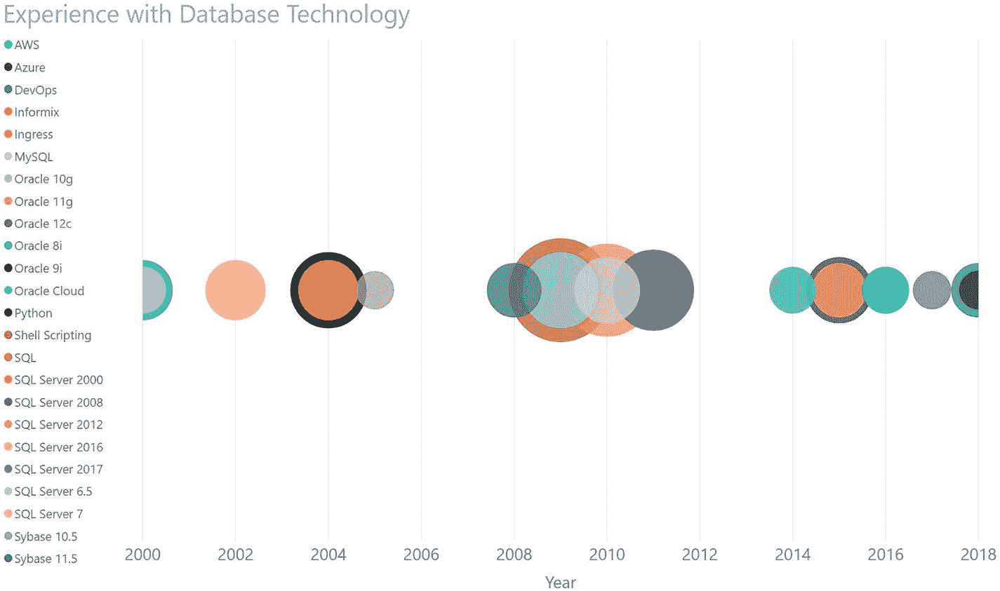
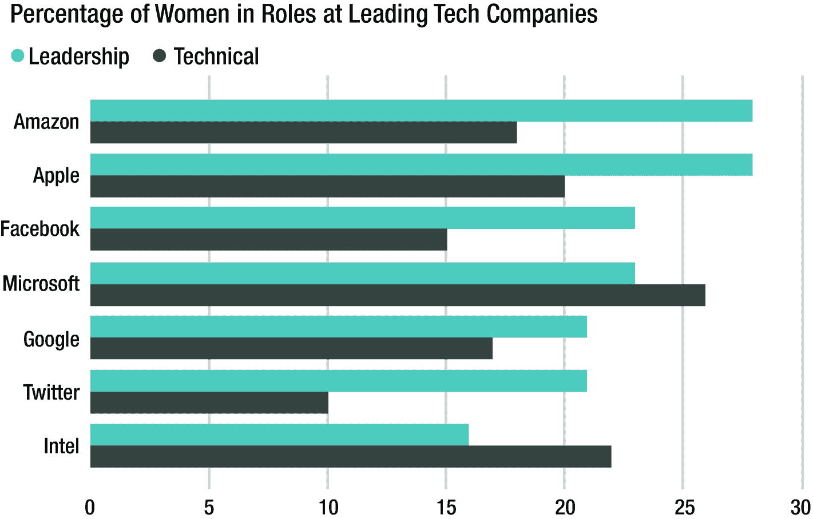
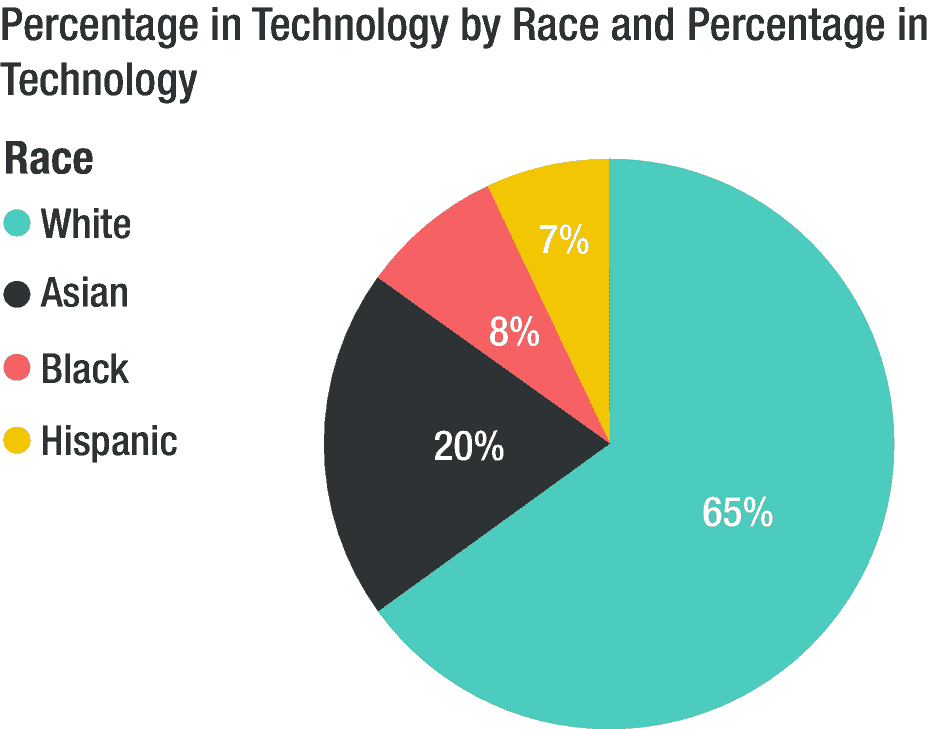
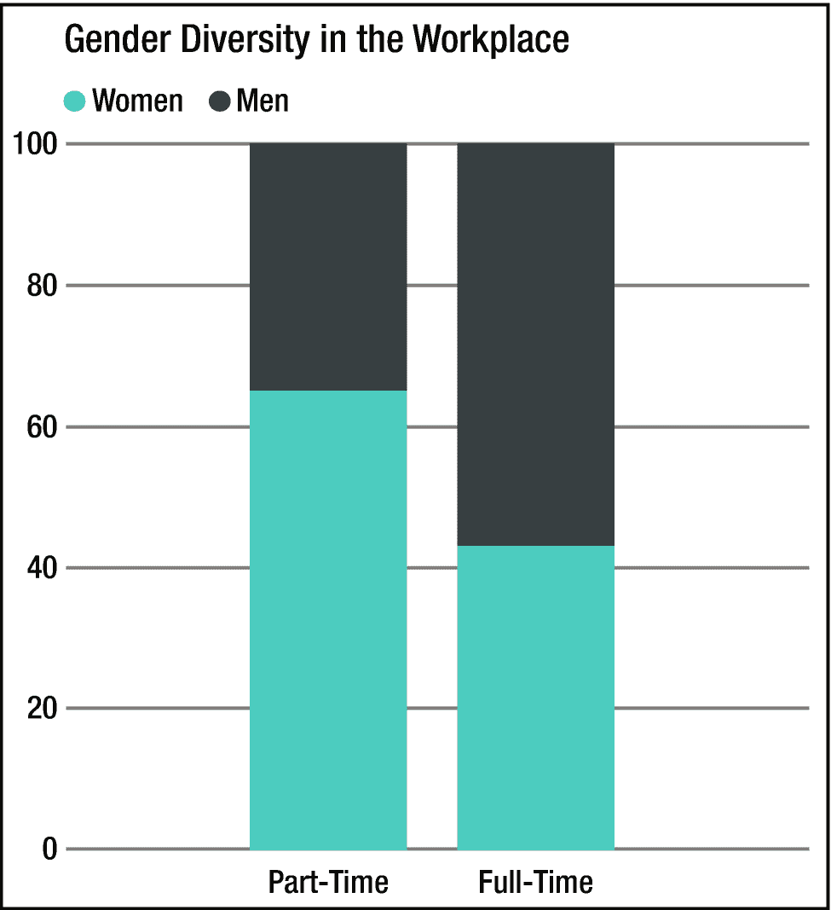

## 结束与新的开始

综合我们在前几章讨论的所有内容——早期职业生涯、晋升、科技界的女性，以及那些克服挑战并取得成功的女性的故事，仍然存在一个问题：“我们该何去何从？”

# 新的篇章

大约六个月前，我接受了新的挑战，踏足了一个全新的技术领域，开始在微软担任数据平台架构师，专注于分析与人工智能。我选择脱离原有的职业路径——那个让我陷入混合型技术布道者/面向高管的战略顾问的角色——转向更深层次的技术追求。我曾陷入一种奇妙的困境：开发人员和数据库管理员总是认为我不再真正懂技术，而高管们又觉得我过于技术化。尽管许多高层管理者希望听到充满时髦术语的宏观视角，但他们认为我的专长狭窄地局限于数据库技术，对其他方面几乎不重视。我感到一种莫名的束缚，更糟糕的是，我感到无聊。

虽然我更以 Oracle 技术闻名，并在 Oracle 社区取得了显著成功，但我一直是一名跨平台技术专家，并拓展到其他技术平台会议上进行演讲。这并不令人意外；毕竟，我管理的第一个数据库就是微软 `SQL Server`（6.5 和 7.0 版本），紧随其后的是我第一份数据库管理工作中的 `Oracle` 和 `Sybase` 数据库。我擅长应对挑战性的局面，因此很快掌握了众多数据库平台、操作系统和脚本语言。那些最具挑战性的系统往往是那些不让人有闲暇适应多种环境的系统，而是些古怪的个例，无论我在哪里工作，我都成了这类系统的负责人（图 8-1）。

图 8-1.

我的技术平台经验具有多样性，而不仅仅是在工作场所中

我还发现，当我愿意接手公司里那些被认为无望解决的最大难题时，人们也愿意在我需要帮助时支持我。我会用尽自己的资源，并向他人求助，而他们也很感激我接手了别人都不愿处理的环境，反过来，他们也会不遗余力地帮助我。在某些情况下，这演变成了我多年来获得的支持和指导。我的技能和知识，相比我主动性和坚持所提供的价值，反而退居其次。

无论我经历了多少次偏见（正如我们在前几章所讨论的，研究表明偏见是存在的），我始终努力对我们所处的技术世界保持诚实和公正。由于我认识的许多女性离开了同样是我热爱且无法想象失去的职业生涯，起初，这在我职业发展的进程中似乎只是一个微不足道的注脚。尽管我谦逊地尊重那些帮助我在职业生涯中取得成就的运气、决心和技能，但我并没有将自己经历的事情归结为偏见，而是认为这是我个人的独特经历。在很长一段时间里，我将此归因于自己的个性和特质，而没有将性别视为核心因素。

只有在经过多年的研究，将自己的经历与许多其他人的经历以及大学和研究人员日益增多的研究进行比对之后，我才发现偏见有多么显著，以及它与我们成长的文化环境有多么密切的关系。最深的影响常常来自围绕有抱负的女性所产生的偏见。人们对有抱负女性持有的偏见的反应，通常可以分为三类：

*   那些察觉到偏见并支持改变的人。
*   那些对偏见漠不关心或视而不见，不确定其是否存在的人。
*   最后一类人，他们对有抱负的女性感到明显不适，并且常常带有敌意。

这最后一类人通常表现出明显的不安全感，并且更常是职场霸凌者。他们与有抱负的女性的互动可能会恶化，以至于需要某种程度的干预。我曾指导过一些女性，她们的同龄男性同事将这些女性的抱负视为对他们个人和职业上的攻击——仅仅因为这些女性采取了与男性同事相同的行动并取得了相同的成就。直到最近，我们一直被告知这是一个避而不谈的话题，因此许多属于支持和漠不关心群体的人很难理解，这群敌对个体对留住行业中的女性产生了怎样的影响。我周围的女性私下里窃窃私语，却不敢大声说出来，唯恐被视为不够格、不合群，或被对她们及其职业至关重要的社群所排斥。

当在一个男性主导的行业工作时，问题也可能看起来只针对男性，因为涉及男性同行的比例会高得多。尽管事实并非如此，但这种针对单一性别的印象很容易被误解。

前几天我在社交媒体上读到一句很棒的话：

> *“在讨论有毒行为时，我们常常将其视为对男性的攻击，而实际上，我们需要像看待青蛙一样看待有毒行为。有毒的青蛙并不多，但那些确实存在的青蛙，毒性极强，而且外表看起来并不危险。”*

我不知道这是谁说的，也找不到原作者，但它是对原话的一个变体，原话聚焦于有毒的男子气概。以这句话为焦点，很明显，每个人都需要参与其中，成为解决方案的一部分。我们讨论的第一类人必须成为变革的盟友。这个群体不仅由女性科技从业者组成，也包括男性。正如前几章所讨论的，当包容成为公司更重要的一部分时，我们都能从中受益，从而改善有关多元化和包容性的政策。第二类那些漠不关心或难以同情这些挑战的人，将从同情或漠不关心转变为接受代表性方面的变化——无论结果如何，这原本对他们毫无影响。我们并没有赢得他们的支持，但正如我希望解释的那样，他们也不反对。第三类，即由对科技行业女性持有偏见的男性和女性组成的有毒群体，将面临两个选择——要么改变，要么继续承受对其职业生涯的影响，因为他们会影响到周围的人以及企业的利润底线。

最近的人力资源政策开始显示出变化，这种类型的有毒行为在职场上已不再被容忍。即使在我近期的互动中，与我所指导和支持的人交流时，这一点也很明显。

微软社区中有一位女性，我们暂且称她为简。她在当前公司工作已超过一年，期间受到一位男性同事（我们称他为约翰）的欢迎和指导。简认为约翰帮助她快速入职并跟上新角色的步伐。她非常感激约翰的帮助，但在最初的六个月后，事情变得明朗起来：约翰对她的看法已超出同事范畴。一旦她开始与一位工作外的男士约会（现在已是她的男友），简注意到约翰对她的态度发生了明显变化。起初约翰只是态度冷淡并回避她，但后来变得好斗，甚至公开敌对，以至于破坏了她最近的项目。她向管理层寻求指导，却被告知一定是她想多了，或者她只是伤了他的自尊心，不必担心。

## 当她向我寻求帮助时……

当她向我倾诉自己的遭遇时，这并非我第一次听说，甚至亲身体验类似情况。作为一名科技领域的单身女性，我曾需要谨慎而有策略地引导一位男性同事，打消他对我的个人兴趣。在职场环境中，如果拒绝被视为针对个人，很可能会升级为大多数管理者都难以处理的尴尬局面（更不用说这对女性本身有多不自在）。作为她的导师，我能够建议她如何积极应对，以期问题得到解决。

在她最近一次技术评审后，情况变得明朗：他不仅将她的工作成果据为己有，还将功劳归功于她团队中的其他人，而且他对两个项目的破坏行为已经影响了她在管理层眼中的地位。我之前已指导过她如何追踪并记录他的行为，重点是寻求解决方案，而非指责。由于她的经理并未意识到这种行为对她个人职业生涯以及整个公司有多大的破坏性，我建议她将问题上报给人力资源部门。正如我此前所述，我建议只有在掌握充分文件证据，并且目标明确是“教育”而非“惩罚”时，才去找 `HR`。很多时候，`HR` 能提供的帮助是有限的。简在处理 `HR` 事宜时做得非常出色，她将重点放在其不当行为导致的收入损失以及额外消耗的资源/时间上。与 `HR` 的对质过程相当令人不适，但经过审查发现，他的行为给公司造成了超过 82 万美元的收入损失。`HR` 最终决定因其在处理流程中伪造文件以及骚扰行为而解雇他。

在会议期间，简不小心透露了是我在建议她如何与约翰互动以解决问题。在他被解雇后，约翰找到了我的一个博客网站，发现了一个漏洞（他是一名`.Net Developer`），并黑了网站，导致我的两个博客宕机四天。尽管我有多个博客备份，但他的攻击主要集中在网站图片上（因为我有很多用于界面教学支持的截图）。这件事表明，像约翰这样，认为自己的破坏行为理所应当的人，几乎让我损失了 8 年的技术内容。

你开始意识到情况的严重性。约翰的行为是如此狭隘，仅仅因为世界没有按照他想要的方式运转或回应，这种心态大多数人难以理解。尽管约翰在入侵我的博客网站方面做得“出色”，因为我对 `PHP` 版本了解不足，但他也没能有效隐藏自己的行踪。幸运的是，我的主机提供商正在追查此事。

我还要再次强调，这类人并非按性别划分，因为在职场中不尊重女性的不仅仅是男性。女性同样容易对女性产生偏见，就像男性对女性产生偏见一样。虽然我可能不认同那些属于对立阵营的人，但我们之前已经讨论过偏见产生的原因，并且知道只有明确的界限和规章制度才能消除他们在生产力、收入、员工流动率以及个人职业发展方面造成的代价。通过提供倾听的耳朵和如何有效处理问题的选择来支持那些受到这种破坏性行为影响的人，也同样重要。我无法告诉你，多年来，仅仅通过与我交谈那些有影响的事件，就帮助了多少我指导过的女性。

我每周仍然会收到许多来自寻求支持、指导或赞助的女性的联系，我努力为她们每一个人提供帮助。我也注意到，过去一年里，这个数字有所下降。我也知道下降的原因，这很大程度上涉及到一种概念验证，这在我现在所属的社区中也是一个持续进行中的工作。

## 细节之处见真章

2012 年，我在丹佛参加了我的第一个地区性微软数据库活动（`SQL Saturday`）并发表了演讲。当我进入会场环顾四周时，我被女性与男性的比例惊呆了。此前四年我一直在 `Oracle` 的活动中演讲，已经习惯了在任何我演讲的活动中女性占比都不到 10%的情况。当我开始盘点时，我很快发现，微软活动中的女性比例达到了 40%。我立刻在演讲者休息室问组织者：“你们都是从哪儿找来这么多女性的？！？”我当时刚刚为两个 `Oracle` 用户组（落基山 `Oracle` 用户组 `RMOUG` 和 `Oracle` 开发者工具用户组 `ODTUG`）建立了“科技女性”（`WIT`）组织。我正在自学，当两位演讲者 `Jen` 和 `Sean McCown`（Twitter 上的 `MidnightDBA`）向我透露微软 `PASS`（`SQL Server` 专业协会）组织是如何建立他们的 `WIT` 社区时，我非常感兴趣。他们社区从一开始就让男性作为盟友，认为女性首先作为技术专业人士、其次才是女性融入社区，并通过坦诚的讨论来解决挑战，这些做法引起了我的共鸣。我从这次会面中搜集了所有能获取的信息，并带回去付诸实践。

尽管在我更为传统的 `Oracle` 社区中确实遇到了一些阻力，但也同样受到了许多人的欢迎，并通过小规模复制他们的努力取得了显著成功。我意识到并理解，`Oracle` 社区的成员平均年龄比微软社区的大十岁。我注意到，当 `Oracle` 社区的女性仍然盛装出席活动和会议时，微软社区则选择了低调随意的着装，通常穿着更休闲的服饰，相比严格的着装要求，这反而提供了更少暗示性的衣着。微软的活动对社区免费开放，演讲者和志愿者奉献时间，这使得推动志愿服务精神成为可能，并要求更强的包容性。`PASS` 从一开始就进行的坦诚对话最终促成了为所有 `PASS` 活动采纳行为准则，并在其他会议活动中成为常态；他们还拥有一个 800 骚扰举报热线以及多元/包容性会议来促进教育，而 `Oracle` 社区的大部分活动至今仍缺乏这些。由于 `PASS` 组织对其地区用户组采用高度集中的管理模式，他们更倾向于分享和协作。社区对他们有更深层次的、既得的利益关系，包括当社区要求变革时。没有什么是完美的，但它是一个由成员推动变革的强大平台。

在任何微软活动中，其他与会者更可能向我提出技术问题，进行技术性对话，我也更可能被当作一个技术专家来对待。而在 `Oracle` 活动中，当我发表演讲时被问及“你的孩子在哪里”是常有的事，但在微软活动中几乎从未发生过。在社交媒体、电子邮件以及活动中，存在强烈的技术层面互动，包括关于哪些变革对社区有益的开放、较少限制的讨论。男性往往是首先发问，询问社区和活动如何才能更具包容性的人，我注意到他们更倾向于提问，而不是假设什么能有利于多元化和包容性。

## 排版后内容

加入社区后，同行们纷纷伸出援手，提供赞助和指导。这是我在 `Oracle` 社区中很少经历的，我意识到这有多么宝贵。尽管有更多女性，你可能会认为争夺那个女性“配额位置”的竞争会更激烈，但我从未经历过这种情况。一部分区域性活动致力于实现 40% 女性演讲者的目标，这种代表性有助于推动他人接受，将女性视为技术专家而非异类。我不再那么有压力去充当女性中的“代言人”（因为有很多女性在发言和贡献），也有了更多机会去单纯地做出贡献。

在融入 Microsoft 社区后，我在不到一年的时间里完成了在 `Oracle` 社区需要七年才能实现的事情。我成为了本地 Microsoft `SQL Server` 用户组的主席。我在最大的年度 `PASS` 会议上演讲，撰写文章和书籍，并进行指导。我曾被提名 `MVP`，并且如预期的那样，一旦成为 Microsoft 员工就放弃了它，因为 `MVP` 计划是一个 Microsoft 客户认可计划。

随着我过去一年的职业生涯转向 Microsoft 技术，我经常被问及是否会离开 `Oracle` 社区。一些人对此表示担忧，因为他们知道最初参与的女性就很少，并且他们对持续存在的偏见感到沮丧，这种偏见影响了较老的技术为女性建立可持续的技术倡议。

随着时间的推移，我仍然有机会为 `Oracle` 社区做出贡献，并且每当机会出现时，我都乐于这样做，但机会比 Microsoft 社区少。随着我转向分析、DevOps 和 Microsoft 数据平台，我参加 `Oracle` 活动的机会自然会减少。加上在 Microsoft 社区中较少出现的常见障碍的挑战，进一步减少了为 `Oracle` 社区做贡献的机会。这些“障碍”包括过度的审查、被劝阻不要像男性同行那样争取相同的成就，甚至我的一些内容被归功于同行。

我发现，在一个强大且专注的 `WIT` 倡议存在的情况下，这类障碍会显著减少，这种倡议得到了像我在 Microsoft 社区中所经历的那种社区层面的专门支持。

这导致我选择更多地关注 Microsoft 方面，这不是出于选择或对 `Oracle` 社区的不满，而是因为 Microsoft 的成功。这让我能更频繁地取得与男性同行相同的成就。我仍然热爱 `Oracle` 技术，并在社区中有许多很好的朋友，但目前，投资需要更多与成为技术专家无关的时间与精力。作为曾深度参与这两个社区和公司的人，我意识到 `Oracle` 的多元化和包容性倡议不够成熟。我也认为，为了拥抱云，由于他们比其他供应商更晚涉足云技术，他们别无选择，只能营造一种更具竞争力、更“传统”的氛围，这种氛围可能对女性吸引力较小。他们的会议仍然给参会的女性带来太多尴尬局面，导致不当行为（这通常是由于无限制饮酒、以男性为导向的会后活动，以及有限或不存在的行为准则政策），使得女性选择拒绝参加活动。

在发现参加不当行为少得多的会议是什么感觉后，我发现当这种情况真的发生时，我的耐心大大减少了。在我最近一次参加 `Oracle` 大型活动时，我经历了两次不愉快的情况，我的第一个想法是：“我已经五十多岁了，这不应该再发生了！”我的第二个想法是赞扬 `Oracle` 社区中年轻一代的男性盟友，他们认识到这种情况不能继续下去，并且在每一次事件中都挺身而出反对违规者。尽管女性可以为自己挺身而出，但当面对一个已经表现出对女性缺乏职业尊重的人时，我们发现我们的男性盟友在教化这些少数害群之马方面要成功得多。

尽管我们经常听到女性在科技领域的“兄弟程序员”经历，但我发现年轻一代的男性更有可能成为我们的盟友。这很大程度上可能归因于女性进入职场的时间。那些成为盟友的男性，大多数在成长过程中母亲都在工作。随着多样性和包容性持续发展，这种代表性可以为后代带来巨大的改变——我们可以肯定的一件事就是变化会发生。

这就是让我与 `Oracle` 社区保持联系的原因，也是我看到的希望所在。要求年长的技术专家改变他们的方式可能很苛刻，但同时，我们又在多大程度上要求女性在进入技术领域贡献专业知识时做出改变？许多年轻一代是解决 `Oracle` 社区当前挑战的关键。`Oracle` 在开发和黑客马拉松方面进行了巨大的投入，以接纳更新、更年轻的技术专家。所有人都能从中获得巨大的价值。随着年轻一代帮助老一代摆脱旧有的偏见，年轻一代的技术专家将从老一代的技术经验中受益。通过拓宽老一代的视野并改变偏见，他们可能成为解决我在某些社区中看到的问题的关键部分。通过减轻老一代的偏见，并指导/赞助年轻的技术专家（因为我认为针对一个少数群体的偏见往往会助长对另一个群体的偏见，产生多米诺骨牌效应），遏制年龄歧视偏见的次要目标也将成为总体目标的一部分。

我担心年龄歧视在像 `Oracle` 这样的社区中正成为一个更大的偏见问题，并且我相信它对技术的整体质量有着巨大的影响。我认识到自己在年龄歧视方面的偏见。根据我的经验，如果有人逼我撤回他们不同意的技术陈述，或者更奇怪的是，逼我停止写博客，那么这个人有超过 90% 的几率是男性，并且年龄与我相仿或更大。如果一位女性质疑女性在技术领域偏见的有效性，或者质疑我的决定/着装/选择，她很可能也在 50 岁以上。当你对年长的技术专家感到焦虑时，你会意识到这可能是源于经验的偏见，但如果你不加以控制，它带来的影响不会改变。改变是困难的，我们的经历会强烈地影响我们的思维方式和预期。

作为一个以对技术领域中的每个人价值为傲的人，你希望每个人都能成功。我的一个朋友，`Niall Litchfield`，曾说过：“不造成伤害。”我认为这也适用于任何处于竞争行业中的人。先与自己竞争，再与他人竞争，但无论如何，不要对他人造成伤害。

# 演好角色 *vs.* 做好角色

衡量一个技术领域成功与否，事件并非唯一的区别。我注意到很多同行在职业生涯的某个阶段选择离职——通常是在进入管理层的早期，他们的职业生涯便停滞不前。他们的男性同行会继续进步，而他们却原地踏步。当领导层中大多数是男性时，她们往往不知道该效仿谁（图 8-2）。

图 8-2. 美国顶尖科技公司中的领导层 *vs.* 技术岗位占比^(¹³⁶)

我刚加入微软时，就看到自己所在的部门中有许多女性担任领导职务。凯特·约翰逊（Kate Johnson）是负责微软所有公共及私营业务领域的副总裁，她很友善地在 `LinkedIn` 上与我联系，甚至回复了我的信息，她是我现在所在公司女性领导层的一个代表。另一个我们经常听到并非常钦佩的人是托妮·汤斯-惠特利（Toni Townes-Whitley），她是美国受监管行业的总裁。她对自己所展现的能力极为自信，在面向大量听众演讲时，她能迅速与他们建立起非凡的联系。还有其他一些领导岗位的人，比如微软的首席无障碍官珍妮·莱-弗勒里（Jenny Lay-Flurrie），你可能一开始不会注意到她，但我在入职后不久了解到她们的事迹后，也深受打动。如果你好奇为什么珍妮对我有如此大的激励作用，那是因为她患有重度耳聋，并且一直是微软人工智能项目中的关键推动力量，该项目专注于为残障人士提供包容性。这些项目包括一个 `PowerPoint` 插件，它可以自动将演讲者的话语转换为字幕，甚至可以利用同样是微软开发的自动翻译技术，将其翻译成不同的语言。这仅仅是技术如何成为推动多元化和包容性解决方案的一部分，让每个人都能更多地参与到我们周围世界中的又一个例子。

我还印象深刻地看到，微软董事会成员中有 30% 是女性，这个比例并不像我们期望的那么普遍。^(¹³⁷)

微软首席执行官萨提亚·纳德拉（Satya Nadella）在会议、晋升和我们的团队中花费了大量时间来表彰她们。为了帮助摆脱招聘实践中固有的偏见，微软在数据显示公司内部多元化程度有所下降后，将高管奖金与多元化目标挂钩。^(¹³⁸) 为了让公司对求职者更具吸引力，公司制定了清晰明确的职业发展路径，甚至提供了推动自身职业发展的方法。在甲骨文公司，我为我们的联合首席执行官萨弗拉·卡茨（Safra Katz）感到无比自豪，但那时公司并没有一个全球性的愿景认为多元化是重要的。偶尔你会听到同事开的玩笑，说马克·赫德（Mark Hurd）才是真正的 CEO，萨弗拉·卡茨不可能靠自己获得这个职位。无论她在能力或知识方面如何比较，都无法消除那些影响她在公司内部声誉的偏见。尽管持有这种观点的人只是少数，但正如我们本章前面所讨论的，这种毒性可能致命，而允许这些声音被听到的沉默，也如震耳欲聋的噪音一般，揭示了偏见对领导层的影响。

尽管在甲骨文工作，你会熟悉领导层缺乏多元化的现状，除了少数常见的刻板印象之外，没有任何公开的数据能够证实实际经历或显示出变革的意愿。最近，甲骨文超过 4000 名员工因性别偏见导致的薪资不一致问题提起了诉讼。^(¹³⁹) 只有时间和法院才能决定这个案件的最终结果，但当你读到一家你钦佩的公司经历这样的事情时，无论如何都会感到难受。许多公司都在法庭上遇到过类似的挑战，甚至包括我现在工作的公司。有助于改变这种局面的一个方法是，在涉及多元化和包容性时，对你所做的一切保持透明。

微软与谷歌、苹果及其他科技巨头一样，会发布关于其多元化和多元化举措的信息，并努力强调其重要性。2018 年的结果已经出现在 `Forbes`^(¹⁴⁰) 和其他主要媒体的文章中，讨论这些增长及其对公司的重要性。考虑到公司的规模，在多元化方面产生影响并非易事。从实习生到领导层，每个领域的增长都只略高于 1%，但当你认识到实习生往往是未来的技术专家时，新的数据就很有希望了：2018 年实习生中女性比例从 42.5% 增长了超过 2%。

最大的成功也是最艰巨的挑战之一，那就是技术岗位的种族多元化（图 8-3）。报告显示，在过去 4 年中，黑人和拉丁裔员工数量增长了 33%。尽管从占所有员工的百分比来看，这个数字仍然是个位数，但这是一个他们可以引以为傲的增长，并且希望在未来的岁月里能够持续下去。

图 8-3. 美国技术岗位中的多元化程度^(¹⁴¹)

拥有这类公开信息让我看到了希望，并帮助我坚定了理解：能够产生实际结果的多元化和包容性举措，与那些仅仅是为了“打个勾”敷衍了事的举措相比，是何等重要。你必须看到公司内部发生真正的变化，即使是很小的变化。这种变化不应仅仅体现在技术岗位女性的增加上，还应体现在领导层的代表比例上。如果你看不到这一点，你或许不会认同“你无法成为你看不到的人”这种说法，但这确实会让你在没有任何路径指引的情况下，更难开辟自己的道路。

我在微软社区取得的成就，与我在甲骨文社区相比，速度如此之快，原因不在于我的经验，而在于我们讨论过的——通常在于赞助。在微软的任何活动上，都会有 2-3 倍于以往的人找到我，问我是否愿意去另一个活动演讲、投稿一篇文章，或者参加某个专业团体的社交聚会。我经常目睹其他女性被问及是否考虑提交论文摘要去会议演讲、写书或参与特别活动。我亲眼目睹对他人的赞助越多，就越认识到，反过来，我自己也能获得更多的赞助。这是一种“传递善意”的举措，聚焦于团结一致——每个人都是“大家庭”的一部分，每个人都应该尽力相互支持。

考虑到我所经历的一切，以及我指导和支持过的每一个人，很难想象有什么能阻止我继续推动“科技女性”计划，但我意识到，成为多元化和包容性社区的一员也会带来副作用。

在拥有多元化和包容性举措的社区中，通常存在两种情景：

1.  除了空洞的举措之外，多元化和包容性是一个讳莫如深的话题，收效甚微。
2.  **富有成效的多元与包容，带来坚实变革与成功成果。**

根据我的经验，如果一项多元与包容（D&I）计划并未触及真正的问题，参与者除了完成勾选框式的表面工作外，几乎感受不到任何实质改变。女性和多元群体将继续离开或流动，导致相关数据持续下降或停滞不前。领导岗位上几乎从未有过女性或任何非白人男性。当晋升机会来临时，那些因偏见而“理应”占据该职位的人（通常是白人男性同僚）仍将填补这些空缺。这通常并非有意为之，仅仅是偏见就将女性和有色人种排除在候选名单之外。正如我们已讨论过的，这对团队或公司造成的代价是巨大的。

依我之见，第一种 D&I 模式会继续存在，并对为何数据没有改善感到困惑，常常将未能实现预期改善归咎于话题的复杂性。他们渴望改变，但周围的文化及那些说服他们更关键议题不值得探究的人会持续存在。这类团队不太可能为多元候选人提供令人满意的工作环境，产品也将因缺乏创造力和多元思维而受损。

第二种类型的多元与包容计划，得益于坦诚的对话和有效的变革，我观察到女性的参与率以及多元群体的参与度有所提升。工作满意度也随之提高，这一点从我交谈过的人们的反馈中得到了强调。满意度的提升可以从调查中看出，^(¹⁴²) 同时也伴随着对更多计划与改进的渴望。尽管整体进步令人印象深刻，但我认识到，如果没有对多元与包容计划的持续投入，似乎没有任何一个技术社群能使其多元与包容举措实现自我维系。我不断地进行自我诊断，以衡量自己的觉醒程度——即我对当前多元状况（具体指科技领域的女性，因为我不便假装属于任何其他多元群体）的敏感度。

作为第二种类型的参与者，我意识到，在那些实施第一种模式的社群中，我对科技领域女性所面临挑战的感知变得不那么敏锐。我所拥有的平和与满足感，会平息内心对变革的渴望。尽管女性常常为向我寻求指导而道歉，但我对此却感到高兴，因为这能重燃我的热情，让我专注于前方的道路。

## 成功需要众人拾柴

尽管我们要求女性在科技领域取得成功需要付出诸多努力，但我必须再次强调，我们每个人都是解决方案的一部分。女性可以改变、可以做到、可以成为一切，但这依然无法改变当今社会普遍存在的偏见。

除了我们要求女性做出的所有改变和努力外，我们还需要主动接触并改变男性之间的互动方式，而不仅仅是如何与女性相处。关键在于厘清情感关系与职业关系之间的明确界限。

来自电视节目《粉雄救兵》的卡拉莫·布朗说道：“对男性而言，最大的威胁是有毒的男性行为，这种行为阻止他们充分尊重自己和他人。是时候让男性明白，当我们相互支持与尊重时，我们会变得更强大。而那些‘性别规范’或‘理想化的特定性别行为’对所有人都是破坏性的，因为它们是限制性的。男性可以也应该富有表现力、情感丰富、脆弱、尊重他人、强大且能养家糊口……女性也同样具备这些品质。^(¹⁴³)”

卡拉莫在这里指出的不仅是男性需要进化彼此互动方式的重要性，同时也强调要接受女性是且应当是受到尊重、坚强且能养家糊口的，并同样具备通常被认为女性才有的表现力、情感和脆弱特质。这可以通过理解男性也同样拥有所有这些特质来实现。

科里·布克是新泽西州一位著名且直言不讳的参议员，他曾多次就男性在争取平等的斗争中作为盟友的重要性成为新闻头条。他说，即便这不受欢迎或令人不适，为女性挺身而出并真正倾听她们的声音对我来说也很重要。^(¹⁴⁴) 我可以诚实地说，在这个行业中我最尊敬的男性，是那些真正倾听我讲话、并理解其中蕴含重大商业价值的人。被我归入这类的人，从不会“口惠而实不至”（我喜欢用这个词形容那些只是承认我在说话，但根本没听进去的人）。我认识到这些人往往拥有更强大的领导技能，因为他们确实花时间去真正倾听。

认识到在职场中对偏见直言不讳可能带来的职业风险，有时甚至是个人风险，这一点很重要。我注意到，由于我同意发声，我已多次错失表彰机会、董事会职位和晋升机会。成为变革的代言人并非易事，如果你是那个需要变革的人（即你是偏见的对象），那就更加困难了。来自职场和行业内的盟友力量极其强大，男性可以帮助女性在该行业实现其目标，并帮助巩固这些成果。

我们都需要停止将其视为性别偏见，而应将其视为阻碍人类发挥潜能的普遍偏见。我们一直使用阴阳符号，但我们真的理解它的含义吗？如果我们像中国哲学那样看待它，它被描述为自然界中真正互补、相互联系、相互依存的对立力量。这不正描述了大多数人对男女关系的看法吗？无论他们彼此的看法有多么不同，他们都是同一整体的一部分，相互关联，并且只有在将双方的优势都用于实现人类目标时，才能达到最佳状态。当我们决定整体中的一半应享有更少的权利、更少的报酬以及更少的支持（而正是这些支持能让他们为整体目标做出最大贡献）时，最终伤害的是所有人。

### 我们信赖自己人

接下来要谈到的是下一个群体，即那些仅因所处行业或与真正“觉醒”的同事共事，而只经历过少数几次性别偏见的女性。我理解，因为我现在就在微软，我能感受到肩上的重担卸下了，我可以**做自己**。做最好的自己，不再有持续不断的偏见来侵蚀我每天努力想要达成的事情。问题是，如果我们已经有所成就，如果我们有能力做出改变，就应该在崛起时伸出援手。我们女性需要认识到，另一个女性选择了与我们不同的生活方式或走上不同的道路，这并不意味着我们也必须这样做。我们应该支持她，为她带给世界的东西感到高兴，找出我们支持她的方式，然后请她将这份善意传递给其他人。

正如我在上一段提到的，我认识到自己在微软及其社区中的满足感，以及这如何影响了推动变革的动力。这并不是说我不再那么关心了；恰恰相反，我很清楚自己在一个正在推动变革并做得不错的社区中处于特权地位。变革确实需要一定的动力，而这种动力往往源于不满、被冒犯、被侮辱、被贬低和被拒绝。当我们中的大多数人对现状感到满足时，会发生什么？我们会忘记那些仍在“一无所有”群体中的人吗？这就是我进行自我检查的地方，不仅要监控自己的世界观，还要继续接触那些在多元化和包容性方面处于弱势的人。这能点燃激情，将“战或逃”的反应转变为持续守望的状态。

没有了那种战斗反应，再加上我身边有一个由科技领域更成熟的女性组成的社区，利用这一点很重要；这里有更多的赞助和指导机会。其他女性和男性盟友拿起了那柄众所周知的“剑”，不再那么频繁地依赖我（而且几乎不需要占用我的时间！）。

除非在大多数科技行业中，代表性成为常态，否则整体数字不会改变（图 8-4）。这不是一个要求，只是一个观察。正如我们在其他领域所看到的，比如女医生已不再罕见，我们必须改变文化在媒体、对下一代的职业建议以及公共活动中看待技术专家的方式。这就是长期改变偏见的方法，让女性和少数族裔成为方程式中预期且重要的组成部分。到那时，我们将不再听到或说出“我们需要为这个职位招聘一名女性”，而是通过招聘最合适的人，女性被选中的频率与男性一样高，因为男女候选人的机率正无限接近 50/50^(¹⁴⁵)。

图 8-4.  
按兼职或全职就业状态划分，职场中男性和女性的百分比。来源：美国劳工统计局，2018 年

当有一天，我们让儿童画一名计算机技术员或工程师时，有相当大比例的孩子画的是女性或有色人种，偏见仍未完全改变。下一代是衡量我们在变革之战中成功与否的标尺。我们的下一代以及他们认为技术不仅是一个适合未来职业的优秀学习领域，而且是一个他们愿意留在这个领域的满意度，这些都是衡量我们在改变世界对技术看法方面取得多大成功的因素。

在那一天到来之前，重要的是我们要继续质疑诸如“兄弟程序员”这样的术语，以及为什么这么多科技公司现在只是在收集，却很少发布他们的多元化数据。我们是工程师，没有数据，剩下的只是猜测和意见。

成为一家理解多元化和包容性重要性的公司的一员，对我来说至关重要。当我加入微软时，我就意识到由杰出的萨提亚·纳德拉领导的微软已将重点放在重大变革上。入职第一天，我就被介绍给一家将多元化和包容性融入到公司愿景方方面面的公司。在所有公司文件和培训中都包含包容性用语，这是一种非凡的体验。

当我抵达雷德蒙德总部进行正式入职培训时，同伴们的多元性让我惊叹不已。在欢迎会上，我数了数房间里的女性人数，然后被这家公司惊呆了，因为房间里的代表性比例完全符合我在西雅图街头所期望看到的景象。我是一个习惯了坐在科技从业者房间里，并且常常是唯一女性的女性。在 20-50 人的房间里，我可能只能找到一两个少数族裔，而在微软的入职培训中，在一个 300 人的房间里，只有 30% 是明显的白人。我对这种多元化和包容性，以及这为我这家新公司带来的潜力，感到欣喜若狂。

与我离开的硅谷公司不同，微软的领导层更加多元化，我看到了众多女性担任领导职务。微软的总裁兼 CVP 凯特·约翰逊，总是活跃在现场并与周围的人互动。刚加入公司时，我对她印象非常深刻，于是我在 `LinkedIn` 上联系她并请求添加好友。她很快接受了，并回复说她期待我的贡献，祝贺我加入公司。

我在留言板和论坛上看到有人抱怨微软过于多元化，存在对白人男性申请者的反向偏见。但根据我的经历，这可能可以归结为：当一个人以前享有特权，在作为某一职位的首选候选人时感觉受到的威胁较少，现在却要在一个真正多元化的候选人群中感受到平等竞争的压力时，这种冲击感该有多大。作为一个白人女性，平等也意味着那些曾经历过比我更大偏见的人现在也获得了更多平等，而我将因为我是否是最佳候选人（而非因为偏见）而获得职位。我知道，最终这将惠及我们所有人，带来更高质量的产品、更全面的福利以及能反映整个世界面貌的领导层。无论论坛或其他网站上的负面评论说什么，正如 2018 年多元化报告所述，过去一年多元化几乎没有变化，这些数字很难证实一些人指责那些推行多元化和包容性举措的公司存在反向偏见。

技术需要这种变革，是为了全人类的未来。它不能仅仅服务“人类”（字面意义和象征意义上都是）。技术几乎是我们日常生活方方面面的组成部分，随着机器学习、物联网和人工智能的进步，它正开始渗透到我们的家电、汽车、个人设备甚至服装中。它必须代表我们所有人，而不仅仅是我们认为技术应该是什么样子的单一视角。

波士顿咨询集团进行了一项涉及 1700 多家公司的研究，专注于回答一个问题——“多元化是否创造了更高的收入？”^(¹⁴⁶) 这项研究涵盖了发达国家和发展中国家，收集了关于领导层多元化及其如何影响公司利润的信息。

BCG 已经推断出，领导层更多元化的公司会带来多样化的经验背景，从而产生更广阔的视角来应对挑战，并具备更高效适应的能力。

BCG（波士顿咨询公司）与这家拥有 1700 名员工的公司投入了大量时间，从六个“维度”考察管理层对多样性的认知。这些维度包括年龄、性别、行业背景、教育背景，甚至员工是否来自与工作地不同的国家。他们发现，许多发展中国家比发达国家更拥抱多样性，并因此取得了成功。

由多样性带来的创新使得这些公司的营收比管理层多样性低于平均水平的公司高出 19 个百分点。仅看这些数字可能并不惊人，但当你看到整体数据——占总营收 45%的部分来自这一领域，*而*多样性举措较少的公司这一比例仅为 26%——你就会理解为什么企业开始将多样性视为增加营收的机遇。

## 多样性的核心要点

归根结底，这一切都关乎女性为何留在技术领域，又为何离开。往往并非我们认定的那些大事——比如歧视和性骚扰。那些问题更容易被识别为具有影响且是错误的，因此我们已尝试制定政策和法律来应对，并将它们从以前社会中的常态行为中剔除。

真正的问题在于小事——那些导致技术领域女性被千刀万剐般慢慢扼杀的冒犯行为。

关乎于女性会认为是自己言辞不当，才无人回复邮件或不愿与其合作。关乎于女性将未能升职归咎于自身性格，*而*她们那位资历和学历都不如自己的男性同事却得到了晋升。关乎于她的老板以男同事需要养家为由，拒绝给她加薪，尽管她可能是一位单亲妈妈。关乎于她在绩效评估中收到的矛盾信号：被告知要在会议上多发言，但当她真这么做了，又被指责过于咄咄逼人、直言不讳。

我们有大量书籍告诉女性应该改变什么，但我们忘了，世界既是问题的一部分，也是解决方案的一部分。我们忘记了，除非我们讨论问题是什么，否则就无法解决它。技术领域女性的呐喊不是“都是你的错”或“都是我的错”，而是“我们可以改变这一切”。

脚注 1 2 3 4 5 6 7 8 9 10 11

# 索引

## A

摘要提交，偶然的技术专家，主动倾听，`ARM` 计算机，人工智能 (`AI`) 实验栈，注意力缺陷障碍 (`ADD/ADHD`)，吸引力与功能

## B

抱怨/唠叨，`Black Girls Code` 组织，博客：展示，启动，提交摘要，董事会成员，波士顿咨询集团 (`BCG`)

## C

技术领域女性面临的挑战：`ADD/ADHD`，协作杀手，孤独之地，向上管理，过度成就者，非领导层额外福利部门，`C` 级职位，提升可见度，自信，恐惧，聚焦，人脉网络，赞助人/导师，女性领导职位，客户总监办公室，协作杀手，技术的色彩，沟通：男性和女性，风格，升调，竞争性环境，赞美，计算机科学 (`CS`)，利益冲突，建设性反馈，`CS` 职业与劳动力需求，文化变革，尖端技术

## D

数据库管理员 (`DBA`)，数据平台架构师，直接沟通，多样性，技术行业，着装规范，服装选择，性别标识，男性与女性

## E

埃莉诺·罗斯福，语录，情感与分析型，雇主重视，难以置信的成本，谈判，技术职业发展，赋能，万全之策

## F

失败与成功，快节奏职业，女性同僚：偏见消失，待遇不佳，`DevOps` 风格，弹性工作制

## G

邻家女孩，`Girls Develop It` 和 `Black Girls Code` 项目，更绿色的牧场

## H

糟糕的图表，人力资源 (`HR`)，公司政策，强迫行为

## I, J

`Ingres` 数据库，内向倾向，直觉

## K

儿童桌，远程办公

## L

被忽视与隐形程度，`LinkedIn` 技巧，孤独之地

## M

以男性为中心的技术，男性主导的行业，以男性为中心的吸引力，男性同僚与女性同僚，男性说教 (`Mansplaining`)：定义，不安全感，打断，惯犯，masculine 沟通风格，`MCDBA` 认证，导师：协议，沟通，不同程度的成功，期望值，家庭挑战，寻找，建议与动力，快乐/光鲜的人，不可思议，缺乏自信，制定计划，男性，天生的，1970 年代与 1980 年代初，关系与赞助，*参见* 赞助，有毒的男子气概，女性，`MeToo` 运动，微软社区，微软数据平台，`Microsoft SQL Server`，矛盾信息，女性，跨国公司，`MySQL` 环境

## N

负面反馈/悲观主义，谈判：职业，未来，遣散费，技术，非语言沟通

## O

在线形象，*房间里唯一的女性* (Ruth Czuprynski)，自动化工具，评估，同志情谊，数据库技术，选举设备经理，挫败，医疗保健集团，通过观察学习，管理角色，离岸外包资源，`Oracle ACE` 总监，项目管理流程，质量经理，加强沟通，软件测试员，高级管理层，兽医医疗公司，空缺技术职位与计算机科学毕业生，机遇，`Oracle ACE` 总监，`Oracle` 和 `Microsoft` 数据库，`Oracle` 开发者工具用户组 (`ODTUG`)，`Oracle` 环境

## P

为人父母，偏见的影响，耐心，有色人种，个人利益：职业，学业，支持性伴侣，个人福利，个人要求，女性之路，文化认知，女性教育/职业，潜在雇主，`SQL Server` 专业协会 (`PASS`) 小组，专业合作伙伴关系，专业同僚，地狱项目，物业管理公司，公开演讲

## Q

质量管理技能

## R

树莓派，意识到偏见，警示信号，落基山 `Oracle` 用户组 (`RMOUG`)

## S

薪资：指导，薪资谈判，女性与男性，科学、技术、工程和数学 (`STEM`)，教育，职业变迁，挑战，中等教育，自我审视，沉默是金，硅谷专业人士，目瞪口呆，社交聚会，社交，社交媒体规则 (按性别划分使用)，社会安全网，软件测试技能，南方女性，赞助：`C` 级，复杂性，文化偏见，`LinkedIn`、`Meetup` 和导师，非传统形式，机遇，`Twitter`，女性，体育，`SQL Server`，步骤与目标：构建路径，类别，培训预算，工作/生活平衡，刻板印象

## T

团队建设活动，技术职业，技术教育，技术行业，多样性，头衔：代理主管，机遇，象征性女性，象征性配额，相信自己，相信自己，人员流动率

## U, V

令人不安的野心，历史数据，蜂后，传统角色，年轻一代，升调

## W, X

科技领域女性 (`WIT`) 年龄歧视，`BCG` 在场问题 (Jen Stirrup)，盲点，`brogrammer` 经历，`brogrammer` 分类，数据平台架构师，多元与包容，多元核心观点，情感关系 vs. 职业关系，领导力 vs. 技术岗位，导师指导，微软社区，`Microsoft SQL Server`，令人费解，失误，房间里唯一的女性 (Ruth Czuprynski)，参见“房间里唯一的女性” (Ruth Czuprynski)，`Oracle` 社区，专家小组，职场中男女比例，性取向/性别倾向，社交媒体，更强的多样性，女性在科技领域的地位，相互矛盾的着装要求，弹性工作时间，刻板印象，女性同龄人数量，每周工作 60-80 小时，女性导师，有抱负的女性分类，不良行为，工作着装，工作与生活的和谐 vs. 平衡，职场霸凌，挫败感，不当行为，特权女性

## Y, Z

年轻与无谓