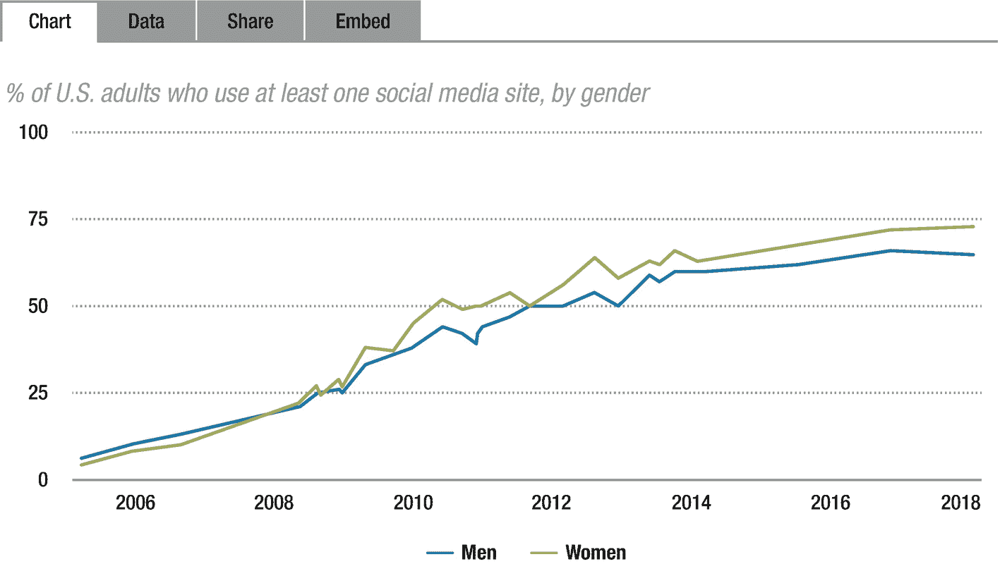
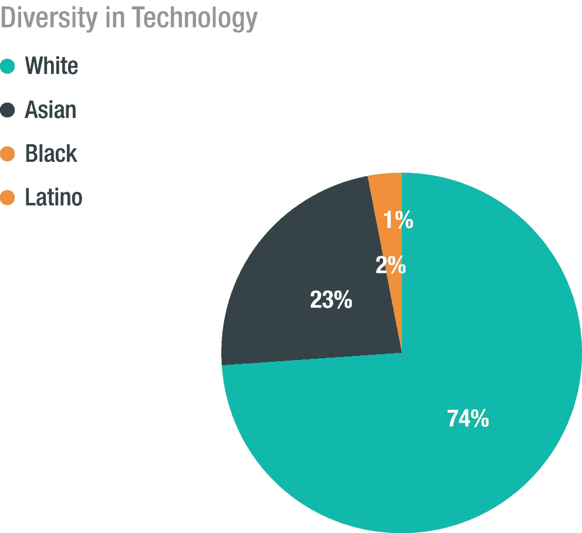
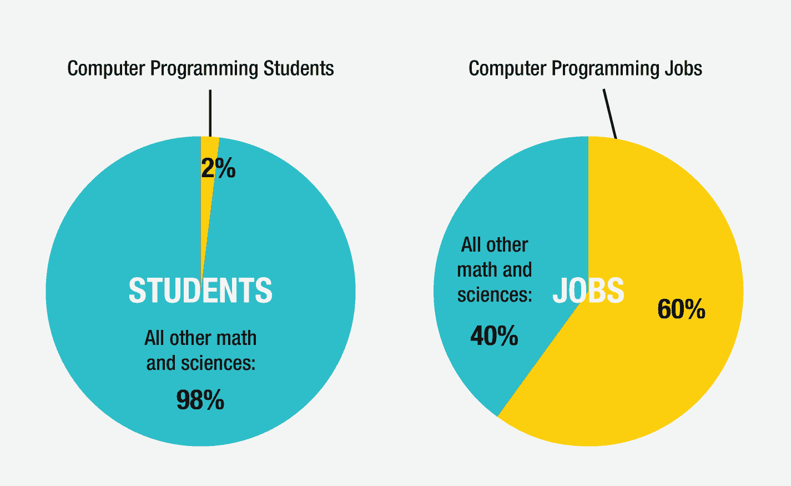

# 6. 以光速前行

工作与生活的平衡似乎是一个神话或一项不可能实现的成就。亚马逊首席执行官杰夫·贝佐斯近期在多篇文章中被提及，称他不相信工作与生活的平衡。^(¹⁰⁶) 他更相信工作与生活的**和谐**，而非平衡，因为平衡往往意味着生活中两者之间存在严格的取舍。他不相信多任务处理，但大多数男性也对此不以为然。^(¹⁰⁷) 没有人能真正同时处理多项任务，但作为一名女性，我确实知道自己倾向于将注意力分散在多个思路上。我很可能在任务之间进行高速切换，但这看起来就像是在同时处理多项任务。这就是我大多数时候的生活状态，包括工作时也是如此。人们总是问我如何能完成这么多事情，而我却很少感到不堪重负或筋疲力尽。我只是按照需要在一天中来回切换，完成工作和家庭任务。还有一个诀窍能确保我拥有更好的工作与生活和谐：

**我拒绝让别人浪费我的时间。**

人们会消耗你宝贵的时间和精力。有人说女性需要学会说“不”，但我们只需要学会对那些为了验证我们的专业技能而提出大量问题、或者对明明可以简单回答“是”或“否”的事情进行冗长讨论的人说“不”即可。

几年前，一位同行作者推荐我给一家技术刊物投稿。编辑给我发了邮件，在我提交了一篇文章后，他开始在一连串的邮件中提出大量问题。他要求我提供大量证据，证明我是所提交主题方面的技术专业人士。而这时我已经多次发送了他所要求的证明链接。收到链接后，他又要求提供更多证明。这场对话持续了数周，但我很快意识到一件让我感到相当不安的事情——从我们持续的讨论来看，很明显他没有阅读我发给他的文章或研究链接，也没有读那篇待发表的文章。我联系了另外三位作者；其中男性作者都没有遇到我与这位编辑之间的情况。唯一一位女性作者证实她也曾在这位编辑那里有过相同经历，并且她花了几个月时间才让他发表她的文章。

我最终给他发了一封邮件，感谢他付出的时间，并决定将文章投给一家竞争对手杂志。尽管我之前从未为他们写过文章，但他们同意仅凭我的写作能力和声誉就发表这篇文章，结果这篇文章成了下一期的封面故事。

最近，在我担任小组成员的一场会议结束后，我终于遇到了最初那家杂志的编辑——那位曾给我带来巨大挑战的人。他做了自我介绍，并问我为什么放弃在那家杂志发表文章。我感觉再向他解释只会浪费更多时间，而且这也不是在公开场合适合讨论的话题。但事实是，我没有时间继续和他纠缠下去，而且我已经吸取了教训。如果你在追求目标的过程中有人浪费你的时间，那就把你的宝贵精力转向别处，尽可能去找那些不会浪费你时间的人。

## 看得见的女性

在职业生涯中晋升的方法有很多，但正如我们已经讨论过的，很多时候女性可能被忽视，即使她们与男性同行一样在沟通、取得成就且同样雄心勃勃。^(¹⁰⁸) 这时，“让自己抛头露面”就变得至关重要。大多数人可能不相信，但我的内向倾向隐藏得很好。我并非从与人互动中获得能量——我消耗能量。在必须进行演讲或社交之前，我绝对需要一段时间来独处充电。当我站在舞台上时，我只是在拓展自己的舒适区以掌控全场，但就像一根橡皮筋，我的界限最终会弹回原状，我会将自己隔离起来重新充电。

线上形象确实提供了一个机会，让你既能展示自己的名字和专业能力，又不必放弃内向的本性（图 6-1）。以下是我给那些觉得建立线上形象有困难的被辅导者的一些建议：

1.  在`LinkedIn`上建立一份完整的简历和个人资料。

2.  考虑写博客——你甚至可以在`LinkedIn`上写博客，让你在专业社交网络上发出专业的声音。

3.  如果你是开发人员或 DBA，可以开通一个`GitHub`/`GitLab`账户，并发布你的脚本和代码。

4.  根据你的专业群体，找出他们用来交流的媒介——`Twitter`、论坛、`Facebook`、`LinkedIn Groups`等。加入这些群体并参与互动。

5.  `LinkedIn`和`Twitter`为女性提供了减少犹豫、进行社交的绝佳方式。这些是更专业的社交网络，目标就是进行专业社交。

图 6-1. 社交媒体用户群体（按性别划分），皮尤研究中心，2018 年，[`http://www.pewinternet.org/fact-sheet/social-media/`](http://www.pewinternet.org/fact-sheet/social-media/)

对许多女性来说，社交媒体可能是一件可怕的事情。我们听说过关于女性遭遇网络跟踪者和网络霸凌的故事，但有一些规则对我来说非常有用：

*   使用专业的用户名和电子邮件地址。考虑使用一个不具描述性的用户名。

*   保持照片和个人资料文本的真实性，但要明确表明你是技术人士。你的目标是打造个人品牌。

*   在每一个账户上使用相同的照片。谷歌不仅搜索词语和短语，也通过图片进行搜索。

*   使用与你专业领域相匹配的话题标签和搜索词。

*   不要害怕在任何论坛中使用“静音”、“屏蔽”或“断开连接”选项。不要试图与任何在网上争论不休的人讲道理。首次冒犯，给予警告；二次冒犯，直接屏蔽。

*   不要发布任何关于你自己的个人信息。我的`Facebook`账户几乎只对好友可见，因为那是我与朋友和家人联系的地方。我也不会在`Facebook`上与不认识的人建立联系。

*   最后但同样重要的是，记住社交媒体是为**你**服务的，而不是相反。你不欠任何人任何东西，你应该享受分享技术知识、建立社交网络和与人联系的过程。

由于`LinkedIn`是一个专业社交网络，所有内容都应该是专业的，但同时保持真实感也很重要。充分利用这个社交媒体平台有一些技巧，我在辅导或就此主题进行演讲时都尽量分享这些技巧。

## LinkedIn 使用技巧

*   始终使用专业的头像照。

*   将技能列表限制在与当前职位或你感兴趣的机遇最匹配的前十项。该网站的搜索算法会优先搜索前十项技能。

*   使用一个吸引人的标题，不要与你当前的职位头衔雷同。避免使用评分低或过度使用的词语：颠覆者、忍者、战士、创意、激情、专家或大师。其中一些词听起来可能很酷，但那些有意录用你的人只会直接忽略它们。

*   撰写一段个人摘要，准确说明你从事的工作或你寻找的目标。

*   你可以将领英简历导出为 PDF 或 Word 文档。
*   将个人资料链接从默认网址更新为你的名字（`http://linkedin.com/名.姓`）。
*   如果你正在找工作，考虑在你的博客、推特甚至名片上放上个人资料的链接。
*   既然你可以在领英上写博客，不妨考虑在你的行业关键话题上撰写几篇专业的文章。

对于那些想写博客却不确定如何开始的人，我于 2008 年在 ORACLENERD 的 Chet Justice 推荐下，以客座博主身份撰写了我的第一篇博文。^(¹⁰⁹) 不久后，我开始了自己的博客。在随后的几年里，它要么缩短了我的技术面试时间（面试官在我还没到场前就读了我的博客，从而掌握了关于我知识水平的答案），要么为我打开了工作机会，因为人们偶然发现了我的博客。

开始写博客很简单：

1.  从一个开放/免费的平台入手。考虑在领英上写博客，或者在 Blogspot 上开设一个博客站点。
2.  这是你在线品牌的一部分，因此在你社交媒体中使用的图片也应该同步到你的博客中。
3.  如果你感到害怕，是因为你觉得自己无话可说。每个人都有有价值的东西可以分享。我一些最受欢迎的博文主题，起初我以为除了自己没人会在意。不要害怕分享。
4.  博客也是一种自我存档。我记不清有多少次回过头去查阅自己的内容寻求帮助，甚至是在多年之后。
5.  你可以在论坛、向客户、甚至向潜在雇主引用博文。
6.  写博客能带来撰写刊物文章、白皮书和参与技术书籍创作的机会。
7.  一旦你的博客运营起来，考虑将其关联到你的社交媒体账号，以触达更广泛的受众，并将你的博客网站添加到读者用来发现内容的博客聚合器中。

在开设自己的博客之后，你甚至可以考虑做演讲。演讲是女性打破职场天花板的方式之一。这意味着你必须走出舒适区，但如果你乐于分享知识并希望在职涯中更上一层楼，向群体进行演讲可能是最有裨益的步骤之一。

如果你想从小处着手，可以在你本地的用户组、Toastmasters 演讲俱乐部，甚至在工作同事面前进行演讲。随着你对演讲愈发自如，你就可以为所在城市、州甚至国际性的活动提交演讲摘要。被技术会议接纳为演讲者后，演讲者通常能获得活动的免费通行证，这意味着可以参加培训课程和社交活动。

当有人与我讨论如何打破职场天花板时，我无法向你强调博客和公开演讲对于实现这一目标有多大的力量。这两种平台都为女性发声，她们受职场中似乎常见的那种“隐形感”的影响较小。它为你赢得可信度和认可，证明你在自己的领域拥有专业知识。

## 超越自我

当你开始凭借专业活动、社交媒体等加速前进时，可能会遭遇一些来自他人的非议。我再次声明，我们对女性的雄心壮志感到不安，^(¹¹⁰) 如果你做得很好，要做好准备会有人来考验你一下，只是为了试图理解你是如何取得这些成就的。要意识到这是他们的问题，而不是你的问题，不要让他们干扰你的目标或浪费你的时间。

可能会有人来找你，声称是关心你，却让你偏离目标。他们可能会声称你获得的一切都是因为受到了特殊待遇，即使你知道那是你自己努力的结果。不要让他们得逞——营造公平的竞争环境不等于降低标准。你所取得的成就，只属于你自己的功劳，与他人无关。

总结本章所述内容：

*   考虑开始写博客，可以在免费的博客网站或领英上开始。让你的内容和声音传播出去，是分享知识并减少性别影响的好方法。
*   写博客能带来其他机会——文章、书籍和演讲。
*   演讲是推动职业生涯更上一层楼的好方法，能帮助你打破职场天花板。
*   懂得何时不听批评——如果批评不是建设性的，并且你无法从中获得任何前进的动力，那么它通常不会有帮助。

## 着装得体

工作着装是科技行业另一个具有挑战性的领域。许多办公室变得越来越休闲，有些科技公司的着装规定即使在公园里都显得有点随意。IT 行业的着装规定是文章中常见的话题。为了促进更好的协作和敏捷的工作环境，着装变得更加宽松。正如我们之前讨论过的，IT 行业的福利通常包括站立式办公桌和现场健身房会员。这对传统的女性职业装，如铅笔裙、连衣裙或高跟鞋，并不那么友好。

历史上，女性的着装是基于吸引力而非功能性。^(¹¹¹) 在上个世纪，这发生了变化，但我们的文化会渗透到工作生活中，这包括着装规定。^(¹¹²) 女性比男性更容易被她们的服装以及吸引力水平所定义，正如我们之前讨论的，女性如何穿着是她们相互联系的一种方式。男性的衣服更宽松，他们的时尚变化不那么剧烈，我们也较少以貌取人。^(¹¹³) 我认为女性想穿什么就穿什么，但有一项研究涉及一个传感器，用于监测男性或女性在特定时间内调整衣服的次数。测试中的女性调整衣服的次数是普通男性的十倍。在接受调查的 112 个人中（70 名男性，42 名女性），男性平均每小时调整衣服四次。女性平均每小时调整衣服 40 次。

我们如此频繁地抚平外套、整理裙子、检查丝袜是否脱丝、鞋子是否有划痕。由于我们的外表受到更严苛的评价，我们学会了对自己呈现出的形象高度警惕。^(¹¹⁴)

我们假设女性每次调整衣服（抚平裙子、检查丝袜、整理项链等）需要 2 秒钟。我们将平均次数减少到每小时只调整衣服 10 次，一天 24 小时，平均睡眠 8 小时。这些数字告诉我们，一名女性每天会花 5 分钟调整衣服。这还不包括她中断手头任务去整理衣服时造成的注意力损失。我知道这听起来像一个奇怪的细节，但我非常注重效率和消除白噪音（从宝贵生命中浪费的时间），而对我来说这就是浪费时间。

那么，为什么女性如此频繁地调整衣服呢？人类可能是一个非常爱评头论足的群体，我们通过一个称为“薄片撷取”的过程来接收关于他人着装方式的这些细微细节。这是我们对新刺激进行毫秒级判断的过程，而社会对女性着装的“薄片撷取”程度是过度的。

## 审判日

无论男女，评判他人的方式或许不同，但这件事我们都在做。男性常常因能力被评判，而女性却往往仍因外貌被评判。^(¹¹⁵) 如果单看衣着，男性会被指责以异性吸引力为标准审视女性穿着，而女性则会以认同度来评判同性的着装。整体而言，女性服饰限制更多、舒适度更低，并且更容易受到时尚变迁的冲击——这一切叠加起来，催生了价值数十亿美元的时装品牌、杂志和在线内容产业。

我之所以关注这个话题，是因为如果一位科技行业的女性每小时要花时间整理衣服十次，这些消耗的精力本可用于创造价值，而且累计下来每天会浪费五分钟。我本人极易分心，并发现当自己穿着更舒适时，注意力能更集中。自从脚部患上关节炎后，我再也穿不了高跟鞋，于是欣然换上了作战靴。我并不想穿传统的“护士鞋”（不是说它不好，只是不符合我的个人风格），但我下定决心不再让双脚受苦。从那时起，我开始找出那些让我分心的衣物，并将它们从衣橱中替换掉。

* 会滑落的袜子被换成了能稳稳贴住脚踝的款式。
* 任何让人不适的衣物——勒肉、紧绷、过窄或限制活动——都被替换成舒适合身、无需反复调整的服装。
* 在裙子里穿上自行车短裤，这样我就不必在意走楼梯时楼下的人会看到什么。
* 选用品质顶尖的鞋靴，但绝不碰带跟或尖头的款式。
* 我学会了分层穿衣，这样无论温度如何变化，都更有可能保持舒适。

所有这些着装选择都是为了支持我的个人风格——面料耐洗耐穿，但原则是：我必须感到舒适，并且真心喜爱这件衣服。从调整衣物和因不适而分心中节省下来的额外时间，便可以用于继续专注于手头的任务。我敬佩那些在会议/活动中穿着四英寸高跟鞋（而且居然还能站稳！）的女性，但任何在科技领域与男性竞争的女性，本就承受着更高水平表现的压力，而要做到这一点，你需要利用一切可以利用的优势。^(¹¹⁶) 这可能是你未曾意识到的另一个消耗精力的领域——为了在极其苛刻的衣着中维持形象，每小时都要调整衣物。

做你自己，但要找到一个舒适的自己，才能成就最好的自己。

## 加速前行

当女性开始不再畏惧自己的抱负，并渴望在技术职业生涯中成就更多时，她们便开始超越仅仅做好技术工作的范畴。正如她们的男性同行已经做到的——写作、面向观众演讲、在董事会中谋得一席之地——女性也应当如此。正如许多人发现的那样，她们可能会从那些先行一步的女性先驱那里收到相互矛盾的信号，而且这背后有充分的理由。我们仍不自觉地让一位女性上位，同时期待另一位女性退下来为她腾出空间。这是持续阻碍女性职场晋升的复杂因素之一。除非我们认识到这一点并加以解决，同时将科技领域的女性视为技术人员，否则我看不到改变的希望。

我也建议竞选董事会职位。可以从本地社区或技术团体开始，然后逐步走向更高职位。这不仅对你的职业生涯有益，对那些敢于创新并主动寻找女性的董事会来说更是如此。女性董事会成员必须获得与男性同行同等的尊重和机会。由于女性不太可能将董事会职位视为“简历上的一项成就”，而是一个需要自己全身心投入的位置，因此女性董事会成员对任何董事会而言都可能卓有成效。^(¹¹⁷) 借用蒂娜·菲的话来说：“彪悍的女人能成事。”

对于那些想要做更多事情的人来说，董事会职位是一次绝佳的机会，但行业内的会议活动、专题讨论会以及活动组织也是如此。积极参与变革、支持本地组织，可以让你结识本地的人脉。许多人面临的疑问是如何获得引荐，并融入像会议这样的团体和活动。

随着多元化和包容性对技术会议越来越重要，会议组织者常常对女性参会者和演讲者参与率低感到困惑。鉴于参会人数对任何活动成功的重要性，向行业内的女性伸出援手以改善这一状况是个绝佳的主意。如果你选择参加某个活动，可以看看有哪些社交活动和会后活动可供参与者选择。你可能会吃惊地发现，这些活动以及供应商的展品有多么以男性为导向，但我相信，随着多元化程度的提高，这种情况是可以改变的。

我承认，我认识的所有女性，几乎都曾在技术会议上因过度饮酒、展台女郎和以男性为中心的噱头而遭遇过尴尬的互动。对于那些希望提高女性演讲者提交摘要数量的活动，不妨考虑向潜在的演讲者和往届参会者发出提交摘要的邀请。将摘要提交从竞争性的提案改为邀请性的，并不会改变摘要的录取方式，但确实会改变提交者的心理感受。

如果我们希望技术会议能更多包容女性，就必须改变对“成功活动”的定义，使其惠及每一位参会者。只有一小部分女性会对以男性为导向的技术活动表达不满。^(¹¹⁸fn118) 另一小部分女性会声称这并不困扰她们，因为早已习以为常，而大多数女性只会默默忍受这种不适，直到她们决定去做更有意义的事情。这就造成了一种无法自我维持、也永远无法改善的局面。

我们还需要对下一代进行大量投资。不仅要改变现状，更要塑造未来。我们看到针对科学、技术、工程和数学（STEM）教育已经涌现出大量举措。除此之外，我们还需要在文化观念上推动变革，改变我们看待女孩的方式——这不仅是在关键的年龄节点^([¹¹⁹)（5 岁、8 岁、12 岁和 15 岁），更要从文化视角在她们出生之前就开始转变。

## 性别偏见与技术领域的挑战

近期出现了一个令人不安的趋势——为准父母举办性别揭晓派对。表面上看，这似乎是对即将诞生的孩子的一种良性庆祝，但对我来说，这是对孩子性别的一种令人不安的痴迷。这完全沉浸在粉色和蓝色的性别世界里，将男性和女性分隔开来，而不是让孩子们成为他们最可能成为的人。我在 1970 年代长大，那是在嬉皮运动之后，我的衣服在今天看来是不分性别的——很少穿连衣裙，大多是灯芯绒裤子和衬衫，颜色与男孩穿的相同。我不是说穿带有亮片的粉紫色褶边连衣裙和套装是错误的。我要说的是，衣服不应该是性别标识物，我们不应该再用颜色来标识孩子两腿之间的性别。这些物品经常被用来判断一个孩子能做什么或不能做什么。由于游戏对于确定一个人以后对社会的潜在贡献至关重要，我们正在用性别偏见阻碍下一代的发展。我们用性别来决定哪些玩具是孩子可以玩的，这影响了我们未来一代成为最具生产力的社会成员的能力。

这不仅仅是让女孩参加体育运动、引导她们接触 STEM 活动。这还在于识别偏见如何影响你自己的育儿方式。我们从很小的时候就被灌输偏见，这为我们的决策形成了一个无意识的层面。在玩具店里，一个男孩挑选了一个洋娃娃，父母倾向于引导他选择不同的玩具，因为他们知道洋娃娃被认为是女孩的玩具。这似乎无伤大雅，但这可能对一个男孩产生长期影响，让他认为育儿是女人的事，而不是男人的事。同样，当一个女孩想要一套科学实验套装，但玩具被放在标有蓝色的通道（被认为是男孩的通道）时，这传递了一个明确的信息：科学被视为男性的领域，这将影响她投入时间在科学上的方式，即使她对这一领域有真诚的兴趣。

对大多数人来说，我们已经超越了意识到这些微小而有影响的问题的阶段。我们忙于养家糊口和谋生，但我们都在同一条船上，应该关心下一代。为了继续发展，我们需要充分利用我们所拥有的一切，这意味着需要全社会每个人的贡献。让学校里的所有人——女性以及所有有色人种——都能更多地接触 STEM，意味着这些领域将有来自我们世界各个群体的代表。亚马逊最近关闭了一个大型人工智能实验，因为数据模型中存在偏见。^(¹²⁰) 我在亚马逊有很多朋友，他们有一个非常成熟的多元化和包容性项目，但这个项目仍然受到了偏见的影响。这是一个极好的例子，说明为什么所从事的工作必须由我们生活世界的各个群体共同完成，我们不能期望那些没有亲身经历的人去理解它。偏见是我们所有人天性的一部分，它太强大了——它过度地渲染了我们的世界，塑造了我们的思维。

因此，我们继续努力改变未来，识别偏见，并公开讨论，对所有相关人员抱有同情心。我们拒绝简单地接受它，然后得出结论：“哦，事情就是这样。”当我刚开始工作时，有一种强烈的压力要我成为“哥们中的一员”，但这根本不可能。正如我们讨论过的，我们的社会根据性别将个体区分得如此鲜明，以至于对某些女性来说，这就像脖子上挂着一个标签。

### 引领变革

如果我们有雄心壮志，希望在企业阶梯上向上攀登，数据显示，人口统计数据严重偏向于男性抢先晋升。^(¹²¹) 那些希望看到改变的男性盟友可能会受到周围人的明显审视，而如果我们试图变得更像我们的男性同事，我们实际上只会变得不那么像自己。

这就是我们拥抱自己本色的地方——不是作为女性，而是作为技术专家。“ME”原则开始发挥作用，我们成为社会、家庭和工作团队的一部分。它让我们成为最好的自己。如果我们不喜欢体育，我们拒绝假装喜欢；但如果真的喜欢，我们也不害怕去热爱。我们明确要求与同事做同样的工作。我们拥抱自己的爱好、兴趣和重要的事情，而不受男性主导环境的潜台词影响——那个环境暗示我们，因为不男性化就不酷。我们礼貌地拒绝去倒咖啡或做笔记，而是要求团队中的每一位成员轮流去做。女性必须有自由完全做自己——在技术领域展现自己的优势、技能和观点。我们必须停止认为，如果不符合那些掌控利益的男性所规定的兴趣，就不酷。我们必须突破偏见的边界，当偏见出现时，要求那些限制我们的人进行公开的对话。当我们看到女性同行或有色人种经历偏见时，要大声说出来，因为袖手旁观就是沉默的接受。

许多女性不敢发声，害怕被贴上抱怨的标签。人们将女性的抱怨贬称为“发牢骚”和“唠叨”并非毫无缘由。尽管男性和女性抱怨的频率相同，但在文化上，女性的抱怨被认为更令人反感。由于这种区别，女性更倾向于把负面印象藏在心里，害怕受到评判。^(¹²²)

对于那些在男性主导行业工作的人来说，当脱衣舞娘出现在活动中，或者当团队建设活动又是一轮梦幻足球或体育赛事，并且显得不像一个团队合作者时，咬住舌头是有些影响的。大声说出来是推动变革以光速发生的不可或缺的一部分。虽然这可能会让人不舒服，但沉默等同于接受，如果什么都不说，没有人会知道有问题存在。他们只会继续挠头，然后对为什么技术领域的女性数量如此之少做出各种假设。^(¹²³)

我们必须致力于改变世界，或者至少改变我们身边的一小部分。我们的声音有力量，作为女性，影响变革的最大方式之一就是大声说出来。自古以来，我们的声音一直是被动的，找到自己的声音对我们所有人来说都是一段坎坷的历史。要进入技术领域，就需要更大胆地闯入这个不成比例的男性竞技场。我们需要相信自己，因为我们往往不太相信自己。正如埃莉诺·罗斯福^(¹²⁴)所说：“女人就像茶包，不放到热水里，你永远不知道她们有多强大。”

除非我们做到这一点，否则我们实现全部潜力的机会就会减少。不要害怕未知、风险和雄心，我们需要拥抱它们，迎接风暴的到来。一旦你渡过了难关，你就会认识到自己的价值，并且知道自己比社会曾经给予或将会给予你的认可要强大得多。

要在职业生涯中达到这一阶段，需要极大的耐心。耐心是一种美德，而对于科技领域的女性来说，耐心几乎是必备品质——当其他人已经放弃时，需要耐心和坚持继续尝试。我的公告板上贴着一句古老的希伯来谚语：“跌倒七次，爬起来八次。”这句话概括了失败与成功的区别。许多我们钦佩的成功人士会告诉你，坚持是关键。并非他们做对了那么多事而获胜，而是当别人放弃时，他们坚持不懈、继续前行。在科技领域，越多的女性这么做，而不是选择一条更轻松的道路，就能引领女性成为科技领域的常态。

我们在科技领域女性所面临的挑战可能看似巨大，但将其分解成小块，每天做一点点改变，才是产生最大影响的方式。在此过程中，待人谦和、富有同情心，将确保我们在努力的同时不会失去人性。

### 热爱科技

鉴于书中用了大量篇幅讨论挑战以及我们需要改变什么，有人可能会问，我们为何还要置身其中。我始终致力于不断发展并让周围的世界变得更好。正因如此，我必须说，我在科技领域拥有了一段非凡的职业生涯。从事科技工作让我得以做到大多数职业女性没有机会做的事情。过去十年里，我一直在家工作，既能照顾需要我的人，又能成为家庭的经济支柱。如今，我的薪水足以让我的三个孩子完成大学学业，且无需背负债务。在科技领域之外，没有多少职业能为你提供这样的机会。

我所在的行业变化之快，几乎与我的思维速度同步。我几乎是患有注意力缺陷多动症（ADHD）的女性的代言人。我需要一种快节奏的职业，其中包含各种有趣的任务和挑战。我欣赏能够高度专注于一项任务的能力，一旦感到注意力涣散，我可以转而投入另一个不同且吸引人的挑战。

我需要灵活的工作安排，让我不仅仅是一名员工。我能够找到导师和赞助人，为我提供渠道，让我在正职之外发展自己的职业生涯。我能够在线以及在线下会议和活动中，向更广阔的世界贡献并分享我的知识。我能按照自己期望的投入程度环游世界，分享我所学到的东西。我在世界各地都有朋友，如果不是因为从事科技行业，我根本不会遇到他们。

我的职业生涯让我能够展翅高飞，涉足我被聘用领域之外的其它技术领域。我有机会将时间志愿奉献给 STEM 教育和有价值的事业。我发现了其他志同道合的人，共同建立社区，其意义远不止于完成一份工作；我们为那些需要大型社区思想领导力的公司构建解决方案。在我的日常工作中，我曾与一些最大的 `Oracle` 和 `Microsoft` 数据库打交道；而到了用户组活动中，我又能用最小的计算机（如树莓派）进行演示。由于我年轻时这种小型单 ARM 计算机并不存在，这让我得以重温童年，有机会接触我小时候从未有机会使用的技术。

随着孩子们都已长大成人，我和丈夫进入了人生的下一个阶段。我们还没准备好退休，但也不想让生活就这样从身边溜走。我们卖掉了丹佛地区的房子，由于我现在为微软工作，我们搬进了一辆豪华房车。我们一边远程工作，一边在美国各地旅行，沉浸在我们认为可能成为下一个家的城镇和城市中。没有多少职业选择能提供这样的自由和稳定。

在我的职业生涯中，我清楚地记录了哪些方法有助于我坚持自己的道路，哪些则没有。我在微软的现任职位是我迄今为止最喜欢的。我拥有随心所欲钻研技术的自由，以及我所喜欢的足以让我保持忙碌的工作需求。尽管我仍然在一个全是男性的团队中，但公司强大的多元化和包容性教育确保了我在真正意义上被平等对待。如果无意识的偏见确实出现，也有直接的方法可以公开处理，而无需担心后果。我想这是行业里大多数人的目标——快乐、高效，并且比昨天的自己更出色。

成为科技领域的一部分很重要，因为科技让我与移动生活、家人和工作保持联系。由于旅行，我的孩子们（最后两个还在上大学）离我很远。如果他们需要什么，我能立即联系上他们。

## 远程工作的技术与多样性

有些人对我能如此远程工作感到困惑，但随着近期的技术发展，我能够通过一个专用的移动热点在线工作，这让我比那些使用住宅 WiFi 连接的同行拥有更好的连接性。我通过网络会议与客户会面，支持他们使用 `Microsoft` 数据平台和 AI 技术栈，如果他们需要我到现场，我只需找一个附近的机场飞过去，这种情况并不常见。我的办公室实际上可以装进一个小背包，而且众所周知，技术正变得越来越小、越来越便携。

这就是技术为我提供的生活，我希望无论从事哪个行业，其他人也能获得这种满足感。但在谈到技术时，我也想要指出我们一直失败的地方。我拥有技能、运气、毅力和巨大支持的组合，从而成就了非凡的职业生涯，我希望其他人也能如此。梦想是，当我到达一所学校时，有 30%或更多的女孩对学习技术职业感兴趣。如果我们努力，技术部门能够紧密代表我们所生活的现实世界的那一天是可以实现的。

对于女性和有色人种来说，在技术领域存在大量的机会，每个人都应该有途径获得这些机会。当他们拥有这些机会时，我们所有人都能从中受益。除了那些不恰当的评论、隐形、晋升跳过和性别薪酬差距之外，还有包容性和多样性的招聘实践倡议。即使由于女性或有色人种候选人数量有限，被雇佣者中男性比例仍然更高，但这些男性更倾向于以开放的心态思考包容性和多样性。他们不太可能限制身边的女性和有色人种，因为招聘流程已经改变，包含了这些重要方面，无论他们雇佣谁。这不仅仅关乎被雇佣者的种族或性别，还关乎此人如何看待包容性和多样性。

这是一个改变游戏规则的因素，因为我们认识到，我们所有人都是解决方案的一部分。当每个人都专注于多样性（图 6-2）是产品和收入成功的关键这一目标时，女性和有色人种也会随之成功。偏见减少了，我们会有更多女性担任技术和领导职位。

图 6-2. 技术行业的整体多样性，TechCrunch 2018

当男性试图驾驭这个领域并超越我们从小被灌输的偏见时，他们可能想知道如何成为女性和有色人种的成功倡导者。以下是一些可靠的方法，可以赋能你身边的人变得更好。

1.  注意你是否可能对身边的人表现出居高临下或屈尊俯就的态度。这是疏远技术领域女性最快的方式之一。

2.  除非一位女性直接请求你解释某件事，否则不要解释。“男性说教”这个说法并不令人愉快，但它确实经常发生。

3.  当你目睹偏见时，要发声。
    1.  如果女性的想法或工作成果被归功于他人，请指出来。
    2.  如果一位女性难以插话，请通过打断那个或那群人，说“我们还没听到 XXXX 的意见，我想听听她怎么说”来帮助她。
    3.  当讨论晋升或任务分配时，注意是否有女性同事被推荐。如果没有，推荐一位。
    4.  如果一位男同事在与女性同事互动时遇到困难，考虑把他拉到一边私下讨论。如果他倾向于反击，你的介入如果让他难堪，可能会加剧这种行为。
    5.  “更衣室”谈话对女性在团队中的地位或职业生涯具有极大的破坏性。要指出来，并要求停止这种行为。

男性在这些情况下处于特权地位，作为盟友，他们在行业中拥有巨大的变革力量。成为身边人的倡导者可以创造更好的工作场所、更好的团队，以及更成功的业务。^(¹²⁵)

技术变得以男性为中心的主要驱动力之一是 20 世纪 80 年代面向男孩的电脑营销。不仅仅是广告，连游戏也都是针对男性兴趣设计的。^(¹²⁶) 想想这个决定让占人口 50%的年轻女性失去了多少收入。我相信这是历史上的一个关键错误，既损失了收入，也损失了来自杰出技术人才的数十年的贡献。为了让我们真正以光速前进，我们需要将整个社会的全面代表带入技术的设计和开发中。任何由孤立群体完成的事情都只会继续产生有缺陷的结果，并且永远无法发挥其全部潜力。

在当今市场，多样性对企业的好处是更大的竞争优势，女性做出 85%的购买决策，企业开始意识到这一人群要求产品反映他们需求的诉求。^(¹²⁷) 最令人惊讶的是，大多数是 30 岁以下的女性。这很少是技术创造者的面孔，这种情况需要改变。

有趣的是，已有研究证明——这不仅仅是理论。斯坦福大学^(¹²⁸)和哈佛大学^(¹²⁹)都表明，当技术人员更能代表最终用户时，就会产生更高质量的产品。这导致收入增加、公司更成功，以及企业如果没有多元化基础就无法获得的竞争优势。拥有更多元化的技术劳动力的第二个好处是，工资会上升，性别薪酬差距会缩小。^(¹³⁰) 软件开发、项目管理和计算机系统是我们当今劳动力市场中需求量最大的三个岗位，更多的代表是让更多女孩早期对这些领域产生兴趣的关键。

由于当前学校体系缺乏技术教育，导致计算机科学毕业生数量有限（图 6-3），这可能要求我们严重依赖“意外技术人员”。^(¹³¹) 这类技术专业人士，即非科班出身但因需求而入行的人，目前约占我所在数据库行业从业人员的 50%。这些人要么拥有计算机科学以外的学位，要么来自军队，或者有些人只是不适应标准的学校课程但精通技术，而劳动力的匮乏让他们获得了足够多的经验，以至于学位已不再是必要条件。

图 6-3. 专注于 CS 职业的学生比例与劳动力需求对比。来源：[`https://code.org`](https://code.org)

考虑到未来两年我们将需要的技术人员数量庞大，我相信我们会看到越来越多的“意外技术人员”进入行业的新岗位。这需要培训，他们通常从以前更有资格的岗位开始，然后发现自己被引导去发现技术技能，从而在新的技术岗位上取得成功。我不认为这是一个缺陷，因为它最终会让技术行业变得更加全面。

当产品更能代表其所代表的最终用户时，对技术的兴趣便会显著增加，这也推动了技术职业的多元化发展。这种代表性自然会促使更多人攻读计算机科学学位，并催生更多技术学校，从而推动我们的科技产业¹³²。这类变革可能掀起比硅谷更壮阔的浪潮，并且凭借我们已有的技术进步，这股浪潮将不仅局限于某个地域，而是席卷全国，进而影响整个世界。

脚注 1   2   3   4   5   6   7   8   9   10   11   12   13   14   15   16   17   18   19   20   21   22   23   24   25   26   27