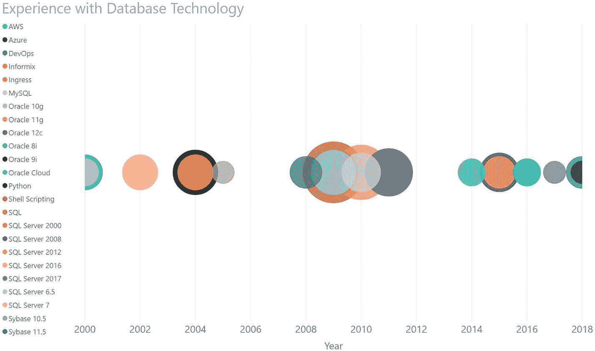
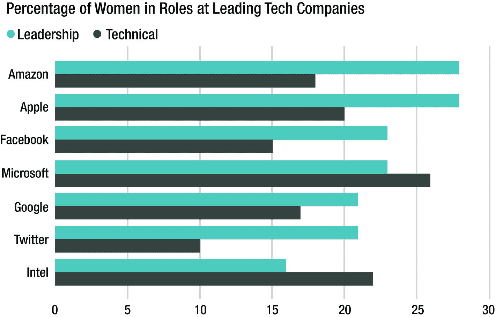
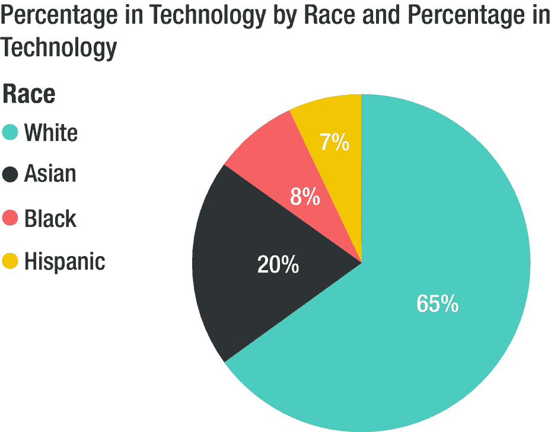
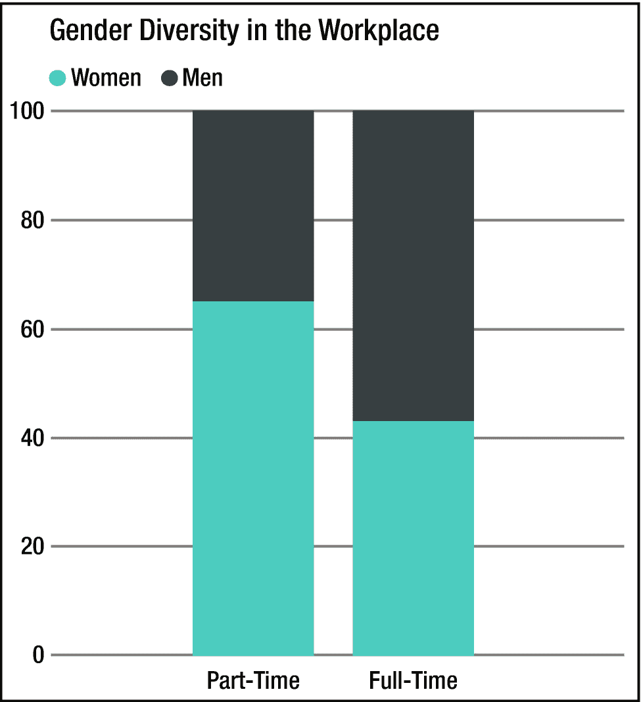

# 7. 一线故事

我有幸获得资助，参与了一套名为《让他们说完：一线故事》的丛书项目。这让我意识到，我们每个人的故事有多么强大的力量。这不仅是他人为你代言，更是你用自己的声音、自己的经历，通过相似性凝聚成的协作，让偏见与进步得以彰显。我之前就希望在自己的书中也能围绕这一主题撰写一章。正如大家所知，我每周会收到 10 到 30 封来自社群的邮件，人们寻求指导与支持，有时只是为了倾诉。分享个人挑战既能疗愈自我，也能将我们紧密联结——尤其当我们意识到自己并不孤单时。

我早期便主动联系了一些同行，询问她们是否愿意分享作为技术领域女性的经历。为了展示偏见如何以相似方式影响所有多元群体，我也向不同种族、性取向与性别认同的人士发出了邀请，希望他们也能贡献自己的故事。当我们允许每个人都能充分为行业做出贡献时，技术领域必将受益匪浅。因此，尽我所能为更多人提供发声机会，对我而言至关重要。

我提供了署名、以首字母署名或匿名三种贡献方式，并聚焦于教育意义而非批判。匿名性至关重要，因为经历偏见的同时，我们也会感到窘迫。我们不愿被视为受害者，也不希望暴露在他人的评判之下。我知道自己在面对尴尬的偏见处境时，最先涌上的情绪并非愤怒或沮丧，而是毫无疑问的窘迫。我为不得不应对偏见而感到羞耻，也为我们至今仍无法超越这一切而羞愧。

本章中的所有经历均经贡献者许可后分享。虽然提及这一点可能有些奇怪，但请不要臆测你认识或自认为认识的人与本故事有任何相似之处。我记不清自己在博客、文章等场合写过多少关于自己或他人经历的篇章——没有什么比告诉一位因觉得某篇故事在写自己而愤怒地联系你的人“这说的不是你”更尴尬的事了。

我意识到，更开放的对话、更强大的多元与包容举措，反过来会为社群内的公开讨论营造更舒适的氛围。因此，当发现人们在分享故事的选择上存在显著差异时，我毫不意外。那些身处沟通更开放社群的女性，更愿意贡献故事，也更少要求匿名。如果社群拥有强大的“女性在科技”倡议，女性贡献意愿的比例会提高 40%以上（时间限制因素会显著降低这一比例）。

我以露丝的故事开篇，因为她属于“软技术”领域，在其漫长的职业生涯中时常需要应对偏见。她温暖、支持他人且和蔼可亲。与我认识的许多女性一样，她倾向于从自身寻找问题的答案，并且极具创造力——即使现已退休，她仍能深入挖掘并审视自己的职业生涯。

## 房间里唯一的女性

作者：露丝·丘普林斯基

音乐剧《汉密尔顿》中有一首歌唱的是“在事情发生的那个房间里”。在我的职业生涯中，我常常是那个房间里唯一的女性。尽管许多女性对能在那张会议桌旁获得一席之地求之不得，但我却并非其中之一。这篇叙述将解释我为何会有那样的感受，以及我从那些经历中学到了什么。

在我的职业生涯中，有多次我都是会议室里唯一的女性、项目团队中唯一的女性，或是管理岗位上唯一的女性。在所有这些情境下，我常常被恐惧、不安全感和自我怀疑的情绪所淹没。我脑海中盘踞的主要问题是：

-   我能否清晰有力地表达我的想法？
-   会有人倾听我并重视我的意见吗？
-   我的想法对我的同事来说是否有意义？
-   如果我的想法被选中实施，它会成功吗？还是会因失败而受到指责？
-   我被选来参加这些会议或项目，是因为我的能力，还是仅仅为了充当“象征性”的女性代表？

我在过去四十年里的职业生涯，恰好与许多美国女性首次大规模进入职场担任主管和管理职位的时期重叠，因此这确实是一段混杂的经历：

### 20 世纪 80 年代：无形之墙

我 20 多岁时开始为一家医疗保健企业集团工作，但在 30 岁出头时，我发现自己担任了一个新的主管职务。我并非主动寻求这个领导职位，而是我的男上司认为我有能力胜任提拔。那些年，我是管理层中唯一的女性，领导着一个约 40 名员工的测试实验室团队。我发现这个角色虽具挑战性但尚可应对，然而，当我身处一个满是其他男性管理者的房间时，我的内心告诉我自己能力不足。我很沉默，除非被点名，否则不会主动发表意见。在团队环境中，我常常觉得自己像隐形人。

我的男上司从未真正指导过我在会议或其他男性主导的场合中该如何表现或回应；他似乎不知道如何当一名导师。我试图观察他人并通过模仿来学习，但我内心始终有一种挥之不去的感觉，认为我的任何贡献都不值一提。我也犹豫着是否要寻求指导，因为我觉得既然自己已被提升到这个职位，就应该已经知道该做什么、该如何表现。在年度考核会议上，我收到了一些反馈，但都不够详细，更像是“你做得不错”。我觉得公司里没有人能让我坦诚地倾诉自己的挣扎。我知道如果让自我怀疑控制自己，我无法成功，但我不知道如何克服这些感受。我错过了让自己变得更果断的机会，因为我不确定如果那样做会得到什么反应。

### 1990 年：朝九晚八

我在同一家企业集团内转到了不同的部门，但担任了一个全新的角色——质量经理——与主要是男性的医疗器械工程师打交道。我经常参加与这些工程师的会议，但我的经理（也是男性）对如何成功地与工程师沟通完全没有提供*任何*指导或反馈。他是那种典型只与自己同级别或更高级别经理打交道的管理者，而让我们这些与他同级别的经理去做所有与工程师沟通的具体工作，并通过试错来确定哪些方法可行、哪些不可行。

我常常觉得自己的意见不受尊重，因为我不具备他们那样深入的技术知识。我甚至无意中听到两位工程师的谈话，说我“人挺好”但不理解他们所做的工作。结果，我感觉工程师们只是在面对面时合作，背地里却并不尊重我。不用说，这令人极度沮丧。我掌握着愿意与团队分享的质量保证和流程管理技能；然而，由于公司里的许多项目都是日期驱动的，我想实施的大部分流程都被视为按时完成工作的障碍。

我们团队内部也存在冲突，而我们的经理不想处理。我的同级经理中包括另外两位女性和一位男性。其中一位女性控制欲很强，并且总是待在经理办公室里。有一次我出差在外，她告诉经理我的工作方法不够好。我回来后不得不为自己的工作向经理辩护。最终，我的经理送我们这批经理去参加团队建设培训，试图解决冲突。不用说，这次培训对改善我们的工作关系收效甚微。由于我知道自己不受男性工程师尊重，加上团队内部的矛盾，我意识到是时候开始寻找其他工作了。

在这十年的后期，我终于有机会从事我梦想的工作：在一家兽医医药公司工作。因为我攻读生物学理学士学位的初衷就是成为兽医，但未能完成相关教育，这已经是最接近梦想的工作了。我终于有机会监督动物研究，并应用我的质量保证和学历技能。但仅仅两年后，公司就被出售，我也被裁员了。我再次发现自己站在了十字路口。

### 21 世纪初：没有龙纹身的女孩

我决定尝试一些完全不同的事情：我的丈夫作为一名信息技术领域的承包商/顾问做得相当成功，他鼓励我将质量管理技能转移到这个行业。我全身心投入其中，开始以合同工的身份做软件测试员。

令人惊讶的是，我确实在大多数是男性的开发者中找到了一些盟友——他们中的大多数人都想与我合作，以提高他们正在构建的软件质量，因此他们愿意讨论我的测试方法和发现的任何缺陷。在我的职业生涯中，这几乎是第一次，我感到自己受到了尊重。我与开发者们进行了开放的对话，他们会主动向我征求意见。我们彼此紧密合作，这意味着我们交付了高质量的成果。

几份这样的合同工作让我扩展了技能，不仅限于软件测试。例如，在一份合同中，我学会了如何构建部署包并将新代码部署到生产环境。教我这些技能的首席数据库管理员是位女性；尽管她是正式员工而我是合同工，她仍然非常乐意将知识传授给我。在 21 世纪初，正式员工常常觉得不应该与合同工合作或分享知识，因为合同工最终会带着所有知识离开，他们常常感到自己的工作受到威胁。但我在与正式员工合作时并未遇到这种态度。所有的合同工都在同一个房间里工作，尽管我是那个房间里唯一的女性，但我感受到了工作中的同志情谊。

在作为合同工取得几次成功后，现实给了我一击：互联网泡沫破裂了。我决定重新转为全职员工模式，在一家国际保险公司担任高级质量保证职务。这最终引领我走向了另一个新的职业生涯：负责公司一些最关键 IT 项目的项目经理。

### 2010 年：还是老样子

## 作为项目经理

作为项目经理，我曾与男性开发者为主力的团队共事，但当公司决定将信息技术部门外包时，我面临了全新的挑战：管理由外包承包商组成的大型项目。起初，大多数资源来自加拿大，但随着成本压力加剧，我越来越多地与印度的离岸资源打交道。

这完全是一种截然不同的体验，因为它要求我大幅提升能力，才能洞察项目任务的真实状况。离岸资源中绝大多数是男性。不仅存在沟通问题，有些资源显然更倾向于与男性领导者合作。我经常发现这一点尤其体现在离岸资源中处于管理层或更高职位的男性身上。我亲眼目睹他们刻意寻求团队中其他男性的协助，却对我视而不见。在经历了这么多年的这种态度之后，我依然惊讶于自己不得不应对它，而且针对女性领导者的态度竟毫无改观。尽管有些资源不习惯向女性经理汇报，但我最终还是赢得了他们的尊重。我必须向他们证明，我能够对项目方向做出正确决策，并且我的判断是可靠的。与我职业生涯中的大多数情况一样，我似乎总是不得不以这种方式不断向他人证明自己。

这个时期的另一个令人沮丧之处在于，部分离岸资源并不具备完成工作所需的技术技能。我感觉自己很多时候不得不“手把手”地教他们。例如，他们常常不知道如何对问题进行根本原因分析，我不得不通过质疑他们的结论来引导他们。其中一些资源确实随着时间推移有所学习和进步，但我似乎大部分时间都花在了这方面的培训上。当时我的经理一直告诉我，我对这些资源的期望太高了，我需要降低期望，这样就不会失望。虽然我最终能够有效领导这个离岸承包商团队，但我仍然不得不接受一个事实：为此我需要付出更多的时间和精力。

在这段时期，有一次经历尤其考验人。在一次微小的组织结构调整后，我开始直接向一位来自印度的男性经理汇报。他最近才搬到我们位于芝加哥郊区的美国总部，因此对我就职的组织还不太熟悉。我曾与过去与他共事过的同事交流过；他们担保说他非常乐于助人且友善。然而，他从未从事过项目管理工作，对我们组织的项目管理流程一无所知，而且最令人不安的是，他从未带过任何直接下属。我不明白他为什么会被提拔到这个位置，但仍试图与他合作，并帮助他了解我们的组织及其流程。

有几次，他在重要的项目会议上犯了错误，导致我们的部门主管抱怨他的能力。我常常不得不去收拾他给我们系统的最终用户或高层管理层造成的烂摊子。我与他的上司（一位女性）进行过几次沟通，讨论他连管理高素质技术资源的基本技能都学不会的问题。

她的回应是什么？她告诉我，我必须继续支持他，并尽我所能培训他，因为我不应该让同事失望。毕竟，她推测说，他可是把全家都搬到了美国中部来担任这个职位。她向我保证，她也会送他去参加课程，以帮助他提升技能。我感到很震惊，当组织内各级人员都清楚地看到他的技能组合根本不足以胜任项目经理，更不用说领导项目经理团队时，她竟然还继续支持他。

幸运的是，另一次组织变革最终让我不再直接向他汇报。令我惊讶的是，组织竟然投入了如此多的时间、精力和培训，徒劳地试图把他塑造成一个他显然完全不合适的角色。讽刺的是，当他最终被免职时，他只是回到了印度的家，据说是去经营他父亲的公司。

### 2016 年：[没有]浪费我的机会

2016 年，我终于受够了在 IT 领域的工作。尽管也有一些不错的经历（大多是独立合同），但糟糕的经历往往更多。我感觉我所效力的公司在商业前景上都很相似，尤其是在“外包”热潮期间。公司们都在寻求通过削减资源成本，其方式就是取消全职 IT 职位，并用离岸资源取而代之。当然，并非所有这些资源都不合格，但*太多*都不合格了；因此，想办法处理这些情况的重任常常落在我肩上。虽然这激发了我的创造力，想方设法让我的团队取得成功，但这也证明这消耗了我的时间和士气。作为一名女性项目经理，我认识到团队的努力共同决定了项目的成败。我觉得这种看法有时是我独有的，但对项目团队的健康至关重要。

我的最后一个项目涉及评估用于保险理赔分析的自动化工具。这个项目备受瞩目，也是 CEO 们的最爱。向 CEO 汇报的经理团队几乎全是男性，他们没有信息技术背景；令人不安的是，他们只是被给定了一个项目完成日期，他们唯一关心的就是赶上那个日期。我的职责是向他们解释必须履行的项目管理义务，但他们常常将这些义务视为障碍，因此，我自然就成了设置这些障碍的人。团队中一位刚拿到 MBA 学位的年轻成员甚至评论说：“我真高兴你在处理那些所有监管的破事——这不值得我花时间。”

我确实认为，这种行为是受到高层管理人员的鼓励和示范的。这类男性经理一次又一次地被引导相信，时间和成本节约是一个项目的关键方面。他们因为赶上一个基于 CEO 目标管理清单上某个条目的日期而获得奖励，而不是看他们交付的产品是否高质量并满足组织需求。他们通常因为赶上日期而获得奖金或晋升，然后就转向下一个项目。

我没有放弃那些我知道会对项目有益的要求，而是继续坚持遵守流程。我采取的一个行动是引入其他部门的领导（信息安全部门、其他项目管理负责人）来向经理团队强化我的沟通。

就像我职业生涯中遇到的许多其他情况一样，在这种情况下我不禁思考，如果是一位男性同事处在我的位置，他们是否会受到不同的对待？而我是团队中唯一的女性，这是否就是我的意见被置之不理的原因？我发现自己多年后仍在质疑，为什么职场行为真的几乎没有多少演变，而我对促成积极改变又几乎毫无掌控力。

在职场打拼了近 40 年后，我感到精疲力竭——这不仅仅是因为我为了在我所从事的一切工作中交付最高质量而度过的漫长日子。脑海中不断萦绕着一个念头：如果我当初是“男性圈子”的一员，我的职业生涯会不会截然不同，这个念头已经让我身心俱疲。幸运的是，多年来我和丈夫储蓄和投资得当，足以让我开启人生的下一个阶段。

### 现在：实现自我

如今我已退休，却涉足了各种全新的机遇。我曾担任选举设备经理，负责芝加哥西北郊区一个选区的投票设备设置与维护；也曾协助一场重要的美国国会竞选，而我的候选人最终胜出——这主要归功于其他像我一样充满活力的郊区女性选民的影响力。我甚至回归了生物学老本行，在当地植物园担任志愿者，从事公民支持的科学项目。没有什么比恢复原生草原更令人振奋的了，尤其是当我与几位世界知名的植物学博士携手合作时。

在迎接这些新挑战的过程中，我发现自己常常回顾职业生涯。我逐渐意识到，当我曾是唯一女性时，那种不愿参与的抵触情绪，很大程度上源于我对情境的解读和自我怀疑，而非情境本身的事实。作为一名职场女性，我必须比男性同事更努力、更优秀，这始终是常态。虽然这不公平，却往往是现实。担任管理职位的女性在职场中常受到不同对待，原因并非能力，而是性别。最终，大多数时候，我是房间里唯一的女性这一事实，真的*并*没有带来什么不同。

很多时候，是有人（经理或同事）足够信任我的判断，才让我进入那些会议室，并相信我能做出有益的贡献。我本应像他人信任我一样信任自己。然而，在事情的当下，我发现自己总是聚焦于最不安的感受，而非自身优势。而当我与走上相似道路的其他女性讨论这些经历时，我发现克服这些感受是许多女性在职业生涯中持续面临的挑战。

根据露丝的经验，她指出，尽管男女经理在技能上同样合格，但他们受到的待遇却截然不同。她发现，那些信任她的能力、不因性别而否定她的人，能够为她提供机会，让她为公司和她所带领的团队带来利益。这是一个有力的说明：更多的代表性如何能提供更多这样一致的体验，并减少因性别偏见而导致的低效。

像露丝一样，奥帕尔·阿拉帕特也是我眼中无比专注、积极且可爱的人。她是一位令人印象深刻的技术专家，在同领域内获得同行认可，荣获了甲骨文 ACE 总监称号。她的智慧包裹着温暖，冷静的外表让人本能地信任她。我知道事情并非总是如此，我为那些错过机会、未能让她在她所承担的每一份事业中展现其卓越能力的人感到遗憾。

我们常开玩笑说女性被身边的男性忽视，但还有一个更具挑战性的问题：男性（我也知道有些女性也会这样对待其他女性）在女性所说的话得到男性认可之前，不会相信她。

我亲身经历过：当我发表一个观点后，只有当我丈夫赞同或重复了我的话，人们才会接受。我演讲或撰写过无数话题，一旦被男性同行重复，就会从“观点”变成“事实”。即便带着研究和参考文献，一些人就是不满足，不愿倾听女性的想法、建议或答案，除非有男性同行给予认可。

莉·艾里什是 PASS 女性科技小组的联合负责人，自从我被介绍到社区以来，她一直热心地指导并支持我（以及我认识的大量女性）。她对微软社区充满激情和深沉的热爱，是这项倡议持续成功的关键原因。她在数据库技术领域拥有丰富的经验，现任数据库管理总监一职，但这并不意味着她不再经历偏见带来的挑战。

### 这玩意儿有人听吗？

莉·艾里什

我清楚地记得第一次意识到一个男人仅仅因为我是女性而不听我说话的时刻。回想起来，我确信这之前已经发生过很多次了。但这一次，在那一刻，我明白了。我当时二十多岁，与正教授汤姆·皮蒂共同执教一门大学课程。我已经完成了硕士学位所需的一切，而且这也不是我多年来第一次授课。一个年轻男生问了一个复杂的问题，我轻松地回答了。我的回答很深入，需要用到黑板上的图表，以及我凭记忆脱口而出的不少百分比数据。讲完后，我问他是否理解了。他什么也没对我说，却转向那位男教授，逐字重复了他的问题。我站在那里，目瞪口呆。令我惊讶的是，教授立刻意识到这个年轻人在做什么。他完全不买账。汤姆沉默地看了那个年轻人一会儿，然后说：“她刚才的回答比我能做到的更好。你是根本没听，还是没听懂？”

十年后，我是一家大公司团队里的高级数据库管理员。我为一家大型企业与几个全男性开发团队紧密合作。我拥有完全的生产环境访问权限和叫停任何部署的权力。在那特别的一天，我和我们唯一的男性数据库管理员约翰站在一起，讨论即将进行的代码推送中遇到的一个问题。我所在开发团队的组长走过来，问了一个针对我们配置的`SQL Server`问题。我毫不犹豫地详细回答了。组长停顿了一下，转向约翰，逐字重复了那个问题。我的同事难以置信地看着我。这一次，我们俩都目瞪口呆。约翰尽他所能回忆着复述了我的答案，然后说：“她刚才回答你了。你是不明白吗？”团队组长咕哝了几句关于想要确认的话，然后就溜走了。

时隔多年，在不同场合，拥有不同权力和影响力的情况下，我遭到了同样程度的忽视和视而不见。我花了很多年才意识到，问题不在我。这与我是谁、我表现得多么自信、或者我拥有多少资历（或没有资历）毫无关系。这完全在于他们，在于他们作为男性的身份，以及他们对女性抱有多少尊重。在这两次经历中，我都很幸运地与那些意识到作为女性在职场会面临何种问题的男性共事——那些自称女权主义者的男性，因为他们明白，平等不是一张饼，我的拥有更多并不意味着他们就更少。那些经历教会了我，不要等着男人来回答，而是直接说：“我刚才回答你了。你没在听吗？”

前一章的内容探讨了我们常让女性被忽视，却又告诉她们要大声说话这一事实。当经历让你要么“目瞪口呆”，要么你的回应只会削弱进一步教育这一目标时，你该怎么办？

我曾被要求猜测女性在某些情况下做出某些选择的原因，但我总是犹豫。我大多不在现场，也并非身处那些女性的内心，所以任何说法都只是我的猜测。拥有盟友，就像莉在她所描述的两次经历中那样，有助于佐证她所经历的事情，以及为什么冒犯者做出了不倾听女性愿意分享的知识这一错误选择。

## 那一课

Opal Alapat

我在科技领域摸爬滚打了近二十年。在此期间，我学到了许多宝贵的经验。想分享的第一课，是关于我如何学会与男性恰当相处的成长历程。有些时候，我是项目中唯一的女性，感到被孤立、不被接纳。我不是那种会靠附和低俗笑话、跟着团队去绅士俱乐部来融入的女性，因此我不得不另辟蹊径，与男性同事建立关系。我用技术证明自己，并在合适的场合与他们交往。我不是一个“受欢迎”的同事，因为不忠于“兄弟会”而承受了许多负面批评。当时这让我很困扰。如今，我为自己的行为感到骄傲，也绝不后悔。我认为任何人都不该有压力去适应一个让自己不自在的环境。

第二课，是我学会如何更好地与女性相处。我职业生涯中最灰暗的时刻，莫过于女性之间的相互倾轧。在男性主导的世界里待得太久，我形成了许多盲点。我付出了惨痛的代价才明白，自己的言行可能会被错误地理解与评判。我必须重新学习如何与女性沟通。这帮助我拓宽了视角，学会与不同背景的人交流，包括不同种族和代际的人。有时候，这依然像一场艰苦的战斗，但正因如此，我成为了一个更好的女性。

最后要分享的一课，是关于在一个女性仍可能被忽视的行业里，找到自己的声音。在我职业生涯早期，有一次升职机会被错过，因为我的经理忘了提交相关文件。很难说这是否与性别有关，但我记得所在团队里的男性同事从未遇到过这类问题。我申请更换了经理，并在新的指导下蓬勃发展。我也目睹了女性同事的痛苦：她们发现自己薪水低于男同事，或者加薪机会被转给了对应的男性同事。我的一位朋友在升职中被忽略，被告知她的男同事会给这个职位“带来更多可信度”，尽管她拥有多年更丰富的经验。我认为，我们这一代以及更早一代的许多女性，从小被教育要相信：不应该大声说话，要对别人好（即使这意味着牺牲自己），不要制造麻烦。克服根深蒂固的教养对我而言仍是一个挑战，但我已经学会为自己奋斗，为自己挺身而出，以更自信的姿态发声去竞争。过去二十年里，情况已经有所好转，我对未来的女性世代抱有更多希望，但这个行业仍有很长的路要走。

今天的我，已不同于十年前、甚至二十年前的自己。如今，我努力不让别人打倒我。如今，我为我所信仰的而战。如今，我以身作则。我频繁演讲、在社交媒体上定期宣传技术领域的女性、直言不讳地谈论不平等问题，并自愿担任领导角色——这一切都有其原因。如果我能做到，其他人也能。如果我在那里，下一代女性会看到，并明白女性技术专家很重要。我会继续为正义而战。

回首往事，对比现在的自己与初入行时的模样，可能会让人心生畏惧。我们能识别出当年的天真，或是激情与干劲，与今日的自己所拥有的一切。但随着其他特质逐渐淡化，我们最应获得的，是智慧。我们应该感到自己变得更加自信，并且能够接受——即便无法理解——人性，这比初入行时要好得多。

在讲述 Opal 的故事之后，我再分享另一位 Oracle ACE 总监、业界令人钦佩的女性——Michele Kolbe-Hardwick 的故事。当我联系 Michele，请她为本书分享一个故事时，我也向她坦白，我觉得自己在她职业生涯早期辜负了她。曾有人建议我，如果我为她提名一个奖项，别人会以为只是因为她是个女人，而不是因为她显然当之无愧。我退缩了，以为是在保护她的机会。直到多年后，我站出来要求她最终获得认可时，我才意识到，我一直在担心别人认为我支持她仅仅因为她是女性，而不是不顾他人看法、坚持做正确的事——而这本就是我最初就该做的。

## 那个赞助人

Michelle Kolbe-Hardwick

我一直以为自己从未受到过行业偏见的任何影响。我觉得自己一直得到共事男女同事的巨大支持，并且通过证明自己的专业能力赢得了尊重，而且我总能获得证明自己的机会。

几天前，我和我的第一任经理叙旧，才意识到自己在这个想法上有多天真。她告诉我，在我面试毕业后的第一份工作时，她的男经理想录用另一位候选人——一个男性。他的理由是，他觉得我技术不够强。她请他不要被我的年轻、金发、热情和性别所迷惑，因为她觉得我技术非常扎实，尤其是我拥有计算机科学学位，而另一位候选人没有。她说服了自己的上司，应该让我们俩都做一次技术测试。

我表现出色，而另一位候选人则没有。这让我最终被录用，并开启了一段辉煌的职业生涯。如果没有我的经理顶住她上司的偏见，坚持认为我是合适的候选人，我就不会有今天的成就。

我深深地感激她在招聘过程中给予我的支持，而不是仅仅听从她上司的意见。

### 亲临其境

詹·斯特拉普

女性需要为彼此创造并维护安全的空间。女性需要成为彼此的盟友，并主动建立盟友关系；如果我们自己都做不到这一点，又怎能指望男性成为我们的盟友？我们如何对待彼此，正是向整个行业传递的信号。

举个例子：我之所以公开讲述自己的`#MeToo`经历，部分原因在于围绕我散播的谣言。我曾告诉过几个我信任的人，结果突然之间似乎所有人都知道了——我的信任被错付了。这些谣言具有毒害性，我担心它们会阻碍我参与技术社区和专业工作。我还担心人们会发现我遭受的侵害，视我为污损或破碎之人。因此，我决定掌控自己的故事，勇敢发声。这些谣言被男性和女性不断重复，对我自身的疗愈造成了极大伤害。

我公开讲话的动机之一就是为了对抗这些谣言。在我发声之后，起初我发现人们是抱有同情的。许多女性主动联系我，分享她们自己的故事，或表达同情。我成了女性倾诉故事的避雷针，在承受公开讲述自己`#MeToo`故事带来的冲击波的同时，也吸收着她们的痛苦。

但随后：一片沉默。问题在于，我们总被要求“大声说出来”，对自身遭遇要“勇敢”。在我发声之后，没有一个人来关心我是否安好。没有所谓的“盟友情谊”，这一切都被遗忘了。我也被遗忘了。

我确实减少了谣言对我生活的影响，但却用其他问题替代了它。我认为`#MeToo`故事有两种：一种是人们能够承受的较轻微的故事，另一种则几乎恐怖到令人无法忍受。不幸的是，我所遭受的侵害属于后一类，我认为这对无论男女而言都太过沉重，难以承受。如今，我会听到一些男性询问我的近况，他们想聊聊我的故事如何帮助他们更好地理解自己的伴侣。我也确实听到少数女性的声音，但不多。既然它帮助了人们，无论男女，那么我讲述故事的价值就没有白费。

我战胜了那些带有强烈性别偏见的谣言；没有任何男性会遭受我所经历的那种痛苦。我通过掌控自己的故事，并私下帮助其他女性谈论它，做到了这一点。未来，我希望为那些与我分享故事和痛苦的其他女性做得更好。我还想指出，技术社区并非完美无瑕，它也可能包含竞争和仇恨。这与其他任何与人相关的事物并无二致。

归根结底，力量必须源自你自身。没有人会来拯救你。但最终，你能挺过去。它可以成为你的一部分，但不能定义你；你可以专注于你的职业成就，让你的光芒比以往任何时候都更加耀眼。就像一盏碎裂的灯，因为你破碎了，光芒反而能更明亮地透射出来，你还能在沿途帮助其他女性。成为你希望为你撑腰的那种盟友。成为那个更包容、更伟大的人。

詹是一位了不起的人，也是微软数据科学社区的技术专家。她在性侵犯这一痛苦话题及其中对女性的偏见问题上所表现出的坦诚和开放，无比勇敢。阅读她的文章激励我尝试写下我自己关于`#MeToo`故事的亲身经历，然而，这却是我反复尝试却总也无法完整诉诸笔端的主题。

正如詹在她的经历中所讨论的，她的受侵害事实并未被质疑，但那些妄加评判或凭空臆测的人，*而非*信任她的声音、允许她掌握自己故事的人，却让谣言持续流传。这让我深有共鸣，因为我经历了非常类似的事情，但来自一个非常意想不到的群体——我的家人。我没有经历“他说/她说”的拉扯，或者与警方打交道的可怕经历。发生的事情从未有疑问；医生、护士和警察都非常友善且支持我。我的攻击者被定罪并为其罪行服刑。对我来说最大的挑战是，必须面对一个事实：社会不知道该如何应对我们所认识的强奸犯。大多数文化仍然描绘着后巷里戴着滑雪面罩、手持凶器的陌生人形象，¹³³ 等待着女性不自觉地落入陷阱。数据¹³⁴ 表明情况并非如此，而我们最终面对的是一个只能无奈沦为窃窃私语、臆测、评判和偏见的话题。

多年来，我很少回家，与家人联系也不多，而我的家人都是好人。我的童年很幸福，有着出色的父母，但我却找不到合适的语言向他们解释，关于那个他们以为我会共度一生的男人所发生的一切。我也无法忍受家中墙上、家庭相册里还留有他照片，或是在日常谈话中听到他的名字突然被提起——那痛苦异常。直到现在，我在家人身边时仍然焦虑，时刻等待着有人无意中在谈话里提到他的名字，或遭遇其他无法回避的冲击。对我来说，与孩子和未来的丈夫共同建立新生活，比重温过去要容易得多。

正如詹所认识和指出的那样，女性要说出一个令人不适的话题充满挑战。她们的勇敢、坦诚和同情心不仅应当被相信，更应当被**接纳**。没有评判，没有谣言，更不会有对女性职业生涯的冲击。`#MeToo`运动最终证实了大多数进行过此类公开讨论的女性早已知道的事实——曾遭受攻击、侵犯或虐待的女性数量远超我们想象，因为我们往往选择沉默。这是一个第 22 条军规式的困境。说出来，它可能会影响你的生活、你与周围人的关系，甚至你的事业。随着这个话题得以公开讨论，我对于未来几代人能更好地处理这一切抱有希望，相信情况会向好的方向转变。

## 年轻与“无畏”

新西兰

作为一名年近三十的女性科技从业者，你可能会认为我亲身体验过不少性别偏见。但令人惊讶的是，我个人从未遇到过这种情况。然而，我常常需要证明自己的价值，因为几乎每个遇见我的人都觉得我看起来太年轻，无法承担那些本该比至少年长十岁的人负责的项目。信不信由你，作为职场中的千禧一代女性，且外表比实际年龄年轻得多，有时会陷入一些尴尬的处境。

我 21 岁时获得技术学位毕业，随后立即在一家跨国公司开始了职业生涯。每当出现棘手的业务问题时，我总是乐于伸出援手。再加上我与各层级、各职能部门的人沟通，理解他们担忧根源的天赋，我很快就晋升到了高曝光度的职位。在与经验丰富的同事合作时，我始终秉持包容、尊重和同理心的风格，同时对自己的能力充满信心。这种方法帮助我应对了这种独特的年龄偏见。

最近，当我申请加入一个技术用户组的管理委员会时，我立刻被告知：尽管我有很多宝贵的想法能让社区受益，但我实在过于年轻和热情，无法将组织的未来以及财务交由我信任。而事实上，我是大型金融 IT 团队中负责管理数百万美元预算的两人之一。我必须承认，当时我确实怀疑过自己，甚至差点放弃追求这个机会。

让我重拾信心继续前行的是几位导师的建议和支持。当你年轻时，依靠一个经验丰富的导师网络来评估你的决定至关重要，他们会毫不犹豫地根据自身经历直言相告。而在听取各方意见后，最终决定什么值得追求，则取决于你自己。

新西兰在她的故事中所描述的是一种基于年龄的偏见。我们常常听到“年龄歧视”这个词被用于年长者身上，我也曾目睹过这种现象，尤其是在那些非常时髦、痴迷年轻的硅谷，但我指导过不止一个才华横溢、雄心勃勃且智慧过人的年轻人，他们却因“太年轻”而无法像年长的同龄人那样凭自身优点被评判。

作者经历的第二个部分涉及些许“冒名顶替综合症”（我们中许多人难道不都有这种感受吗），并认识到当我们偶尔自我怀疑时，要看清自己和自己的真实能力是多么困难。我自己年轻时也曾有过这种感觉，觉得自己非常普通、愚蠢又无知。我花了一些时间才意识到，我需要相信自己，不要过分相信他人的话语，并明白克服怀疑的最大方法就是去尝试。“跌倒七次，爬起来八次。”在别人放弃的地方爬起来并取得成功，正是失败与成功的区别。我毫不怀疑，我们都会从上述作者身上看到伟大的成就——她将为技术行业贡献出巨大的力量！

现在我们来看一些要求匿名的女性提交的故事。她们选择匿名的原因与其经历一样五花八门。有些人意识到讨论这些挑战很重要，但又不愿让相关人士或其所在公司难堪。有些人希望当初能直接指责肇事者，却又担心影响自己的工作和职业前途等。

来自我们匿名投稿者的第一个故事是关于女性在晋升中被忽略的挑战——即使她们是更符合条件的候选人。我不知道听过多少次，女性是“职能负责人”或“代理经理”，却从未真正拥有过正式头衔。她们往往对非正式的职位感到相当满意，直到一个通常技能或经验较差的男性候选人被引入，却获得了职位、头衔和相应的薪资。如果她们询问为何自己未被考虑或被忽略，得到的常常是矛盾的理由，或者被反问为什么不能安于现状。

这种情况对女性职业生涯、薪资和机会的持续损害是显而易见的。任何不了解这些处境，并疑惑为何女性会接受这些责任或不要求对自己的角色给予认可的人，都没有意识到，如果她们真的提出要求，许多人会陷入怎样的风险之中。许多人仅仅是对女性的抱负感到不适，而谈判本身就足以引发一些不安。

## 老大哥

匿名

在我担任 DBA 期间，曾在一家公司工作，当时有一位男同事，尽管我的资历更胜一筹，但系统运维团队却更愿意听从他的意见。这位男同事几乎没接受过 SQL Server 培训，而我已经使用该平台五年，并获得了 MCDBA 认证。在职期间，我花了大量时间培训这位男同事。这家公司的男性比例尤其高，即便是在以男性为主导的 IT 部门，情况也是如此。公司的文化，甚至管理层，都以男性为主，IT 管理层中甚至没有一位女性。

有一次，我因被指控在某个应用服务器上卸载并安装了某个关键软件的旧版本而引发事端，但我甚至都没有登录过那台服务器。我的经历告诉我，系统运维团队对我的技能怀有敌意。当我为 SQL Server 申请硬件（内存、存储，*等等*）时，即使我提供了统计数据证明其必要性，他们也会认为这不必要。相反，如果我的男同事提出同样的要求，就会被批准。他不需要提供任何证据来证明他的要求合理，也不需要我那种技术数据，因为他们会很快否定我的。尽管我向老板反馈了这种行为，但从未采取任何措施来制止这种情况继续发生。

在我专业领域拥有 15 年经验后，主管会把最困难、最重要的项目交给我们的团队经理，而团队经理又会把这些项目分配给我。我的男同事当时在做一个 DevOps 方面的项目，这个项目不在常规项目之内，几乎要脱离我们部门。

为了掌握和了解我们对公司的价值，领导层建立了一个排名系统，由经理们定期更新。我的经理离职后，他告诉我，由于我能够按时完成那些被认为最重要的项目，并且对分配的任务更加专注，我一直排名第一。经理离职后，公司正在寻找他的继任者，并征求他对其团队内部人选的建议，他推荐了我和我的男同事。虽然我在主要技术领域经验丰富得多，但最终这个职位还是给了我的男同事。我要求与上级管理层会面，当被问及为什么我没有被考虑时，他们表示我在公司内部不够“高调”，意思是他们觉得我与同事的沟通和协作不够。考虑到我在值班时的投入程度以及在办公室的敬业程度，这个说法很奇怪。

更矛盾的是，同一批管理层又表示，担心我在外部社区进行演讲和撰写文章，让我显得过于“高调”。尽管我的男同事也在社区会议上演讲，但我的外部志愿工作和作品却被认为对我本职工作构成了威胁。这让他们认为我有离职的风险。

在这件事以及其他类似事件之后，我认定这种严重的偏见影响了我像男性同事一样发展职业生涯的能力，于是我离开了，去寻找更好的机会。

前面这个故事让我深有感触。我一直能够观察我的同事，了解哪些方法能推动职业发展，并试图效仿。但我非常困惑，当我和男性同事付出同样的努力时，所得到的体验却如此不同。我甚至去对比了各自的笔记和经历，当我们谈到所受待遇的差异时，他们和我一样困惑。

经常是我因同样的行为受到惩罚，而他们却因此获得回报。待遇差别就是如此巨大，而针对为何我要被区别对待，只有一些站不住脚、含糊其辞的解释。这通常始于一些矛盾信号，因为始作俑者试图找出他们面对女性成就时感到不适的原因，但如果这种不适转为敌意，那通常就是个信号，表明是时候到别处寻找新的机会了。

### 忍气吞声

匿名

如果有人问起，我会把自己描述成一个内向的人，却想像那些外向的人一样成为注意力的中心，但又没有勇气做出什么惊人或出格的事来吸引眼球。我有些有趣的故事，但它们内容很深，需要时间和讨论才能理解透彻，就像我处理的数据和系统一样。我无疑是数据方面的专家，知道数据来源、发生过的转换以及最终是如何存储的。

公司里有一位年长的男性合同工，他存在的全部意义似乎就是获取我的数据，对数据进行处理，然后创建柱状图。那些图表糟糕透顶，除了显示一些计数之外，什么也说明不了。他还使用“非常复杂”的流程来获取这些计数。这是胡说八道。我有一些报表精确地统计了他所做的工作，但他的数字却“比我的更好”，尽管他无法解释自己是如何得出这些数字的，而我可以为自己的计算过程和流程提供详细文档。

然后他声称我们的数字对不上，到处嚷嚷说我的系统“有问题”。我们花了数百个人工时和数千美元来证明我的系统没有问题。问题在于他不理解业务流程，因此对数据做了错误的假设。他也无法解释计数上的差异，因为他解释不了他自己所做的处理，所以我根本无法匹配他的数字。

在会议期间，他经常打断我、贬低我（现在我不被允许和他一起开会了，所以他不能再这样了）。同事们会后会过来问我，他是不是一直这样对我。由于他在高层有影响力，而且我老板指示我不要与他冲突，我不得不忍气吞声。

我们付给这位合同工大量的纳税人钱，让他“制作”那些本可以自动生成的图表。分析师们花费数百小时与他分享专业知识，以便他能制作出这些图表，而这些图表分析师们能做得更好、更快。我不确定是什么让他如此特别，以至于我们花了这么多钱，还允许一个外部人员来掌控对我们数据的理解以及数据呈现方式，但我相信我开始产生影响。组织内部越来越多的人来找我寻求指导，帮助构建他们想要解答的问题，并找到回答这些问题的数据。

作为一名科技领域的女性，我不得不在一个男性主导的行业中摸爬滚打了 20 年。再加上我目前工作的执法领域也由男性主导，要克服这种偏见带来的障碍非常困难，但我将坚持不懈。

## 问题

匿名

早上站会时，和往常一样，轮到我提问，也一如既往地被忽视。有人告诉我应该大声说出来，要求得到回答，但当我真的这么做时，那些家伙只是互相看看，要么 smirk（假笑），要么指指时钟。

他们表现得好像我应该知道所有问题的答案，但事实从未改变。第二天，我们坐在下一次站会上，解释谁因为假设自己应该做什么，而没有像我前一天那样提出同样的问题，从而做错了事。

这很令人恼火，我不知道该如何应对。根据导师的建议，我开始在站会后发送一封跟进邮件，记录我的问题，然后每天记录前一天出错的状况。似乎没人读这些邮件，但至少当最终用户问起项目为何失败时，它们应该能派上用场。

我们在团队中工作时也总是遇到同样的情况。我发现流程中缺少了什么，得到的回应却总是居高临下。好像我很愚蠢一样，但事实证明我是正确的次数比例，简直令人难以置信。

他们从不听我把话说完，也不采纳我的建议，直到为时已晚。我感觉自己不被任何团队视为有价值的成员。

## 这玩意儿有声音吗？

匿名

虽然我真的很喜欢当 DBA（数据库管理员），但我一直在挣扎。当我发言时，被视为有攻击性。我的男性同僚会打断我的话。我的直接主管要求我保持缄默。我觉得我必须付出双倍的努力，才能获得男性同僚一半的重视。我没有学位，但在 Oracle、SQL Server 和 Ingres 数据库方面有多年经验。

我真的很喜欢处理 Oracle 的工作，但后来意外地被要求停止。我当时正表现出色，大杀四方，进行 12c 设置，安装 OEM 13c，调整和与团队协作——至少我是这么认为的。我被告知，我的高级男性主管抱怨说他的工作不够多，很无聊。作为回应，我的经理让我完全停止处理 Oracle 的工作，然后把它全部交给我的主管管理。从那以后，我就不准碰 Oracle 了，被告知主要处理 SQL Server 和其他数据库。这些数据库被我的主管视为“技术要求较低”。最近，我开始更深入地研究 MySQL 和 Community Server。我被要求培训我的高级主管使用 MySQL 环境，以便他能作为我的后备。我立刻感到惊讶，因为我们的 Oracle 环境根本没有后备人员。

在指导下，我现在明白了，我不是有攻击性，只是在坚持主张。我开始向我的经理直接询问我对其他平台缺乏交叉培训的担忧，并同意培训我的主管使用 MySQL 环境，前提是他允许我作为他的后备并处理 Oracle 环境。认识到自己对公司的价值，是我站出来并期望公司做出改变的重要第一步，这既能提升我对职业的满意度，同时也能为公司提供更多价值。

除了错失晋升机会，我还经常听到女性谈论在顶级项目和技术培训方面失去的机会。存在一种奇怪的偏见，认为男性在工作中比女性更需要技术挑战和精神刺激。也有数据显示，女性离开技术行业而非其他行业，是因为她们想要更有挑战性的工作。^(¹³⁵)

## 失策

我曾经在医疗保健行业工作，后来参加了一年的技术培训课程后转到 IT 行业。那时候，我是一个有三个孩子的年轻单亲家长，对办公室政治和文化非常天真。天真到几乎立刻就打破了一条不成文的规矩：不和同事约会。

隔了几个办公室，有个单亲爸爸。他英俊、安静，人缘很好。我们共享同一个朋友圈，至少对我来说是新朋友，对他来说是老朋友。他在我的新雇主那里已经工作了八年多。

我们火热的办公室恋情持续了大约 9 个月，和同事朋友们一起参加了很多社交活动。他总有一种不言自明的优越感，而且有办法让我在这段关系中感到“不够好”，考虑到我们是专业上的同级，这引起了警报。他会在说话时打断我，并在别人面前叫我闭嘴，让我难堪。

有一天，我注意到他的工资单放在外面，我快速瞥了一眼。在我们的工作架构中，他仅比我高一级，尽管他比我早工作 8 年，但年薪比我多 25,000 美元。在我们当时担任的职位上，这是巨大的薪酬差异。

最终，随着对他的行为感到厌倦，以及我越来越觉得他总是在“将就”，这段恋情无疾而终。我可以告诉你，在那个办公室里，周围都是他的朋友——可能也是我的新工作朋友，而且全都是男性——这令人感到畏惧和不适。他曾建议我，也许我应该离开。

我为此承担了责任，因为是我选择了打破规则。那是我一生中迄今为止最好的工作。那是我新的 IT 职业生涯，我决心扭转局面，不让这个“纯男性俱乐部”把我赶出这里。

我埋头苦干。我交了新朋友，最终，那些老朋友又开始对我友好起来，我和前男友也能在同一间办公室共处，我们的关系恢复到舒适的专业状态。

快进到大约 18 年后，我们的个人生活都有了新的发展，我们仍在同一间办公室，而我已经升职到了比他高的职位。

这个故事的寓意是——不要放弃。永远不要放弃。即使你犯了一个可怕的错误，或者做了可能终结职业生涯的事情，也要尽力保持透明并承认错误或失败。同时，不要让办公室政治窃取你的职业生涯。

超脱于纷争之上。

我只能想象上面那位作者为了达到现在的位置经历了什么。当我们对现状抱有希望时，很难预知未来。正如前文所讨论的，有研究表明，当办公室里男女之间的话题涉及浪漫关系时，权力分配会变得多么失衡。

虽然我在和丈夫考虑恋爱关系之前就认识他八年了，但这仍然是我一生中最艰难的决定之一。在我认识他的整个过程中，我一直在专业上钦佩他，但突然间，我们共同服务的董事会同僚以及我们所属的技术社区都会知道我们陷入了恋情。蒂姆的行为堪称典范。他耐心而尊重，深知我会受到社区中男性和女性的评判。

正如前一位作者分享的那样，问题不仅在于这段关系能否长久，还在于如果不能长久会怎样？这会如何影响你的职业生涯以及你所在领域的其他人对你的看法？这位作者很坚持，她知道她可以改变自己的未来，以纠正她认为自己过去犯下的错误。

## 多样性不仅仅关乎女性

如前所述，我想展示偏见对于所有多元化群体来说是多么相似和令人困惑。我联络了几位对我坦诚聊过自身挑战的朋友，请他们贡献故事。

第一个故事来自道格·高尔特。道格和我认识很久了，曾在 Enkitec 共事。我是一个同性恋儿子的骄傲母亲，虽然道格和我是同龄人，但我还是忍不住希望我的儿子能像我在这位朋友道格身上看到的那样，在生活中找到同样的自信和满足感。

## 沉默是金

道格·高特

我于 1987 年出柜，尽管在那之前很久我就知道自己是同性恋。从那时起，我就对我接触到的几乎所有人——无论是家人、朋友还是同事——都非常坦诚。

1990 年，我搬到了德克萨斯州的达拉斯，并开始为一家"四大"咨询公司工作。我当时很年轻，也很享受能借出差机会游历全国、用前沿技术做些酷事的机遇。

每个周一早上，无论背景如何，员工们都会聚在一起，分享各自的周末趣闻。当时，我觉得能有如此开放包容的一群工作伙伴真是棒极了。我不明白为什么我的同性恋朋友们都告诫我要小心。

在我被公认为公司的重要资产和贡献者两年后，我被叫到当地分公司经理的办公室，并被告知我被解雇了。这位经理相当保守，他给出的解雇理由是："你的生活方式选择与公司的价值观不符。"

我深受打击，并开始害怕：我被告诫过，公开、诚实的生活是不现实的，而且这会对我的职业生涯产生严重影响。这是一个可怕的醒悟，但我拒绝接受。我在一家规模小得多的咨询公司找到了新职位，并发现他们不仅看重员工的硬技能，也同样重视他们多元化的个人特质。在经历了上一份工作后，我仍对分享太多个人生活心存戒备，但多年来，我与那里的许多员工都变得亲近了。

到了 1994 年，我已经做了几个月的咨询项目，并且克服了将个人生活与工作分开的恐惧。这家本地的企业物业管理公司采用相当开放式的办公设计，我与他们的全职员工坐在一起，几乎没有隐私可言。

一天下午，我接到了我咨询公司办公室经理的电话——一位我认识很久的人——问我是否参加圣诞派对，以及是否会带同伴。她向我保证，我非常欢迎带男朋友来，通话很简短。那天晚些时候，我被叫到客户主管的办公室，得知有人偷听到了我的电话，并向他表达了担忧。他告诫我要保持私生活的私密性，并建议我利用个人时间接听电话。

我的旧日恐惧再次袭来，担心我会为那些被认为会危及我或我合同公司的行为而负责。我曾想象自己随时可能被扫地出门，但最后却风平浪静，直到我所在公司举办圣诞派对的当晚。

我把这件事告诉了我所在公司的老板和办公室经理。他们都没有接到那家物业管理公司主管的任何消息，并且两人都表示，即使对方联系了他们，他们也会毫无保留地支持我。

那天晚上的谈话让我印象深刻的不是说了什么，而是怎么说的。他们以一种理所当然的方式让我明白，我根本不应该为此担心，而且将来在任何类似的冲突中，他们都会支持我。

这个微小却意义非凡的举动，在我整个职业生涯中都一直伴随着我。

在困难时期拥有盟友至关重要。这能让一个情境从成为我们对职业不满的原因之一，转变为促使我们投身于事业的理由。盟友能建立我们对团队成员和领导层的信任。当个人感受到身边人的支持与尊重时，这会激发对公司的忠诚，并加深对公司愿景的信念。

我一直非常珍视那些愿意在处境尴尬时挺身而出、作为盟友支持他人的社区成员。这需要巨大的内在力量，并彰显了品格。当有人不辞辛劳地成为你的盟友时，这是一个难以忘怀的举动。

我所在社区中的另一位杰出人物是伦道夫·韦斯特。我记得他如何立即欢迎我加入微软社区，以及他在与任何人交谈时流露出的智慧。他的魅力之一在于能让你立刻感到被接纳，但正如他在他的文章中所强调的那样，我们都有让自己大吃一惊的时候。

## 我们每个人心中的偏见

伦道夫·韦斯特

我是白人，外表呈现为男性。大约十年前，我曾参与一个我称之为"地狱项目"的工作，并最终离开了那家公司。

几个月后，我回去看望一位同事，他把我介绍给了一位坐在我原先座位上的黑人女性。我的第一反应是惊讶，但很快变成了尴尬。我本该是平等权利的典范，但在那一瞬间，由于内隐偏见，我产生了一种刻板印象——以为一位黑人女性不可能胜任我曾担任的职位。为了掩饰我通红的脸，我大声地为我自己的错误道歉。今天，我也想为我最初的反应道歉。

我认为自我审视是我们所能拥有的最强大的技能之一。多年来，我不得不评估自己的偏见，因为我意识到，如果我期望约会由男方买单，或者不承担那些通常期望男性同龄人承担的责任（比如搬运重物等），那么我就不能指望自己被平等对待。用我们期望世界所拥有的标准来要求自己并不容易，但这是迈向一个更加公平公正的社会所必须的第一步。

## 科技的色彩

匿名

我知道我们对此现实状况会加以调侃，但当你作为房间里唯一的黑人时，在技术活动上演讲可能会充满焦虑。你知道观众中总有那么几个人，已经先入为主地认为你在贫民窟长大，而非出身于郊区的中产阶级家庭。你有时会感觉自己夹在两种文化之间，因为如果房间里还有另一个黑人，他们无疑会走过来试图与你亲近，即使你们毫无共同之处。

别误会，我有自己的黑人朋友，他们虽然寥寥无几，但也会参加这些活动。我们彼此走近、打招呼，并讨论着情况并未好转。我们感叹技术活动中的女性数量，以及有多少人真正关心有色人种。

事实是，我们是世界的一部分，而我们越深入地融入科技领域，科技就会变得越好。硅谷有多少创始人是移民？当你看到来自中国、印度和其他地区的移民时，这个数字相当可观，但像查尔斯·哈德森、特里斯坦·沃克和金伯利·布莱恩特这样的黑人却少得多。我们屈指可数，这使得我们基于代表性在科技领域成功的几率低得令人沮丧。

好消息是，我认识一些正努力改变这一现状的朋友。我有一位朋友在亚特兰大运营着一个很棒的志愿者团体，为城市里的贫困儿童带去科技知识。还有像金伯利·布莱恩特的“黑人女孩编程”这样的组织，它们正在向下一代介绍科技，这些孩子可能因为人口统计、生活质量或教育资源等原因，原本没有机会接触科技。

这让我对未来充满希望——我不用再在房间里寻找另一个黑人了。

我记得这位朋友第一次与我分享这个故事时，是我向他表达了对“多元化”被简单地等同于“科技界的女性”这一现象的担忧，并悲哀地意识到这并非需要解决的全部问题。我曾见过他走向我的一位黑人女性朋友，拥抱她，然后碰拳并说道：“同胞黑人”。我对这一切背后的真相感到震惊。尽管微软社区和演讲圈中“科技界的女性”倡议令人印象深刻，但我注意到，有色人种的数量并没有比甲骨文社区显著增加，于是我向我成为朋友的少数黑人之一询问了这件事。他证实了我的观察，并说还有很大的改进空间。

这是我们需要克服的障碍之一。如果教育改革能让每个人在与核心学科（阅读、写作和算术）同等重要的基础上学习科技，这对于科技领域中有色人种的多元化会有什么影响呢？

不仅是在科技领域，而且在领导层中，增加有色人种的代表性，是否有助于影响本应更少的贫困群体所经历的恶性循环？是否有助于改变我们在媒体描绘有色人种方式以及执法部门对待他们方式中看到的偏见？仅仅通过向大众而非少数特权阶层介绍科技，我们又能改变多少？

这种改变能否影响科技领域中黑人和拉丁裔女性少得可怜的人数？

前面这些故事只是我向社区征集的几个例子。我本可以向更多人寻求帮助，但选择保持在这个群体范围内，因为我觉得它涵盖了广泛的主题，并且包括了来自众多背景和国家的人，而不仅仅是美国。

我想公开感谢每一位为本章撰写故事的人。我相信通过来自众多人的声音，更多的人会听到它们。

脚注 1 2 3

## 结束与新的开始

综合我们在前几章讨论的所有内容——早期职业生涯、晋升、科技界的女性，以及那些克服挑战并取得成功的女性的故事，仍然存在一个问题：“我们该何去何从？”

### 新的篇章

大约六个月前，我接受了新的挑战，踏足了一个全新的技术领域，开始在微软担任数据平台架构师，专注于分析与人工智能。我选择脱离原有的职业路径——那个让我陷入混合型技术布道者/面向高管的战略顾问的角色——转向更深层次的技术追求。我曾陷入一种奇妙的困境：开发人员和数据库管理员总是认为我不再真正懂技术，而高管们又觉得我过于技术化。尽管许多高层管理者希望听到充满时髦术语的宏观视角，但他们认为我的专长狭窄地局限于数据库技术，对其他方面几乎不重视。我感到一种莫名的束缚，更糟糕的是，我感到无聊。

虽然我更以 Oracle 技术闻名，并在 Oracle 社区取得了显著成功，但我一直是一名跨平台技术专家，并拓展到其他技术平台会议上进行演讲。这并不令人意外；毕竟，我管理的第一个数据库就是微软 SQL Server（6.5 和 7.0 版本），紧随其后的是我第一份数据库管理工作中的 Oracle 和 Sybase 数据库。我擅长应对挑战性的局面，因此很快掌握了众多数据库平台、操作系统和脚本语言。那些最具挑战性的系统往往是那些不让人有闲暇适应多种环境的系统，而是些古怪的个例，无论我在哪里工作，我都成了这类系统的负责人（图 8-1）。

图 8-1.

我的技术平台经验具有多样性，而不仅仅是在工作场所中

我还发现，当我愿意接手公司里那些被认为无望解决的最大难题时，人们也愿意在我需要帮助时支持我。我会用尽自己的资源，并向他人求助，而他们也很感激我接手了别人都不愿处理的环境，反过来，他们也会不遗余力地帮助我。在某些情况下，这演变成了我多年来获得的支持和指导。我的技能和知识，相比我主动性和坚持所提供的价值，反而退居其次。

无论我经历了多少次偏见（正如我们在前几章所讨论的，研究表明偏见是存在的），我始终努力对我们所处的技术世界保持诚实和公正。由于我认识的许多女性离开了同样是我热爱且无法想象失去的职业生涯，起初，这在我职业发展的进程中似乎只是一个微不足道的注脚。尽管我谦逊地尊重那些帮助我在职业生涯中取得成就的运气、决心和技能，但我并没有将自己经历的事情归结为偏见，而是认为这是我个人的独特经历。在很长一段时间里，我将此归因于自己的个性和特质，而没有将性别视为核心因素。

只有在经过多年的研究，将自己的经历与许多其他人的经历以及大学和研究人员日益增多的研究进行比对之后，我才发现偏见有多么显著，以及它与我们成长的文化环境有多么密切的关系。最深的影响常常来自围绕有抱负的女性所产生的偏见。人们对有抱负女性持有的偏见的反应，通常可以分为三类：

*   那些察觉到偏见并支持改变的人。
*   那些对偏见漠不关心或视而不见，不确定其是否存在的人。
*   最后一类人，他们对有抱负的女性感到明显不适，并且常常带有敌意。

这最后一类人通常表现出明显的不安全感，并且更常是职场霸凌者。他们与有抱负的女性的互动可能会恶化，以至于需要某种程度的干预。我曾指导过一些女性，她们的同龄男性同事将这些女性的抱负视为对他们个人和职业上的攻击——仅仅因为这些女性采取了与男性同事相同的行动并取得了相同的成就。直到最近，我们一直被告知这是一个避而不谈的话题，因此许多属于支持和漠不关心群体的人很难理解，这群敌对个体对留住行业中的女性产生了怎样的影响。我周围的女性私下里窃窃私语，却不敢大声说出来，唯恐被视为不够格、不合群，或被对她们及其职业至关重要的社群所排斥。

当在一个男性主导的行业工作时，问题也可能看起来只针对男性，因为涉及男性同行的比例会高得多。尽管事实并非如此，但这种针对单一性别的印象很容易被误解。

前几天我在社交媒体上读到一句很棒的话：

> *“在讨论有毒行为时，我们常常将其视为对男性的攻击，而实际上，我们需要像看待青蛙一样看待有毒行为。有毒的青蛙并不多，但那些确实存在的青蛙，毒性极强，而且外表看起来并不危险。”*

我不知道这是谁说的，也找不到原作者，但它是对原话的一个变体，原话聚焦于有毒的男子气概。以这句话为焦点，很明显，每个人都需要参与其中，成为解决方案的一部分。我们讨论的第一类人必须成为变革的盟友。这个群体不仅由女性科技从业者组成，也包括男性。正如前几章所讨论的，当包容成为公司更重要的一部分时，我们都能从中受益，从而改善有关多元化和包容性的政策。第二类那些漠不关心或难以同情这些挑战的人，将从同情或漠不关心转变为接受代表性方面的变化——无论结果如何，这原本对他们毫无影响。我们并没有赢得他们的支持，但正如我希望解释的那样，他们也不反对。第三类，即由对科技行业女性持有偏见的男性和女性组成的有毒群体，将面临两个选择——要么改变，要么继续承受对其职业生涯的影响，因为他们会影响到周围的人以及企业的利润底线。

最近的人力资源政策开始显示出变化，这种类型的有毒行为在职场上已不再被容忍。即使在我近期的互动中，与我所指导和支持的人交流时，这一点也很明显。

微软社区中有一位女性，我们暂且称她为简。她在当前公司工作已超过一年，期间受到一位男性同事（我们称他为约翰）的欢迎和指导。简认为约翰帮助她快速入职并跟上新角色的步伐。她非常感激约翰的帮助，但在最初的六个月后，事情变得明朗起来：约翰对她的看法已超出同事范畴。一旦她开始与一位工作外的男士约会（现在已是她的男友），简注意到约翰对她的态度发生了明显变化。起初约翰只是态度冷淡并回避她，但后来变得好斗，甚至公开敌对，以至于破坏了她最近的项目。她向管理层寻求指导，却被告知一定是她想多了，或者她只是伤了他的自尊心，不必担心。

## 当她向我寻求帮助时……

当她向我倾诉自己的遭遇时，这并非我第一次听说，甚至亲身体验类似情况。作为一名科技领域的单身女性，我曾需要谨慎而有策略地引导一位男性同事，打消他对我的个人兴趣。在职场环境中，如果拒绝被视为针对个人，很可能会升级为大多数管理者都难以处理的尴尬局面（更不用说这对女性本身有多不自在）。作为她的导师，我能够建议她如何积极应对，以期问题得到解决。

在她最近一次技术评审后，情况变得明朗：他不仅将她的工作成果据为己有，还将功劳归功于她团队中的其他人，而且他对两个项目的破坏行为已经影响了她在管理层眼中的地位。我之前已指导过她如何追踪并记录他的行为，重点是寻求解决方案，而非指责。由于她的经理并未意识到这种行为对她个人职业生涯以及整个公司有多大的破坏性，我建议她将问题上报给人力资源部门。正如我此前所述，我建议只有在掌握充分文件证据，并且目标明确是“教育”而非“惩罚”时，才去找 HR。很多时候，HR 能提供的帮助是有限的。简在处理 HR 事宜时做得非常出色，她将重点放在其不当行为导致的收入损失以及额外消耗的资源/时间上。与 HR 的对质过程相当令人不适，但经过审查发现，他的行为给公司造成了超过 82 万美元的收入损失。HR 最终决定因其在处理流程中伪造文件以及骚扰行为而解雇他。

在会议期间，简不小心透露了是我在建议她如何与约翰互动以解决问题。在他被解雇后，约翰找到了我的一个博客网站，发现了一个漏洞（他是一名`.Net Developer`），并黑了网站，导致我的两个博客宕机四天。尽管我有多个博客备份，但他的攻击主要集中在网站图片上（因为我有很多用于界面教学支持的截图）。这件事表明，像约翰这样，认为自己的破坏行为理所应当的人，几乎让我损失了 8 年的技术内容。

你开始意识到情况的严重性。约翰的行为是如此狭隘，仅仅因为世界没有按照他想要的方式运转或回应，这种心态大多数人难以理解。尽管约翰在入侵我的博客网站方面做得“出色”，因为我对 PHP 版本了解不足，但他也没能有效隐藏自己的行踪。幸运的是，我的主机提供商正在追查此事。

我还要再次强调，这类人并非按性别划分，因为在职场中不尊重女性的不仅仅是男性。女性同样容易对女性产生偏见，就像男性对女性产生偏见一样。虽然我可能不认同那些属于对立阵营的人，但我们之前已经讨论过偏见产生的原因，并且知道只有明确的界限和规章制度才能消除他们在生产力、收入、员工流动率以及个人职业发展方面造成的代价。通过提供倾听的耳朵和如何有效处理问题的选择来支持那些受到这种破坏性行为影响的人，也同样重要。我无法告诉你，多年来，仅仅通过与我交谈那些有影响的事件，就帮助了多少我指导过的女性。

我每周仍然会收到许多来自寻求支持、指导或赞助的女性的联系，我努力为她们每一个人提供帮助。我也注意到，过去一年里，这个数字有所下降。我也知道下降的原因，这很大程度上涉及到一种概念验证，这在我现在所属的社区中也是一个持续进行中的工作。

### 细节之处见真章

2012 年，我在丹佛参加了我的第一个地区性微软数据库活动（SQL Saturday）并发表了演讲。当我进入会场环顾四周时，我被女性与男性的比例惊呆了。此前四年我一直在 Oracle 的活动中演讲，已经习惯了在任何我演讲的活动中女性占比都不到 10%的情况。当我开始盘点时，我很快发现，微软活动中的女性比例达到了 40%。我立刻在演讲者休息室问组织者：“你们都是从哪儿找来这么多女性的？！？”我当时刚刚为两个 Oracle 用户组（落基山 Oracle 用户组 RMOUG 和 Oracle 开发者工具用户组 ODTUG）建立了“科技女性”（WIT）组织。我正在自学，当两位演讲者 Jen 和 Sean McCown（Twitter 上的 MidnightDBA）向我透露微软 PASS（SQL Server 专业协会）组织是如何建立他们的 WIT 社区时，我非常感兴趣。他们社区从一开始就让男性作为盟友，认为女性首先作为技术专业人士、其次才是女性融入社区，并通过坦诚的讨论来解决挑战，这些做法引起了我的共鸣。我从这次会面中搜集了所有能获取的信息，并带回去付诸实践。

尽管在我更为传统的 Oracle 社区中确实遇到了一些阻力，但也同样受到了许多人的欢迎，并通过小规模复制他们的努力取得了显著成功。我意识到并理解，Oracle 社区的成员平均年龄比微软社区的大十岁。我注意到，当 Oracle 社区的女性仍然盛装出席活动和会议时，微软社区则选择了低调随意的着装，通常穿着更休闲的服饰，相比严格的着装要求，这反而提供了更少暗示性的衣着。微软的活动对社区免费开放，演讲者和志愿者奉献时间，这使得推动志愿服务精神成为可能，并要求更强的包容性。PASS 从一开始就进行的坦诚对话最终促成了为所有 PASS 活动采纳行为准则，并在其他会议活动中成为常态；他们还拥有一个 800 骚扰举报热线以及多元/包容性会议来促进教育，而 Oracle 社区的大部分活动至今仍缺乏这些。由于 PASS 组织对其地区用户组采用高度集中的管理模式，他们更倾向于分享和协作。社区对他们有更深层次的、既得的利益关系，包括当社区要求变革时。没有什么是完美的，但它是一个由成员推动变革的强大平台。

在任何微软活动中，其他与会者更可能向我提出技术问题，进行技术性对话，我也更可能被当作一个技术专家来对待。而在 Oracle 活动中，当我发表演讲时被问及“你的孩子在哪里”是常有的事，但在微软活动中几乎从未发生过。在社交媒体、电子邮件以及活动中，存在强烈的技术层面互动，包括关于哪些变革对社区有益的开放、较少限制的讨论。男性往往是首先发问，询问社区和活动如何才能更具包容性的人，我注意到他们更倾向于提问，而不是假设什么能有利于多元化和包容性。

## 排版后内容

加入社区后，同行们纷纷伸出援手，提供赞助和指导。这是我在 Oracle 社区中很少经历的，我意识到这有多么宝贵。尽管有更多女性，你可能会认为争夺那个女性“配额位置”的竞争会更激烈，但我从未经历过这种情况。一部分区域性活动致力于实现 40% 女性演讲者的目标，这种代表性有助于推动他人接受，将女性视为技术专家而非异类。我不再那么有压力去充当女性中的“代言人”（因为有很多女性在发言和贡献），也有了更多机会去单纯地做出贡献。

在融入 Microsoft 社区后，我在不到一年的时间里完成了在 Oracle 社区需要七年才能实现的事情。我成为了本地 Microsoft SQL Server 用户组的主席。我在最大的年度 PASS 会议上演讲，撰写文章和书籍，并进行指导。我曾被提名 MVP，并且如预期的那样，一旦成为 Microsoft 员工就放弃了它，因为 MVP 计划是一个 Microsoft 客户认可计划。

随着我过去一年的职业生涯转向 Microsoft 技术，我经常被问及是否会离开 Oracle 社区。一些人对此表示担忧，因为他们知道最初参与的女性就很少，并且他们对持续存在的偏见感到沮丧，这种偏见影响了较老的技术为女性建立可持续的技术倡议。

随着时间的推移，我仍然有机会为 Oracle 社区做出贡献，并且每当机会出现时，我都乐于这样做，但机会比 Microsoft 社区少。随着我转向分析、DevOps 和 Microsoft 数据平台，我参加 Oracle 活动的机会自然会减少。加上在 Microsoft 社区中较少出现的常见障碍的挑战，进一步减少了为 Oracle 社区做贡献的机会。这些“障碍”包括过度的审查、被劝阻不要像男性同行那样争取相同的成就，甚至我的一些内容被归功于同行。

我发现，在一个强大且专注的 WIT 倡议存在的情况下，这类障碍会显著减少，这种倡议得到了像我在 Microsoft 社区中所经历的那种社区层面的专门支持。

这导致我选择更多地关注 Microsoft 方面，这不是出于选择或对 Oracle 社区的不满，而是因为 Microsoft 的成功。这让我能更频繁地取得与男性同行相同的成就。我仍然热爱 Oracle 技术，并在社区中有许多很好的朋友，但目前，投资需要更多与成为技术专家无关的时间与精力。作为曾深度参与这两个社区和公司的人，我意识到 Oracle 的多元化和包容性倡议不够成熟。我也认为，为了拥抱云，由于他们比其他供应商更晚涉足云技术，他们别无选择，只能营造一种更具竞争力、更“传统”的氛围，这种氛围可能对女性吸引力较小。他们的会议仍然给参会的女性带来太多尴尬局面，导致不当行为（这通常是由于无限制饮酒、以男性为导向的会后活动，以及有限或不存在的行为准则政策），使得女性选择拒绝参加活动。

在发现参加不当行为少得多的会议是什么感觉后，我发现当这种情况真的发生时，我的耐心大大减少了。在我最近一次参加 Oracle 大型活动时，我经历了两次不愉快的情况，我的第一个想法是：“我已经五十多岁了，这不应该再发生了！”我的第二个想法是赞扬 Oracle 社区中年轻一代的男性盟友，他们认识到这种情况不能继续下去，并且在每一次事件中都挺身而出反对违规者。尽管女性可以为自己挺身而出，但当面对一个已经表现出对女性缺乏职业尊重的人时，我们发现我们的男性盟友在教化这些少数害群之马方面要成功得多。

尽管我们经常听到女性在科技领域的“兄弟程序员”经历，但我发现年轻一代的男性更有可能成为我们的盟友。这很大程度上可能归因于女性进入职场的时间。那些成为盟友的男性，大多数在成长过程中母亲都在工作。随着多样性和包容性持续发展，这种代表性可以为后代带来巨大的改变——我们可以肯定的一件事就是变化会发生。

这就是让我与 Oracle 社区保持联系的原因，也是我看到的希望所在。要求年长的技术专家改变他们的方式可能很苛刻，但同时，我们又在多大程度上要求女性在进入技术领域贡献专业知识时做出改变？许多年轻一代是解决 Oracle 社区当前挑战的关键。Oracle 在开发和黑客马拉松方面进行了巨大的投入，以接纳更新、更年轻的技术专家。所有人都能从中获得巨大的价值。随着年轻一代帮助老一代摆脱旧有的偏见，年轻一代的技术专家将从老一代的技术经验中受益。通过拓宽老一代的视野并改变偏见，他们可能成为解决我在某些社区中看到的问题的关键部分。通过减轻老一代的偏见，并指导/赞助年轻的技术专家（因为我认为针对一个少数群体的偏见往往会助长对另一个群体的偏见，产生多米诺骨牌效应），遏制年龄歧视偏见的次要目标也将成为总体目标的一部分。

我担心年龄歧视在像 Oracle 这样的社区中正成为一个更大的偏见问题，并且我相信它对技术的整体质量有着巨大的影响。我认识到自己在年龄歧视方面的偏见。根据我的经验，如果有人逼我撤回他们不同意的技术陈述，或者更奇怪的是，逼我停止写博客，那么这个人有超过 90% 的几率是男性，并且年龄与我相仿或更大。如果一位女性质疑女性在技术领域偏见的有效性，或者质疑我的决定/着装/选择，她很可能也在 50 岁以上。当你对年长的技术专家感到焦虑时，你会意识到这可能是源于经验的偏见，但如果你不加以控制，它带来的影响不会改变。改变是困难的，我们的经历会强烈地影响我们的思维方式和预期。

作为一个以对技术领域中的每个人价值为傲的人，你希望每个人都能成功。我的一个朋友，Niall Litchfield，曾说过：“不造成伤害。”我认为这也适用于任何处于竞争行业中的人。先与自己竞争，再与他人竞争，但无论如何，不要对他人造成伤害。

## 演好角色 *vs.* 做好角色

衡量一个技术领域成功与否，事件并非唯一的区别。我注意到很多同行在职业生涯的某个阶段选择离职——通常是在进入管理层的早期，他们的职业生涯便停滞不前。他们的男性同行会继续进步，而他们却原地踏步。当领导层中大多数是男性时，她们往往不知道该效仿谁（图 8-2）。

图 8-2. 美国顶尖科技公司中的领导层 *vs.* 技术岗位占比^(¹³⁶)

我刚加入微软时，就看到自己所在的部门中有许多女性担任领导职务。凯特·约翰逊（Kate Johnson）是负责微软所有公共及私营业务领域的副总裁，她很友善地在 `LinkedIn` 上与我联系，甚至回复了我的信息，她是我现在所在公司女性领导层的一个代表。另一个我们经常听到并非常钦佩的人是托妮·汤斯-惠特利（Toni Townes-Whitley），她是美国受监管行业的总裁。她对自己所展现的能力极为自信，在面向大量听众演讲时，她能迅速与他们建立起非凡的联系。还有其他一些领导岗位的人，比如微软的首席无障碍官珍妮·莱-弗勒里（Jenny Lay-Flurrie），你可能一开始不会注意到她，但我在入职后不久了解到她们的事迹后，也深受打动。如果你好奇为什么珍妮对我有如此大的激励作用，那是因为她患有重度耳聋，并且一直是微软人工智能项目中的关键推动力量，该项目专注于为残障人士提供包容性。这些项目包括一个 `PowerPoint` 插件，它可以自动将演讲者的话语转换为字幕，甚至可以利用同样是微软开发的自动翻译技术，将其翻译成不同的语言。这仅仅是技术如何成为推动多元化和包容性解决方案的一部分，让每个人都能更多地参与到我们周围世界中的又一个例子。

我还印象深刻地看到，微软董事会成员中有 30% 是女性，这个比例并不像我们期望的那么普遍。^(¹³⁷)

微软首席执行官萨提亚·纳德拉（Satya Nadella）在会议、晋升和我们的团队中花费了大量时间来表彰她们。为了帮助摆脱招聘实践中固有的偏见，微软在数据显示公司内部多元化程度有所下降后，将高管奖金与多元化目标挂钩。^(¹³⁸) 为了让公司对求职者更具吸引力，公司制定了清晰明确的职业发展路径，甚至提供了推动自身职业发展的方法。在甲骨文公司，我为我们的联合首席执行官萨弗拉·卡茨（Safra Katz）感到无比自豪，但那时公司并没有一个全球性的愿景认为多元化是重要的。偶尔你会听到同事开的玩笑，说马克·赫德（Mark Hurd）才是真正的 CEO，萨弗拉·卡茨不可能靠自己获得这个职位。无论她在能力或知识方面如何比较，都无法消除那些影响她在公司内部声誉的偏见。尽管持有这种观点的人只是少数，但正如我们本章前面所讨论的，这种毒性可能致命，而允许这些声音被听到的沉默，也如震耳欲聋的噪音一般，揭示了偏见对领导层的影响。

尽管在甲骨文工作，你会熟悉领导层缺乏多元化的现状，除了少数常见的刻板印象之外，没有任何公开的数据能够证实实际经历或显示出变革的意愿。最近，甲骨文超过 4000 名员工因性别偏见导致的薪资不一致问题提起了诉讼。^(¹³⁹) 只有时间和法院才能决定这个案件的最终结果，但当你读到一家你钦佩的公司经历这样的事情时，无论如何都会感到难受。许多公司都在法庭上遇到过类似的挑战，甚至包括我现在工作的公司。有助于改变这种局面的一个方法是，在涉及多元化和包容性时，对你所做的一切保持透明。

微软与谷歌、苹果及其他科技巨头一样，会发布关于其多元化和多元化举措的信息，并努力强调其重要性。2018 年的结果已经出现在 `Forbes`^(¹⁴⁰) 和其他主要媒体的文章中，讨论这些增长及其对公司的重要性。考虑到公司的规模，在多元化方面产生影响并非易事。从实习生到领导层，每个领域的增长都只略高于 1%，但当你认识到实习生往往是未来的技术专家时，新的数据就很有希望了：2018 年实习生中女性比例从 42.5% 增长了超过 2%。

最大的成功也是最艰巨的挑战之一，那就是技术岗位的种族多元化（图 8-3）。报告显示，在过去 4 年中，黑人和拉丁裔员工数量增长了 33%。尽管从占所有员工的百分比来看，这个数字仍然是个位数，但这是一个他们可以引以为傲的增长，并且希望在未来的岁月里能够持续下去。

图 8-3. 美国技术岗位中的多元化程度^(¹⁴¹)

拥有这类公开信息让我看到了希望，并帮助我坚定了理解：能够产生实际结果的多元化和包容性举措，与那些仅仅是为了“打个勾”敷衍了事的举措相比，是何等重要。你必须看到公司内部发生真正的变化，即使是很小的变化。这种变化不应仅仅体现在技术岗位女性的增加上，还应体现在领导层的代表比例上。如果你看不到这一点，你或许不会认同“你无法成为你看不到的人”这种说法，但这确实会让你在没有任何路径指引的情况下，更难开辟自己的道路。

我在微软社区取得的成就，与我在甲骨文社区相比，速度如此之快，原因不在于我的经验，而在于我们讨论过的——通常在于赞助。在微软的任何活动上，都会有 2-3 倍于以往的人找到我，问我是否愿意去另一个活动演讲、投稿一篇文章，或者参加某个专业团体的社交聚会。我经常目睹其他女性被问及是否考虑提交论文摘要去会议演讲、写书或参与特别活动。我亲眼目睹对他人的赞助越多，就越认识到，反过来，我自己也能获得更多的赞助。这是一种“传递善意”的举措，聚焦于团结一致——每个人都是“大家庭”的一部分，每个人都应该尽力相互支持。

考虑到我所经历的一切，以及我指导和支持过的每一个人，很难想象有什么能阻止我继续推动“科技女性”计划，但我意识到，成为多元化和包容性社区的一员也会带来副作用。

在拥有多元化和包容性举措的社区中，通常存在两种情景：

1.  除了空洞的举措之外，多元化和包容性是一个讳莫如深的话题，收效甚微。

2.  **富有成效的多元与包容，带来坚实变革与成功成果。**

根据我的经验，如果一项多元与包容（D&I）计划并未触及真正的问题，参与者除了完成勾选框式的表面工作外，几乎感受不到任何实质改变。女性和多元群体将继续离开或流动，导致相关数据持续下降或停滞不前。领导岗位上几乎从未有过女性或任何非白人男性。当晋升机会来临时，那些因偏见而“理应”占据该职位的人（通常是白人男性同僚）仍将填补这些空缺。这通常并非有意为之，仅仅是偏见就将女性和有色人种排除在候选名单之外。正如我们已讨论过的，这对团队或公司造成的代价是巨大的。

依我之见，第一种 D&I 模式会继续存在，并对为何数据没有改善感到困惑，常常将未能实现预期改善归咎于话题的复杂性。他们渴望改变，但周围的文化及那些说服他们更关键议题不值得探究的人会持续存在。这类团队不太可能为多元候选人提供令人满意的工作环境，产品也将因缺乏创造力和多元思维而受损。

第二种类型的多元与包容计划，得益于坦诚的对话和有效的变革，我观察到女性的参与率以及多元群体的参与度有所提升。工作满意度也随之提高，这一点从我交谈过的人们的反馈中得到了强调。满意度的提升可以从调查中看出，^(¹⁴²) 同时也伴随着对更多计划与改进的渴望。尽管整体进步令人印象深刻，但我认识到，如果没有对多元与包容计划的持续投入，似乎没有任何一个技术社群能使其多元与包容举措实现自我维系。我不断地进行自我诊断，以衡量自己的觉醒程度——即我对当前多元状况（具体指科技领域的女性，因为我不便假装属于任何其他多元群体）的敏感度。

作为第二种类型的参与者，我意识到，在那些实施第一种模式的社群中，我对科技领域女性所面临挑战的感知变得不那么敏锐。我所拥有的平和与满足感，会平息内心对变革的渴望。尽管女性常常为向我寻求指导而道歉，但我对此却感到高兴，因为这能重燃我的热情，让我专注于前方的道路。

### 成功需要众人拾柴

尽管我们要求女性在科技领域取得成功需要付出诸多努力，但我必须再次强调，我们每个人都是解决方案的一部分。女性可以改变、可以做到、可以成为一切，但这依然无法改变当今社会普遍存在的偏见。

除了我们要求女性做出的所有改变和努力外，我们还需要主动接触并改变男性之间的互动方式，而不仅仅是如何与女性相处。关键在于厘清情感关系与职业关系之间的明确界限。

来自电视节目《粉雄救兵》的卡拉莫·布朗说道：“对男性而言，最大的威胁是有毒的男性行为，这种行为阻止他们充分尊重自己和他人。是时候让男性明白，当我们相互支持与尊重时，我们会变得更强大。而那些‘性别规范’或‘理想化的特定性别行为’对所有人都是破坏性的，因为它们是限制性的。男性可以也应该富有表现力、情感丰富、脆弱、尊重他人、强大且能养家糊口……女性也同样具备这些品质。^(¹⁴³)”

卡拉莫在这里指出的不仅是男性需要进化彼此互动方式的重要性，同时也强调要接受女性是且应当是受到尊重、坚强且能养家糊口的，并同样具备通常被认为女性才有的表现力、情感和脆弱特质。这可以通过理解男性也同样拥有所有这些特质来实现。

科里·布克是新泽西州一位著名且直言不讳的参议员，他曾多次就男性在争取平等的斗争中作为盟友的重要性成为新闻头条。他说，即便这不受欢迎或令人不适，为女性挺身而出并真正倾听她们的声音对我来说也很重要。^(¹⁴⁴) 我可以诚实地说，在这个行业中我最尊敬的男性，是那些真正倾听我讲话、并理解其中蕴含重大商业价值的人。被我归入这类的人，从不会“口惠而实不至”（我喜欢用这个词形容那些只是承认我在说话，但根本没听进去的人）。我认识到这些人往往拥有更强大的领导技能，因为他们确实花时间去真正倾听。

认识到在职场中对偏见直言不讳可能带来的职业风险，有时甚至是个人风险，这一点很重要。我注意到，由于我同意发声，我已多次错失表彰机会、董事会职位和晋升机会。成为变革的代言人并非易事，如果你是那个需要变革的人（即你是偏见的对象），那就更加困难了。来自职场和行业内的盟友力量极其强大，男性可以帮助女性在该行业实现其目标，并帮助巩固这些成果。

我们都需要停止将其视为性别偏见，而应将其视为阻碍人类发挥潜能的普遍偏见。我们一直使用阴阳符号，但我们真的理解它的含义吗？如果我们像中国哲学那样看待它，它被描述为自然界中真正互补、相互联系、相互依存的对立力量。这不正描述了大多数人对男女关系的看法吗？无论他们彼此的看法有多么不同，他们都是同一整体的一部分，相互关联，并且只有在将双方的优势都用于实现人类目标时，才能达到最佳状态。当我们决定整体中的一半应享有更少的权利、更少的报酬以及更少的支持（而正是这些支持能让他们为整体目标做出最大贡献）时，最终伤害的是所有人。

#### 我们信赖自己人

接下来要谈到的是下一个群体，即那些仅因所处行业或与真正“觉醒”的同事共事，而只经历过少数几次性别偏见的女性。我理解，因为我现在就在微软，我能感受到肩上的重担卸下了，我可以**做自己**。做最好的自己，不再有持续不断的偏见来侵蚀我每天努力想要达成的事情。问题是，如果我们已经有所成就，如果我们有能力做出改变，就应该在崛起时伸出援手。我们女性需要认识到，另一个女性选择了与我们不同的生活方式或走上不同的道路，这并不意味着我们也必须这样做。我们应该支持她，为她带给世界的东西感到高兴，找出我们支持她的方式，然后请她将这份善意传递给其他人。

正如我在上一段提到的，我认识到自己在微软及其社区中的满足感，以及这如何影响了推动变革的动力。这并不是说我不再那么关心了；恰恰相反，我很清楚自己在一个正在推动变革并做得不错的社区中处于特权地位。变革确实需要一定的动力，而这种动力往往源于不满、被冒犯、被侮辱、被贬低和被拒绝。当我们中的大多数人对现状感到满足时，会发生什么？我们会忘记那些仍在“一无所有”群体中的人吗？这就是我进行自我检查的地方，不仅要监控自己的世界观，还要继续接触那些在多元化和包容性方面处于弱势的人。这能点燃激情，将“战或逃”的反应转变为持续守望的状态。

没有了那种战斗反应，再加上我身边有一个由科技领域更成熟的女性组成的社区，利用这一点很重要；这里有更多的赞助和指导机会。其他女性和男性盟友拿起了那柄众所周知的“剑”，不再那么频繁地依赖我（而且几乎不需要占用我的时间！）。

除非在大多数科技行业中，代表性成为常态，否则整体数字不会改变（图 8-4）。这不是一个要求，只是一个观察。正如我们在其他领域所看到的，比如女医生已不再罕见，我们必须改变文化在媒体、对下一代的职业建议以及公共活动中看待技术专家的方式。这就是长期改变偏见的方法，让女性和少数族裔成为方程式中预期且重要的组成部分。到那时，我们将不再听到或说出“我们需要为这个职位招聘一名女性”，而是通过招聘最合适的人，女性被选中的频率与男性一样高，因为男女候选人的机率正无限接近 50/50^(¹⁴⁵)。

图 8-4.  
按兼职或全职就业状态划分，职场中男性和女性的百分比。来源：美国劳工统计局，2018 年

当有一天，我们让儿童画一名计算机技术员或工程师时，有相当大比例的孩子画的是女性或有色人种，偏见仍未完全改变。下一代是衡量我们在变革之战中成功与否的标尺。我们的下一代以及他们认为技术不仅是一个适合未来职业的优秀学习领域，而且是一个他们愿意留在这个领域的满意度，这些都是衡量我们在改变世界对技术看法方面取得多大成功的因素。

在那一天到来之前，重要的是我们要继续质疑诸如“兄弟程序员”这样的术语，以及为什么这么多科技公司现在只是在收集，却很少发布他们的多元化数据。我们是工程师，没有数据，剩下的只是猜测和意见。

成为一家理解多元化和包容性重要性的公司的一员，对我来说至关重要。当我加入微软时，我就意识到由杰出的萨提亚·纳德拉领导的微软已将重点放在重大变革上。入职第一天，我就被介绍给一家将多元化和包容性融入到公司愿景方方面面的公司。在所有公司文件和培训中都包含包容性用语，这是一种非凡的体验。

当我抵达雷德蒙德总部进行正式入职培训时，同伴们的多元性让我惊叹不已。在欢迎会上，我数了数房间里的女性人数，然后被这家公司惊呆了，因为房间里的代表性比例完全符合我在西雅图街头所期望看到的景象。我是一个习惯了坐在科技从业者房间里，并且常常是唯一女性的女性。在 20-50 人的房间里，我可能只能找到一两个少数族裔，而在微软的入职培训中，在一个 300 人的房间里，只有 30% 是明显的白人。我对这种多元化和包容性，以及这为我这家新公司带来的潜力，感到欣喜若狂。

与我离开的硅谷公司不同，微软的领导层更加多元化，我看到了众多女性担任领导职务。微软的总裁兼 CVP 凯特·约翰逊，总是活跃在现场并与周围的人互动。刚加入公司时，我对她印象非常深刻，于是我在 LinkedIn 上联系她并请求添加好友。她很快接受了，并回复说她期待我的贡献，祝贺我加入公司。

我在留言板和论坛上看到有人抱怨微软过于多元化，存在对白人男性申请者的反向偏见。但根据我的经历，这可能可以归结为：当一个人以前享有特权，在作为某一职位的首选候选人时感觉受到的威胁较少，现在却要在一个真正多元化的候选人群中感受到平等竞争的压力时，这种冲击感该有多大。作为一个白人女性，平等也意味着那些曾经历过比我更大偏见的人现在也获得了更多平等，而我将因为我是否是最佳候选人（而非因为偏见）而获得职位。我知道，最终这将惠及我们所有人，带来更高质量的产品、更全面的福利以及能反映整个世界面貌的领导层。无论论坛或其他网站上的负面评论说什么，正如 2018 年多元化报告所述，过去一年多元化几乎没有变化，这些数字很难证实一些人指责那些推行多元化和包容性举措的公司存在反向偏见。

技术需要这种变革，是为了全人类的未来。它不能仅仅服务“人类”（字面意义和象征意义上都是）。技术几乎是我们日常生活方方面面的组成部分，随着机器学习、物联网和人工智能的进步，它正开始渗透到我们的家电、汽车、个人设备甚至服装中。它必须代表我们所有人，而不仅仅是我们认为技术应该是什么样子的单一视角。

波士顿咨询集团进行了一项涉及 1700 多家公司的研究，专注于回答一个问题——“多元化是否创造了更高的收入？”^(¹⁴⁶) 这项研究涵盖了发达国家和发展中国家，收集了关于领导层多元化及其如何影响公司利润的信息。

BCG 已经推断出，领导层更多元化的公司会带来多样化的经验背景，从而产生更广阔的视角来应对挑战，并具备更高效适应的能力。

BCG（波士顿咨询公司）与这家拥有 1700 名员工的公司投入了大量时间，从六个“维度”考察管理层对多样性的认知。这些维度包括年龄、性别、行业背景、教育背景，甚至员工是否来自与工作地不同的国家。他们发现，许多发展中国家比发达国家更拥抱多样性，并因此取得了成功。

由多样性带来的创新使得这些公司的营收比管理层多样性低于平均水平的公司高出 19 个百分点。仅看这些数字可能并不惊人，但当你看到整体数据——占总营收 45%的部分来自这一领域，*而*多样性举措较少的公司这一比例仅为 26%——你就会理解为什么企业开始将多样性视为增加营收的机遇。

## 多样性的核心要点

归根结底，这一切都关乎女性为何留在技术领域，又为何离开。往往并非我们认定的那些大事——比如歧视和性骚扰。那些问题更容易被识别为具有影响且是错误的，因此我们已尝试制定政策和法律来应对，并将它们从以前社会中的常态行为中剔除。

真正的问题在于小事——那些导致技术领域女性被千刀万剐般慢慢扼杀的冒犯行为。

关乎于女性会认为是自己言辞不当，才无人回复邮件或不愿与其合作。关乎于女性将未能升职归咎于自身性格，*而*她们那位资历和学历都不如自己的男性同事却得到了晋升。关乎于她的老板以男同事需要养家为由，拒绝给她加薪，尽管她可能是一位单亲妈妈。关乎于她在绩效评估中收到的矛盾信号：被告知要在会议上多发言，但当她真这么做了，又被指责过于咄咄逼人、直言不讳。

我们有大量书籍告诉女性应该改变什么，但我们忘了，世界既是问题的一部分，也是解决方案的一部分。我们忘记了，除非我们讨论问题是什么，否则就无法解决它。技术领域女性的呐喊不是“都是你的错”或“都是我的错”，而是“我们可以改变这一切”。

脚注 1 2 3 4 5 6 7 8 9 10 11

