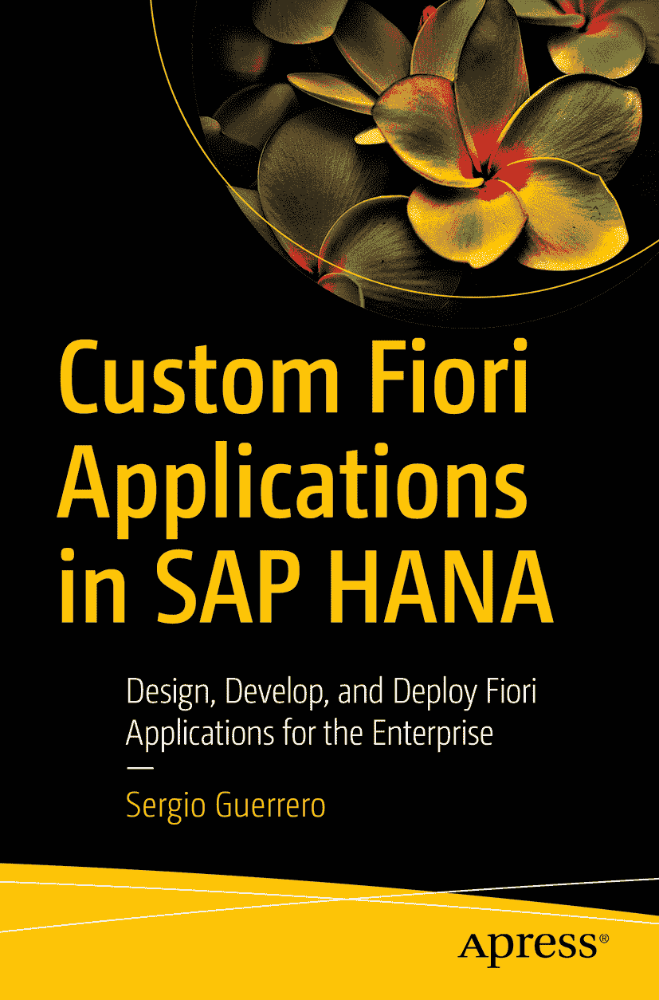

ISBN 978-1-4842-6357-0  
e-ISBN 978-1-4842-6358-7  
<https://doi.org/10.1007/978-1-4842-6358-7>

© Sergio Guerrero 2021  
本作品受版权保护。出版商保留所有权利，涉及全部或部分资料，具体包括翻译、重印、重用插图、背诵、广播、以微缩胶片或任何其他物理方式复制，以及以电子方式改编、通过计算机软件或目前已知或未来开发的类似或不同的方法进行传输或信息存储与检索。

在本出版物中使用通用描述性名称、注册商标、商标、服务标志等，即使未作明确声明，也不意味着此类名称不受相关保护性法律法规的约束，因此可自由用于一般用途。

出版商、作者和编辑默认认为本书中的建议和信息在出版之日是真实准确的。出版商、作者或编辑均不对本书所含材料或可能存在的任何错误或遗漏提供明示或暗示的担保。

出版商对已出版地图中的管辖权主张和机构隶属关系保持中立立场。

本书由 Springer Science+Business Media New York 向全球图书发行，地址：1 New York Plaza, Suite 4600, New York, NY 10004-1562, USA。电话：1-800-SPRINGER，传真：(201) 348-4505，电子邮件：orders-ny@springer-sbm.com，或访问 www.springeronline.com。Apress Media, LLC 是一家加利福尼亚有限责任公司，其唯一成员（所有者）是 Springer Science + Business Media Finance Inc (SSBM Finance Inc)。SSBM Finance Inc 是一家特拉华州公司。

*献给我的妻子艾米，感谢她无条件的支持，以及我的孩子奥利弗和艾玛*

*献给托尼和伊维特·维拉弗兰卡*

*献给格雷罗和希门尼斯家族*

## 引言

多年来，在 SAP 生态系统中创建软件应用一直令人头疼；然而，Fiori 应用改变了开发企业业务应用的游戏规则，这些应用易于开发，并能满足整个企业的复杂规则。自七年前首次发布以来，由于 Fiori 出色的用户体验和久经考验的能力，众多客户迅速采用，Fiori 应用持续受到欢迎。

许多客户关注应用程序集成、应用与数据安全、易用性、业务采用情况，以及其他现代、高质量且具有竞争力的框架所提供的功能。SAP Fiori 在同类产品中脱颖而出，提供了一个世界级的框架来创建类似产品。

本书将引导您完成设计、协作、开发、测试和将 Fiori 应用部署到本地及云环境的全过程。书中展示了多种 IDE 工具，让读者了解可用于开发、扩展、测试和增强 Fiori 应用的多种方法。通过阅读本书，读者将了解所有阶段、工具和功能，并完成一个示例 Fiori 应用的开发，该应用在 SAP Web IDE 中开发，并部署到本地的 SAP HANA XSA 环境以及 AWS 云平台。

第 1 章解释了什么是 SAP Fiori 应用，并介绍了 Fiori 应用的五个设计原则。

第 2 章和第 3 章涉及从远程 OData 服务消费数据，以及在数据不可用时模拟数据。数据模型以模型-视图-控制器（MVC）设计模式进行消费和呈现，这是 Fiori 应用中常用的模式。外部 JavaScript 库被集成到 Fiori 应用中，并在多种设备上展示以体现其响应式特性。

第 4 章展示并比较了 Fiori 应用中使用的不同单元测试框架，以及其他开源框架，如 Nightmare 和 Puppeteer。

本书以第 5 章结束，该章将示例 Fiori 应用部署到本地环境，并介绍了将同一应用部署到 SAP 云平台和 Amazon Web Services 的步骤。

所有源代码均可通过本书的产品页面在 GitHub 上获取，地址为 `www.apress.com/978-1-4842-6357-0`。如需更详细信息，请访问 `http://www.apress.com/source-code`。

## 关于作者

## 关于技术审校