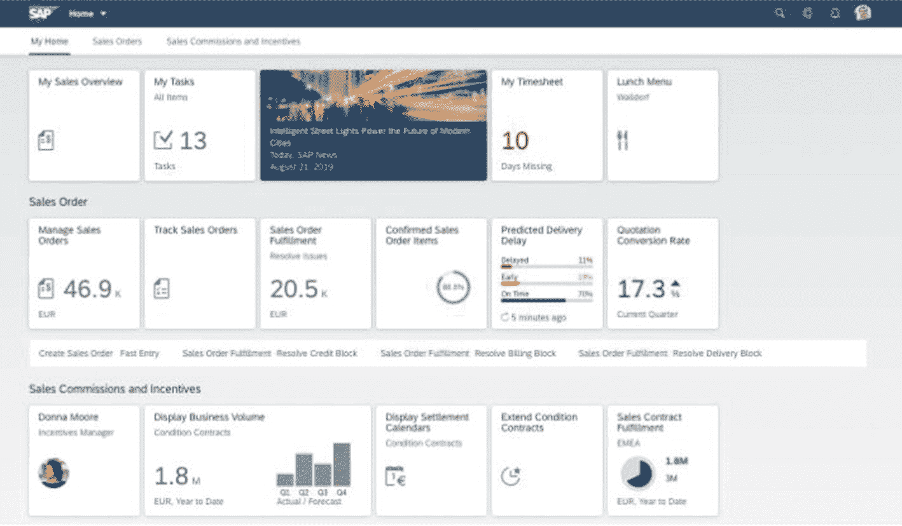
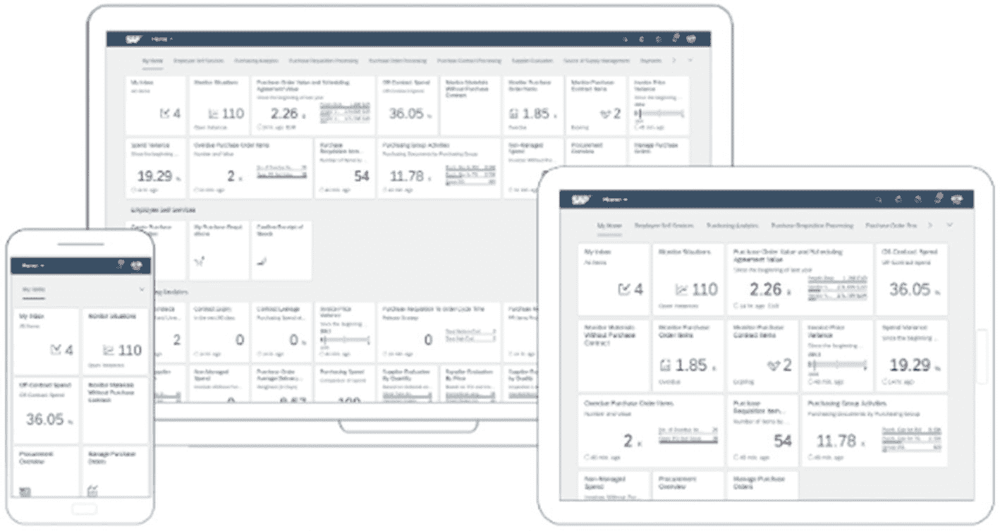
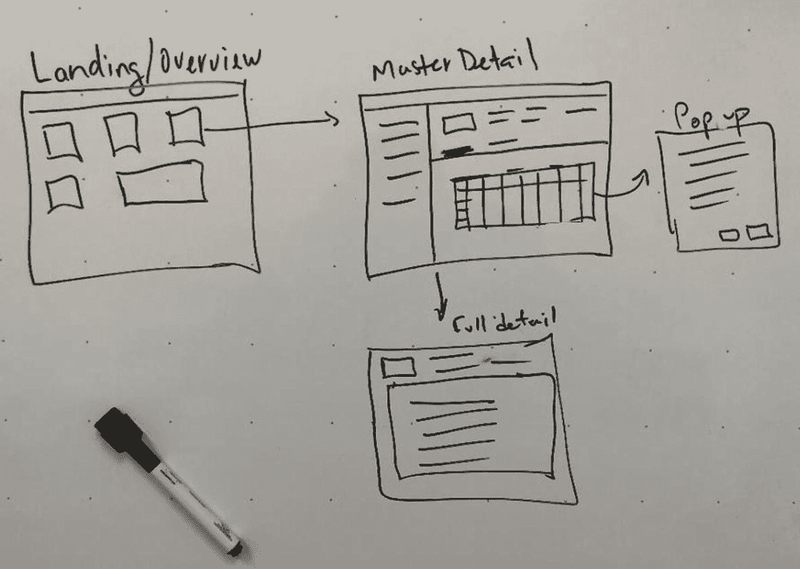
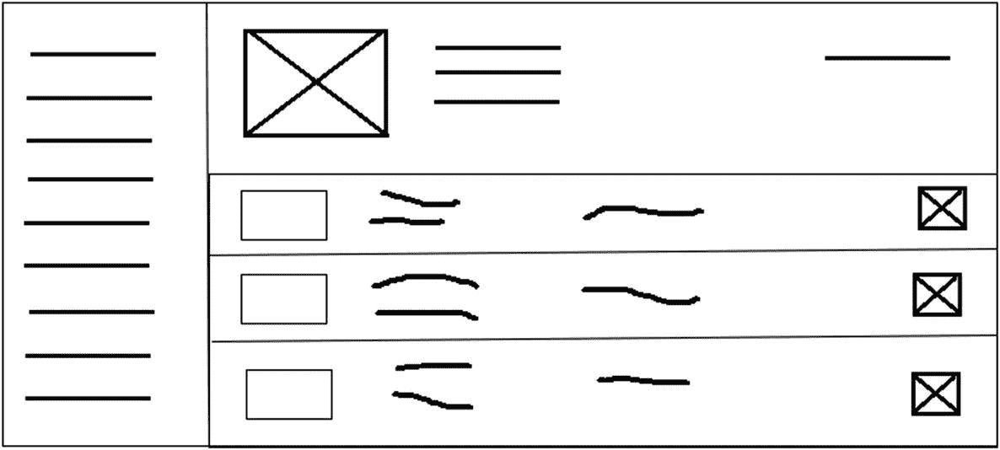
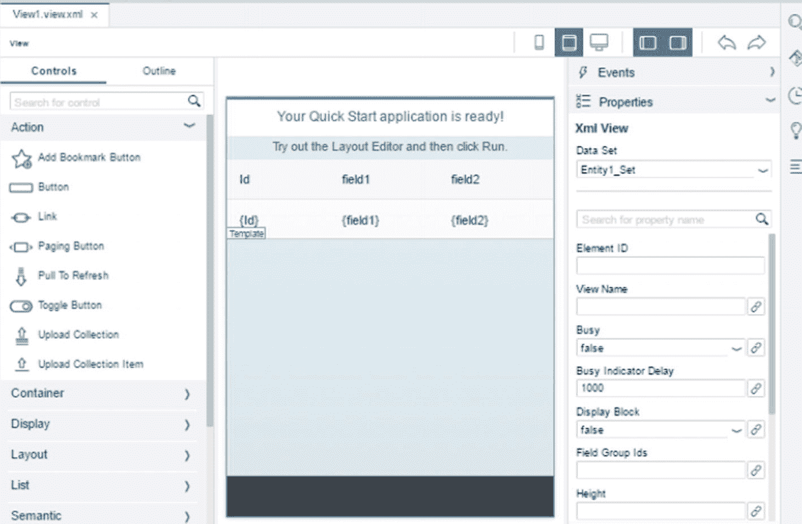
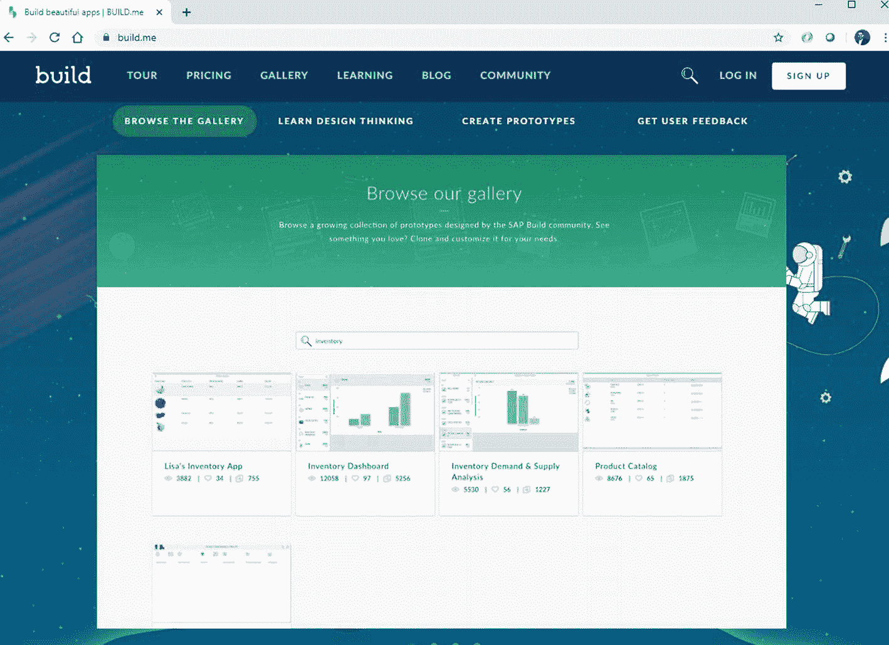
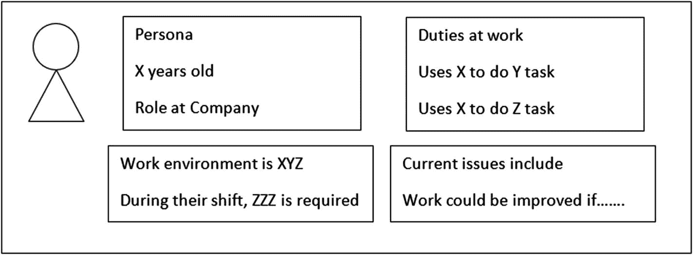

# 1. SAP HANA 中的 Fiori 应用

欢迎在 SAP HANA 中构建自定义 Fiori 应用。在本介绍性章节中，我将解释什么是 Fiori，开始产品开发时哪些概念重要，为何初始设计至关重要，不同的设计方法，了解当前和未来的用户，以及用户如何在流程中使用该产品。最终，产品会从设计阶段进入开发和部署阶段。本书将以一个完整的练习作结，展示一个利用本书讨论的所有概念开发而成的完整 Fiori 应用。

## 什么是 Fiori？

`Fiori` 指的是 SAP 创建的用户体验（UX）设计语言，并被其当前及未来的所有软件产品所采用：例如 `S/4 HANA` 中的 `Fiori 启动板`、`Fiori 应用程序库`、`XSA` 的 `SAP HANA 驾驶舱`等，仅举几例。示例如图 1-1 所示。

图 1-1 SAP Fiori 应用程序示例

`SAP Fiori` 于 2013 年推出首个版本；此后发布了三个主要版本，其主题分别称为 `Gold Reflection`（黑金色）、`Belize`（蓝色）和 `Quartz`（银色）。最新改进版本称为 `Fiori 3`，于 2019 年发布，其外观和感觉如图 1-2 所示。

图 1-2 Fiori 3 用户体验

`Fiori UX` 也已扩展至移动平台，例如支持原生设备的 `IOS` 和 `Android`。为这些设备开发应用程序需要额外的编程语言、语言运行时和模拟器，具体取决于目标平台（若在 `IOS` 平台上开发，还需考虑许可问题）。`IOS` 设备使用 `SAP Fiori for IOS 指南`，可访问以下链接：[`https://experience.sap.com/fiori-design-ios/`](https://experience.sap.com/fiori-design-ios/)；而 `Android` 设备则使用 `SAP Fiori for Android 指南`，可访问以下链接：[`https://help.sap.com/doc/c2d571df73104f72b9f1b73e06c5609a/Latest/en-US/docs/index.html`](https://help.sap.com/doc/c2d571df73104f72b9f1b73e06c5609a/Latest/en-US/docs/index.html)。此外，还有一些混合应用程序保持了 `Fiori UX` 的外观和感觉，它们之所以重要，是因为它们增强并利用了移动设备提供的功能。

请记住，为 `IOS` 设备构建的应用程序在发布前，必须提交至应用商店，并接受其特定规则、许可及其他平台相关检查的验证。如果这是最终目标，则需要考虑各种类型的 `IOS` 许可证。`IOS` 应用的许可证信息可在 Apple 开发者网站上找到：[`https://developer.apple.com/support/compare-memberships/`](https://developer.apple.com/support/compare-memberships/)。

就本书而言，仅涵盖 `SAP Fiori UX` 的 Web 版本，我会为原生开发提供 `URL` 链接，供读者了解如何查找与特定移动平台版本相关的更多信息。无论你是为 Web 还是移动平台开发 `Fiori` 应用程序，后续步骤都将类似。让我们开始吧！

任何产品首要且最重要的步骤都是`设计`阶段。无论产品是消费品、软件产品还是任何其他类型的产品：所有产品都应经历这一步骤。我怎么强调这一步骤都不为过——在此阶段偷工减料，只会导致后期额外工作量的增加。

在创建产品之前，必须进行市场调研：与潜在用户进行问答环节，了解产品将如何被使用、如何对用户有益、如何改进初始原型，并最终收集尽可能多的细节，以帮助公司在开始生产产品前感到放心。同样的概念也应适用于创建像企业级 `Fiori` 应用程序这样的软件产品。不幸的是，如果你在行业内工作过几年，可能对某些开发团队在启动新软件应用时面临的困境有所了解。如果你注意到最后一句话，我从分析产品、用户及其潜在用途，急剧转向展示开发团队 struggling 的现状，正如某些公司中的情况一样。我之所以提到这一点，是因为这是许多团队面临的残酷现实，而作为企业中的开发者，我们需要确保在开始任何开发工作之前理解用户的需求，以最小化返工，并长期提高软件采纳率。软件采纳并非易事，必须谨慎进行。

## Fiori 设计

如前文所述，`设计`是决定产品成败众多步骤中的关键基础要素。前期投入的时间越多，团队就越能更好地开发出受用户欢迎的产品。

`设计`并不仅仅意味着只需要一位平面设计师进行原型设计、草图绘制或任何其他类型的绘图；`设计`意味着要进行设计思维讨论，使用便利贴、白板绘图以及任何必要的工具来理解用户对产品的使用方式和/或操作流程。在此阶段，请**不要**试图解决问题或寻找解决方案。这项活动严格来说是为了了解用户的需求。（**开发者注意**）之后会有足够的时间来解决解决方案问题。

在这一步骤中，整个团队（包括技术人员和非技术人员）都能参与进来，这一点非常重要。使用诸如普通`白板`之类的工具可以使产品团队和业务方受益，因为他们能够且应该共同参与设计创意的讨论。通过这种方式，设计可以轻松更改，并且设计团队应该能够并乐于接受持续的反馈。这种做法有时看起来可能过于简单；然而，对于任何新产品的贡献者来说，在着手绘制草图或制作原型以理解业务需求之前，集思广益并快速调整方案是至关重要的。如图 1-3 所示。

图 1-3 白板设计

如果产品团队对 `SAP Fiori` 的某些设计模式已有足够的信心，那么他们可以继续进入草图绘制阶段。有一种方法称为`低阶设计`，如图 1-4 所示，这意味着可以进行草图绘制，设计人员通常会对屏幕的高阶组件（方框、网格、列表和其他占位符）进行模拟。设计人员还可以从此类设计中展示应用的导航。因为它足够简单且能传达设计思路，所以对产品团队来说可以快速见效。另一方面，这种设计方法的一个缺点是，客户可能无法完全理解`低阶设计`，并且可能因为看不到原型清晰、全面的图景而感到困惑。在我们这个拥有众多可用于此目的的工具和应用的时代，客户往往希望看到他们的产品最终会是什么样子。在我看来，与白板或`高阶设计`方法（将在下一段讨论）相比，`低阶设计`的采用率较低。

图 1-4 低阶设计

第三种设计方法是`高阶设计`，如图 1-5 所示。这种设计意味着设计人员或开发人员可以开始将应用控件（`SAPUI5`）放置在屏幕上，并快速构建原型。某些 `RAD` 工具（快速应用开发工具）可用于此目的。这种方法能快速向客户展示更直接的应用设计。最重要的是，它能精确显示应用的外观（但不一定是其行为）。很多时候，客户希望确切地看到他们在开发结束后能得到什么，并且他们以为原型完成后就万事大吉了：这是错误的！您的团队必须提前让客户了解原型的情况，并告知他们后续仍然需要在数据集成、数据绑定、从 Web 服务消费数据以及为 `Fiori` 应用添加自定义行为（如业务规则）等方面投入开发工作。

诸如 `SAP Web IDE`（集成开发环境）、`SAP Build`（如图 1-6 所示）等工具，以及其他工具，可以帮助您利用这些工具内的拖拽功能或 `WYSIWYG`（所见即所得）编辑器快速完成`高阶设计`原型。

*此处提及的每个工具在生产环境中使用可能都需要一定的许可证。请在使用这些工具前核实许可证要求。*

图 1-5 SAP Web IDE 布局编辑器

如果您决定使用 `SAP Build` 工具，您需要创建一个账户并选择许可证类型。使用 `SAP Build` 工具的好处是，您可以为其中一些应用制作原型，并且还可以实现包含路由导航的功能。`SAP Build` 足够简单，即使是非技术用户也能使用。许多客户喜欢减少技术依赖和拥有自助服务工具的想法；我认为 `SAP Build` 是实现该目标的一个好工具。`SAP Build` 工具中有一个很棒的功能，允许用户上传电子表格来包含数据，并立即将其反映到正在构建的原型中。一旦原型足够接近所需效果，就可以将其传递给技术团队，集成到其余的技术环境中。

使用付费许可证的 `SAP Build` 工具，用户可以创建多个项目并将其保存在自己的账户中。这些原型/项目随后可以被导入到 `SAP Web IDE` 中，Web 开发者可以在其中通过向应用的其余部分添加 `JavaScript` 代码来继续工作。此外，如果用户对 `SAP Build` 或 `SAP Fiori` 不太熟悉，图库部分有一些模板可以作为他们学习制作原型的起点。还有博客和社区页面，用户可以在其中参与讨论、提问，甚至从博客中获益。使用 `SAP Build` 的免费试用许可证，设计师/开发者只能创建一个应用项目。有大量在线资源可以帮助您熟悉并加入这些在线社区。如果您不知道从哪里开始，可以在 `SAP Build` 社区中探索。

图 1-6 SAP Build 工具

无论设计是通过白板、`低阶`还是`高阶设计`完成的，此步骤的最终目标都是了解用户以及他们将如何与产品交互；因此，您的团队需要专注于这个目标。引入目标受众用户并创建虚构的用户画像是有益的。

`用户画像`描述了一个理想的虚构用户及其工作环境、性别、任务、他们将如何使用该产品，以及与该用户与产品交互相关的任何外部因素、障碍、可能限制或其他元数据（在我们的案例中，该产品是软件），如图 1-7 所示。除了了解用户需求外，还必须对用户群体当前遇到的痛点进行一些研究，并思考这个新产品如何能够最大限度地减少这些痛点，甚至更好地消除它们。`Fiori` 设计的目标是打造最好、最高效的产品，让用户乐于拥有并享受使用它来完成日常任务。

图 1-7 用户画像

虽然这本书与软件相关，但同样的原则也适用于任何其他产品，所以让我们分析一下目前市场上一些成功的产品。人们可能会想，为什么其中一些产品如此成功？深入的研究和良好的设计可以带来巨大的 `ROI`（投资回报率）。