# 单一产品品牌分析

我想分析的一个单一产品品牌，是生产电动工具、建筑工具和工具存储设备等产品的品牌。这些工具质量非常高，且使用寿命极长。它们是大多数建筑专业人士的选择，处于其行业产品的高端定位。十多年前我结婚时，为了房屋装修项目购置了各种类型的工具。当我开始学习如何完成一些小型家庭项目时，我的第一套工具表现得非常出色。随着我积累经验并进一步了解工具质量，我意识到，合适的工具才能正确完成工作。是的，我本可以购买更便宜的工具，但那和使用正确工具的效果完全不同。我开始投资更多这种黑黄配色的工具。我最新入手的一套工具是钻头和冲击钻的套装，配有一个电池充电器和两块电池。与我的旧工具相比，历经多年发展，新工具变得更轻、动力更强、电池续航时间得到改善，而且一些不同的工具可以共享电池。在我看来，这家公司开展了广泛的用户体验研究、工具设计以及对工具进行了大量改进，从而实现了客户满意度、提高了产品采用率并获得了回头客；所有这些，都是大多数公司期望看到的。所有这些令人满意的举措，为这家公司带来了巨大的投资回报率。我不介意多花一点钱来获得高质量的工具。正如你在这段文字中所看到的，其中涉及了可能的用户画像（建筑专业人士）、关于客户如何使用工具的客户研究，以及识别这些用户的一些痛点，例如工具重量、电池续航时间以及工具部件之间的兼容性。所有这些概念都是产品从设计到开发和生产过程中的一部分。`SAP` 也推荐了这样一个流程；它被称为设计思维，这是一个经过验证的流程，贯穿于产品创建的整个生命周期。设计思维流程始于发现阶段，在此阶段，各种事物被呈现和分析，并在创建产品时记录大量笔记；设计阶段包括多种呈现创意和制作原型的方法，以观察该创意将如何被使用，并被团队中的许多协作者观察，其目的是提供反馈并捕捉用户将如何使用该产品：基本上是全员参与。开发阶段是人员创建产品，向客户方展示产品以获取反馈，并在多次迭代中进行改进；最后是交付，这是流程中回报丰厚的部分，此时产品离开团队并投入生产使用。

## Fiori 的五项设计原则

`Fiori` 用户体验有五项设计原则，必须应用于所有应用程序，如图 1-8 所示：

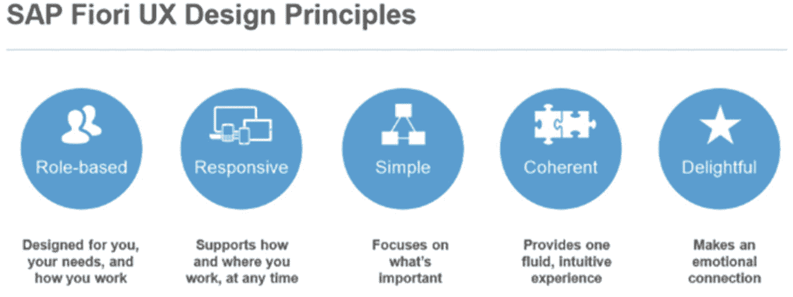

*图 1-8*
*Fiori 的五项设计原则*

1. 基于角色
2. 一致性
3. 简洁
4. 响应式
5. 愉悦

**基于角色** 与设计原则中的其他特性同等重要；然而，在我看来，它是最重要的一个，因为它似乎是大多数客户真正要求的功能。基于角色的特性可以将控件属性设置为只读、启用/禁用可见性，或允许用户提供输入。`Fiori` 应用程序的另一个基于角色的用例是，公司内不同部门的用户能够看到应用程序的不同部分；例如，人力资源部门的用户与财务部门的用户，以及其他部门的用户相比，对同一个应用程序会有不同的视图。此外，这些角色可以与非 `Fiori` 应用程序中的 `Active Directory` 角色进行比较。在设计 `Fiori` 应用程序时，你可以将此属性视为一种方式，为拥有读写权限的用户与另一个只能读取某些数据而无法交互的用户展示同一个应用程序。如果你能理解只读与读写之间的区别，那么你就在思考基于角色的特性。当 `Fiori` 应用程序被添加到 `SAP Fiori` 启动板中时，角色还可以允许或阻止用户访问 `Fiori` 应用程序。在本书中，我们不会深入讲解启动板的配置；相反，我们将在第 5 章中将我们的 `Fiori` 应用程序部署到 `SAP HANA XSA` 环境中。

**一致性** 是设计原则的一部分，它强制要求应用程序的设计在其所做的每一件事以及其行为方式上都合乎逻辑。在旧的 `SAP R/3` 中，某些事务需要输入非常多的参数，以至于用户有时不明白为什么应用程序需要它们；有时，用户甚至需要点击一个元素才能显示附加信息。此外，一致性原则在为这些业务场景设计新软件时，会带来额外的流程改进。这个特性可以被想象成一个向导，或者一个带有默认过滤器的智能表格，这些过滤器显示在智能过滤器栏中，或者当在按钮中使用 `type` 属性来显示接受（显示为绿色）、拒绝（显示为红色）或默认（默认颜色）时。其他 `UI5` 控件可能使用 `state` 属性来显示其他状态，例如警告、启用或禁用，仅举几例。

**简洁** 是我最喜欢的特性之一，因为作为 `SAP` 世界中的开发人员，某些 `SAP` 事务非常复杂，即使我们不知道某些字段的用途，也需要提供大量的字段。这里的简洁特性指的是尽量减少点击次数，让用户保持更高的生产力，并使他们的流程尽可能高效。允许用户完成一项任务时，在一个流程或事务中应包含的最大点击次数应少于三次。

**响应式** 指的是传统软件必须针对不同平台进行编写；然而，`SAP Fiori` 利用了软件的响应式特性，只需编写单一的代码库，就能让软件在不同屏幕尺寸和设备上自适应，且从技术角度来说几乎不需要额外投入。`Fiori` 应用的响应式特性能够立即为企业带来投资回报，因为它们可以同时为办公环境或生产车间开发这些应用。出色的响应式应用还能在移动浏览器中运行，让用户随时了解业务情况，如图 1-2 所示。`SAP Web IDE` 和 `SAP Build` 工具都具备“设备预览”功能，您可以立即看到设计在不同设备上的显示效果。

**愉悦性** 意味着，如果用户喜欢某个应用，他们很可能会再次回来完成工作或使用它。美观的应用更有可能提高生产力，让用户保持愉悦心情，这就是为什么包含这一原则如此重要。在设计新软件时，让用户接受它是非常困难的任务。用户会抱怨，并声称当前系统虽然低效但也能工作，从而抵制变革。从过往在其他平台（设计自由度极高）的经验来看，缺乏这部分框架也会让工作变得更加繁琐和复杂。

通过对比图 1-9 和图 1-10，可以直观地看到 `Fiori` 的五大设计原则。图 1-9 展示了一个 `SAP GUI` 事务，而图 1-10 则展示了一个带有对象页面和图标标签栏的 `Fiori` 应用。

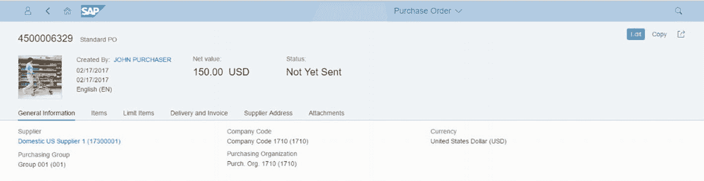

图 1-10
`SAP Fiori` 标准应用

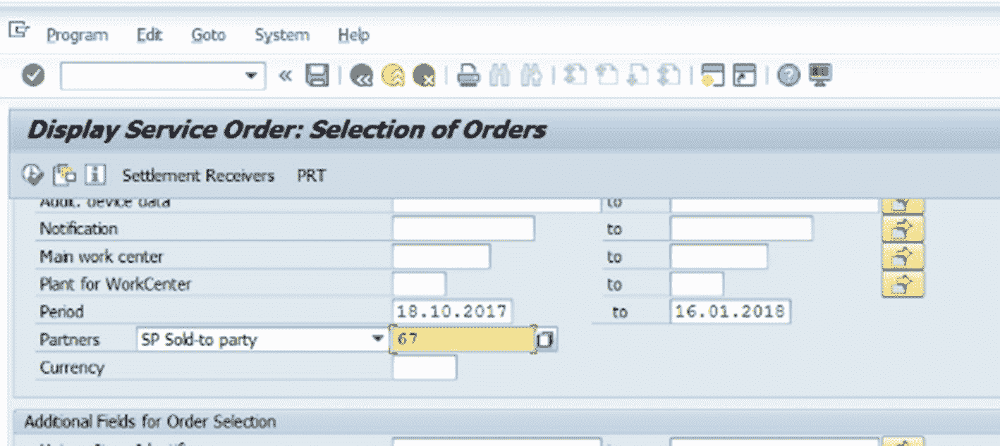

图 1-9
`SAP GUI`

## 为 Fiori 应用准备好您的系统

虽然理解 `Fiori` 设计、用户体验以及创建优秀产品的所有初始概念是必要的，但作为开发者的您可能想知道何时才能进入系统，开始原型设计和开发一些 `Fiori` 应用。

`Fiori` 提供了一套样板文件，助您为 `Fiori` 应用的世界做好准备。您可以在 [`https://experience.sap.com/fiori-design-web/downloads/#top`](https://experience.sap.com/fiori-design-web/downloads/%2523top) 找到这些样板文件。这些样板包含了模板、控件、颜色、字体、图标以及您开始设计所需的一切。无论是 `Mac` 用户还是 `Windows` 用户，都有相应的样板和程序可用。我不会深入设计方面，因为我更熟悉开发领域。当设计完成后，设计团队的原型图和其他交付成果就可以移交给开发人员，以便他们开始开发。

有多种工具可用于开发 `Fiori` 应用。如图 1-11 所示，诸如 `SAP Web IDE`（可在 `SAP 云平台`、本地部署或 `Web IDE 个人版` 中找到）和 `Business Application Studio` 等工具，都用于此类 `Fiori` 开发。

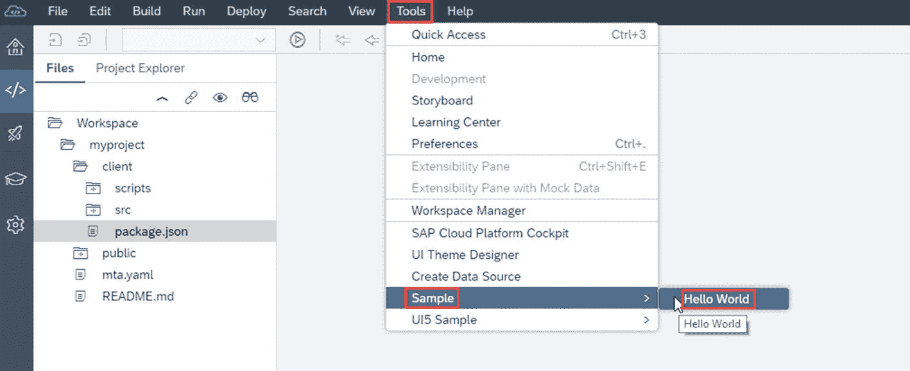

图 1-11
`SAP Web IDE`

`Business Application Studio` 是用于 `Fiori` 和 `HANA` 开发的最新工具，它是 `Visual Studio IDE` 的一组插件（也可在 `SAP 云平台` 上找到：位于 `Cloud Foundry 平台` ➤ `订阅` ➤ `SAP Business Application Studio` 下，然后点击订阅），如图 1-12 所示。如果您无法访问，请检查您的用户是否具有 `Business Application Studio 开发者` 角色模板。

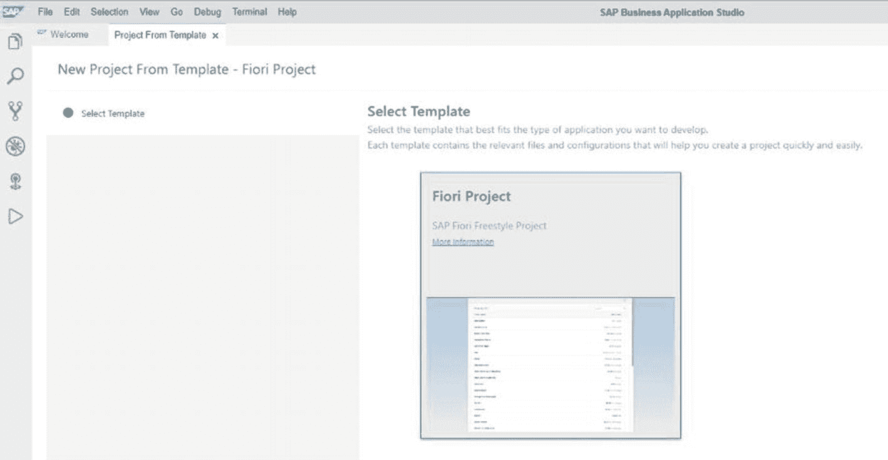

图 1-12
`SAP Business Application Studio`

如果您决定使用 `Visual Studio Code IDE`，还可以获得一些 `SAP Fiori` 插件。

这些插件可以在扩展中找到，如图 1-13 所示。

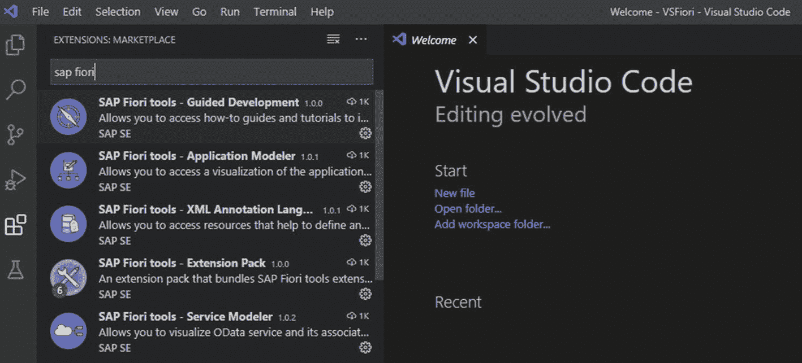

图 1-13
适用于 `Visual Studio Code` 的 `SAP Fiori` 插件

既然我已经介绍了开发工具，那么现在重要的是了解如何开始为您的自定义 `Fiori` 应用进行开发。

`Fiori` 应用构建于 `SAPUI5` `JavaScript` 库之上。`SAPUI5` `JS` 库是一套由 `SAP` 构建的 `HTML5` 控件和 `CSS3` 样式，用于创建 `Fiori` 应用。所有拥有付费许可证的 `SAP` 用户都可以访问并创建这些 `SAPUI5` / `Fiori` 应用。另一方面，如果您不是 `SAP` 客户，但希望使用 `UI5` 构建类似 `SAP` 的 `Fiori` 应用，还有一个名为 `OpenUI5` 的开源版本。这两个库的一些差异在表 1-1 中已突出显示。

表 1-1
`SAPUI5` 与 `OpenSAPUI5` 对比

| | `SAPUI5` | `OpenUI5` |
| --- | --- | --- |
| 库类型 | 对 `SAP` 客户可用 | 开源库 |
| 许可证类型 | `SAP` | `Apache 2.0` |
| 运行平台 | `SAP HANA`、`SAP 云平台` 或 `SAP NetWeaver` 前端服务器 | 任意 `Web` 服务器 |
| 网站 | [`https://sapui5.hana.ondemand.com/`](https://sapui5.hana.ondemand.com/) | [`https://openui5.org/`](https://openui5.org/) |
| 应用类型 | `SAP` 前端服务器• `SAP Fiori` 应用• `SAP Fiori` 自由式应用 `SAP HANA` 扩展应用服务（`XS` 引擎）• 自定义 `Fiori` 应用 | 任意 `Web` 应用或 `Web` 组件 |
| 开发者 | `SAP` | `SAP` 及开源社区 |

在之前的表格对比之外，我们不妨花点时间了解一下 `SAPUI5 SDK`（软件开发工具包）页面，因为我将着重介绍其中重要的内容，以及那些试图进入 `SAPUI5` / `Fiori` 开发的读者应该注意的事项。

在图 1-14 和图 1-15 中，我们可以分别看到 `SAPUI5 SDK` 和 `OpenUI5 SDK` 页面。它们具有相似的外观与风格，以及相同的结构；再次说明，这些不同的库分别用于 `SAP` 许可的开发或 `UI5` 框架的开源等价物。

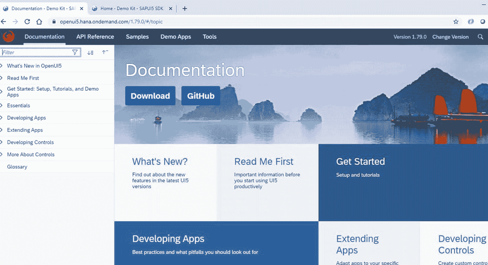

图 1-15
`Open UI5 SDK`

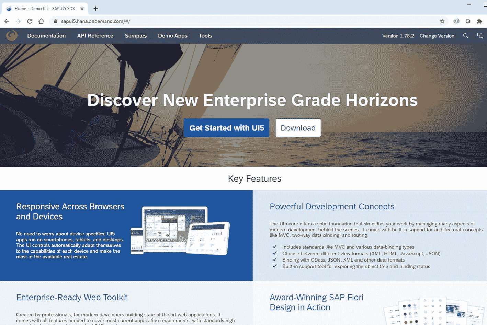

图 1-14
`SAPUI5 SDK`

在图 1-16 中，你可以看到 `SAPUI5 SDK` 页面。页面顶部有一些章节（选项卡），内容被划分其中。

### 文档

在本节中，读者可以找到与 `SAPUI5` 应用程序相关的所有重要文档，内容涵盖从创建第一个 `Fiori` 应用程序的入门教程，到深入理解 `Fiori` 应用程序的深层概念。

本节中其他值得记住的重要信息包括：版本特性、版本支持、如何开发自定义控件、主题、`SAP Fiori CSS` 类以及浏览器兼容性等。

花时间学习入门教程部分非常重要，因为它展示了如何从头到尾构建一个 `Fiori` 应用程序。它还展示了使用 `MVC`（模型-视图-控制器）模式的不同场景。无论你是构建新应用程序还是扩展现有 `SAP` 交付的应用程序，`SDK` 的这一部分都很有用，并且建议熟悉它。

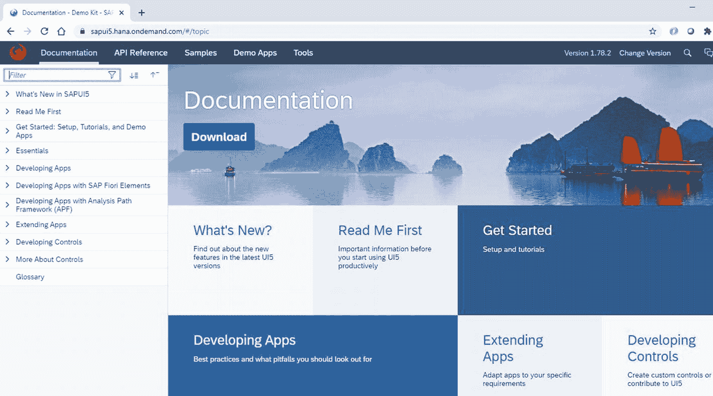

图 1-16
`SAPUI5 SDK` 文档页面

### API 参考

`API` 参考非常有帮助，因为它解释了所有 `SAPUI5` 控件：控件被分解为属性、事件、构造函数、关联、聚合及其基数。如图 1-17 所示。

在这个 `SAPUI5 SDK` 部分中，开发人员可以全面了解每个控件的所有必要属性、继承关系和行为。此外，本节还根据命名空间（`sap.m`、`sap.apf`、`sap.ui`、`sap.f`...）对 `SAPUI5` 控件进行了分类。

当你决定开始构建 `Fiori` 应用程序，并且需要在 `XML` 视图中使用来自不同命名空间的控件时，请确保包含对这些命名空间的引用。遗漏命名空间是开发人员开始涉足 `SAPUI5` 时常犯的错误。另一个常见的疏忽是缺乏对可用属性的理解；花些时间阅读 `API` 参考，熟悉一些常用控件，例如表格、按钮和输入字段。

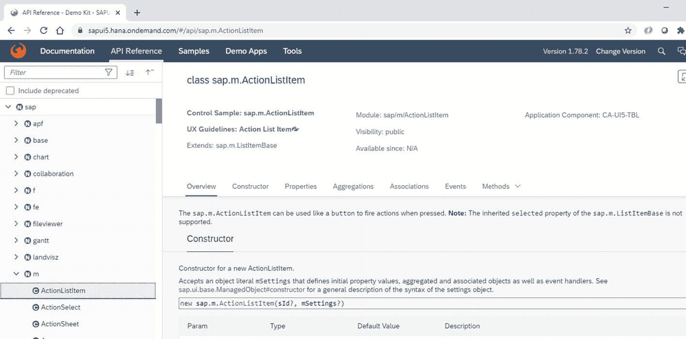

图 1-17
`SAPUI5 SDK API` 参考

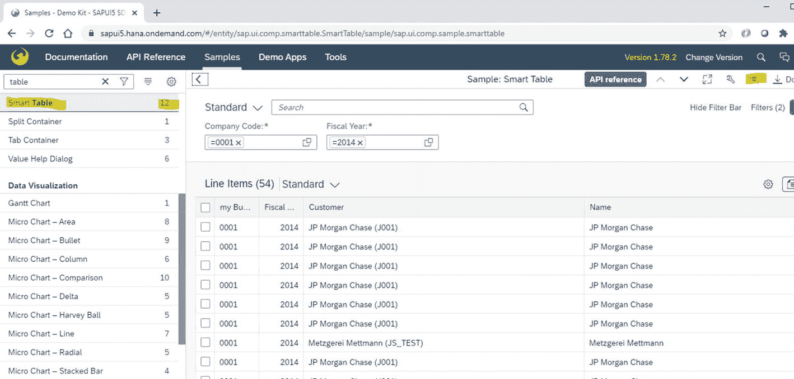

图 1-18
`SAPUI5 SDK` 示例页面

### 示例

是的，`SDK` 页面提供了示例应用程序和代码片段，开发人员可以快速在用户界面上看到它们，如图 1-18 所示。随着开发人员学习得越来越多，某些代码片段会很容易记住，但在开发新应用程序需要新控件时，知道从哪里获取这些控件仍然非常有帮助。此选项卡中的重要部分包括：
1.  应用程序左侧显示的控件导航列表
2.  列表项中展示的不同场景数量
3.  所使用的 `SAPUI5` 库的版本（屏幕右上角）
4.  代码片段图标，显示为 `{ = }`，位于“更改版本”图标和放大镜图标下方（图 1-18 的右上角）

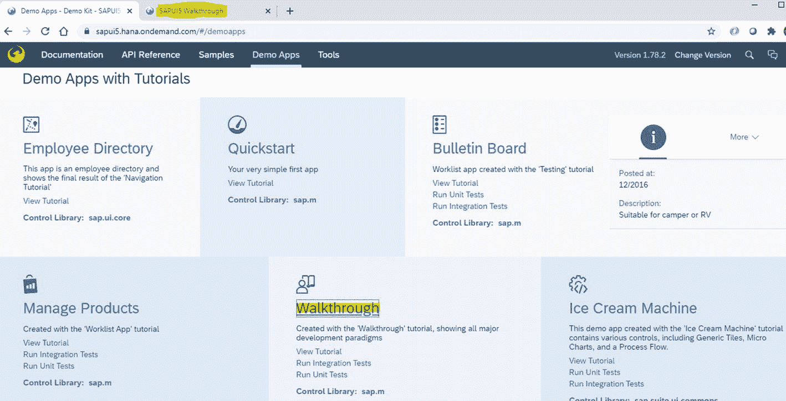

图 1-19
`SAPUI5 SDK` 演示应用程序

### 演示应用

`SAP` 提供了一些演示应用程序，如图 1-19 所示，以便开发人员可以看到已完成的工作以及实现方式。如果需要，他们可以获取代码库，以防需求与演示应用程序类似。我强烈建议首先访问并学习入门教程应用程序，以全面了解 `SAP Fiori` 应用程序中存在的所有动态部分。如果你能跟随此应用程序并理解众多部分如何协调配合，那么无论是修改现有 `Fiori` 应用程序还是从头创建新应用程序，都会变得非常容易。

请确保在此演示应用部分投入足够时间，尤其在图 1-19 所示的入门教程中。

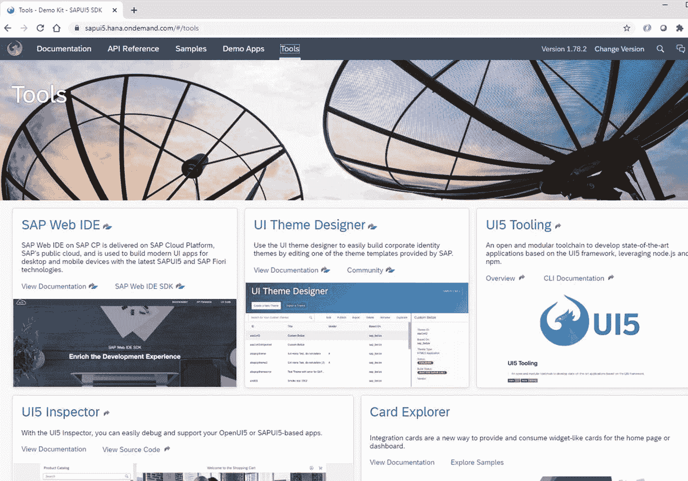

图 1-20
`SAPUI5 SDK` 工具页面

### 工具

本部分指出了构建 `SAP Fiori` 应用程序所需的主要工具，如图 1-20 所示。这些工具用于开发（`SAP Web IDE` 或 `UI5` 工具）、调试（`UI5 inspector`）、主题设计器（如果需要自定义主题）以及图标。接下来对这些工具进行补充说明。

在图 1-20 中，你可以看到主要工具的说明以及了解更多相关信息的链接。

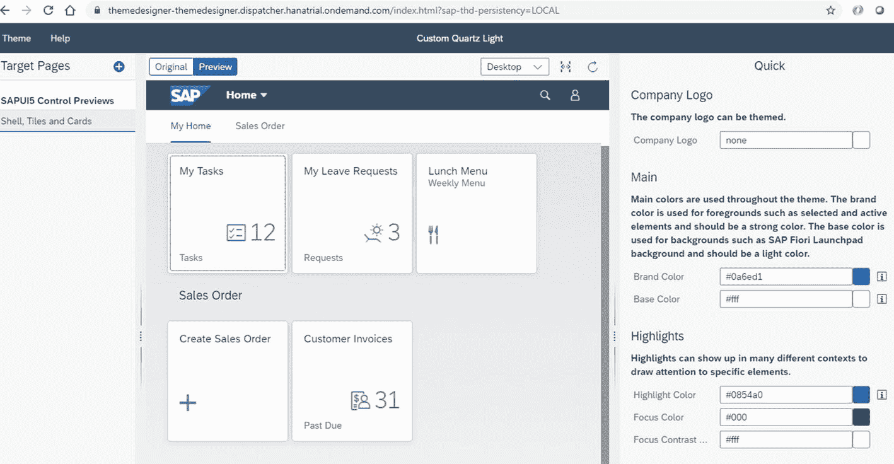

图 1-21
`SAP Cloud Platform` 自定义主题设计器

### SAP Web IDE

这是 `SAP Fiori` 应用程序的主要开发工具。它是一个基于浏览器的工具，用于开发 `Web` 和数据库应用程序。此类工具有多个版本，因此请检查开发所需的版本和许可证要求。`SAP Web IDE` 可以本地安装（`SAP Web IDE` 个人版），在 `SAP Cloud Platform` 上有一个名为 `SAP Web IDE Full stack` 的版本，同时还有一个适用于本地部署开发的版本，也可以通过 `SAP HANA Express` 版访问。

### UI 主题设计器

如果待开发的 `SAPUI5` 应用程序需要自定义主题，并且该 Fiori 应用程序不遵循标准的 Fiori 概念，则建议使用此工具，如图 1-21 所示。在 `SAP Cloud Platform`（或 `SAP Cloud Platform` 试用版）中查看此工具，看看是否能设计出自己的自定义品牌主题。此工具非常有帮助，因为它允许开发人员重用类名，并且开发人员可以动态更改颜色，快速查看如果使用自定义主题作为最终产品，他们的应用程序可能是什么样子。

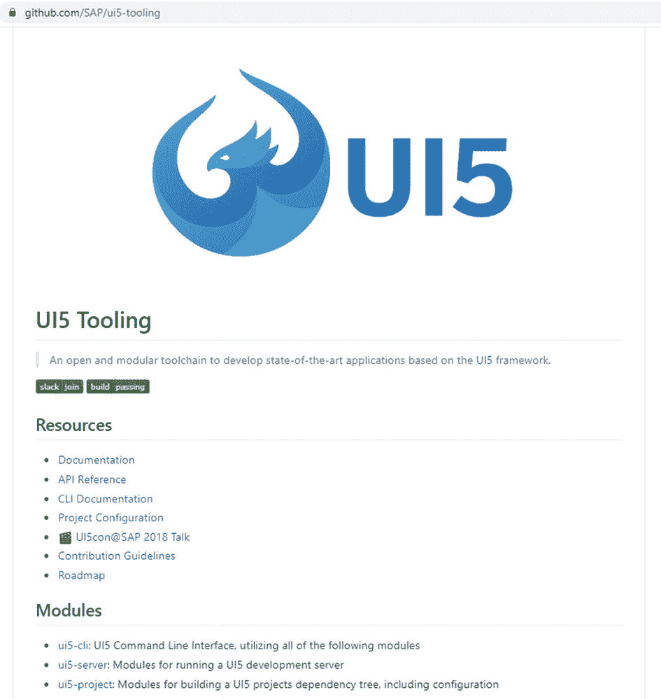

图 1-22

### UI5 工具 CLI

1.  **UI5 工具**

    这是一个命令行界面(CLI)工具，如图 1-22 所示，该工具利用 `Node JS` 和 `NPM`（Node 包管理器）加速应用程序的开发。CLI 工具在 Web 开发中非常流行，因此 `SAPUI5` 也提供了该工具也就不足为奇了。

    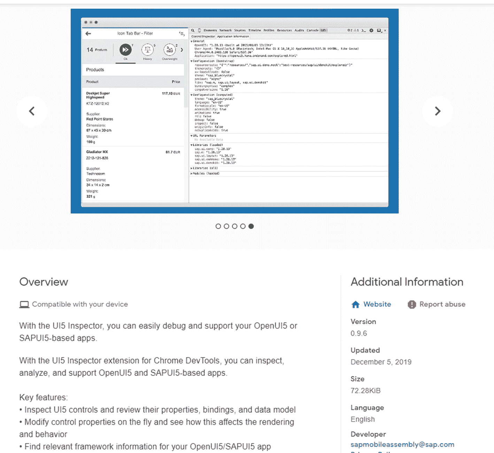

    图 1-23

### SAPUI5 检查器

1.  **UI5 检查器**

    该工具是一个 Chrome 浏览器附加组件，允许开发者在应用程序于浏览器中运行时，对其中的 `SAPUI5` 控件进行调试和分析。该工具如图 1-23 所示。此工具可显示应用程序内控件的层级结构，以及分配给它的所有 `CSS` 类和任何其他属性/特性。在尝试调试特定控件的行为或在应用程序中查找内容时，此工具非常有用。由于不同浏览器的行为和显示方式不同，在比较某些控件的渲染效果以及它们在不同浏览器上的表现时，可以使用此工具。

    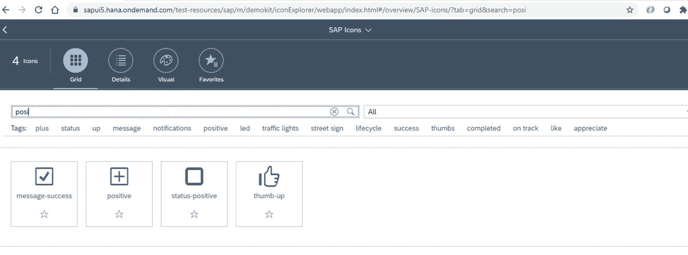

    图 1-24

### SAPUI5 图标浏览器

1.  **图标浏览器**

    到目前为止，这是我最喜欢的工具，因为它能让我在同一框架内找到可用的图标。有时，在其他技术框架中，开发者需要集成额外的 `JS` 库来获取图标，而在 `SAPUI5` 中，图标库已经包含在内。该工具允许开发者搜索图标，并且图标可以以多种形式呈现，例如不同的大小。此外，图标还带有一些关键词标记，如图 1-24 所示，在此工具中搜索时可以轻松找到它们。

## 理解元素、布局和页面模板

随着我们对 Fiori 的深入了解，理解 Fiori 应用程序是如何设计和开发的变得至关重要。如果你以前从未开发过 Fiori 应用程序，你很可能会先看一些示例，然后尝试模仿它们。这是学习新技能或技术，或者第一次尝试新事物时的正常过程。经验丰富的开发者也会寻找构成某种应用程序的模式和组件。我们试图理解页面由哪些元素组成，使用了哪些控件，并通过某些 API 或文档熟悉它们。开发 Fiori 应用程序时也是如此。

**SAPUI5 控件** 包含了 Web 应用程序中最常见的控件，例如输入字段、标签、组合框、表格和复选框等等。请访问 `SAPUI5 SDK` 页面，以了解更多关于不同类型控件的信息、它们的文档及其代码示例。

`SAP Fiori` **元素**，以前称为智能模板，为您提供了 Fiori 应用程序中最常用的一套模板。其中一些模板包括概览页面、列表报表、工作清单和对象页面。此外，其中一些 Fiori 元素几乎不需要或完全不需要开发，它们是元数据驱动的应用程序。本书将展示如何使用 `MVC` 框架、`XML` 视图和控制器中的 `JavaScript` 编程语言来创建这些应用程序。

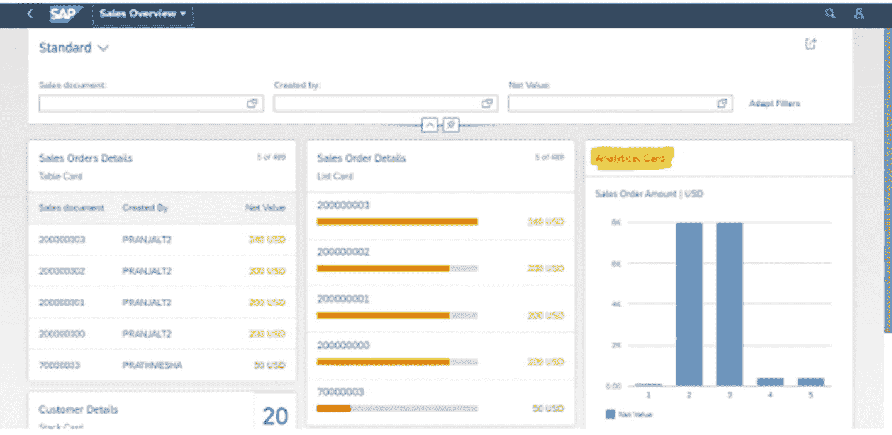

图 1-25

### 概览模板

1.  **概览页面：** 此模板包含可能带有一些重要指标（如分析型卡片）的智能磁贴，允许用户快速查看并导航以查看更多详细信息。顾名思义，概览页面的目的是无需深入到应用程序的每个区域/页面来查找系统问题，就能快速提供重要信息的概览。这种类型的页面/模板用作应用程序的入口点，如图 1-25 所示。该模板展示了卡片、磁贴、列表和一些图表，以便快速可视化。一张图胜过千言万语，这种类型的模板正是做到了这一点。它不会让用户感到不知所措，并且清晰地指明了要寻找的目标。

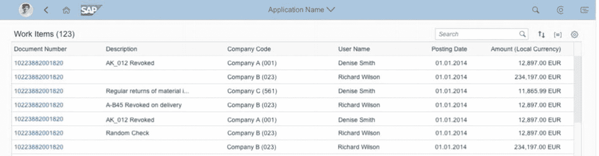

图 1-26

### 工作清单模板

1.  **工作清单：** 这种类型的页面/模板用于向用户分配工作，并且通常允许用户深入查看详细信息以执行某些操作。它是一个从简单列表到详情页的页面。该模板展示了一个列表、一个导航以及一个可以查看项目详情并对其采取操作的详情页面。图 1-26 展示了这样一个模板。

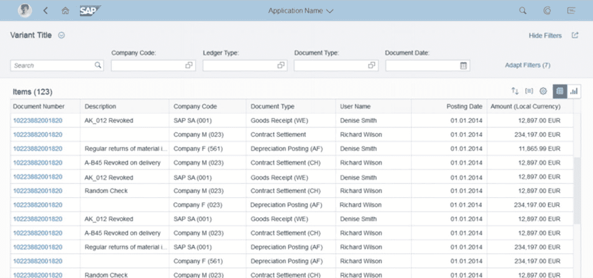

图 1-27

### 列表报表模板

1.  **列表报表：** 这种类型的模板与工作清单模板非常相似；然而，此模板通常用于包含更多项目的数据集，用户可以通过包含筛选条件来最小化显示的记录数量。该模板还允许进行多选，以便对特定记录执行一组操作。与工作清单相比，它通常用于向用户提供数据集更高层级的可见性，而工作清单通常用于专属于特定用户的较小数据集。该模板如图 1-27 所示。

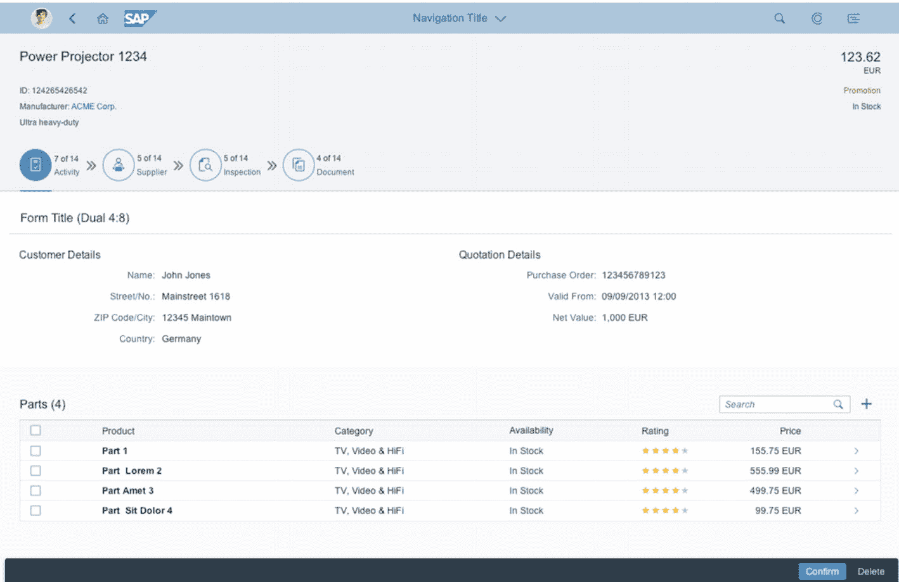

图 1-28

### 对象视图模板

## 对象页面

**对象页面：** 此模板用于提供特定记录的详细信息。它作为详细步骤使用，当用户从列表项点击导航并进入此处时生效。该模板用于提供关于某条记录的具体细节，包含标题级别的数据属性，如对象标题、编号、对象图片、名称、状态以及对象属性。

此模板还可以包含选项卡，用于分隔并逻辑地显示与当前项相关的特定子类别的数据。某些 Fiori 应用在需要提供记录的详尽视图时会使用此类模板。如图 1-28 所示。

## 布局与页面方案

**布局** 从宏观上看，是供开发人员在屏幕上放置内容的占位符。布局有多种类型：例如，用于全屏的动态布局，如图 1-29 所示；以及具有两列或三列的灵活列布局，如图 1-30 所示。

图 1-30

包含两列或三列的灵活布局

图 1-29

全屏布局

**页面方案** 指的是如何将元素放置在布局内，以构建更完整的应用程序。根据所选布局的不同，布局内部可能会添加一个或多个页面方案。全屏布局可以包含一种类型的元素，例如工作清单。

灵活列布局通常由主/详细模板组成，其中**主（UI）**视图包含用于导航的列表，而模板的详细侧则显示与从 **(UI)** 视图中选择的项相关的详情。与两列的灵活列布局非常相似，三列布局通常用于主-详细-详细场景。采用这些两列或三列布局的原因，是为了避免应用中的多次导航，让用户始终专注于同一个屏幕，同时在各个布局上呈现相关信息。

强调 **智能控件** 作为 Fiori 应用中使用组件的一部分非常重要。智能控件是指当 Fiori 应用中存在 `OData` 服务时，利用该服务的元数据来构建的控件。智能控件包括智能过滤器、用于包含可见字段的控件配置以及导出到 Excel 等功能，仅举几例，如图 1-18 所示。智能过滤器栏可以生成智能输入字段控件，并提供应用程序过滤功能，而无需编写一行代码。它完全由框架管理。如果您的应用程序需要对智能过滤器栏进行自定义过滤或额外增强，则可以利用提供的功能，并自行添加自定义处理程序作为代码的自定义扩展。这些智能控件的大部分配置是在将控件放入 `XML` 视图时完成的，并包含最终绑定到 `OData` 服务的控件属性。

**`OData`** 服务在 Fiori 应用中至关重要，因为这些服务用于通过 `HTTP(s)` 从 Web 客户端暴露或消费数据。`OData` 是一种协议，在 Fiori 应用以及其他 Web 技术中得到了广泛应用。`SAP Fiori (UI5)` 控件主要使用两个不同版本的 `OData`：v2 和 v4。`OData` 以 `Atom XML` 和 `JSON` 格式返回数据。`OData` 服务可以根据 `OData` 协议中记录的 `OData` 语法规则进行查询。在创建某些 Fiori 应用程序时，也存在向导来包含 `OData` 端点（`URL`），该向导会包含 `OData` 模型和元数据文件，并准备好应用程序以消费此类服务。`OData` 将在第 2 章中深入讨论。

## 结论

在结束我们第一章的内容时，我希望您能理解为什么 Fiori 设计是开始任何应用程序开发之前的一项重要任务，并且是软件产品开发成功的基本支柱。

在最初设计产品时投入更多时间，将减少开发团队与产品所有者或客户之间的不必要迭代。在项目初期付出更大的努力将使产品更成功，并提高其投资回报率。第一章中的第二个学习点是熟悉 `SAP Fiori` 原则和 `SAP Fiori` 概念，例如组件、元素、布局和页面方案，以便向客户推荐它们，并在设计和开发 `SAP Fiori` 应用程序时加以应用。最后，理解 `SAP Fiori` 应用之间的集成点，以及了解某些相关技术的预期，对于让您的团队准备好迎接一段有趣而激动人心的旅程至关重要。熟悉各种开发工具，进行比较，并选择正确的工具，这样您就能知道在您的场景中何时使用它们。感谢您完成本章，事不宜迟，请准备好进入下一章，在下一章中，我们将深入探讨 `OData` 协议和 `RESTful API`。