# 3. 构建 Fiori 应用程序

欢迎来到第 3 章，这是关于开发者的章节。感谢您跟随前两章的阅读，书中解释了从头开始创建自定义 SAP Fiori 应用程序所需的步骤，从设计阶段开始，然后分析和处理数据，甚至在数据不可用时模拟数据。本章侧重于 SAP Fiori 应用程序的实际实现，并主要针对开发人员。在本章中，本书将深入探讨构成 Fiori 应用程序的不同领域；解释被称为 MVC（模型-视图-控制器）的软件设计模式，以及用于开发和调试的不同工具，例如 SAP Web IDE。此外，还讨论了如何将第三方 JavaScript 库集成到我们的 SAP Fiori Web 应用程序中，然后展示了 Fiori 应用程序在桌面、平板电脑和手机等不同设备上呈现的各种场景。

## MVC

`MVC`（模型-视图-控制器）架构设计模式已有非常悠久的历史。自 20 世纪 70 至 80 年代问世以来，它就在软件领域取得了令人难以置信的普及。该模式最初是为了解耦软件、从代码层面实现关注点分离而设计的，随后演化出多种变体，例如`MVP`（模型-视图-表示器）和`MVVM`（模型-视图-视图模型）。这种架构模式已被多种编程语言采用，包括 C#、JavaScript、PHP、NodeJS 和 Java，此处仅举几例。

本书将重点讨论`MVC`以及它如何应用于使用`SAPUI5`库的 SAP Fiori 应用。在表 3-1 中，我们可以观察到该设计模式的一些优缺点。

**表 3-1** 使用 MVC 的优缺点

| 优点 | 缺点 |
| --- | --- |
| 代码文件松散耦合 | 根据项目的复杂程度/规模，可能让人难以承受 |
| 支持多位开发者同时工作 | 跟踪每个人的工作以及代码合并可能非常繁琐 |
| 支持模型的多个版本 | 对新团队来说，学习曲线可能具有挑战性 |
| 更容易进行单元测试 | 一些经验较少的开发者难以理解代码解耦和模块化的概念 |
| 由于模块化而实现代码复用 |  |

`MVC`模式通常被描绘成三个部分之间的连接线，如图 3-1 所示。

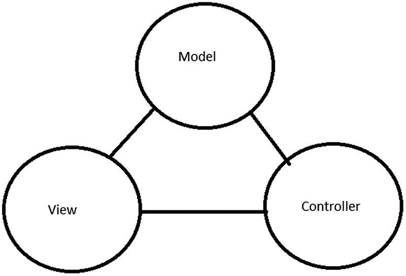

**图 3-1** MVC 架构模式

1.  **模型**表示来自 API、Web 服务或本地`JSON`模型的数据。就 Fiori 应用而言，大多数情况下，应用会引用一个 OData 服务（服务器端模型），如第 2 章所示。这些模型也可以是应用本地的`JSON`模型（客户端模型）。数据模型可以绑定到该模式的视图部分，当视图使用双向绑定时，模型会直接反映更新。绑定可以是单向绑定，即应用只对模型进行只读操作；也可以是双向绑定，即模型可以从视图更新，并且模型始终反映视图所做的更改。

2.  **视图**表示用户在操作 SAP Fiori 应用时可视化的 HTML5 控件。视图绑定到模型，并立即向用户展示数据模型。用户界面允许用户与模型交互，并通过事件，视图调用（通知）控制器执行某些行为（例如调用 JavaScript 函数）。

视图可以创建为 HTML 视图、XML 视图、JSON 视图和 JavaScript 视图。`XML`视图是 SAP 推荐和首选的方法。使用`XML`视图的原因是应用结构更具可读性，而且`XML`视图也很容易在布局编辑器中显示。多年前，当`SAPUI5`刚推出时，JavaScript 视图是创建应用的原始方式；然而，由于其复杂性和语言语法的原因，JavaScript 视图很快就成为了备选方案。

3.  **控制器**作为对一个或多个绑定到视图的事件的响应而被触发。视图（HTML/XML/JavaScript）控件根据控件类型拥有不同类型的事件。当视图触发事件时，相应的`controller.js`文件中的 JavaScript 函数会被执行。

如上一段所述，根据所使用的控件类型，它们可能拥有不同类型的事件。一些常见的控件和事件如表 3-2 所示。

**表 3-2** 常见的 SAPUI5 控件

| 控件类型 | 事件 | 说明 |
| --- | --- | --- |
| `Button` | `Press` | 当用户点击按钮时 |
| `Input` | `onKeyUp`、`onKeyDown` | 当用户输入时 |
| `ComboBox` | `onSelectionChanged` | 当用户更改所选项目时 |
| `Table` | `onItemPressed` | 当选中某个项目（行）时 |
| `List` | `onItemPressed` | 当按下列表项时；此事件本质上与响应式表格控件中的事件非常相似 |

这些事件可以直接从框架中使用，也可以通过应用内的额外自定义绑定来使用。如果框架没有提供所需事件，那么将自定义事件绑定到控件是一种常见操作。例如，我们可能希望将滚动事件绑定到应用，或从同一个控件调用多个事件。一些用例可能包括在`SAPUI5`输入字段上添加`keyUp`、`keyDown`、鼠标悬停（悬停在输入元素上）或`blur`（失去焦点时）事件。

当使用`SAPUI5`库时，如果开发者导航到（UI5）*API 参考*选项卡，就能看到控件特有的事件。在主列表（左侧导航栏）中查找特定控件，然后即可看到该控件的*事件*（显示在应用右侧的详细信息部分），如图 3-2 所示。

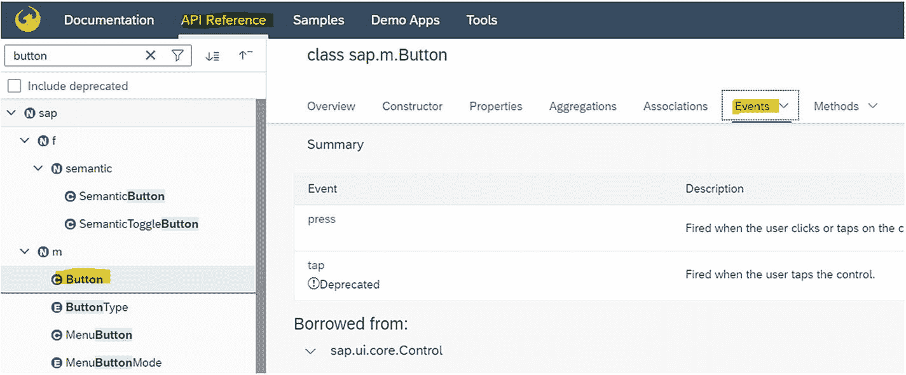

**图 3-2** SAPUI5 SDK API 参考选项卡

花些时间浏览一下其他一些控件，以熟悉不同类型的事件，以及不同控件之间事件的差异。你不需要记住每个控件的每个事件或属性；但是，了解如何在 SDK 中找到与之相关的更多信息会很有帮助。此外，每个 UI5 元素也可以附加到浏览器元素。框架非常灵活，可以将自定义事件包含到这些控件中，例如页面滚动、鼠标事件以及渲染前后的事件。

除了单个控件拥有这些事件之外，在应用的生命周期中也会发生一些事件，视图的情况就是如此。每个视图都有一个生命周期。表 3-3 列出了视图的生命周期事件。

**表 3-3** SAPUI5 视图生命周期事件

| 视图事件 | 使用时机 |
| --- | --- |
| `onInit` | 在导航到视图后，视图被初始化时。此事件通常用于初始化应用要使用的某些值。在某些情况下，数据模型或控件直到下一组事件发生时才会被初始化。使用此事件时请注意调试。 |
| `beforeRendering` | 视图已被初始化，但并非所有控件都已渲染到屏幕上。如果在`onInit`事件期间数据模型尚未准备好，并且正好在控件显示到屏幕之前，可以使用此事件。其他用例可能包括从控件解绑事件。 |
| `afterRendering` | 视图已被初始化，控件已渲染到屏幕上，并且正好在将控制权交给用户之前。当应用需要在控件渲染到屏幕后修改控件行为时，此事件非常有用。此外，如果我们需要查询 OData 服务并对应用应用额外逻辑，也可以使用此事件。 |
| `beforeExit` | 在导航离开或关闭视图之前。 |

通过在下图所示的*API 参考*选项卡中查找`XML`视图，可以在`SAPUI5` SDK 中找到相同的事件。请记住，可能存在从其他控件借用的事件，如图 3-3 所示。

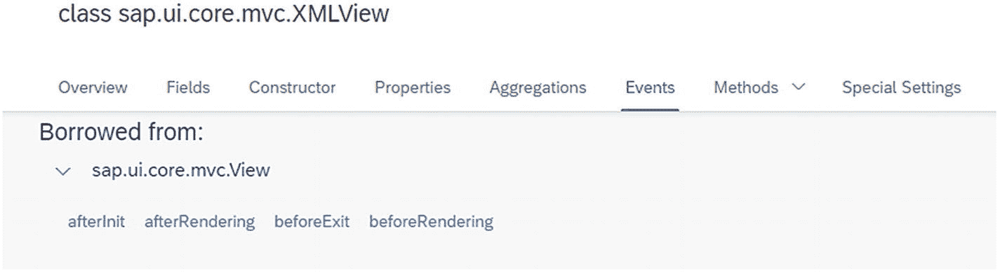

**图 3-3** XML 视图借用的控件事件

好的，这是根据您的要求，遵循注意事项和示例格式，将给定英文文本翻译成中文的结果。

花点时间打开 SAP Web IDE，分析一些 XML 视图，以理解 MVC 模式并了解它在 SAPUI5 中的应用方式。我们将从分析一个在 SAP HANA XSA express edition（HANA 2 XSA SPS04）上构建的应用开始。该应用展示了一个主-从（master-detail）模板方法。这个 Fiori 应用使用了多个视图。该视图包含多个 UI5 控件。

主列表包含来自第 2 章介绍的 XSOData 服务的 `Devices` 列表。`Master` 视图有一个 `List` 控件，每个列表项都绑定到 `items` 聚合。此视图中可能发生多个事件。此主列表示例如图 3-4 所示。

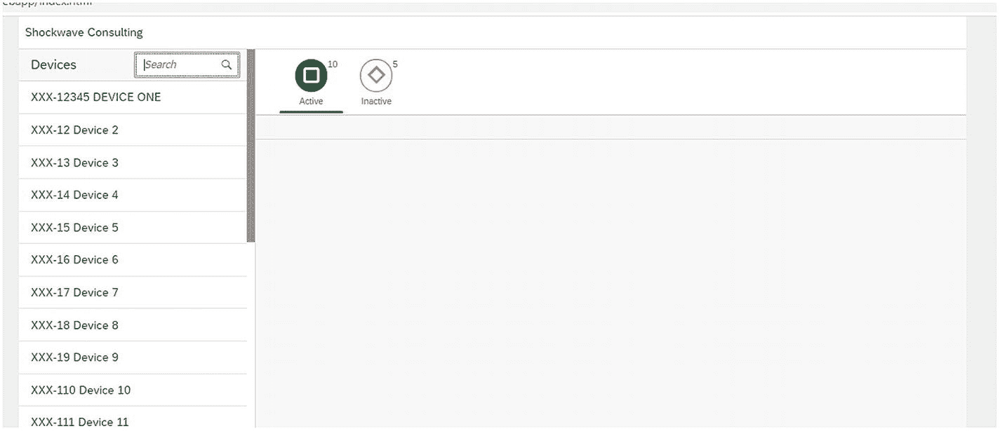

**图 3-4** 主-从应用

1.  在绑定项目之前（例如，如果需要在显示到用户界面之前格式化项目）
2.  点击某个项目（用于导航或显示其在 `Detail` 视图中的详细信息）
3.  在列表中进行搜索（以缩小显示的列表范围）

生成上述主-从模板 UI 的代码如图 3-5 所示。

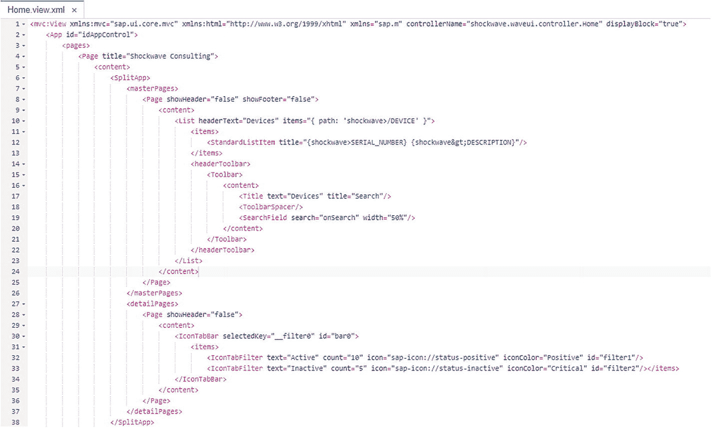

**图 3-5** 显示主-从模板的 XML 视图

请注意，随着应用包含更多功能，上述 `Home` 视图可能会变得过于繁杂和复杂，以至于任何开发者都难以理解。在图 3-6 中，练习展示了将 `Master` 视图页面重构到其自己的视图后的同一个应用，以显示更清晰的视图设置——当视图或控制器在应用开发过程中开始变得杂乱或过于繁忙时，重构是一种常见的做法。经验丰富的开发者可以轻松地在应用的不同文件/模块的重构和初始软件设计方面提供帮助。

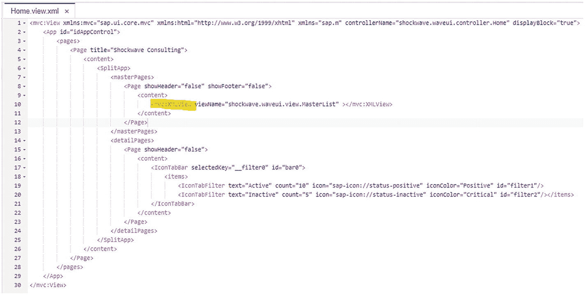

**图 3-6** `MasterList` XML 视图引用

现在，`MasterList` 视图定义位于 `View` 文件夹中，如图 3-7 所示。要生成新视图，请右键单击 `View` 文件夹，选择 `New`，`File`，并提供文件名以及文件内容（您需要将 `Home` 视图中的视图声明复制到新创建的视图中）。另一种方法是使用 SAP Web IDE 提供的“New SAPUI5 view”选项，在各自的文件夹中创建视图和控制器文件。

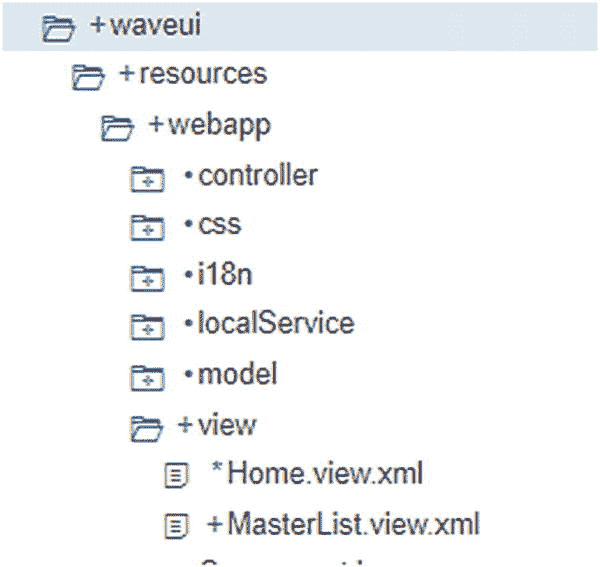

**图 3-7** 显示 `View` 文件夹的项目

`MasterList` 视图定义看起来与之前在 `Home` 视图中的完全相同。对 Home 控制器的引用保持不变，因为这是一个相当小的示例，如有需要，开发者可以在 `Controller` 文件夹中添加一个新的控制器文件，并进一步将视图引用更新到所需的控制器文件位置。此功能（新视图和新控制器）将在后面的 `Detail` 视图示例中展示。

`Detail` 视图可以包含任何控件、表单、选项卡栏或图表，以显示所选项目的详细数据。在此视图中，开发者可以观察到选项卡（选项卡栏控件）使用 `items` 聚合，并且可以触发诸如选择项目之类的事件。当使用这些控件时，诸如包含过滤器之类的情况会很有帮助。`Detail` 视图（重构后）如图 3-8 所示。

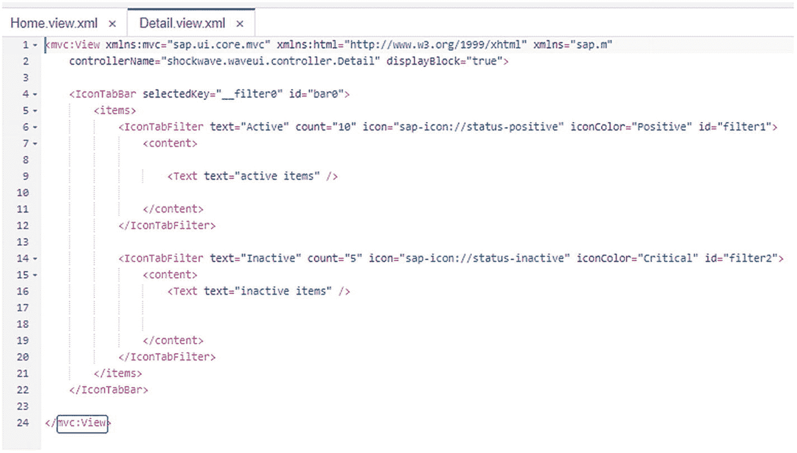

**图 3-8** `Detail` 视图

并且这个（嵌套的）`Detail` 视图也在 `Home` 视图中被引用，如图 3-9 所示。

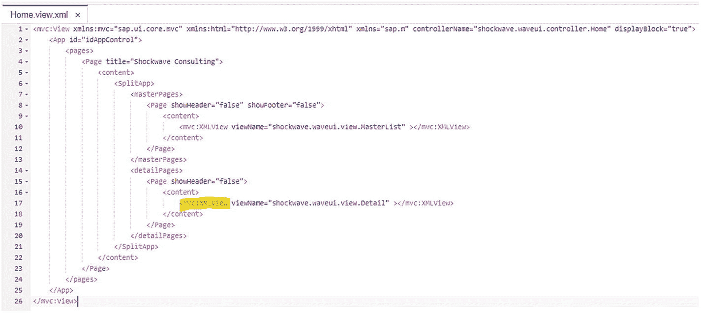

**图 3-9** 重构后的 `Detail` 视图引用

这是一个很好的练习，既展示了重构，也向开发者表明，在开发周期中，可以继续向 Fiori 应用添加内容的同时进行重构。您可能已经注意到，`Detail` 视图引用的是 Detail 控制器而不是 Home 控制器，如图 3-8 的第 2 行所示。此外，Detail 控制器位于 `Controller` 文件夹中，如图 3-10 所示。

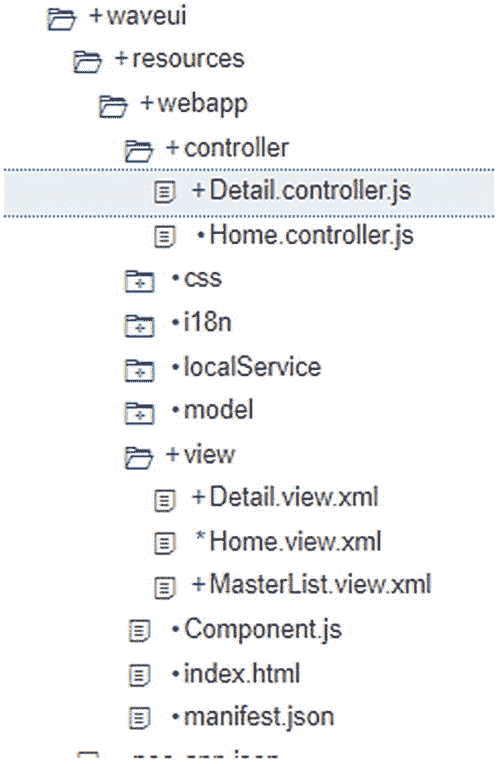

**图 3-10** Detail 控制器

此外，MVC 的另一个好处是它的组件是松散耦合的，可以在应用的多个部分中重用。假设我们有额外的选项卡，并且在这些选项卡中，应用需要在多个选项卡之间显示相同的控件。您可能会想，应用能否将（UI5）控件从 `Detail` 视图解耦到一个单独的视图中，然后将包含该控件的视图嵌入到 `Detail` 视图中。是的，可以。

在重构我们想要拆分为其自己视图的控件之前，本书将描述 SAPUI5 库的一个特性，称为 `Fragment`。正如您在之前的段落中看到的，本书展示了各个视图，并且每个视图可能包含一个同名的控制器。请参阅图 3-10 以查看相应文件夹中的视图/控制器。在开发这些应用时，开发者应该知道，大多数情况下，每个视图文件都包含一个对应的控制器文件。Fragments 的行为类似于视图；但是，它们不包含控制器文件。相反，它们被嵌入到视图中，并且在这些 fragments 中引用的任何事件都可以从视图的控制器中执行。

在图 3-11 中，您可以看到我们有一个响应式表格控件。该表格控件将在从主列表中选择一个设备后，在 Activity 选项卡下显示该设备的活动。此外，此表格还将在下一个选项卡中用于显示设备的不活动状态。为了避免引入重复的代码，本练习将重构这段包含响应式表格的 XML 代码片段，并将其重构为一个 XML fragment。

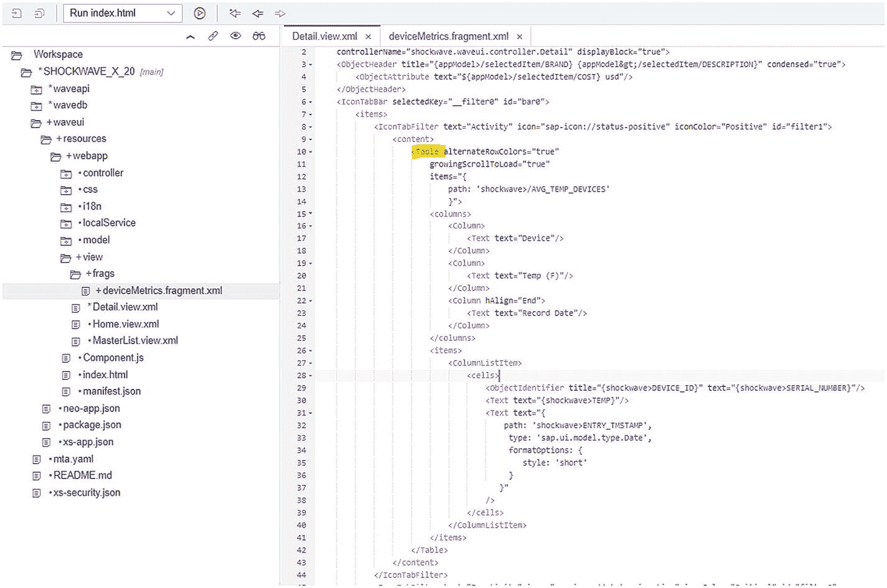

**图 3-11** 使用 fragment 之前的 `Detail` 视图代码

在图 3-12 中，您可以再次看到 `Detail` 视图中重构后、干净的代码片段。使用 fragment 时，开发者必须确保 fragment 包含独特的概念，并且应为 fragment 提供一个名称，以便稍后从 JavaScript 控制器中轻松访问。

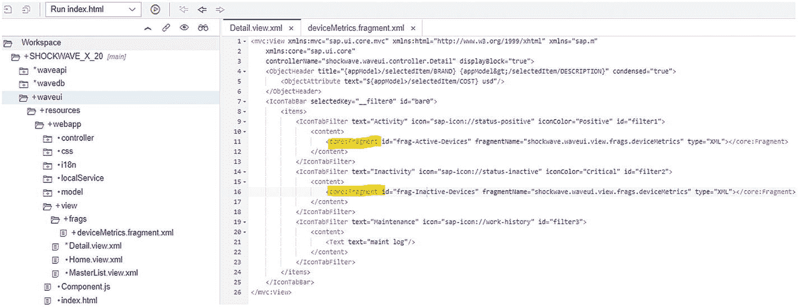

**图 3-12** 创建 fragment 后的 `Detail` 视图代码

如果您好奇 fragment 代码的定义，可以查看图 3-13，以了解将代码从视图中剪切并移动到 fragment 中以实现重用是多么容易。

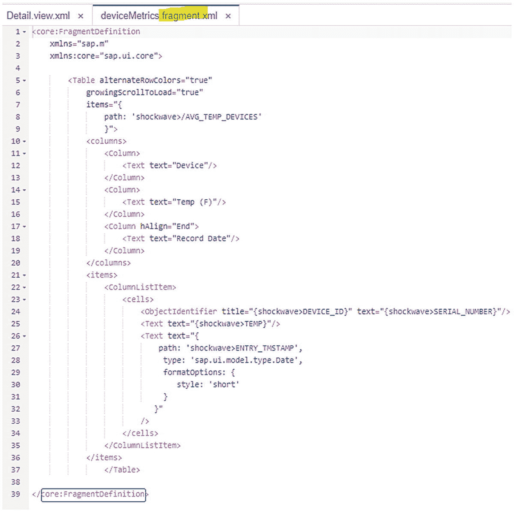

**图 3-13** Fragment 定义

片段（Fragments）非常灵活，它们是可以复用于视图中的代码片段，比视图粒度更细。在标准 SAP Fiori 应用中，片段非常常见。片段、视图和控制器都通过其命名空间和文件名进行引用。很简洁，不是吗？

从现在开始，我们可以从应用中看到“活动”和“非活动”选项卡上显示相同的 UI 控件，如图 3-14 和 3-15 所示。

**注意**

现在，选项卡显示相同的数据；但是，将会应用一些过滤条件，以便在使用此应用时，选项卡数据更有意义。“活动”选项卡将包含 TEMP 值大于零的设备的 TEMP 指标，而“非活动”选项卡将包含 TEMP 等于零时的指标。

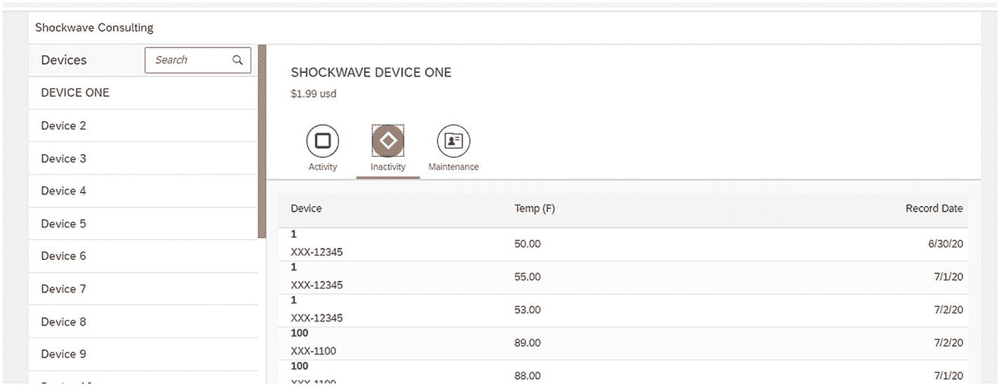

图 3-15

显示片段的“非活动”选项卡

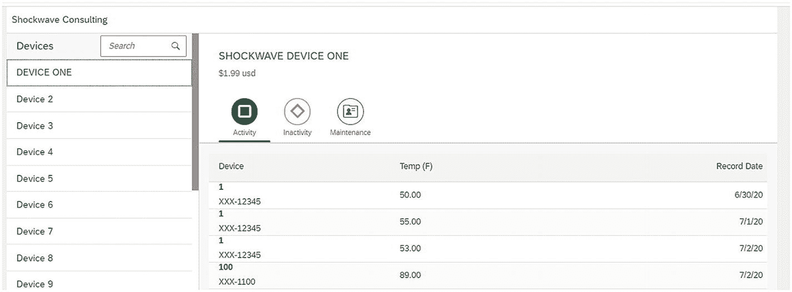

图 3-14

显示片段的“活动”选项卡

## 开发和调试 Fiori 应用的工具

在第 2 章和第 3 章中，我们展示了几种用于开发的工具，并且还展示了开发 SAP Fiori 应用时的调试步骤。接下来，我们想介绍一些开发人员可能在下一个项目中会遇到的其他工具。

第一个也是最常用的工具是 SAP Web IDE。此工具有多个版本。根据您要构建的应用类型，可能需要考虑不同的许可证类型。请查看 SAP Web IDE 许可详细信息，以确定哪个版本适合您或您的组织。

SAP Web IDE 个人版是 SAP Web IDE 的版本之一，用于本地开发。可以从 SAP 工具页面 [`https://tools.hana.ondemand.com/#sapui5`](https://tools.hana.ondemand.com/%2523sapui5) 下载。登录页面如图 3-16 所示。

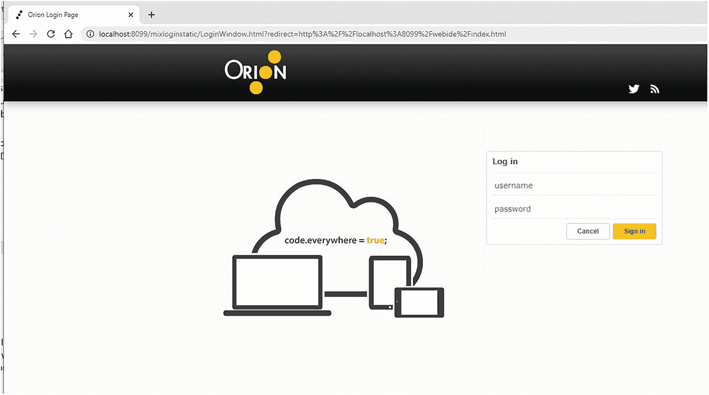

图 3-16

SAP Web IDE 个人版

登录到 `SAP Web IDE personal edition` 后，开发人员会看到欢迎页面。从那里，开发人员可以导航到其大部分时间将使用的工作区。在工作区内，开发人员可以基于模板创建项目，或创建自由风格的定制应用，如第 2 章和图 3-17 所示。

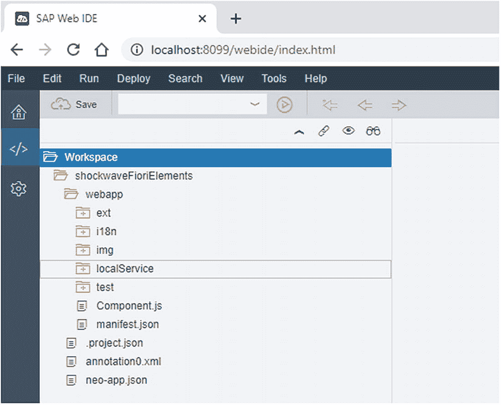

图 3-17

个人 Web IDE 工作区

可以在工作区内创建一个或多个项目。所有这些项目都包含非常相似的项目结构。

接下来我想介绍的工具是来自 SAP 云（及试用）平台的 `SAP Web IDE full stack`（图 3-18）。此版本是免费版本，目的是提供示例 SAP Fiori 应用与本书读者分享。全栈意味着开发人员可以使用它来开发 UI5 应用、HANA 数据库开发对象和 Node JS API。此工具提供了许多功能，我强烈建议其他开发人员投入时间了解这些功能（仅提及其中几项，例如 GIT 集成、连接到 HANA 数据库、连接到后端 ABAP 系统以及调试）。

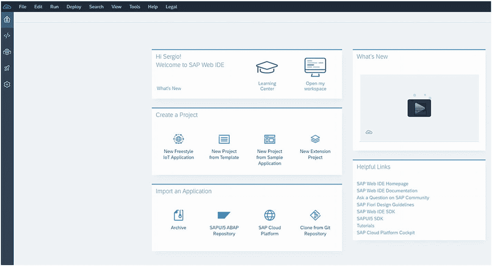

图 3-18

SAP Web IDE 全栈版

使用 SAP Web IDE 工具的另一个优点是，它在其提供的不同版本（云、本地部署或个人版）中具有统一的外观和感觉。这是一个巨大的优势，允许开发人员在项目之间或客户之间切换工具，同时仍能继续进行开发。

另一个流行的工具是 Microsoft Visual Studio Code。这是一个免费的代码编辑器和 IDE，可以与可选安装的 Fiori 插件一起使用。Visual Studio Code 可能是迄今为止最强大的 IDE，它也可以用于其他语言（Node、JavaScript、Go、Python）的开发。它显示在图 3-19 中。要安装这些插件，请打开 Visual Studio Code 扩展并安装它们。如果您还没有安装，请确保您的系统已安装 `node` 和 `npm`。这些开源包是必需的。

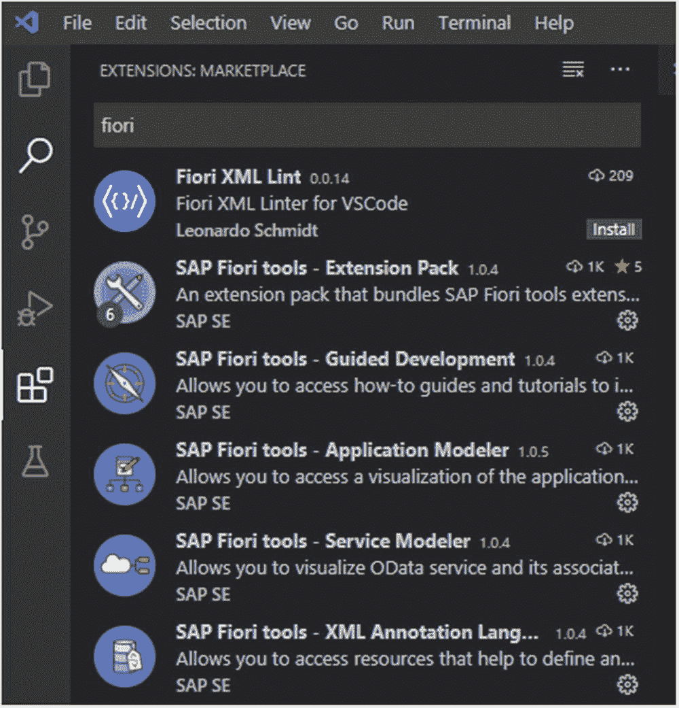

图 3-19

带有 Fiori 插件的 Visual Studio Code

安装这些插件后，开发者可以使用 Visual Studio Code 创建他们的 Fiori elements 应用，如图 3-20 所示。

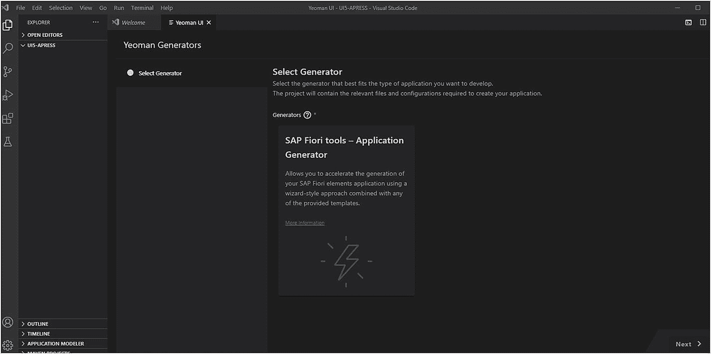

**图 3-20** 安装了 Fiori 工具的 Visual Studio Code

从命令面板（`Ctrl + Shift + P`）中选择 `SAP Fiori Tool Generator` 来生成一个 SAP Fiori 应用，然后点击 Visual Studio Code 右下角的**下一步**按钮。

按照向导操作，开发者必须选择一个可用的模板。在此案例中，本书将展示来自 Fiori 应用的**工作清单**模板。然后选择**下一步**，如图 3-21 所示。

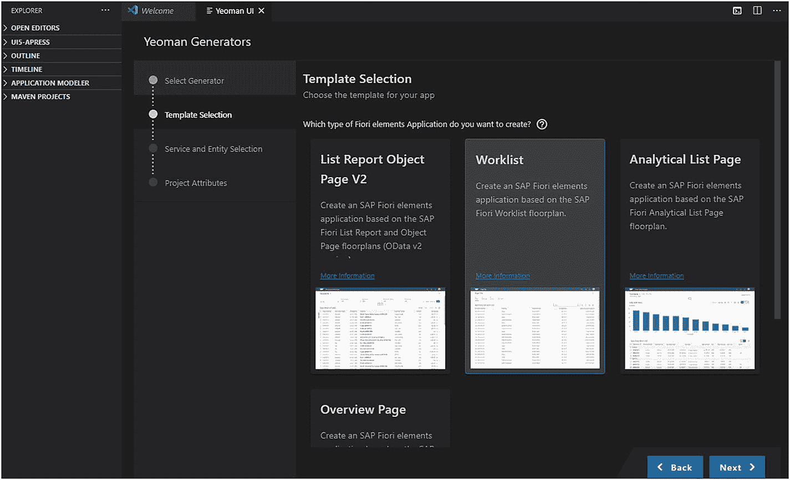

**图 3-21** 选择工作清单应用

选择模板后，开发者必须选择将用于绑定到应用中的 OData 服务（或其元数据文件）。由于应用未直接连接到后端系统，本书将展示如何导入一个 XML 元数据文件作为替代方案。从 OData 服务定义中，获取元数据内容（在服务托管的 URL 后追加 `/$metadata`），并将其保存为本地文件到您的计算机上。将此文件保存为 `metadata.xml` 后，从向导的数据源部分选择它，如图 3-22 所示。您还必须在此 OData 元数据文件中选择一个端点。

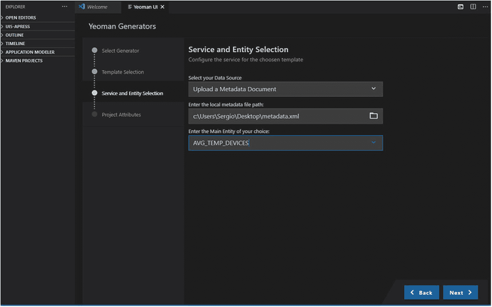

**图 3-22** 数据源配置

配置数据源后，继续下一步设置项目配置，如图 3-23 所示。

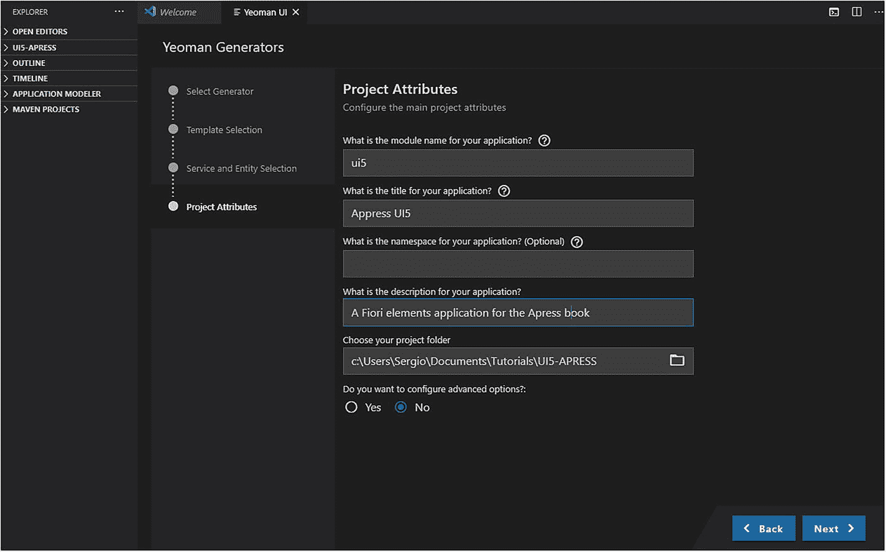

**图 3-23** 项目配置

向导配置完所有设置后，便会创建您指定的应用。Visual Studio Code 会提示您打开新创建的应用。同意提示并打开新 Fiori 应用中的任意文件。以下打开的 `package.json` 文件展示了应用配置、可从 CLI 执行的脚本，以及项目结构、依赖项或任何其他设置。请注意，*工作区*（左侧的文件夹层次结构和文件）中的 UI5 应用显示 `metadata.xml` 文件已上传到 `localService` 文件夹；其中包含 `Component.js` 和 `manifest.json`（应用配置）文件。

这些是所有 Fiori 应用中非常重要的文件。图 3-24 包含了许多需要观察和理解的重要配置项。请花些时间查看所有附加设置。

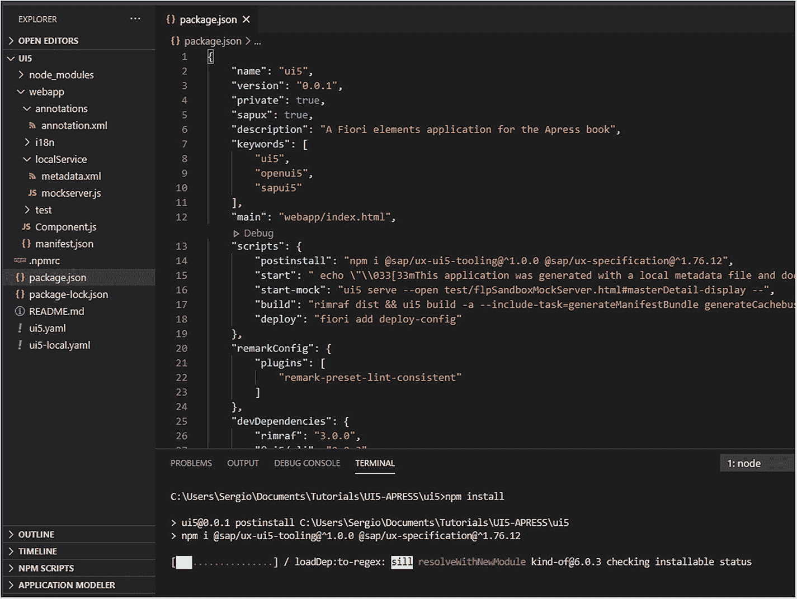

**图 3-24** Visual Code 内的 `package.json` 文件

当应用准备好展示时，在 sapui5 中打开终端窗口，首先确保所有依赖项都已包含在内。开发者可以使用 `npm install` 命令来运行 npm 命令以安装它们。等待所有依赖项被下载到本地。在 `npm install` 命令之后执行 `npm run start-mock` 命令，如图 3-25 所示。由于我们没有直接连接到 OData 服务，此命令将使用模拟数据运行 Fiori 应用。此外，您可以观察到应用正在运行一个本地 node 服务器，并且应用从此处提供。

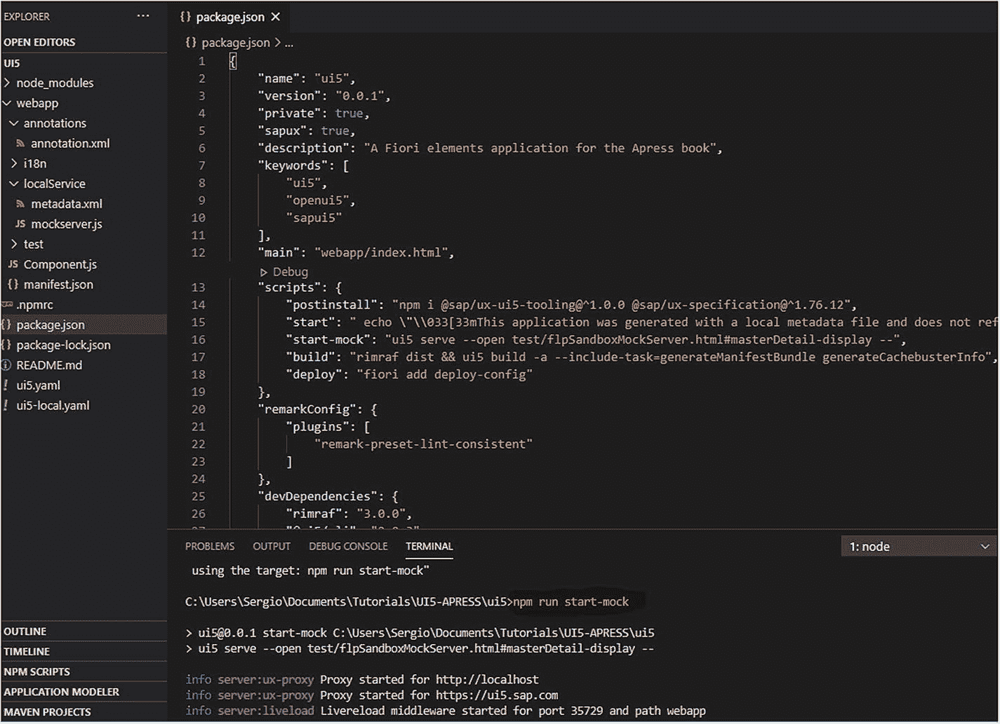

**图 3-25** 运行 `npm run start-mock` 命令

图 3-26 显示了执行 `start-mock` 命令后的默认 Fiori 应用。

最初，此应用不显示任何数据（或列），直到开发者访问屏幕右侧的**配置齿轮图标**。弹出窗口打开后，选择您希望显示的列。由于我们选择了**工作清单**模板应用，**工作清单**模板显示了绑定到 OData 服务的网格，并根据服务的元数据定义使用**智能控件**显示列。

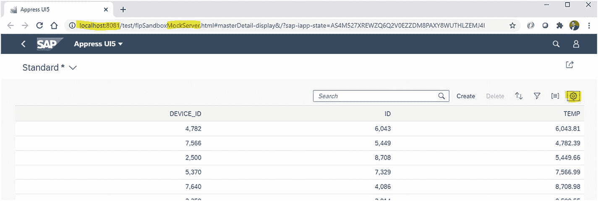

**图 3-26** **工作清单**模板上的列配置

行分组是另一个开箱即用的重要功能。此功能由图 3-27 中高亮的图标表示。当用户选择该图标时，他们必须选择要按之分组项的列。当某一列中存在重复数据时，通常会使用此功能。以下是选择某一列进行分组后的输出结果。

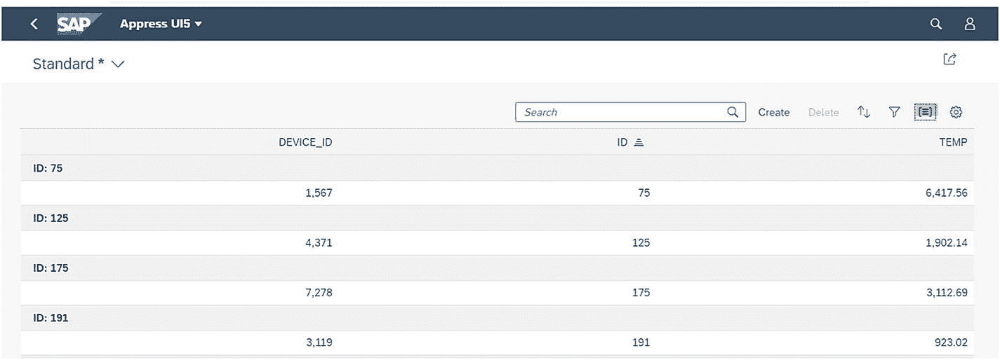

**图 3-27** 分组

同样重要的是，该模板还提供了其他开箱即用的功能，例如筛选。选择位于**齿轮图标**旁边的**漏斗图标**，查看如何将筛选应用于同一个 Fiori 应用，如图 3-28 所示，以及其输出结果，如图 3-29 所示。如前所述，所有这些功能都是开箱即用的，无需任何额外的开发工作量。

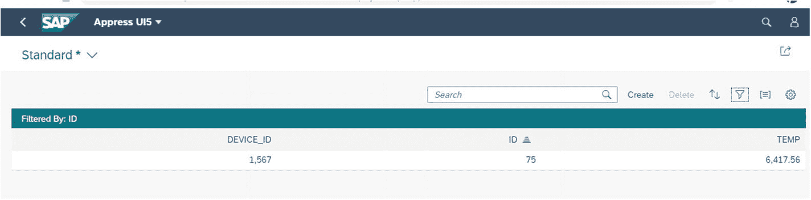

**图 3-29** 应用筛选后的数据输出

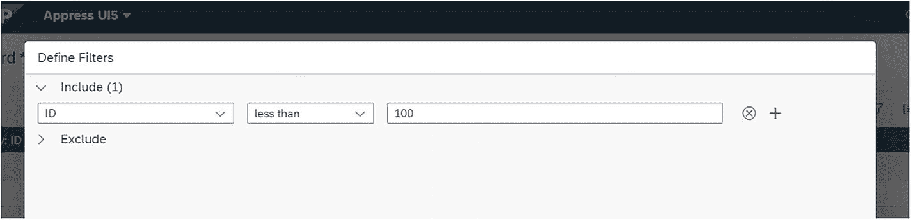

**图 3-28** 智能模板筛选

其他功能，如排序、创建和删除，在此仅作说明；我邀请您去探索它们，并了解其他功能，例如保存变式（显示在上图左上角的标准下拉菜单中），或与其他人共享应用（如右上角头像图标下方所示）。可能还有一些较小的应用配置设置需要处理，例如更改表格类型（`GridTable` 代替 `Responsive`）、隐藏应用的某些部分（如不显示变式），或隐藏应用的某些区域；所有这些配置设置都是可能的，但有些繁琐，因为开发者需要修改 `manifest` 配置文件中的应用设置。

到现在，您可能会问，为什么在第 2 章中，我们使用 SAP Web IDE 创建 sapui5 应用的一种方法，需要编写视图、片段和控制器，而在这里的第 3 章中，本书展示了包含相同 OData 服务的元数据定义的简单方法，并且不需要添加任何代码。事实上，这是许多 SAP 客户最常问的问题之一。客户通常会问，是否可以直接跳过编码？为什么他们需要采用更费时的方法？就像软件中的其他所有事情一样，不同的用例需要不同的开发方法。

如果你正在开发一个非常标准的应用程序，且确实不需要定制化，那么使用第 3 章中介绍的采用 `Fiori elements` 的方法是最佳选择。这种方法将为你节省大量时间和开发投入，但不会为轻松定制化提供太多自由度。在这种方法中，定制化是通过修改 `manifest.json` 文件配置和在 XML 中添加注解来实现的。

相反，如果你的团队正在开发的应用程序需要定制化、引入业务规则和灵活性，并且它基本上不会是一个标准的展示型应用程序，那么你的团队或组织需要考虑采用第 2 章中展示的定制化方法。

有一些 `Fiori` 指南可供参考，以确定哪种开发类型适合你和你的组织。请在 SAP Fiori 指南网页 URL：[`https://experience.sap.com/fiori-design/`](https://experience.sap.com/fiori-design/) 中查看这些 Fiori 指南。

## 将外部 JS 库集成到 (SAPUI5) Fiori 中

熟悉了开发工具，并开始使用其中一个应用程序工具后，很可能有时需要集成额外的 JavaScript 库，例如当 SAPUI5 库未提供某些功能时，或者需要利用其他库来构建更健壮的 Fiori 应用程序时。第三方库通常作为 Web 应用程序的依赖项被包含进来，在我们的案例中，本书将展示一个过去使用过的此类库。

本书要演示的第三方库叫做 `moment.js`。`moment.js` 是一个免费的 JavaScript 库，用于处理日期对象。通常，在 JavaScript 中处理日期对象并不简单也不直接。可能需要使用这个第三方库的原因有很多，包括：

1.  日期加法
2.  日期比较
3.  处理时区和偏移量

图 3-30 是 `moment.js` 网站的一张图片，开发者可以在此下载这个第三方库。

*请阅读文档和任何许可信息，以确保你的项目可以使用此库。*

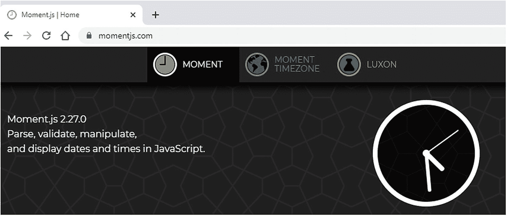

图 3-30
`moment.js` 网站

要将此库添加到项目中，首先从其网站下载。然后将其作为依赖项包含进来。在图 3-31 中，添加了一个名为 `externalLibs` 的文件夹；其中包含了 `moment.js` 库。该依赖项被注入到细节控制器文件中，并作为 `moment.js` 引用。

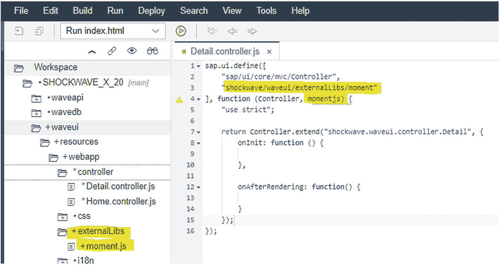

图 3-31
加载 `moment.js` 作为依赖项

一旦 `moment` 库被加载到项目中，开发者就可以引用其不同的操作，如图 3-32 所示。

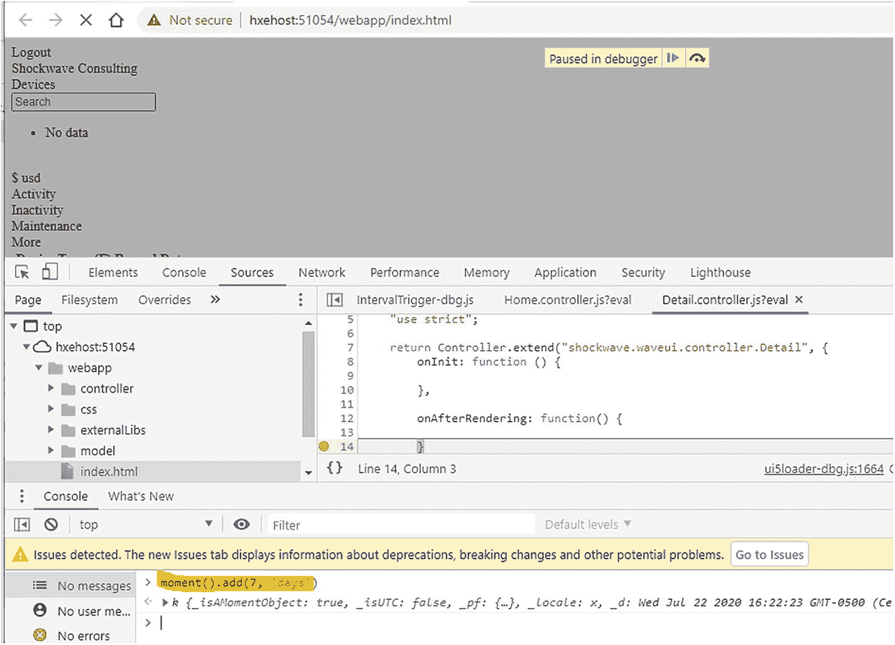

图 3-32
`moment.js` 库已就绪

要包含其他第三方库，请遵循相同的方法：将其下载到本地，添加到项目中，然后在项目中将其作为对库位置的引用包含进来。在利用某些开源库之前，请确保阅读许可条款，以避免任何潜在问题。

## 浏览器差异、限制与特性

如今，在开发现代 Web 应用程序时，期望是能够部署我们的 Web 应用程序，并使其能够在不同设备、浏览器和屏幕尺寸上正常工作。大多数公司使用 Google Chrome、Mozilla Firefox 和 Microsoft 的 Internet Explorer。

SAPUI5 库对其大多数控件和模板提供跨浏览器支持。接下来，你可以观察不同浏览器如何显示同一个应用程序。使用不同浏览器时，视觉效果略有下降。大多数开发者和公司使用 Google Chrome 作为构建和使用业务应用程序的首选浏览器；尽管如此，所有主流浏览器都应该能够显示同一个应用程序，它们之间的差异很小。

图 3-33 显示了 Google Chrome 版本 83.0.4147。

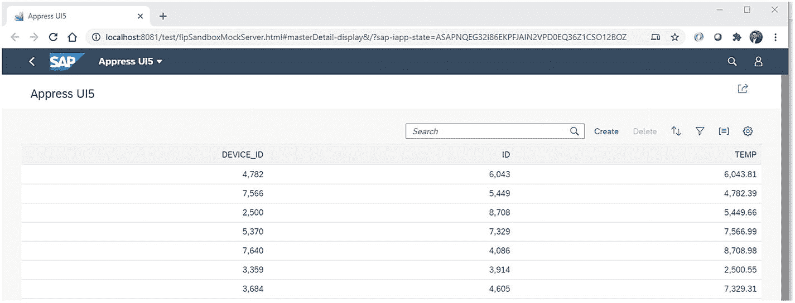

图 3-33
`Fiori elements` 列表报告

当尝试在 Internet Explorer 浏览器中显示相同的 Fiori elements 应用程序时，出现错误，提示无法加载组件文件，如图 3-34 所示。

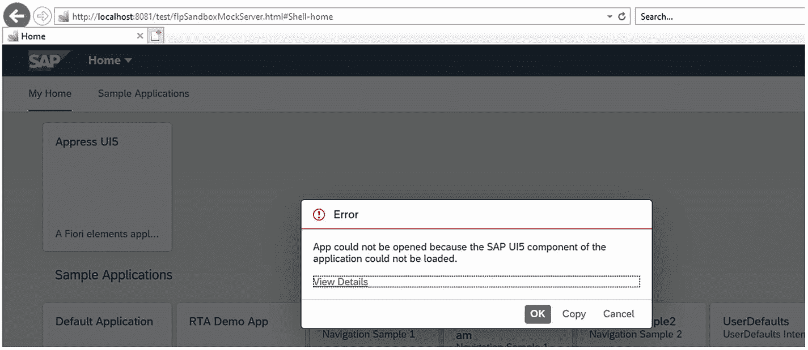

图 3-34
IE 浏览器因无法加载组件而显示错误

图 3-35 显示了 Microsoft Edge 版本 83.0.478。

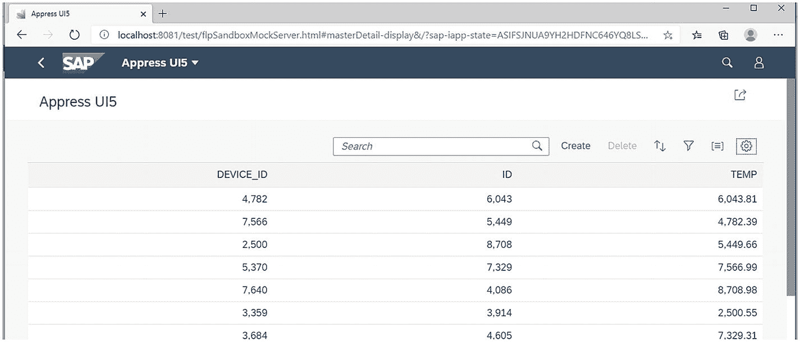

图 3-35
Microsoft Edge 显示列表报告的 Fiori elements 模板

在这些浏览器之间进行更好的比较，将涉及我们在 SAP HANA XSA 中构建的自定义主从应用程序。

首先，图 3-36 展示了 Google Chrome 浏览器。在我看来，与 Microsoft 的 IE 和 Edge 浏览器相比，此浏览器呈现出最简洁的设计，并且在视觉上更令人愉悦。

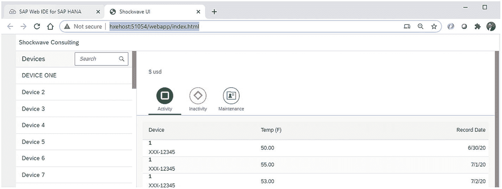

图 3-36
SAP HANA 中的自定义 Fiori 应用程序

其次，图 3-37 展示了 Internet Explorer 浏览器。它显示的字体稍大，滚动条比 Google Chrome 中看到的更显眼。

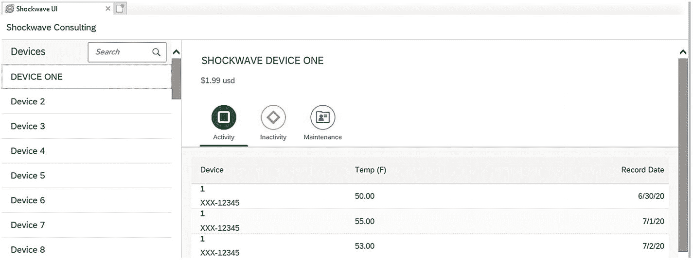

图 3-37
Internet Explorer 中的自定义 Fiori 应用程序

最后，我们比较的第三个浏览器是 Microsoft Edge 浏览器，如图 3-38 所示。这个浏览器似乎字体显示稍大，各个组件之间的排列看起来也更紧凑。

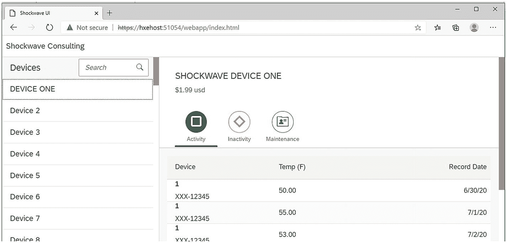

图 3-38
Microsoft Edge 中的自定义 Fiori 应用程序

在了解了不同浏览器对同一应用程序的不同呈现效果后，我们可以得出结论：视觉上的降级是微小的。有时，一些非 SAPUI5 的功能在不同浏览器中也会受到影响，JavaScript ES6 函数就是这种情况。

除了突出和展示不同浏览器的差异之外，本书还介绍了这些浏览器为开发者提供的一些调试功能。

本书展示了如何在 Google Chrome 版本 83 中完成调试。要调试这些 SAPUI5 应用程序，开发者可以使用浏览器开发者工具，方法是按键盘上的 `F12` 键，或者通过浏览器设置 -> 工具 -> 开发者工具进入，如图 3-39 所示。

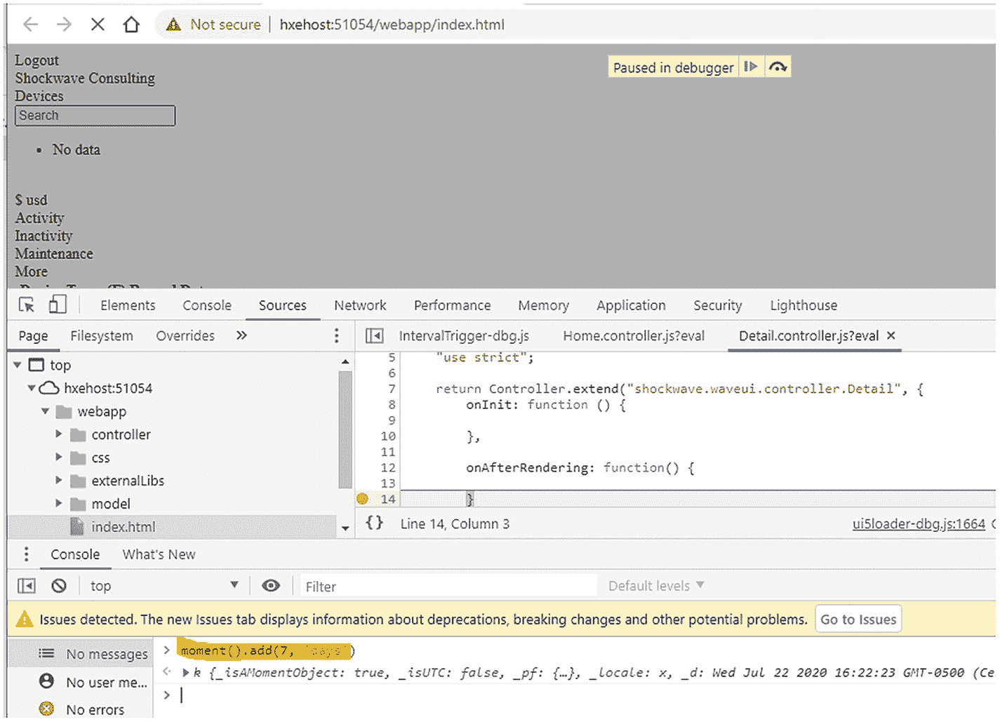

## 图 3-39

Chrome 浏览器调试

接下来介绍的浏览器是微软的 Edge，在打开开发者工具时，其功能在外观和操作上与 Chrome 非常相似。事实上，我们也可以使用键盘上的 `F12` 键来打开开发者工具。如图 3-40 所示。

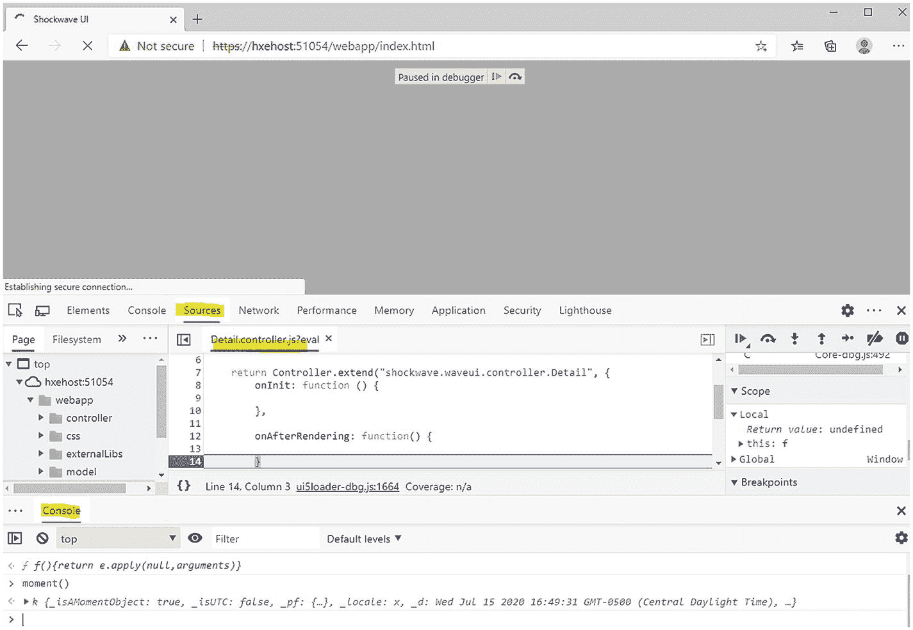

**图 3-40** Edge 浏览器调试

## 各种设备上的 Fiori 应用

使用 `SAPUI5` 这样的框架的一大优势是它具有响应式特性。响应式意味着只需一套代码库，该代码便能适应大多数设备的屏幕尺寸，无需编写额外的自定义代码来实现适配。正如第 1 章所述，Fiori 应用天生就具备响应式应用的特点。在本节中，我们可以观察到我们正在构建的 `SAPUI5` 应用在不同设备上的显示效果如下。

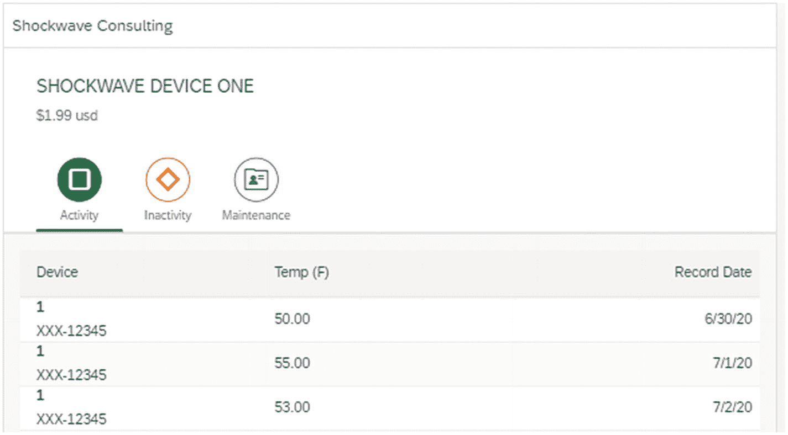

**图 3-41** 平板电脑视图

1.  **桌面视图** – 此视图可在之前的所有图像中看到，例如图 3-40。

2.  **平板电脑视图** 如图 3-41 所示。如果您打开开发者工具，然后选择设备图标以显示响应式设备，您的浏览器也可以模拟此视图。在选择图标后，您还可以在平板电脑和其他设备之间切换。

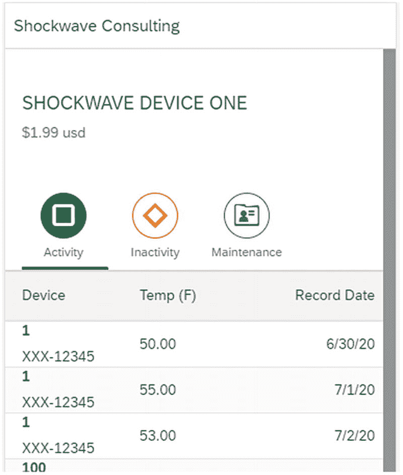

**图 3-42** 手机视图

1.  **手机视图** 如图 3-42 所示。此图像同样来自打开开发者工具时的浏览器模拟器功能。

## 结论

感谢您阅读至此，即将完成第 3 章。本章的主要目的是展示在 SAP HANA XSA 中构建的自定义应用，以及在使用了 Fiori elements 的 SAP Fiori 应用中可以完成的一些小幅自定义修改。介绍这两种类型的应用是为了让您了解并意识到何时使用 Fiori elements（少量自定义甚至零自定义），以及何时应考虑将某些 SAP 自定义 Fiori 应用开发为自由式应用（这样在设计和开发上具有更大的灵活性）。本章还涉及了开发 Fiori 应用时可以使用的各种工具；其中一些是开源工具，另一些则是 SAP 授权工具。理解并知道在合适的场景下使用哪种工具，也将帮助开发者在开发周期中提高效率。最后，本书展示了同一应用在不同浏览器上显示效果的差异，并让您了解到使用这些浏览器时可能出现的性能下降和视觉差异。希望本章符合您的喜好，并且您已获得足够的信息，能够指导您为下一个开发项目选择工具。

