# 4. Fiori 应用的单元测试

欢迎来到第 4 章。在本章中，本书将从第 3 章中介绍的开发阶段继续推进，进入到单元测试环节。您可能会想，单元测试是否属于开发的一部分，并且是否需要由开发人员来完成。让我们从一个初步的“是”来回答。开发人员负责创建软件，他们也确实负责对其代码进行单元测试，以确保下一批相关人员确认他们的开发已完成且没有错误。下一批查看该软件（无论有无用户界面）的人员自然会与这个软件交互，如果您愿意，他们还会执行额外的测试步骤。无论这些人员是有意测试软件，还是无意为之，任何与软件的交互仍被视为测试。

如果与我们的软件交互的人员发现了问题，他们可能会报告，于是就会创建并跟踪一个错误（bug），目的是在软件再次发布前修复它。这就形成了一个循环：开发人员不断地编写新软件、添加修复或增强他们最初创建或持续维护的代码。大多数开发人员喜欢编写新软件和新功能——创造新事物——而不是回头去修复他们没发现或并非他们造成的错误。本章旨在帮助开发人员搭建起他们的单元测试环境，以便他们能将更多时间用于开发新功能，并希望能减少花在重复测试上的时间。没错：单元测试和自动化测试的目标之一，就是利用工具和框架来设置并执行这些重复性任务，从而节省开发人员的时间，并使业务保持持续集成/交付模式。

## 单元测试框架

解决问题的方法有很多种，在软件开发中，执行单元测试的方法也有很多种。在本节中，本书将介绍一些基于过往经验中使用过的不同单元测试框架。此外，这些单元测试框架还用于 Fiori 开发中，对用户界面进行测试、对 OData 服务的使用进行测试，以及评估应用的完整性。表 4-1 列出了本章将要讨论的不同框架。

**表 4-1** 不同的 JS 单元测试框架

| 框架名称 | 描述 | 网址 |
| --- | --- | --- |
| `QUnit` | 功能强大且易于使用的 JS 框架 | [`https://qunitjs.com/`](https://qunitjs.com/) |
| `Nightmare JS` | 高级浏览器自动化库 | [`http://www.nightmarejs.org/`](http://www.nightmarejs.org/) |
| `Puppeteer` | 用于控制无头 Chrome 开发工具的高级 Node 库 API | [`https://developers.google.com/web/tools/puppeteer`](https://developers.google.com/web/tools/puppeteer) |

## Fiori 应用单元测试

Fiori（`SAPUI5`）应用开箱即用地使用了 `QUnit` 框架；但是，如果您正在考虑其他单元测试框架解决方案，其他框架也可能为您的团队提供类似的功能。

在进入测试之前，开发人员必须理解他们要开发的内容以及要测试的内容的需求。在开发过程中，开发人员需要知道创建有意义且成功的测试用例所需的预期输入和输出。理解单元测试场景还需要了解其他情况，例如用户将如何使用他们的软件，以及将使用哪些设备进行测试。

在第一个练习中，本书介绍了三个不同的测试用例：

1.  第一个测试用例是比较 `1` 是否等于 `1`，这只是为了让我们开始使用这个框架。

2.  第二个测试用例是比较短格式的两个日期。

3.  第三个测试用例包含一组三个验证（称为断言）。这些断言被分解为：调用一个 OData Web 服务，确保获取数据的时间在一秒以内，确保至少有一条记录被返回，最后将对象结构与开发人员设定的预期对象结构进行比较。


### QUnit

在牢记这三个测试用例的同时，让我们继续分析和在我们的应用程序中设置 `QUnit` 框架。如果要在 `Node JS` 环境中使用 `QUnit` 框架，则无需任何配置；如果要在基于浏览器的应用程序中使用（我们的情况就是如此），则只需极少的配置。我之所以提到 `Node JS`，是因为稍后我们也会在其他一些框架中使用它。要成功使用该框架，开发者必须熟练掌握 JavaScript 语言，最好对 `ES6` 中的箭头函数有良好的理解，并且还应该对浏览器开发者工具有一定的了解。

通常，`SAPUI5` 模板包含一个 `test` 文件夹用于实现这些测试用例。如果你的项目没有包含这样一个文件夹，那么请按照后续步骤来引入一个单元测试框架。

第一个练习将展示 `QUnit` 框架。

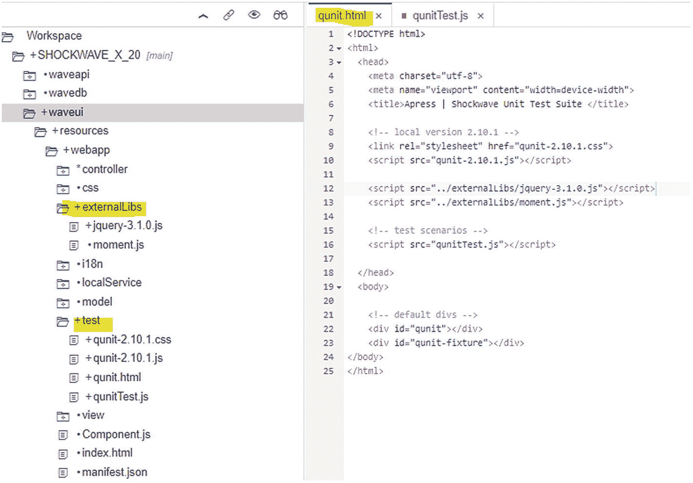

**图 4-1** 本地 QUnit 框架

1.  首先，创建一个如图 4-1 所示的 `test` 文件夹。你可以像下面的练习那样包含一个本地的 `QUnit` 框架，或者如果你更喜欢使用内容分发网络资源（`CDN`），那么你需要在 `html` 文件的 `script` 标签中体现该 URL（第 10 行）。在本练习中，我们从 QUnit 官网下载了 `QUnit` 框架（版本 `2.10.1`）的文件，并将其本地包含在我们的项目中。
2.  接下来，我们创建了一个 `qunit.html` 文件，如图 4-1 右半部分所示，该文件将是我们单元测试场景的入口点。这个文件展示了单元测试**模块**的输出，这些模块将在后面进一步解释。文件中还引用了 `qunit-2.10.1.css` 文件，该文件用于设置 `QUnit` 测试套件输出屏幕的样式。
3.  最后，如图 4-1 的第 16 行所示，在一个单独的 `qunitTest.js` 文件中引用了测试场景。将单元测试模块化对你最有利，这样你的所有代码就不会都存在于同一个文件中。在测试和开发过程中采用模块化方法会使工作更轻松。

在加载了 `QUnit` 场景的外部引用之后，本书还引用了本地的 `JQuery` 版本 `3.1.0` JavaScript 文件，该书将用它来演示调用 `OData` 服务，并且书中还引用了 `moment.js` 库，因为其中一个练习演示了使用外部库来格式化 `date` 对象数据类型。

双击打开 `test/qunitTest.js` 文件，查看 `QUnit` 框架的结构。在图 4-2 中，你可以看到以下内容：

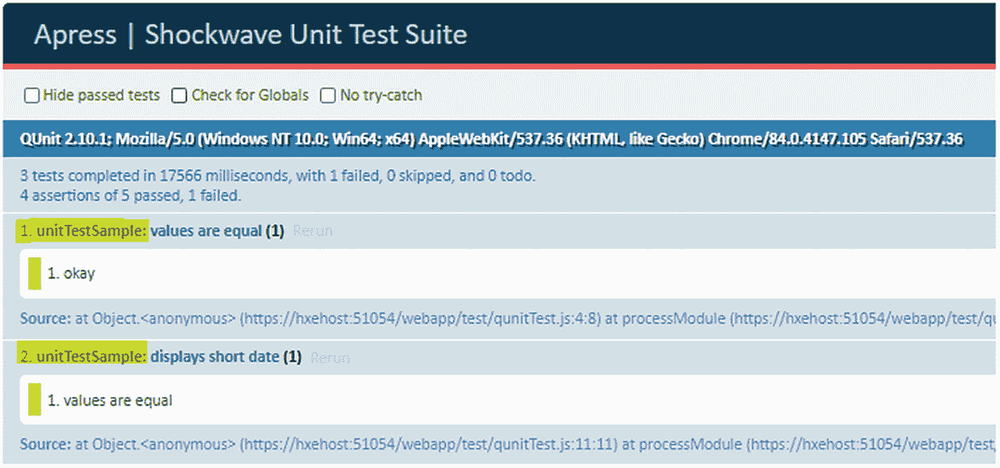

**图 4-2** QUnit 输出示例

1.  单元测试套件的标题，来自 `qunitTest.html` 文件。
2.  复选框，用于在开发者只想显示错误的测试时隐藏通过的测试。另一个复选框用于检查全局设置。最后还有一个复选框，用于禁用代码中的 `try-catch` 代码块。
3.  框架本身显示完成的测试数量、完成所花费的时间、失败、通过和跳过的测试的详细情况，以及断言的总数。
4.  深入观察输出结果，读者还可以看到框架的层级输出，例如：
    1.  `QUnit.module` – 允许开发者对一个或多个测试用例进行分组。`QUnit.module` 接受两个参数，第一个是模块的名称，第二个是执行其测试的回调函数。一个应用程序中可以有一个或多个模块来分离单元测试。在图 4-2 中，读者可以看到高亮显示的模块名称（`unitTestSample`）。
    2.  `QUnit.test` – 属于模块的一部分，可以包含一个或多个断言。`test` 部分接受两个参数：测试的名称以及将在其中执行断言的函数。在图 4-2 中，读者可以看到同一个模块（`unitTestSample`）中的两个测试场景。

在每个测试的正下方，读者还可以看到每个测试所在的源代码和行号。

输出屏幕是根据图 4-3 中所示的测试用例生成的。

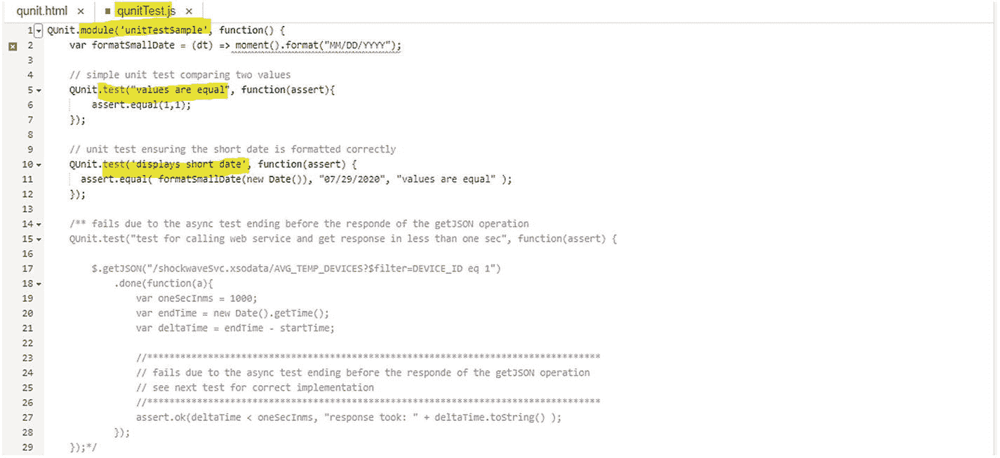

**图 4-3** QUnit 测试用例

断言是代码中的语句，用于确保所测试内容的有效性。前面高亮显示的两个测试展示了第 5-7 行以及第 10-12 行的非常简单的测试。请注意，在第 11 行，该示例使用了一个函数，该函数进一步使用了一个名为 `moment` 的外部库。这个库帮助开发者处理 JavaScript 中的日期和时间对象。`moment.js` 库与 `JQuery` 库一起被加载到 `qunitTest.html` 文件的 `head` 元素 XML 标签中。

第 14-29 行由于测试场景设置不正确而被注释掉了。这部分代码保留了下来，以展示开发者在设置测试用例时可能犯的一个典型错误。这段代码失败的原因是 `QUnit` 测试用例与 `JQuery` 的 `getJSON` 函数一同执行，而 `getJSON` 是异步执行的，导致 `QUnit` 测试部分在到达成功回调之前就结束了，从而产生了错误的测试用例。

更深入地看一下图 4-4 中的函数，它展示了测试异步 JavaScript（`AJAX`）调用时的正确方法。这个 `QUnit` 测试嵌套在 `JQuery` 的 `getJSON` 函数调用中。

展示这个测试的目的是为了演示在 `QUnit` 框架上下文中调用异步 Web 服务的用法，以验证以下需求：

1.  执行 `OData` 调用（或 `REST API`）所需的时间
2.  Web 开发的异步特性与单元测试协同工作
3.  在一个测试中验证多个断言：
    1.  通常，软件必须符合在软件产品创建之前建立的服务水平协议（`SLA`）。在我们的场景中，我们测试以确保 `OData` 服务的消耗时间少于约定的某个执行时间。
    2.  本书在此场景中提出的第二个断言是 `OData` 调用包含至少一条记录（不应返回空数组）。
    3.  第三个也是最后一个（但并非最不重要的）测试场景是用预期的对象结构来验证其中一个响应对象。

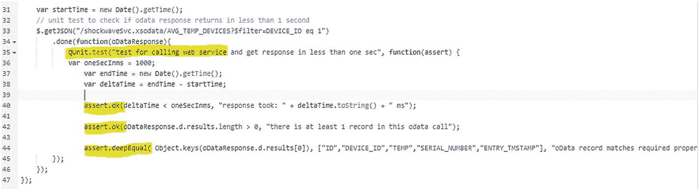

**图 4-4** 使用 AJAX 调用的 QUnit 测试

在第三个测试用例中，还有其他需要注意的地方：练习在 `getJSON` 函数之前（第 31 行）开始记录 `startTime`，然后在成功回调内部（第 37 行）记录 `endTime`，以便能够计算时间差（第 38 行）。

图 4-5 显示了当预期的对象结构与 `OData` 服务的响应不匹配时发生的失败，这对应了测试用例中的第三个断言。`OData` 服务响应的预期结果与图 4-5 中显示的内容之间的差异，正是开发者应该理解并解决的失败。

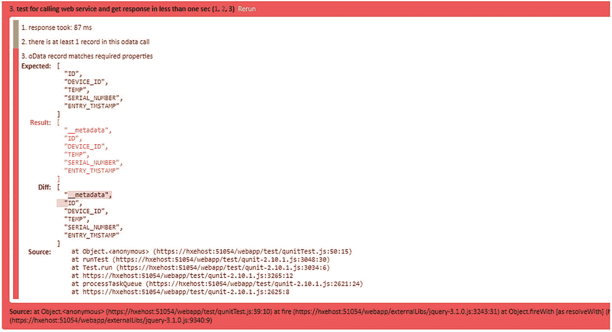

**图 4-5** 预期对象结构与 OData 服务的响应结构不匹配时显示的失败信息


### 单元测试调试

在编写这些单元测试用例时，开发人员可能也需要对自己的代码进行调试。

要调试单元测试用例，开发人员需要像开发解决方案一样查看浏览器开发者工具。要启动开发者工具，请打开浏览器窗口找到单元测试 HTML 页面所在位置，按下 `F12` 启动开发者工具，然后导航至存放源代码的 `Sources` 标签页。在 `Sources` 标签页中，打开你的 JavaScript 文件并设置断点，即可逐步调试你的开发代码。就像通常从控制器 JS 文件中导航和移动 JavaScript 代码一样，开发人员可以使用同样的浏览器工具来帮助自己导航和调试单元测试脚本（使用键盘快捷键 `F10`、`F11`、`F8`）或使用浏览器右下角的导航图标。

本章稍后部分会深入介绍 Chrome 开发者工具，所以请确保你已经充分理解开发者工具中的这一部分内容，以便后续能很好地运用它。

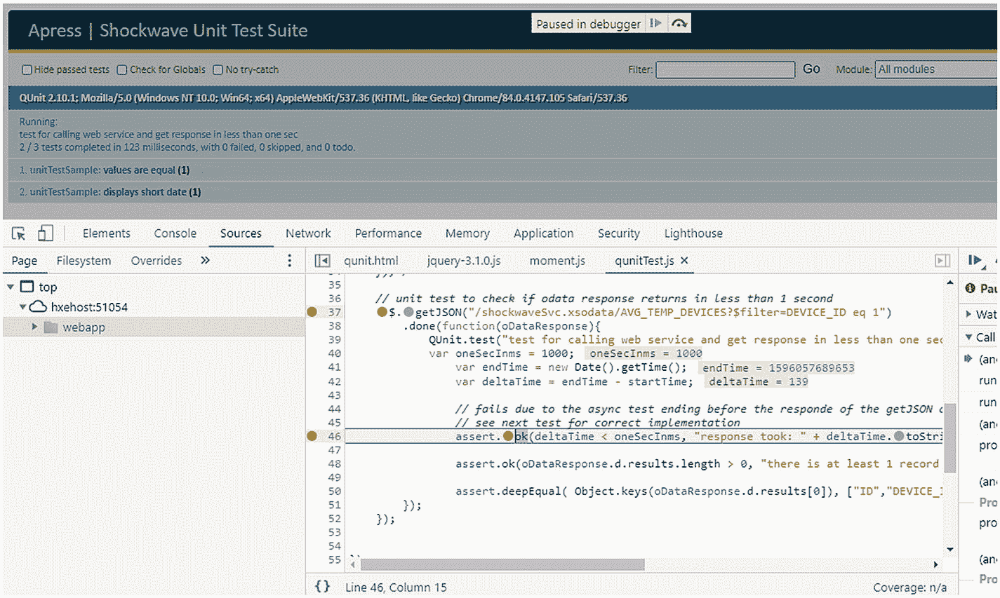

**图 4-6** – 调试 QUnit 测试用例

## 从该单元测试框架中学到的

1.  设置和上手非常容易：[`qunitjs.com/intro/`](https://qunitjs.com/intro/)
2.  文档易于理解：[`api.qunitjs.com/QUnit/`](https://api.qunitjs.com/QUnit/)
3.  大多数 Fiori 应用模板都使用该框架：[`sapui5.hana.ondemand.com/1.36.6/docs/guide/e1ce1de315994a02bf162f4b3b5a9f09.html`](https://sapui5.hana.ondemand.com/1.36.6/docs/guide/e1ce1de315994a02bf162f4b3b5a9f09.html)
4.  开发人员熟悉该框架中使用的大多数概念，包括调试

请花额外时间查阅 QUnit 文档，熟悉该框架提供的其他类型的测试、断言以及操作或功能。如果你决定实现这个框架，祝你好运！

## Nightmare JS

接下来本书要重点介绍的另一个单元测试框架是 Nightmare JS。选择这个单元测试框架的原因在于它是一个流行的 JavaScript 框架，并且不属于常规的 Fiori 开发范畴。我通常喜欢体验 SAP 技术及其产品所提供的功能，但自己主动研究网络上可用的其他选项也是一个好习惯。毕竟，本书提供的是另一种信息来源，它呈现不同视角，与读者分享那些或许尚未被探索过的信息。可惜的是，这个单元测试框架的最终效果并不理想；不过，我决定将其保留在文中，以便与其他框架进行对比。该框架的某些命令和特性与本章记录的最后一个单元框架相似，这也是将其保留于此的主要原因，即使它只能呈现一个不完整的单元测试场景。这个框架中仍有一些有价值的信息值得了解。

Nightmare JS 是一个开源的高级单元测试浏览器自动化框架。在底层，Nightmare JS 使用了 Electron JS 框架。Electron JS（访问 [`www.electronjs.org/`](https://www.electronjs.org/)）是一个允许开发者使用 JavaScript、HTML 和 CSS 创建跨平台桌面应用的框架。请允许我再重复一遍：使用 JS、HTML 和 CSS 创建跨平台桌面应用。如果你了解 Web 开发，就会知道 JavaScript、HTML 和 CSS 是运行在浏览器上的语言，因此与桌面应用程序不同。Electron JS 也是一个流行的框架，因为 Web 开发者现在可以用他们熟悉的技术来创建桌面应用了。带着这个想法，接下来让我们定义、解释并展示 Nightmare JS 框架如何作为我们 Fiori 应用单元测试的第二个选项。

Nightmare JS 使用模拟用户与软件交互的函数，例如 `type`、`click` 和 `goto`，并提供一个看似同步的 API，而不是像其他框架那样使用嵌套回调。请查看他们的 GitHub Read Me 页面以了解关于该框架的更多信息：[`github.com/segmentio/nightmare/blob/master/Readme.md`](https://github.com/segmentio/nightmare/blob/master/Readme.md)

Nightmare JS 可以作为使用 Node JS 的项目添加，也可以作为独立的单元测试（Node JS）应用程序进行开发。按照 Nightmare JS 框架的步骤，使用以下命令行从 npm 包安装该框架：

```
npm install nightmare
```

运行安装命令后，请确保使用以下命令行安装所有依赖项：

```
npm install
```

在继续单元测试开发之前，请记住该框架具有模拟用户对网站操作的功能；因此，开始思考你的软件可能实现的用户自动化操作。可能还有其他框架能实现相同的步骤；不过，我将其包含在内是为了对比，看看它如何工作，以及用户在与不同单元测试框架交互以及使用开源软件时可能遇到哪些问题。

本书将尝试展示以下内容：

1.  打开自定义应用并输入凭据进行身份验证
2.  验证数据已加载到应用的主列表
3.  从列表中点击某个项目以查看其详情

**图 4-7** 展示了演示第一个测试场景的初始 Nightmare JS 脚本。让我们仔细看看这个脚本中发生了什么。

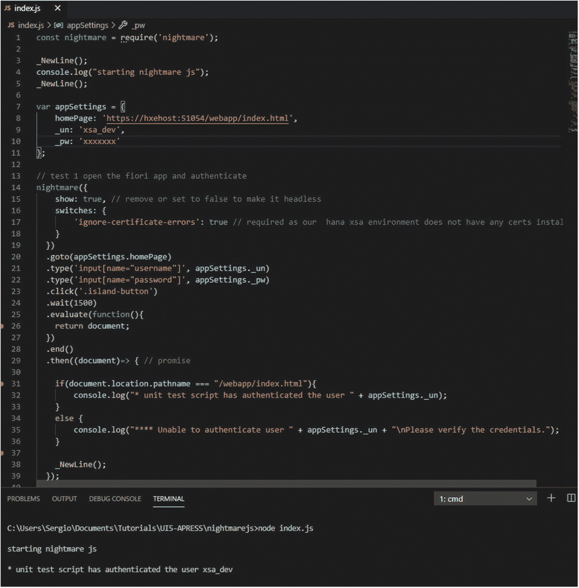

**图 4-7** – Nightmare JS 单元测试框架

1.  第 1 行加载了 `nightmare` JS 库


2.  `Line 7` 有一个对象，用于脚本内部的应用程序配置设置。该对象包含的 `username`、`password` 和 `home page URL` 等设置均在测试中使用。

3.  `Line 14` 初始化测试。
    1.  `Line 15` 的 `show` 属性允许框架打开一个窗口实例，向用户展示整个测试的自动化过程。

2.  `Line 16` 传递 `switches`；由于我们没有安全套接层（SSL），该练习必须提供一个标志来忽略此类证书验证。

3.  `Line 20` 使用 `goto` 命令打开应用程序。

4.  `Line 21` 和 `Line 22` 自动执行应用程序的输入操作，将值分别设置到名为 `username` 和 `password` 的输入字段中。

5.  `Line 23` 点击提交按钮（该按钮包含 CSS 类 `.island-button`）。

6.  `evaluation` 函数调用页面中的一个函数，用于从 `goto` 步骤访问的页面中检索信息。

7.  `then` 函数返回一个承诺（`line 29`），我们可以看到，如果用户已通过身份验证，则在控制台打印显示用户名；否则，在我们的负面测试场景中，显示一条错误信息，如图 4-8 所示。

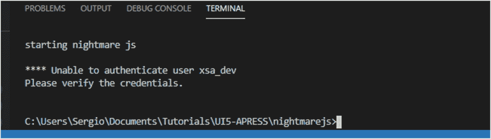

**图 4-8**
Nightmare JS 脚本的控制台输出

这是运行同一测试用例时交互式窗口的外观（窗口自动打开，脚本填充输入字段，并点击“登录”按钮）。请注意，这不是浏览器窗口，而是由 Nightmare 在后台运行 Electron 框架打开的窗口，如图 4-9 所示。

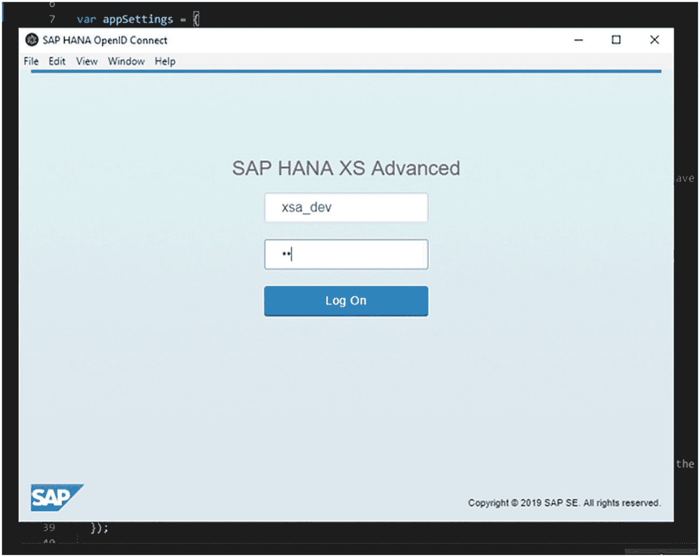

**图 4-9**
使用 Nightmare JS 自动填充表单

在多次尝试继续使用 Nightmare JS 框架后，我不断遇到与安全设置相关的问题。我尝试向 `switch` 对象添加属性以忽略这些证书错误；尽管如此，在运行回调时，Nightmare JS 框架无法渲染单元测试的下一步。

我尝试过的几种方法包括：在点击“登录”按钮后等待主列表选择器，但由于应用程序渲染存在安全问题，该选择器从未渲染到 Electron 窗口中。我尝试的下一步是在其他用户代理（如 Firefox 或 Chrome）中打开 Nightmare JS 应用程序，但由于同样的安全问题，用户代理无法工作，代码立即停止执行。我尝试添加开发者工具，以查看是否有其他来自应用程序的错误阻止了框架打开 Fiori 应用程序。我在 `switches` 语句内部使用了 `openDevTools` 设置，如图 4-10 所示。

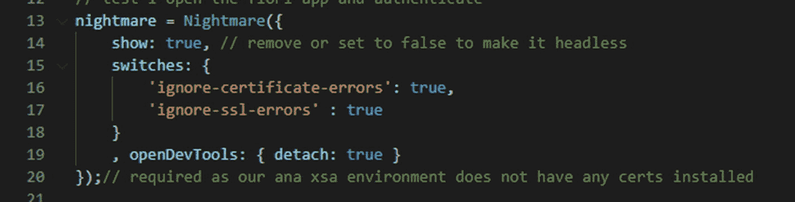

**图 4-10**
Nightmare JS 的 switches 设置

这个 `switch` 语句成功打开了开发者工具，如图 4-11 所示；然而，开发者工具在应用程序的组件预加载阶段挂起，不幸的是，该练习无法继续使用此框架。这对我以及尝试评估各种框架的其他读者来说都是一个很好的教训。问题就变成了：开发者应该在什么时候继续在当前框架上投入时间，而不是转而评估和实施其他框架？

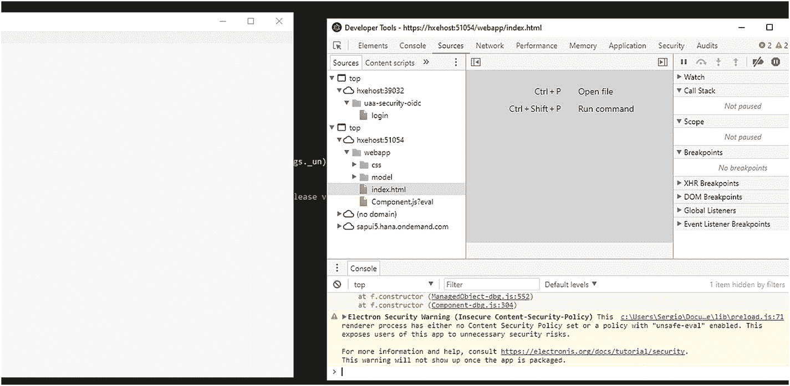

**图 4-11**
Nightmare JS 打开 devTools

鉴于前述 Nightmare JS 的所有问题和设置，现在是时候进入下一个单元测试框架了。该框架拥有大量追随者，并因其久经考验的能力而成为最流行的框架之一。此外，该框架之所以获得认可，是因为它提供了许多大多数开发者在手动测试自定义 Fiori 应用程序开发时已经熟悉的功能。


## Puppeteer

`Puppeteer` 是由谷歌开发的优秀 JavaScript 框架，也是目前可用的最佳测试框架之一。`Puppeteer` 使用 `Node.js` 作为其 JavaScript 语言，可用于在我们的 Fiori 应用程序及任何其他 Web 应用程序中自动化执行单元测试。探索此工具的开发者还需要了解 DOM 选择器以及 Google Chrome 浏览器提供的常用浏览器开发者工具。该框架的主要特性在于，它提供了一套 API 用于控制 DevTools 协议。请查看图 4-12，了解 `Node.js` 脚本如何与 `Puppeteer` API 交互，进而与 Chrome 开发者协议（`CDP`）以及无头 Chrome 进程交互的不同层级。

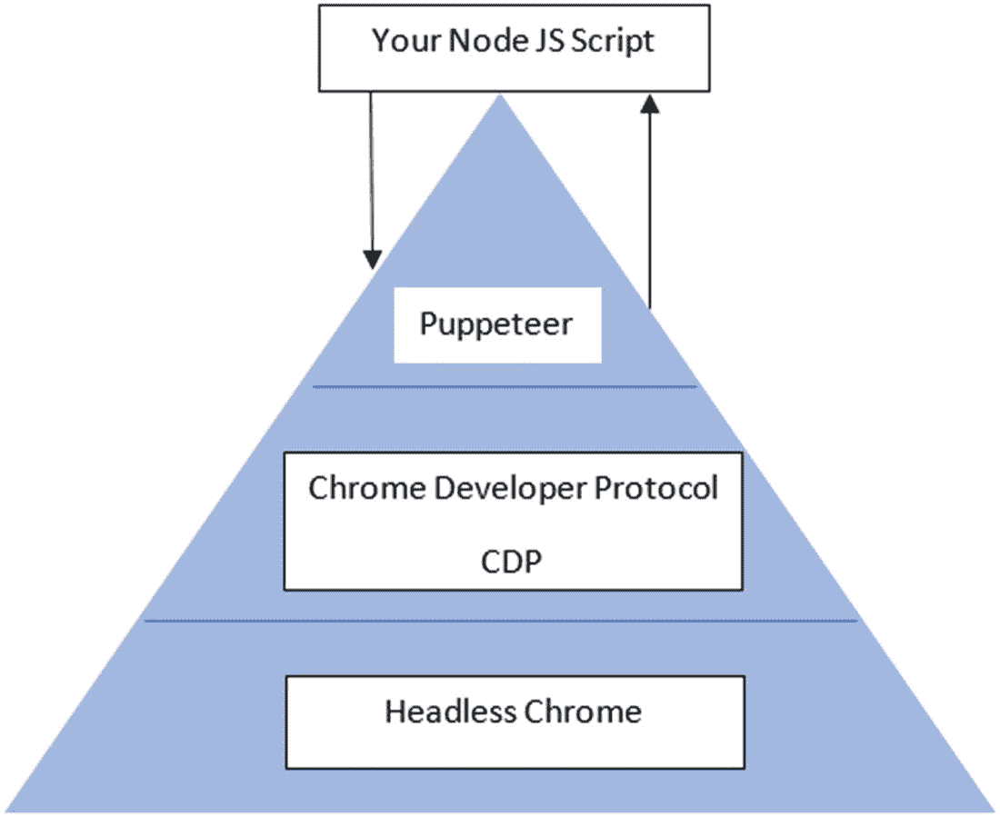

**图 4-12** Puppeteer 架构

### 无头浏览器与有头浏览器

您可能会好奇无头浏览器是什么意思。这意味着脚本可以自动化执行，而无需打开浏览器窗口。使用 `CDP`，`Puppeteer` API 可以模拟浏览器所具备的一切功能，而无需实际打开它。有时，我们需要使用有头浏览器（即打开窗口）来查看脚本与浏览器本身之间的自动化交互。此外，有头 `Puppeteer` 进程可以附加浏览器开发者工具，以便用户能在运行时进行交互并更新数值。

DevTools 协议页面对其自身描述如下：*“开发者可以使用此 DevTools 协议来检查、交互、调试和分析 Chromium、Chrome 以及其他基于 Blink 的浏览器。”*

在本章前文，我们还提到了单元测试、负责验证开发工作的不同角色，以及用于完成这些任务的一些工具。大多数 Web 开发者都熟悉按下 `F12` 键后弹出的浏览器工具。有些开发者使用此工具已久，但只关注其中部分用于调试代码的功能——例如查看文件在特定网络请求期间何时加载——也有一些开发者在开发完成并验证后，使用浏览器来截图。某些流程有时要求截图，以证明开发工作确已进行、已经过验证，并可参考程序的代码在变更前后的运行状况。开发者工具中还有其他标签页，提供了额外的功能，但开发者通常不会深入接触，或者尚未有机会探索。借助 `Puppeteer`，这些工具及其特性与功能均可通过编程方式进行交互。

### 安装 Puppeteer

安装 `Puppeteer` 需要使用 `npm` 命令，如图 4-13 所示。

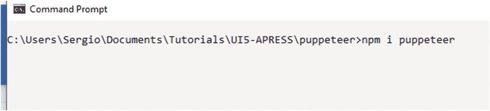

**图 4-13** 使用 `npm` 安装 `Puppeteer` API

安装完成后，一个 `node` 脚本如图 4-14 所示。此脚本将用于演示如何在自定义的 Fiori 示例应用程序中使用 `Puppeteer`。请注意，此 `Puppeteer` 脚本是作为独立于自定义 Fiori 应用程序的程序开发的，本书展示了使用 Visual Studio Code 编辑器来开发它。该脚本如图 4-14 所示。

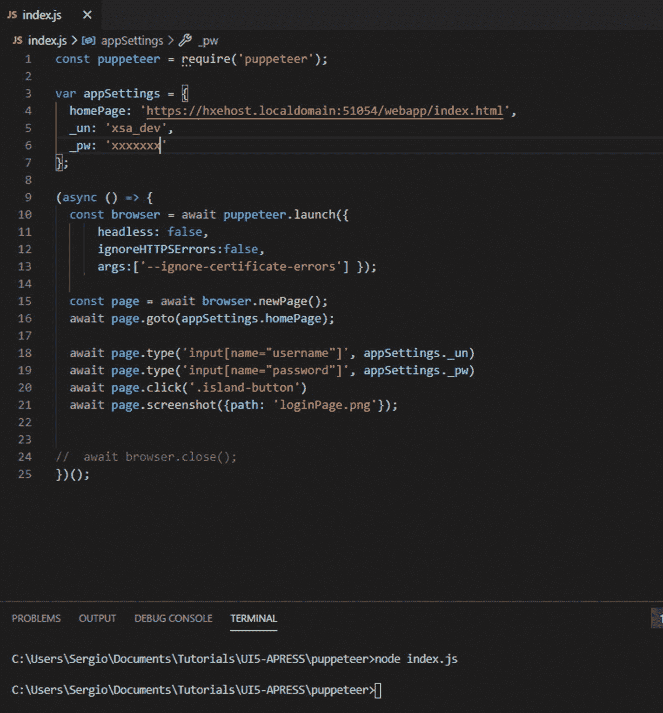

**图 4-14** 示例 `Puppeteer` 脚本

您可能会好奇为什么本书使用 Visual Studio Code。这是因为这是一款免费的编辑器工具，在开发和使用 `Node.js` 及其他编程语言时，通过启用相应的扩展，它拥有出色的特性。

此外，我很高兴地告诉大家，使用 `Puppeteer` 框架是多么简单。它比本章介绍的其他框架都要容易上手。`Puppeteer` 官方网站上有大量的文档，地址如下：[`https://devdocs.io/puppeteer/`](https://devdocs.io/puppeteer/)，此外在本书编写过程中查阅的其他来源，如 YouTube 视频和谷歌搜索结果等，也提供了丰富资料。

### 探索 Puppeteer 脚本

现在，让我们来探索上述脚本包含的内容及其功能。

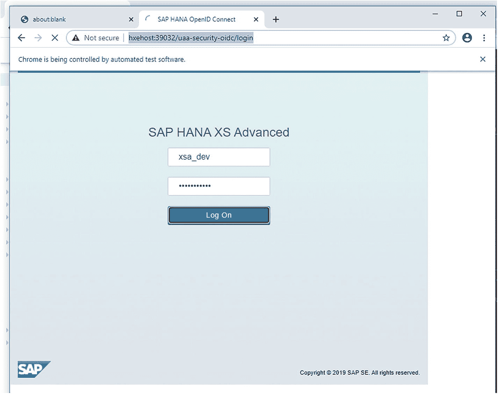

**图 4-15** 有头 `Puppeteer` 脚本启动 Fiori 应用程序

1.  **第 1 行** 加载了 `Puppeteer` Node.js 库（安装之后）
2.  **第 3–5 行** 用于应用程序配置。为简化练习步骤，配置包含在同一个脚本中；不过，它也可以重构或从其他文件读取
3.  **第 9 行及以下** 包含了正在被单元测试的主函数
    1.  请注意，该框架从入口点开始就采用了异步编程；因此，您会在后续代码行中看到 `await` 关键字。
4.  **第 10 行** 初始化 `Puppeteer` 框架的一个新实例，并使用一些默认设置启动它，例如以**有头**模式启动（`headless: false`），并忽略 HTTPS 错误（由于缺少证书）。
5.  由于我们的自定义 Fiori 应用程序启用了路由认证，练习从打开应用程序的主页开始，并且必须先进行认证才能打开应用程序本身，如图 4-15 所示。
6.  使用 `headless: false` 标志是为了可视化应用程序的运行过程，如图 4-15 所示。请注意在打开的浏览器窗口中，地址栏正上方有一条消息显示“Chrome is being controlled by automated test software”（Chrome 正由自动化测试软件控制），这意味着它确实是在运行我们的脚本。

脚本打开有头浏览器后，立即输入用户名和密码，并点击“登录”按钮，应用程序随后会重定向到自定义的 Fiori 应用程序，如图 4-16 所示。

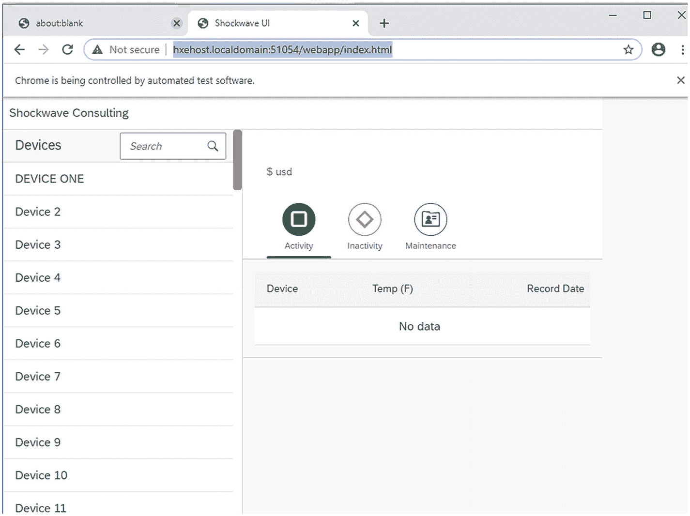

**图 4-16** 认证后由 `Puppeteer` 脚本打开的 Fiori 应用程序

### 验证主列表控件

`Puppeteer` 脚本中下一个要验证的单元测试是确保主列表控件包含一个设备列表。请确保您知道列表控件的选择器标识符。在此例中，选择器是 `#__xmlview1--masterList-listUl`。该选择器被识别为 SAPUI5 框架赋予的 ID。使用 `Puppeteer` 的 `waitForSelector` 函数，传入我们在 `appSettings.masterListSelector` 中定义的选择器，并传递给该函数。在回调函数中，我们简单地将结果元素输出到控制台，以确保该项存在。如果您好奇回调函数中还有哪些其他属性，可以在调用 `waitForSelector` 函数之前以及 `then` 回调内部设置断点，以检查这些对象。请查看图 4-17，了解等待选择器并对其进行检查的更多实现细节。

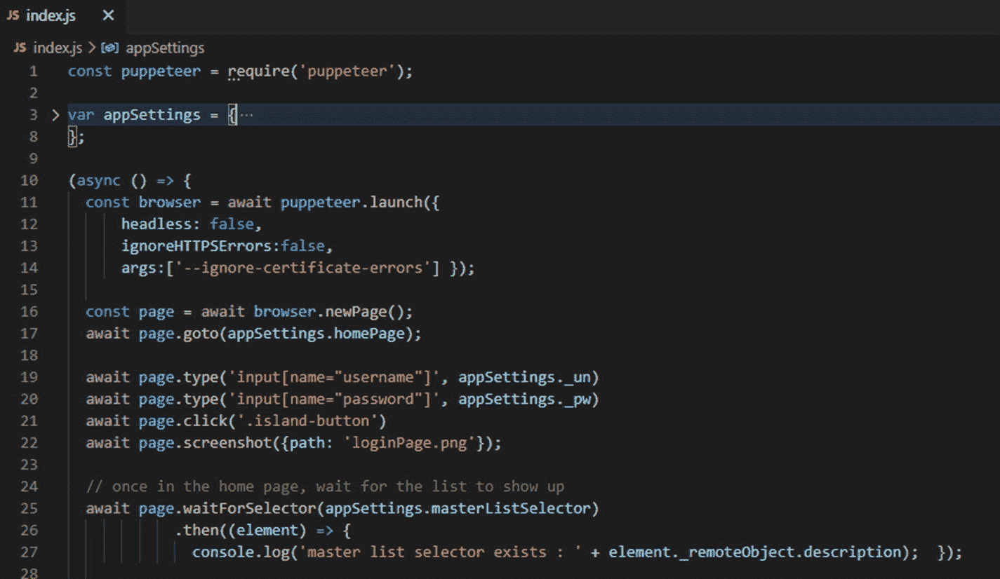

**图 4-17** `Puppeteer` 脚本等待选择器


### 在 Puppeteer 脚本中需要验证的下一个单元测试是：确保点击设备列表项会填充详细信息视图（屏幕右侧）。这个测试非常强大，因为我们模拟了用户与应用程序显示界面交互，以及点击列表项查看其详细信息的操作流程。

这里的棘手之处在于要理解列表可能包含 1 个、2 个或 100 个列表项，我们需要确保不仅能选中第一个列表项，还能选中列表中的任意一个列表项。我的第一个想法是基于 jQuery 规则或某些选择器来选取列表的子元素，并获取第 `n` 个元素。然后，我进一步思考，记起了 JavaScript 语言的 `Math` 库中有一个 `random` 函数。于是我加入了一个变量，用于获取一个介于 0 和列表项长度之间的随机数。一旦随机数确定，我们就需要点击该元素——没错！大声说出这个想法感觉非常好，但下一个障碍是如何从列表中获取随机元素，然后以某种方式点击它。

在图 4-18 中，你可以看到我新增的函数，它让 Puppeteer 框架根据元素 `ul`（一个无序列表）和列表项 `li`（基于指定的 CSS 类）来等待选择器。这个 CSS 类是 SAPUI5 框架提供的，我通过打开开发者工具并识别出来。

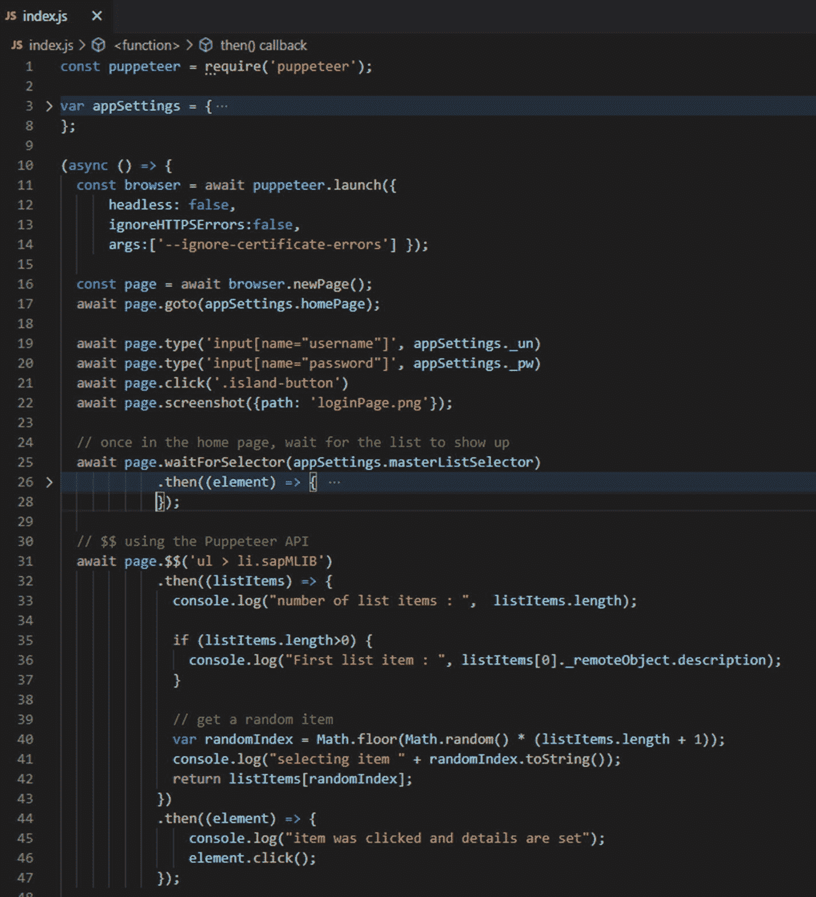

**图 4-18** Puppeteer 脚本等待选择器、计算随机值并点击列表项

在 Puppeteer 框架等待列表项后，这些列表项会被传递给回调函数，以便进一步检查，例如查看存在多少条记录。接下来，我在控制台中显示了这些列表项中的第一个。

然后，我计算了之前描述的随机值，并使用了 `return` 关键字，因为我希望在下一次回调中使用这个元素，我在下一次回调中基于当前回调函数返回的元素添加了 `click` 函数。这个框架确实允许对这些元素进行异步操作，同时还允许我们识别和计算一个场景后，将元素链式传递到下一个场景进行进一步检查和剖析，这真是太棒了。

我建议你仔细查看图 4-18 几次，了解所有 JavaScript 概念如何在这个框架中协同工作。

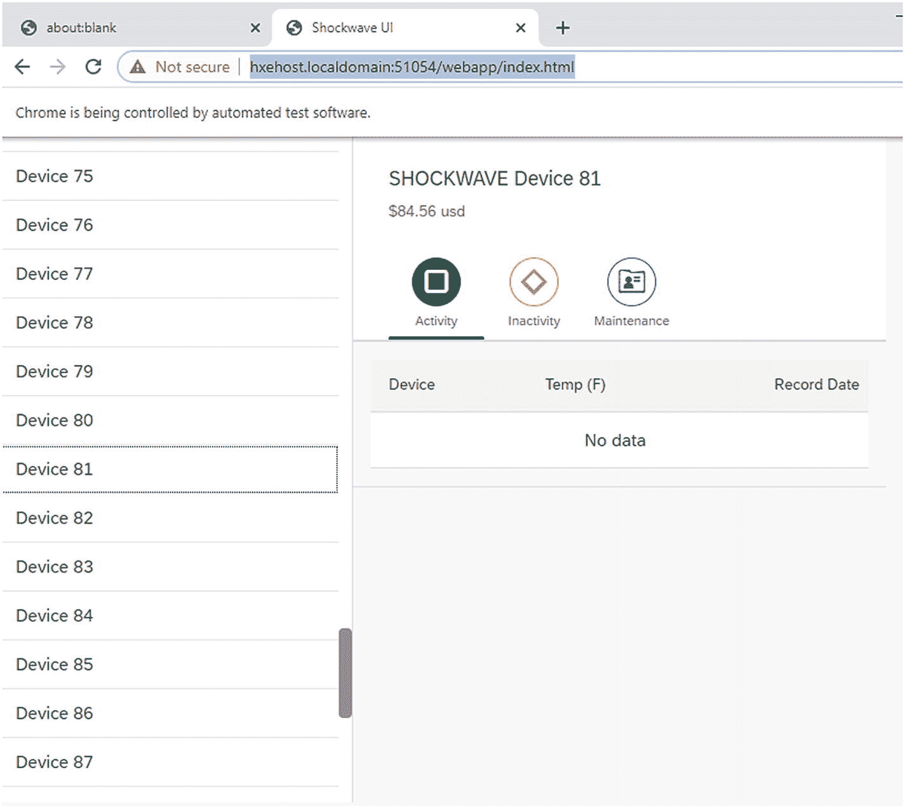

**图 4-19** Puppeteer 脚本选择随机列表项以显示其详细信息

下一张截图，图 4-19，向读者展示了可以通过脚本方式完成的强大功能，同时我们也可以在真实窗口中看到这些操作，就像用户正在与我们自定义的 Fiori 应用程序进行交互一样。

为了方便读者，在运行完上述场景后，Visual Studio Code 控制台显示的内容如图 4-20 所示。

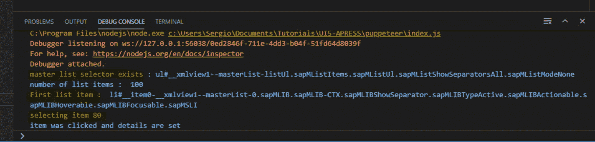

**图 4-20** Puppeteer 脚本的控制台输出

最后但同样重要的是，我们可以编写 Puppeteer 单元测试脚本，使其在完成后自动关闭，方法是在主函数末尾取消注释 `await browser.close()` 这一行，如图 4-21 所示。

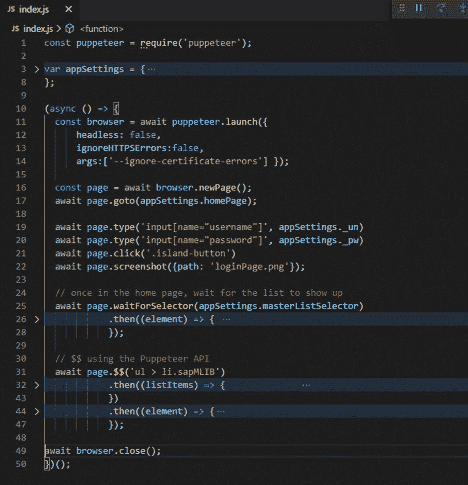

**图 4-21** 在 Puppeteer 脚本末尾关闭浏览器

这次脚本运行后，它会快速打开窗口，运行不同的场景，并在执行结束时自行关闭。在图 4-22 中，我们可以看到单元测试的日志，但由于脚本运行速度很快，人工因素未能捕获到运行时的截图。

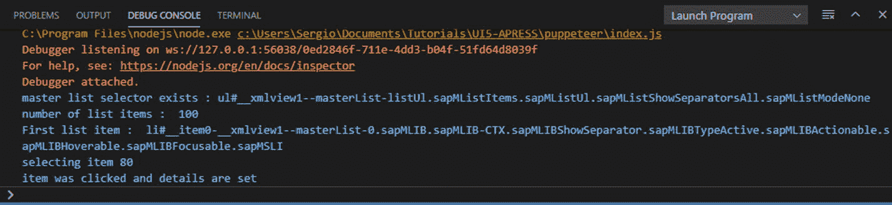

**图 4-22** 运行完整脚本后的最终控制台输出

到目前为止，我们已经使用 Puppeteer 框架运行了几个单元测试用例来展示用户与软件的交互；然而，没有一个测试场景显示网络请求，也没有显示应用与 OData 服务之间传输的数据。

我将继续包含其中一个测试，以便我们拥有一个更完整的单元测试框架；这也是我们正在编写的自动化脚本的一部分。归根结底，我们还需要验证应用程序与后端系统之间来回发送的数据。话不多说，请看下文。让我们暂时移除浏览器的关闭命令，以便在关闭有头浏览器窗口之前，允许应用程序拦截和分析 API 的请求/响应，如图 4-23 所示。

开发者可以观察到 Puppeteer 脚本显示以下内容：

1. `page.on(‘request’, InterceptedRequest => ...)` – 此回调允许开发者在请求发送到后端 API 之前对其进行分析。开发者可以查看当前值、编辑请求头、请求参数以及与 HTTP(s) 请求相关的任何其他设置。

2. `page.on(‘response’, InterceptResponse => ...)` – 此回调允许开发者分析响应对象，包括响应本身、头信息、cookie、实际的响应数据，以及你在接收 HTTP(s) 响应对象时能想到的任何其他设置。

为简化练习，Puppeteer 脚本还执行了一些 `console.log()` 语句，以便开发者在其单元测试期间看到这些值，如图 4-23 所示。

如果任何开发者希望查看回调中的其他值，他们还可以将鼠标悬停在请求/响应变量上来分析这些属性，或者在调试控制台中输入命令以查看特定对象的运行时值。

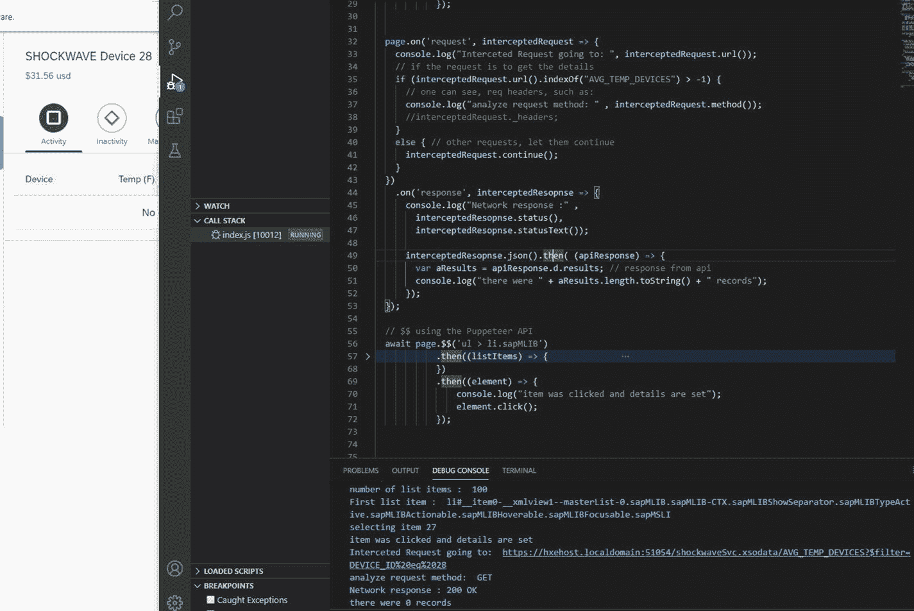

**图 4-23** Puppeteer 脚本拦截网络请求和响应

在本书前面，我们介绍了一个生成随机索引的函数，用于选择主列表控件。现在，让我们与自定义 Fiori 应用程序交互，从当前的 Puppeteer 窗口中手动选择一个记录，该记录在被拦截的 API 请求中包含附加记录。没错：在应用程序执行单元测试时，用户也可以与这个有头会话进行交互。

在图 4-24 中，用户已手动从主列表中选择了 DEVICE ONE 记录，你可以在后台应用程序（左侧白底图像）中看到所选项目的详细信息显示在应用程序中，同时 Visual Studio Code 控制台（图 4-24 右侧黑底部分）也显示了被拦截的请求（记录了请求方法 `GET`），以及被拦截的响应（状态 `200 OK` 并返回了 7 条记录，其中只有 5 条包含 Activity 属性，而这些正是显示在应用程序 Activity 选项卡下的记录）。

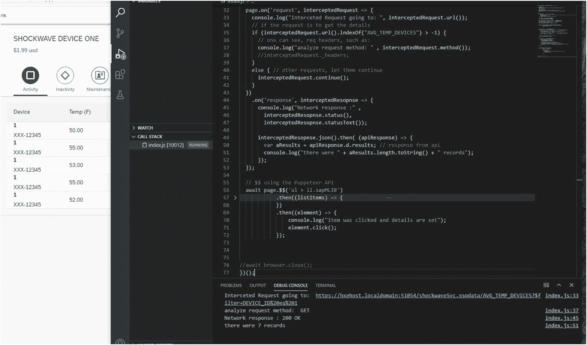

**图 4-24** 手动选择的列表项用于分析被拦截的响应对象


### Puppeteer 练习总结

因此，Puppeteer 的练习到此结束；我真心相信这个框架为我们的单元测试章节增添了巨大的优势和好处。从`QUnit`框架开始，它与我们的应用程序非常接近，并很好地集成了`SAPUI5`框架，大多数开发者可能会感到舒适，无需进行任何额外设置或配置——这些有时可能过于繁琐或耗时，就像我遇到的`Nightmare JS`框架那样。接着谈到`Puppeteer`框架，我发现这个框架拥有一些高级功能，同时在大多数我研究或偶然发现的在线资源中都有非常完善的文档记录。我由衷地并强烈推荐`Puppeteer`给任何从事 Web 开发的人，因为它是一个如此干净且易于使用的框架，几乎涵盖了开发者在软件开发过程中需要测试的所有可能测试用例：从通过输入用户名和密码来验证用户，到触发按钮或链接的点击事件，再到拦截加载或发布数据时的`http(s)`请求。这个框架确实赢得了我心中最佳单元测试框架的选票，我很高兴能在构建和验证自定义 Fiori 应用程序时将其作为一个外部选项来使用。如果用户需要查看测试过程中发生的情况，使用有头和无头功能的选项极其重要。一旦他们对开发感到满意，他们可以选择在单元测试脚本中使用无头模式来最小化处理过程。向`Puppeteer`团队致敬，打造出如此出色的产品。

## 单元测试带来的改进

单元测试在开发软件应用程序时是有益的；然而，对于开发者来说，这不仅仅是证明他们的工作正确无误。开发者有时会觉得这类任务很繁琐，而客户有时则认为这是一项不必要的开支。在本节中，本书将展示几个场景，证明之前的这些假设是错误的。

1.  **单元测试如何让我的代码变得更好？**

理解任务并能够测试它，让开发者能够根据需求展示其工作。编写单元测试允许开发者以编程方式双倍检查自己的工作，以防由于需求变更或软件产品增强而需要多次更新。如果开发者不仅开发需求，而且理解其软件必须接受的测试场景，他们会在自己的技艺上变得越来越好。此外，自动化工作对于注入不同的测试值至关重要，例如在`Puppeteer`示例中展示的那样，其中利用生成随机数来触发读取 API 操作，以检索链接到列表项的详细信息。

2.  **单元测试如何节省我的项目时间？**

有些情况下，软件产品需要以增量阶段构建。如今，大多数公司遵循敏捷方法论，软件产品经过多次迭代和业务用户的反馈而发展。手头有一个脚本化的单元测试框架将减少交付这些增强功能所需的时间，以及验证新软件添加或更改所需的时间。消除人工运行这些单元测试的因素是节省总体时间的一种方式，并使项目在引入这些更改/集成时更加稳健。此外，如果我们软件的多个部分都遵循这些单元测试框架，那么我们还可以自动化测试，以最小化开发后和部署后的时间，就像大多数公司在集成和回归测试期间所做的那样。

3.  **我的单元测试如何为我的软件带来改进？**

性能改进可以通过不同的方式展示：
    -   应用程序启动时的性能
    -   加载 (MVC) 视图时的性能
    -   访问外部资源（如图像或其他脚本）时的性能
    -   从 Web 服务加载数据时的性能

请记住，在软件项目初期创建单元测试脚本会需要一些额外的时间，而同一软件产品的后续增强可以利用这些测试用例场景，从长远来看使开发及其与其他系统的集成更加稳健。

根据其他自定义 Fiori 应用程序的经验，其他改进包括但不限于以下内容：

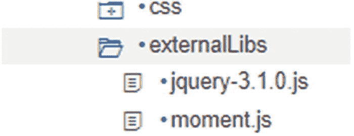

图 4-27
精简的外部库

1.  将`SAPUI5`应用程序设置为异步加载，如图 [4-25] 所示。

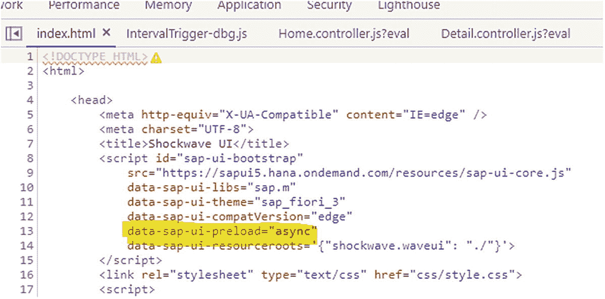

图 4-25
异步引导`SAPUI5`

您也可以在“网络”选项卡中观察正在加载的资源，如图 [4-26] 所示。

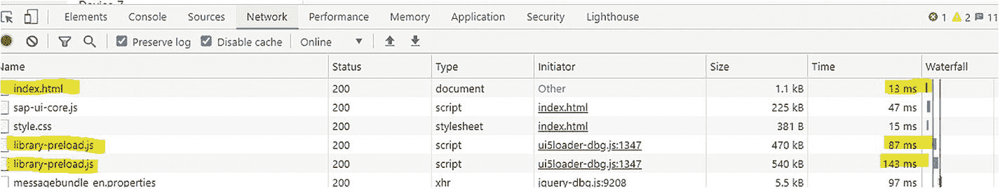

图 4-26
显示预加载资源的“网络”选项卡

2.  精简 JavaScript 文件以改善应用程序加载性能（确保您的文件经过精简过程；它们的扩展名可能是`*.min.js`）。精简过程也可以应用于样式表文件。在本书的练习中，使用了两个`js`库：`jQuery`库和`moment.js`库。两者都已精简，如图 [4-27] 所示。

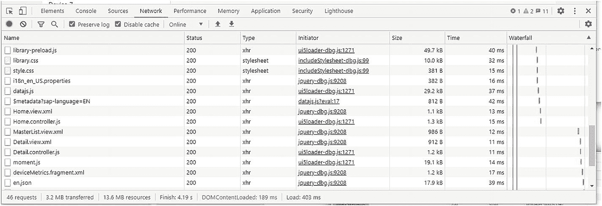

图 4-29
异步资源加载

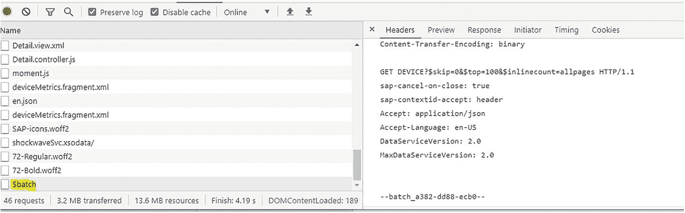

图 4-28
OData 服务发起批处理请求

3.  如果您的自定义应用程序使用图像文件，请确保图像质量良好且其大小能够快速读取并加载到应用程序中。运行浏览器开发者工具查看加载这些图像的时间，可以改善您的加载时间。

4.  利用 SAP 图标执行应用程序中所需的某些操作。由于`SAPUI5`框架提供的图标已经是同一库的一部分，您可以利用这些图标。此外，使用这些图标（如练习中图标标签栏中包含的图标）也有利于您的 Fiori 开发，因为您所包含的资源符合框架的规则和指南。

5.  从 OData 服务加载数据的改进包括：能够设置`SAPUI5`控件聚合器以按需加载此类数据，并设置一个可见元素数量作为阈值，从而使控件仅加载最终用户所需或可见的内容。遵循这条建议，确实使我们的自定义 Fiori 应用程序具有现代快速 Web 应用程序的外观和感觉，如图 [4-28] 和 [4-29] 所示。


## 结语

在本章即将结束之际，我怀着苦乐参半的心情，想与所有读者分享这些经验。有些开发框架（无论是用于单元测试还是非单元测试的）只需简单配置即可使用，而使用这些框架时，有时可能需要掌握更多高深和精深的技术知识。我建议所有开发者在决定采用、研究并推行某个框架之前，先熟悉几个备选方案。在我们的项目中，还有其他因素（如时间和资源）可能会限制我们，而这些额外因素正是导致项目有时最终采用简单的单元测试框架，有时却采用更优雅解决方案的主要原因——正如我发现 Puppeteer 是目前最优雅且最简单的解决方案之一。

分析每个框架的优缺点应当成为单元测试设计的一部分。此外，当开发者涉足全新领域时，查阅现有文档应当成为采用某个框架的驱动因素。我发现 Puppeteer 是我最偏爱的单元测试框架，尽管由于本文篇幅和时间所限，我只触及了该框架的皮毛。希望你能利用练习中分享的一些脚本，入门或拓展你在单元测试框架方面的知识。最后但同样重要的是，如果你仍对自动化测试感到不适应，还有一些手动方式供你入门单元测试：我们都是从某个起点开始的，希望你先掌握手动步骤，然后再涉足这些企业级信誉良好的选项。如果你决定深入研究 QUnit、Nightmare JS 或 Puppeteer，我期待听到你的反馈。祝你实施顺利！

