# 5. 部署自定义 Fiori 应用

欢迎来到《自定义 Fiori 应用》的最后一章。这一章令人兴奋，因为迄今为止所介绍的所有内容，现在都将被提升到另一个环境，以便供开发者之外的人员使用。部署应用不仅仅是复制文件或点击按钮，让软件从本地工作区或开发环境迁移到质量环境，甚至最终迁移到生产环境。在将软件部署到上游环境之前，可能有一系列项目需要验证。根据公司的政策，在软件开发生命周期中可能会遵循某些步骤，包括审批和发布软件的相关步骤。在发布此应用或其他 Web 应用之前，可能需要满足某些非技术性要求。

本书假设在执行后续步骤之前，先决条件已经满足——文档已更新、质量保证测试已通过、用户验收测试已完成、且已获得管理层的批准。此外，在 SAP Cloud Platform 或 Amazon Web Service 环境中使用的任何外部账户都已被创建。

## 准备部署和软件版本管理

在准备和发布软件时，可以在多个位置跟踪应用本身的版本，以及用于审计目的。作为软件的开发者和技术负责人，我们还必须跟踪与外部软件库的不同集成点。在这个自定义 Fiori 应用中，本书使用了表 5-1 所示的版本。

表 5-1 Fiori 应用开发过程中使用的软件版本

| 软件或库 | 版本 | 如何确定版本 |
| --- | --- | --- |
| HANA XSA | HANA 2 SPS 04 | HANA XSA 安装 |
| Fiori UX | 3 | 在 `index.html` 中配置 |
| SAPUI5 | 1.80.1 | 浏览器中按 `Ctrl + Shift + Alt + P` |
| Node JS | 12.16.1 | 命令行中执行 `cmd node -v` |
| NPM | 6.13.4 | 命令行中执行 `cmd npm -v` |
| JQuery | 3.1.0 | 从 IDE 中打开文件 |
| Moment.JS | 2.27.0 | 从 IDE 中打开文件 |
| QUnit | 2.10.1 | 从 IDE 中打开文件 |
| Nightmare JS | 3.0.2 | 从 IDE 中的 `node_module` |
| Puppeteer JS | 5.2.1 | 从 IDE 中的 `node_module` |
| OData | v2 和 v4 | 浏览器中文件的元数据 |
| `mta.yaml` | 0.0.1 | 由开发者在 SAP Web IDE 中配置 |

如你所见，示例自定义 Fiori 应用中有许多集成点，需要关注和维护它们，同时确保无论用什么开发，当它到达生产环境时也能得到维护。当由于问题（可能并非 Fiori 开发者实现的功能的一部分）而报告问题和错误时，保留软件版本信息极为重要；有时，这些问题可能源于这些外部库或模块的依赖关系。通常，公司可能会对遵循合规流程的公司进行审计，在这种情况下，拥有此类文档证据总是非常有用的。

你可能想知道，在开发自定义 Fiori 应用时，还有哪些其他原因需要保留版本信息。通常，外部依赖也可能发布新版本，在这种情况下，开发者可能需要查阅其文档和日志，以验证当前拥有的版本，并判断是否值得升级到新版本，或者新版本是否与其环境的其余部分兼容。当软件普遍可用时，有一些通用指导原则；有时，新功能甚至可能需要新的硬件。有时，软件的小版本发布或补丁可能对自定义应用的开发和集成影响不大；在这种情况下，影响可能很小甚至没有，集成可以安全地采用。如果依赖项的升级是主版本发布，则建议分析新功能的影响、优缺点以及所带来的好处，以了解是否有必要计划升级。这是 SAP 软件或其他付费软件的常见场景，它们会经历发布周期，为其客户提供最新、最强大的功能。

如表 5-1 所示，软件有多种版本。软件版本管理的最佳实践将版本模式描述为 `X.Y.Z`，其中：

1. **X** 代表主版本号。主版本意味着软件中增加了多种功能并已发布。
2. **Y** 代表次版本号。次版本意味着软件中增加了一个小功能并已发布。
3. **Z** 代表补丁号。补丁号意味着软件的一个不同构建版本已被添加并发布。

如果您想知道如何维护我们的自定义 Fiori 应用程序，请查看`mta.yaml`文件，它位于 SAP Web IDE 中 Fiori 项目的 SAPUI5 模块内。打开 SAP Web IDE，导航到该项目，打开名为`waveui`的 UI5 模块，然后双击`mta.yaml`文件，如图 5-1 所示。

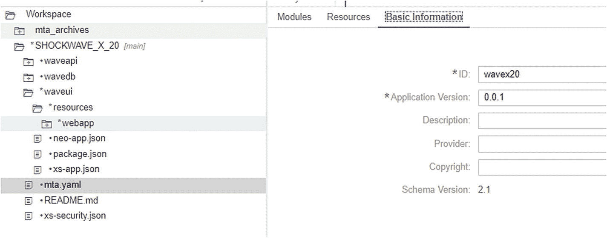

在此图中，读者可以看到应用程序版本被标识为`0.0.1`；这意味着这是正在开发的软件的初始版本。开发人员需要提出的下一个问题是，随着新功能的添加或产品在其生命周期中的演进，这个工作的版本如何递增。这是通过在`mta.yaml`文件中将版本`0.0.1`递增为`0.0.2`、`0.0.3`等来完成的，如图 5-2 所示。此`mta.yaml`文件仅当开发在遵循 Cloud Foundry（CF）原则的 XSA 环境中进行时才存在。请注意，此开发工件（文件）在 SAPUI5 应用程序的 XS 经典版本中不存在。

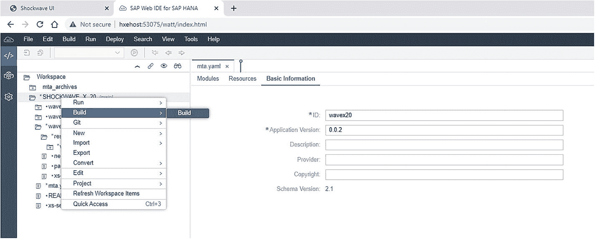

在项目级别运行构建过程的结果是创建一个`mtar`文件（MTA = 多目标应用程序归档），这是用于将软件从 SAP Web IDE 部署到目标环境的主要文件，如图 5-3 所示。这是一个二进制文件，仅用于部署目的。

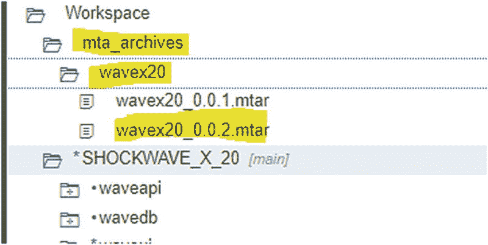

SAP Web IDE 具有通过选择部署代码（`mtar`文件）然后从 SAP Web IDE 中选择`Deploy`菜单来部署此开发代码的功能，如图 5-4 所示。一旦选择了`Deploy`菜单，开发人员就可以选择是部署到 SAP Cloud Platform，还是部署到 XS Advanced 环境（本地部署），如图 5-4 所示。在本章末尾，将有一个类似的练习，使用相同的工具 SAP Web IDE；然而，它将用于部署到 Amazon Web Services（AWS）。

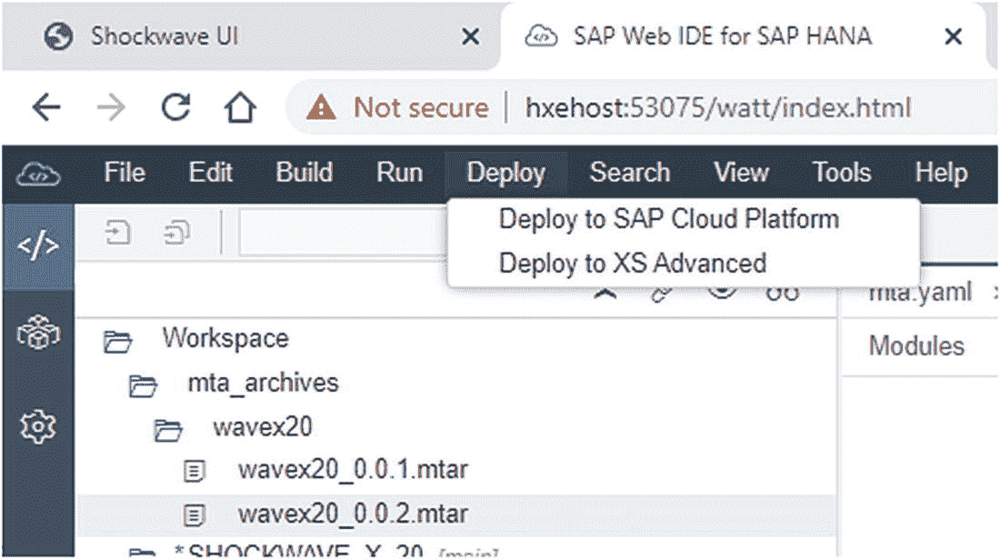

下面展示了部署到本地 XS Advanced 环境的过程，以查看开发实例（由唯一标识符以及`sapui5`模块`waveui`的名称标识）如何与由其模块名称`waveui`标识的已发布实例一起显示，如图 5-5 所示。

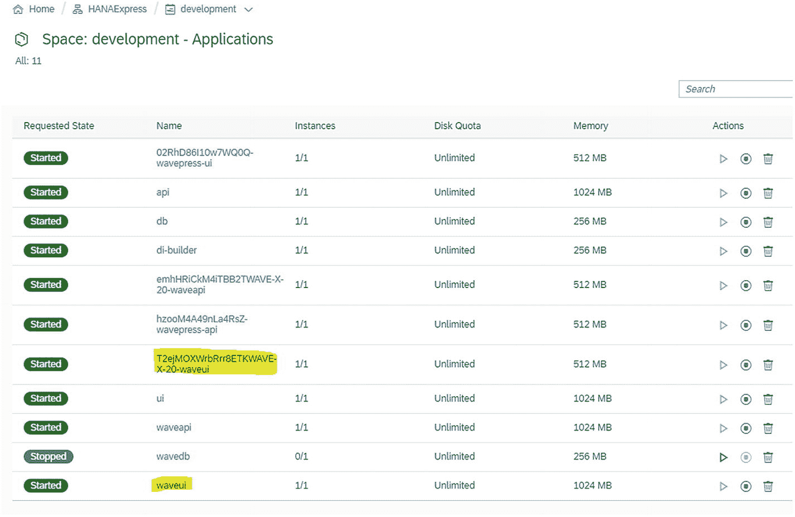

部署到 XSA 环境后，开发人员和用户会收到一个与开发期间使用的`URL:PORT`组合不同的`URL:PORT`组合，以此区分他们的应用程序部署到了哪里。访问这个新的 URL 将把他们带到目标环境中的应用程序。请记住，这两个应用程序都保存在控制台的`Applications`页面中，因为它们并行运行，并部署到不同的端口，就像它们是微服务一样。这是一个非常令人兴奋的话题，最近获得了很大的关注。请查阅我的书《Microservices in SAP HANA XSA》（Apress, 2020）以了解更多关于微服务的信息。

如果您想了解 Fiori 应用程序如何开发到 SAP Cloud Platform，请继续执行接下来的几个步骤。请注意，同一个应用程序可以部署到多个端点；但是，开发人员必须确保他们的 Web 应用程序能够访问其正在使用的任何 OData 服务。当您的 OData 服务和 Fiori 应用程序具有不同域时，请运行一些集成验证。可能还需要执行其他步骤，例如，在 SAP Cloud Platform 中创建目标（`Destination`）以信任目标 URL，启用 CORS（跨域资源共享），甚至让您的网络团队参与进来，以允许 Fiori 应用程序进行外部域调用。要创建目标，请转到 SAP Cloud Platform Cockpit，并从左侧导航列表中选择`Destinations`菜单项，如图 5-6 所示。

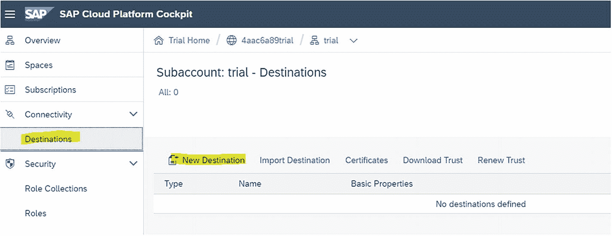

然后，按照图 5-7 中的步骤，提供必要的信息以从 SAP Cloud Platform 访问和测试目标。同一个屏幕允许 SCP 管理员设置受信任的证书。

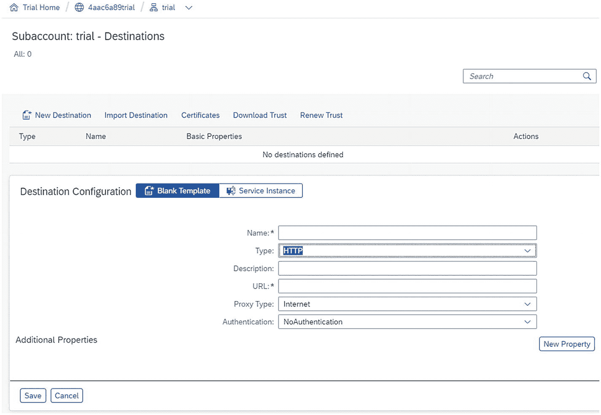

# 部署到 SAP Cloud Platform 的前置条件

要将 Fiori 应用程序部署到 SAP Cloud Platform，开发人员必须在该平台中拥有一个账户，允许他们创建、部署和维护应用程序，并进一步在云环境中设置其他设置。SAP Cloud Platform 架构基于 CF 架构。SAP Cloud Platform 的 Neo 版本不遵循这些标准。在展示将 Fiori 应用程序部署到 SCP 的步骤之前，请确保理解并掌握 CF 架构模型。在我的另一本书*《Building Microservices in SAP HANA XSA》*（[`https://www.apress.com/us/book/9781484261170`](https://www.apress.com/us/book/9781484261170)）中，有更多关于 CF 以及使用 SAP HANA XSA 构建微服务的信息。

## CF 架构与关键概念

CF 是一个开源的云应用平台。CF 由 IBM、SAP、Microsoft、Google 等公司组成，共同制定行业标准，使应用程序能够在云提供商之间运行，从而让开发人员专注于应用程序开发，而不是创建云。创建 CF 就绪的应用程序的好处之一是，这些应用程序本质上与基础设施解耦，因此当它们准备好迁移到本地部署、公共云或其他私有云时，这些应用程序可以轻松地从一种环境/云迁移到另一种环境/云。在开始介绍应用程序之前，有必要先了解 CF 的层次组织以及我们将要交互的一些重要概念：组织（`Organization`）、空间（`Space`）、应用程序（`Application`）、服务（`Service`）和角色（`Role`），如图 5-8 中的截图所示。

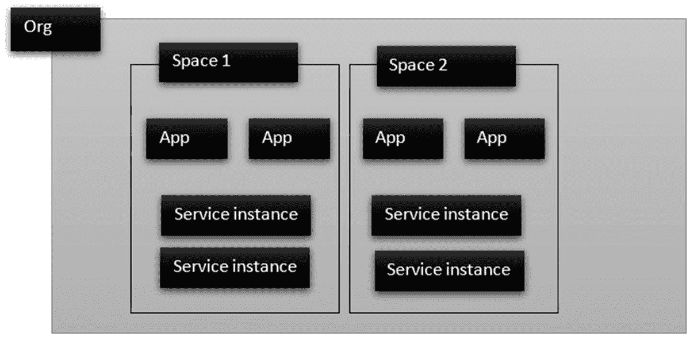

图 5-8 CF 层次结构架构

1.  一个组织（`org`）被定义为一个开发账户，其中拥有一个或多个开发者（称为贡献者），他们通过用户账户拥有访问权限。这些贡献者被分配了特殊角色，以管理、审计和构建云就绪应用程序，或授予他人访问权限。为了演示目的，本书提供的示例将有一个已经创建且处于活动状态的组织。只有管理员可以更改此`org`的状态；但是，我们将在剩余练习中假设它处于活动状态。
2.  在一个组织内，可以包含一个或多个空间。空间被定义为组织内的一个分区，专门用于构建、部署和维护应用程序。每个应用程序都归属于一个空间。拥有应用程序最终需要授予访问该应用程序的角色。应用程序角色属于且仅属于一个空间。
3.  应用程序和服务是 CF 层级结构中的下一级。这些应用程序和服务允许用户展示和使用数据。
4.  用户可能被分配一个或多个角色（角色集合是模板）。这些角色允许用户开发、访问、管理或审计应用程序、空间甚至组织。应用程序安全是软件系统中非常复杂的部分。云（以及 HANA XSA）中的安全性本身就是一个广泛的话题。目前已有几本其他书籍详细解释了 SAP HANA XSA 的安全性。对于本书，其中已实现了足够的安全性来从 Fiori 应用程序访问 OData 服务。

有多种方式可以与 CF 实例进行交互。其中一种是通过命令行界面（CLI）。CLI 可以与 Linux 命令结合使用，例如 `pipe`、`grep` 等。我们需要使用各种命令与云/XSA 架构进行交互，例如登录、设置服务，以及创建、编辑、构建、部署甚至扩展应用程序或服务。CF CLI 是一个多功能工具，允许开发者与其云实例进行交互。它易于自动化和编写其他流程的脚本，否则这些流程需要人工输入命令。它最大限度地降低了与云交互时引入错误的风险，并使其对需要了解云容器细节的开发者和管理员保持可用性。

此类命令的示例如下：

```
cf login           # 登录云实例
cf apps | grep      # 从应用程序列表中检索应用程序
cf push             # 将应用程序推送到 cf 实例
cf scale -m -i 
```

可用命令的完整列表在此处显示：[`http://cli.cloudfoundry.org/en-US/cf/`](http://cli.cloudfoundry.org/en-US/cf/)

此外，一旦在系统上安装了 CF CLI，可以运行 `cf --help` 命令来查看如何使用一个命令及其可用的标志，如图 5-9 所示。

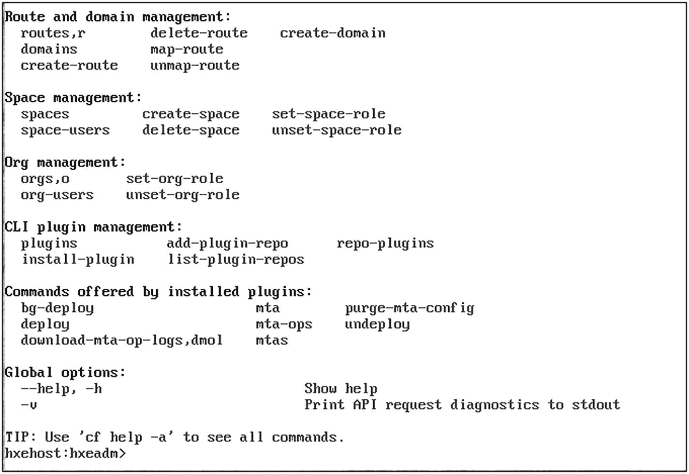

图 5-9 CF CLI

## 使用 SAP Cloud Platform 部署 Fiori 应用

要将我们的 Fiori 应用程序部署到 SCP，请选择从工作区项目生成的 `.mtar` 文件，然后选择“Deploy to”并选择 SAP Cloud Platform。当你了解了 CF 架构后，接下来需要选择要将应用程序部署到的空间。如果你正在运行 SAP Cloud 试用版，默认情况下，当你在平台内启用 CF 模式时，SCP 已经为你提供了一个组织。让我们看看在 SAP Cloud Platform 中检索所需设置的步骤。转到你的 SCP 账户（或免费注册一个）。登录后，你将看到如图 5-10 所示的屏幕。

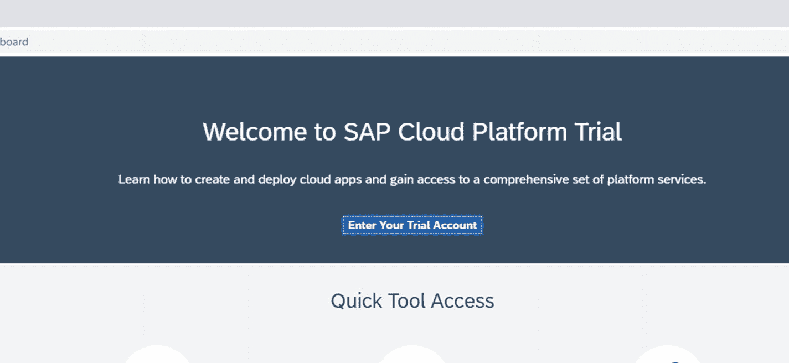

图 5-10 SAP Cloud Platform 试用账户

然后，注意 SCP 在后台使用了 AWS，如图 5-11 所示。本书将在本章后面介绍 AWS。记住这些资源被创建的区域非常重要。

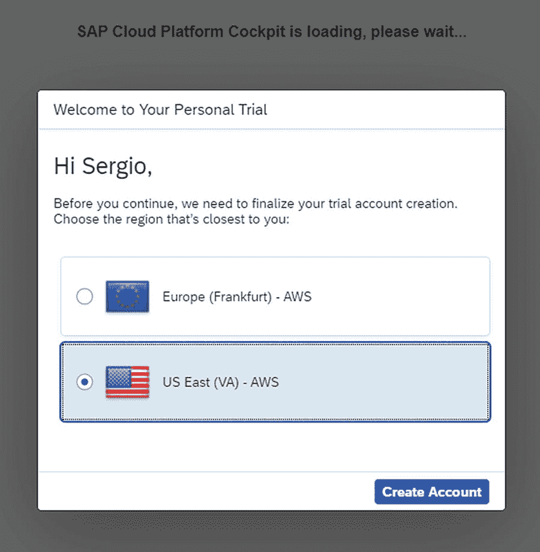

图 5-11 使用 AWS East（VA）区域的 SCP

此过程如图 5-12 所示，可能需要几分钟才能完成。完成后，你将可以继续操作。

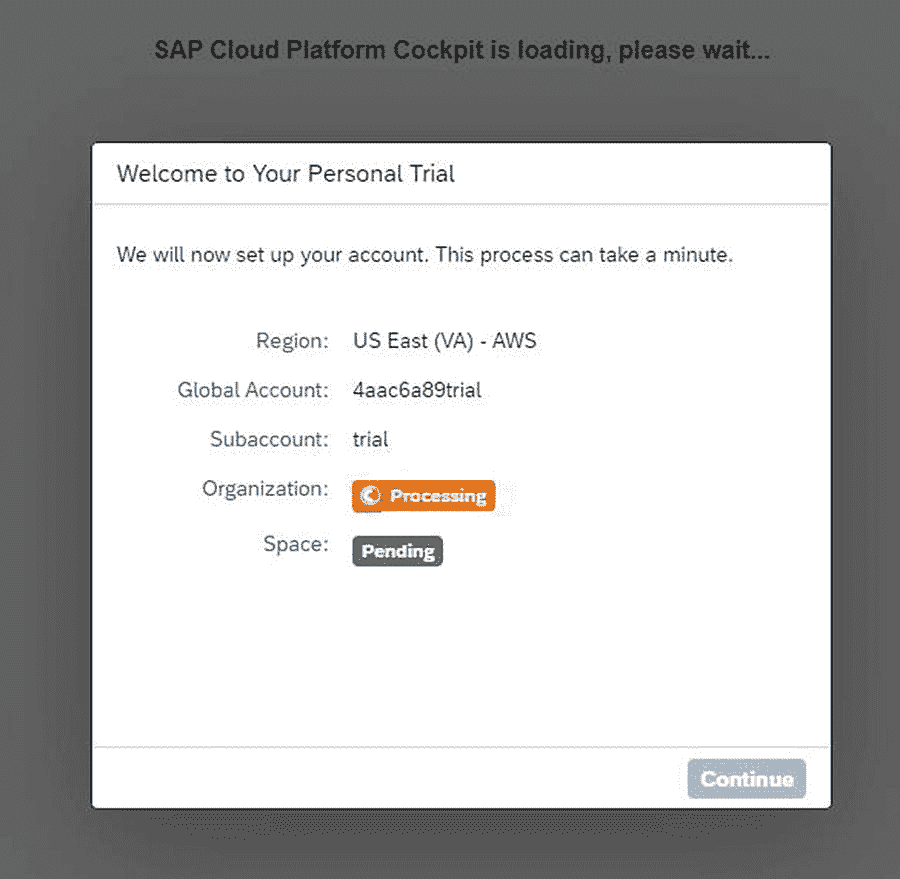

`图 5-12` 设置试用账户

创建账户后，浏览器将重定向至图 5-13 所示的 SCP Cockpit 界面。请仔细查看该仪表盘中的各项功能，以便后续参考，或在不再使用时删除试用账户。

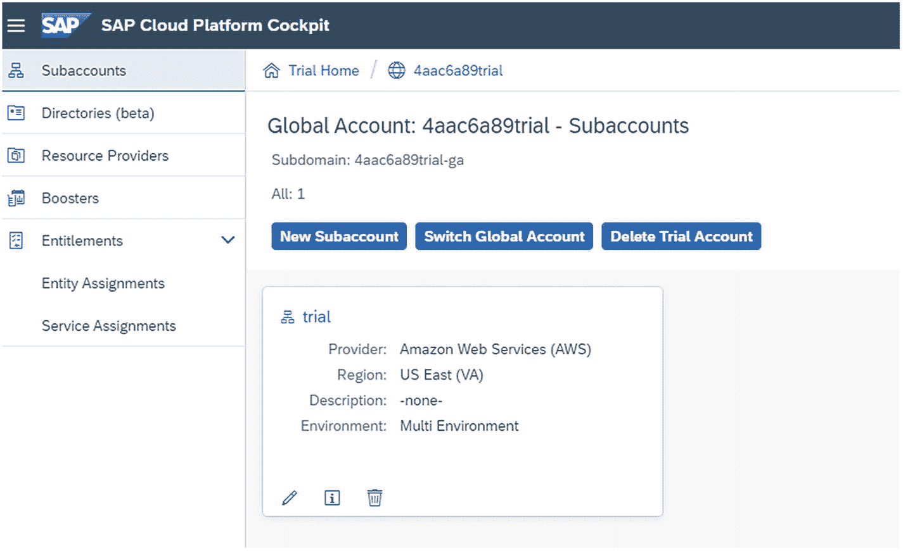

`图 5-13` 显示全局账户设置的 SCP Cockpit

选择"trial"全局账户磁贴，进入子账户。在接下来的界面中，您将看到部署所需的所有云设置。图 5-14 所示的图像可谓"一图胜千言"，因为其中的信息将对您的部署、维护乃至任何未来的开发工作都大有裨益。请仔细分析这个仪表盘并熟悉图 5-14 中的界面，以及所有与 CF 架构相关的重要设置，例如`Org Name`（组织名称）、`Space Name`（空间名称）以及`API endpoint`（API 端点），当您决定从`SAP Web IDE`进行部署时，将需要用到这些信息。

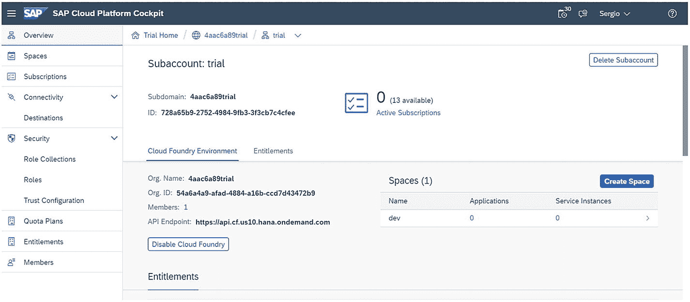

`图 5-14` 子账户试用中的 SCP CF 设置

请注意，目前仅创建了一个空间，且其中尚未部署任何应用程序。完成部署后，该数字应会增长。如果您在 SCP 试用账户中进行此练习，您还会看到云实例的启用天数，该信息显示在浏览器的右上角（默认为 30 天）。如果您的演示需要更多天数，可以向 SCP 申请。正如我接下来将要展示的，试用账户可能功能受限。在了解了上一段所述的云平台设置后，请返回您的`SAP Web IDE`，按照以下步骤将应用程序部署到 SCP 环境：

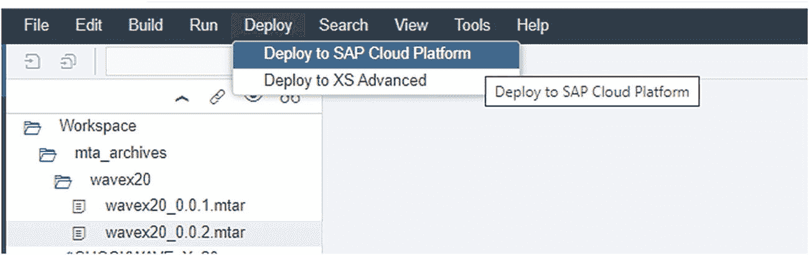

`图 5-15` SAP Web IDE 部署至 SCP

1.  假设您已生成了一个`mtar`文件，请选择您要部署的`mtar`文件。
2.  选择"部署"菜单，然后选择"Deploy to SAP Cloud Platform"，如图 5-15 所示。

在 SCP 教程中创建示例云应用程序[`https://developers.sap.com/tutorials/s4sdk-cloud-foundry-sample-application.html`](https://developers.sap.com/tutorials/s4sdk-cloud-foundry-sample-application.html)时，开发人员还可以观察到以下端点会根据所选区域而有所不同——您的端点将如图 5-16 所示。如果未显示，请在下拉控件中键入以下端点之一。

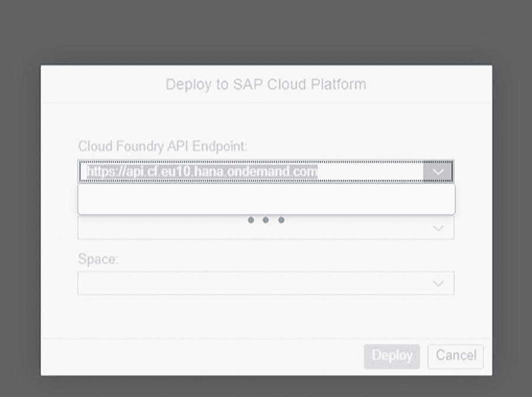

`图 5-16` SAP Web IDE 显示云平台上的端点

1.  欧洲地区使用 `https://api.cf.eu10.hana.ondemand.com` AWS 平台
2.  美国东部（弗吉尼亚州）使用 `https://api.cf.us10.hana.ondemand.com` AWS 平台
3.  美国中部使用 `https://api.cf.us20.hana.ondemand.com` Azure 平台

选择与您的 SAP 账户匹配的端点后，输入图 5-17 所示的账户凭证。

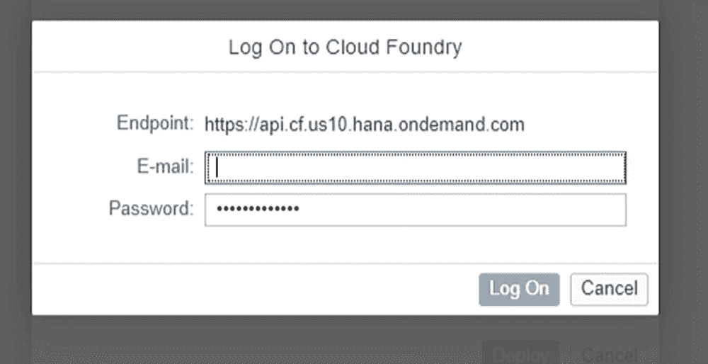

`图 5-17` SCP 账户凭证

在`SAP Web IDE`通过 SCP 对您进行身份验证后，将出现下一个提示，要求部署者选择组织和空间，如图 5-18 所示。请记住，一个组织可能包含一个或多个空间。以下练习仅显示默认的`dev`空间以供说明——如果您的组织为开发或部署创建了其他空间，请选择相应的空间。

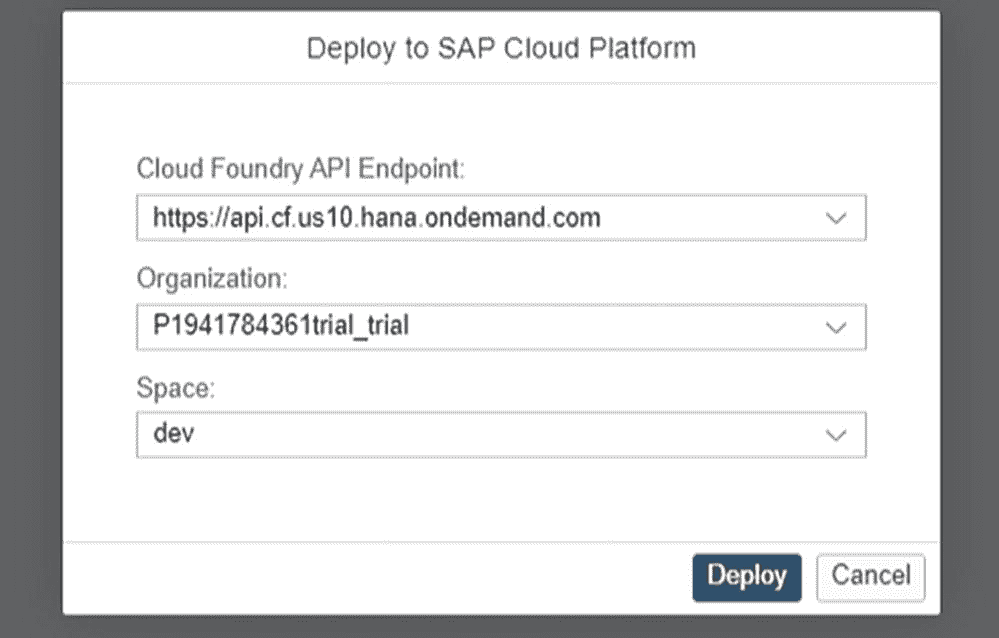

`图 5-18` SCP 云层级结构

在我的示例中，部署因数据库配置设置而失败；但是，如果您仅部署自定义的 Fiori 应用程序，则应该能够顺利完成部署。请查看如图 5-19 所示的控制台日志，以了解部署是否完成，或者您的 Fiori 应用程序中是否有任何设置需要编辑。

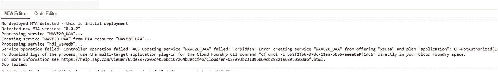

`图 5-19` SAP Web IDE 部署期间出现的错误

## 部署到 SAP Cloud 和 AWS 等不同平台

上一小节描述了开发者可以在 SAP Web IDE 中构建并部署 Fiori 应用到 SAP Cloud Platform 的步骤。还有其他一些云提供商也可以用来托管 Fiori 应用。本章的这一部分将解释如何将同一个 Fiori 应用部署到 AWS 环境。在 AWS 上，需要一个付费账户来获得一个 `EC2` 实例，以便在其上加载 SAP HANA XSA 快速版镜像。

在本书中，我选择了 AWS，是因为我对这个过程已经比较熟悉，并且已经实施过几次。不管你信不信，每次我执行这些步骤时，我都能学到新东西，在撰写本书期间也不例外。就像本书解释了 CF 的架构和层级一样，我认为也应该介绍一下来自 AWS 云平台的几个概念。

AWS 提供了大量的服务，供全球各地的公司用于日常业务的运营。无论从开发者、云客户还是从他们所提供的服务的角度来看，AWS 都是一个非常出色的平台。无论是为了我自己的目的，还是为了撰写本书，我对所探索的各种 AWS 服务都非常满意。

对于组织来说，选择云提供商可能是一项挑战，因为他们将其部分基础设施（有时还包括他们的数据）托付给了云提供商；然而，如果你对比一下使用云服务的利弊，你就会意识到这样做有很多好处。仅举几例：

1.  **几分钟内全球化。** 你可以只需点击几下，即可在世界各地部署你的基础设施、软件和其他服务，并快速投入生产。无需像过去本地部署时代那样，等待漫长数日/数周来订购和交付硬件。
2.  **基础设施零维护，按用量付费。** 补丁或其他维护费用由云提供商承担。你（客户）只需为使用中的计算能力和数据检索付费。
3.  **“对云”负责 vs “在云中”负责。** 你（客户）必须对你在云中放置的内容负责，例如保护你的应用程序、数据库、用户等安全。AWS 对云本身负责，确保其正常运行，其托管服务是安全的，并且你的账户不会与其他账户混淆。
4.  **通过标签跟踪服务产生的费用。** 你的云账户可以设置预算告警，并且可以标记每个服务，让你了解你和你的客户正在使用的各个服务分别产生了多少成本。

一旦你充分了解了云的优势，并准备好在云平台运行你的应用程序，你会发现你还需要了解额外的 AWS 概念。在设置某些服务时，并为了理解月底的账单，需要了解以下术语。设置服务时请密切留意：

1.  **区域** - 这是世界上一个拥有集群数据中心的独立地理区域。北美有多个区域；例如，美国东部、美国西部、加拿大。建议客户选择一个靠近其客户所在地的区域，以尽量减少对其软件性能和网络延迟的影响。区域概念对软件和云服务的使用方式有重大影响。您希望尽可能保持您的运营距离最近。
2.  **可用区** – AZ 是区域内的一个或多个数据中心。一个区域内存在多个 AZ 的目的是为了冗余，从而实现高可用性，进而达到容错、独立供电、独立冷却、安全和数据保护。美国东部区域内的 AZ 是 `us-east-1`、`us-east-2`。请确认您部署软件的区域内有哪些 AZ。

这些概念在图 5-20 中进行了高级别展示。

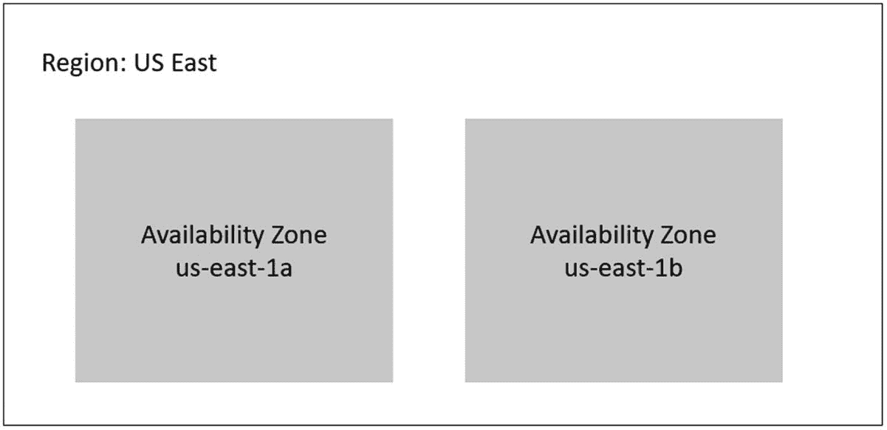

图 5-20 AWS 区域和可用区

接下来的概念与 AWS 服务相关。这些服务必须部署在某个 AWS 区域内。

1.  **弹性计算云** - `EC2`。这是最初且最流行的服务之一，允许公司运行虚拟计算能力。你可以将一个 `EC2` 实例视为运行在云端网络中的虚拟机。有各种类型的 `EC2` 实例，提供计算能力、高内存、专用实例或竞价实例。所有这些实例都具备并提供了许多特性和功能，并按使用量计费。
2.  **弹性块存储** – `EBS`。该服务提供块存储，作为允许 `EC2` 实例存储数据的方法之一。AWS 提供多种提供存储解决方案的服务。有些服务用于大容量存储，有些用于持久化存储，另一些用于内存存储。就部署我们的应用程序而言，你需要了解此服务的关键点是，练习中使用的 `EC2` 实例使用了 SAP HANA XSA 镜像。此镜像需要 `EBS` 服务。在为您的应用程序使用 AWS 之前，请熟悉此服务及其他存储服务，以了解相关特性和成本。
3.  **简单存储服务** - `S3`。该服务是最流行的 AWS 服务之一，大多数云客户的使用率都很高。简单存储服务用于对象存储，例如文件、代码、备份和镜像。从 AWS UI 的角度来看，`S3` 服务显示为文件夹层级结构；然而，这些对象是以扁平层级结构存储的。该服务为客户提供无限的存储空间，并且根据其消费者所需的检索时间，提供多种类型的存储。再次强调，请熟悉不同的 `S3` 存储桶类型，以确定哪种最适合您。在本书的练习中，我们将使用 `S3` 服务来存储和备份我们的代码版本。

本书不会深入探讨与 AWS、`EC2`、`EBS` 或网络相关的细节；但是，为了将自定义应用程序部署到这个平台，有必要对这些托管服务进行高级别的说明。如果您需要有关 AWS 的更深入知识，请咨询 AWS 专业人员。请参见图 5-21 以了解此设置的高级视图。

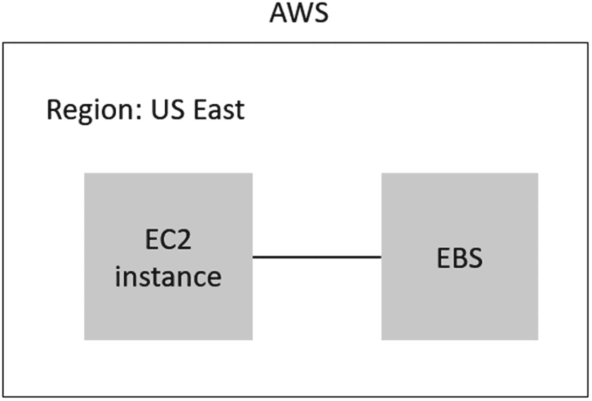

图 5-21 托管了一个连接到 `EBS` 的 `EC2` 实例的 AWS 区域

对于我们此次的练习，我们按照 SAP 提供的教程中所述设置了推荐的 AWS 基础设施：[`https://developers.sap.com/tutorials/hxe-xsa-aws-setup.html`](https://developers.sap.com/tutorials/hxe-xsa-aws-setup.html)。

## AWS 上的 SAP HANA XSA

SAP HANA XSA（免费）映像可在 AWS Marketplace 中找到，如图 5-22 所示。选择映像后，您需要选择要部署到的区域。该映像是一个预构建的实例，已包含一些必需的设置。使用映像可以加快启动和运行的速度。该映像已配置好的一些设置包括安全组网络规则以及卷存储，下文将进一步讨论。

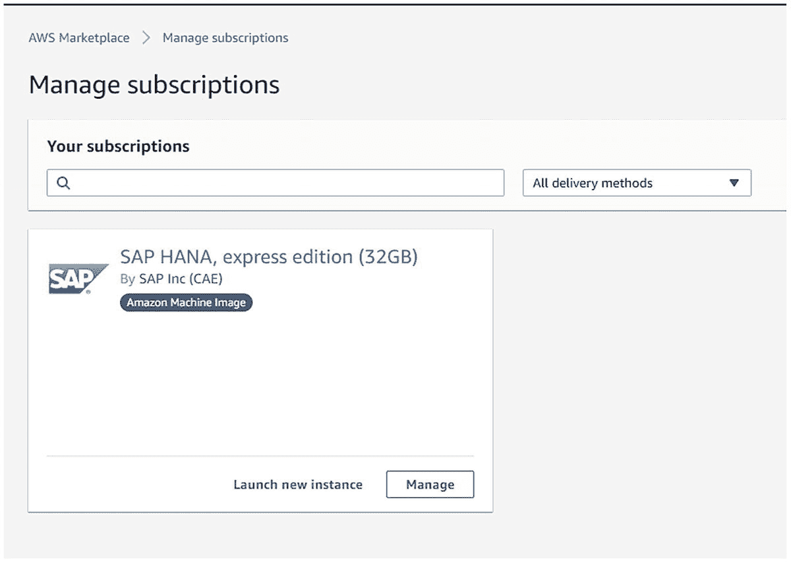

`图 5-22` – SAP HANA XSA 快捷版

此 SAP HANA XSA 映像使用一个 `EC2` 实例 `m4.2xlarge`，该实例仅使用 `EBS` 存储，如图 5-23 所示。

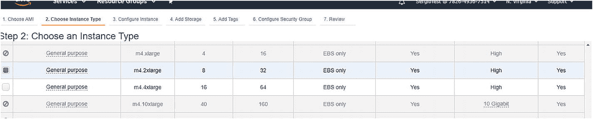

`图 5-23` – SAP HANA XSA – EC2 实例设置

按照提示设置您的 XSA 环境。最终，您需要配置安全设置并开放一些端口，以连接到某些 HANA XSA 服务和将在 AWS 中托管的 SAP HANA XSA Web IDE；由于您使用了 SAP HANA XSA 映像，这些设置已就绪。您还需要生成或选择现有的密钥对，以便使用 Linux（如果使用 Windows，则使用 `Putty`）连接到您的实例。如果您已有生成的密钥对，则可以使用该密钥对。我建议您创建一个新的密钥对，以便对整个环境进行一次干净的安装。

上述 URL 包含了 SAP 官方网站上的所有步骤。如果操作正确，完成设置可能需要 30 分钟到 1 小时。

我在设置过程中遇到的一些常见错误是：

1.  理解 `Putty` 和 `Putty Key Gen` 之间的区别
2.  基本了解如何使用 `XS CLI`
3.  理解连接到 AWS 账户时使用密钥对证书的原因
4.  从 `pem` 密钥生成 `ppk` 文件。在此步骤中，请确保选择私钥（而非公钥）
5.  理解终端设置步骤，并确保知道在何时使用哪些命令

请记住，尽管 HANA XSA 映像是免费的，但在使用过程中您仍然需要为 `EC2` 实例以及 `EBS` 存储付费。停止 `EC2` 实例并不会停止 `EBS` 存储；因此，如果您决定停止 `EC2` 实例，除非您终止 `EC2` 实例和 `EBS` 卷，否则您仍需支付 `EBS` 服务的费用——您可能也会在月底收到账单时，通过这种惨痛的方式学到这一点。

图 5-24 展示了终止 `EC2` 实例和 `EBS` 卷时的情形。执行此操作将清除您的所有数据，因此仅当您完全完成练习后，才可继续执行此步骤。

请勿在生产环境中执行此步骤，除非您完全确定要永久删除所有内容！

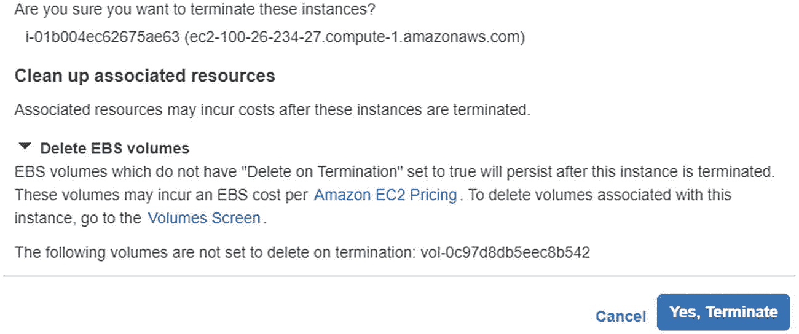

`图 5-24` – 终止 EC2 实例和 EBS 卷

## 部署您的应用程序

在 AWS 中设置好 XSA 环境后，将应用程序部署到该环境的最简单方法是连接到您的 GIT 账户并检索自定义 Fiori 应用程序的代码。请参阅接下来的几个步骤，了解如何连接到 GIT、拉取代码，然后使用在 AWS 中运行的 SAP Web IDE 将代码部署到 XSA 环境。

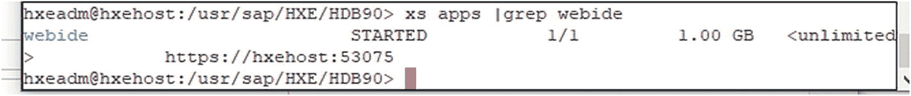

`图 5-25` – 通过 XS CLI 验证 SAP Web IDE 的状态

### 步骤 1：验证 SAP Web IDE 状态

确保 SAP Web IDE 已启动并正在运行。运行以下 `XS CLI` 命令，并注意状态显示为 `RUNNING Instances 1/1`，如图 5-25 所示。

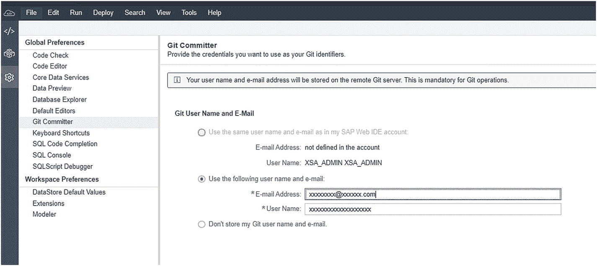

`图 5-26` – GIT 账户详细信息

### 步骤 2：在 Web IDE 中配置 GIT

打开浏览器，导航至 `hxehost:53075`（Web IDE 的默认端口），并以 `XSA_ADMIN` 或 `XSA_DEV` 账户登录。进入 SAP Web IDE 后，打开设置齿轮（左侧导航图标），并提供您的 GIT 提交者邮箱地址和用户名（它们必须与 GIT 账户详细信息匹配），如图 5-26 所示。

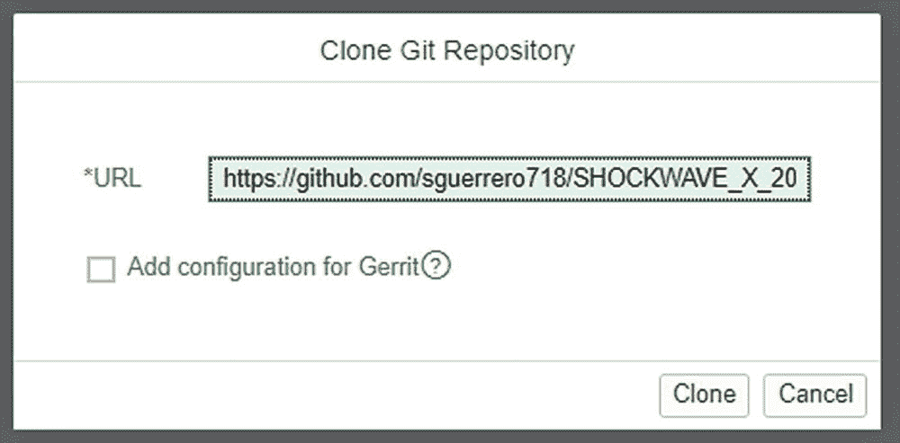

`图 5-28` – GIT 仓库 URL

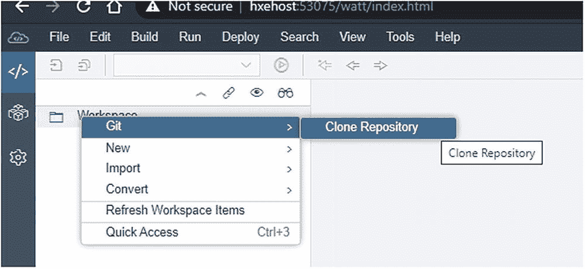

`图 5-27` – 克隆仓库

### 步骤 3：克隆仓库

返回工作区，右键单击并选择“克隆仓库”。出现提示时，提供用于克隆 GIT 仓库的 URL，如图 5-27 和图 5-28 所示。

### 步骤 4：构建模块

克隆仓库后，自定义 Fiori 应用程序项目将出现在 SAP Web IDE 中。依次构建每个模块，从数据库模块开始，然后是 API 模块，最后是 UI 模块。如果提示您选择空间，请选择（默认的）开发空间，最后构建项目以生成 `mtar` 文件，就像我们之前所做的那样，如图 5-29 所示。

请密切关注 SAP Web IDE 控制台，以确保您的模块和项目构建成功（图 5-30）。如果出现任何问题，请先解决它们，然后再继续。只有当项目构建成功时，您才能进行部署。

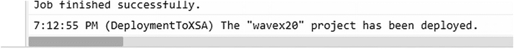

`图 5-30` – 从 SAP Web IDE 部署项目后的成功消息

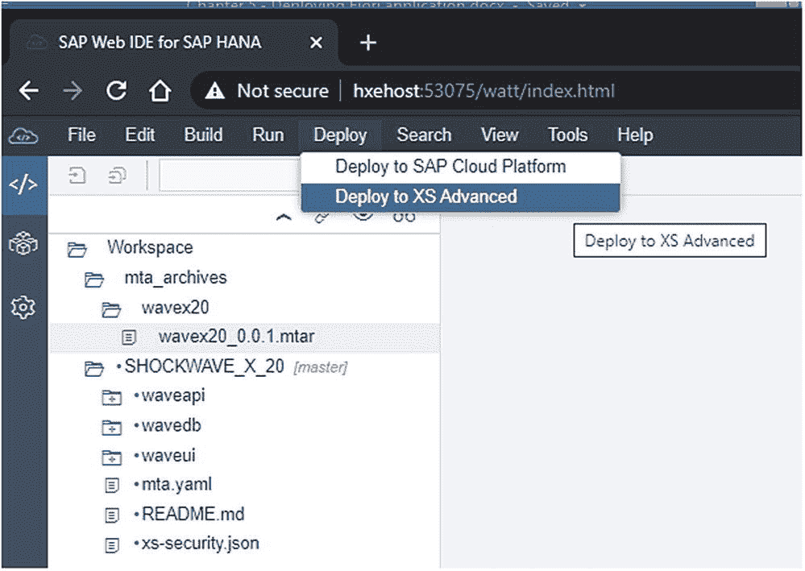

`图 5-29` – SAP Web IDE 在 AWS 中生成 mtar 文件

### 步骤 5：部署并验证

打开 HANA XS Advanced Cockpit，查看此应用部署到的 URL，如图 5-31 所示。

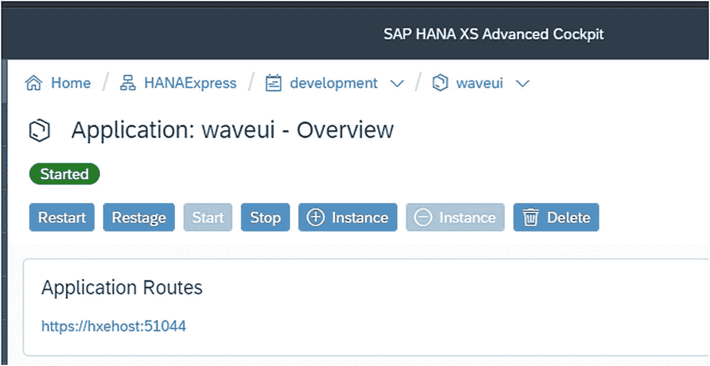

`图 5-31` – 用于 Fiori 应用程序的 HANA XSA URL

然后，从您的浏览器导航到该 URL，以验证应用程序是否确实已部署（或者您可以使用第 4 章的 `Puppeteer` 脚本来自动执行此步骤），如图 5-32 所示。

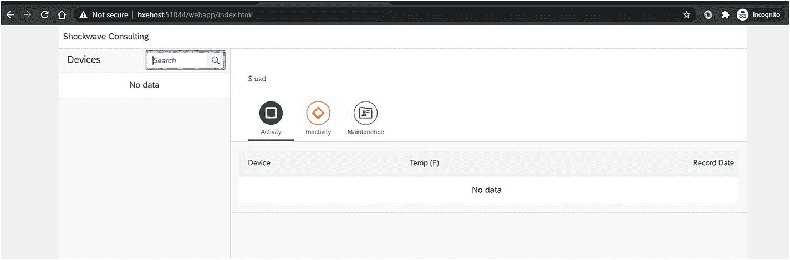

`图 5-32` – 在 AWS 上运行的自定义 Fiori 应用程序

图 5-32 中的屏幕显示了一个空列表和一个空详情页面，这是因为 HANA 数据库目前不包含任何数据，毕竟这是一个全新的部署。但是，您可以通过使用 `Puppeteer` 脚本并编辑 URL 值，或通过手动打开浏览器的网络选项卡并查看生成的请求（如图 5-33 所示），来验证 OData 服务是否确实已从自定义 Fiori 应用程序中调用。

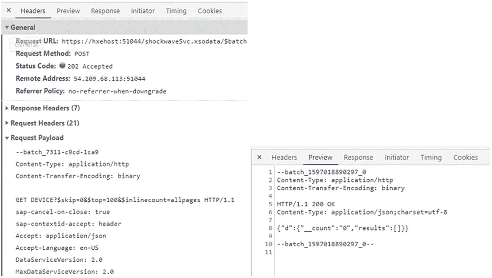

`图 5-33` – 网络选项卡请求标头和响应

注意，图 5-33 中的远程地址显示我们的 XSA 应用程序正在 AWS 实例中运行。

虽然在 AWS 中运行 HANA XSA 应用的实践练习，看起来与在本地场景中运行应用几乎如出一辙，本质上确实非常接近；但你可以看到，我们定制的 Fiori 应用在云端的运行情况，既可以通过浏览器进行验证，也可以使用本书第 4 章中来自 `Puppeteer` 的单元测试脚本来验证。

此外，AWS 实例必须在 EC2 仪表盘中处于运行状态，才能在浏览器中运行。在此温馨提醒一下，完成开发后请记得停止（或终止）你的 `EC2` 实例，以避免在 AWS 中产生不必要的费用。同时请记住，`EBS` 卷（存储）是独立于 `EC2` 实例运行的；因此，如果你希望终止 `EC2` 实例，也请分离并删除该卷，以避免为你未使用的服务付费。

## GIT 仓库

在前文关于 AWS 云的小节中曾简要提及，如何使用 GIT 仓库将开发工作保存在外部企业仓库中。使用外部仓库的原因是允许代码在 SAP HANA 外部进行维护。此外，像 GIT 这样的外部代码仓库是一种行业标准，它允许开发团队使用不同的分支策略并行进行软件开发，并保持其部署的整洁性。有几种不同的外部仓库；然而，本书使用 GIT 是为了与本书练习中提供的工具保持更紧密的集成。

为简单起见，假设所有跟随练习的人都有一个有效的 GIT 账户，并且能够使用自己的许可证从 GIT 仓库进行连接、提交和克隆——本书将演示使用一个拥有免费许可证的账户。

为了使用 GIT，开发者必须能够访问此仓库，熟悉 GIT 命令，并且要么通过命令行执行（如果你采用此方法，则需要下载 `GIT CLI`），要么通过 SAP Web IDE 与之交互，后者已经具备与 GIT 仓库的接口。在上一节中，练习使用了克隆功能来从 GIT 仓库检索代码，并使用检索到的代码将其部署到 AWS 实例。

GIT 命令在包括 SAP Fiori 应用、单元测试以及此处展示或你在日常工作中所见到的其他软件开发在内的现代软件开发和维护中是基础。需要理解每个命令的工作原理、何时以及如何使用它们，以便在进行 Fiori 开发时提高效率。理解这些命令还能让你与其他团队成员并行工作，也能让你理解代码版本控制和软件部署，并最终能够跟踪分配的新任务或错误修复。

还有更多可用的命令，但并未全部列在表 5-2 中。以下是最常用命令的列表（排名不分先后）：

`表 5-2` 从 SAP Web IDE 使用的 GIT 命令

| 命令 | 描述 | 示例 |
| --- | --- | --- |
| `Clone` | 将外部仓库克隆到本地工作区 | `git clone <url>` |
| `Commit` | 将本地工作区的更改提交到远程仓库 | `git commit -m <提交注释>` |
| `Stash` | 保存你不想立即提交的更改 | `git stash` |
| `Push` | 将你的更改推送到远程（主）分支 | `git push <远程仓库> <分支>` |
| `Pull` | 从远程分支拉取更改 | `git pull <远程仓库> <分支>` |
| `Rebase` | 将一系列提交移动或合并到新的基础提交的过程。Rebase 的主要目的是维护项目历史 | `git rebase <基础>` |

如果你选择 `GIT` 窗格（位于浏览器屏幕右侧顶部算起的第二个图标），则所有这些命令都可以从 SAP Web IDE 中运行。任何待处理的更改都会显示在更改表格中，如图 5-34 所示。

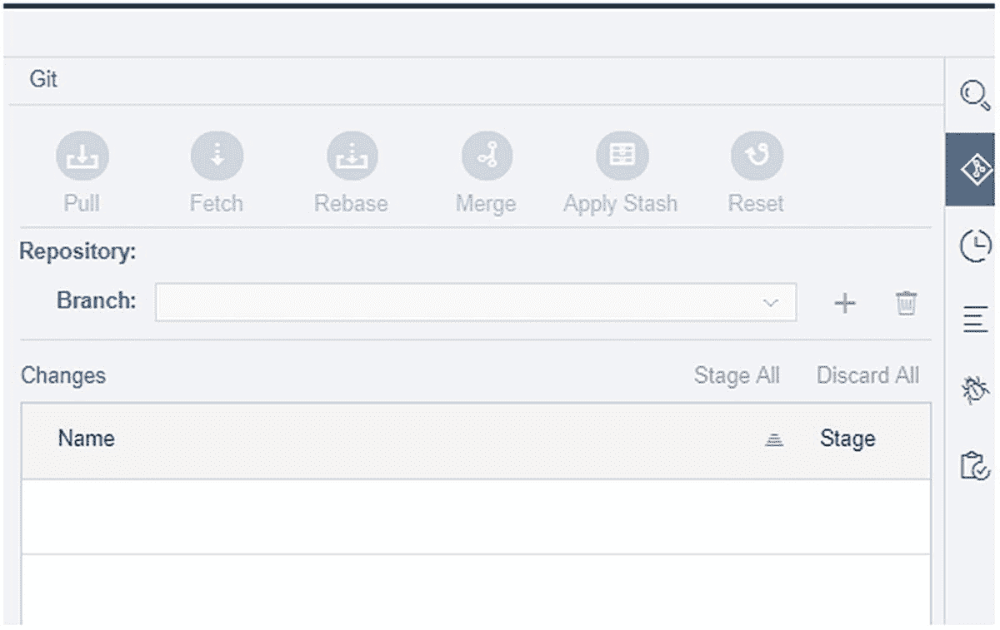

`图 5-34` SAP Web IDE 中的 GIT 窗格

要将更改保存到仓库，开发者必须保存对 SAP Web IDE 中文件所做的更改，这些更改会以待处理状态显示在 `GIT` 窗格中。然后，开发者必须选择要暂存的文件，在 `GIT` 窗格底部的注释输入框中输入注释，最后选择 `commit` 和 `push` 按钮，将这些更改推送到外部仓库。

在构建此定制 Fiori 应用的不同阶段，都执行了这些步骤，你可以从 GITHUB 仓库页面看到更改日志，如图 5-35 所示（共 23 次提交，包括一些测试提交和一些小提交）。

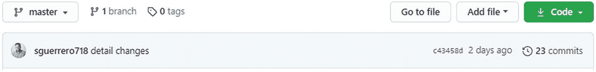

`图 5-35` 仓库中显示的 GITHUB 代码提交

无论你是进行定制 Fiori 开发还是任何其他类型的软件开发，你都很有可能与外部代码仓库交互。花些时间熟悉仓库命令。其他类似 GITHUB 的外部仓库包括 `Bitbucket` 和 `MSFT TFS`，仅举两例。这两个额外外部代码仓库也可以作为你 Fiori 开发的代码仓库，并且当你与它们交互时，遵循与 GITHUB 仓库相同的命令。根据你使用的工具，有相应的插件用于与这些外部仓库交互。在本书前面部分，我们还演示了 Visual Studio Code 编辑器，它也可以与 GITHUB、`Bitbucket` 和 `MSFT TFS` 交互。

## 自动化部署

这可能是本书阅读量最大的部分。每个人都希望自己的团队能够搭上持续集成和持续交付（CI/CD）的顺风车。这意味着什么？

1.  持续集成是一种实践，即频繁地向仓库提交代码，以确保代码能够与软件的其他部分“契合”。拥有自动化单元测试有助于运行持续集成管道。如果开发者更改代码、部署，并且他们的软件能够工作，那么他们就在遵循这一实践。

2.  持续交付依赖于持续集成。负责部署开发者代码的软件工程师必须始终能够进行部署，并且保持其部署的代码持续工作，以确保交付新代码不会破坏现有的软件系统。尽管代码在不断集成，但没有理由不能让软件在可工作状态下交付。运行持续交付管道可能看起来有风险；这需要极大的纪律性和全体人员的参与，以确保 CI/CD 过程能够尽可能顺畅地运行，但这是可行的。这种类型的操作可以在大型组织中实现，这些组织有专门的工程师团队负责协调不同的组成部分。

在我们的练习中，实现 CI/CD 的理想情况是，所有软件的修改都通过一个自动化的单元测试过程运行，例如第 4 章中所示的过程。如果自动化测试通过了所有验证，那么代码就会被提交到 GITHUB，并且代码提交会通过一个验证软件语法规则、代码覆盖率等的过程来运行，以确保其符合一定的标准集。如果这一步成功了，那么该提交就可以通过某个工具或脚本部署到上游环境。

## 结论

在本章结尾，我很高兴能够将这个应用部署到不同的云提供商。本章首先解释了软件版本管理，并提供了关于软件发布以及维护软件时应注意的事项。在介绍软件版本管理之后，本书解释并比较了 `CF` 架构，以及不同云平台（包括基于云原则的 `SAP HANA XSA`）是如何遵循该架构的。不同提供商的步骤可能略有差异；然而，各个平台之间的概念遵循着非常相似的步骤。毕竟，目标云平台是基于 `CF` 架构的。希望你能跟随这些步骤，在你选择的任何目标平台上完成部署。完成练习的方法和工具有很多，本书仅展示了其中一部分。