# 1. 使用 Python 进行数据科学入门

数字数据量正以惊人的速度增长，每两年翻一番，并改变着我们的生活方式。据估计，到 2020 年，地球上每个人每秒钟将产生约 1.7MB 的新数据。这意味着我们需要拥有技术工具、算法和模型，来清理、处理和理解不同形式的可用数据，以便进行决策。*数据科学*是一个涵盖与清理、准备和分析非结构化、半结构化和结构化数据相关所有内容的领域。这门科学结合了统计学、数学、编程、问题解决和数据采集，从数据中提取洞察和信息。

## 数据科学的阶段

图 1-1 展示了数据科学领域的不同阶段。数据科学家使用诸如 `Python`、`R`、`SAS`、`Java`、`Perl` 和 `C/C++` 等编程工具，从准备好的数据中提取知识。为了提取这些信息，他们采用基于机器学习算法、统计学和数学方法的各种适用模型。

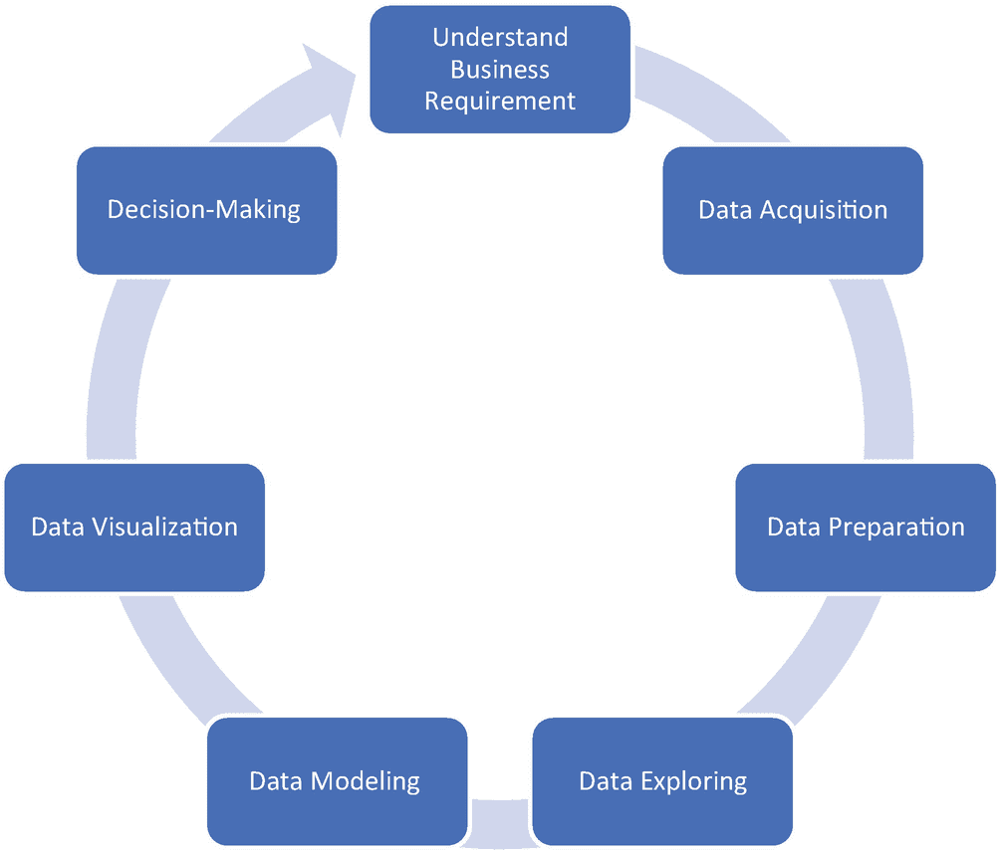

图 1-1

数据科学项目阶段

数据科学算法应用于诸多产品中，例如互联网搜索引擎，以在更短时间内为搜索查询提供最佳结果；推荐系统，利用用户经验生成推荐；数字广告；教育系统；医疗系统等等。数据科学家应深入了解诸如 `Python`、`R`、`SAS`、`Hadoop` 平台和 `SQL` 数据库等编程工具；熟悉诸如 `JSON`、`XML`、`HTML` 等半结构化格式。此外，还需掌握处理非结构化数据的知识。

## 为什么选择 Python？

`Python` 是一种动态、通用的编程语言，应用于各个领域。`Python` 可用于从一次性脚本到提供 24/7 不间断服务的大型可扩展 Web 服务器等各种场景。它用于 GUI 和数据库编程、客户端和服务器端 Web 编程以及应用程序测试。科学家用它为世界上最快的超级计算机编写应用程序，儿童也用它初次学习编程。它最初由 Guido van Rossum 在 20 世纪 90 年代初开发，现在由非营利组织 Python 软件基金会管理，并得到微软、谷歌等公司的赞助。

`Python` 的第一个版本于 1991 年发布。`Python` 目前处于 `3.x` 版本，该版本于 2011 年 2 月经过长期测试后发布。其许多主要特性也已向后移植到兼容的 `Python 2.6`、`2.7` 和 `3.6` 版本。

### Python 的基本特性

`Python` 提供了众多特性；以下是一些重要特性：

*   *易于学习和使用*：`Python` 使用优雅的语法，使程序易于阅读。它开发者友好，是一种高级编程语言。

*   *表达力强*：`Python` 语言表达力强，这意味着它比其他语言更易于理解和阅读。

*   *解释型*：`Python` 是一种解释型语言。换句话说，解释器逐行执行代码。这使得调试变得容易，因此适合初学者。

*   *跨平台*：`Python` 可以在 Windows、Linux、Unix、Macintosh 等不同平台上同样良好地运行。因此，`Python` 是一种可移植语言。

*   *免费且开源*：`Python` 语言可在 [`www.python.org`](http://www.python.org) 免费获取。其源代码也可获得。

*   *面向对象*：`Python` 是一种面向对象的语言，具有类和对象的概念。

*   *可扩展*：通过添加用编译语言（如 `C` 或 `C++`）实现的新模块，可以轻松扩展 `Python`，这些模块可用于编译代码。

*   *大型标准库*：它附带一个大型标准库，支持许多常见编程任务，例如连接 Web 服务器、使用正则表达式搜索文本以及读取和修改文件。

*   *GUI 编程支持*：可以使用 `Python` 开发图形用户界面。

*   *可集成*：它可以轻松地与 `C`、`C++`、`Java` 等语言集成。


### Python 学习资源

众多优秀的 Python 资源可供不同学习阶段的 Python 学习者使用。虽然资源数量庞大，但想要全部找到却并非易事。以下是最通用的 Python 资源，并附有它们为学习者提供的内容说明：

-   *《Python 练习册》*是一本 Python 练习题集，旨在帮助你掌握基本的语言语法。（参见 [`https://anandology.com/python-practice-book/index.html`](https://anandology.com/python-practice-book/index.html)。）
-   *《敏捷 Python 编程：人人适用》* 提供了 Python 编程作为敏捷工具的实践演示，适用于数据清洗、集成、分析和可视化，适合学术界人士、专业人士和研究人员。（参见 [`http://www.lulu.com/shop/ossama-embarak/agile-python-programming-applied-for-everyone/paperback/product-23694020.html`](https://www.lulu.com/shop/ossama-embarak/agile-python-programming-applied-for-everyone/paperback/product-23694020.html)。）
-   “Python 速成课”精彩地概述了 Python 的历史、驱动编程社区的因素以及示例代码。你可能需要结合其他资源来阅读，才能真正掌握语法，但它是随着你持续学习而值得反复阅读的优秀资源。（参见 [`https://www.grahamwheeler.com/posts/python-crash-course.html`](https://www.grahamwheeler.com/posts/python-crash-course.html)。）
-   “Python 简明教程”是一份面向初学者的 Python 语言教程。（参见 [`https://python.swaroopch.com/`](https://python.swaroopch.com/)。）
-   O'Reilly 出版的书籍 *《像计算机科学家一样思考 Python》* 在网络上以 HTML 格式免费提供。（参见 [`https://greenteapress.com/wp/think-python/`](https://greenteapress.com/wp/think-python/)。）
-   *《为你我而写的 Python》* 是一本通俗易懂的书籍，包含 Python 语法和主要语言结构的章节。该书末尾还附有一份简短指南，教程序员编写他们的第一个 Flask Web 应用程序。（参见 [`https://pymbook.readthedocs.io/en/latest/`](https://pymbook.readthedocs.io/en/latest/)。）
-   Code Academy 为完全编程新手提供了 Python 学习路径。（参见 [`www.codecademy.com/catalog/language/python`](https://www.codecademy.com/catalog/language/python)。）
-   *《Python 编程入门》* 介绍了 Python 的基本语法和控制结构。这本免费书籍为每个主题提供了大量代码示例。（参见 [`www.opentechschool.org/`](https://www.opentechschool.org/)。）
-   如果你想成为一名专业程序员，Google 整理了一份极好的学习材料汇编。这些资源不仅对 Python 初学者有用，对任何希望在软件领域拥有强大职业生涯的开发者都很有帮助。（参见 [`techdevguide.withgoogle.com`](https://techdevguide.withgoogle.com)。）
-   正在寻找通过项目学习编程的灵感？请查看 [`knightlab.northwestern.edu`](https://knightlab.northwestern.edu) 上为 Python 初学者准备的五个编程项目。
-   Udacity 上有一门由 Reddit 创始人之一讲授的课程，展示了如何使用 Python 构建博客。这是对 Web 开发概念的极好介绍。（参见 [`mena.udacity.com`](https://mena.udacity.com)。）

## Python 环境与编辑器

有许多集成开发环境（IDE）可用于创建 Python 脚本。

### 便携式 Python 编辑器（无需安装）

这些编辑器无需安装：


图 1-2

Anaconda Navigator

-   *Azure Jupyter Notebooks*：开源 Jupyter Notebooks 由微软开发，作为分析和机器学习的分析平台。
-   *Python(x,y)*：Python(x,y) 是一款免费的科研与工程开发应用程序，基于 Python 编程语言、Qt 图形用户界面和 Spyder 交互式科学开发环境，用于数值计算、数据分析和数据可视化。
-   *WinPython*：这是一个适用于 Windows 平台的免费 Python 发行版；它包含了用于 ScientificPython 的预构建包。
-   *Anaconda*：这是一个完全免费、可用于企业级应用的 Python 发行版，适用于大规模数据处理、预测分析和科学计算。
-   *PythonAnywhere*：PythonAnywhere 让在云端创建和运行 Python 程序变得简单。你可以在基于 Web 的编辑器中编写程序，或者在任何现代 Web 浏览器中运行控制台会话。
-   *Anaconda Navigator*：这是 Anaconda 发行版中包含的一个桌面图形用户界面（GUI），允许你启动应用程序并轻松管理 Anaconda 包（如图 1-2 所示）、环境和频道，而无需使用命令行。Navigator 可以在 Anaconda 云或本地 Anaconda 仓库中搜索包。它适用于 Windows、macOS 和 Linux。

以下部分将演示如何设置和使用 Azure Jupyter Notebooks。


### Azure Notebooks

Azure Machine Learning 工作台通过与 Jupyter Notebook 的集成，支持交互式数据科学实验。

Azure Notebooks 可在 [`https://notebooks.azure.com/`](https://notebooks.azure.com/) 免费获取。注册并登录 Azure Notebooks 后，您将看到如下所示的菜单：

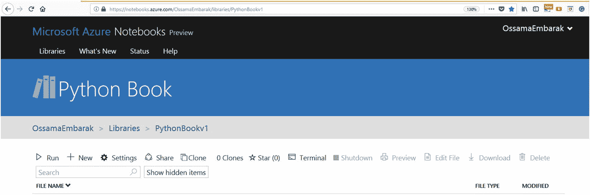

创建账户后，您可以为任何想要启动的 Python 项目创建一个库。您创建的所有库都可以通过点击“库”链接来显示和访问。

让我们创建一个新的 Python 脚本。

1.  创建一个库。

    点击“新建库”，输入库的详细信息，然后点击“创建”，如下图所示：

    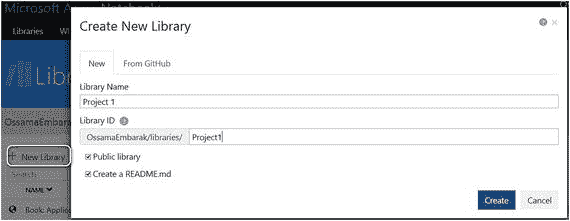

    新库创建完成，如图 1-3 所示。

    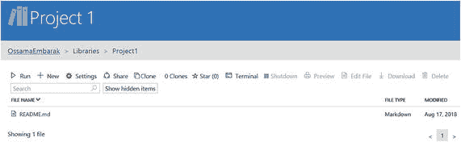

2.  创建一个项目文件夹容器。

    组织 Python 库脚本非常重要。您可以通过从功能区选择“+新建”来创建文件夹和子文件夹；然后对于项目类型，选择“文件夹”，如图 1-3 所示。

    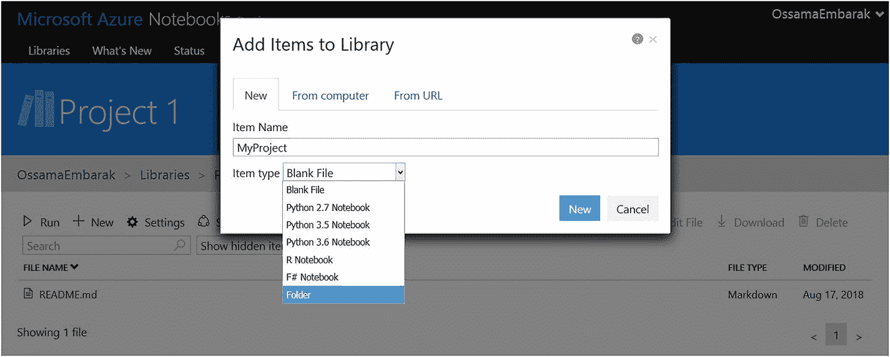

    图 1-3

    在 Azure 项目中创建文件夹

3.  创建一个 Python 项目。

    进入创建的文件夹，并创建一个新的 Python 项目。

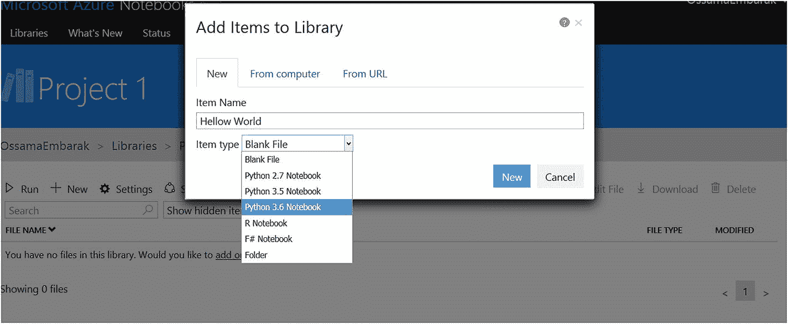

您的项目应该如下所示：

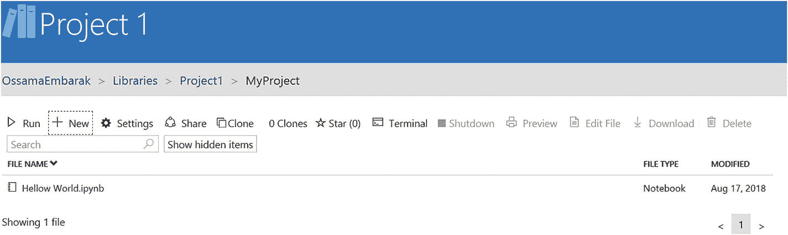

1.  编写并运行一个 Python 脚本。

    通过点击打开已创建的 Hello World 脚本，并开始编写您的 Python 代码，如图 1-4 所示。

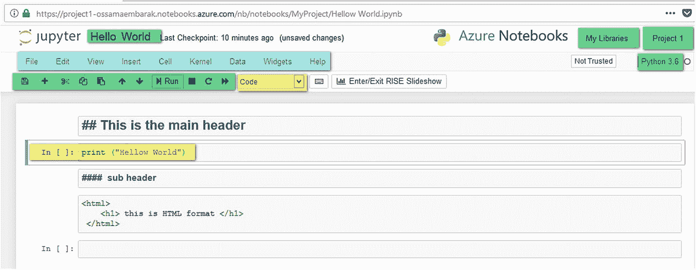

图 1-4

Azure 上的一个 Python 脚本文件

在图 1-4 中，所有绿色图标显示了可应用于正在运行的文件的选项。例如，您可以点击 + 为脚本文件添加新行。此外，您还可以保存、剪切以及上下移动行。要执行任何代码段，请按 `Ctrl+Enter`，或点击功能区上的“运行”。

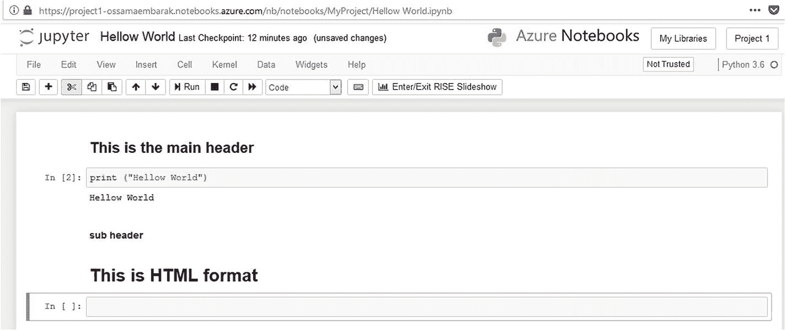

### 离线与桌面 Python 编辑器

有许多离线的 Python IDE，例如 Spyder、通过 Eclipse 使用的 PyDev、NetBeans、Eric、PyCharm、Wing、Komodo、用于 Visual Studio 的 Python 工具等等。

以下步骤演示了如何设置和使用 Spyder。您可以下载 Anaconda Navigator，然后运行 Spyder 软件，如图 1-5 所示。

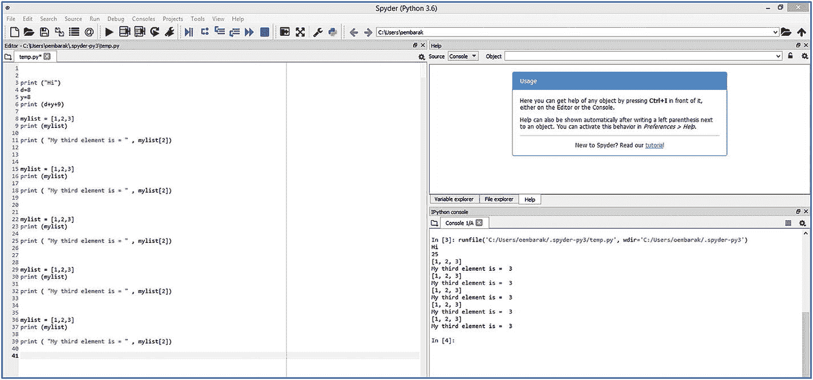

图 1-5

Python Spyder IDE

在左侧，您可以编写 Python 脚本，在右侧，您可以在控制台中看到已执行的脚本。

## Python 编程基础

本节介绍 Python 编程的基础知识。

### 基本语法

Python *标识符* 是用于标识所创建脚本中的变量、函数、类、模块或其他对象的名称。标识符以字母 *A* 到 *Z* 或 *a* 到 *z* 或下划线（`_`）开头，后跟零个或多个字母、下划线和数字（0 到 9）。

Python 不允许在标识符中使用特殊字符，例如 `@`、`$` 和 `%`。Python 是一种区分大小写的编程语言。因此，`Manpower` 和 `manpower` 在 Python 中是两个不同的标识符。

以下是命名 Python 标识符的规则：

*   类名以大写字母开头。所有其他标识符以小写字母开头。

*   以单个前导下划线开头的标识符表示该标识符是私有的。

*   以两个前导下划线开头的标识符表示一个强私有的标识符。

*   如果标识符也以两个尾随下划线结尾，则该标识符是语言定义的特殊名称。

`help?` 方法可用于从 Python 用户手册获取支持，如代码清单 1-1 所示。

```
In [3]:      help?
Signature:   help(*args, **kwds)
Type:        _Helper
String form: Type help() for interactive help, or help(object) for help about object.
Namespace:   Python builtin
File:        ~/anaconda3_501/lib/python3.6/_sitebuiltins.py
Docstring:
Define the builtin 'help'.
This is a wrapper around pydoc.help that provides a helpful message
when 'help' is typed at the Python interactive prompt .
Calling help() at the Python prompt starts an interactive help session.
Calling help(thing) prints help for the python object 'thing'.
代码清单 1-1
从 Python 获取帮助
```

给定 Python 脚本中的最小单元称为 *标记*，它代表标点符号、保留字以及语句中的每个单独单词，这些单词可以是关键字、标识符、字面量和运算符。

表 1-1 列出了 Python 中的保留字。保留字是 Python 语言已经保留的单词，用户不能重新定义或声明。

表 1-1

Python 保留关键字

| `and` | `exec` | `not` | `continue` | `global` | `with` | `yield` | `in` |
| --- | --- | --- | --- | --- | --- | --- | --- |
| `assert` | `finally` | `or` | `def` | `if` | `return` | `else` | `is` |
| `break` | `for` | `pass` | `except` | `lambda` | `while` | `try` |   |
| `class` | `from` | `print` | `del` | `import` | `raise` | `elif` |   |

#### 行与缩进

行缩进在 Python 中很重要，因为 Python 不依赖花括号来表示类、函数定义或流程控制的代码块。因此，代码段块由行缩进表示，并且被严格执行，如代码清单 1-2 所示。

```
In [4]:age, mark, code=10,75,"CIS2403"
print (age)
print (mark)
print (code)
File "", line 4
print (code)
IndentationError: unexpected indent
代码清单 1-2
行缩进语法错误
```

#### 多行语句

Python 中的语句通常以换行符结束。但程序员可以使用行继续符（`\`）来表示该行应该继续，如代码清单 1-3 所示。否则，将发生语法错误。

```
In [5]:TV=15
Mobile=20 Tablet = 30
total = TV +
Mobile +
Tablet
print (total)
File "", line 5
total = TV +
SyntaxError: invalid syntax
代码清单 1-3
多行语句
```

以下是正确的语法：

```
In [6]: TV=15
Mobile=20
Tablet = 30
total = TV + \
Mobile + \
Tablet
print (total)

```

包含在 `[]`、`{}` 或 `()` 括号内的语句代码段不需要使用行继续符，如代码清单 1-4 所示。

```
In [7]: days = ['Monday', 'Tuesday', 'Wednesday',
'Thursday', 'Friday']
print (days)
['Monday', 'Tuesday', 'Wednesday', 'Thursday', 'Friday']
代码清单 1-4
带引号的语句
```


#### Python 中的引号

Python 接受单引号（`'`）、双引号（`"`）和三引号（`'''` 或 `"""`）来表示字符串字面量，只要字符串的起始和结束使用相同类型的引号即可。不过，三引号用于跨越多行的字符串，如代码清单 1-5 所示。

```
In [8]:sms1 = 'Hellow World'
sms2 = "Hellow World"
sms3 = """ Hellow World"""
sms4 = """ Hellow
World"""
print (sms1)
print (sms2)
print (sms3)
print (sms4)
Hellow World
Hellow World
Hellow World
Hellow
World
代码清单 1-5
Python 中的引号
```

#### 单行多条语句

Python 允许使用 `\n` 将一行拆分为多行。此外，如果语句都不启动新的代码块，则分号（`;`）允许在单行上放置多条语句，如代码清单 1-6 所示。

```
In [9]: TV=15; name="Nour"; print (name); print ("Welcome to\nDubai Festival 2018")
Nour
Welcome to
Dubai Festival 2018
代码清单 1-6
分号和换行符的使用
```

#### 从用户读取数据

代码清单 1-7 中的代码段提示用户输入姓名和年龄，将年龄转换为整数，然后显示数据。

```
In [10]:name = input("Enter your name ")
age = int (input("Enter your age "))
print ("\nName =", name); print ("\nAge =", age)
Enter your name Nour
Enter your age 12
Name = Nour
Age = 12
代码清单 1-7
从用户读取数据
```

### 声明变量并赋值

在 Python 中，没有限制必须显式声明变量。一旦你给变量赋值，Python 就会根据所赋的值来认定该变量。如果赋的值是字符串，则该变量被视为字符串。如果赋的值是实数，则 Python 会将该变量视为双精度浮点型变量。因此，Python 并不限制你在应用程序中使用变量之前必须先声明它们。它允许你在需要的时候创建变量。

Python 有五种标准数据类型，用于定义可对它们执行的操作以及每种数据类型的存储方法。

*   数字（Number）
*   字符串（String）
*   列表（List）
*   元组（Tuple）
*   字典（Dictionary）

等号（`=`）运算符用于给变量赋值，如代码清单 1-8 所示。

```
In [11]: age = 11
name ="Nour"
tall=100.50
In [12]: print (age)
print (name)
print (tall)

Nour
100.5
代码清单 1-8
赋值运算符
```

#### 多重赋值

Python 允许你在一条语句中给多个变量赋值，这也称为*多重赋值*。你可以给多个变量赋同一个值，也可以给多个变量赋多个不同的值，如代码清单 1-9 所示。

```
In [13]:age= mark = code =25
print (age)
print (mark)
print (code)

In [14]:age, mark, code=10,75,"CIS2403"
print (age)
print (mark)
print (code)

CIS2403
代码清单 1-9
多重赋值
```

#### 变量名与关键字

*变量*是一个标识符，用于分配特定的内存空间并赋予一个在程序运行期间可能改变的值。变量名应能体现变量的用途，例如，如果你想为学生的年龄创建一个变量，可以将其命名为 `age` 或 `student_age`。变量名有许多规则和限制。变量命名中不允许使用特殊字符或空格。例如，变量名不能以任何特殊字符开头，也不能是 Python 的保留关键字。以下示例展示了错误的命名：`{?age, 1age, age student, and, if, 1_age, etc}`。以下展示了正确的变量命名：`{age, age1, age_1, if_age, etc}`。

#### 语句与表达式

*语句*是可由 Python 解释器执行以获取特定结果或执行特定任务的任何代码单元。程序包含一系列语句，每条语句在程序执行期间都有特定目的。*表达式*是值、变量和运算符的组合，由解释器求值以执行特定任务，如代码清单 1-10 所示。

```
In [16]:# 表达式
x=0.6              # 语句
x=3.9 * x * (1-x)  # 表达式
print (round(x, 2))
0.94
代码清单 1-10
表达式和语句形式
```

## Python 中的基本运算符

运算符是可以操作操作数值的构造。与不同的编程语言一样，Python 支持以下运算符：

*   算术运算符
*   关系运算符
*   赋值运算符
*   逻辑运算符
*   成员运算符
*   身份运算符
*   位运算符

### 算术运算符

表 1-2 展示了 Python 中算术运算符的示例。

**表 1-2** Python 算术运算符

| 运算符 | 描述 | 示例 | 输出 |
| --- | --- | --- | --- |
| `//` | 执行整除（返回除法后的整数值） | `print (13//5)` | 2 |
| `+` | 执行加法 | `print (13+5)` | 18 |
| `-` | 执行减法 | `print (13-5)` | 8 |
| `*` | 执行乘法 | `print (2*5)` | 10 |
| `/` | 执行除法 | `print (13/5)` | 2.6 |
| `%` | 返回除法后的余数（取模） | `print (13%5)` | 3 |
| `**` | 返回幂运算结果（乘方） | `print (2**3)` | 8 |

### 关系运算符

表 1-3 展示了 Python 中关系运算符的示例。

**表 1-3** Python 关系运算符

| 运算符 | 描述 | 示例 | 输出 |
| --- | --- | --- | --- |
| `<` | 小于 | `print (13<5)` | False |
| `>` | 大于 | `print (13>5)` | True |
| `<=` | 小于或等于 | `print (13<=5)` | False |
| `>=` | 大于或等于 | `print (2>=5)` | False |
| `==` | 等于 | `print (13==5)` | False |
| `!=` | 不等于 | `print (13! =5)` | True |

### 赋值运算符

表 1-4 展示了 Python 中赋值运算符的示例。

**表 1-4** Python 赋值运算符

| 运算符 | 描述 | 示例 | 输出 |
| --- | --- | --- | --- |
| `=` | 赋值 | `x=10` `print (x)` | 10 |
| `/=` | 除后赋值 | `x=10; x/=2` `print (x)` | 5.0 |
| `+=` | 加后赋值 | `x=10; x+=7` `print (x)` | 17 |
| `-=` | 减后赋值 | `x=10; x-=6` `print (x)` | 4 |
| `*=` | 乘后赋值 | `x=10; x*=5` `print (x)` | 50 |
| `%=` | 取模后赋值 | `x=13; x%=5` `print (x)` | 3 |
| `**=` | 幂运算后赋值 | `x=10; x**=3` `print(x)` | 1000 |
| `//=` | 整除后赋值 | `x=10; x//=2` `print(x)` | 5 |

### 逻辑运算符

表 1-5 展示了 Python 中逻辑运算符的示例。

**表 1-5** Python 逻辑运算符

| 运算符 | 描述 | 示例 | 输出 |
| --- | --- | --- | --- |
| `and` | 逻辑与（当两个条件都为真时，输出为真） | `x=10>5 and 4>20` `print (x)` | False |
| `or` | 逻辑或（如果任一条件为真，输出即为真） | `x=10>5 or 4>20` `print (x)` | True |
| `not` | 逻辑非（对条件取反，即反转结果） | `x=not (10<4)` `print (x)` | True |

一个 Python *程序* 是一系列旨在完成某项任务的 Python 语句序列。它可以是一行代码，也可以是数千行代码段，由计算机执行以完成特定任务。Python 语句会立即执行，而不会等待整个程序执行完毕。因此，Python 是一种逐行执行的解释型语言。这与其他语言（如 C#）不同，C# 是一种需要处理整个程序的编译型语言。


### Python 注释

Python 中有两种注释：单行注释和多行注释。

`#` 符号用于单行注释。

多行注释可以放在三引号内，如清单 1-11 所示。

```
In [18]: # Python 单行注释
In [19]: ''' 这是
多行注释'''
清单 1-11
Python 注释形式
```

### 格式化字符串

Python 的特殊运算符 `%` 有助于创建格式化输出。该运算符接受两个操作数：一个格式化字符串和一个值。以下示例展示了如何以字符串格式传递一个字符串和值 `3.14259`。需要明确的是，该值可以是单个值、值的元组或值的字典。

```
In [20]: print ("pi=%s"%"3.14159")
pi=3.14159
```

### 转换类型

你可以使用不同的转换说明符语法来转换值，如表 1-6 所总结。

表 1-6

转换语法

| 语法 | 描述 |
| --- | --- |
| `%c` | 转换为单个字符 |
| `%d`, `%i` | 转换为有符号十进制整数或长整数 |
| `%u` | 转换为无符号十进制整数 |
| `%e`, `%E` | 转换为指数记数法的浮点数 |
| `%f` | 转换为定点十进制记数法的浮点数 |
| `%g` | 转换为 `%f` 和 `%e` 中较短的值 |
| `%G` | 转换为 `%f` 和 `%E` 中较短的值 |
| `%o` | 转换为八进制无符号整数 |
| `%r` | 转换为使用 `repr()` 生成的字符串 |
| `%s` | 转换为使用 `str()` 函数的字符串 |
| `%x`, `%X` | 转换为十六进制无符号整数 |

例如，转换说明符 `%s` 表示将值转换为字符串。因此，要在字符串输出中打印数值，你可以使用例如 `print("pi=%s" % 3.14159)`。你可以在同一个字符串中使用多个转换，例如，转换为双精度、浮点数等。

```
In [1]:print("The value of %s is = %02f" % ("pi", 3.14159))
The value of pi is = 3.141590
```

你可以使用点号 (`.`) 后跟一个正整数来指定精度。在以下示例中，你可以使用不同数据类型的元组，并将输出注入到字符串消息中：

```
In [21]:print ("Your name is %s, and your height is %.2f while your weight is %.2d" % ('Ossama', 172.156783, 75.56647))
Your name is Ossama, and your height is 172.16 while your weight is 75
```

在前面的示例中，你可以看到 `%.2f` 被替换为值 `172.16`，小数点后保留两位小数，而 `%2d` 用于仅显示十进制值，但采用两位数字格式。

你可以显示直接从字典中读取的值，如下所示，其中 `%(name)s` 表示将键 `Name` 的字典值作为字符串，`%(height).2f` 表示将其作为带有两位小数的浮点数，即键 `height` 的字典值：

```
In [23]:print ("Hi %(Name)s, your height is %(height).2f" %{'Name':"Ossama", 'height': 172.156783})
Hi Ossama, your height is 172.16
```

### 替换字段 `{}`

你可以使用替换字段 `{}` 作为名称（或索引）。如果提供了索引，它就是字段中提供的参数列表的索引。索引不必按顺序排列；它们可以是随机顺序，例如索引 0、1 和 2，或者索引 2、1 和 0。

```
In [24]:x = "price is"
print ("{1} {0} {2}".format(x, "The", 1920.345))
The price is 1920.345
```

此外，你可以使用来自列表、字典、属性甚至单个变量的混合值。在以下示例中，你将创建一个名为 `A()` 的类，它有一个名为 `x` 的变量，赋值为 9。

然后你从类 `A()` 创建一个名为 `w` 的实例（*对象*）。然后你打印从变量 `{0}` 索引的值，以及从值列表 `["a," "or," "is"]` 中索引的 `{1[2]}` 值，其中 1 指的是打印索引，2 指的是给定列表中的索引（字符串索引为 0）。`{2[test]}` 指的是打印字符串中的索引 2，并从传递的字典中通过键 `test` 读取其值。最后，`{3.x}` 指的是第三个索引，它从 `w` 获取值，`w` 是类 `A()` 的一个实例。

```
In [34]:class A():x=9 w=A()
print ("{0} {1[2]} {2[test]} {3.x}".format("This", ["a", "or", "is"], {"test": "another"},w))
This is another 9
In [34]:print ("{1[1]} {0} {1[2]} {2[test]}{3.x}".format("This", ["a", "or", "is"], {"test": "another"},w))
or This is another 9
```

### 日期和时间模块

Python 提供了一个 time 包来处理日期和时间。你可以使用内置方法检索当前日期和时间，并操作日期和时间。

清单 1-12 中的示例导入了 time 包，并调用其 `.localtime()` 函数来检索当前日期和时间。

```
In [42]:import time localtime = time.asctime(time.localtime(time.time()))
print ("Formatted time :", localtime)
print(time.localtime())
print (time.time())
Formatted time : Fri Aug 17 19:12:07 2018
time.struct_time(tm_year=2018, tm_mon=8, tm_mday=17, tm_hour=19, tm_min=12, tm_sec=7, tm_wday=4, tm_yday=229, tm_isdst=0)
1534533127.8304486
清单 1-12
时间方法
```

### 时间模块方法

Python 提供了各种内置的时间函数，如表 1-7 所示，可用于与时间相关的目的。

表 1-7

内置时间方法

| 方法 | 描述 |
| --- | --- |
| `time()` | 返回自 1970 年 1 月 1 日以来的秒数。 |
| `asctime(time)` | 返回一个 24 字符的字符串，例如 Sat Jun 16 21:27:18 2018。 |
| `sleep(time)` | 用于在给定的时间间隔内暂停时间。 |
| `strptime(String,format)` | 返回一个包含九个时间属性的元组。它接收一个日期字符串和一个格式。`time.struct_time(tm_year=2018, tm_mon=6, tm_mday=16, tm_hour=0, tm_min=0, tm_sec=0, tm_wday=3, tm_yday=177, tm_isdst=-1)` |
| `gtime()/gtime(sec)` | 返回 `struct_time`，其中包含九个时间属性。 |
| `mktime()` | 返回自纪元以来的浮点秒数。 |
| `strftime(format)/strftime(format,time)` | 以特定格式返回时间。如果未提供时间，则获取当前时间的秒数。 |

### Python 日历模块

Python 提供了一个日历模块，如表 1-8 所示，它提供了许多用于处理日历的函数和方法。

表 1-8

内置日历模块函数

| 方法 | 描述 |
| --- | --- |
| `prcal(year)` | 打印全年的日历。 |
| `firstweekday()` | 返回第一个工作日。默认是 0，表示星期一。 |
| `isleap(year)` | 返回一个布尔值，即 true 或 false。如果给定年份是闰年，则返回 true；否则返回 false。 |
| `monthcalendar(year,month)` | 返回给定月份，每周作为一个列表。 |
| `leapdays(year1,year2)` | 返回从 `year1` 到 `year2` 的闰日数量。 |
| `prmonth(year,month)` | 打印给定年份的给定月份。 |

你可以使用 Calendar 包来显示 2018 年的日历，如下所示：

```
In [45]:import calendar
calendar.prcal(2018)
```

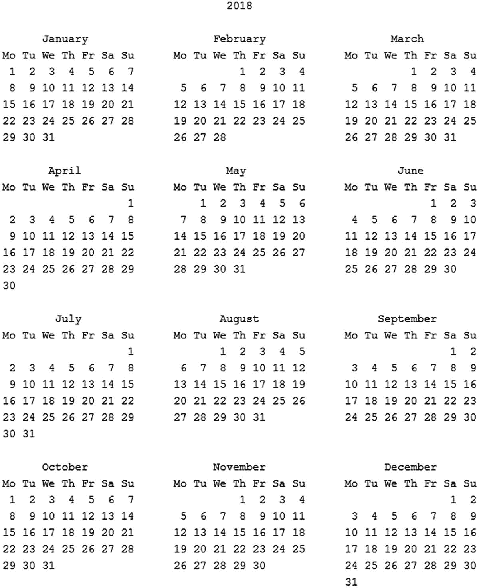

## 基础 Python 编程技术

本节演示了许多 Python 编程语法结构。


### 选择语句

`if` 语句用于在给定条件为真时执行特定的语句或语句集。`if` 结构有多种形式，如表 1-9 所示。

**表 1-9** `if` 语句结构

| 形式 | `if` 语句 | `if-else` 语句 | 嵌套 `if` 语句 |
| --- | --- | --- | --- |
| **结构** | `if(condition):` `statements` | `if(condition):` `statements` `else:` `statements` | `if (condition):` `statements` `elif (condition):` `statements` `else:` `statements` |

`if` 语句用于根据程序执行过程中出现的特定条件做出决策。如果结果为真，则执行一个或一组操作；如果结果为假，则执行另一组操作。图 1-6 展示了大多数编程语言（包括 Python）中典型的决策结构的一般形式。在 Python 中，任何非零和非空值都被视为真，而零或空值则被视为假。

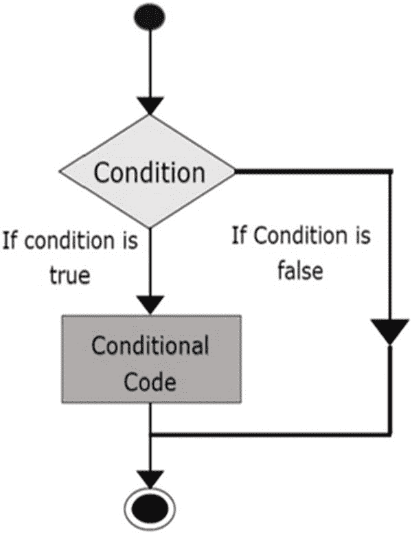

**图 1-6** 选择语句结构

清单 1-13 演示了两个选择语句的示例，请记住缩进在 Python 结构中非常重要。第一个代码块显示 `x` 的值等于 5；因此，条件测试的是 `x` 是否等于 5。因此，当条件为真时，输出执行该语句。

```
In [13]:#Comparison operators
x=5
if x==5:
print ('Equal 5')
elif x>5:
print ('Greater than 5')
elif x<5:
print ('Less than 5')
Equal 5
In [14]:year=2000
if year%4==0:
print("Year(", year ,")is Leap")
else:
print (year , "Year is not Leap" )
Year( 2000 )is Leap
清单 1-13
if-else 语句结构
```

缩进决定了应执行哪条语句。在清单 1-14 中，`if` 语句的条件为假，因此只有外部的 `print` 语句被执行。

```
In [12]:#Indentation
x=2
if x>2:
print ("Bigger than 2")
print (" X Value bigger than 2")
print ("Now we are out of if block\n")
Now we are out of if block
清单 1-14
执行缩进
```

嵌套 `if` 语句是指一个 `if` 语句作为另一个 `if` 语句的目标。换句话说，嵌套 `if` 语句是位于另一个 `if` 语句内部的 `if` 语句，如清单 1-15 所示。

```
In [2]:a=10
if a>=20:
print ("Condition is True" )
else:
if a>=15:
print ("Checking second value" )
else:
print ("All Conditions are false" )
All Conditions are false
清单 1-15
嵌套选择语句
```

### 迭代语句

Python 中有多种迭代语句结构。`for` 循环是其中一种结构；它用于按元素出现的顺序遍历集合中的元素。通常，语句是按顺序执行的，即函数中的第一条语句先执行，接着是第二条，依此类推。有时可能需要多次执行一段代码块。

控制结构允许你多次执行一条语句或一组语句，如图 1-7 所示。

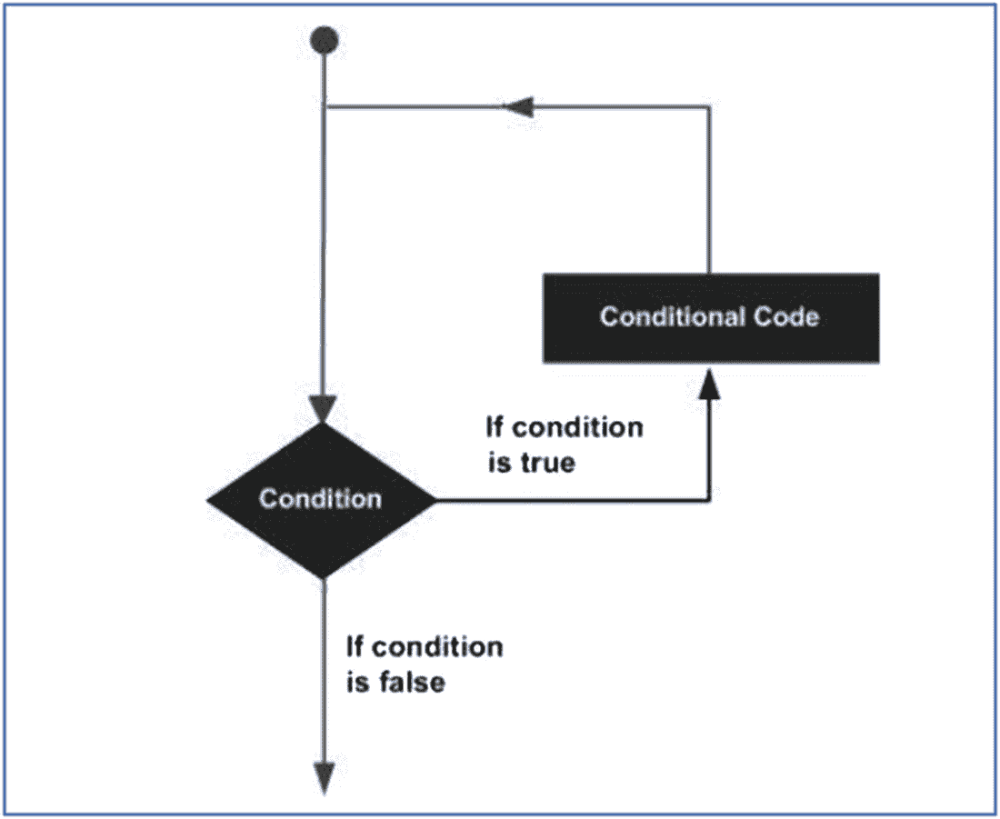

**图 1-7** 循环语句

表 1-10 展示了迭代语句的不同形式。Python 编程语言提供了不同类型的循环语句来处理迭代需求。

**表 1-10** 迭代语句结构

| 1 | `for` 循环 多次执行一系列语句，并简化管理循环变量的代码。 |
| 2 | 嵌套循环 你可以在任何其他 `while`、`for` 或 `do..while` 循环内部使用一个或多个循环。 |
| 3 | `while` 循环 在给定条件为真时重复执行一条语句或一组语句。它在*执行循环体之前*测试条件。 |
| 4 | `do {....} while ()` 在给定条件为真时重复执行一条语句或一组语句。它在*执行循环体之后*测试条件。 |

Python 为迭代语句提供了多种支持方法，允许你终止迭代、跳过特定迭代，或者在你不想执行任何命令或代码时使用 `pass`。表 1-11 总结了迭代执行中的控制语句。

**表 1-11** 循环控制语句

| 1 | Break 语句 终止循环语句，并将执行转移到循环之后紧接着的语句。 |
| 2 | Continue 语句 使循环跳过其主体剩余部分，并在重新迭代之前立即重新测试其条件。 |
| 3 | Pass 语句 当语法上需要一条语句，但你不想执行任何命令或代码时，使用 `pass` 语句。 |

`range()` 语句与 `for` 循环语句一起使用，你可以指定一个值。例如，如果你指定 4，循环语句从 1 开始，到 3 结束，即 n-1。此外，你还可以指定起始值和结束值。以下示例演示了循环语句。

清单 1-16 显示从 1 到 n-1 的所有数值，其中 n=4。

```
In [23]:# use the range statement
for a in range (1,4):
print ( a )

清单 1-16
for 循环语句
```

清单 1-17 显示从 0 到 n-1 的所有数值，其中 n=4。

```
In [24]:# use the range statement
for a in range (4):
print ( a )

清单 1-17
使用 range() 方法
```

清单 1-18 展示了 `while` 迭代语句。

```
In [32]:ticket=4
while ticket>0:
print ("Your ticket number is ", ticket)
ticket -=1
Your ticket number is 4
Your ticket number is 3
Your ticket number is 2
Your ticket number is 1
清单 1-18
while 迭代语句
```

清单 1-19 遍历列表中的所有数值以找到最大值。

```
In [2]:largest = None
print ('Before:', largest)
for val in [30, 45, 12, 90, 74, 15]:
if largest is None or val>largest:
largest = val
print ("Loop", val, largest)
print ("Largest", largest)
Before: None
Loop 30 30
Loop 45 45
Loop 90 90
Largest 90
清单 1-19
在循环语句中使用选择语句
```

在前面的示例中，第一个和第二个迭代使用了带有 `range` 语句的 `for` 循环。在最后一个示例中，迭代遍历一个元素列表，并在到达被迭代列表的最后一个元素时停止。

`break` 语句用于跳出语句并转移执行控制。它会中断当前执行，如果是内层循环，则内层循环会立即终止。而 `continue` 语句是一种跳转语句，它会跳过当前迭代的执行。跳过之后，循环会继续执行下一次迭代。`pass` 关键字用于不执行任何操作。以下示例演示了如何以及何时使用每个语句。


### Break、Continue 和 Pass 语句的使用

清单 1-20 展示了 `break`、`continue` 和 `pass` 语句。

```
In [44]:for letter in 'Python3':
if letter == 'o':
break
print (letter)
P
y
t
h
In [45]: a=0
while a<=5:
a=a+1
if a%2==0:
continue
print (a)
print ("End of Loop" )

End of Loop
In [46]: for i in [1,2,3,4,5]:
if i==3:
pass
print ("Pass when value is", i )
print (i)

Pass when value is 3

Listing 1-20
Break, Continue, and Pass Statements
```

如图所示，你可以遍历一个字母列表，如清单 1-20 所示，也可以遍历单词 `Python3` 并显示所有字母。一旦找到条件（即字母 `o`），就停止迭代。此外，当语法上需要一条语句，但你不想执行任何命令或代码时，可以使用 `pass` 语句。`pass` 语句是一个空操作；执行时不会发生任何事情。

### `try` 和 `except`

`try` 和 `except` 用于处理意外值，你可以通过它们验证输入值以避免错误发生。在清单 1-21 的第一个示例中，你使用 `try` 和 `except` 处理字符串 `"Al Fayoum"`，该字符串无法转换为整数；而在第二个示例中，你使用 `try` 和 `except` 处理字符串 `12`，该字符串可以转换为整数值。

```
In [14]: # Try and Except
astr='Al Fayoum'
errosms=''
try:
istr=int(astr) # error
except:
istr=-1
errosms="\nIncorrect entry"
print ("First Try:", istr , errosms)
First Try: -1
Incorrect entry
In [15]:# Try and Except
astr='12'
errosms=' '
try:
istr=int(astr) # error
except:
istr=-1
errosms="\nIncorrect entry"
print ("First Try:", istr , errosms)
First Try: 12
Listing 1-21
try and except Statements
```

### 字符串处理

*字符串*是一个字符序列，可以通过方括号中的表达式（称为*索引*）来访问。例如，如果你有一个名为 `var1` 的字符串变量，它保存单词 `PYTHON`，那么 `var1[1]` 将返回字符 `Y`，而 `var1[-2]` 将返回字符 `O`。Python 通过将文本括在单引号或双引号中来处理字符串。字符串存储在连续的内存位置中，可以从两个方向（正向和反向）访问，如下例所示，其中

*   正向索引从 0、1、2、3 等开始。
*   反向索引从 -1、-2、-3、-4 等开始。

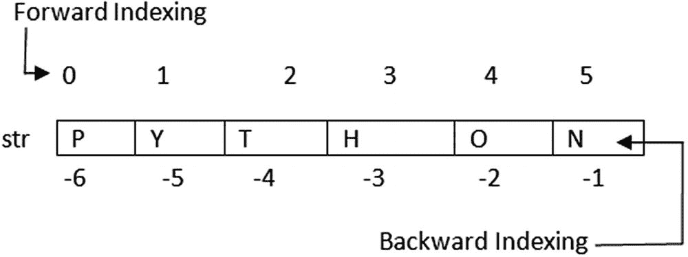

#### 字符串特殊运算符

表 1-12 列出了字符串处理中使用的运算符。假设你有两个变量 `a = 'Hello'` 和 `b = 'Python'`。那么你可以实现表 1-12 中所示的操作。

**表 1-12**  
字符串运算符

| 运算符 | 描述 | 输出 |
| --- | --- | --- |
| `+` | 连接：将运算符两侧的值相加 | `a + b` 将得到 `HelloPython`。 |
| `*` | 重复：创建新字符串，连接同一字符串的多个副本 | `a*2` 将得到 `-HelloHello`。 |
| `[]` | 切片：返回给定索引处的字符 | `a[1]` 将得到 `e`。 |
| `[ : ]` | 范围切片：返回给定范围内的字符 | `a[1:4]` 将得到 `ell`。 |
| `in` | 成员资格：如果字符存在于给定字符串中，则返回 true | `H in a` 将返回 true。 |
| `not in` | 成员资格：如果字符不存在于给定字符串中，则返回 true | `M not in a` 将返回 true。 |

使用运算符 `%` 进行字符串格式化时会用到各种符号。表 1-13 给出了一些简单的示例。

**表 1-13**  
字符串格式符号

| 格式符号 | 转换 |
| --- | --- |
| `%c` | 字符 |
| `%s` | 格式化前通过 `str()` 进行字符串转换 |
| `%i` | 有符号十进制整数 |
| `%d` | 有符号十进制整数 |
| `%u` | 无符号十进制整数 |
| `%o` | 八进制整数 |
| `%x` | 十六进制整数（小写字母） |
| `%X` | 十六进制整数（大写字母） |
| `%e` | 指数表示法（使用小写 `e`） |
| `%E` | 指数表示法（使用大写 `E`） |
| `%f` | 浮点实数 |
| `%g` | `%f` 和 `%e` 中较短的形式 |
| `%G` | `%f` 和 `%E` 中较短的形式 |

#### 字符串切片与连接

*字符串切片*指的是使用索引或搜索方法从字符串中提取的一段。此外，`len()` 方法是一个内置函数，用于返回字符串中的字符数。连接使你能够将多个字符串连接在一起形成另一个字符串。

运算符 `[n:m]` 返回字符串中从第 *n* 个字符到第 *m* 个字符的部分，包括第一个但不包括最后一个。如果省略第一个索引（冒号之前），切片将从字符串的开头开始。同样，如果省略第二个索引，切片将一直进行到字符串的末尾。清单 1-22 中的示例展示了使用 `+` 运算符进行字符串切片和连接。

```
In [3]:var1 = 'Welcome to Dubai'
var2 = "Python Programming"
print ("var1[0]:", var1[0])
print ("var2[1:5]:", var2[1:5])
var1[0]: W
var2[1:5]: ytho
In [5]:st1="Hello"
st2=' World'
fullst=st1 + st2
print (fullst)
Hello World
In [11]:# looking inside strings
fruit = 'banana'
letter= fruit[1]
print (letter)
index=3
w = fruit[index-1]
print (w)
print (len(fruit))
a
n

Listing 1-22
String Slicing and Concatenation
```

#### 字符串转换与格式符号

如果字符串值适用于转换，则可以将其转换为浮点数、双精度数或整数，如清单 1-23 所示。

```
In [14]:#Convert string to int
str3 = '123'
str3= int (str3)+1
print (str3)

In [15]:#Read and convert data
name=input('Enter your name: ')
age=input('Enter your age: ')
age= int(age) + 1
print ("Name: %s"% name ,"\t Age:%d"% age)
Enter your name: Omar
Enter your age: 41
Name: Omar    Age:42
Listing 1-23
String Conversion and Format Symbols
```


#### 遍历字符串

你可以使用迭代语句向前或向后遍历字符串。许多计算任务都涉及逐个字符地处理字符串。字符串处理可以从开头开始，依次选取每个字符，对其进行操作，并持续到末尾。这种处理模式称为*遍历*。编写遍历的一种方法是使用`while`循环，如代码清单 1-24 所示。

```
In [30]:# 遍历字符串
fruit ='banana'
index=0
while index')
if line[0]=='#':
continue
if line =='done':
break
print (line )
print ('End!')
使用 continue 实现迭代
Enter your data>Higher Colleges of Technology
Higher Colleges of Technology
Enter your data>#
Enter your data>done
End!
In [32]:print ("\n 倒序打印")
index=len(fruit)-1
while index>=0 :
letter = fruit [index]
print (index, letter )
index=index-1
倒序打印
5 a
4 n
3 a
2 n
1 a
0 b
逐字母迭代
In [33]:Country='Egypt'
for letter in Country:
print (letter)
E
g
y
p
t
代码清单 1-24
字符串迭代
```

你也可以使用迭代来统计单词中的字母数或行中的单词数，如代码清单 1-25 所示。

```
In [2]:# 查找并计数
word='banana'
count=0
for letter in word:
if letter =='a':
count +=1
print ("单词", word, "中字母 a 的数量为：", count )
单词 banana 中字母 a 的数量为： 3
In [3]:# 字符串切片
s="Welcome to Higher Colleges of Technology"
print (s[0:4])
print (s[6:7])
print (s[6:20])
print (s[:12])
print (s[2:])
print (s [:])
print (s)
Welc
e
e to Higher Co Welcome to H
lcome to Higher Colleges of Technology Welcome to Higher Colleges of Technology
Welcome to Higher Colleges of Technology
代码清单 1-25
字符串的迭代与切片
```

### Python 字符串函数与方法

有许多内置的方法和函数可用于字符串处理；表 1-14 列出了这些方法。

**表 1-14** 内置字符串方法

| 方法/函数 | 描述 |
| --- | --- |
| `capitalize()` | 将字符串的第一个字符大写。 |
| `count(string,begin,end)` | 统计子字符串在字符串中从起始索引到结束索引之间出现的次数。 |
| `endswith(suffix, begin=0,end=n)` | 如果字符串以给定的后缀结尾（在起始和结束索引之间），则返回布尔值`True`。 |
| `find(substring, beginIndex, endIndex)` | 返回子字符串在字符串中从起始索引到结束索引之间首次出现的索引值。 |
| `index(subsring, beginIndex, endIndex)` | 如果未找到字符串则抛出异常，其他功能与`find()`方法相同。 |
| `isalnum()` | 如果字符串中的字符都是字母数字（即字母或数字）且至少有一个字符，则返回`True`；否则返回`False`。 |
| `isalpha()` | 如果所有字符都是字母且至少有一个字符，则返回`True`；否则返回`False`。 |
| `isdigit()` | 如果所有字符都是数字且至少有一个字符，则返回`True`；否则返回`False`。 |
| `islower()` | 如果字符串中的字符都是小写，则返回`True`；否则返回`False`。 |
| `isupper()` | 如果字符串中的字符都是大写，则返回`False`；否则返回`False`。 |
| `isspace()` | 如果字符串中的字符都是空白字符，则返回`True`；否则返回`False`。 |
| `len(string)` | 返回字符串的长度。 |
| `lower()` | 将字符串中的所有字符转换为小写。 |
| `upper()` | 将字符串中的所有字符转换为大写。 |
| `startswith(str,begin=0,end=n)` | 如果字符串以给定的`str`开头（在起始和结束索引之间），则返回布尔值`True`。 |
| `swapcase()` | 反转字符串中所有字符的大小写。 |
| `lstrip()` | 移除字符串中所有前导空白字符，也可用于移除前导空白中的特定字符。 |
| `rstrip()` | 移除字符串中所有尾随空白字符，也可用于移除尾随空白中的特定字符。 |

代码清单 1-26 展示了如何使用内置方法移除字符串中的空白、统计字符串中的特定字母、检查字符串是否包含另一个字符串等操作。

```
In [29]:var1 =' Higher Colleges of Technology '
var2='College'
var3='g'
print (var1.upper())
print (var1.lower())
print ('WELCOME TO'.lower())
print (len(var1))
print (var1.count(var3, 2, 29) ) # 查找 var1 中有多少个字母 g
print ( var2.count(var3) )
HIGHER COLLEGES OF TECHNOLOGY
higher colleges of technology
welcome to

In [33]:print (var1.endswith('r'))
print (var1.startswith('O'))
print (var1.find('h', 0, 29))
print (var1.lstrip()) # 移除 var1 中字符串的所有前导空白
print (var1.rstrip()) # 移除 var1 中字符串的所有尾随空白
print (var1.strip()) # 移除所有前导和尾随空白
print ('\n')
print (var1.replace('Colleges', 'University'))
False
False

Higher Colleges of Technology
Higher Colleges of Technology
Higher Colleges of Technology
Higher University of Technology
代码清单 1-26
实现字符串方法
```

### `in` 运算符

单词`in`是一个布尔运算符，它接受两个字符串，如果第一个字符串作为子字符串出现在第二个字符串中，则返回`True`，如代码清单 1-27 所示。

```
In [43]:var1 =' Higher Colleges of Technology '
var2='College'
var3='g'
print ( var2 in var1)
print ( var2 not in var1)
True
False
代码清单 1-27
字符串处理中的 in 方法
```

### 解析与提取字符串

`find`运算符返回子字符串在另一个字符串中首次出现的索引，如代码清单 1-28 所示。`atpost`变量用于保存子字符串`@`在`Maindata`字符串变量中出现时返回的索引。

```
In [39]:# 解析与提取字符串
Maindata = 'From ossama.embarak@hct.ac.ae Sunday Jan 4 09:30:50 2017' atpost = Maindata.find('@')
print ("\n>>>>>>>>>>>>")
print (atpost)
print (Maindata[ :atpost])
data = Maindata[ :atpost]
name=data.split(' ')
print (name)
print (name[1].replace('.', ' ').upper())
print ("\n>>>>>>>>>>>>")
>>>>>>>>>>>>

From ossama.embarak
['From', 'ossama.embarak']
OSSAMA EMBARAK
>>>>>>>>>>>>
In [41]:# 另一种分割字符串的方法
Maindata = 'From ossama.embarak@hct.ac.ae Sunday Jan 4 09:30:50 2017'
name= Maindata[ :atpost].replace('From','').upper()
print (name.replace('.',' ').upper().lstrip())
print ("\n>>>>>>>>>>>>")
sppos=Maindata.find(' ', atpost)
print (sppos)
print (Maindata[ :sppos])
host = Maindata [atpost + 1 : sppos ]
print (host)
print ("\n>>>>>>>>>>>>")
OSSAMA EMBARAK
>>>>>>>>>>>>

From ossama.embarak@hct.ac.ae
hct.ac.ae
>>>>>>>>>>>>
代码清单 1-28
解析与提取字符串
```


