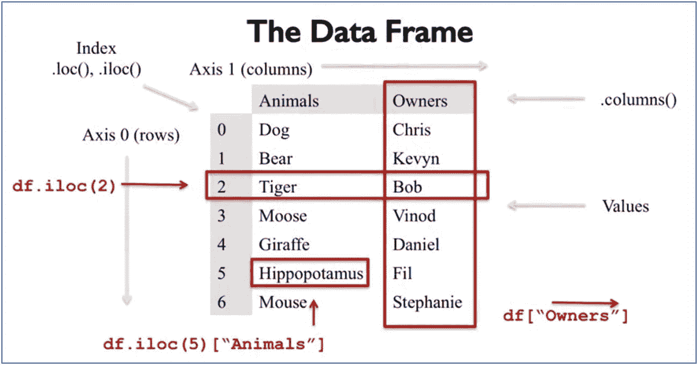

# 表格数据与数据格式

数据以不同形式存在，可以是**非结构化数据**、**半结构化数据**或**结构化数据**。Python 提供了不同的结构来维护和操作数据，例如变量、列表、字典、元组、序列、面板和数据框。在 Python 中，可以使用表示数据集中记录的元组列表，以数据框结构轻松表示表格数据。虽然易于创建，但这种表示方式通常无法实现重要的表格数据操作，例如高效的列选择、矩阵运算或电子表格风格的操作。`Tabular` 是一个用于处理表格数据的 Python 模块包。其主要对象是 `tabarray` 类，这是一种用于保存和操作表格数据的数据结构。你可以将数据放入 `tabarray` 对象中，以实现更灵活、更强大的数据处理。Pandas 库也提供了丰富的数据结构和函数，旨在使结构化数据的处理变得快速、简单且富有表现力。此外，它还提供了一个强大且高效的数据分析环境。

可以使用以下构造函数创建 Pandas 数据框：

```
pandas.DataFrame( data, index, columns, dtype, copy)
```

Pandas 数据框可以通过多种输入形式创建，例如：

*   列表
*   字典
*   序列
*   Numpy ndarrays
*   另一个数据框

第 3 章将详细演示数据框结构的创建和操作。

## Python Pandas 数据科学库

Pandas 是一个开源的 Python 库，通过其强大的数据结构提供高性能的数据操作和分析工具。Pandas 这个名字来源于“面板数据”（panel data），这是一个计量经济学中用于多维数据的术语。以下是 Pandas 库的主要特性：

*   提供从不同格式加载数据对象的机制
*   创建具有默认和自定义索引的高效数据框对象
*   重塑和透视数据集
*   提供处理缺失数据的有效机制
*   合并、分组、聚合和转换数据
*   通过实现切片、索引、子集化、删除和插入等各种功能来操作大型数据集
*   提供高效的时间序列功能

有时你需要导入 Pandas 包，因为标准的 Python 发行版不附带 Pandas 模块。一个轻量级的替代方案是使用流行的 Python 包安装程序 `pip` 来安装 Numpy。Pandas 库用于创建和处理序列、数据框和面板。

### Pandas 序列

`Series` 是一种一维标签数组，能够保存任何类型的数据（整数、字符串、浮点数、Python 对象等）。清单 1-29 展示了如何使用 Pandas 库创建序列。

```
In [34]:#使用 pandas 和 numpy 从数组创建序列
import pandas as pd
import numpy as np
data = np.array([90,75,50,66])
s = pd.Series(data,index=['A','B','C','D'])
print (s)
A 90
B 75
C 50
D 66
dtype: int64
In [36]:print (s[1])

In [37]:#使用 pandas 从字典创建序列
import pandas as pd
import numpy as np
data = {'Ahmed' : 92, 'Ali' : 55, 'Omar' : 83}
s = pd.Series(data,index=['Ali','Ahmed','Omar'])
print (s)
Ali 55
Ahmed 92
Omar 83
dtype: int64
In [38]:print (s[1:])
Ahmed 92
Omar 83
dtype: int64
清单 1-29
使用 Pandas 库创建序列
```

### Pandas 数据框

`DataFrame` 是一种二维数据结构。换句话说，数据以表格形式按行和列对齐。在下表中，你有两列和三行数据。清单 1-30 展示了如何使用 Pandas 库创建数据框。

| 姓名 | 年龄 |
| --- | --- |
| Ahmed | 35 |
| Ali | 17 |
| Omar | 25 |

```
In [39]:import pandas as pd
data = [['Ahmed',35],['Ali',17],['Omar',25]]
DataFrame1 = pd.DataFrame(data,columns=['Name','Age'])
print (DataFrame1)
Name   Age
0  Ahmed  35
1  Ali    17
2  Omar   25
清单 1-30
使用 Pandas 库创建数据框
```

你可以从索引 1 开始到行尾检索数据框中的数据。

```
In [40]: DataFrame1[1:]
Out[40]:     Name   Age
1   Ali    17
2   Omar   25
```

你可以使用字典创建数据框。

```
In [41]:import pandas as pd
data = {'Name':['Ahmed', 'Ali', 'Omar', 'Salwa'],'Age':[35,17,25,30]}
dataframe2 = pd.DataFrame(data, index=[100, 101, 102, 103])
print (dataframe2)
Age    Name
100   35     Ahmed
101   17     Ali
102   25     Omar
103   30     Salwa
```

你可以只选择数据框中的前两行。

```
In [42]: dataframe2[:2]
Out[42]:     Age   Name
100   35    Ahmed
101   17    Ali
```

你可以只选择数据框中的 `Name` 列。

```
In [43]: dataframe2['Name']
Out[43]:100         Ahmed
101    Ali
102    Omar
103    Salwa
Name: Name, dtype: object
```

### Pandas 面板

`Panel` 是一个 3D 数据容器，可以从不同的数据结构创建，例如从数据框字典创建，如清单 1-31 所示。

```
In [44]:# 创建一个面板
import pandas as pd
import numpy as np
data = {'Temperature Day1' : pd.DataFrame(np.random.randn(4, 3)),'Temperature Day2' : pd.DataFrame(np.random.randn(4, 2))}
p = pd.Panel(data)
print (p['Temperature Day1'])
0        1          2
0   1.152400    -1.298529   1.440522
1   -1.404988   -0.105308   -0.192273
2   -0.575023   -0.424549   0.146086
3   -1.347784   1.153291   -0.131740
清单 1-31
使用 Pandas 库创建面板
```

## Python Lambda 与 Numpy 库

`lambda` 运算符是一种创建小型匿名函数的方法，换句话说，就是没有名称的函数。这些函数是一次性函数；它们只在创建它们的地方被需要。`lambda` 特性主要对 Lisp 程序员有用。Lambda 函数与 `filter()`、`map()` 和 `reduce()` 函数结合使用。

*匿名*函数是指没有命名的函数，通过使用关键字 `lambda` 创建。`lambda` 的创建不使用 `def` 关键字；它接受任意数量的参数并返回一个求值后的表达式，如清单 1-32 所示。

```
In [34]:# 匿名函数定义
summation=lambda val1, val2: val1 + val2#将 summation 作为函数调用
print ("The summation of 7 + 10 = ", summation(7,10) )
The summation of 7 + 10 = 17
In [46]:result = lambda x, y : x * y
result(2,5)
Out[46]: 10
In [47]:result(4,10)
Out[47]: 40
清单 1-32
匿名函数
```

### map() 函数

`map()` 函数用于将特定函数应用于数据序列。`map()` 函数有两个参数。

```
r = map(func, seq)
```

这里，`func` 是要应用的函数名称，`seq` 是序列（例如，列表），它将函数 `func` 应用于序列 `seq` 的所有元素。它返回一个新列表，其中的元素已被 `func` 改变，如清单 1-33 所示。

```
In [65]:def fahrenheit(T):
return ((float(9)/5)*T + 32)
def celsius(T):
return (float(5)/9)*(T-32)
Temp = (15.8, 25, 30.5,25)
F = list ( map(fahrenheit, Temp))
C = list ( map(celsius, F))
print (F)
print (C)
[60.44, 77.0, 86.9, 77.0]
[15.799999999999999, 25.0, 30.500000000000004, 25.0]
In [72]:Celsius = [39.2, 36.5, 37.3, 37.8]
Fahrenheit = map(lambda x: (float(9)/5)*x + 32, Celsius)
for x in Fahrenheit:
print(x)
102.56
97.7
99.14
100.03999999999999
清单 1-33
使用 map() 函数
```

### `filter()` 函数

`filter()` 函数是一种优雅的方式，用于过滤出列表中所有使所应用函数返回真值的元素。

例如，函数 `filter(func, list1)` 需要一个名为 `func` 的函数作为其第一个参数。`func` 返回一个布尔值，换句话说，要么是真（true），要么是假（false）。该函数将应用于列表 `list1` 的每一个元素。只有当 `func` 返回真值时，该列表元素才会被包含在结果列表中。

清单 1-34 中的 `filter()` 函数用于仅返回偶数值。

```
In [79]:fib = [0,1,1,2,3,5,8,13,21,34,55]
result = filter(lambda x: x % 2==0, fib)
for x in result:
print(x)

清单 1-34
使用 filter() 函数
```

### `reduce()` 函数

`reduce()` 函数持续地将函数 `func` 应用于一个序列 `seq`，并返回一个单一的值。

`reduce()` 函数用于查找整数序列中的最大值，如清单 1-35 所示。

```
In [81]: f = lambda a,b: a if (a > b) else b
reduce(f, [47,11,42,102,13])

In [82]: reduce(lambda x,y: x+y, [47,11,42,13])

清单 1-35
使用 reduce() 函数
```

### Python Numpy 包

`Numpy` 是一个 Python 包，代表“数值 Python”。它是一个由多维数组对象和一组用于处理数组的例程组成的库。

Numpy 库用于执行以下操作：

-   与线性代数和随机数生成相关的操作
-   数组上的数学和逻辑运算
-   傅里叶变换和用于形状操作的例程

例如，你可以创建数组并执行各种操作，如数组的加法或减法，如清单 1-36 所示。

```
In [83]:a=np.array([[1,2,3],[4,5,6]])
b=np.array([[7,8,9],[10,11,12]])
np.add(a,b)
Out[83]: array([[ 8, 10, 12], [14, 16, 18]])
In [84]:np.subtract(a,b) #Same as a-b
Out[84]: array([[-6, -6, -6], [-6, -6, -6]])
清单 1-36
Numpy 函数示例
```

## 数据清洗与操作技术

对于任何数据科学家来说，保持数据的准确性都至关重要。开发准确的模型并从所应用的模型中获得准确的预测，都依赖于对缺失值的处理。因此，处理缺失数据对于使模型更准确和有效非常重要。

有许多技术和方法来处理缺失数据，例如：

-   向前填充缺失值
-   向后填充缺失值
-   删除缺失值
-   替换缺失（或）通用值
-   用标量值替换 NaN

以下示例用于处理表格数据集中的缺失值：

```
In [31]: dataset.fillna(0) # 用零值填充缺失值
In [35]: dataset.fillna(method='pad') # 向前填充方法
In [35]: dataset.fillna(method=' bfill') # 向后填充方法
In [37]: dataset.dropna() # 删除所有缺失数据
```

第 5 章涵盖了不同的数据收集和清洗技术。

## Series 和 DataFrame 的抽象

`Series` 是 Pandas 中的主要数据结构之一。它与列表和字典不同。一个简单的可视化方法是将其视为两列数据。第一列是特殊的索引，很像字典的键，而第二列是你的实际数据。你可以为 `Series` 指定一个索引，或者让 Python 自动分配索引。可以使用不同的属性从 `Series` 的 `iloc()` 和 `loc()` 属性中检索数据。此外，Python 可以根据传递的值自动检索数据。如果你传递一个对象，那么 Python 会认为你想使用基于索引标签的 `loc()`。但是，如果你传递一个整数索引参数，那么 Python 会考虑 `iloc()` 属性，如清单 1-37 所示。

```
In [6]: import pandas as pd
animals = ["Lion", "Tiger", "Bear"]
pd.Series(animals)
Out[6]: 0 Lion
1 Tiger
2 Bear
dtype: object
清单 1-37
Series 结构与查询
```

你可以创建一个数值型的 `Series`。

```
In [5]: marks = [95, 84, 55, 75]
pd.Series(marks)
Out[5]: 0   95
1   84
2   55
3   75
dtype: int64
```

你可以从字典创建一个 `Series`，其中索引是字典的键。

```
In [11]: quiz1 = {"Ahmed":75, "Omar": 84, "Salwa": 70}
q = pd.Series(quiz1)
q
Out[11]: Ahmed   75
Omar    84
Salwa   70
dtype: int64
```

以下示例演示了如何查询一个 `Series`。

你可以使用 `Series` 标签或 `loc()` 属性来查询 `Series`。

```
In [13]: q.loc['Ahmed']
Out[13]: 75
In [20]: q['Ahmed']
Out[20]: 75
```

你可以使用 `Series` 索引或 `iloc()` 属性来查询 `Series`。

```
In [19]: q.iloc[2]
Out[19]: 70
In [21]: q[2]
Out[21]: 70
```

你可以对 `Series` 执行 Numpy 操作。

```
In [25]:s = pd.Series([70,90,65,25, 99])
s
Out[25]:0   70
1   90
2   65
3   25
4   99
dtype: int64
In [27]:total =0
for val in s:
total += val
print (total)
```

通过对 `Series` 使用 Numpy 函数，你可以获得更快的结果。

```
In [28]: import numpy as np
total = np.sum(s)
print (total)
```

可以修改 `Series` 以添加新值；Python 会自动检测到输入的值不在 `Series` 中，因此会将其添加到修改后的 `Series` 中。

```
In [29]:s = pd.Series ([99,55,66,88])
s.loc['Ahmed'] = 85
s
Out[29]: 0   99
1   55
2   66
3   88
Ahmed   85
dtype: int64
```

你可以追加两个或多个 `Series` 以生成一个更大的 `Series`，如下所示：

```
In [32]: test = [95, 84, 55, 75]
marks = pd.Series(test)
s = pd.Series ([99,55,66,88])
s.loc['Ahmed'] = 85
NewSeries = s.append(marks)
NewSeries
Out[32]: 0   99
1   55
2   66
3   88
Ahmed   85
0   95
1   84
2   55
3   75
dtype: int64
```

`DataFrame` 数据结构是 Python 中数据收集和处理的主要结构。`DataFrame` 是一个二维的 `Series` 对象，如图 1-8 所示，其中有一个索引和多列内容，每列都有一个标签。



图 1-8

DataFrame 虚拟结构

`DataFrame` 的创建和查询在本章前面已经讨论过，并且将在第 3 章关于数据收集结构的上下文中再次讨论。