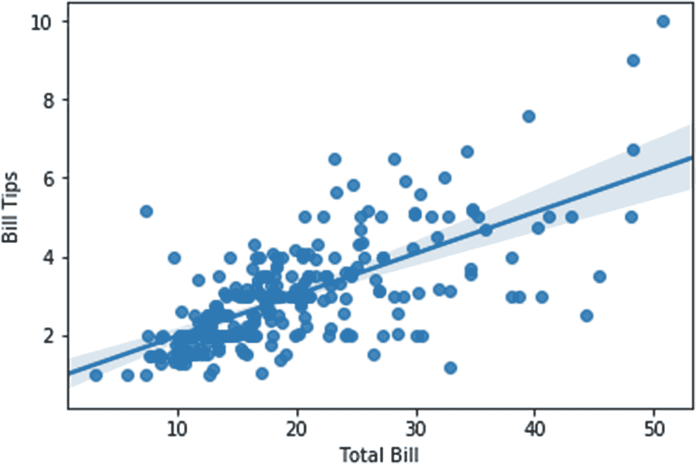
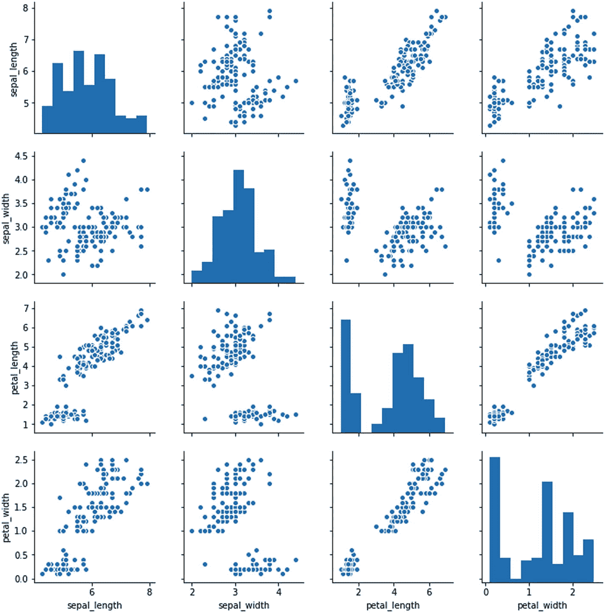

# 运行基础推断分析

Python 提供了众多用于推断和统计分析的库，例如`Pandas`、`SciPy` 和`Numpy`。Python 是执行多种统计数据操作的高效工具，包括以下内容：
- 线性回归
- 寻找相关性
- 测量集中趋势
- 测量方差
- 正态分布
- 二项分布
- 泊松分布
- 伯努利分布
- 计算 p 值
- 执行卡方检验

两个变量之间的线性关系在绘制成图表时表现为一条直线，其中两个变量的指数（幂）均为 1。当任意变量的指数不等于 1 时，非线性关系会形成一条曲线。

让我们使用`Seaborn` Python 库中内置的 Tips 数据集，来寻找餐厅顾客总账单金额与每笔账单小费金额之间的线性回归关系，如图 1-9 所示。`Seaborn`中用于寻找线性回归关系的函数是`regplot`。



图 1-9：回归分析

```
In [40]:import seaborn as sb
from matplotlib import pyplot as plt
df = sb.load_dataset('tips')
sb.regplot(x = "total_bill", y = "tip", data = df)
plt.xlabel('Total Bill')
plt.ylabel('Bill Tips')
plt.show()
```

`相关性`指的是两个数据集之间涉及依赖关系的某种统计关联，例如产品价格与其销售量之间的相关性。

让我们使用`Seaborn` Python 库中内置的 Iris 数据集，尝试测量三种鸢尾花的花萼和花瓣的长度与宽度之间的相关性，如图 1-10 所示。



图 1-10：相关性分析

```
In [42]: import matplotlib.pyplot as plt
import seaborn as sns
df = sns.load_dataset('iris')
sns.pairplot(df, kind="scatter")
plt.show()
```

在统计学中，`方差`是衡量数值与均值之间离散程度的指标。标准差是方差的平方根。换句话说，它是数据集中各数值与均值之差的平方的平均值。在 Python 中，你可以使用`Pandas`库中的`std()`函数来计算这个值。

```
In [58]: import pandas as pd
d = {
'Name': pd.Series(['Ahmed','Omar','Ali','Salwa','Majid',
'Othman','Gameel','Ziad','Ahlam','Zahrah',
'Ayman','Alaa']),
'Age': pd.Series([34,26,25,27,30,54,23,43,40,30,28,46]),
'Height':pd.Series([114.23,173.24,153.98,172.0,153.20,164.6,
183.8,163.78,172.0,164.8 ])}
df = pd.DataFrame(d) #创建一个数据框
print (df.std())# 计算并打印标准差
Age     9.740574
Height 18.552823
Out[46]: [Text(0,0.5,'Frequency'), Text(0.5,0,'Binomial')]
```

你可以使用`describe()`方法来获取数据框的完整描述，如下所示：

```
In [59]: print (df.describe())
Age Height
count 12.000000 12.000000
mean 33.833333 164.448333
std 9.740574 18.552823
min 23.000000 114.230000
25% 26.750000 161.330000
50% 30.000000 168.400000
75% 40.750000 173.455000
max 54.000000 183.800000
```

`集中趋势`衡量的是数据集中数值位置的分布情况。它让你了解数据集中数据的平均值，并指示数值在数据集中的分散程度。

以下示例查找了之前创建的数据框的均值、中位数和众数：

```
In [60]: print ("分布中的均值")
print (df.mean())
print ("*******************************")
print ("分布中的中位数")
print (df.median())
print ("*******************************")
print ("分布中的众数")
print (df['Height'].mode())
分布中的均值
Age 33.833333
Height    164.448333
dtype: float64
*******************************
分布中的中位数
Age 30.0
Height    168.4
dtype: float64
*******************************
分布中身高的众数
0     172.0
dtype: float64
```

## 总结

本章介绍了数据科学领域以及如何使用 Python 编程进行实现。让我们回顾一下本章涵盖的内容。
- 数据科学的主要概念和生命周期
- Python 编程的重要性及其用于数据处理的主要库
- 数据科学应用中使用的不同 Python 数据结构
- 如何应用基本的 Python 编程技术
- 作为主要 Python 数据结构的抽象序列和数据框的初步实现
- 数据清洗及其操作技术
- 运行基础推断统计分析

下一章将介绍数据可视化在商业智能中的重要性以及更多内容。

## 练习与答案

### 练习1
编写一个 Python 脚本，提示用户输入两个值；然后对这两个值执行基本的算术运算：加法、减法、乘法和除法。

**答案：**

```
In [2]: # 存储输入的数字：
num1 = input('请输入第一个数字：')
num2 = input('请输入第二个数字：')
sumval = float(num1) + float(num2)     # 两数相加
minval = float(num1) - float(num2)     # 两数相减
mulval = float(num1) * float(num2)     # 两数相乘
divval = float(num1) / float(num2)     # 两数相除
### 显示和
print('{0} 与 {1} 的和是 {2}'.format(num1, num2, sumval))
### 显示差
print('{0} 与 {1} 的差是 {2}'.format(num1, num2, minval))
### 显示积
print('{0} 与 {1} 的积是 {2}'.format(num1, num2, mulval))
### 显示商
print('{0} 与 {1} 的商是 {2}'.format(num1, num2, divval))
请输入第一个数字：10
请输入第二个数字：5
10 与 5 的和是 15.0
10 与 5 的差是 5.0
10 与 5 的积是 50.0
10 与 5 的商是 2.0
```

### 练习2
编写一个 Python 脚本，提示用户输入三角形三条边的长度。然后计算半周长。计算三角形面积并将结果显示给用户。三角形的面积公式为 `(s*(s-a)*(s-b)*(s-c))-1/2`。

**答案：**

```
In [3]:a = float(input('请输入第一条边：'))
b = float(input('请输入第二条边：'))
c = float(input('请输入第三条边：'))
s = (a + b + c) / 2 # 计算半周长
area = (s*(s-a)*(s-b)*(s-c)) ** 0.5 # 计算面积
print('三角形的面积是 %0.2f' %area)
请输入第一条边：10
请输入第二条边：9
请输入第三条边：7
三角形的面积是 30.59
```

### 练习3
编写一个 Python 脚本，提示用户输入起始值和结束值，并在输入的两个值之间生成一些随机值。

**答案：**

```
In [7]:import random
a = int(input('请输入起始值：'))
b = int(input('请输入结束值：'))
print(random.randint(a,b))
random.sample(range(a, b), 3)
请输入起始值：10
请输入结束值：100

Out[7]: [64, 12, 41]
```

### 练习4
编写一个 Python 程序，提示用户输入以千米为单位的距离；然后将千米转换为英里，其中 1 千米等于 0.62137 英里。显示结果。

**答案：**

```
In [9]: # 将千米转换为英里
kilometers = float(input('请输入以千米为单位的距离：')) # 转换系数
Miles = kilometers * 0.62137
print('%0.2f 千米等于 %0.2f 英里'
%(kilometers, Miles))
请输入以千米为单位的距离：120
120.00 千米等于 74.56 英里
```

### 练习5
编写一个 Python 程序，提示用户输入一个摄氏温度值；然后将摄氏温度转换为华氏温度，其中 `T(°F) = T(°C) x 1.8 + 32`。显示结果。

**答案：**

```
In [11]: # 将摄氏温度转换为华氏温度
Celsius = float(input('请输入摄氏温度：'))
### 转换系数
Fahrenheit = (Celsius * 1.8) + 32
print('%0.2f 摄氏度等于 %0.2f 华氏度'
%(Celsius, Fahrenheit))
请输入摄氏温度：25
25.00 摄氏度等于 77.00 华氏度
```

### 练习6
编写一个程序，提示用户输入工作小时数和每小时费率来计算总工资。对于超过 30 小时的工作时间，程序应给予员工 1.5 倍的工资。如果输入的小时数为 50，费率为 10，则计算出的工资应为 Pay: 550.0。

**答案：**

```
In [6]:Hflage=True
Rflage=True
while Hflage & Rflage :
hours = input ('请输入小时数：')
try:
hours = int(hours)
Hflage=False
except:
print ("小时数输入错误！！！！")
try:
rate = input ('请输入费率：')
rate=float(rate)
Rflage=False
except:
print ("费率输入错误！！")
if hours>40:
pay= 40 * rate + (rate*1.5) * (hours - 40)
else:
pay= hours * rate
print ('工资：',pay)
请输入小时数：50
请输入费率：10
工资：550.0
```

### 练习7
编写一个程序，提示用户输入一个值；然后检查输入的值是正数还是负数，并显示相应的消息。

**答案：**

```
In [1]: Val = float(input("请输入一个数字："))
if Val > 0:
print("{0} 是正数".format(Val))
elif Val == 0:
print("{0} 是零".format(Val))
else:
print("{0} 是负数".format(Val))
请输入一个数字：-12
-12.0 是负数
```

### 练习8
编写一个程序，提示用户输入年龄；然后判断每个人是儿童、青少年、成年人还是老年人。显示相应的消息。

| 年龄 | 类别 |
| --- | --- |
| < 13 | 儿童 |
| 13 到 17 | 青少年 |
| 18 到 59 | 成年人 |
| > 59 | 老年人 |

**答案：**

```
In [6]:age = int(input("请输入一个人的年龄："))
if(age = 13 and age = 18 and age <=59):
print("这是成年人")
else:
print("这是老年人")
请输入一个人的年龄：40
这是成年人
```

### 练习9
编写一个程序，提示用户输入汽车速度；然后根据以下类别计算罚款，并显示相应的消息。

| 速度限制 | 罚款金额 |
| --- | --- |
| < 80 | 0 |
| 81 到 99 | 200 |
| 100 到 109 | 350 |
| > 109 | 500 |

**答案：**

```
In [7]:Speed = int(input("请输入您的汽车速度"))
if(Speed = 81 and Speed = 100 and Speed <=109):
print("罚款 350 迪拉姆 ")
else:
print("罚款 500 迪拉姆 ")
请输入您的汽车速度 120
罚款 500 迪拉姆
```

### 练习10
编写一个程序，提示用户输入一个年份；然后判断它是否为闰年。如果一个年份能被 4、100 *和* 400 整除，则视为闰年。如果它能被 4 和 100 整除，但不能被 400 整除，则不是闰年。显示相应的消息。

**答案：**

```
In [11]:year = int(input("请输入一个年份："))
if (year % 4) == 0:
if (year % 100) == 0:
if (year % 400) == 0:
print("{0} 是闰年".format(year))
else:
print("{0} 不是闰年".format(year))
else:
print("{0} 是闰年".format(year))
else:
print("{0} 不是闰年".format(year))
请输入一个年份：2000
2000 是闰年
```

### 练习11
编写一个程序，提示用户输入一个斐波那契数列。斐波那契数列是数字序列 0, 1, 1, 2, 3, 5, 8, 13, 21, 34, .... 下一个数字是通过将其前面的两个数字相加得到的。例如，2 是通过将其前面的两个数字 (1+1) 相加得到的。显示相应的消息。

**答案：**

```
In [14]:nterms = int(input("您想要多少项？"))
### 前两个数字
n1 = 0
n2 = 1
count = 2
### 检查项数是否有效
if nterms <= 0:
print("请输入一个正整数")
elif nterms == 1:
print("斐波那契数列：")
print(n1)
else:
print("斐波那契数列：")
print(n1,",",n2,end=', ') # end=', ' 用于在同一行继续打印
while count < nterms:
nth = n1 + n2
print(nth,end=' , ')
### 更新值
n1 = n2
n2 = nth
count += 1
您想要多少项？8
斐波那契数列：
0 , 1, 1 , 2 , 3 , 5 , 8 , 13 ,
```