# 2. 数据可视化在商业智能中的重要性

`数据可视化`是将数据解读并以图形或图表形式呈现的过程。当前，我们正生活在大数据时代，数据已被描述为商业的原材料。企业、行业、研究机构和技术开发中使用的数据量巨大，且每天都在快速增长。我们收集和分析的数据越多，就越有能力做出关键的业务决策。然而，随着数据的急剧增长，企业从现有数据中提取关键信息变得愈发困难。这正是数据可视化重要性凸显之处。数据可视化通过将海量数据总结并以简单易懂的格式呈现，帮助人们理解数据的意义，从而清晰有效地传达信息。

## 从输入到输出的转变

任何企业的决策者都希望使用高度可视化的商业智能（`BI`）工具，以便快速做出正确决策。商业智能已变得更加主流；因此，供应商开始关注流程的两端，并提高数据输入的质量。同时，他们也高度重视确保输出结构良好且清晰呈现。这种对输出的关注很大程度上是由消费者的需求驱动的，而消费者已被可视化所能提供的价值所吸引。`BI`仪表板是整合多种不同数据可视化的绝佳方式，能够提供业务绩效和待改进领域的概览。

## 数据可视化为何重要？

俗话说，一图胜千言。人类通过图片理解数据，远比阅读行列中的数字更有效。因此，如果数据以图形格式呈现，人们就能更有效地发现相关性并提出重要问题。

数据可视化有助于企业实现众多目标。

*   将业务数据转换为交互式图表，进行动态解读，以服务于业务目标
*   将来自不同数据源的数据转化为视觉上吸引人、可交互的仪表板，为业务提供洞察
*   创建更具吸引力和信息量的仪表板，展示各种图形化的数据表示
*   通过深入挖掘数据并发现洞察，做出恰当的决策
*   找出所分析数据中的模式、趋势和相关性，以确定必须在哪些方面改进运营流程，从而促进业务增长
*   提供所分析数据的更全面图景
*   直观地组织和呈现海量数据，以展示数据中的重要发现
*   借助数据可视化做出更优、更快速且更明智的决策

## 现代企业为何需要数据可视化？

通过不同方式收集到的关于业务活动的海量数据，企业领导者需要合适的技术来轻松深入挖掘数据，以了解可以在哪些方面改进运营流程并促进业务增长。数据可视化将商业智能变为现实。现代企业需要数据可视化，原因如下：

*   数据可视化帮助公司分析其不同流程，以便管理层能够专注于需要改进的领域，从而增加收入并提高生产力。
*   它让商业智能变得生动。
*   它采用创造性的方法来理解业务数据中隐藏的信息。
*   它提供了一种更好、更快的方式来识别数据集中的模式、趋势和相关性，而这些仅靠文本是无法发现的。
*   它通过预测即将到来的趋势或销售量及其将产生的收入，来识别新的商业机会。
*   它通过将数据集绘制在同一可视化图表上，为管理者提供进行更有效比较所需的信息。
*   它使管理者能够理解运营条件与业务绩效之间的相关性。
*   它帮助企业发现业务的灰色地带，并做出正确的改进决策。
*   数据可视化帮助管理者理解客户的行为和兴趣，从而留住客户并保持市场份额。

## 数据可视化的未来

数据可视化正从一门艺术转变为一门科学领域。数据科学技术要求我们从相对简单的图表转向多方面的关系图谱。多维可视化将提升数据可视化在物联网、网络与复杂性理论、纳米科学、社会科学研究、教育系统、认知科学、太空等领域所能发挥的作用。现在和未来，数据可视化都将在应用网络理论、物联网、复杂性理论等众多概念中发挥关键作用。例如，网络理论运用算法来理解和建模对象之间的成对关系，以理解犯罪预防与疾病管理、社交网络分析、生物网络分析、网络优化和链接分析等多个领域中的关系与交互。

数据可视化将被大量用于分析和可视化从数十亿互联设备（从智能家电和可穿戴设备到汽车传感器以及环境和智慧城市监测器）收集的数据流。物联网设备数据将提供对全球正在发生之事的非凡洞察。在此背景下，数据可视化将提高安全水平，提升运营效率，帮助更好地理解多种全球现象，并改进和定制所提供的洲际服务。

## 数据可视化如何用于商业决策

数据可视化对于任何企业来说都是一项真正的资产，有助于做出实时业务决策。它将提取的信息可视化为逻辑清晰、有意义的各个部分，并通过保持简单、相关和清晰来帮助用户避免信息过载。可视化有多种方式可以帮助企业改进决策。

### 更快的响应

快速响应客户或用户的需求对于任何公司留住客户并保持其忠诚度都至关重要。通过社交网络或公司系统每天收集的海量数据，将收集到的数据的有用解读交到管理者和决策者手中变得极其有用，这样他们就能快速识别问题并缩短响应时间。

### 简洁性

基于大量原始数据做出有效决策是不可能的。因此，数据可视化提供了所限定参数的完整图景，并通过让决策者能够挑选所需的相关数据并在需要时深入查看细节，从而简化了数据。

### 更轻松的模式可视化

数据可视化提供了更简单的方法来识别数据集中即将出现的趋势和模式，从而使企业能够做出有效决策并提前制定策略。

### 团队参与

数据可视化不仅处理历史数据，也处理实时数据。不同的组织单元都能受益于直接访问由数据可视化工具展示的提取信息。这提高了部门之间的协作水平，帮助他们实现战略目标。

### 统一解读

数据可视化可以生成图表和图形，使所有利用提取信息进行决策的人都能得出相同的解读。有许多数据可视化工具，例如 `R`、`Python`、`Matlab`、`Scala` 和 `Java`。表 2-1 比较了最常用的语言，即 `R` 语言和 `Python` 语言。

**表 2-1**
`R` 语言与 `Python` 对比

| 参数 | `R` | `Python` |
| --- | --- | --- |
| **主要用途** | 数据分析和统计。 | 部署和生产。 |
| **用户** | 学者和研究人员。 | 程序员和开发者。 |
| **灵活性** | 易于使用的可用库。 | 从头构建新模型很容易。 |
| **集成性** | 本地运行。 | 与应用程序集成良好。通过云端运行。 |
| **数据库规模** | 处理海量数据。 | 处理海量数据。 |
| **IDE 示例** | `RStudio`。 | `Spyder`、`IPython Notebook`、`Jupyter Notebook` 等。 |
| **重要包和库** | `Tydiverse`、`Ggplot2`、`Caret`、`Zoo`。 | `Pandas`、`Numpy`、`Scipy`、`Scikit-learn`、`TensorFlow`、`Caret`。 |
| **优点** | • 全面的统计分析包。 • 开源；任何人都可以使用。 • 跨平台，可在多种操作系统上运行。 • 任何人都可以修复错误并增强代码。 | • `Python` 是一种通用语言，简单直观。 • 适用于数学计算。 • 可通过云端和 IDE（如 `Jupyter Notebook`）在线共享数据。 • 可部署。 • 处理速度快。 • 代码可读性高。 • 支持多种系统和平台。 • 易于与其他语言（如 `C` 和 `Java`）集成。 |
| **缺点** | • 某些包的质量不佳。 • `R` 因其内存管理可能消耗所有内存。 • 速度慢且学习曲线陡峭。 • 库之间存在依赖关系。 • `R` 包和错误没有定期和直接的更新。 | • `Python` 开发者群体相对较小。 • `Python` 的库没有 `R` 多。 • 不适合移动开发。 • 数据库访问受限。 |

## 介绍数据可视化技术

数据可视化旨在通过提取和绘制信息来理解数据，以显示模式、发现趋势并识别异常值。数据可视化有两种基本类型。

* *探索*有助于从收集的数据中提取信息。
* *解释*则展示提取出的信息。

有许多类型的二维数据可视化，例如时间序列、多维、层次和网络。在下一节中，我们将演示 `Python` 编程语言提供的多种数据可视化技术。

### 加载库

一些库是 `Python` 自带的，而另一些则需要直接下载和安装。

例如，你可以使用 `pip` 安装 `Matplotlib`，如下所示：

```bash
python -m pip install -U pip setuptools
python -m pip install matplotlib
```

你可以使用 `Jupyter Notebook` 或桌面 `Python` IDE（如 `Spyder`）来安装、搜索或更新 `Python` 包。表 2-2 展示了如何使用 `pip` 和 `conda` 命令。

**表 2-2**
安装和升级 `Python` 包

| 描述 | `pip` | `conda Anaconda` |
| --- | --- | --- |
| 适用范围 | `Python` 和 `Anaconda` | 仅限 `Anaconda` |
| 搜索包 | `pip search matplolib` | `conda search matplolib` |
| 安装包 | `pip install matplolib` | `conda install matplolib` |
| 升级包 | `pip install matplolib-upgrade` | `conda install matplolib-upgrade` |
| 显示已安装的包 | `pip list` | `conda list` |

让我们使用 `pip` 和 `conda` 命令列出所有已安装或升级的 `Python` 库。

```bash
conda list
pip list
```

类似地，你可以在 `Jupyter Notebooks` 上安装或升级包或特定的 `Python` 包，例如 `Matplotlib`，如代码清单 2-1 所示。

```python
In [5]: try:
    import matplotlib
except:
    import pip
    pip.main(['install', 'matplotlib'])
import matplotlib
# 代码清单 2-1
# 已安装或升级的包
```

可以导入任何库并使用别名，如下所示：

```python
In [ ]: import matplotlib.pyplot as plt
import numpy as np
import pandas as pd
import seaborn as sns
import pygal
from mayavi import mlab
# etc....
```

一旦你将任何库加载到你的 `Python` 脚本中，你就可以调用该包的函数和属性。

### Python 中用于数据可视化的流行库

`Python` 语言提供了大量用于绘制数据的数据可视化库。最常用和常见的数据可视化库有 `Pygal`、`Altair`、`VisPy`、`PyQtGraph`、`Matplotlib`、`Bokeh`、`Seaborn`、`Plotly` 和 `ggplot`，如图 2-1 所示。

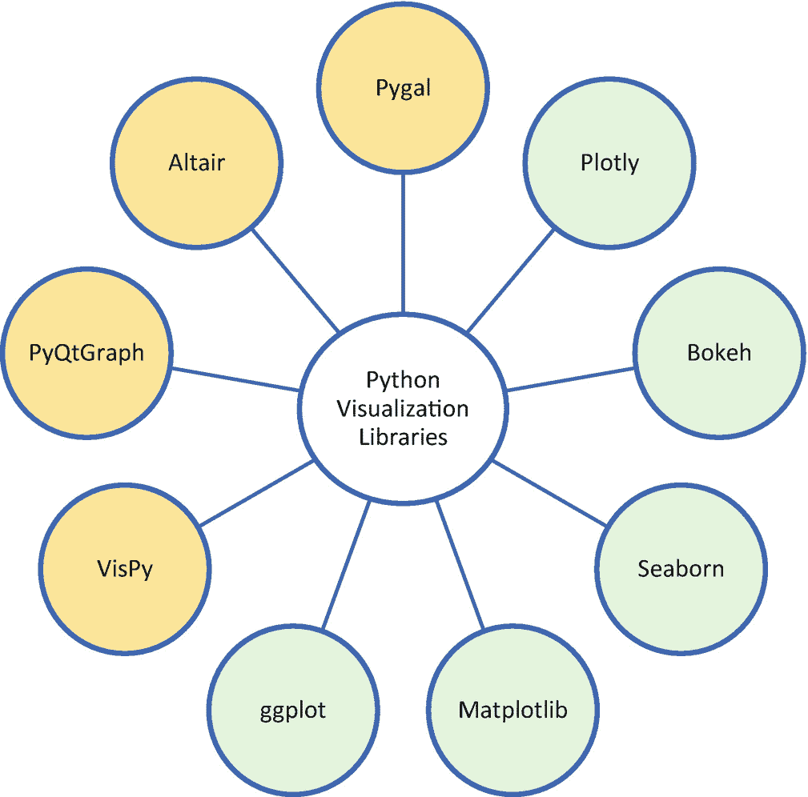

**图 2-1**
数据可视化库

这些库各有其特点。其中一些库可能被采用用于实现，并依赖于其他库。例如，`Seaborn` 是一个使用 `Matplotlib` 的统计数据可视化库。此外，在可视化数据之前，它还需要 `Pandas`，可能还需要 `NumPy` 进行统计处理。

#### Matplotlib

`Matplotlib` 是一个用于数据可视化的 `Python` 二维绘图库，它基于 `Numpy` 数组构建，旨在与更广泛的 `SciPy` 栈协同工作。它能以多种格式生成出版质量的图形，并在跨平台的交互式环境中运行。有两种选项可以将图形直接嵌入到笔记本中。

* `%matplotlib notebook` 将导致在笔记本中嵌入*交互式*绘图。
* `%matplotlib inline` 将导致在笔记本中嵌入绘图的*静态*图形图像。

代码清单 2-2 使用 `Matplotlib` 绘制固定数据并调整绘图属性。

```python
In [12]: import numpy as np
import matplotlib.pyplot as plt
%matplotlib inline
plt.style.use('seaborn-whitegrid')
X = [590,540,740,130,810,300,320,230,470,620,770,250]
Y = [32,36,39,52,61,72,77,75,68,57,48,48]
plt.scatter(X,Y)
plt.xlim(0,1000)
plt.ylim(0,100)
#scatter plot color
plt.scatter(X, Y, s=60, c="red", marker="^")
#change axes ranges
plt.xlim(0,1000)
plt.ylim(0,100)
#add title
plt.title('Relationship Between Temperature and Iced Coffee Sales')
#add x and y labels
plt.xlabel('Sold Coffee')
plt.ylabel('Temperature in Fahrenheit')
#show plot
plt.show()
# 代码清单 2-2
# 导入并使用 Matplotlib 库
```

图 2-2 展示了 `Matplot` 库中的一个可视化效果。

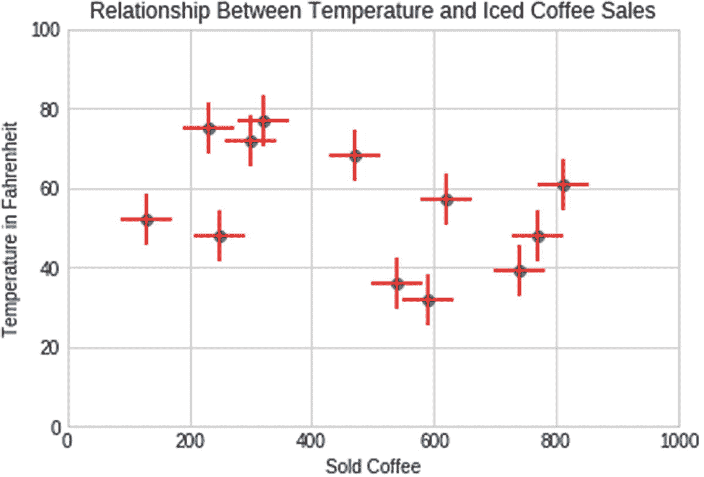

**图 2-2**
使用 `Matplotlib` 可视化数据

代码清单 2-3 使用 `Matplotlib` 绘制固定数据并调整绘图属性。

```python
In [20]: %matplotlib inline
import matplotlib.pyplot as plt
import numpy as np
plt.style.use('seaborn-whitegrid')
##### Create empty figure
fig = plt.figure()
ax = plt.axes()
x = np.linspace(0, 10, 1000)
ax.plot(x, np.sin(x));
plt.plot(x, np.sin(x))
plt.plot(x, np.cos(x))
##### set the x and y axis range
plt.xlim(0, 11)
plt.ylim(-2, 2)
plt.axis('tight')
#add title
plt.title('Plotting data using sin and cos')
# 代码清单 2-3
# 导入 Numpy 并调用其函数
```

图 2-3 展示了添加到同一图形上的累积属性。

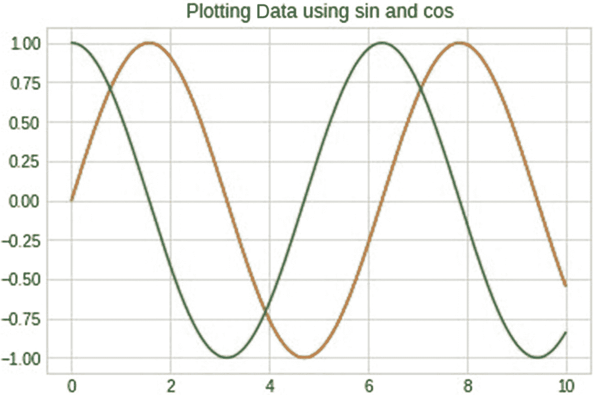

**图 2-3**
通过 `Matplotlib` 确定适配函数（`sin` 和 `cos`）

所有更改后的属性都应用于同一个图形，如上所示。

`Matplotlib` 包可以生成许多不同的绘图格式；其中一些格式将在第 7 章中讨论。

# Python 数据可视化库

## Seaborn

`Seaborn` 是一个基于 `Matplotlib` 的 Python 数据可视化库，它提供了高级接口，用于绘制美观且信息丰富的统计图形（参见代码清单 2-4）。

```python
In [34]: import matplotlib.pyplot as plt
%matplotlib inline
import numpy as np
import pandas as pd
import seaborn as sns
plt.style.use('classic')
plt.style.use('seaborn-whitegrid')
##### 创建一些数据
data = np.random.multivariate_normal([0, 0], [[5, 2], [2, 2]], size=2000)
data = pd.DataFrame(data, columns=['x', 'y'])
##### 使用 seaborn 绘制数据
sns.distplot(data['x'])
sns.distplot(data['y']);
```
**代码清单 2-4** 导入并使用 `Seaborn` 库

图 2-4 展示了一个 `Seaborn` 图形。

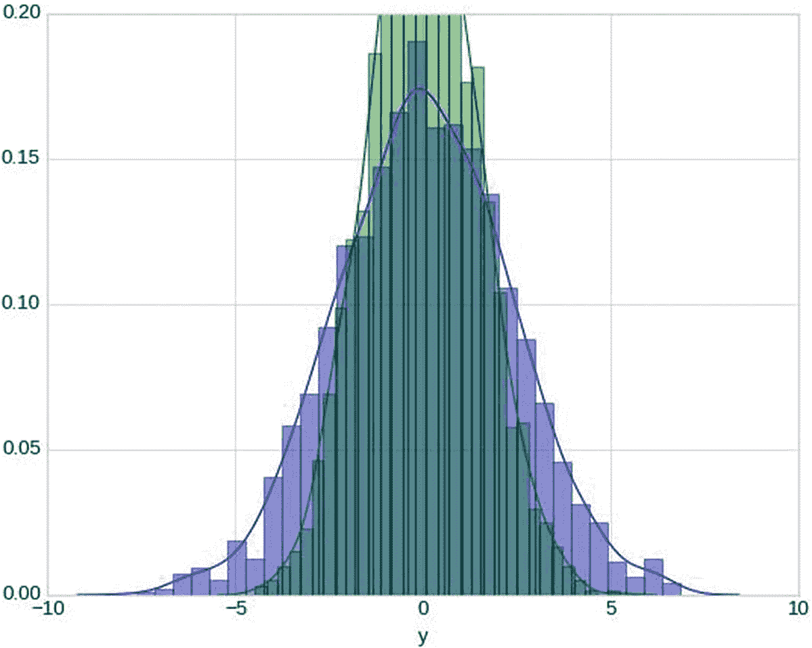
**图 2-4** Seaborn 图形

让我们使用核密度估计来展示分布，`Seaborn` 通过 `sns.kdeplot` 实现。你可以使用与前一个示例相同的数据集，名为 `Data`（参见图 2-5）。

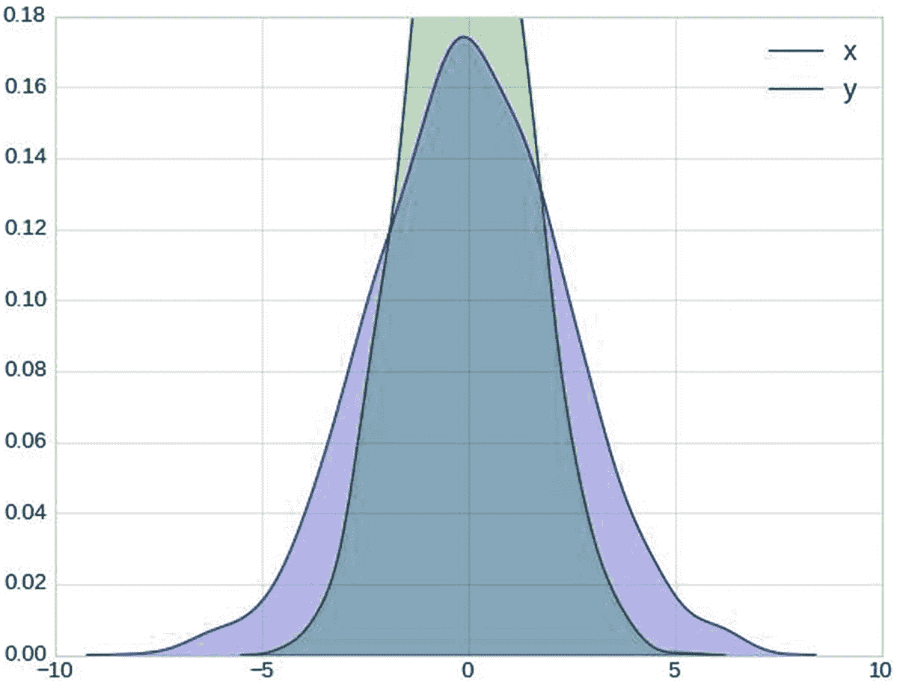
**图 2-5** Seaborn 核密度估计图

```python
In [35]: for col in 'xy':
sns.kdeplot(data[col], shade=True)
```

将完整的二维数据集传递给 `kdeplot`，如下所示，你将得到数据的二维可视化结果（参见图 2-6）：

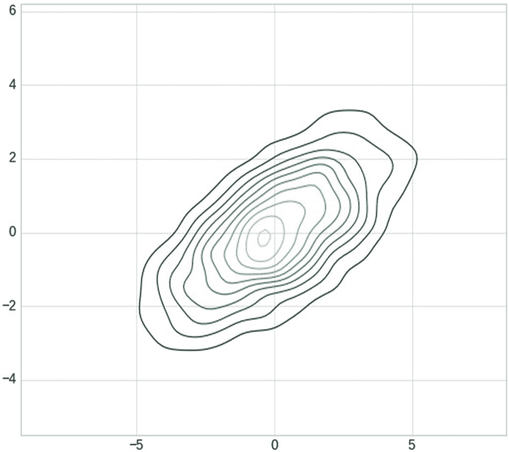
**图 2-6** 二维核密度图

```python
In [36]: sns.kdeplot(data);
```

让我们使用 `sns.jointplot` 将联合分布和边缘分布结合起来，如下所示（参见图 2-7）：

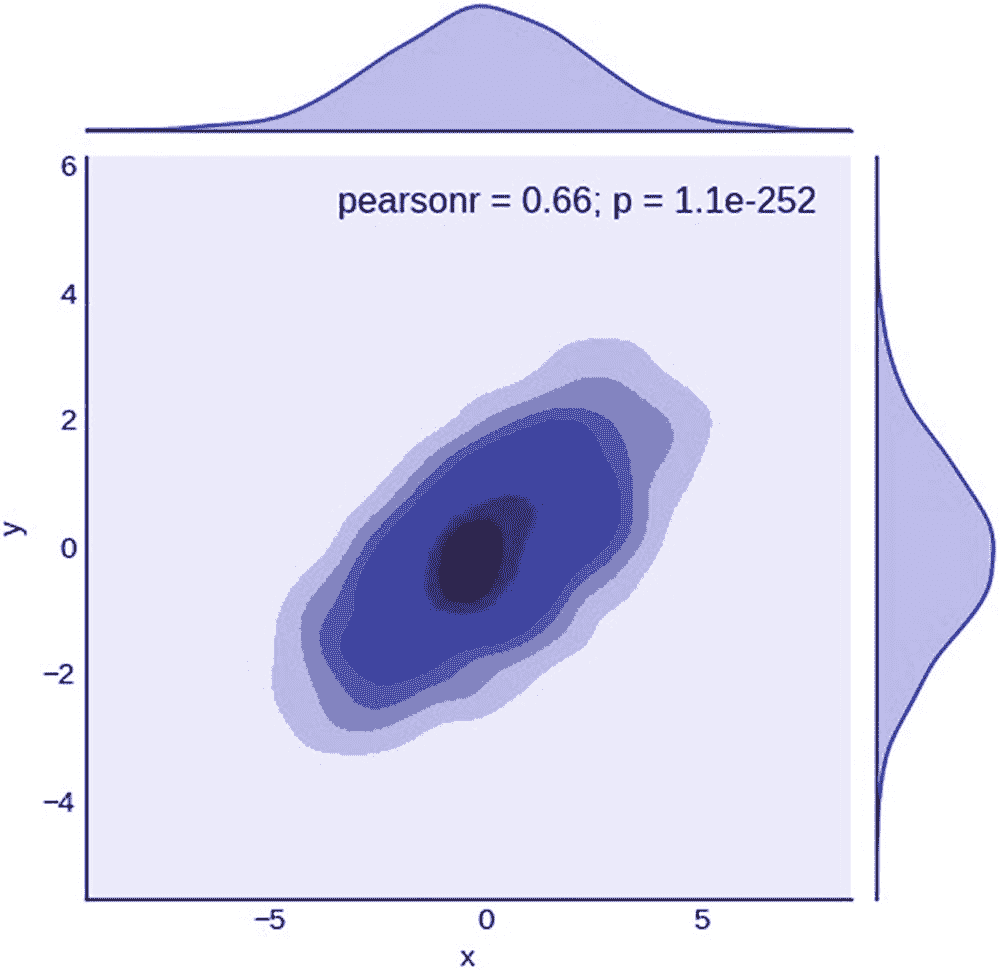
**图 2-7** 联合分布图

```python
In [37]: with sns.axes_style('white'):
sns.jointplot("x", "y", data, kind="kde");
```

在联合图中使用基于六边形的直方图，如下所示（参见图 2-8）：

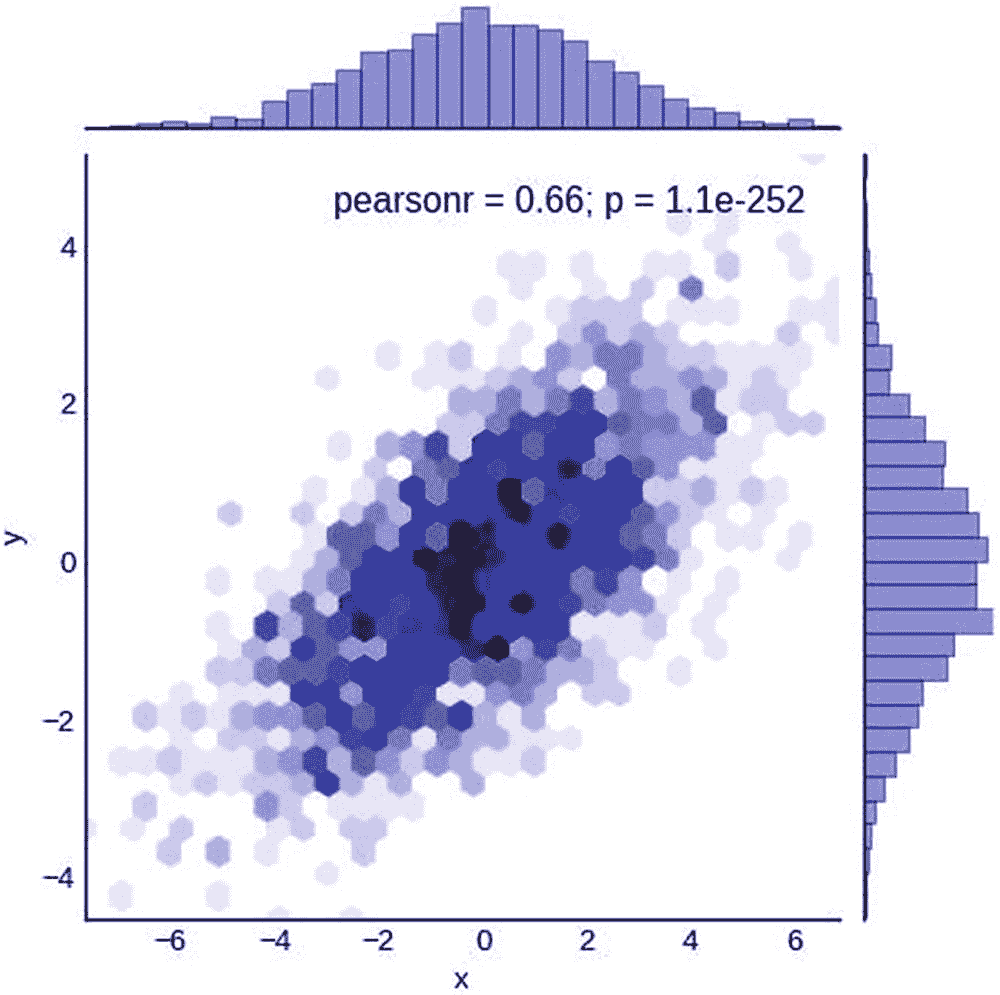
**图 2-8** 基于六边形的直方图

```python
In [38]: with sns.axes_style('white'):
sns.jointplot("x", "y", data, kind="hex")
```

你还可以通过调用 `sns.pairplot` 来可视化样本之间的多维关系（参见图 2-9）：

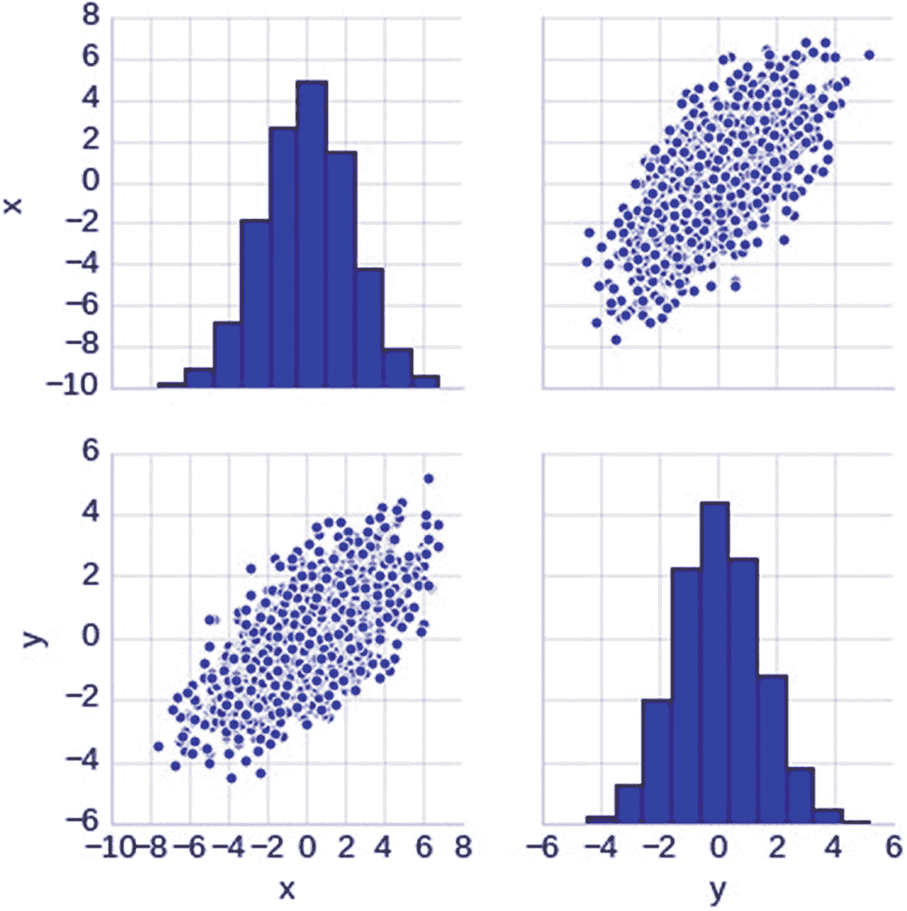
**图 2-9** 多维关系图

```python
In [41]: sns.pairplot(data);
```

`Seaborn` 包生成了许多不同的绘图格式；其中一些格式将在第 7 章中讨论。

## Plotly

`Plotly` Python 绘图库可以在线创建交互式、出版级质量的图形。可以在线或离线生成不同的动态图形格式。

代码清单 2-5 实现了一个动态热力图（参见图 2-10）。

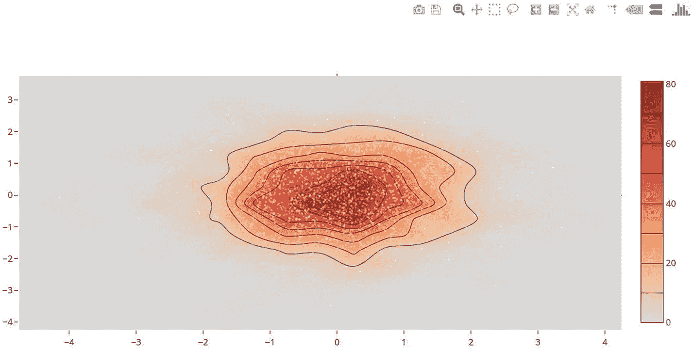
**图 2-10** 动态热力图

```python
In [67]: import plotly.graph_objs as go
import numpy as np
x = np.random.randn(2000)
y = np.random.randn(2000)
iplot([go.Histogram2dContour(x=x, y=y, contours=dict (coloring='heatmap')), go.Scatter(x=x, y=y, mode="markers", marker=dict(color='white', size=3, opacity= opacity=0.3))], show_link=False)
```
**代码清单 2-5** 导入并使用 `Plotly` 库

使用 `plotly.offline` 在笔记本中离线执行 `Plotly` 脚本（图 2-11），如下所示：

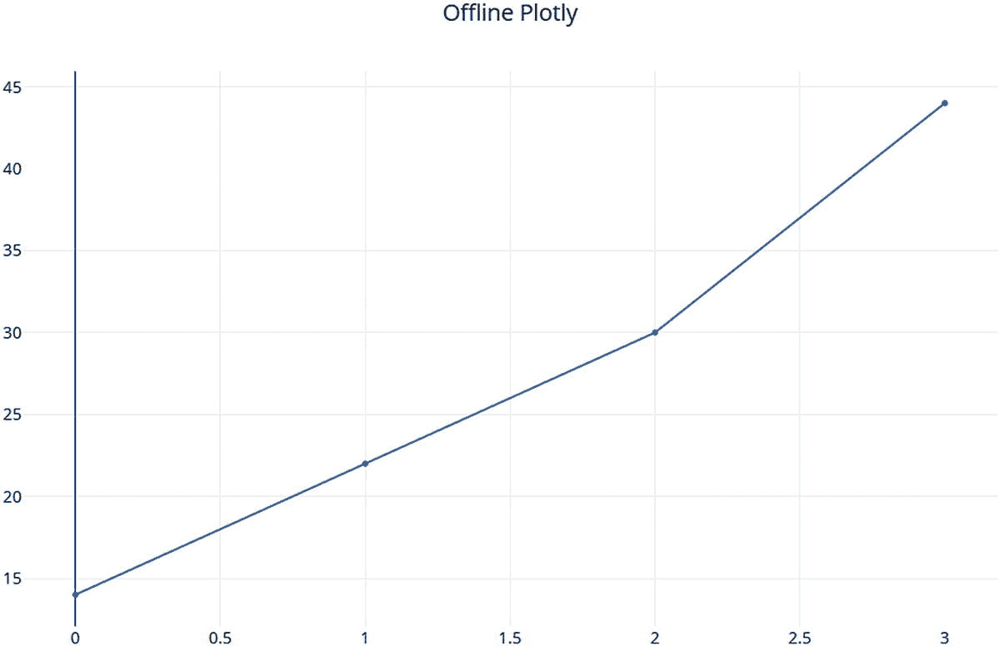
**图 2-11** 离线 Plotly 图形

```python
In [90]: import plotly.offline as offline
import plotly.graph_objs as go
offline.plot({'data': [{'y': [14, 22, 30, 44]}],
'layout': {'title': 'Offline Plotly', 'font':
dict(size=16)}}, image="png")
Out[90]: 'file:///home/nbuser/library/temp-plot.html'
```

执行 `Plotly` Python 脚本，如代码清单 2-6 所示，将打开一个网页浏览器，并绘制出动态的 `Plotly` 图形，如图 2-12 所示。

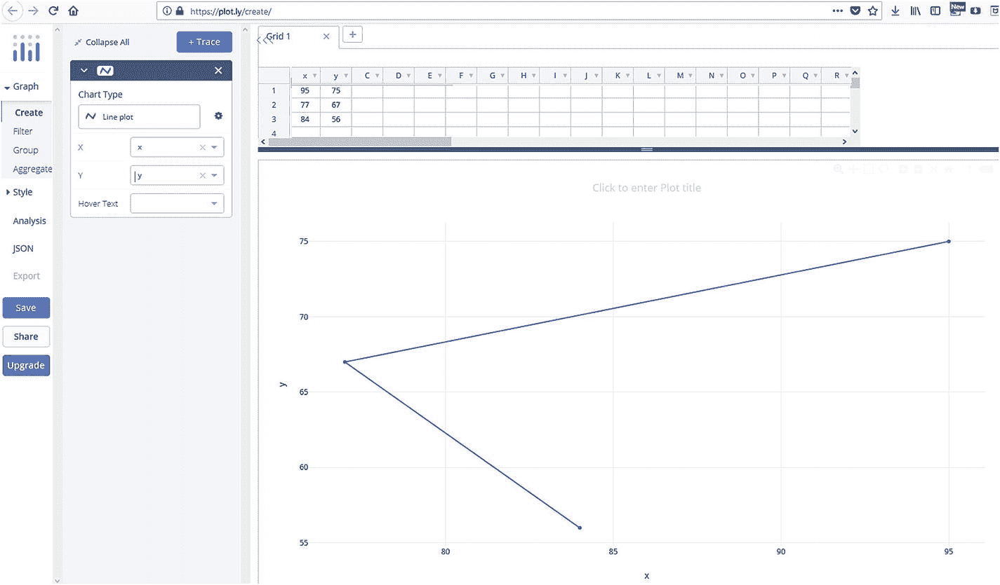
**图 2-12** Plotly 动态图形

```python
In [64]:from plotly import __version__
from plotly.offline import download_plotlyjs, init_notebook_mode, plot, iplot init_notebook_mode(connected=True)
print  (__version__)

3.1.0
In [91]: import plotly.graph_objs as go
plot([go.Scatter(x=[95, 77, 84], y=[75, 67, 56])])
Out[91]: 'file:///home/nbuser/library/temp-plot.html'
```
**代码清单 2-6** 导入并使用 `Plotly` 包

`Plotly` 图形更适合动态和在线数据可视化，特别是实时数据流，但这不在本书的讨论范围内。

## Geoplotlib

`Geoplotlib` 是一个用于创建各种地图类型和绘制地理数据的工具箱。`Geoplotlib` 需要 `Pyglet` 作为面向对象的编程接口。这种绘图类型不在本书的讨论范围内。

## Pandas

`Pandas` 是一个为数据操作和分析而编写的 Python 库。你可以在各种学术和商业领域（包括金融、经济学、统计学、广告、网络分析等）中将 Python 与 `Pandas` 结合使用。`Pandas` 将在第 6 章中讨论。

## Python 绘图入门

如前所述，有多种绘图格式可供使用，包括离线或在线格式。以下是直接绘图的示例。

清单 2-7 实现了一个基础绘图。图 2-13 展示了该图形。

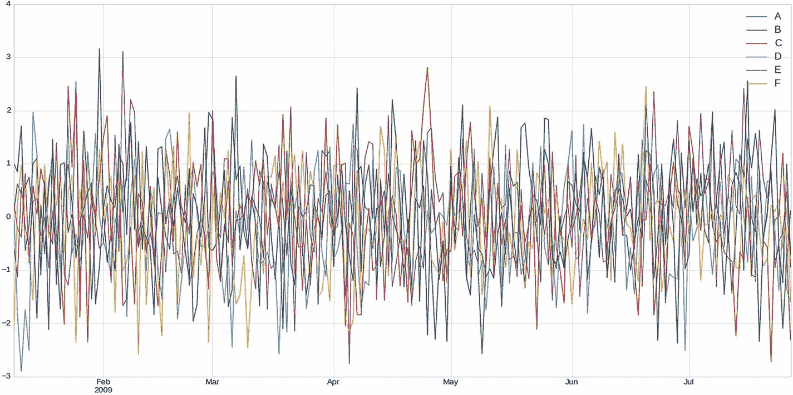
**图 2-13** 直接绘图

```python
In [116]: import pandas as pd import numpy as np
df = pd.DataFrame(np.random.randn(200,6),index= pd.date_range('1/9/2009', periods=200), columns= list('ABCDEF'))
df.plot(figsize=(20, 10)).legend(bbox_to_anchor=(1, 1))
```
**清单 2-7** 运行基础绘图

清单 2-8 创建了一个柱状图（见图 2-14）。

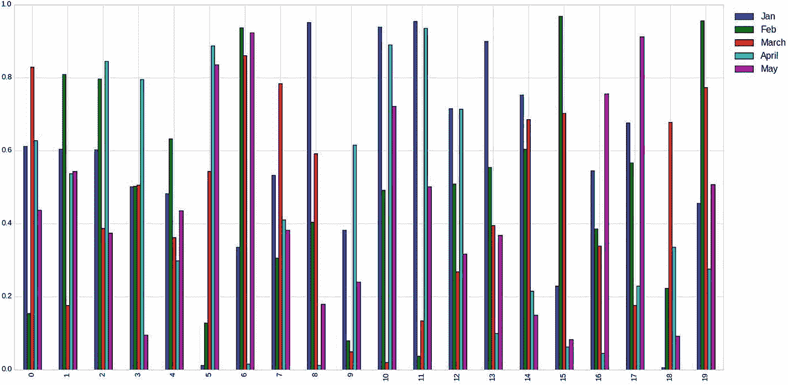
**图 2-14** 直接柱状图

```python
In [123]: import pandas as pd
import numpy as np
df = pd.DataFrame(np.random.rand(20,5), columns=['Jan','Feb','March','April', 'May'])
df.plot.bar(figsize=(20, 10)).legend(bbox_to_anchor=(1.1, 1))
```
**清单 2-8** 直接绘图

清单 2-9 设置了 `stacked=True` 以生成堆叠柱状图（见图 2-15）。

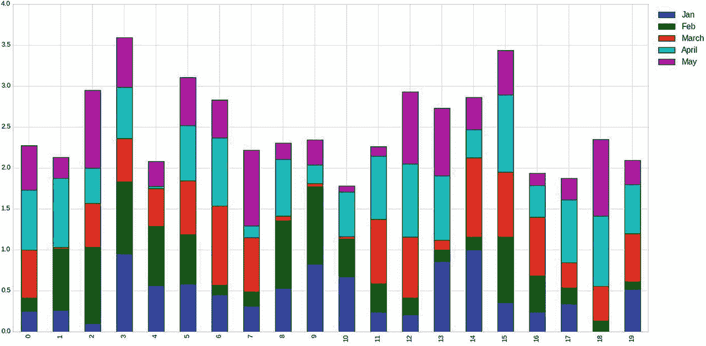
**图 2-15** 堆叠柱状图

```python
In [124]: import pandas as pd
df = pd.DataFrame(np.random.rand(20,5), columns=['Jan','Feb','March','April', 'May']) df.plot.bar(stacked=True, figsize=(20, 10)).legend(bbox_to_anchor=(1.1, 1))
```
**清单 2-9** 创建堆叠柱状图

要获取水平柱状图，请使用 `barh` 方法，如清单 2-10 所示。图 2-16 展示了生成的图形。

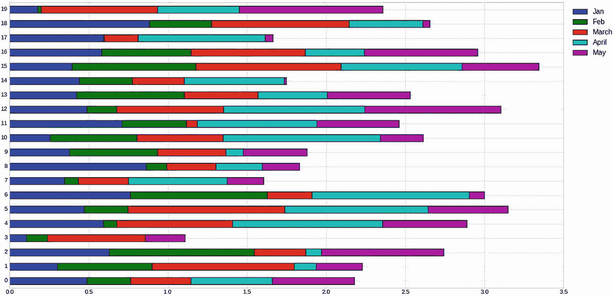
**图 2-16** 水平柱状图

```python
In [126]: import pandas as pd
df = pd.DataFrame(np.random.rand(20,5), columns=['Jan','Feb','March','April', 'May']) df.plot.barh(stacked=True, figsize=(20, 10)).legend(bbox_to_anchor=(1.1, 1))
```
**清单 2-10** 柱状图

可以使用 `plot.hist()` 方法绘制直方图；您还可以指定分箱数量，如清单 2-11 所示。图 2-17 展示了该图形。

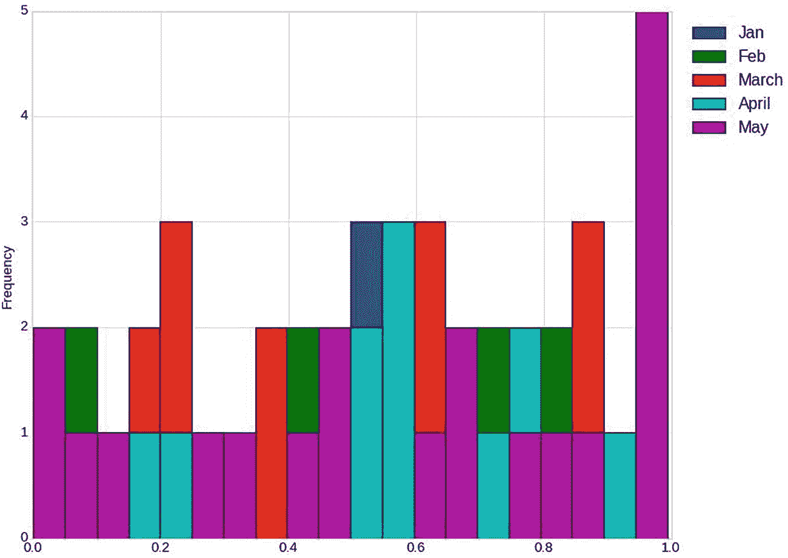
**图 2-17** 直方图

```python
In [131]: import pandas as pd
df = pd.DataFrame(np.random.rand(20,5), columns=['Jan','Feb','March','April', 'May'])
df.plot.hist(bins= 20, figsize=(10,8)).legend
bbox_to_anchor=(1.2, 1))
```
**清单 2-11** 使用柱状图的 `bins` 属性

清单 2-12 为数据集中的每一列绘制了多个直方图（见图 2-18）。

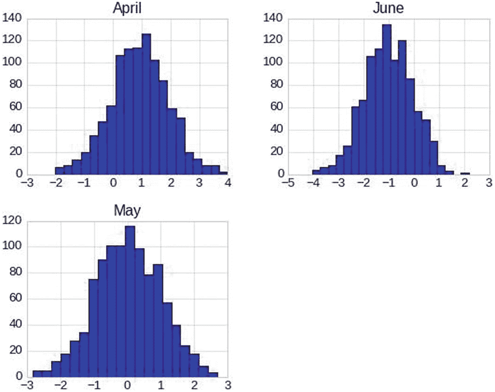
**图 2-18** 基于列的多个直方图

```python
In [139]: import pandas as pd
import numpy as np
df=pd.DataFrame({'April':np.random.randn(1000)+1,'May':np.random.randn(1000),'June': np.random.randn(1000) - 1}, columns=['April', 'May', 'June'])
df.hist(bins=20)
```
**清单 2-12** 每列多个直方图

清单 2-13 实现了一个箱线图（见图 2-19）。

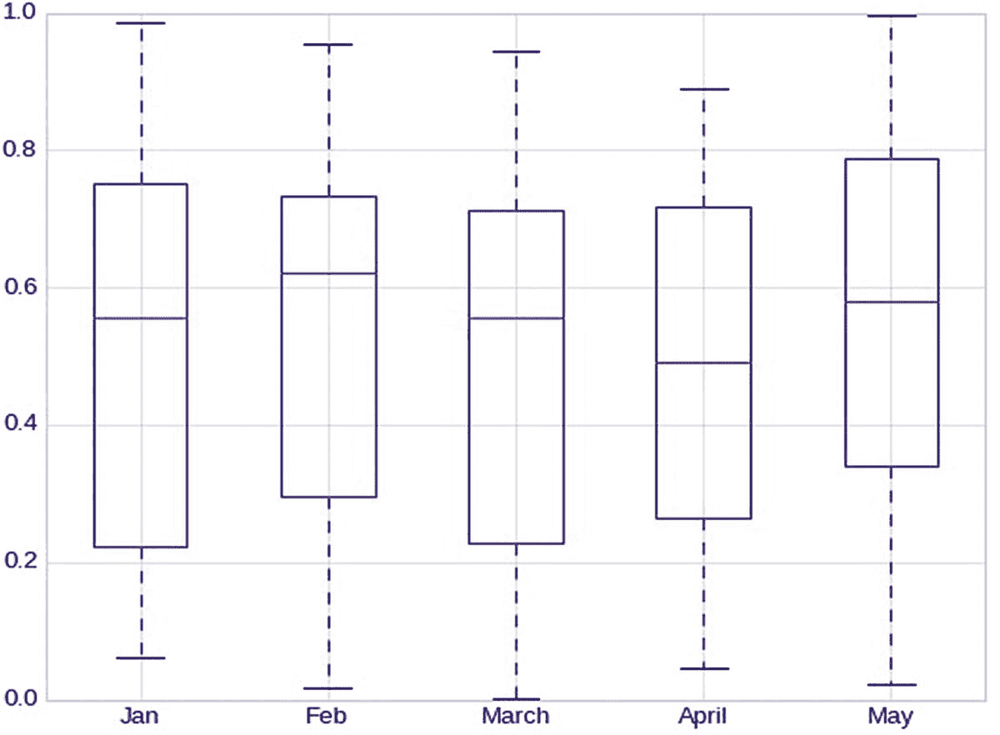
**图 2-19** 箱线图

```python
In [140]:import pandas as pd
import numpy as np
df = pd.DataFrame(np.random.rand(20,5),columns=['Jan','Feb','March','April', 'May'])
df.plot.box()
```
**清单 2-13** 创建箱线图

清单 2-14 实现了一个面积图（见图 2-20）。

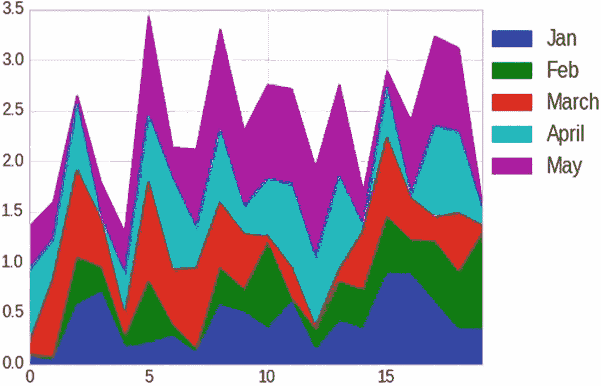
**图 2-20** 面积图

```python
In [145]: import pandas as pd
import numpy as np
df = pd.DataFrame(np.random.rand(20,5),columns= ['Jan','Feb','March','April', 'May'])
df.plot.area(figsize=(6, 4)).legend(bbox_to_anchor=(1.3, 1))
```
**清单 2-14** 创建面积图

清单 2-15 创建了一个散点图（见图 2-21）。

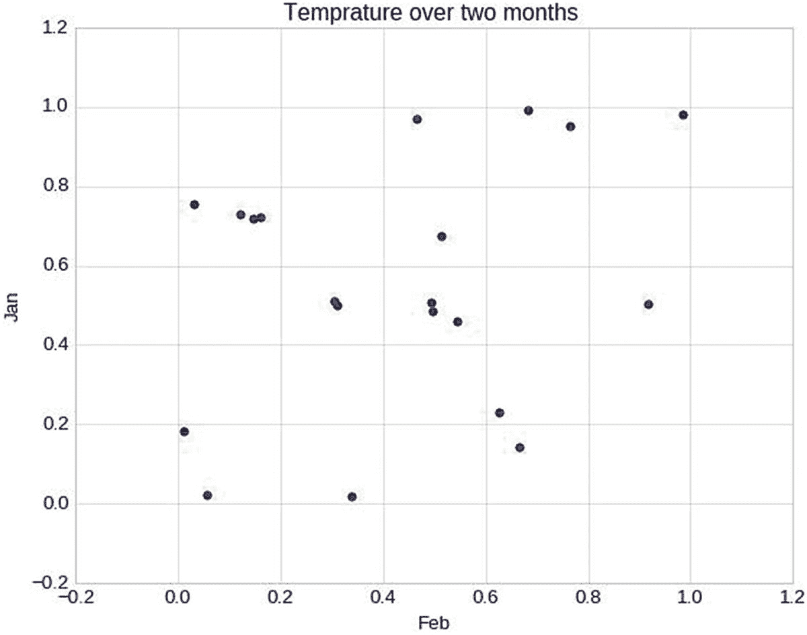
**图 2-21** 散点图

```python
In [150]: import pandas as pd
import numpy as np
df = pd.DataFrame(np.random.rand(20,5),columns= ['Jan','Feb','March','April', 'May'])
df.plot.scatter(x='Feb', y="Jan", title='Temperature over two months ')
```
**清单 2-15** 创建散点图

更多图形格式请参见第 7 章。

# 总结

本章演示了如何在现代业务中实现数据可视化。让我们回顾一下本章所学的内容。

* 理解数据可视化的重要性。
* 认识数据可视化在现代业务中的应用及其未来实现。
* 识别数据可视化在决策中的作用。
* 加载并使用重要的 Python 数据可视化库。
* 通过带参考答案的练习进行实践和模拟真实场景。

下一章将介绍数据收集结构及更多内容。

## 练习与答案

| 姓名 | 手机销售额 | 电视销售额 |
| --- | --- | --- |
| `艾哈迈德` | 2540 | 2200 |
| `奥马尔` | 1370 | 1900 |
| `阿里` | 1320 | 2150 |
| `齐亚德` | 2000 | 1850 |
| `萨尔瓦` | 2100 | 1770 |
| `莉拉` | 2150 | 2000 |

### 1. 什么是数据可视化？

**答案：**

数据可视化是以图形或图表形式解读数据的过程。

### 2. 为什么数据可视化很重要？

**答案：**

- 数据可视化通过以下方式帮助企业实现众多目标。
- 将业务数据转换为交互式图表，以便进行动态解读，服务于业务目标。
- 将来自不同数据源的数据转换为视觉上吸引人、可交互的仪表盘，为企业提供洞察。
- 创建更具吸引力、信息更丰富的仪表盘，以多种图形方式呈现数据。
- 通过深入挖掘数据并发现洞察，做出恰当的决策。
- 找出正在分析的数据中的模式、趋势和相关性，以确定必须在哪些方面改进运营流程，从而发展业务。
- 提供正在分析的数据的全貌。
- 能够直观地组织和呈现海量数据，以展示数据中的重要发现。
- 做出更好、更快、更明智的决策。

### 3. 为什么现代企业需要数据可视化？

**答案：**

- 现代企业需要数据可视化来支持以下领域。
- 分析企业的不同流程，使管理层能够专注于需要改进的领域，以增加收入和提升生产力。
- 让商业智能活起来。
- 运用创造性方法，提升理解业务数据中隐藏信息的能力。
- 提供更好、更快的方法来识别数据集中的模式、趋势和相关性，这些在纯文本形式下可能无法被发现。
- 通过预测即将到来的趋势或销售量及其可能产生的收入，识别新的商业机会。
- 帮助发现数据中那些仅从文本中可能不易察觉的趋势。
- 通过将数据集绘制在同一可视化图表上，为管理者提供进行更有效比较所需的信息。
- 使管理者能够理解运营条件与业务绩效之间的相关性。
- 帮助发现业务中的灰色地带，从而为改进做出正确决策。
- 帮助理解客户的行为和兴趣，从而留住客户和市场。

### 4. 数据可视化如何用于商业决策？

**答案：**

- 可视化通过多种方式帮助企业改进决策。
- **更快的响应时间：** 将收集到的数据的有用解读交到管理者和决策者手中变得极其有用，使他们能够快速识别问题并缩短响应时间。
- **简洁性：** 数据可视化技术提供了所界定参数的全貌，并通过让决策者挑选他们需要的相关数据并在需要时深入细节来简化数据。
- **更轻松的模式可视化：** 提供了更简单的方法来识别数据集中的即将到来的趋势和模式，从而能够做出高效决策并提前制定策略。
- **团队参与：** 提高部门间的协作水平，并使他们在同一页面上以实现战略目标。
- **统一解读：** 生成的图表和图形对所有使用提取信息进行决策的利益相关者具有相同的解读，从而避免任何误导。

### 5. 编写一个 Python 脚本来为下表创建一个数据框：

**答案：**

```
In [ ]: import pandas as pd
import numpy as np
import matplotlib.pyplot as plt
salesMen = ['Ahmed', 'Omar', 'Ali', 'Ziad', 'Salwa', 'Lila']
Mobile_Sales = [2540, 1370, 1320, 2000, 2100, 2150]
TV_Sales = [2200, 1900, 2150, 1850, 1770, 2000]
df = pd.DataFrame()
df ['Name'] =salesMen
df ['Mobile_Sales'] = Mobile_Sales
df['TV_Sales']=TV_Sales
df.set_index("Name",drop=True,inplace=True)
In [13]: df
Out[13]: Name    Mobile_Sales    TV_Sales
Ahmed   2540            2200
Omar    1370            1900
Ali     1320            2150
Ziad    2000            1850
Salwa   2100            1770
Lila    2150            2000
```

针对上一题创建的数据框，执行以下操作：

#### 1. 创建一个商品销售额的饼图。

**答案：**

#### 2. 创建一个销售额的条形图。

**答案：**

```
In [5]: df.plot.bar( figsize=(20, 10), rot=0).legend(bbox_to_anchor=(1.1, 1)) plt.xlabel('Salesmen') plt.ylabel('Sales')
plt.title('Sales Volume for two salesmen in \nJanuary and April 2017')
plt.show()
```

另请参见图 2-22。

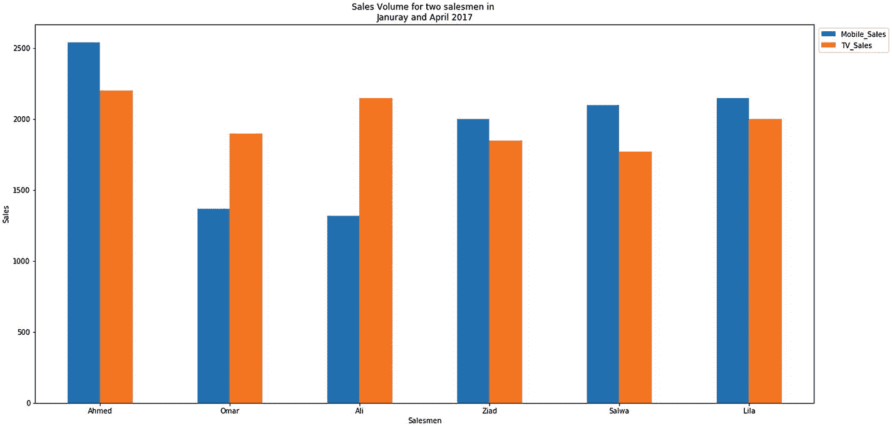

图 2-22

销售额条形图

```
In [6]: df.plot.pie(subplots=True)
```

另请参见图 2-23。

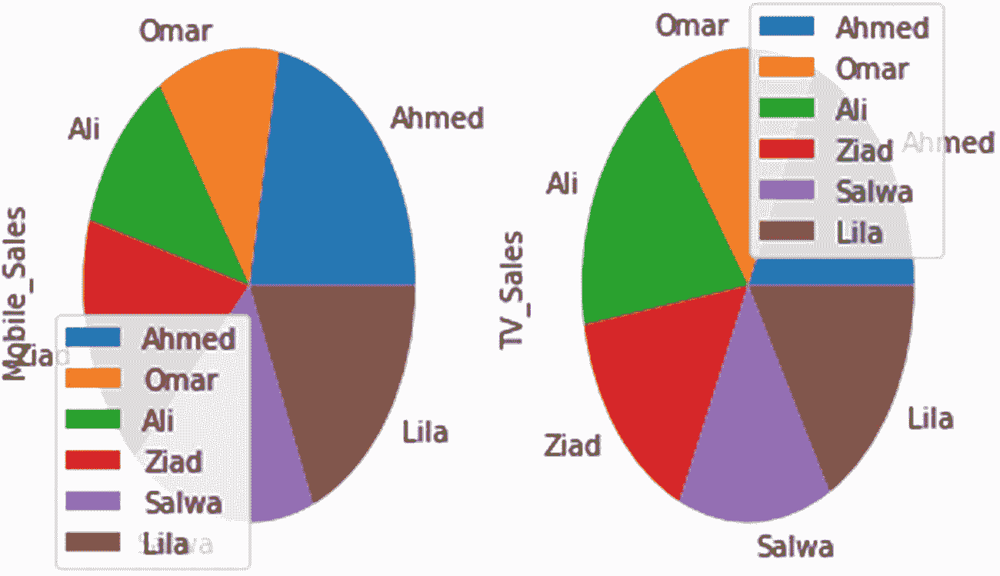

图 2-23

销售额饼图

#### 3. 创建一个商品销售额的箱线图。

**答案：**

```
In [8]: df.plot.box()
```

另请参见图 2-24。

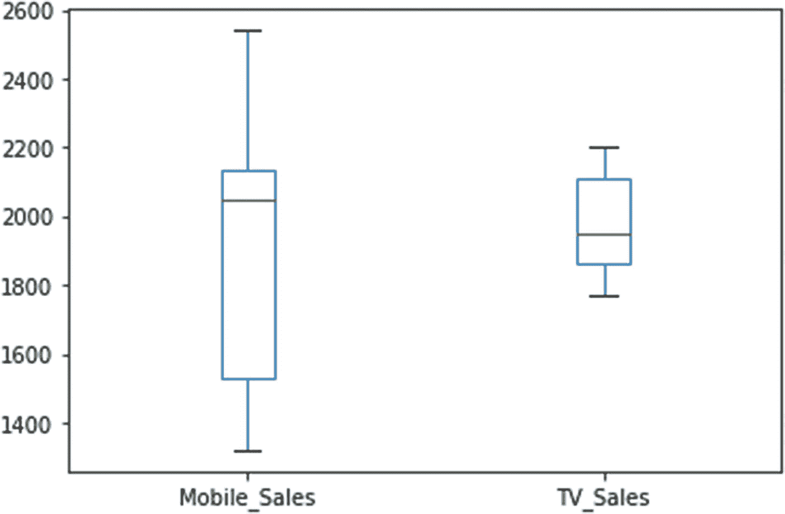

图 2-24

销售额箱线图

#### 4. 创建一个商品销售额的堆叠条形图。

**答案：**

```
In [11]: df.plot.bar(stacked=True, figsize=(20, 10)).legend
(bbox_to_anchor=(1.1, 1))
```

另请参见图 2-26。

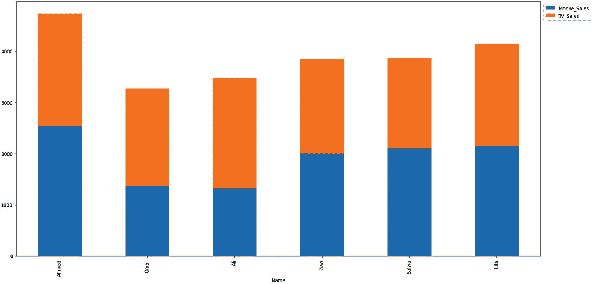

图 2-26

销售额堆叠条形图

#### 5. 创建一个商品销售额的面积图。

**答案：**

```
In [9]: df.plot.area(figsize=(6, 4)).legend(bbox_to_anchor=(1.3,
1))
```

另请参见图 2-25。

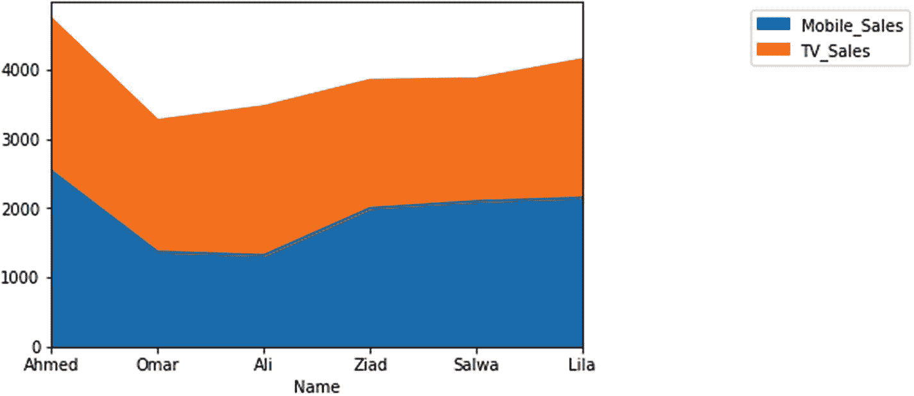

图 2-25

销售额面积图